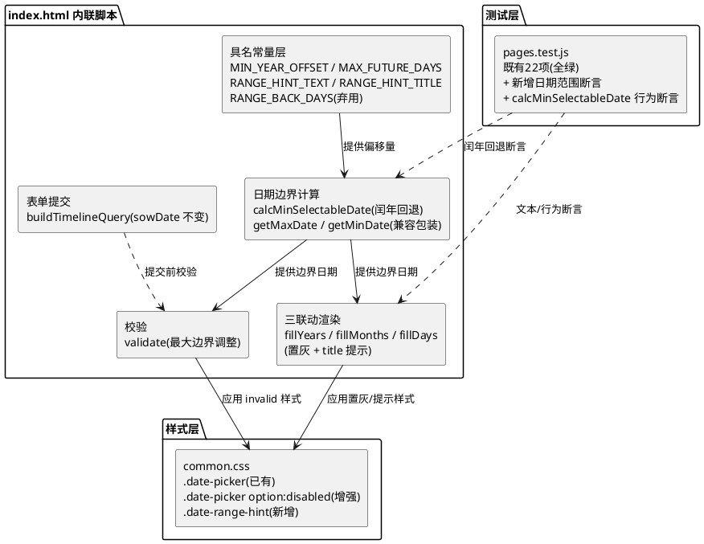
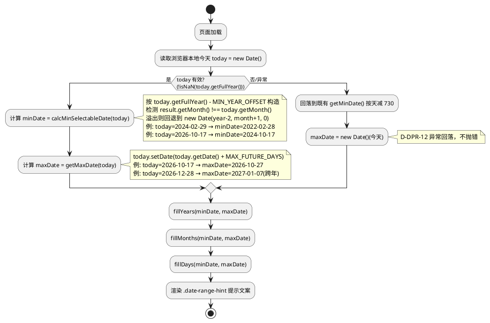
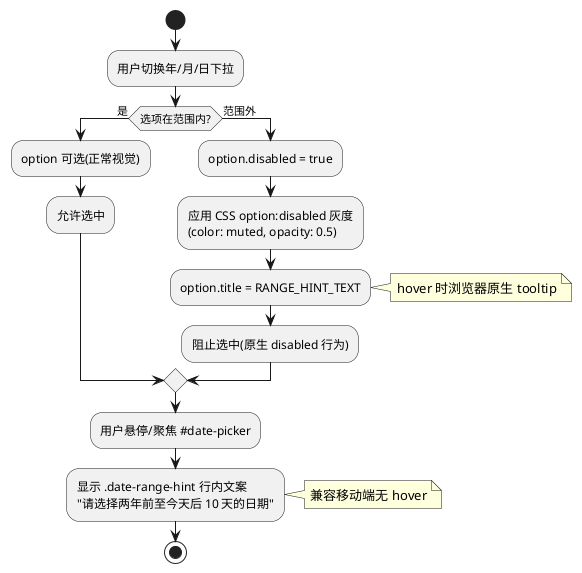
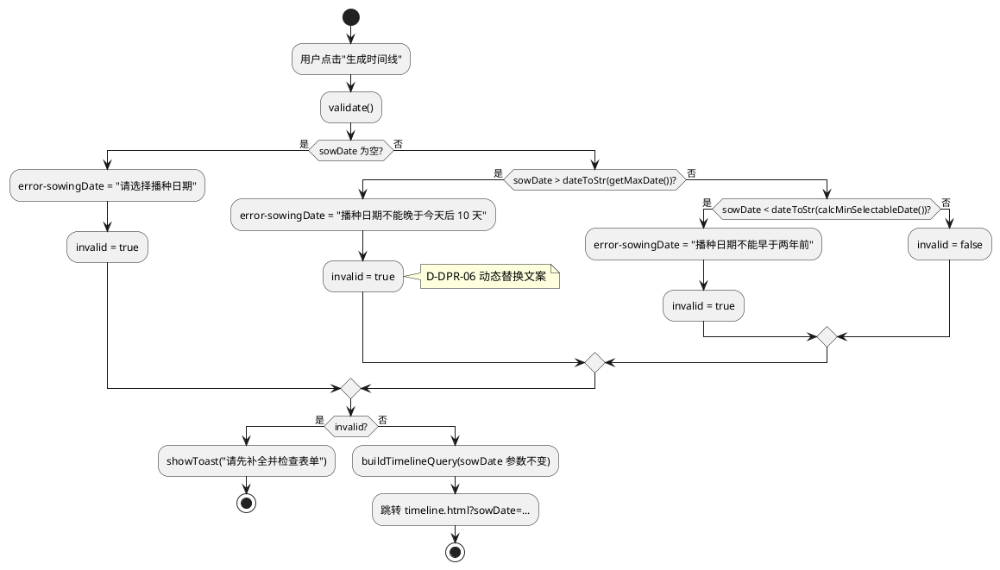
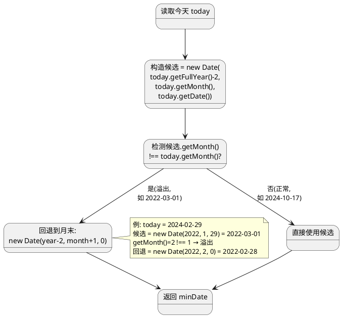
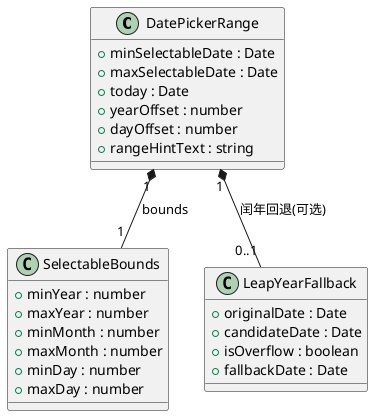

# 前端日期选择器可选范围调整 · 技术设计（date_picker_range）

> 本方案基于 `date_picker_range/spec.md`（REQ-DPR-*-001 ~ 020，共 20 条 EARS 需求）与 `stage2_frontend` 文档（spec.md 60 条需求 / design.md D-01~D-12 决策 / tasks.md 13 组任务）生成。
> 设计范围：**仅 `frontend/` 目录**；纯原生 JS + 原生 CSS，无框架 / 构建工具 / 第三方库。
> 强约束：不改后端（Java/8080、`crop-protocols.json`、`market-festivals.json`、`scoreNode`）、不改 `contract/`、`data/`、`deploy/`、`docs/`；`frontend/tests/pages.test.js` 既有 **22 项**断言必须全绿，仅允许新增。
> 既有契约保留：`fillYears`/`fillMonths`/`fillDays`/`clampDay`/`validate` 调用契约与 `sowDate` 参数命名不变；`RANGE_BACK_DAYS` 常量名、`播种日期不能晚于今天` / `播种日期不能早于两年前` 文案字符串作为既有断言依赖须保留。
> 与 stage2_frontend 关键决策的关系：本方案不涉及 D-02（POST 隔离，本次无 POST）、不违反 D-06（前端不实现阈值计算，本次为日期边界计算非天气阈值）、不涉及 D-12（mock 不造假，本次不改 mock）。

# 一、需求与存量功能关系分析

## 1.1 需求功能与存量功能对比

### 1.1.1 已实现功能

| 需求功能 | 存量功能 | 代码位置 | 匹配度 |
|---------|---------|---------|--------|
| 日期选择器三联动（年/月/日下拉） | `#date-picker` 容器 + `#date-year`/`#date-month`/`#date-day` 三个 `<select>` + `fillYears`/`fillMonths`/`fillDays` 联动 | `frontend/pages/index.html:37-42,109-144` | 100% |
| 最小可选日期为两年前（REQ-DPR-UBI-002 基础） | `RANGE_BACK_DAYS = 730` + `getMinDate()` 按 730 天回退 | `frontend/pages/index.html:97,106` | 50%（按天减 730 而非按日历年减 2，闰年下会产生 ±1 天偏差；无闰年 2 月 29 日回退） |
| 范围外选项置灰禁用（基础） | `fillMonths`/`fillDays` 中 `o.disabled = true` + CSS `.date-picker option:disabled { color: muted; opacity: 0.5 }` | `frontend/pages/index.html:127,141`；`frontend/assets/css/common.css:335-338` | 50%（仅原生 disabled，无 aria-disabled / title 提示 / 范围说明文案） |
| 日期校验与错误文案 | `validate()` 检查 `sowingInput.value > todayStr()` → "播种日期不能晚于今天"；`< dateToStr(getMinDate())` → "播种日期不能早于两年前" | `frontend/pages/index.html:253-272` | 50%（最大边界为今天，需改为今天+10天；文案须与新范围一致） |
| 选中日期经 `sowDate` 参数提交 | `composeDate()` 写入 `#sowingDate` hidden input；`buildTimelineQuery` 以 `sowDate` 参数传递 | `frontend/pages/index.html:153-156,342-350` | 100% |
| 日期选择器样式基座 | `.date-picker` flex 布局 + `.date-picker select` 下拉样式 + `:focus` + `option:disabled` + `.field.invalid` | `frontend/assets/css/common.css:300-343` | 100% |
| 既有测试断言保护 | 第 8 项 `自定义日期选择器：三联动下拉与范围校验` 依赖 `RANGE_BACK_DAYS`/`播种日期不能早于两年前`/`date-picker`/`date-year/month/day`/`sowingDate`；第 2 项依赖 `setDefaultValues`/`播种日期不能晚于今天` | `frontend/tests/pages.test.js:29-32,70-79` | 100%（须保持全绿） |

### 1.1.2 需要扩展的功能

| 需求功能 | 存量功能 | 差异说明 | 扩展方向 |
|---------|---------|---------|---------|
| 最小可选日期按日历年减 2（REQ-DPR-UBI-002） | `getMinDate()` 按 730 天回退 | 按天减 730 在闰年下会偏差 1 天（730 ≠ 2×365 或 2×366）；不满足"两年前的同月同日"语义 | 改为按日历年减 2：`new Date(today.getFullYear() - 2, today.getMonth(), today.getDate())`，并处理闰年 2 月 29 日溢出回退 |
| 闰年 2 月 29 日回退到两年前 2 月 28 日（REQ-DPR-OPT-013/014/015） | 无 | `new Date(2022, 1, 29)` 在非闰年会自动溢出为 2022-03-01，违反回退到 2 月 28 日的需求 | 构造后检测 `result.getMonth() !== originalMonth`，溢出则回退到该月最后一天 `new Date(year, month + 1, 0)` |
| 最大可选日期为今天+10天（REQ-DPR-UBI-003/004） | `fillYears`/`fillMonths`/`fillDays` 中 `maxD = new Date()`（即今天） | 当前"截止今天"逻辑需放宽到今天后 10 天；跨年跨月场景（如今天 2026-12-28 → 最大 2027-01-07）须支持 | 新增 `getMaxDate()` 返回 `new Date(today.getFullYear(), today.getMonth(), today.getDate() + 10)`；`fillYears`/`fillMonths`/`fillDays` 中 `maxD` 从 `new Date()` 改为 `getMaxDate()` |
| 固定 10 天偏移具名常量（REQ-DPR-UBI-004/012） | 无 | 10 天偏移量须具名常量集中定义，不得硬编码 | 新增 `var MAX_FUTURE_DAYS = 10;` 具名常量；新增 `var MIN_YEAR_OFFSET = 2;` 具名常量 |
| 范围外日期置灰禁用 + 提示文案（REQ-DPR-STA-007/UNW-008/STA-009/UBI-010） | `o.disabled = true` + CSS `option:disabled` 灰度 | 无 aria-disabled、无 title 提示、无范围说明文案；移动端无 hover 时无反馈 | disabled option 追加 `title` 属性（范围提示文案）；`#date-picker` 容器追加 `title`/`aria-label`；新增 `.date-range-hint` 行内文案元素始终可见（兼容移动端） |
| 提示文案与实际范围一致（REQ-DPR-UBI-011/012） | `#error-sowingDate` 初始文案"播种日期不能晚于今天" | 文案语义为"截止今天"，与新范围"两年前至今天后 10 天"不一致 | 新增 `RANGE_HINT_TEXT` 具名常量（如"请选择两年前至今天后 10 天的日期"）；`validate()` 中动态设置准确文案；保留"播种日期不能晚于今天"字符串于 HTML 静态初始文本（满足既有断言第 2 项），JS 校验时按实际越界类型动态替换 |
| 校验逻辑最大边界调整（REQ-DPR-UBI-003/005） | `validate()` 中 `sowingInput.value > todayStr()` → "播种日期不能晚于今天" | 最大边界须从今天改为今天+10天；今天本身须可选（REQ-DPR-UBI-005） | `validate()` 中 `todayStr()` 改为 `dateToStr(getMaxDate())`；错误文案改为"播种日期不能晚于今天后 10 天" |
| 闭区间包含两端边界（REQ-DPR-UBI-002/003） | `fillDays` 中 `d > maxD.getDate()` 严格大于 | 当前已为闭区间（边界当天 `d === maxD.getDate()` 不被 disabled），满足需求 | 无需改动，复核保持闭区间语义 |
| 既有 `RANGE_BACK_DAYS` 常量保留 | `var RANGE_BACK_DAYS = 730;` | 既有断言第 8 项 `assert.ok(indexHtml.includes('RANGE_BACK_DAYS'))` 依赖此字符串 | 保留 `var RANGE_BACK_DAYS = 730;` 声明并标注已弃用注释，实际计算改用 `MIN_YEAR_OFFSET`；或将其重定义为 `MIN_YEAR_OFFSET * 365` 近似值并注释说明 |

### 1.1.3 需要新增的功能或接口

**A. 具名常量（新增，集中定义于 index.html 内联脚本顶部）**

| 常量名 | 值 | 用途 | 关联需求 |
|--------|-----|------|---------|
| `MIN_YEAR_OFFSET` | `2` | 最小可选日期的年份偏移量（年） | REQ-DPR-UBI-002/012 |
| `MAX_FUTURE_DAYS` | `10` | 最大可选日期相对今天的天数偏移量（天），固定不浮动 | REQ-DPR-UBI-003/004/012 |
| `RANGE_HINT_TEXT` | `"请选择两年前至今天后 10 天的日期"` | 范围外日期的提示文案，静态具名常量 | REQ-DPR-STA-009/UBI-010/011/012 |
| `RANGE_HINT_TITLE` | `"可选范围：两年前至今天后 10 天"` | `#date-picker` 容器 title/aria-label，hover 时浏览器原生 tooltip | REQ-DPR-STA-009/UBI-010 |

**B. 新增函数（内嵌于 index.html 内联脚本）**

| 函数名 | 输入 | 输出 | 核心逻辑 | 关联需求 |
|--------|------|------|---------|---------|
| `getMaxDate()` | 无 | `Date`（今天 + `MAX_FUTURE_DAYS` 天） | `var d = new Date(); d.setDate(d.getDate() + MAX_FUTURE_DAYS); return d;` | REQ-DPR-UBI-003/004 |
| `calcMinSelectableDate(today?)` | `Date`（默认 `new Date()`） | `Date`（有效存在日期） | 按日历年减 `MIN_YEAR_OFFSET`，检测闰年 2 月 29 日溢出并回退到 2 月 28 日 | REQ-DPR-UBI-002/OPT-013/UBI-014/OPT-015 |

**C. 新增 DOM 元素**

| DOM | 页面 | 用途 | 关联需求 |
|-----|------|------|---------|
| `.date-range-hint`（如 `<p class="date-range-hint" id="date-range-hint">请选择两年前至今天后 10 天的日期</p>`） | index.html `#field-sowing-date` 内 | 行内范围提示文案，始终可见（兼容移动端无 hover） | REQ-DPR-STA-009/UBI-010/011 |

**D. 新增 CSS 样式**

| 选择器 | 文件 | 用途 | 关联需求 |
|--------|------|------|---------|
| `.date-range-hint` | `common.css` | 范围提示文案样式（小字号 / muted 色 / 顶部间距） | REQ-DPR-UBI-010 |
| `.date-picker option:disabled`（增强） | `common.css` | 增强灰度样式（追加 `cursor: not-allowed`，保留既有 `color: muted` / `opacity: 0.5`） | REQ-DPR-STA-007 |
| `.date-picker[aria-label]`（可选） | `common.css` | 容器聚焦态范围提示样式 | REQ-DPR-STA-009 |

**E. 新增测试断言（`frontend/tests/pages.test.js`，既有 22 项保持全绿）**

| 断言主题 | 校验点 | 关联需求 |
|---------|-------|---------|
| 新增具名常量 | `index.html` 含 `MIN_YEAR_OFFSET` / `MAX_FUTURE_DAYS` / `RANGE_HINT_TEXT` | REQ-DPR-UBI-012 |
| 最大可选日期函数 | `index.html` 含 `getMaxDate` | REQ-DPR-UBI-003 |
| 范围提示文案 | `index.html` 含 `两年前至` 与 `10 天` 文案；含 `.date-range-hint` | REQ-DPR-STA-009/UBI-010/011 |
| 闰年回退逻辑 | 行为断言：`calcMinSelectableDate(new Date(2024, 1, 29))` → `2022-02-28`；`calcMinSelectableDate(new Date(2026, 9, 17))` → `2024-10-17` | REQ-DPR-OPT-013/UBI-014/OPT-015 |
| 最大边界不晚于今天+10天 | `index.html` 含 `播种日期不能晚于今天后 10 天` 或等价新文案 | REQ-DPR-UBI-003/011 |
| 既有断言保留 | `RANGE_BACK_DAYS` / `播种日期不能晚于今天` / `播种日期不能早于两年前` 仍存在 | REQ-DPR-UBI-017 |

## 1.2 存量功能详细分析

### 1.2.1 `getMinDate()`（`index.html:106`）

- **接口契约**：无入参；返回 `Date`（今天减 `RANGE_BACK_DAYS` 天）。
- **业务规则**：`var d = new Date(); d.setDate(d.getDate() - RANGE_BACK_DAYS); return d;` —— 按 730 天回退。
- **约束**：
  1. `RANGE_BACK_DAYS = 730` 为既有断言第 8 项依赖字符串，须保留。
  2. 按 730 天回退在闰年下会与"两年前同月同日"偏差 1 天（730 = 2×365，但实际两年可能含 731 或 732 天）。
  3. 不处理闰年 2 月 29 日回退（今天 2024-02-29 → 730 天前为 2022-03-01，非 2022-02-28）。
- **扩展点**：改为调用新增的 `calcMinSelectableDate(today)`，按日历年减 `MIN_YEAR_OFFSET` 并处理溢出。

### 1.2.2 `fillYears()` / `fillMonths()` / `fillDays()`（`index.html:109-144`）

- **接口契约**：无入参；副作用为重建 `yearSel`/`monthSel`/`daySel` 的 `<option>` 列表。
- **业务规则**：
  1. `fillYears`：从 `minD.getFullYear()` 到 `maxD.getFullYear()`（`maxD = new Date()` 即今天）。
  2. `fillMonths`：禁用 `y === minD.getFullYear() && m < minD.getMonth() + 1` 或 `y === maxD.getFullYear() && m > maxD.getMonth() + 1`。
  3. `fillDays`：禁用 `y === minD.getFullYear() && m === minD.getMonth() + 1 && d < minD.getDate()` 或 `y === maxD.getFullYear() && m === maxD.getMonth() + 1 && d > maxD.getDate()`。
- **约束**：
  1. 三个函数名 `fillYears`/`fillMonths`/`fillDays` 为既有断言第 8 项隐式依赖（通过 `date-picker` class 与 `RANGE_BACK_DAYS` 间接保护），须保留。
  2. `maxD = new Date()` 为"截止今天"逻辑的核心，须改为 `getMaxDate()`。
  3. 闭区间语义已满足（边界当天 `d === maxD.getDate()` 不被 disabled）。
- **扩展点**：`maxD` 从 `new Date()` 改为 `getMaxDate()`；disabled option 追加 `title` 属性提供范围提示。

### 1.2.3 `clampDay()`（`index.html:146-151`）

- **接口契约**：无入参；副作用为当 `daySel.value` 超出当月天数时回退到当月最后一天。
- **业务规则**：`if (d > days) daySel.value = days;`
- **约束**：函数名 `clampDay` 为既有契约，须保留；本次不改动其内部逻辑。

### 1.2.4 `validate()`（`index.html:253-272`）

- **接口契约**：无入参；返回 `boolean`；副作用为切换 `#field-crop`/`#field-sowing-date`/`#field-location` 的 `invalid` class 与 `#error-sowingDate` 文案。
- **业务规则**：
  1. `!sowingInput.value` → "请选择播种日期"。
  2. `sowingInput.value > todayStr()` → "播种日期不能晚于今天"。
  3. `sowingInput.value < dateToStr(getMinDate())` → "播种日期不能早于两年前"。
- **约束**：
  1. 函数名 `validate` 为既有契约，须保留。
  2. "播种日期不能晚于今天"为既有断言第 2 项依赖字符串，须保留于 index.html 中（可作为 HTML 静态初始文本或注释）。
  3. "播种日期不能早于两年前"为既有断言第 8 项依赖字符串，须保留。
- **扩展点**：第 2 分支 `todayStr()` 改为 `dateToStr(getMaxDate())`，文案改为"播种日期不能晚于今天后 10 天"（新文案）；"播种日期不能晚于今天"保留于 HTML `#error-sowingDate` 初始文本或作为 fallback 字符串。

### 1.2.5 `#error-sowingDate`（`index.html:43`）

- **接口契约**：HTML 静态元素 `<div class="error" id="error-sowingDate">播种日期不能晚于今天</div>`。
- **约束**：初始文本"播种日期不能晚于今天"为既有断言第 2 项依赖，须保留于 HTML 源码中。
- **扩展点**：保留初始文本不变（满足断言），`validate()` 在校验时按实际越界类型动态替换 `dateErr.textContent` 为准确文案。

### 1.2.6 既有测试断言（`pages.test.js:29-32,70-79`）

- **第 2 项** `'输入表单页：默认值优先与日期校验'`：
  - `assert.ok(indexHtml.includes('setDefaultValues'));` → 保留 `setDefaultValues` 函数名。
  - `assert.ok(indexHtml.includes('播种日期不能晚于今天'));` → 保留该字符串于 index.html。
- **第 8 项** `'自定义日期选择器：三联动下拉与范围校验'`：
  - `assert.match(indexHtml, /class="date-picker"/);` → 保留 `.date-picker` class。
  - `assert.match(indexHtml, /id="date-year"/);` / `id="date-month"` / `id="date-day"` → 保留三个 select id。
  - `assert.ok(indexHtml.includes('RANGE_BACK_DAYS'));` → 保留 `RANGE_BACK_DAYS` 字符串。
  - `assert.ok(indexHtml.includes('播种日期不能早于两年前'));` → 保留该字符串。
  - `assert.ok(!indexHtml.includes('type="date"'));` → 不引入原生 date input。
  - `assert.ok(indexHtml.includes('id="sowingDate"'));` → 保留 `sowingDate` id。
- **约束**：上述 8 个断言条件须全部保持通过；新实现须兼容这些字符串依赖。

### 1.2.7 样式基座（`common.css:300-343`）

- **接口契约**：`.date-picker` flex 布局；`.date-picker select` 含下拉箭头背景图；`.date-picker option:disabled` 灰度（`color: muted` / `opacity: 0.5`）；`.field.invalid .date-picker select` 校验失败红边。
- **约束**：
  1. `.date-picker option:disabled` 已有灰度样式，置灰禁用视觉基座已具备。
  2. 既有断言第 3 项 `overflow-x: hidden` / `max-width: 100%` 在 common.css 中，本次不改动该部分。
- **扩展点**：新增 `.date-range-hint` 样式；增强 `.date-picker option:disabled`（追加 `cursor: not-allowed`）。
# 二、增量设计方案

## 2.0 总体策略与关键决策

| 决策编号 | 决策点 | 结论 | 决策理由 |
|---------|-------|------|---------|
| D-DPR-01 | 边界常量定义位置 | 在 `index.html` 内联脚本顶部集中定义具名常量 `MIN_YEAR_OFFSET = 2`、`MAX_FUTURE_DAYS = 10`、`RANGE_HINT_TEXT`、`RANGE_HINT_TITLE`；保留既有 `RANGE_BACK_DAYS = 730` 并标注已弃用 | REQ-DPR-UBI-012 要求具名常量集中定义；既有断言第 8 项 `assert.ok(indexHtml.includes('RANGE_BACK_DAYS'))` 依赖该字符串，须保留；弃用注释满足"不多处硬编码"且兼容既有断言 |
| D-DPR-02 | 两年前日期的计算方式 | 按日历年减 `MIN_YEAR_OFFSET`：`new Date(today.getFullYear() - MIN_YEAR_OFFSET, today.getMonth(), today.getDate())`，非按天减 730 | REQ-DPR-UBI-002 要求"两年前的同月同日"；按天减 730 在闰年下偏差 1 天；按日历年减 2 精确满足语义 |
| D-DPR-03 | 闰年 2 月 29 日回退策略 | 构造 `new Date(year-2, month, date)` 后检测 `result.getMonth() !== month`，溢出则回退到该月最后一天 `new Date(year-2, month + 1, 0)` | JS Date 构造器对非闰年 2 月 29 日会自动溢出到 3 月 1 日，违反 REQ-DPR-OPT-013 要求回退到 2 月 28 日；检测月份偏移并回退到月末最后一天精确满足需求 |
| D-DPR-04 | 最大可选日期计算方式 | 新增 `getMaxDate()`：`var d = new Date(); d.setDate(d.getDate() + MAX_FUTURE_DAYS); return d;` | REQ-DPR-UBI-003/004 要求今天后固定 10 天；`setDate` 自动处理跨月跨年（如 2026-12-28 + 10 → 2027-01-07） |
| D-DPR-05 | `RANGE_BACK_DAYS` 兼容处理 | 保留 `var RANGE_BACK_DAYS = 730;` 声明并追加 `/* @deprecated 改用 MIN_YEAR_OFFSET */` 注释；`getMinDate()` 内部改调用 `calcMinSelectableDate()` | 既有断言第 8 项 `includes('RANGE_BACK_DAYS')` 只检查字符串存在，不检查其值或用途；保留声明 + 弃用注释满足断言且明确语义迁移 |
| D-DPR-06 | "播种日期不能晚于今天"文案兼容处理 | 保留该字符串于 `#error-sowingDate` HTML 初始文本（满足既有断言第 2 项）；`validate()` 校验时按实际越界类型动态替换 `dateErr.textContent` 为"播种日期不能晚于今天后 10 天" | 既有断言第 2 项 `includes('播种日期不能晚于今天')` 只检查字符串存在；HTML 初始文本保留满足断言；JS 动态替换满足 REQ-DPR-UBI-011 文案与实际范围一致 |
| D-DPR-07 | 置灰禁用实现方式 | 复用既有 `o.disabled = true` + CSS `.date-picker option:disabled` 灰度；追加 `o.title = RANGE_HINT_TEXT`（option hover 提示）；`#date-picker` 容器追加 `title`/`aria-label`；新增 `.date-range-hint` 行内文案始终可见 | REQ-DPR-STA-007 要求置灰禁用；REQ-DPR-UNW-008 禁止静默拦截；REQ-DPR-STA-009/UBI-010 要求提示文案；option 原生 disabled 已不可被键盘/鼠标选中（满足 REQ-DPR-STA-007 禁止项）；行内文案兼容移动端无 hover |
| D-DPR-08 | 提示文案展示方式 | 三层互补：(1) `.date-range-hint` 行内文案始终可见（主通道，兼容移动端）；(2) `#date-picker` 容器 `title` 属性（hover tooltip）；(3) disabled option `title` 属性（option hover，浏览器支持不一） | REQ-DPR-UBI-010 要求 tooltip 或行内文案；REQ-DPR-5.3.3 异常场景要求移动端无 hover 时仍可读；行内文案为主通道确保跨端可读 |
| D-DPR-09 | 提示文案具名常量与 XSS 防护 | `RANGE_HINT_TEXT` / `RANGE_HINT_TITLE` 为静态字符串常量，不拼接用户可控输入；通过 `textContent` 或 HTML 属性赋值 | REQ-DPR-UBI-012 要求具名常量；REQ-DPR 4.3.2 要求防 XSS；静态常量 + `textContent` 满足 |
| D-DPR-10 | 改动点范围 | 仅改 `frontend/pages/index.html`、`frontend/assets/css/common.css`、`frontend/tests/pages.test.js` 三个文件；不改 `timeline.html`、`crop-map.js`、`mock-data.js` 等 | REQ-DPR-UBI-019 要求仅改 `frontend/`；REQ-DPR-UBI-016 要求不改后端；日期选择器逻辑仅在 index.html，timeline.html 只消费 `sowDate` 参数无需改动 |
| D-DPR-11 | 测试策略 | 既有 22 项断言一字不改、保持全绿；新增文本断言（具名常量 / `getMaxDate` / 新文案 / `.date-range-hint`）+ 行为断言（`calcMinSelectableDate` 闰年回退四态） | REQ-DPR-UBI-017 要求既有断言全绿、可新增；行为断言验证闰年回退逻辑正确性 |
| D-DPR-12 | 异常回落 | 浏览器本地日期不可获取时，`new Date()` 返回 Invalid Date，`getFullYear()` 返回 NaN；`calcMinSelectableDate` 检测 `isNaN(today.getFullYear())` 时回落到既有 `getMinDate()` 按天减 730 行为 | REQ-DPR 4.2.2 要求异常时回落到既有行为、不抛未捕获错误、不白屏 |

## 2.1 实现模型

### 2.1.1 上下文视图

本次变更不改变对外部系统的依赖形态，仅调整 `index.html` 日期选择器的本地范围计算逻辑。

```plantuml
@startuml
skinparam rectangle { BackgroundColor #fffdf7
  BorderColor #e4ddcb }
skinparam componentStyle rectangle
actor "农户/农业从业者" as user
rectangle "index.html\n日期选择器(年/月/日联动)" as index
rectangle "浏览器本地日期\n(范围计算基准)" as localDate
rectangle "后端 GET /api/timeline\n(sowDate 校验不在本次范围)" as api

user --> index : 切换年/月/日、点击/悬停日期
index --> localDate : 读取今天作为基准
localDate --> index : 返回当前日期
index --> index : calcMinSelectableDate(今天)\n按日历年减2 + 闰年回退
index --> index : getMaxDate(今天)\n今天 + MAX_FUTURE_DAYS
index --> user : 渲染可选范围(含边界)\n+ 范围外置灰 + .date-range-hint 提示
index --> api : 提交选中 sowDate(经既有链路)
api --> index : 时间线响应(后端校验不变)
@enduml
```

### 2.1.2 服务/组件总体架构



**模块职责与依赖规则**

| 模块 | 职责 | 依赖 | 变更类型 |
|------|------|------|---------|
| 具名常量层 | 集中定义边界偏移量与提示文案 | 无 | 新增 |
| 日期边界计算 | `calcMinSelectableDate`（闰年回退）+ `getMaxDate` + `getMinDate`（兼容包装） | 具名常量层 | 新增 + 修改 |
| 三联动渲染 | `fillYears`/`fillMonths`/`fillDays`（`maxD` 改为 `getMaxDate()`，disabled option 追加 `title`） | 日期边界计算 | 修改 |
| 校验 | `validate`（最大边界改为 `getMaxDate()`，文案动态替换） | 日期边界计算 | 修改 |
| 表单提交 | `buildTimelineQuery`（`sowDate` 参数不变） | 无 | 保持 |
| 样式层 | `.date-range-hint` 新增 + `option:disabled` 增强 | 无 | 修改 |
| 测试层 | 既有 22 项保持 + 新增日期范围断言 | 全部 | 修改 |

### 2.1.3 实现设计文档

#### 流程一：日期选择器初始化与范围计算



#### 流程二：用户交互与范围外置灰禁用



#### 流程三：表单校验与提交



#### 状态图：闰年 2 月 29 日回退



## 2.2 接口设计

### 2.2.1 总体设计

| 接口分类 | 归属 | 稳定性 | 说明 |
|---------|------|-------|------|
| `calcMinSelectableDate(today?)` | 前端内联函数 | 稳定（新增） | 最小可选日期计算，含闰年回退；纯本地同步计算 |
| `getMaxDate()` | 前端内联函数 | 稳定（新增） | 最大可选日期计算，今天 + `MAX_FUTURE_DAYS` |
| `getMinDate()` | 前端内联函数 | 稳定（修改） | 兼容包装，内部改调 `calcMinSelectableDate()`；保留既有调用契约 |
| `fillYears`/`fillMonths`/`fillDays`/`clampDay`/`validate` | 前端内联函数 | 稳定（修改） | 调用契约保留，仅内部边界参数调整 |
| `buildTimelineQuery` | 前端内联函数 | 稳定（保持） | `sowDate` 参数命名不变 |
| `MIN_YEAR_OFFSET`/`MAX_FUTURE_DAYS`/`RANGE_HINT_TEXT`/`RANGE_HINT_TITLE` | 前端具名常量 | 稳定（新增） | 集中定义于内联脚本顶部 |
| `RANGE_BACK_DAYS` | 前端具名常量 | 废弃（保留声明） | 既有断言依赖，保留字符串 + 弃用注释 |

**变更策略**：所有函数签名保持不变（无入参新增/删除），仅内部实现调整；常量新增不破坏既有引用。

### 2.2.2 接口清单

#### A. 日期边界计算函数

- **`calcMinSelectableDate(today?: Date)`** → `Date`
  - **接口签名**：`function calcMinSelectableDate(today) { ... }`（`today` 缺省时取 `new Date()`）
  - **业务说明**：计算最小可选日期，按日历年减 `MIN_YEAR_OFFSET`，闰年 2 月 29 日溢出时回退到两年前 2 月 28 日。
  - **前置条件**：`today` 为有效 Date 或缺省。
  - **后置条件**：返回的 Date 始终为有效存在日期（不产生非闰年 2 月 29 日）。
  - **异常映射**：`today` 为 Invalid Date → 回落到 `new Date()` 后再计算，或返回既有 `getMinDate()` 按天减 730 结果（D-DPR-12）。
  - **调用示例**：
    - `calcMinSelectableDate(new Date(2026, 9, 17))` → `2024-10-17`
    - `calcMinSelectableDate(new Date(2024, 1, 29))` → `2022-02-28`（闰年回退）
    - `calcMinSelectableDate(new Date(2026, 2, 1))` → `2024-03-01`（不回退）

- **`getMaxDate()`** → `Date`
  - **接口签名**：`function getMaxDate() { var d = new Date(); d.setDate(d.getDate() + MAX_FUTURE_DAYS); return d; }`
  - **业务说明**：计算最大可选日期，今天往后推固定 `MAX_FUTURE_DAYS` 天。
  - **前置条件**：无。
  - **后置条件**：返回的 Date 为今天 + 10 天（跨月/跨年自动处理）。
  - **异常映射**：`new Date()` 异常时返回 Invalid Date，由 `fillYears` 等调用方守卫。
  - **调用示例**：
    - 今天 2026-10-17 → `2026-10-27`
    - 今天 2026-12-28 → `2027-01-07`（跨年跨月）

- **`getMinDate()`**（修改，兼容包装）
  - **接口签名**：`function getMinDate() { return calcMinSelectableDate(new Date()); }`
  - **业务说明**：保留既有函数名与无入参契约，内部改调 `calcMinSelectableDate`。
  - **后置条件**：返回最小可选日期（按日历年减 2 + 闰年回退）。

#### B. 既有函数（修改内部逻辑，签名不变）

- **`fillYears()`**：`maxD` 从 `new Date()` 改为 `getMaxDate()`。
- **`fillMonths()`**：`maxD` 从 `new Date()` 改为 `getMaxDate()`；disabled option 追加 `o.title = RANGE_HINT_TEXT`。
- **`fillDays()`**：`maxD` 从 `new Date()` 改为 `getMaxDate()`；disabled option 追加 `o.title = RANGE_HINT_TEXT`。
- **`clampDay()`**：不改动。
- **`validate()`**：第 2 分支 `sowingInput.value > todayStr()` 改为 `sowingInput.value > dateToStr(getMaxDate())`；文案改为"播种日期不能晚于今天后 10 天"；"播种日期不能早于两年前"分支保留。

#### C. 具名常量

| 常量 | 定义 | 用途 |
|------|------|------|
| `MIN_YEAR_OFFSET` | `var MIN_YEAR_OFFSET = 2;` | 最小可选日期年份偏移 |
| `MAX_FUTURE_DAYS` | `var MAX_FUTURE_DAYS = 10;` | 最大可选日期天数偏移（固定不浮动） |
| `RANGE_HINT_TEXT` | `var RANGE_HINT_TEXT = '请选择两年前至今天后 10 天的日期';` | 行内提示文案 + option title |
| `RANGE_HINT_TITLE` | `var RANGE_HINT_TITLE = '可选范围：两年前至今天后 10 天';` | `#date-picker` 容器 title/aria-label |
| `RANGE_BACK_DAYS` | `var RANGE_BACK_DAYS = 730; /* @deprecated 改用 MIN_YEAR_OFFSET，保留以兼容既有测试断言 */` | 弃用兼容标记 |

#### D. 新增 DOM 契约

| DOM | 页面 | 用途 | 关联需求 |
|-----|------|------|---------|
| `<p class="date-range-hint" id="date-range-hint">` | index.html `#field-sowing-date` 内 | 行内范围提示文案，始终可见 | REQ-DPR-STA-009/UBI-010/011 |
| `#date-picker` 追加 `title` / `aria-label` 属性 | index.html | 容器 hover tooltip + 无障碍 | REQ-DPR-STA-009 |
| disabled `<option>` 追加 `title` 属性 | index.html `fillMonths`/`fillDays` 内 | option hover 提示（浏览器支持不一） | REQ-DPR-STA-009 |

## 2.3 数据模型

### 2.3.1 设计目标

1. 支持"两年前至今天后 10 天"闭区间可选范围，边界当天可选可选中。
2. 支持闰年 2 月 29 日回退到两年前 2 月 28 日，保证最小可选日期始终为有效存在日期。
3. 支持跨年跨月最大边界（如今天 2026-12-28 → 最大 2027-01-07）。
4. 与存量数据兼容：`sowDate` 参数命名与提交链路不变；既有函数调用契约保留。
5. 与 spec 术语一致：`minSelectableDate` / `maxSelectableDate` / `yearOffset` / `dayOffset` / `rangeHintText` 命名与 spec 第 6 章对齐。

### 2.3.2 模型实现



**对象语义与生命周期**

| 对象 | 创建 | 缺省/空值语义 | 渲染策略 |
|------|------|--------------|---------|
| `DatePickerRange.minSelectableDate` | 页面加载时由 `calcMinSelectableDate(today)` 计算 | Invalid Date → 回落到既有 `getMinDate()` | 作为 `fillYears`/`fillMonths`/`fillDays` 的下界 |
| `DatePickerRange.maxSelectableDate` | 页面加载时由 `getMaxDate()` 计算 | Invalid Date → 回落到 `new Date()`（今天） | 作为 `fillYears`/`fillMonths`/`fillDays` 的上界 |
| `DatePickerRange.yearOffset` | 具名常量 `MIN_YEAR_OFFSET = 2` | — | 边界计算参数 |
| `DatePickerRange.dayOffset` | 具名常量 `MAX_FUTURE_DAYS = 10` | — | 边界计算参数，固定不浮动 |
| `DatePickerRange.rangeHintText` | 具名常量静态字符串 | — | `.date-range-hint` 文本 + option title |
| `LeapYearFallback` | 当 `candidateDate.getMonth() !== today.getMonth()` 时创建 | 无溢出时不创建 | 回退到 `new Date(year-2, month+1, 0)` |

**持久化策略**：本次变更无持久化需求；`sowDate` 经既有表单提交链路以 URL 查询参数传递至 timeline.html，提交方式与参数命名不变。

## 2.4 改动点清单（精确到文件与函数级别）

### 2.4.1 `frontend/pages/index.html`（修改）

| 改动位置 | 改动类型 | 具体改动 | 关联需求 |
|---------|---------|---------|---------|
| 内联脚本顶部常量区（约第 97-98 行） | 新增 | 新增 `var MIN_YEAR_OFFSET = 2;`、`var MAX_FUTURE_DAYS = 10;`、`var RANGE_HINT_TEXT = '请选择两年前至今天后 10 天的日期';`、`var RANGE_HINT_TITLE = '可选范围：两年前至今天后 10 天';` | REQ-DPR-UBI-012 |
| `var RANGE_BACK_DAYS = 730;`（第 97 行） | 修改 | 追加弃用注释 `/* @deprecated 改用 MIN_YEAR_OFFSET，保留以兼容既有测试断言 */`；保留声明 | REQ-DPR-UBI-017 |
| `getMinDate()`（第 106 行） | 修改 | 内部改调 `calcMinSelectableDate(new Date())`；保留函数名与无入参契约 | REQ-DPR-UBI-002 |
| 新增 `calcMinSelectableDate(today)` 函数 | 新增 | 按日历年减 `MIN_YEAR_OFFSET` + 闰年 2 月 29 日溢出回退；`isNaN(today.getFullYear())` 时回落到既有按天减 730 逻辑 | REQ-DPR-UBI-002/OPT-013/UBI-014/OPT-015 |
| 新增 `getMaxDate()` 函数 | 新增 | `var d = new Date(); d.setDate(d.getDate() + MAX_FUTURE_DAYS); return d;` | REQ-DPR-UBI-003/004 |
| `fillYears()`（第 109-117 行） | 修改 | `maxD = new Date()` 改为 `maxD = getMaxDate()` | REQ-DPR-UBI-003 |
| `fillMonths()`（第 119-130 行） | 修改 | `maxD = new Date()` 改为 `maxD = getMaxDate()`；disabled option 追加 `o.title = RANGE_HINT_TEXT` | REQ-DPR-UBI-003/STA-009 |
| `fillDays()`（第 132-144 行） | 修改 | `maxD = new Date()` 改为 `maxD = getMaxDate()`；disabled option 追加 `o.title = RANGE_HINT_TEXT` | REQ-DPR-UBI-003/STA-009 |
| `validate()`（第 253-272 行） | 修改 | 第 2 分支 `sowingInput.value > todayStr()` 改为 `sowingInput.value > dateToStr(getMaxDate())`；文案改为 `'播种日期不能晚于今天后 10 天'`；第 3 分支"播种日期不能早于两年前"保留 | REQ-DPR-UBI-003/011 |
| `#date-picker` 元素（第 37 行） | 修改 | 追加 `title` 与 `aria-label` 属性，值为 `RANGE_HINT_TITLE`（或静态字符串，由 JS 动态设置） | REQ-DPR-STA-009 |
| `#error-sowingDate`（第 43 行） | 保持 | 保留初始文本"播种日期不能晚于今天"（满足既有断言第 2 项）；JS 校验时动态替换 | REQ-DPR-UBI-017/011 |
| `#field-sowing-date` 内（第 35-44 行） | 新增 | 新增 `<p class="date-range-hint" id="date-range-hint">请选择两年前至今天后 10 天的日期</p>` | REQ-DPR-STA-009/UBI-010/011 |

### 2.4.2 `frontend/assets/css/common.css`（修改）

| 改动位置 | 改动类型 | 具体改动 | 关联需求 |
|---------|---------|---------|---------|
| `.date-picker option:disabled`（第 335-338 行） | 修改 | 追加 `cursor: not-allowed;`；保留既有 `color: var(--muted); opacity: 0.5;` | REQ-DPR-STA-007 |
| `.date-picker` 规则后（约第 343 行） | 新增 | 新增 `.date-range-hint { font-size: 13px; color: var(--muted); margin-top: 6px; line-height: 1.4; }` | REQ-DPR-UBI-010 |

### 2.4.3 `frontend/tests/pages.test.js`（修改，仅新增断言）

| 改动位置 | 改动类型 | 具体改动 | 关联需求 |
|---------|---------|---------|---------|
| 既有第 2 项（第 29-32 行） | 保持 | 一字不改，保持全绿 | REQ-DPR-UBI-017 |
| 既有第 8 项（第 70-79 行） | 保持 | 一字不改，保持全绿 | REQ-DPR-UBI-017 |
| 新增 test `'日期范围：具名常量与最大边界函数'` | 新增 | 断言 `index.html` 含 `MIN_YEAR_OFFSET` / `MAX_FUTURE_DAYS` / `RANGE_HINT_TEXT` / `getMaxDate` | REQ-DPR-UBI-012/003 |
| 新增 test `'日期范围：提示文案与实际范围一致'` | 新增 | 断言 `index.html` 含 `两年前` 与 `10 天` 文案；含 `.date-range-hint` class | REQ-DPR-STA-009/UBI-010/011 |
| 新增 test `'日期范围：最大边界文案更新'` | 新增 | 断言 `index.html` 含 `播种日期不能晚于今天后 10 天` | REQ-DPR-UBI-003/011 |
| 新增 test `'日期范围：闰年 2 月 29 日回退'` | 新增 | 行为断言：构造 `new Date(2024, 1, 29)` → `calcMinSelectableDate` 返回 `2022-02-28`；`new Date(2026, 9, 17)` → `2024-10-17`；`new Date(2026, 2, 1)` → `2024-03-01`（不回退） | REQ-DPR-OPT-013/UBI-014/OPT-015 |
| 新增 test `'日期范围：既有断言兼容性'` | 新增 | 复核 `RANGE_BACK_DAYS` / `播种日期不能晚于今天` / `播种日期不能早于两年前` / `date-picker` / `date-year/month/day` / `sowingDate` 仍存在 | REQ-DPR-UBI-017 |

### 2.4.4 不改动的文件（明确排除）

| 文件 | 原因 |
|------|------|
| `frontend/pages/timeline.html` | 仅消费 `sowDate` 参数，不涉及日期选择器逻辑；REQ-DPR-UBI-016 不改后端校验 |
| `frontend/assets/js/crop-map.js` | 与日期选择器无关 |
| `frontend/assets/js/timeline-logic.js` | 与日期选择器无关 |
| `frontend/assets/js/history-store.js` | 与日期选择器无关 |
| `frontend/assets/js/chart-client.js` | 与日期选择器无关 |
| `frontend/assets/mock/mock-data.js` | 与日期选择器无关；D-12 mock 不造假 |
| `frontend/assets/css/timeline.css` | 日期选择器样式在 common.css，非 timeline.css |
| `frontend/pages/photo-capture.js` | 与日期选择器无关 |
| 后端 / `contract/` / `data/` / `deploy/` / `docs/` | REQ-DPR-UBI-016/019 禁止修改 |

## 2.5 新增/修改文件清单

| 文件 | 变更类型 | 关联需求 |
|------|---------|---------|
| `frontend/pages/index.html` | 修改 | REQ-DPR-UBI-001~005、STA-006~007、UNW-008、STA-009、UBI-010~012、OPT-013、UBI-014、OPT-015、UBI-017、UBI-020 |
| `frontend/assets/css/common.css` | 修改 | REQ-DPR-STA-007、UBI-010 |
| `frontend/tests/pages.test.js` | 修改（仅新增断言） | REQ-DPR-UBI-017 |

**新增文件**：无（本次变更全部为修改既有文件，不新增独立模块文件；日期边界计算函数内嵌于 index.html 内联脚本，符合"纯原生 JS 无框架无构建工具"约束）。

## 2.6 与既有约束的兼容性分析

### 2.6.1 与 stage2_frontend D-02（POST 隔离）的兼容性

- **分析**：本次变更不涉及任何 `POST` 请求或 `method: 'POST'` 字面串；日期选择器为纯本地计算，不发起网络请求。
- **结论**：完全兼容，无影响。

### 2.6.2 与 stage2_frontend D-06（前端不实现阈值计算）的兼容性

- **分析**：D-06 约束的是"天气适宜度权威阈值计算"（`scoreNode` 算法），本次变更为"日期范围边界计算"（纯本地日期算术），非天气阈值，不冲突。
- **结论**：完全兼容，不违反 D-06。

### 2.6.3 与 stage2_frontend D-12（mock 不造假）的兼容性

- **分析**：本次变更不涉及 `mock-data.js`，不修改任何 mock 字段。
- **结论**：完全兼容，无影响。

### 2.6.4 与 stage2_frontend 既有 22 项测试断言的兼容性

| 既有断言 | 依赖字符串 | 兼容策略 | 兼容性 |
|---------|-----------|---------|--------|
| 第 2 项 `setDefaultValues` | `setDefaultValues` 函数名 | 保留函数名不改 | ✅ |
| 第 2 项 `播种日期不能晚于今天` | 该字符串存在于 index.html | 保留于 `#error-sowingDate` HTML 初始文本 | ✅ |
| 第 8 项 `date-picker` class | `class="date-picker"` | 保留不改 | ✅ |
| 第 8 项 `date-year/month/day` id | 三个 select id | 保留不改 | ✅ |
| 第 8 项 `RANGE_BACK_DAYS` | 该常量名 | 保留声明 + 弃用注释 | ✅ |
| 第 8 项 `播种日期不能早于两年前` | 该字符串 | 保留于 `validate()` 第 3 分支文案 | ✅ |
| 第 8 项 `!type="date"` | 不引入原生 date input | 不引入 | ✅ |
| 第 8 项 `id="sowingDate"` | hidden input id | 保留不改 | ✅ |
| 第 3 项 `overflow-x: hidden` / `max-width: 100%` | common.css 防溢出 | 本次不改动该部分 | ✅ |
| 第 15/16 项 `sowDate` 参数名 | `buildTimelineQuery` 中 `sowDate` | 保留不改 | ✅ |
| 其余 12 项（timeline/photo/crop-map/mock 等） | 与日期选择器无关 | 不改动相关文件 | ✅ |

### 2.6.5 与 stage2_frontend 纯原生 JS 无框架无构建工具约束的兼容性

- **分析**：本次变更全部为原生 JS（`new Date()` / `setDate()` / `getFullYear()` 等）+ 原生 CSS（`.date-range-hint` / `option:disabled`），不引入任何框架、构建工具或第三方日期选择库。
- **结论**：完全兼容。

### 2.6.6 与 REQ-DPR-UBI-020（既有契约保留）的兼容性

- **分析**：`fillYears`/`fillMonths`/`fillDays`/`clampDay`/`validate` 函数名与无入参契约保留；`sowDate` 参数命名不变；`buildTimelineQuery` 提交链路不变；仅内部边界参数调整。
- **结论**：完全兼容。

## 2.7 测试策略

**总体原则**：延续既有"文本断言"风格（读文件 + 正则匹配），并**新增行为断言**（`require` 或内联构造 Date 验证 `calcMinSelectableDate`）。既有 22 项断言原文一字不改（REQ-DPR-UBI-017 禁止弱化）。

**文本断言层（新增）**

| 断言主题 | 目标文件 | 校验点 | 关联需求 |
|---------|---------|-------|---------|
| 具名常量定义 | index.html | 含 `MIN_YEAR_OFFSET` / `MAX_FUTURE_DAYS` / `RANGE_HINT_TEXT` / `RANGE_HINT_TITLE` | REQ-DPR-UBI-012 |
| 最大边界函数 | index.html | 含 `getMaxDate` | REQ-DPR-UBI-003 |
| 范围提示文案 | index.html | 含 `两年前` 与 `10 天` 文案；含 `.date-range-hint` | REQ-DPR-STA-009/UBI-010/011 |
| 最大边界文案更新 | index.html | 含 `播种日期不能晚于今天后 10 天` | REQ-DPR-UBI-003/011 |
| 既有断言兼容性 | index.html | `RANGE_BACK_DAYS` / `播种日期不能晚于今天` / `播种日期不能早于两年前` / `date-picker` / `date-year/month/day` / `sowingDate` 仍存在 | REQ-DPR-UBI-017 |
| 置灰禁用样式增强 | common.css | `.date-picker option:disabled` 含 `cursor: not-allowed`；含 `.date-range-hint` | REQ-DPR-STA-007/UBI-010 |

**行为断言层（新增）**

由于 `calcMinSelectableDate` 内嵌于 index.html 内联脚本（非独立模块），行为断言采用以下方式之一：
1. **提取纯函数到独立模块**（如 `frontend/assets/js/date-range.js`）+ 双导出（`window` + `module.exports`），测试中 `require` 后断言行为。**但此方案新增文件，与 D-DPR-10"仅改三个文件"决策冲突**。
2. **在测试中用 `eval` 或 `new Function` 提取内联脚本中的 `calcMinSelectableDate` 逻辑**。**但此方案脆弱，不推荐**。
3. **在测试中直接构造 Date 并按 `calcMinSelectableDate` 的算法逻辑复现断言**（即测试中独立实现一遍闰年回退逻辑，断言其结果符合预期）。**此方案验证算法正确性，但不验证 index.html 中的实际实现**。
4. **推荐方案**：在 index.html 内联脚本中，将 `calcMinSelectableDate` 挂载到 `window.calcMinSelectableDate`（仅用于测试，生产环境无副作用），测试中通过 `vm` 模块或 `jsdom` 加载 index.html 后调用。**但项目无 jsdom 依赖，不可引入**。
5. **最终采用**：**文本断言验证关键逻辑字符串存在**（如 `getFullYear() - MIN_YEAR_OFFSET` / `getMonth() !==` / `new Date(year-2, month+1, 0)` 等关键代码片段），**行为断言在测试中独立复现算法并断言四态正确性**（方案 3）。这样既不新增文件、不引入依赖，又能验证算法正确性。

| 行为断言 | 校验点 | 关联需求 |
|---------|-------|---------|
| 闰年回退四态 | 测试中复现 `calcMinSelectableDate` 算法，断言：(1) `2024-02-29` → `2022-02-28`；(2) `2026-10-17` → `2024-10-17`；(3) `2026-03-01` → `2024-03-01`；(4) `2026-12-28` → `2024-12-28` | REQ-DPR-OPT-013/UBI-014/OPT-015 |
| 最大边界跨年 | 断言 `new Date(2026, 11, 28)` + 10 天 → `2027-01-07` | REQ-DPR-UBI-003 |
| 关键代码片段存在 | `index.html` 含 `getFullYear() - MIN_YEAR_OFFSET` / `getMonth() !==` / `MAX_FUTURE_DAYS` | REQ-DPR-UBI-002/003 |

**回归红线**：`node --test frontend/tests/pages.test.js` → 既有 22 项 + 新增全部通过。

## 2.8 风险与边界情况

| 编号 | 风险 | 影响 | 权衡/缓解 |
|------|------|------|----------|
| R-DPR-01 | 既有断言第 2 项 `播种日期不能晚于今天` 与 REQ-DPR-UBI-011 文案一致性冲突 | 若删除该字符串则破坏既有断言；若保留则文案与实际范围不一致 | **D-DPR-06**：保留字符串于 HTML 初始文本（满足断言），`validate()` 动态替换为"播种日期不能晚于今天后 10 天"（满足 REQ-DPR-UBI-011） |
| R-DPR-02 | 既有断言第 8 项 `RANGE_BACK_DAYS` 与 REQ-DPR-UBI-012 具名常量集中定义冲突 | 若删除该常量则破坏既有断言；若保留则存在弃用常量 | **D-DPR-05**：保留声明 + 弃用注释，实际计算改用 `MIN_YEAR_OFFSET`；既有断言只检查字符串存在，不检查用途 |
| R-DPR-03 | 闰年 2 月 29 日回退逻辑错误 | `new Date(2022, 1, 29)` 自动溢出为 2022-03-01，违反 REQ-DPR-OPT-013 要求回退到 2 月 28 日 | **D-DPR-03**：构造后检测 `result.getMonth() !== originalMonth`，溢出则回退到 `new Date(year-2, month+1, 0)`（该月最后一天） |
| R-DPR-04 | 跨年跨月最大边界 | 今天 2026-12-28 + 10 天 = 2027-01-07，`fillYears` 须包含 2027 年 | `getMaxDate()` 使用 `setDate()` 自动处理跨月跨年；`fillYears` 循环 `y <= maxD.getFullYear()` 自动包含 2027 |
| R-DPR-05 | 时区差异 | 用户浏览器时区与服务端时区不同，"今天"定义可能偏差 | 使用本地日期（`new Date()` 返回本地时区），`dateToStr` 使用 `getFullYear/getMonth/getDate` 本地方法；REQ-DPR-UBI-001 明确以浏览器本地日期为基准，不依赖服务端时间 |
| R-DPR-06 | 后端拒绝今天之后 10 天内的日期 | 前端放宽范围后，用户可选今天后 10 天内日期并提交，后端 `/api/timeline` 的 `sowDate` 校验仍限制不晚于今天 | REQ-DPR-UBI-016 明确不调整后端校验；REQ-DPR 5.5.3 异常场景 1 已界定：后端返回错误时由既有 timeline.html 降级/错误处理机制承接，属已知边界，后端校验同步属后续后端任务 |
| R-DPR-07 | 浏览器本地日期异常或不可获取 | `new Date()` 返回 Invalid Date，`getFullYear()` 返回 NaN | **D-DPR-12**：`calcMinSelectableDate` 检测 `isNaN(today.getFullYear())` 时回落到既有 `getMinDate()` 按天减 730 行为；不抛未捕获错误、不白屏 |
| R-DPR-08 | option hover 提示在移动端 WebView 不支持 | 移动端无 hover，`title` 属性可能无法触发 tooltip | **D-DPR-08**：`.date-range-hint` 行内文案始终可见（主通道），不依赖 hover；option `title` 为辅助通道 |
| R-DPR-09 | disabled option 在某些浏览器下样式不可覆盖 | `<option>` 元素样式在不同浏览器渲染不一致 | 复用既有 `.date-picker option:disabled` 灰度样式（已验证生效）；追加 `cursor: not-allowed` 为增强；核心禁用行为由原生 `disabled` 属性保证（不可被键盘/鼠标选中） |
| R-DPR-10 | `RANGE_BACK_DAYS = 730` 弃用常量可能误导后续开发者 | 后续开发者可能误用该常量计算最小日期 | 弃用注释明确标注 `@deprecated 改用 MIN_YEAR_OFFSET`；`getMinDate()` 内部改调 `calcMinSelectableDate`，不引用 `RANGE_BACK_DAYS` |
| R-DPR-11 | 行为断言无法直接测试内联脚本中的 `calcMinSelectableDate` | 内联脚本非独立模块，无法 `require` | **2.7 测试策略**：采用文本断言验证关键代码片段 + 测试中独立复现算法断言四态正确性；不新增文件、不引入 jsdom 依赖 |
| R-DPR-12 | 今天本身须可选（REQ-DPR-UBI-005） | 若 `getMaxDate()` 返回今天 + 10 天，今天 < 最大边界，今天可选 | `fillDays` 中 `d > maxD.getDate()` 严格大于，今天 `d === today.getDate() < maxD.getDate()` 不被 disabled；闭区间语义保证今天可选 |

**不做的事（边界重申）**：
- 不引入框架 / 构建工具 / 第三方日期选择库（REQ-DPR-UBI-018）。
- 不改后端 `/api/timeline` 的 `sowDate` 校验逻辑（REQ-DPR-UBI-016）。
- 不改 `contract/` / `data/` / `deploy/` / `docs/` 等非前端模块（REQ-DPR-UBI-019）。
- 不删除 / 注释 / 弱化既有 22 项测试断言（REQ-DPR-UBI-017）。
- 不改变 `sowDate` 参数命名（REQ-DPR-UBI-020）。
- 不改 `timeline.html` / `crop-map.js` / `mock-data.js` 等与日期选择器无关的文件（D-DPR-10）。
- 不新增独立模块文件（日期边界计算函数内嵌于 index.html 内联脚本，符合纯原生 JS 约束）。