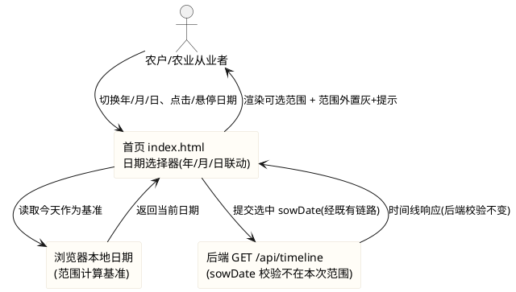
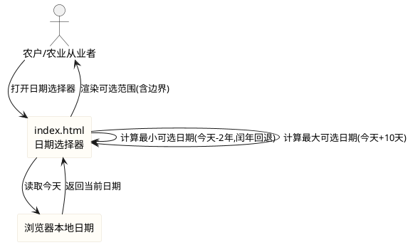

# 前端日期选择器可选范围调整需求规格（date_picker_range）

> **本规格基于上一阶段 stage2_frontend 文档增量补充，请结合上一阶段 spec.md / design.md 一并阅读。**
> 上一阶段文档位置：`.codeartsdoer/specs/stage2_frontend/spec.md`（60 条 EARS 需求）、`design.md`（D-01~D-12 关键决策）、`tasks.md`（13 组 53 子任务）、`ops-security-report.md`（运维安全报告）。

> **版本记录**
> - v1.0：前端日期选择器可选范围调整首版需求，需求编号范围 `REQ-DPR-*-001` ~ `REQ-DPR-*-020`，共 20 条。
> - 本规格为**增量补充**，不改动上一阶段既有 60 条需求，仅对日期选择器可选范围逻辑进行独立规约。

> 本文档用于规范 agritime（知农时 · 会看天的农事日历）**前端日期选择器可选范围逻辑调整**的验收标准。
> 范围红线：仅允许修改 `frontend/` 目录下文件；不得修改后端（`/opt/crop-calendar`、Java/8080）、`contract/`、`data/`、`deploy/`、`docs/`；不引入框架、构建工具或任何第三方依赖；不得破坏 `frontend/tests/pages.test.js` 既有断言。
> 变更性质：**仅前端展示与交互层面**的日期可选范围变更，不涉及后端 `/api/timeline` 的 `sowDate` 参数校验逻辑同步调整。
> 交付形式：本文档描述**做什么（What）**与**验收标准（Acceptance Criteria）**，不描述技术实现方式（How）；技术架构与代码结构由后续 design 阶段承接。

# **1. 组件定位**

## **1.1 核心职责**
本组件负责调整 agritime 首页日期选择器的可选日期范围边界计算与范围外日期的置灰禁用交互，使用户可选择从两年前至今天之后固定 10 天的日期。

## **1.2 核心输入**
1. 浏览器本地当前日期（作为可选范围计算的基准）。
2. 用户在 `frontend/pages/index.html` 日期选择器上的交互操作（切换年/月/日、点击候选日期、悬停/聚焦于置灰日期）。
3. 既有日期选择器三联动（年/月/日下拉）与 `clampDay`/`validate` 校验链路的既有输入。

## **1.3 核心输出**
1. 日期选择器中年/月/日下拉的可选项集合（按新范围裁剪）。
2. 范围外日期的置灰禁用视觉状态。
3. 范围外日期被关注/悬停时呈现的提示文案（如"请选择两年前至 10 天后的日期"）。
4. 用户最终选中的、落在新可选范围内的播种日期（经既有表单提交链路传递至 timeline.html）。

## **1.4 职责边界**
本组件**不负责**以下事项：
1. 后端 `/api/timeline` 的 `sowDate` 参数校验逻辑——后端是否接受今天之后 10 天内的日期**不在本次修改范围**，前端放宽可选范围后可能向后端提交此前被后端拒绝的日期，后端校验同步属后续后端任务。
2. 日期选择器以外的任何表单字段（作物、所在地）的校验与交互。
3. 时间线页（timeline.html）任何渲染逻辑。
4. 任何框架、构建工具、第三方日期选择库（如 Pikaday、flatpickr）的引入——**明确禁止**。
5. 既有 `frontend/tests/pages.test.js` 断言的删除、注释或弱化——仅允许新增断言。
6. 农事节令、节日规则、天气适宜度等业务权威数据的计算与硬编码——归后端，前端不越界。

# **2. 领域术语**

**日期选择器（Date Picker）**
: 指 `frontend/pages/index.html` 中由年/月/日三个下拉联动构成的播种日期选择控件，对应既有 `fillYears`/`fillMonths`/`fillDays`/`clampDay`/`validate` 逻辑。

**可选日期范围（Selectable Date Range）**
: 指日期选择器允许用户选中的日期区间，本次调整为从"两年前的同月同日"到"今天之后固定 10 天"的闭区间。

**最小可选日期（Min Selectable Date）**
: 指可选日期范围的起始边界，即今天往前推两年的同月同日；闰年 2 月 29 日特殊情况须回退到两年前的 2 月 28 日。

**最大可选日期（Max Selectable Date）**
: 指可选日期范围的结束边界，即今天往后推固定 10 天，不含浮动。

**固定 10 天（Fixed Ten Days）**
: 指最大可选日期相对今天的偏移量精确为 10 天，不随月份、季节、作物或任何业务条件浮动。

**置灰禁用（Greyed-out Disabled）**
: 指超出可选范围的日期以灰度视觉呈现且不可被选中，同时附带提示文案引导用户选择有效范围。

**闭区间（Closed Interval）**
: 指最小可选日期当天与最大可选日期当天均包含在可选范围内，可选且可选中。

**闰年回退（Leap Year Fallback）**
: 指当今天是闰年 2 月 29 日时，两年前同月同日（2 月 29 日）在非闰年不存在，须将最小可选日期回退到该年 2 月 28 日。

**EARS 需求编号约定**
: 本文档需求编号格式为 `REQ-DPR-XXX-NNN`，`DPR` 为 Date Picker Range 缩写。前缀对应 EARS 句型：UBI（Ubiquitous，通用）、EVT（Event-driven，事件驱动）、STA（State-driven，状态驱动）、OPT（Optional，可选/带前提）、UNW（Unwanted，非期望行为）。

# **3. 角色与边界**

## **3.1 核心角色**
- **农户 / 农业从业者**：在首页通过日期选择器选定播种日期并提交，是本次可选范围调整的直接受益对象；调整后可选择今天之后 10 天内的日期用于提前规划播种。
- **测试维护者**：运行 `node --test frontend/tests/pages.test.js`，确认既有断言全绿并补充新需求断言。
- **开发者 / 交付者**：在 `frontend/` 范围内改动日期选择器相关代码并提交 Git。

## **3.2 外部系统**
- **后端时间线接口（`GET /api/timeline?crop&sowDate&lat&lon`）**：接收前端提交的 `sowDate` 参数；本次**不调整后端对该参数的校验逻辑**，后端校验范围与前端可选范围可能暂时不一致，属已知边界，由后续后端任务同步。
- **浏览器本地日期**：可选范围计算的基准来源，纯本地计算，不发起网络请求。

## **3.3 交互上下文**


# **4. DFX约束**

## **4.1 性能**
1. 可选范围边界计算须为**纯本地同步计算**，不发起任何网络请求，计算到下拉可选项更新须 ≤ 50ms。
2. 范围外日期置灰与提示呈现不得引入额外渲染开销，复用既有日期选择器三联动渲染机制。

## **4.2 可靠性**
1. 可选范围边界计算须始终产生**有效存在日期**，不得产生不存在的日期（如非闰年的 2 月 29 日）。
2. 当浏览器本地日期异常或不可获取时，系统须回落到既有日期选择器行为，不抛未捕获错误、不白屏。
3. 闰年 2 月 29 日回退逻辑须保证最小可选日期为有效日期，不因边界计算产生非法日期。

## **4.3 安全性**
1. 本次变更不引入任何外部脚本依赖，所有逻辑内联或使用项目内本地脚本。
2. 提示文案须为前端具名常量，不得拼接用户可控输入，避免 XSS。

## **4.4 可维护性**
1. 可选范围边界常量（两年偏移、10 天偏移）与提示文案须以**具名常量**集中定义，不得多处硬编码（对齐上一阶段 4.4.1 可维护性约束）。
2. 本次变更须保留既有日期选择器三联动（年/月/日）与 `clampDay`/`validate` 的核心契约，不破坏既有表单提交链路与参数命名（`sowDate`）。

## **4.5 兼容性**
1. **测试兼容（强制红线）**：不得破坏 `frontend/tests/pages.test.js` 既有断言；可新增断言，既有断言须全绿。运行命令：`node --test frontend/tests/pages.test.js`。
2. **不可引入依赖**：不得引入框架、构建工具、第三方库（含任何日期选择库）。
3. **文件范围兼容**：不得修改后端及 `contract/`、`data/`、`deploy/`、`docs/` 等模块。
4. **接口兼容**：不得改变前端既有的 `sowDate` 参数命名与表单提交方式。
5. **浏览器兼容**：须在主流现代浏览器（Chrome/Edge/Safari 近两版）与移动端 WebView 下可用（原生 JS 语法）。
6. **既有逻辑兼容**：须保留既有 `fillYears`/`fillMonths`/`fillDays`/`clampDay`/`validate` 的调用契约与表单提交链路，仅调整其内部范围边界参数。

# **5. 核心能力**

## **5.1 可选日期范围边界计算**

### **5.1.1 业务规则**

1. **REQ-DPR-UBI-001（Ubiquitous）**：系统须以浏览器本地当前日期为基准计算日期选择器的可选范围边界，不发起网络请求、不依赖服务端时间。
   a. 验收条件：[打开 index.html 日期选择器] → [可选范围以本地今天为基准计算，无网络请求被触发]

2. **REQ-DPR-UBI-002（Ubiquitous）**：最小可选日期须为今天往前推两年的同月同日（即两年前的同月同日），且该边界当天可选（闭区间包含起始边界）。
   a. 验收条件：[今天为 2026-10-17] → [最小可选日期为 2024-10-17，且 2024-10-17 当天可选可选中]
   b. 验收条件：[今天为 2026-03-01] → [最小可选日期为 2024-03-01，当天可选]

3. **REQ-DPR-UBI-003（Ubiquitous）**：最大可选日期须为今天往后推固定 10 天，且该边界当天可选（闭区间包含结束边界）。
   a. 验收条件：[今天为 2026-10-17] → [最大可选日期为 2026-10-27，且 2026-10-27 当天可选可选中]
   b. 验收条件：[今天为 2026-12-28] → [最大可选日期为 2027-01-07（跨年跨月），当天可选]

4. **REQ-DPR-UBI-004（Ubiquitous）**：后续可选天数须精确固定为 10 天，不得随月份、季节、作物或任何业务条件浮动。
   a. 验收条件：[在不同月份/季节/作物下打开日期选择器] → [最大可选日期恒为今天 + 10 天，偏移量恒为 10]

5. **REQ-DPR-UBI-005（Ubiquitous）**：今天本身须在可选范围内且可选。
   a. 验收条件：[打开日期选择器] → [今天对应的日期可选且可选中，不置灰]

6. **禁止项**：禁止将最大可选日期设为今天（即维持旧的"截止今天"逻辑）；禁止后续可选天数浮动（如随月份天数变化）。
   a. 验收条件：[代码审查 + 交互核对] → [最大可选日期为今天 + 10 天，非今天；偏移量固定为 10]

### **5.1.2 交互流程**



### **5.1.3 异常场景**

1. **浏览器本地日期不可获取或异常**
   a. 触发条件：浏览器本地日期为非法值或无法读取
   b. 系统行为：回落到既有日期选择器行为，不抛未捕获错误
   c. 用户感知：日期选择器仍可用（按既有范围或安全默认范围），无白屏

## **5.2 范围内可选与范围外置灰禁用**

### **5.2.1 业务规则**

1. **REQ-DPR-STA-006（State-driven）**：当某日期处于最小可选日期与最大可选日期之间（含两端边界）时，该日期须可选且可被用户选中。
   a. 验收条件：[今天为 2026-10-17，选择 2024-10-17 / 2025-05-01 / 2026-10-17 / 2026-10-27] → [均可选可选中，不置灰]

2. **REQ-DPR-STA-007（State-driven）**：当某日期早于最小可选日期或晚于最大可选日期时，该日期须以置灰禁用状态呈现且不可被选中。
   a. 验收条件：[今天为 2026-10-17，选择 2024-10-16 / 2026-10-28] → [该日期置灰禁用，点击/选择无效]

3. **REQ-DPR-UNW-008（Unwanted）**：超出可选范围的日期不得被直接拦截选择操作而不给任何反馈。
   a. 验收条件：[点击/聚焦范围外日期] → [存在置灰视觉与提示文案反馈，非静默拦截]

4. **禁止项**：禁止以"隐藏范围外日期"代替"置灰禁用"（用户须能感知到范围外日期的存在与不可选原因）；禁止范围外日期可被键盘或任何方式选中。
   a. 验收条件：[打开日期选择器查看范围外区域] → [范围外日期可见但置灰，不可被鼠标/键盘选中]

### **5.2.2 交互流程**

```plantuml
@startuml
skinparam rectangle {
  BackgroundColor #fffdf7
  BorderColor #e4ddcb
}
actor "农户/农业从业者" as user
rectangle "index.html\n日期选择器" as index

user --> index : 浏览/点击某日期
alt 日期在范围内
  index --> user : 允许选中(正常视觉)
else 日期在范围外
  index --> user : 置灰禁用 + 提示文案
end
@enduml
```

### **5.2.3 异常场景**

1. **用户通过键盘尝试选中范围外日期**
   a. 触发条件：用户用键盘导航到置灰禁用日期并按回车/空格
   b. 系统行为：阻止选中，保持置灰状态，呈现提示文案
   c. 用户感知：该日期未被选中，看到可选范围提示

## **5.3 置灰禁用提示文案**

### **5.3.1 业务规则**

1. **REQ-DPR-STA-009（State-driven）**：当用户尝试关注/悬停/聚焦于置灰禁用日期时，系统须给出提示文案说明可选范围（如"请选择两年前至 10 天后的日期"）。
   a. 验收条件：[悬停/聚焦于范围外日期] → [出现提示文案，内容包含可选范围说明]

2. **REQ-DPR-UBI-010（Ubiquitous）**：提示文案须以可读方式呈现（tooltip 或文案说明），不得仅有灰度而无任何文字引导。
   a. 验收条件：[查看置灰禁用日期] → [存在可读文字提示（tooltip 或行内文案），非纯灰度无文字]

3. **REQ-DPR-UBI-011（Ubiquitous）**：提示文案内容须与实际可选范围一致，即反映"两年前至今天后 10 天"的语义，不得使用过时或与实际范围不符的文案。
   a. 验收条件：[今天为 2026-10-17，查看提示文案] → [文案语义为"两年前至 10 天后"或等价表述，与实际范围 2024-10-17 ~ 2026-10-27 一致]

4. **REQ-DPR-UBI-012（Ubiquitous）**：提示文案与可选范围边界常量须以具名常量集中定义，不得多处硬编码（对齐上一阶段 4.4.1 可维护性约束）。
   a. 验收条件：[代码审查] → [提示文案与边界偏移量以具名常量定义，无多处硬编码]

5. **禁止项**：禁止提示文案拼接用户可控输入（防 XSS）；禁止提示文案与实际可选范围不一致（如仍写"不晚于今天"）。
   a. 验收条件：[代码审查 + 交互核对] → [文案为静态常量，内容与"两年前至 10 天后"范围一致]

### **5.3.3 异常场景**

1. **提示文案在移动端 WebView 下的呈现**
   a. 触发条件：移动端 WebView 不支持 hover，tooltip 可能无法触发
   b. 系统行为：以聚焦/点击或行内文案方式呈现提示，确保移动端可读
   c. 用户感知：移动端仍能看到可选范围提示，不因无 hover 而无反馈

## **5.4 闰年 2 月 29 日回退处理**

### **5.4.1 业务规则**

1. **REQ-DPR-OPT-013（Optional/带前提）**：当今天是闰年 2 月 29 日且两年前该日期（2 月 29 日）不存在时，最小可选日期须回退到两年前的 2 月 28 日。
   a. 验收条件：[今天为 2024-02-29（闰年），两年前 2022-02-29 不存在] → [最小可选日期为 2022-02-28，当天可选可选中]

2. **REQ-DPR-UBI-014（Ubiquitous）**：最小可选日期的计算须保证结果为有效存在日期，不得产生不存在的日期（如非闰年的 2 月 29 日）。
   a. 验收条件：[今天为任意闰年 2 月 29 日] → [最小可选日期为有效存在日期（回退到 2 月 28 日），不产生非法日期]
   b. 验收条件：[今天为非 2 月 29 日的任意日期] → [最小可选日期为两年前同月同日，为有效日期]

3. **REQ-DPR-OPT-015（Optional/带前提）**：当今天不是 2 月 29 日，或两年前 2 月 29 日存在（即两年前也是闰年）时，最小可选日期须为两年前的同月同日，不触发回退。
   a. 验收条件：[今天为 2026-10-17] → [最小可选日期为 2024-10-17，不回退]
   b. 验收条件：[今天为 2024-02-29 且两年前 2022 非闰年] → [触发回退到 2022-02-28]

4. **禁止项**：禁止在非闰年 2 月 29 日场景下错误触发回退；禁止回退到 2 月 28 日以外的日期（如 3 月 1 日）。
   a. 验收条件：[今天为 2026-03-01] → [最小可选日期为 2024-03-01，不回退]
   a. 验收条件：[今天为闰年 2 月 29 日] → [回退目标为两年前 2 月 28 日，非 3 月 1 日或其他]

### **5.4.3 异常场景**

1. **两年前同月同日存在但为月末边界**
   a. 触发条件：今天为某月最后一天，两年前该月同日存在
   b. 系统行为：直接取两年前同月同日，不触发回退
   c. 用户感知：最小可选日期为两年前该月最后一天，正常可选

## **5.5 变更范围与兼容性约束**

### **5.5.1 业务规则**

1. **REQ-DPR-UBI-016（Ubiquitous）**：本次变更须仅限前端展示与交互层面，不得涉及后端 `/api/timeline` 的 `sowDate` 参数校验逻辑调整。
   a. 验收条件：[代码审查 + git diff] → [无后端 `/opt/crop-calendar`、`crop-protocols.json` 等后端文件变更；后端 `sowDate` 校验逻辑未改]

2. **REQ-DPR-UBI-017（Ubiquitous）**：本次变更不得破坏 `frontend/tests/pages.test.js` 既有断言，既有断言须全绿；可新增针对新范围的断言。
   a. 验收条件：[运行 `node --test frontend/tests/pages.test.js`] → [既有断言全绿，无失败；新增断言通过]

3. **REQ-DPR-UBI-018（Ubiquitous）**：本次变更不得引入框架、构建工具或任何第三方库（含任何日期选择库）。
   a. 验收条件：[代码审查 + package 审查] → [无新框架/构建工具/第三方库引入，纯原生 JS + 原生 CSS]

4. **REQ-DPR-UBI-019（Ubiquitous）**：本次变更须仅修改 `frontend/` 目录下文件，不得修改后端、`contract/`、`data/`、`deploy/`、`docs/` 等模块。
   a. 验收条件：[git diff --stat] → [改动仅落在 `frontend/` 目录]

5. **REQ-DPR-UBI-020（Ubiquitous）**：本次变更须保留既有日期选择器三联动（年/月/日）与 `clampDay`/`validate` 的核心契约，不破坏既有表单提交链路与 `sowDate` 参数命名。
   a. 验收条件：[提交表单] → [选中的播种日期经既有链路以 `sowDate` 参数传递至 timeline.html，提交方式与参数命名不变]
   b. 验收条件：[代码审查] → [`fillYears`/`fillMonths`/`fillDays`/`clampDay`/`validate` 调用契约保留，仅内部范围边界参数调整]

6. **禁止项**：禁止为通过新需求而删除、注释或弱化既有测试断言；禁止改变 `sowDate` 参数命名（如改为 `sowingDate`）；禁止将后端校验同步纳入本次前端修改范围。
   a. 验收条件：[代码审查] → [既有断言原文保留且通过；参数名仍为 `sowDate`；无后端校验逻辑变更]

### **5.5.3 异常场景**

1. **前端放宽范围后后端拒绝今天之后 10 天内的日期**
   a. 触发条件：用户选中今天之后 10 天内的日期并提交，后端 `/api/timeline` 的 `sowDate` 校验仍限制不晚于今天
   b. 系统行为：前端按新范围允许提交，后端返回校验错误时由既有 timeline.html 降级/错误处理机制承接（不在本次修改范围）
   c. 用户感知：前端可选但提交后可能收到后端错误或降级视图；此为已知边界，后端校验同步属后续后端任务

2. **既有测试依赖旧的"截止今天"范围断言**
   a. 触发条件：既有 `pages.test.js` 中存在断言依赖"最大可选日期为今天"的假设
   b. 系统行为：若该断言属既有 22 项红线断言，须保留其原文并通过（即新实现须兼容该断言）；若属可调整断言，按新范围更新
   c. 用户感知：测试套件全绿，既有红线断言未被破坏

# **6. 数据约束**

## **6.1 可选范围边界对象**
1. **minSelectableDate**：最小可选日期，格式 `YYYY-MM-DD`，须为有效存在日期；计算方式为今天往前推两年的同月同日，闰年 2 月 29 日回退到两年前 2 月 28 日。
2. **maxSelectableDate**：最大可选日期，格式 `YYYY-MM-DD`，须为有效存在日期；计算方式为今天往后推固定 10 天。
3. **today**：浏览器本地当前日期，格式 `YYYY-MM-DD`，作为边界计算基准。
4. **yearOffset**：年份偏移常量，固定为 2（年），以具名常量定义。
5. **dayOffset**：天数偏移常量，固定为 10（天），以具名常量定义，不得浮动。
6. **区间包含性**：minSelectableDate 与 maxSelectableDate 均包含在可选范围内（闭区间）。

## **6.2 提示文案对象**
1. **rangeHintText**：范围外日期的提示文案，为静态具名常量字符串，语义须反映"两年前至今天后 10 天"的可选范围。
2. **呈现方式**：tooltip 或行内文案，须可读；不得拼接用户可控输入。
3. **一致性约束**：rangeHintText 语义须与 minSelectableDate / maxSelectableDate 实际范围一致，不得使用过时文案（如"不晚于今天"）。

## **6.3 选中日期对象（既有契约保留）**
1. **sowDate**：用户最终选中的播种日期，格式 `YYYY-MM-DD`，须满足 minSelectableDate ≤ sowDate ≤ maxSelectableDate。
2. **参数命名**：须保持 `sowDate`，不得改为 `sowingDate` 或其他（对齐上一阶段 4.4.2 参数命名统一约束）。
3. **提交链路**：经既有表单提交链路以 URL 查询参数传递至 timeline.html，提交方式不变。

# **7. 需求归类与交付边界**

## **7.1 前端代码修改（允许且必须，范围限 `frontend/`）**
1. `frontend/pages/index.html`：调整 `fillYears`/`fillMonths`/`fillDays`/`clampDay`/`validate` 内部的日期范围边界参数（最小可选日期改为两年前、最大可选日期改为今天 + 10 天），新增范围外日期置灰禁用样式与提示文案呈现。—— 对应 REQ-DPR-UBI-001~005、STA-006~007、UNW-008、STA-009、UBI-010~012、OPT-013、UBI-014、OPT-015、UBI-020。
2. `frontend/assets/css/*`：新增范围外日期置灰禁用样式与提示文案样式（如 tooltip）。—— 对应 REQ-DPR-STA-007、UBI-010。
3. `frontend/tests/pages.test.js`：新增针对新可选范围的断言（最小/最大边界、置灰禁用、提示文案、闰年回退），既有断言保持全绿。—— 对应 REQ-DPR-UBI-017。

## **7.2 明确排除项（本次不纳入范围）**
1. **后端 `/api/timeline` 的 `sowDate` 校验逻辑同步**：后端是否接受今天之后 10 天内的日期不在本次修改范围，属后续后端任务。
2. **后端 Java 改动**：`/opt/crop-calendar`、8080 服务、`crop-protocols.json`、`market-festivals.json`、阈值表、`scoreNode` 算法——**不得修改**。
3. **框架/构建工具/第三方依赖引入**（含任何日期选择库）——**明确禁止**。
4. **`contract/`、`data/`、`deploy/`、`docs/` 等非前端模块**——**不得修改**。
5. **既有测试断言的删除/注释/弱化**——**明确禁止**，仅允许新增。

## **7.3 约束条件汇总**
1. **纯前端**：改动仅限 `frontend/` 目录。
2. **无框架**：纯原生 JS + 原生 CSS，无第三方依赖。
3. **不改后端**：不修改任何后端代码与数据文件，不调整后端 `sowDate` 校验。
4. **不破坏既有测试**：`node --test frontend/tests/pages.test.js` 既有断言须全绿。
5. **闭区间**：最小与最大可选日期当天均可选。
6. **固定 10 天**：后续可选天数精确固定为 10 天，不浮动。
7. **闰年回退**：今天是 2 月 29 日时，最小可选日期回退到两年前 2 月 28 日。
8. **具名常量**：边界偏移量与提示文案以具名常量集中定义，不多处硬编码。
9. **既有契约保留**：`fillYears`/`fillMonths`/`fillDays`/`clampDay`/`validate` 调用契约与 `sowDate` 参数命名不变。