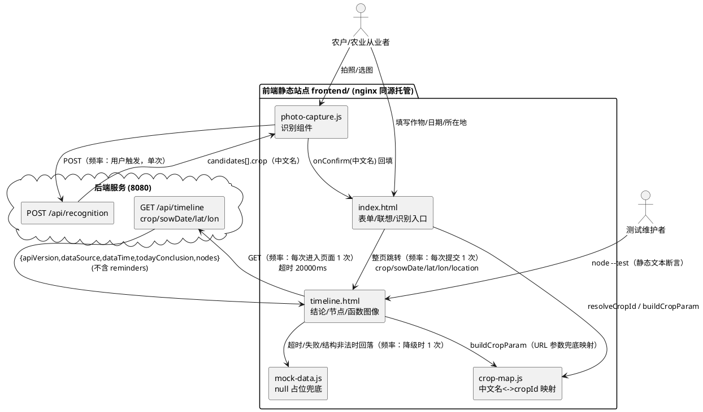
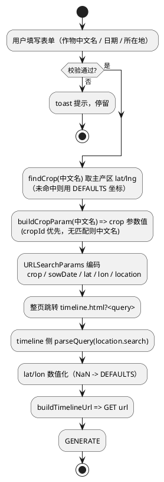
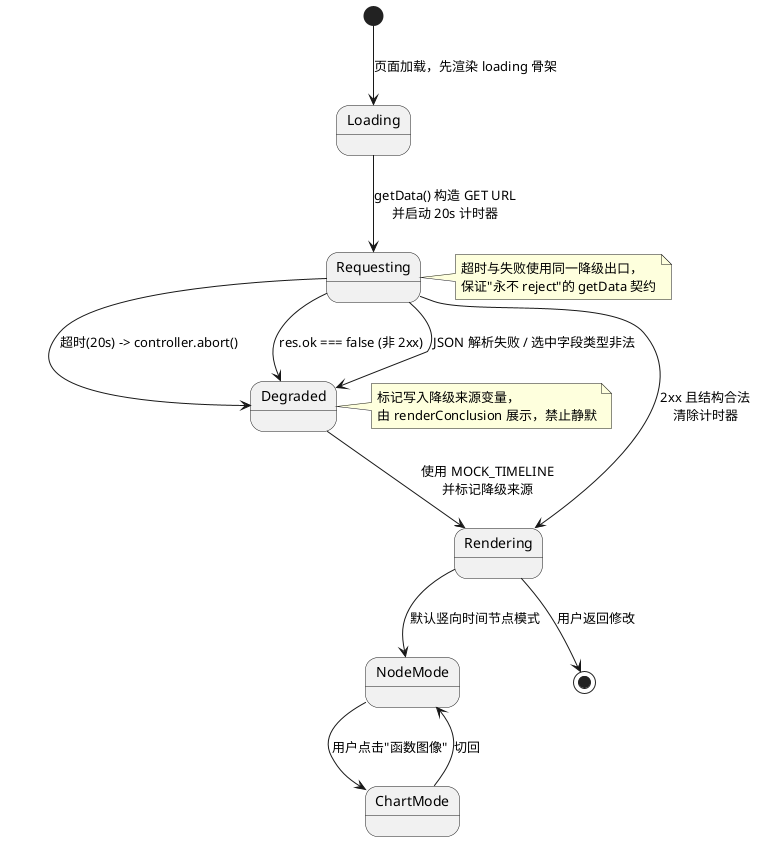
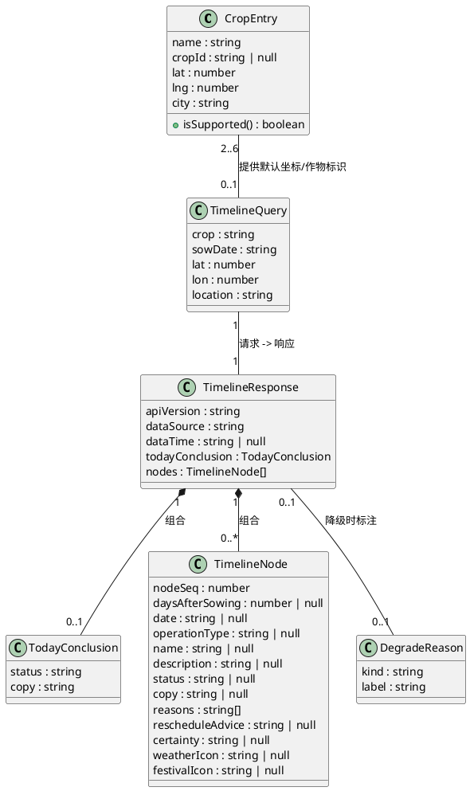

# 前端业务流程对齐后端真实接口 · 技术设计（frontend_flow_align）

> 需求来源：`.codeartsdoer/specs/frontend_flow_align/spec.md`（REQ-FFA-001 ~ REQ-FFA-019）
> 设计范围：仅 `frontend/` 目录；不引入框架 / 构建工具 / 第三方库；不修改后端、`contract/`、`data/`、`deploy/`、`docs/`；不修改 nginx。
> 强约束：`frontend/tests/pages.test.js` 既有 13 项断言必须全绿，仅允许新增断言。

# 一、需求与存量功能关系分析

## 1.1 需求功能与存量功能对比

### 1.1.1 已实现功能

| 需求功能 | 存量功能 | 代码位置 | 匹配度 |
|---------|---------|---------|--------|
| 输入表单三字段（作物/日期/所在地）+ 模糊联想（REQ-FFA-UBI-009 前置） | 表单结构 + `renderSuggestions` 关键字包含匹配 | `frontend/pages/index.html:27-62`、`:175-193` | 100% |
| 自定义日期三联动选择器与范围校验 | `fillYears/fillMonths/fillDays/clampDay/validate` | `frontend/pages/index.html:95-153`、`:208-227` | 100% |
| 拍照识别 → 候选 → 人工确认 → 回填 | `PhotoCapture.open(onConfirm)`、`renderCandidates`、`showFallback` | `frontend/pages/photo-capture.js:106-127`、`:155-197` | 75%（回填值为中文名，未做 cropId 映射） |
| 今日结论卡片渲染（status → 徽标 + copy 文案 + 数据来源） | `renderConclusion` | `frontend/pages/timeline.html:116-133` | 75%（副标题误用 `payload.crop/sowingDate`；契约字段本身已适配） |
| 竖向时间节点三层信息渲染（动作 / 决策 / 详情） | `renderNode`（含 `tl-action`、`tl-decision`、`tl-note`、`tl-detail`） | `frontend/pages/timeline.html:135-203` | 100% |
| 节点展开折叠与空态提示 | `card.classList.toggle('open')`、`render` 空态分支 | `frontend/pages/timeline.html:145`、`:377-380` | 100% |
| 实线/虚线语义（certainty） | `certainty === 'predicted'` → `predicted` 类 | `frontend/pages/timeline.html:137`；`frontend/assets/css/timeline.css` | 100% |
| 模式切换（时间节点 / 函数图像） | `renderModeSwitch`、`switchMode`、`currentMode`、`chartRendered` | `frontend/pages/timeline.html:354-373` | 100% |
| 函数图像按节点 `daysAfterSowing` 绘制多峰曲线 | `buildChartSVG` + `gaussianPath`（高斯采样） | `frontend/pages/timeline.html:245-342` | 75%（坐标轴依据已正确，真实/占位判定闸门需强化） |
| null 占位空坐标轴 + "数据待接入" | `buildEmptyChartSVG` + `CHART_CONFIG.PLACEHOLDER_TEXT` | `frontend/pages/timeline.html:255-291` | 100% |
| 请求失败回落本地兜底数据 | `getData().catch(() => window.MOCK_TIMELINE)` | `frontend/pages/timeline.html:78-86` | 50%（仅覆盖"失败"，无"超时"；请求方法与参数形态不符） |
| 离线 null 占位数据（不硬编码假数据） | `MOCK_TIMELINE`（字段 null、`reasons: []`） | `frontend/assets/mock/mock-data.js:6-28` | 100% |
| 前端单测基座（13 项） | `node --test` 文本断言套件 | `frontend/tests/pages.test.js:16-98` | 100% |

### 1.1.2 需要扩展的功能

| 需求功能 | 存量功能 | 差异说明 | 扩展方向 |
|---------|---------|---------|---------|
| REQ-FFA-UBI-001/002/003：GET 请求 + `crop/sowDate/lat/lon` 查询参数 + cropId 传参 | `getData()` 以 `POST` + `Content-Type: application/json` + JSON body 请求 | 方法不符；参数名不符（`sowingDate`）；位置为 `location` 对象（`latitude/longitude/county`）；`crop` 传中文名 | 改为 `GET /api/timeline` + `URLSearchParams` 拼装；`crop` 传 cropId（无匹配时传中文名）；删除 JSON body 与 `sowingDate`/`location` 对象 |
| REQ-FFA-UBI-009/010/011/012：URL 参数链路与标量位置传参 | index.html 提交拼 `crop(中文名)/sowingDate/location/latitude/longitude`；timeline.html 解析 `crop/sowingDate/latitude/longitude/location` 组装 `payload` | 参数名与形态不一致；两页面命名混用 | 统一为 `crop/sowDate/lat/lon/location`；`location` 仅展示；`lat/lon` 为标量数值 |
| REQ-FFA-UBI-005/006/007/008：CROPS 补 cropId + 中文名→cropId 映射 + 无匹配走中文名 | `CROPS` 5 条仅 `name/lat/lng/city`；`findCrop` 仅精确比较 `name` | 缺 `cropId` 字段；无映射能力；"山东寿光番茄"后端不支持却与支持作物并列 | 补 `cropId`（覆盖后端 5 个，番茄为 `null`）；新增可复用映射模块；解析规则"精确优先、其次包含" |
| REQ-FFA-STA-011/UNW-012：20s 超时中止 + 降级不静默 | `fetch` 无 `signal`、无超时；catch 静默回落 | 无超时上限常量；无中止机制；降级无用户可见反馈（REQ 禁止静默） | `AbortController` + 具名常量 `TIMELINE_TIMEOUT_MS = 20000`；降级后在"数据来源"文案追加降级标识 |
| REQ-FFA-UBI-016/017：函数图像真实/占位数据对齐 | `renderChart` 以 `hasRealData = node.date != null \|\| node.name != null` 做闸门；`buildChartSVG` 内部仅按 `daysAfterSowing` 判断 | mock 的 `daysAfterSowing` 有值但 `date/name` 为 null，两处判定口径不同，存在误绘虚假曲线的风险 | 保留并强化外闸门（`hasRealData && 有效天数非空`）；`buildChartSVG` 保持单一职责（只负责绘制），不单独暴露绘制入口 |
| REQ 4.2.2：`reminders` 缺失容错 | `render()` 已有 `data.reminders && data.reminders.length` 守卫；但 `MOCK_TIMELINE.reminders` 存在且字段全 null，会渲染一个空"销售窗口"卡片 | 真实响应不返回 `reminders` 时守卫可容错；降级时产生无意义空节点 | 保留守卫 + 增加"全空 reminder 跳过"判定；`renderReminder` 能力保留不删除 |
| REQ-FFA-UBI-018/019：既有 13 项断言全绿 + 补充对齐断言 | 13 项文本断言覆盖表单/时间线/图表/识别 | 无本次对齐相关断言（GET、参数名、映射、超时常量） | 新增断言并逐条核对既有断言依赖的字符串不得被改动 |

### 1.1.3 需要新增的功能或接口

**A. 作物标识映射模块（新增文件，frontend/ 范围内）**

| 功能点 | 输入 | 输出 | 核心逻辑 | 依赖 |
|-------|------|------|---------|------|
| `resolveCropId` | 作物中文名（用户输入/识别回填/URL 参数） | cropId 或 `null` | 规范化 → 精确匹配 → 包含匹配（CROPS 名称双向包含 + 后端 5 作物关键词） | 无 |
| `buildCropParam` | 作物中文名 | 非空 `crop` 参数值 | `resolveCropId(name) \|\| 中文名`（走后端大模型分支） | `resolveCropId` |
| `getCropByName` | 作物中文名 | `CropEntry` 或 `undefined` | 精确匹配 CROPS（回填 `city`/`lat`/`lng`） | 无 |
| `CROPS` / `CROP_IDS` | — | 作物数据集常量 / 5 个合法 cropId 常量 | 集中定义，禁止散落 | 无 |

**B. 页面查询参数契约（timeline.html 新增）**

- `parseQuery(search)`：`location.search` → `{ crop, sowDate, lat, lon, location }`，含默认值与数值兜底。
- `buildTimelineUrl(query)`：结构化参数 → 完整请求 URL（`URLSearchParams` 编码）。

**C. 降级状态反馈（timeline.html 新增）**

- 降级原因标记（超时 / 非 2xx / 结构非法 / 离线），用于"数据来源"文案追加降级提示，满足 REQ-FFA-UNW-012"禁止静默"。

**D. 测试断言补充（tests/pages.test.js 新增，见 2.2 / 第二章 2.1.5）**

**E. index.html 提交参数拼装（新增函数）**

- `buildTimelineQuery({ cropName, sowDate, lat, lon, location })` → 查询串，供 `window.location.href` 使用。

## 1.2 存量功能详细分析

### 1.2.1 `renderNode(node)`（`timeline.html:135-203`）

- **接口契约**：入参为后端 `nodes[]` 单元素；返回 `HTMLElement`（`.tl-node` 包裹 `.tl-card`）；无抛异常路径（全部字段通过 `|| ''` 或 `&&` 守卫）。
- **业务规则**：`certainty === 'predicted'` → 虚线语义；`status` 决定配色类；`solarTerm` 优先于 `weatherIcon` 展示备注；`reasons` 为数组时渲染 `<ul>`。
- **扩展点**：无显式钩子。本次**不改动**，因为它已完全按契约字段渲染（`name/date/copy/reasons/rescheduleAdvice/weatherIcon`），且是既有断言（`tl-action`/`tl-decision`/`tl-note`/`node.copy`/`predicted`/`certain`）的承载点。
- **约束**：后端不返回 `solarTerm`/`solarTermTip` 时走 `weatherIcon` 分支，行为正确，无需适配；`festivalIcon` 字段后端会返回但当前未使用，属可选增强（本次不实现，避免引入新断言风险）。

### 1.2.2 `renderChart` / `buildChartSVG` / `buildEmptyChartSVG`（`timeline.html:245-352`）

- **接口契约**：`renderChart(data)` 入参为整份响应（可为 `null`）；无返回值，副作用为向 `#chart` 注入原生 SVG 并置 `chartRendered = true`。
- **业务规则**：
  - 外闸门：`hasRealData = nodes.some(n => n.date != null || n.name != null)` → 真实数据才走 `buildChartSVG`，否则 `buildEmptyChartSVG`。
  - 内绘制：`buildChartSVG` 仅取 `daysAfterSowing != null` 的节点，`minDay/maxDay` 归一化到横轴，每个节点叠加一条高斯峰（多峰值）。
- **扩展点**：`CHART_CONFIG`（`SIGMA/SAMPLE_STEP/VIEWBOX_*`）为唯一调参点，属具名常量集中定义，符合 REQ-FFA 4.4.1。
- **约束**：
  1. `buildChartSVG` 自身不判断"真实/占位"，若被直接调用且传入 mock 节点（`daysAfterSowing` 有值、其余 null）会绘出曲线 —— 因此**绘制入口只能经 `renderChart` 闸门**，改造中不得新增旁路调用。
  2. `switchMode` 首次切到图模式时使用 `cachedData`，而 `cachedData` 仅在 `render()` 的"有节点"分支赋值；空态提前 `return` 前不会渲染模式切换控件，故不存在 `cachedData` 为 `null` 的图模式入口。
  3. 既有断言依赖 `CHART_CONFIG`、`SIGMA`、`数据待接入`、`createElementNS`、`id="chart"` 字符串，改造须保留。

### 1.2.3 `getData()`（`timeline.html:78-86`）

- **接口契约**：无入参；返回 `Promise<响应对象>`；**不抛异常**（catch 内回落 mock）。
- **业务规则**：以模块级 `payload`（页面加载时一次性解析 URL 得到）作为请求体；`!res.ok` 主动抛错进入降级。
- **约束（改造要点）**：
  1. `payload` 是闭包内单例，被 `renderConclusion` 读取（`payload.crop`/`payload.sowingDate`），改造后须同步替换展示来源，避免出现 `undefined`。
  2. 降级返回值必须是"结构完整可直接渲染"的对象（`nodes` 数组非空），否则 `render()` 会走空态。
  3. `getData().then(render)` 无 `catch`，因此新实现必须保持"永不 reject"约定，否则会出现未捕获 Promise 异常（违反 REQ-FFA-UNW-012）。

### 1.2.4 `render(data)`（`timeline.html:375-392`）

- **接口契约**：入参为响应对象或 `null`；副作用为切换 `#loading`/`#empty-state`/`#timeline`/`#footer` 显隐。
- **业务规则**：`!data || !data.nodes || nodes.length === 0` → 直接空态并 return；否则渲染结论 → 缓存 → 模式切换 → 节点列表 →（可选）提醒列表。
- **约束**：`data.todayConclusion` 为必需字段，`renderConclusion` 直接读取其 `status/copy`；若后端异常返回缺少 `todayConclusion`，会抛 `TypeError`。改造中须在渲染前做契约字段守卫（缺 `todayConclusion` 时用空对象兜底）。

### 1.2.5 index.html 提交链路（`index.html:204-259`）

- **接口契约**：`submit` 事件处理器；`validate()` 先行校验；`findCrop(name)` 精确匹配 CROPS；`URLSearchParams` 拼装后整页跳转。
- **业务规则**：`latitude/longitude` 来自命中的 CROPS 条目，未命中回落硬编码 `35.07/116.31`。
- **约束**：
  1. 隐藏域 `id="sowingDate"` 是既有断言（第 9 项）的必需字符串，**必须保留该 DOM 契约**；本次仅调整"URL 参数名"为 `sowDate`，不改表单字段 id/name（`name="sowingDate"` 与 `id="sowingDate"` 均保留）。
  2. `CROPS` 是 `renderSuggestions`、`findCrop`、识别回填（`locationInput.value = hit.city`）三处共用数据源，新增 `cropId` 字段不得改变既有字段名。

### 1.2.6 拍照识别回填（`photo-capture.js` + `index.html:236-245`）

- **接口契约**：`PhotoCapture.open(onConfirm)`，`onConfirm(cropName: string)` 传入的是后端 `candidates[].crop`（**中文名**）。
- **约束**：识别组件自身已内置 `AbortController` + `FALLBACK_TIMEOUT_MS = 800` 超时与手动搜索回落，属既有能力，本次**零改动**（REQ-FFA-UBI-015 要求的"展示中文名、传参用 cropId"通过 index.html 提交时统一映射即可满足）。
- **扩展点**：`onConfirm` 回调即天然扩展点 —— 若后续需要在回填瞬间就展示 cropId，可在此处调用映射模块；本次不需要。
# 二、增量设计方案

## 2.0 总体策略与关键决策

| 决策编号 | 决策点 | 结论 | 决策理由 |
|---------|-------|------|---------|
| D-01 | 无匹配 cropId 的作物如何传参 | 有匹配 → `crop={cropId}`（走数据库规程表）；无匹配 → `crop={中文名}`（走后端大模型分支） | 用户已确认；两种路径 `crop` 参数恒非空，前端无需感知后端分支 |
| D-02 | 请求超时上限 | `TIMELINE_TIMEOUT_MS = 20000`（具名常量，单点定义） | 用户已确认体验优先；小于后端实测 ~61s，正常后端下即按降级路径运行 |
| D-03 | 中文名↔cropId 映射表归属 | 新增独立本地脚本 `frontend/assets/js/crop-map.js`，以 `window.CropMap` 命名空间挂载，index.html 与 timeline.html 均在业务脚本之前引入 | 两页面为独立 HTML 且无构建工具/模块系统，内联必然出现两份会漂移的映射表（违反 4.4.1 集中定义）；该文件属 spec 4.3.2 允许的"项目内本地脚本" |
| D-04 | 表单字段 `sowingDate` 是否改名 | DOM 契约保留 `id="sowingDate"` / `name="sowingDate"`，仅 URL 参数名与请求参数名统一为 `sowDate` | 既有断言第 9 项强依赖 `id="sowingDate"`；字段 id 与 URL 参数名本可解耦 |
| D-05 | `photo-capture.js` 是否改动 | 零改动 | 识别回填契约（中文名）+ index.html 提交时统一映射已满足 REQ-FFA-UBI-014/015；改动识别组件会波及既有断言第 8 项 |
| D-06 | `reminders` 处理 | 保留 `renderReminder` 与 `render()` 守卫（向后兼容），新增"全空 reminder 跳过" | 后端不返回 `reminders` 时守卫已容错；mock 中字段全 null 的 reminder 会渲染空卡片，跳过更符合"不臆造"原则 |
| D-07 | 函数图像绘制入口 | 仅保留 `renderChart` 一个入口，闸门强化为 `hasRealData && 有效 daysAfterSowing 非空` | 防止 mock（有 `daysAfterSowing`、无 `date/name`）被误绘为真实曲线（REQ-FFA-STA-017 禁止项） |
| D-08 | 降级时用户反馈 | 降级后在 `#data-meta` 追加降级来源标识（如"本地兜底数据"），并在 brand 副标题保留作物与日期 | REQ-FFA-UNW-012 禁止"静默无反馈"；该文案属"数据来源"语义，不属节点 `copy`，不违反"文案来源受控"断言 |

## 2.1 实现模型

### 2.1.1 上下文视图



通信约束说明：
- 前端与后端为**同源经 nginx 代理**（`/api → 8080`），属部署前提，前端仅使用相对路径 `/api/timeline`、`/api/recognition`，不引入绝对域名或跨域配置。
- 请求频率均为"用户行为驱动、单次"，前端无轮询、无重试（超时即降级，不重试以避免多次约 1 分钟等待）。

### 2.1.2 服务/组件总体架构

```plantuml
@startuml
skinparam componentStyle rectangle

package "frontend/assets/js/crop-map.js (window.CropMap)" as cm {
  [CROP_IDS\n('dry_garlic','wheat_winter','corn_summer','rice','soybean')] as ids
  [CROPS: CropEntry[]] as crops
  [CROP_KEYWORDS\n中文关键词 -> cropId] as kw
  [resolveCropId(name)] as r1
  [buildCropParam(name)] as r2
  [getCropByName(name)] as r3
}

package "frontend/pages/index.html (IIFE)" as idx {
  [CROPS -> CropMap.CROPS\n(引用，不再本地定义)] as icrops
  [renderSuggestions / findCrop] as isearch
  [buildTimelineQuery(opts)] as iq
  [submit 处理器] as isub
}

package "frontend/pages/timeline.html (IIFE)" as tl {
  [CONFIG\nAPI_PATH/TIMELINE_TIMEOUT_MS/DEFAULTS] as cfg
  [parseQuery(search)] as pq
  [buildTimelineUrl(query)] as bu
  [getData() -> Promise<Response>] as gd
  [renderConclusion / renderNode / renderReminder] as rn
  [renderChart / buildChartSVG / buildEmptyChartSVG] as rc
  [render / switchMode] as rr
}

package "frontend/assets/mock/mock-data.js" as mk {
  [window.MOCK_TIMELINE\n(null 占位)] as mt
}

ids --> r1
crops --> r1
kw --> r1
r1 --> r2
r2 --> r3

icrops ..> crops : 引用
isearch --> icrops
isub --> isearch
isub --> iq
iq ..> r2 : buildCropParam

pq --> r1
bu --> pq
gd --> bu
gd ..> mt : 超时/失败回落
gd --> rr
rr --> rn
rr --> rc
@enduml
```

**模块职责与常量集中定义**

| 模块 | 职责 | 关键常量（集中、具名） |
|------|------|----------------------|
| `crop-map.js` | 唯一的作物标识事实源：数据集、合法 cropId 集合、关键词、解析函数 | `CROP_IDS`、`CROPS`、`CROP_KEYWORDS` |
| `index.html` | 表单交互、联想、识别回填、提交跳转参数拼装 | `RANGE_BACK_DAYS`、`DEFAULT_BACK_DAYS`（既有，保留） |
| `timeline.html` | 参数解析、取数（GET + 超时 + 降级）、渲染（结论/节点/图表） | `CONFIG.API_PATH`、`CONFIG.TIMELINE_TIMEOUT_MS = 20000`、`CONFIG.DEFAULTS`、`CHART_CONFIG`（既有，保留） |
| `mock-data.js` | 离线兜底数据（null 占位） | `window.MOCK_TIMELINE`（保持 null 占位，不硬编码假数据） |

**`CROPS` 数据集设计（REQ-FFA-UBI-005/008）**

| name | cropId | lat | lng | city |
|------|--------|-----|-----|------|
| 山东金乡大蒜 | `dry_garlic` | 35.07 | 116.31 | 山东省济宁市金乡县 |
| 河南新乡小麦 | `wheat_winter` | 35.30 | 113.93 | 河南省新乡市 |
| 黑龙江绥化玉米 | `corn_summer` | 46.65 | 126.99 | 黑龙江省绥化市 |
| 湖北荆州水稻 | `rice` | 30.33 | 112.24 | 湖北省荆州市 |
| 大豆（黄淮海主产区） | `soybean` | 34.75 | 114.30 | 河南省开封市 |
| 山东寿光番茄 | `null` | 36.86 | 118.79 | 山东省潍坊市寿光市 |

说明：
1. `soybean` 为后端支持的 5 个 cropId 之一，但既有 CROPS 无对应条目。**新增一条大豆条目**以满足 UBI-005"5 个 cropId 全部出现"，同时不删除番茄（保留用户可识别/可选能力）。
2. 番茄 `cropId: null` 是**显式声明"后端不支持"**，不得臆造 cropId（UBI-008 禁止项），其传参路径由 D-01 覆盖为中文名。
3. `null` 用于"后端不支持"，`cropId` 缺失/空字符串（`''`）在解析中被视为无效值，两者判定一致。

**中文名 → cropId 解析规则（REQ-FFA-UBI-006/007、异常场景 5.2.3.1）**

解析顺序（命中即返回）：

1. **规范化**：`trim` + 去除内部空格与常见后缀修饰（如"的"），保留原始中文名用于回退。
2. **精确匹配（优先级最高）**：规范化结果与 `CROPS[].name` 全等 → 返回其 `cropId`。
3. **包含匹配**：
   a. `CROPS[].name` 包含输入（如输入"大蒜" ⊂ "山东金乡大蒜"）→ 取**首个最长匹配**（多命中时取最长的 CROPS 名称，保证特异性）；
   b. 输入包含 `CROPS[].name`（如输入"山东金乡大蒜种子"）；
   c. `CROP_KEYWORDS` 命中（关键词 → cropId 直连，如"大蒜"→`dry_garlic`、"小麦/冬小麦"→`wheat_winter`、"玉米/夏玉米"→`corn_summer`、"水稻/稻"→`rice`、"大豆"→`soybean`）。
4. **无匹配** → 返回 `null`。
5. `resolveCropId` 对 `cropId` 已为合法值的输入（URL 直传 cropId）**直接透传**，保证幂等。

`buildCropParam(name)` = `resolveCropId(name) || 规范化中文名`（非空兜底：两者皆空时返回 `CONFIG.DEFAULTS.cropName` 派生值）。

### 2.1.3 实现设计文档

#### 2.1.3.1 页面间参数链路（REQ-FFA-UBI-009/010/011/012）



| URL 参数 | 来源 | 是否进入接口 query | 说明 |
|---------|------|------------------|------|
| `crop` | `buildCropParam(作物中文名)` | 是（原样透传） | 值为 cropId 或中文名 |
| `sowDate` | `sowingDate` 隐藏域值（`YYYY-MM-DD`） | 是 | 参数名统一为 `sowDate` |
| `lat` | 命中 CROPS 的 `lat`，否则 `DEFAULTS.lat` | 是 | 标量数值 |
| `lon` | 命中 CROPS 的 `lng`，否则 `DEFAULTS.lon` | 是 | 标量数值 |
| `location` | 所在地输入（中文文本） | **否** | 仅用于 brand 副标题/展示 |

timeline.html 侧解析要求（REQ-FFA-UBI-010 + 异常场景 5.3.3）：
- 默认值：`crop` 缺省 → `DEFAULTS.cropId`（`dry_garlic`）；`sowDate` 缺省 → `DEFAULTS.sowDate`；`lat/lon` 缺省或 `Number()` 为 `NaN` / 越界 → `DEFAULTS.lat/lon`。
- **兼容性**：为消化历史书签/缓存页，`parseQuery` 可对旧参数名做只读兼容（读 `sowingDate` 作为 `sowDate` 回退），但**生成路径只写 `sowDate`**；兼容分支需注释标注"仅读、不写"。若评审要求绝对纯净，可省略该回退（不影响 REQ 验收）。
- `crop` 参数若已是合法 cropId（`CROP_IDS` 命中）则直接使用，否则经 `buildCropParam` 解析 —— 保证无匹配作物仍以中文名透传（D-01）。

#### 2.1.3.2 请求与超时降级状态机（REQ-FFA-STA-011 / UNW-012）



关键实现约束：
1. `getData()` 返回的 Promise **永不 reject**：所有错误（含 `AbortError`）在内部捕获并转为 mock 数据，配合降级原因标记。
2. 计时器必须成对清理：`finally` 或各分支显式 `clearTimeout`，避免页面长驻时的悬挂计时器。
3. 超时判定与用户主动返回（跳转 index.html）并发时（异常场景 5.4.3.1）：`AbortController.abort()` 幂等，`render()` 前置 `#loading` 已隐藏判断，避免重复渲染；页面即将卸载时的渲染写入不做特殊处理（无副作用）。
4. 首屏不阻塞（REQ-FFA 4.1.3）：HTML 中 `#loading` 骨架保持默认可见，取数 Promise 回调中才隐藏。
5. **不重试**：超时后直接降级，避免用户体验上串联多次 20s 等待。

#### 2.1.3.3 渲染与契约守卫

- 渲染前守卫（新增）：`data` 非对象 / `nodes` 非数组 → 归一化为 `{ todayConclusion: {}, nodes: [] }`；缺 `todayConclusion` → 用 `{}`，`renderConclusion` 内 `status` 默认 `green`、`copy` 默认空串（既有行为已如此，仅补对象存在性守卫）。
- `renderConclusion` 改造点：
  1. brand 副标题由 `payload.crop · payload.sowingDate` 改为 `displayCropName · query.sowDate`（`displayCropName` = 用户可读名称：命中 CROPS 用 `name`，否则用 `crop` 原值/中文名，禁止展示 cropId）。
  2. "数据来源"文案：`realtime/cache/unavailable` 三元映射保留；降级时追加降级标识。
  3. 仍读取 `data.todayConclusion.copy`（不硬编码状态文案，保持既有断言第 7 项）。
- `render()` 改造点：
  1. `reminders` 渲染前过滤"全空 reminder"（`festivalName/festivalDate/reminderCopy` 均空则跳过），保留 `renderReminder` 函数本身。
  2. 空态分支保持提前 `return`（既有断言第 5 项文案不变）。
- `renderNode`、`renderModeSwitch`、`switchMode`：**不改动**（除挂入图表闸门所需的 `cachedData` 语义保持）。

#### 2.1.3.4 函数图像模式数据判定（REQ-FFA-UBI-016 / STA-017）

| 数据形态 | `date/name` | `daysAfterSowing` | 期望表现 | 判定 |
|---------|------------|------------------|---------|------|
| 真实 nodes | 有值 | 至少 1 个非 null | 多峰值曲线，峰值横坐标对应 `daysAfterSowing` | 绘制 |
| 部分真实 | 部分有值 | 至少 1 个非 null | 绘制（仅对有值节点成峰，忽略 null） | 绘制 |
| mock null 占位 | 全 null | 0/7/120…（有值） | 空坐标轴 + "数据待接入" | **不绘制** |
| 无有效天数 | 任意 | 全 null | 空坐标轴占位 | 不绘制 |

判定实现（口径统一为"外闸门 + 内过滤"）：
1. `renderChart(data)`：`hasRealData = nodes.some(n => n.date != null || n.name != null)`；`hasValidDays = nodes.some(n => n.daysAfterSowing != null)`；仅当 `hasRealData && hasValidDays` 才调用 `buildChartSVG`，否则 `buildEmptyChartSVG`。
2. `buildChartSVG` 保留既有内部 `days.length === 0 → buildEmptyChartSVG()` 二次兜底（防御性，不新增逻辑）。
3. 禁止新增任何直接调用 `buildChartSVG` 的旁路（D-07）。

#### 2.1.3.5 扩展点与一致性设计

- **无事务/无并发一致性诉求**：纯前端只读取数，无写操作、无事务边界。
- **扩展点 1 · 映射表扩展**：新增后端支持作物时，只需在 `crop-map.js` 的 `CROP_IDS` + `CROPS`（或 `CROP_KEYWORDS`）中追加，页面与请求路径无需改动。
- **扩展点 2 · 超时策略**：`CONFIG.TIMELINE_TIMEOUT_MS` 单点可调；若后端耗时优化，仅改此常量。
- **扩展点 3 · 降级反馈样式**：降级标识通过既有 `.data-meta.warn` 类承载（`timeline.css` 已存在 `.warn` 语义），必要时最小补充 CSS，不新增结构。

## 2.2 接口设计

### 2.2.1 总体设计

| 接口 | 归属 | 稳定性 | 可见性 | 说明 |
|------|------|--------|--------|------|
| `CropMap.resolveCropId(name)` | `crop-map.js` | 稳定 | 全局（`window.CropMap`） | 中文名 → cropId 或 null |
| `CropMap.buildCropParam(name)` | `crop-map.js` | 稳定 | 全局 | 中文名 → 请求 `crop` 参数值（cropId 优先，中文名兜底） |
| `CropMap.getCropByName(name)` | `crop-map.js` | 稳定 | 全局 | 中文名 → `CropEntry`（精确匹配） |
| `CropMap.CROPS` / `CropMap.CROP_IDS` | `crop-map.js` | 稳定 | 全局（只读约定） | 数据集与合法 cropId 常量 |
| `PhotoCapture.open(onConfirm)` | `photo-capture.js` | 稳定（既有，不改） | 全局 | `onConfirm(cropName: 中文名)` |
| `buildTimelineQuery(opts)` | `index.html` | 内部 | IIFE 内 | 表单 → 查询串 |
| `parseQuery(search)` | `timeline.html` | 内部 | IIFE 内 | 查询串 → 结构化参数 |
| `buildTimelineUrl(query)` | `timeline.html` | 内部 | IIFE 内 | 结构化参数 → GET URL |
| `getData()` | `timeline.html` | 内部 | IIFE 内 | 取数（永不 reject） |
| `GET /api/timeline` | 后端（只读依赖） | 冻结 | HTTP | 契约见 spec 6.2/6.3 |

命名与类型约定：
- 全部使用 `class`-free 的原生对象与函数（无构建、无 TS）；JSDoc 注释标注 `@param {string} name` / `@returns {string|null}`，作为类型契约的静态表达。
- 不使用 `any` 语义的"字符串 Map"传参：`resolveCropId` 只接收 `string`，返回 `string | null`；页面内所有参数以显式字段对象承载（`TimelineQuery`）。
- 不新增版本化接口（页面级内部函数），版本风险由 `crop-map.js` 的常量集中化控制。

### 2.2.2 接口清单

#### 2.2.2.1 `CropMap.resolveCropId(name)`

- **接口签名**：`resolveCropId(name: string): string | null`
- **业务说明**：把用户输入或识别回填的中文名解析为后端 cropId。
- **前置条件**：`name` 可为任意字符串（含空串）；调用方无需预校验。
- **后置条件**：无副作用；返回值必为 `CROP_IDS` 之一或 `null`；不抛异常。
- **异常映射**：无异常路径（非字符串入参按空串处理，返回 `null`）。
- **调用示例**：`CropMap.resolveCropId('大蒜')` → `'dry_garlic'`；`CropMap.resolveCropId('山东寿光番茄')` → `null`

#### 2.2.2.2 `CropMap.buildCropParam(name)`

- **接口签名**：`buildCropParam(name: string): string`
- **业务说明**：生成 `crop` 查询参数值（D-01：有匹配走 cropId，无匹配走中文名）。
- **前置条件**：无。
- **后置条件**：返回值**非空**（入参为空时回落 `CROPS[0].cropId`）。
- **异常映射**：无。
- **调用示例**：`buildCropParam('河南新乡小麦')` → `'wheat_winter'`；`buildCropParam('番茄')` → `'番茄'`

#### 2.2.2.3 `CropMap.getCropByName(name)`

- **接口签名**：`getCropByName(name: string): CropEntry | undefined`
- **业务说明**：精确取作物条目，用于回填 `city`、取主产区 `lat/lng` 作默认坐标。
- **后置条件**：无副作用；未命中返回 `undefined`（调用方以 `if (hit)` 判定，保持既有写法）。
- **调用示例**：`getCropByName('湖北荆州水稻')` → `{ name:'湖北荆州水稻', cropId:'rice', lat:30.33, lng:112.24, city:'湖北省荆州市' }`

#### 2.2.2.4 `PhotoCapture.open(onConfirm)`

- **接口签名**：`open(onConfirm: (cropName: string) => void): void`（既有，不改动）
- **业务说明**：拍照 → 识别 → 候选确认 → 回填中文名。
- **后置条件**：`onConfirm` 收到后端 `candidates[].crop`（中文名），由调用方负责展示与后续映射。
- **异常映射**：识别失败/超时（800ms）→ 内部回落手动搜索输入框，`onConfirm` 仍只回调中文名。
- **调用示例**：`PhotoCapture.open(function (cropName) { /* 回填中文名，提交时再映射 */ })`

#### 2.2.2.5 `buildTimelineQuery(opts)`（index.html）

- **接口签名**：`buildTimelineQuery(opts: { cropName: string; sowDate: string; lat: number; lon: number; location: string }): string`
- **业务说明**：把校验后的表单值编码为 URL 查询串（`URLSearchParams`，防注入，REQ-FFA 4.3.1）。
- **前置条件**：调用方已完成 `validate()`；`cropName/location` 非空。
- **后置条件**：返回形如 `crop=dry_garlic&sowDate=2025-03-15&lat=35.07&lon=116.31&location=山东省济宁市金乡县` 的字符串；`crop` 由 `buildCropParam(cropName)` 得出。
- **异常映射**：无（`lat/lon` 由调用方保证为数值）。
- **调用示例**：`window.location.href = 'timeline.html?' + buildTimelineQuery({ cropName: '山东金乡大蒜', sowDate: '2025-03-15', lat: 35.07, lon: 116.31, location: '山东省济宁市金乡县' })`

#### 2.2.2.6 `parseQuery(search)`（timeline.html）

- **接口签名**：`parseQuery(search: string): TimelineQuery`
- **业务说明**：把 `window.location.search` 解析为结构化参数并做默认值/类型兜底。
- **前置条件**：`search` 可为 `''`（直接访问页面，异常场景 5.3.3.1）。
- **后置条件**：返回 `{ crop: string; sowDate: string; lat: number; lon: number; location: string }`，其中 `crop` 必为非空（`buildCropParam` 解析后）、`lat/lon` 必为有限数值（越界或 `NaN` → 默认坐标）。
- **异常映射**：无异常；非法输入静默兜底为默认值。
- **调用示例**：`parseQuery('?crop=rice&sowDate=2025-04-01&lat=30.33&lon=112.24&location=湖北省荆州市')` → `{ crop:'rice', sowDate:'2025-04-01', lat:30.33, lon:112.24, location:'湖北省荆州市' }`

#### 2.2.2.7 `buildTimelineUrl(query)`（timeline.html）

- **接口签名**：`buildTimelineUrl(query: TimelineQuery): string`
- **业务说明**：构造 `GET /api/timeline` 完整请求 URL，**仅含** `crop/sowDate/lat/lon`（不含 `location`）。
- **前置条件**：`query` 来自 `parseQuery`。
- **后置条件**：返回 `CONFIG.API_PATH + '?' + URLSearchParams`；参数名恒为 `crop/sowDate/lat/lon`，不出现 `sowingDate`/`latitude`/`longitude`/`location`。
- **异常映射**：无。
- **调用示例**：`buildTimelineUrl({ crop:'dry_garlic', sowDate:'2025-03-15', lat:35.07, lon:116.31, location:'山东省济宁市金乡县' })` → `/api/timeline?crop=dry_garlic&sowDate=2025-03-15&lat=35.07&lon=116.31`

#### 2.2.2.8 `getData()`（timeline.html）

- **接口签名**：`getData(): Promise<TimelineResponse>`
- **业务说明**：以 `GET` 请求真实时间线；超时（`CONFIG.TIMELINE_TIMEOUT_MS`）/非 2xx/结构非法时回落 `window.MOCK_TIMELINE`。
- **前置条件**：页面已解析 URL 参数；`window.MOCK_TIMELINE` 已由 `mock-data.js` 定义。
- **后置条件**：Promise **永不 reject**；返回对象必含 `nodes` 数组；降级时同步置位"降级来源"标记供 UI 展示。
- **异常映射**：
  - 超时（`AbortError`）→ 降级来源 = `timeout`；
  - 非 2xx → 降级来源 = `http`；
  - JSON 解析失败 / 字段类型非法 → 降级来源 = `invalid`；
  - 网络错误 → 降级来源 = `offline`。
- **调用示例**：`getData().then(render)`（保持既有调用形式不变）
- **禁止项**：请求方法必须为 `GET`；不得使用 `method: 'POST'`、不得发送 JSON body（REQ-FFA-UBI-001/禁止项）。

#### 2.2.2.9 `GET /api/timeline`（后端只读依赖，前端不改）

- **请求**：`crop`（cropId 或中文名）、`sowDate`（`YYYY-MM-DD`）、`lat`、`lon`。
- **响应使用字段**：`apiVersion`、`dataSource`、`dataTime`、`todayConclusion{status,copy}`、`nodes[]{nodeSeq,daysAfterSowing,date,operationType,name,description,status,copy,reasons,rescheduleAdvice,certainty,weatherIcon,festivalIcon}`。
- **不存在字段**：`reminders` —— 前端只做容错，不臆造。

## 2.3 数据模型

### 2.3.1 设计目标

1. 领域对齐：模型术语与 spec 第 2 章、第 6 章完全一致（cropId、sowDate、lat/lon、TimelineNode、今日结论）。
2. 类型安全：静态语言层面的类型契约由 JSDoc 表达，边界（URL 参数、后端响应）一律做存在性与类型校验后使用。
3. 兼容存量：`CropEntry` 在既有 `name/lat/lng/city` 上**仅追加** `cropId`，不重命名、不删除；`MOCK_TIMELINE` 结构保持不变（null 占位）。
4. 容量与性能：数据集为 6 条静态常量，解析为纯内存线性扫描（最坏 6×2 次字符串比较），无性能风险，无需索引结构。

### 2.3.2 模型实现



**对象生命周期与关系**

| 对象 | 创建时机 | 销毁/失效 | 关系与说明 |
|------|---------|----------|-----------|
| `CropEntry[]`（`CropMap.CROPS`） | 页面加载时由 `crop-map.js` 一次创建 | 页面卸载 | 组合于 `CropMap` 命名空间；被 index.html 与 timeline.html 共享引用（只读约定，禁止就地修改） |
| `TimelineQuery` | timeline.html 加载时由 `parseQuery` 创建一次 | 页面卸载 | 聚合自 URL 参数；`crop` 已解析为可用参数值（cropId 或中文名），不再保留"原始中文名"与"cropId"两个字段，避免歧义 |
| `TimelineResponse` | `getData()` resolve 时创建（真实或 mock） | 被 `cachedData` 持有至页面卸载 | 事件图像模式复用同一实例 |
| `TimelineNode[]` | 随响应创建 | 同响应生命周期 | 组合关系；`daysAfterSowing` 为函数图像横轴唯一依据 |
| `DegradeReason` | 降级分支创建 | 页面卸载 | 与响应关联（可空）；仅用于 UI 提示，不参与业务判定 |

**持久化策略**：无服务端持久化。唯一"落盘"数据为 `frontend/assets/mock/mock-data.js`（静态 null 占位常量），遵循"不硬编码假数据"约束；前端不写 `localStorage`/`sessionStorage`，参数链路仅通过 URL 传递。

**向后兼容策略**：
1. `CropEntry` 追加字段，既有 `findCrop`（按 `name` 精确匹配）逻辑保持不变，仅改为从 `CropMap.CROPS` 取值。
2. URL 参数：新链路只生成 `sowDate/lat/lon`；`parseQuery` 对旧参数名（`sowingDate/latitude/longitude`）可选只读兼容，避免历史书签白屏（兼容分支不参与新链路生成）。
3. `MOCK_TIMELINE` 保留既有 `reminders` 数组（结构不变），渲染侧通过"全空跳过"消解其展示副作用，不删数据、不破坏既有断言。

## 2.4 测试断言设计（REQ-FFA-UBI-018/019）

### 2.4.1 既有 13 项断言影响评估（红线核查）

| 既有断言 | 依赖字符串/文件 | 本次改造是否触及 | 结论 |
|---------|---------------|----------------|------|
| 1 表单三字段 + 联想 + 拍照入口 | `id="crop"`、`id="sowingDate"`、`id="location"`、`id="crop-suggestions"`、`id="photo-btn"` | DOM 契约保留（仅提交逻辑改参数名） | 全绿 |
| 2 默认值与日期校验 | `setDefaultValues`、`播种日期不能晚于今天` | 保留 | 全绿 |
| 3 移动端 viewport / CSS | `viewport`、`common.css` 内容 | 不动 | 全绿 |
| 4 三层信息与首屏结论 | `conclusion`、`tl-action`、`tl-decision`、`tl-note` | `renderNode` 不改动 | 全绿 |
| 5 节点展开与空态 | `classList.toggle('open')`、`未生成节点，请检查作物或日期` | 保留 | 全绿 |
| 6 实线虚线语义 | `predicted`、`certain`、timeline.css | 保留 | 全绿 |
| 7 文案来源受控 | `node.copy` 存在、且不含 `'今天适宜作业，按计划进行'` | 保留（新增降级文案不得等于该串） | 全绿 |
| 8 识别组件 | `确认`、`手动搜索`、`AbortController`、`/api/recognition` | `photo-capture.js` 零改动 | 全绿 |
| 9 日期选择器 | `class="date-picker"`、`id="date-year/month/day"`、`RANGE_BACK_DAYS`、`播种日期不能早于两年前`、不含 `type="date"`、`id="sowingDate"` | 保留（禁止改 `id="sowingDate"`） | 全绿 |
| 10 模式切换 | `mode-switch`、`mode-tab`、`data-mode="node"`、`data-mode="chart"`、`class="mode-tab active"` | 保留原 HTML | 全绿 |
| 11 chart 容器与原生 SVG | `id="chart"`、`createElementNS` | 保留 | 全绿 |
| 12 具名常量与占位提示 | `CHART_CONFIG`、`SIGMA`、`数据待接入` | 保留 | 全绿 |
| 13 无外部图表库 | 不含 `Chart.js`、`echarts`、`d3` | 保留（新增代码/注释不得出现这些词） | 全绿 |

### 2.4.2 新增断言方向

| 新增断言 | 检查目标 | 建议读取文件 | 断言要点 |
|---------|---------|------------|---------|
| GET 方法对齐 | 时间线请求方法 | `timeline.html` | 含 `'GET'`（如 `method: 'GET'`）；**不含** `method: 'POST'`；仍含 `/api/timeline` |
| 参数名对齐 | `crop/sowDate/lat/lon` | `timeline.html` | 含 `sowDate`、`lat`、`lon`、`URLSearchParams`；**不含** `sowingDate`（timeline.html 内彻底清除） |
| 位置标量传参 | 不传 location 对象 | `timeline.html` | 不含 `location:` 对象字面量 / `latitude` / `longitude`；`location` 仅作为展示变量出现 |
| 超时常量 | 20s 具名常量 | `timeline.html` | 含 `TIMELINE_TIMEOUT_MS` 与 `20000`；含 `AbortController`；含 `setTimeout` |
| 映射表完整性 | 5 个 cropId 全覆盖 | `assets/js/crop-map.js` | 含 `dry_garlic`、`wheat_winter`、`corn_summer`、`rice`、`soybean`；含 `resolveCropId`、`buildCropParam` |
| 页面共用映射 | 两页面均引入映射脚本 | `index.html`、`timeline.html` | 均含 `crop-map.js` 的 `<script src>` 引用 |
| 无臆造 cropId | UBI-008 禁止项 | `assets/js/crop-map.js` | 番茄条目 `cropId` 为 `null`；cropId 取值集合不超出 5 个 |
| URL 参数链路自洽 | index 产出参数名 | `index.html` | 含 `sowDate` 与 `lat`、`lon`；提交跳转用 `URLSearchParams` |
| reminders 容错 | 缺失不报错 | `timeline.html` | 存在 `data.reminders` 守卫（`&&`）且含全空跳过判定 |
| 函数图像双形态 | 真实/占位判定 | `timeline.html` | 含 `hasRealData` 或等价闸门；含 `daysAfterSowing`；含 `buildEmptyChartSVG` |
| 降级不静默 | UNW-012 | `timeline.html` | 降级分支含可见文案标识（如"本地兜底数据"），且该文案不等于既有禁止串 |
| mock 不造假 | 6.1/7.1.3 | `mock-data.js` | `nodes` 字段以 `null` 占位（含 `date: null`、`name: null`） |

### 2.4.3 回归验证方式

1. `node --test frontend/tests/pages.test.js` → 既有 13 项 + 新增断言全绿。
2. 本地静态服务下人工验证三条链路：命中 cropId（大蒜）、无匹配（番茄，`crop` 为中文名）、无参数直访（默认值兜底）。
3. 降级验证：断开 `/api` 或强制 20s 超时 → 页面 20s 内结束 loading，渲染 mock 占位视图，函数图像模式显示空坐标轴 + "数据待接入"，控制台无未捕获错误。

## 2.5 改造文件清单与风险

| 文件 | 改动性质 | 主要改动 | 风险 |
|------|---------|---------|------|
| `frontend/assets/js/crop-map.js` | **新增** | `CROP_IDS`、`CROPS`、`CROP_KEYWORDS`、`resolveCropId`、`buildCropParam`、`getCropByName`，挂载 `window.CropMap` | 新增文件不在 spec 7.1 显式清单内，但属"项目内本地脚本"、限 `frontend/` 范围；备选（若评审否决）为两页面各自内联同一份常量表，需人工同步，可维护性下降 |
| `frontend/pages/index.html` | 修改 | 引入 `crop-map.js`；`CROPS` 改为引用 `CropMap.CROPS`（含补 `cropId`）；新增 `buildTimelineQuery`；提交跳转参数改为 `crop/sowDate/lat/lon/location` | 必须保留 `id="sowingDate"`、`RANGE_BACK_DAYS`、`type="date"` 缺失等既有断言依赖 |
| `frontend/pages/timeline.html` | 修改（重点） | 引入 `crop-map.js`；`CONFIG`（`API_PATH`/`TIMELINE_TIMEOUT_MS=20000`/`DEFAULTS`）；`parseQuery`/`buildTimelineUrl`/`getData` 重写为 GET + 超时 + 降级标记；`renderConclusion` 副标题与降级文案；`render` 契约守卫与全空 reminder 跳过；`renderChart` 闸门强化 | 不得残留 `POST`/`sowingDate`/`location` 对象；不得引入第三方库名称字符串；不得破坏图表相关既有断言 |
| `frontend/assets/mock/mock-data.js` | 保持 | null 占位策略不变（如需仅与契约字段对齐，不新增假数据） | 若改动结构需同步 `renderChart` 判定 |
| `frontend/tests/pages.test.js` | 增补 | 新增 2.4.2 断言，既有 13 项原文保留 | 禁止删除或弱化既有断言 |
| `frontend/pages/photo-capture.js` | 不改 | — | 零改动，规避断言第 8 项风险 |
| `frontend/assets/css/common.css` / `timeline.css` | 最小改动（可选） | 仅在降级标识/占位提示需要样式补充时调整 | 不得破坏既有 CSS 断言（`overflow-x: hidden`、`max-width: 100%`、`.tl-node.predicted ... dashed`） |

**显式不做的项**：nginx 配置、后端接口实现、`contract/`/`data/`/`deploy/`/`docs/`、`festivalIcon` 等契约新增字段的展示增强、请求重试机制、任何框架/构建/第三方库引入。