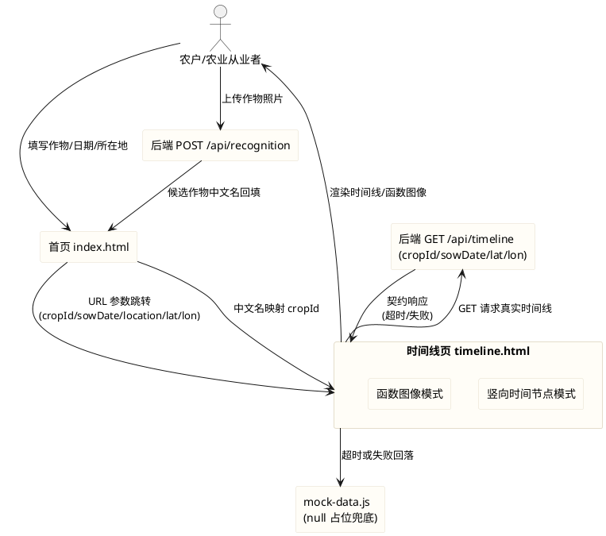
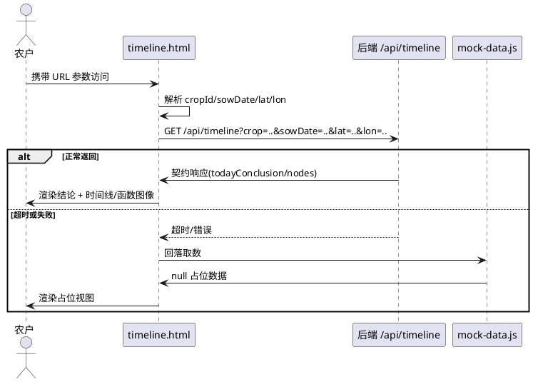

# 前端业务流程对齐后端真实接口（frontend_flow_align）

> 本文档用于将 agritime（知农时）纯前端展示链路对齐后端真实接口契约：修正 timeline.html 数据请求的方法、参数名、作物标识与位置传参，补齐"中文名 ↔ cropId"映射、请求超时降级、拍照识别中文名映射，以及函数图像模式在"真实数据 / null 占位"两种情况下的数据对齐。
> 范围红线：仅允许修改 `frontend/` 目录下文件；不得修改后端、`contract/`、`data/`、`deploy/`、`docs/`；不引入框架、构建工具或第三方依赖。
> nginx 反向代理 `/api → 8080` 属**部署前提/待确认项**（见第 7 章），不纳入前端代码修改范围。

# **1. 组件定位**

## **1.1 核心职责**
本组件负责将 agritime 前端（index.html → timeline.html）的取数链路对齐后端真实接口契约，实现"输入表单 → 时间线展示/函数图像"全链路可跑通、可降级。

## **1.2 核心输入**
1. 用户在 index.html 输入并提交的作物品种、播种日期、所在地。
2. index.html 通过 URL 查询参数（crop/cropId、sowDate、location、lat、lon）跳转 timeline.html 时传入的参数链路。
3. 后端 `GET /api/timeline` 的真实响应（契约对象，含 todayConclusion、nodes；**不含 reminders**）。
4. 拍照识别接口 `POST /api/recognition` 返回的候选作物中文名列表（candidates[].crop）。
5. 离线兜底数据 `frontend/assets/mock/mock-data.js`（字段以 null 占位）。

## **1.3 核心输出**
1. 向 `GET /api/timeline` 发出带 `crop`（cropId）、`sowDate`、`lat`、`lon` 查询参数的请求。
2. 在 timeline.html 渲染的今日结论、竖向时间节点列表、函数图像（两种模式）。
3. 接口失败或超时后渲染的 mock 兜底视图（页面不中断、不白屏）。
4. 经"中文名 → cropId"映射后的作物标识（供请求参数与展示使用）。

## **1.4 职责边界**
本组件**不负责**以下事项：
1. 后端服务（`/opt/crop-calendar`、`zhinongshi-calc`）及 `GET /api/timeline`、`POST /api/recognition` 的实现——**不得修改**，前端仅按契约适配。
2. `contract/`、`data/`、`deploy/`、`docs/` 等非前端模块——**不得修改**。
3. nginx 反向代理 `/api → 8080` 的部署配置——属**部署前提/待确认项**，非前端代码。
4. 后端时间线生成算法、图表数据大模型生成逻辑、超时根因治理——本组件仅在**前端**做超时保护与降级。
5. 引入任何框架、构建工具、第三方库（含图表库）——**明确禁止**。
6. 后端不返回 `reminders` 字段——本组件不得臆造 reminders，从容处理其缺失（优雅降级）。

# **2. 领域术语**

**cropId**
: 后端约定的作物英文标识，取值范围仅 5 个：`dry_garlic`（山东金乡大蒜）、`wheat_winter`（冬小麦）、`corn_summer`（夏玉米）、`rice`（水稻）、`soybean`（大豆）。
: 备注：时间线接口的 `crop` 参数须传 cropId，而非作物中文名。

**作物中文名 ↔ cropId 映射**
: 前端维护的对照关系，用于将用户输入/识别结果中的作物中文名转换为后端可识别的 cropId，反之用于展示。

**sowDate**
: 后端约定的播种日期查询参数名，格式 `YYYY-MM-DD`。
: 备注：前端既有参数名为 `sowingDate`，本次须对齐为 `sowDate`，并保证 index.html → timeline.html 参数链路自洽。

**lat / lon**
: 后端约定的纬度、经度查询参数名（标量）。
: 备注：前端既有以 `location` 对象（含 latitude/longitude/county）传参，本次须改为标量 `lat`/`lon`；`location`（所在地区中文文本）仅用于页面展示。

**超时降级**
: 当对后端接口的请求在限定时间内未返回（或返回失败）时，前端主动中止请求并回落到本地 mock 数据渲染，保证页面可用。

**URL 参数链路**
: index.html 提交后拼装查询参数跳转 timeline.html，timeline.html 再解析这些参数构造接口请求，两个页面之间的参数命名与含义须保持一致（自洽）。

**EARS 需求编号约定**
: 本文档需求编号格式为 REQ-FFA-NNN，FFA 为 Frontend Flow Align 缩写。编号前缀对应 EARS 句型：UBI（Ubiquitous）、EVT（Event-driven）、STA（State-driven）、OPT（Optional）、UNW（Unwanted）。

# **3. 角色与边界**

## **3.1 核心角色**
- **农户/农业从业者**：在首页填写作物/日期/所在地并提交，在时间线页查看结论与时间线/函数图像，是体验对象。
- **测试维护者**：运行 `node --test frontend/tests/pages.test.js`，确认既有 13 项断言全绿，并可按需补充新断言。
- **开发者/交付者**：将修改后的前端代码上传至目标服务器并提交 Git。

## **3.2 外部系统**
- **后端时间线接口（`GET /api/timeline`）**：真实数据来源，参数 `crop`（cropId）/`sowDate`/`lat`/`lon`，返回契约对象（含 todayConclusion、nodes，不含 reminders）；实测耗时约 61 秒。
- **后端识别接口（`POST /api/recognition`）**：请求 JSON `{image: base64}`，返回 `{needConfirm, candidates[{crop, confidence}], fallback}`，其中 `crop` 为**中文名**。
- **mock-data.js**：离线兜底数据来源，字段 null 占位，**不得硬编码假数据**。
- **首页（index.html）**：表单页，跳转 timeline.html 并传递查询参数。
- **目标服务器（115.175.44.27 的 /agritime）与 GitHub 仓库（lj-tang/agritime）**：交付目标。

## **3.3 交互上下文**

# **4. DFX约束**

## **4.1 性能**
1. 对 `GET /api/timeline` 的请求须设置明确超时上限，取值为 **20 秒（20000ms）**；超时后立即中止请求并降级（回落 mock）。该值小于后端实测耗时（约 61 秒），故正常后端条件下会超时降级——这是用户确认的体验优先策略：宁可 20 秒后降级，也不让用户等待约 1 分钟。
2. 超时上限须以具名常量集中定义，不得在多处硬编码。
3. 前端首屏（含加载骨架显示）不得因等待后端而阻塞，须先渲染 loading 态。

## **4.2 可靠性**
1. 当 `GET /api/timeline` 超时、返回非 2xx 或返回非法结构时，系统须回落至 mock-data.js 渲染，页面不得白屏或抛出未捕获 JS 错误。
2. 后端不返回 `reminders` 时，渲染逻辑须容错（无销售窗口节点即可），不得报错。
3. 降级后 mock 的 null 占位数据须能正常渲染（空态/占位提示），不得因字段为 null 抛出异常。

## **4.3 安全性**
1. 请求参数须经标准 URL 编码（URLSearchParams）拼装，防止参数注入。
2. 本次不引入任何外部脚本依赖，所有逻辑内联于前端页面或项目内本地脚本。

## **4.4 可维护性**
1. cropId 映射表、超时上限、接口路径须以具名常量集中定义，便于维护。
2. 参数名（crop/sowDate/lat/lon）须全链路统一，禁止一处用 `sowingDate` 另一处用 `sowDate`。

## **4.5 兼容性**
1. **测试兼容（强制红线）**：本次改造不得破坏 `frontend/tests/pages.test.js` 的既有 13 项断言；可新增断言，但既有断言须全绿。
2. **不可引入依赖**：不得引入框架、构建工具、第三方库（含图表库）。
3. **文件范围兼容**：不得修改后端及 `contract/`、`data/`、`deploy/`、`docs/` 等模块。
4. **参数链路兼容**：index.html 与 timeline.html 的 URL 参数命名须自洽，timeline.html 须能解析 index.html 产出的全部参数。

# **5. 核心能力**

## **5.1 时间线数据请求对齐**

### **5.1.1 业务规则**

1. **REQ-FFA-UBI-001（Ubiquitous）**：系统须以 HTTP `GET` 方法请求后端时间线接口 `/api/timeline`，替代既有 `POST` 请求。
   a. 验收条件：[timeline.html 发起时间线数据请求] → [请求方法为 GET，请求体中无 JSON body]

2. **REQ-FFA-UBI-002（Ubiquitous）**：系统须以查询参数传递 `crop`、`sowDate`、`lat`、`lon`，参数名与后端契约完全一致。
   a. 验收条件：[审查请求 URL] → [形如 `/api/timeline?crop={cropId}&sowDate=YYYY-MM-DD&lat={纬度}&lon={经度}`，无 `sowingDate`、无 `location` 对象参数]

3. **REQ-FFA-UBI-003（Ubiquitous）**：系统须在 `crop` 参数中传递作物英文 cropId（非中文名）。
   a. 验收条件：[用户选择"山东金乡大蒜"并提交] → [请求参数 `crop=dry_garlic`，而非 `crop=山东金乡大蒜`]

4. **REQ-FFA-UBI-004（Ubiquitous）**：系统须按后端契约解析响应：读取 `todayConclusion`（status/copy 等）与 `nodes`（nodeSeq/daysAfterSowing/date/operationType/name/description/status/copy/reasons/rescheduleAdvice/certainty/weatherIcon 等）字段用于渲染。
   a. 验收条件：[后端返回契约响应] → [今日结论卡片与竖向节点列表按响应字段正确渲染]

5. **禁止项**：禁止继续以 `POST` + JSON body（含 `crop` 中文名、`sowingDate`、`location` 对象）请求时间线接口；禁止幻想后端返回 `reminders` 字段。
   a. 验收条件：[代码审查] → [无 POST 时间线请求，无 sowingDate/location 对象参数，reminders 缺失时逻辑不报错]

### **5.1.2 交互流程**

### **5.1.3 异常场景**

1. **接口返回非 2xx**
   a. 触发条件：后端返回 4xx/5xx
   b. 系统行为：捕获错误并回落 mock
   c. 用户感知：看到 mock 占位视图，页面可用
2. **接口返回结构非法**
   a. 触发条件：响应缺少 nodes 或字段类型异常
   b. 系统行为：按缺失/空数组处理，走空态或降级
   c. 用户感知：看到空态或占位提示，无 JS 报错

## **5.2 作物标识映射（中文名 ↔ cropId）**

### **5.2.1 业务规则**

1. **REQ-FFA-UBI-005（Ubiquitous）**：系统须为作物数据集（index.html 的 CROPS）补齐 cropId 字段，且覆盖后端支持的全部 5 个 cropId（dry_garlic、wheat_winter、corn_summer、rice、soybean）。
   a. 验收条件：[代码审查] → [CROPS 中每一项均含 cropId，且 5 个 cropId 全部出现]

2. **REQ-FFA-UBI-006（Ubiquitous）**：系统须提供"作物中文名 → cropId"的映射能力，使中文名（含用户输入、识别回填）能转换为请求所需 cropId。
   a. 验收条件：[输入中文名"山东金乡大蒜"] → [映射得到 `dry_garlic`]

3. **REQ-FFA-EVT-007（Event-driven）**：当作物中文名能匹配到 cropId 时（后端数据库/规程表已支持的作物），系统须以该 cropId 作为 `crop` 参数（走数据库规程）；当无法匹配任何 cropId 时，系统须以作物**中文名**作为 `crop` 参数发起请求，交由后端走大模型生成分支。
   a. 验收条件：[选择"山东金乡大蒜"提交] → [请求 `crop=dry_garlic`（走数据库）]；[选择"山东寿光番茄"提交] → [请求 `crop=山东寿光番茄`（中文名，走后端大模型）]；两种情况下 `crop` 参数均非空

4. **REQ-FFA-UBI-008（Ubiquitous）**：系统须移除 CROPS 中后端不支持的作物条目所臆造的 cropId，或将其调整为后端支持的作物；不得为"番茄"等后端不支持作物编造 cropId。
   a. 验收条件：[代码审查] → [不存在后端 5 个 cropId 之外的臆造 cropId]

5. **禁止项**：禁止在请求中以中文名充当 cropId；禁止为后端不支持的作物编造 cropId。
   a. 验收条件：[代码审查] → [请求 crop 值恒为后端 5 个 cropId 之一或明确的默认值]

### **5.2.3 异常场景**

1. **识别回填的中文名与 CROPS 不完全一致**
   a. 触发条件：识别返回"大蒜"而 CROPS 为"山东金乡大蒜"
   b. 系统行为：按映射规则（精确匹配优先，其次包含匹配）转换为 cropId；无法匹配时按 5.2.1 规则处理
   c. 用户感知：作物正常参与时间线请求，无非法参数

## **5.3 参数链路与位置传参对齐**

### **5.3.1 业务规则**

1. **REQ-FFA-UBI-009（Ubiquitous）**：index.html 提交跳转时，URL 查询参数须包含 cropId（作为 `crop`）、`sowDate`（格式 `YYYY-MM-DD`）、`lat`、`lon`，并保留 `location`（所在地区中文文本）用于展示。
   a. 验收条件：[表单校验通过提交] → [URL 含 `crop=dry_garlic&sowDate=YYYY-MM-DD&lat=..&lon=..&location=中文地区`]

2. **REQ-FFA-UBI-010（Ubiquitous）**：timeline.html 须能解析 index.html 产出的参数链路，并将 `lat`/`lon` 作为标量数值、`crop` 作为 cropId 使用。
   a. 验收条件：[携带 index.html 产出的 URL 访问 timeline.html] → [请求 `/api/timeline` 使用正确的 cropId 与 lat/lon 标量]

3. **REQ-FFA-UBI-011（Ubiquitous）**：index.html → timeline.html 的参数命名须全链路统一（统一使用 `sowDate`），timeline.html 须与 index.html 保持一致。
   a. 验收条件：[代码审查] → [两页面关于播种日期的参数名一致，不存在一端 `sowingDate` 另一端 `sowDate` 的断链]

4. **REQ-FFA-UBI-012（Ubiquitous）**：`location` 中文文本仅用于页面展示（如标题副文案），不得再作为位置坐标参数传给后端。
   a. 验收条件：[审查请求参数] → [位置以 `lat`/`lon` 标量传递，`location` 不出现在接口 query 中]

5. **禁止项**：禁止以 `location` 对象（latitude/longitude/county）承载位置传参；禁止参数名在页面间不一致导致断链。
   a. 验收条件：[代码审查] → [无 location 对象传参，参数名链路自洽]

### **5.3.3 异常场景**

1. **URL 参数缺失**
   a. 触发条件：用户直接访问 timeline.html 未带参数
   b. 系统行为：使用明确的默认值（默认 cropId 与默认经纬度）构造请求
   c. 用户感知：页面正常展示，不报错
2. **经纬度为非数字**
   a. 触发条件：`lat`/`lon` 非数值
   b. 系统行为：回落默认坐标
   c. 用户感知：页面正常展示

## **5.4 请求超时与降级**

### **5.4.1 业务规则**

1. **REQ-FFA-STA-011（State-driven）**：在时间线请求进行中且超过 20 秒未返回时，系统须中止该请求并进入降级流程。
   a. 验收条件：[后端无响应超过 20 秒] → [请求被中止，回落 mock 数据渲染，页面可正常查看]

2. **REQ-FFA-UNW-012（Unwanted）**：如果时间线请求超时、失败或返回非法数据，系统不得停留在 loading 骨架或白屏状态。
   a. 验收条件：[请求超时/失败] → [loading 隐藏，渲染 mock 占位视图或空态，无未捕获 JS 错误]

3. **REQ-FFA-UBI-013（Ubiquitous）**：系统须在任何降级路径下均保证时间线页与函数图像模式的渲染逻辑可用（含 null 占位）。
   a. 验收条件：[降级到 mock 后切换至函数图像模式] → [显示占比占位视图，无报错]

4. **禁止项**：禁止不设超时的无限等待；禁止超时后静默无反馈。
   a. 验收条件：[代码审查] → [存在明确的超时上限常量与降级分支]

### **5.4.3 异常场景**

1. **超时与用户主动返回并发**
   a. 触发条件：请求超时瞬间用户点击返回
   b. 系统行为：中止请求，不产生重复渲染或错误
   c. 用户感知：正常跳转，无报错

## **5.5 拍照识别中文名映射**

### **5.5.1 业务规则**

1. **REQ-FFA-EVT-014（Event-driven）**：当拍照识别返回候选作物中文名并由用户确认回填到作物字段后，系统须能将该中文名映射到 cropId，供后续时间线请求使用。
   a. 验收条件：[识别返回"水稻"并用户确认] → [后续提交请求参数 `crop=rice`]

2. **REQ-FFA-UBI-015（Ubiquitous）**：系统须适配识别接口返回结构中 `candidates[].crop` 为中文名的约定；回填后仍以中文名展示、以 cropId 传参。
   a. 验收条件：[识别成功回填] → [作物输入框显示中文名，请求使用对应 cropId]

3. **禁止项**：禁止将识别返回的中文名直接作为 crop 请求参数。
   a. 验收条件：[代码审查] → [识别回填路径同样经过中文名→cropId 映射]

### **5.5.3 异常场景**

1. **识别候选中文名无对应 cropId**
   a. 触发条件：识别返回后端不支持作物
   b. 系统行为：按 5.2.1 REQ-FFA-EVT-007 规则处理（无匹配 cropId 时以中文名发起，走后端大模型）
   c. 用户感知：无非法参数，流程不中断

## **5.6 函数图像模式数据对齐**

### **5.6.1 业务规则**

1. **REQ-FFA-UBI-016（Ubiquitous）**：当时间线数据为真实 nodes（date/name 等字段有值）时，函数图像模式须以各节点的 `daysAfterSowing` 为横轴坐标依据绘制多峰值曲线。
   a. 验收条件：[真实数据含多个含 daysAfterSowing 的节点且切至函数图像模式] → [各峰值位置对应该节点的 daysAfterSowing，形成多峰值曲线]

2. **REQ-FFA-STA-017（State-driven）**：当数据为 null 占位（mock 未接入真实数据）或无有效 daysAfterSowing 时，函数图像模式须显示占位状态，不得绘制含具体峰值的虚假曲线。
   a. 验收条件：[mock null 占位数据且切至函数图像模式] → [显示空坐标轴与"数据待接入"占位提示，不绘制曲线]

3. **禁止项**：禁止在 null 占位时硬编码假曲线；禁止函数图像模式破坏既有竖向时间节点模式逻辑与既有 13 项断言。
   a. 验收条件：[代码审查] → [null 占位无虚假曲线，既有断言全绿]

## **5.7 可运行性与测试**

### **5.7.1 业务规则**

1. **REQ-FFA-UBI-018（Ubiquitous）**：改造后前端逻辑须正确、无报错，且 `frontend/tests/pages.test.js` 既有 13 项断言全部通过。
   a. 验收条件：[运行 `node --test frontend/tests/pages.test.js`] → [既有 13 项断言全绿，无失败]

2. **REQ-FFA-UBI-019（Ubiquitous）**：系统须针对本次对齐补充必要测试断言（如 GET + cropId/sowDate/lat/lon 参数、中文名→cropId 映射、超时降级常量等），且不得破坏既有断言。
   a. 验收条件：[测试套件运行] → [新增断言通过，既有 13 项断言仍全绿]

3. **禁止项**：禁止为通过测试而删除或弱化既有断言。
   a. 验收条件：[代码审查] → [既有 13 项断言原文保留且通过]

# **6. 数据约束**

## **6.1 作物映射对象（作物数据集条目）**
1. **name**：作物中文名，非空字符串，用于展示与用户输入比对。
2. **cropId**：后端作物英文标识，取值必须为 dry_garlic、wheat_winter、corn_summer、rice、soybean 之一。
3. **lat**：作物主产区纬度，数值，可作为默认坐标来源。
4. **lng**：作物主产区经度，数值，可作为默认坐标来源。
5. **city**：作物主产区中文地名，非空字符串，用于所在地回填与展示。

## **6.2 时间线请求参数**
1. **crop**：cropId，必填，取值见 6.1 cropId 约束。
2. **sowDate**：播种日期，格式 `YYYY-MM-DD`，必填。
3. **lat**：纬度，数值（标量），必填（缺失回落默认）。
4. **lon**：经度，数值（标量），必填（缺失回落默认）。
5. **location**：所在地区中文文本，仅用于展示，不作为接口参数。

## **6.3 时间线响应对象**
1. **apiVersion**：接口版本字符串。
2. **dataSource**：数据来源枚举（realtime/cache/unavailable），用于"数据来源"文案。
3. **dataTime**：数据时间，可为 null。
4. **todayConclusion**：今日结论对象，含 status、copy 等字段。
5. **nodes**：节点数组，每个节点含 nodeSeq、daysAfterSowing（函数图像横轴依据）、date、operationType、name、description、status、copy、reasons、rescheduleAdvice、certainty、weatherIcon 等。
6. **reminders**：后端**不返回**；前端须容错其缺失。

## **6.4 识别响应对象**
1. **needConfirm**：布尔，是否需人工确认。
2. **candidates**：候选数组，元素含 crop（**中文名**）与 confidence（0-1 数值）。
3. **fallback**：兜底标志/提示（可为 null）。
4. 备注：`candidates[].crop` 为中文名，须经中文名→cropId 映射后方可用于时间线请求。

# **7. 需求归类与交付边界**

> 本章为本次任务的落地归类，明确区分"前端代码修改"、"部署前提/待确认项"与"交付任务"。

## **7.1 前端代码修改（允许且必须，范围限 frontend/）**
1. `frontend/pages/timeline.html`：`getData()` 改为 `GET /api/timeline?crop&sowDate&lat&lon`；URL 参数解析对齐；超时（20s）与降级；识别中文名→cropId；函数图像模式真实/占位数据对齐。—— 对应 REQ-FFA-UBI-001~004、UBI-010~014、STA-011、UNW-012、UBI-015~017。
2. `frontend/pages/index.html`：CROPS 补齐 cropId（覆盖后端 5 个）；提交跳转参数对齐（crop=cropId、sowDate、lat、lon、location）；识别回填经映射。—— 对应 REQ-FFA-UBI-005~009、EVT-014。
3. `frontend/assets/mock/mock-data.js`：保持 null 占位策略（如需可与契约字段保持一致，不得硬编码假数据）。
4. `frontend/tests/pages.test.js`：新增对齐相关断言，既有 13 项断言保持全绿。—— 对应 REQ-FFA-UBI-018、UBI-019。
5. `frontend/pages/photo-capture.js`：如需确保识别中文名可被映射（仅在映射逻辑需落在该文件时做最小改动，否则不改动）。
6. `frontend/assets/css/*`：如降级/占位视图需要样式微调（最小改动）。

## **7.2 部署前提 / 待确认项（不纳入前端代码修改范围）**
1. **nginx 反向代理**：目标服务器需保证 `/api → 8080` 的反向代理生效，前端 GET `/api/timeline` 与 POST `/api/recognition` 才能命中后端。**属部署配置**，须由部署方确认配置；本 spec 不将 nginx 配置纳入前端代码修改。
2. **后端接口可用性与耗时**：后端时间线接口实测约 61 秒，属后端性能问题；本 spec 仅做前端 20s 超时保护（超时即降级），**不承诺**修复后端耗时。
3. **跨域/同源**：前端与接口在同源（同域经 nginx 代理）下运行的前置条件，须由部署方确认。
4. 已确认：前端超时上限取 **20s**（用户决策，体验优先，超时即降级）；若后端耗时优化后需重新评估该值。
5. 已确认：无对应 cropId 的作物（如"番茄"）以**中文名**发起请求，走后端大模型生成分支（用户决策）。

## **7.3 交付任务**
1. **上传服务器**：修改后的前端代码须能上传至目标服务器 115.175.44.27 的 `/agritime`（依赖 7.2 的 nginx 前提）。
2. **Git 提交**：修改后同步提交并推送至 GitHub 仓库 `lj-tang/agritime`。
3. 以上交付任务以 7.1 前端代码修改完成为前置。