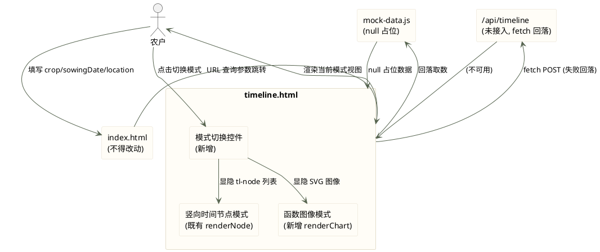
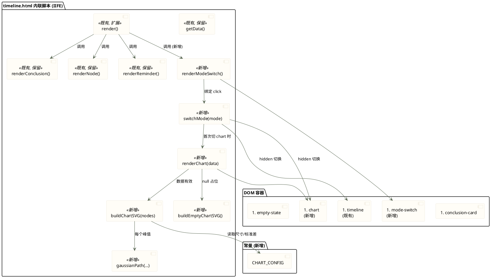
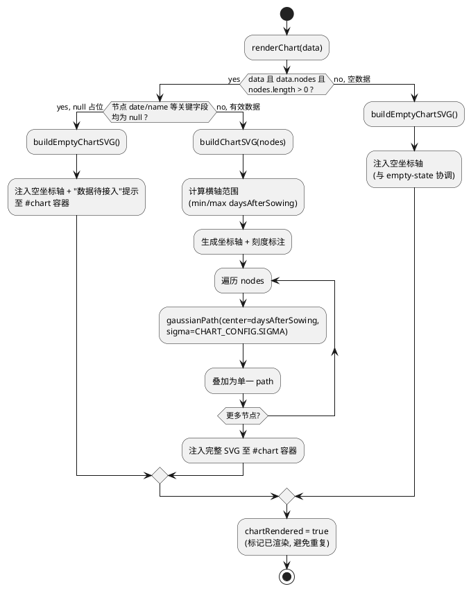
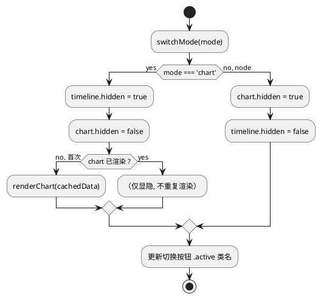
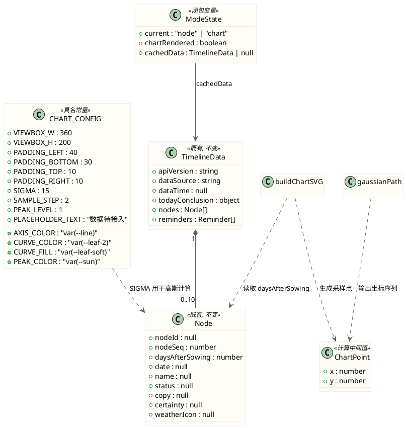

# 一、需求与存量功能关系分析

## 1.1 需求功能与存量功能对比

### 1.1.1 已实现功能

| 需求功能 | 存量功能 | 代码位置 | 匹配度 |
|---------|---------|---------|--------|
| 时间线数据获取与 fetch 失败回落 mock | getData() 已实现 fetch /api/timeline 失败回落 window.MOCK_TIMELINE | timeline.html:73-81 | 100% |
| 竖向时间节点模式渲染（tl-node 卡片列表） | renderNode() 渲染动作/决策/节气天气/详情多层信息 | timeline.html:130-198 | 100% |
| 销售窗口提醒节点渲染 | renderReminder() 渲染节日销售窗口 | timeline.html:200-227 | 100% |
| 今日结论卡片渲染 | renderConclusion() 渲染状态徽标 + 文案 + 数据来源 | timeline.html:111-128 | 100% |
| 节点展开交互（classList.toggle('open')） | renderNode 中 card.addEventListener click 切换 open 类 | timeline.html:140 | 100% |
| 实线/虚线语义（certainty: predicted dashed / certain solid） | renderNode 中 wrap.className 按 certainty 区分；timeline.css .tl-node.predicted::before dashed | timeline.html:132; timeline.css:93-94 | 100% |
| 空态提示（未生成节点文案） | render() 中 data.nodes 为空时显示 empty-state | timeline.html:231-234 | 100% |
| 加载骨架（loading + skeleton） | 既有 loading 容器与 skeleton 动画 | timeline.html:31-35; timeline.css:214-234 | 100% |
| 375px 移动端视口适配 | viewport meta + common.css overflow-x:hidden + max-width:100% + .page max-width:460px | timeline.html:5; common.css:28-29,46 | 100% |
| 纯原生 HTML/CSS/JS 无框架无构建 | IIFE + var 声明 + 函数式风格，无 ES Module | timeline.html:51-247 | 100% |
| 内联 SVG 图标能力 | svgIcon() + ICONS 对象内联 SVG 字符串 | timeline.html:57-61,90-95 | 75% |
| CSS 变量与设计令牌体系 | common.css :root 定义 --leaf/--sun/--red/--card 等变量 | common.css:1-21 | 100% |

> 匹配度 75% 项说明：svgIcon() 已具备内联 SVG 注入能力，但当前仅用于 term（节气）图标，weather/festival 走外部 img 路径（nodeIcon）。函数图像模式可复用内联 SVG 经验，但需独立构建坐标系 SVG，非简单图标注入。

### 1.1.2 需要扩展的功能

| 需求功能 | 存量功能 | 差异说明 | 扩展方向 |
|---------|---------|---------|---------|
| render() 主渲染流程接入模式切换 | render() 当前直接渲染 conclusion + nodes + reminders，无模式概念 | 需在 conclusion 渲染后、timeline 渲染前插入模式切换控件；timeline 与新增 chart 容器需按当前模式显隐 | 在 render() 中新增切换控件渲染调用与默认模式设置；timeline 与 chart 容器互斥显隐 |
| timeline DOM 容器支持与 chart 容器共存 | 既有 `<section id="timeline">` 单一内容区 | 需新增平级 `<section id="chart">` 容器，两者通过 hidden 属性互斥 | 在 timeline.html 中 conclusion-card 与 timeline 之间插入模式切换控件 DOM；timeline 之后新增 chart 容器 |
| 既有 ICONS 内联 SVG 模式扩展为坐标系 SVG | ICONS 为 24×24 viewBox 图标级 SVG | 函数图像需 viewBox 级坐标系（如 0 0 360 200），含坐标轴、刻度、多峰值曲线路径，尺度与图标完全不同 | 新增独立的 SVG 构建逻辑（createElementNS），不复用 svgIcon()；ICONS 保持图标用途不变 |
| mock-data.js 结构与函数图像数据对接 | nodes 含 daysAfterSowing（有值）与 date/name（null 占位） | 函数图像横轴可用 daysAfterSowing 作为时间刻度（有值），峰值位置依赖 daysAfterSowing；date/name 为 null 时不绘制具体峰值标注文案 | renderChart 以 daysAfterSowing 为横轴坐标依据；date/name null 时坐标轴标注用占位刻度或"数据待接入" |

### 1.1.3 需要新增的功能或接口

**函数图像渲染模块**

| 功能点 | 输入 | 输出 | 核心逻辑 | 依赖 |
|--------|------|------|---------|------|
| renderChart(data) | 时间线数据对象（含 nodes 数组） | SVG DOM 元素注入 #chart 容器 | 判断数据有效性 → 构建坐标系 SVG → 遍历 nodes 绘制钟形曲线 → null 占位时渲染空坐标轴 + 提示文案 | mock-data / 后端数据 |
| buildChartSVG(nodes) | nodes 数组 | SVG 元素（含坐标轴 + 曲线 + 标注） | 计算横轴范围（min/max daysAfterSowing）→ 生成坐标轴与刻度 → 遍历 nodes 生成高斯曲线路径 d 属性 → 叠加为单一 path | 无 |
| gaussianPath(center, sigma, xMin, xMax, width, height) | 峰值中心、标准差、横轴范围、画布尺寸 | SVG path d 字符串 | 按采样步长计算 y = exp(-((x-μ)²)/(2σ²))，映射到画布坐标，拼接 M/L 指令 | 无 |
| buildEmptyChartSVG() | 无 | SVG 元素（空坐标轴 + 占位提示） | 绘制横纵坐标轴框架 + "数据待接入"文字标注，不绘制曲线 | 无 |

**模式切换控件模块**

| 功能点 | 输入 | 输出 | 核心逻辑 | 依赖 |
|--------|------|------|---------|------|
| renderModeSwitch() | 无 | 切换控件 DOM（含两个标签页按钮） | 创建 .mode-switch 容器 + 两个 button（竖向/函数图像）→ 默认竖向按钮 .active → 绑定 click 调用 switchMode | 无 |
| switchMode(mode) | mode: 'node' \| 'chart' | 切换两个内容区 hidden 属性 + 更新按钮 .active | 更新激活态类名 → timeline.hidden / chart.hidden 互斥 → 首次切至 chart 时延迟渲染 renderChart | renderChart |

**代码清理项**

| 清理目标 | 文件 | 冗余内容 | 清理动作 |
|----------|------|---------|---------|
| 未使用内联 SVG | timeline.html | ICONS.weather、ICONS.festival（nodeIcon 对 weather/festival 走 IMG_ICONS 外部 img，从不调用 svgIcon('weather'/'festival')） | 移除 ICONS.weather 与 ICONS.festival，保留 ICONS.term |
| 未使用 CSS 规则 | timeline.css | .conclusion-label（第 26-31 行，timeline.html 中无 class="conclusion-label" 引用） | 移除 .conclusion-label 规则块 |
| mock 结构不一致字段 | mock-data.js | nodes 末节点 festivalIcon 字段仅出现一次，其余节点无此字段；renderNode/renderReminder 未使用 festivalIcon | 移除 festivalIcon 字段，保持各节点结构一致 |

## 1.2 存量功能详细分析

### render(data) — 主渲染入口

- **接口契约**：入参 data（时间线数据对象），无返回值，副作用为操作 DOM（loading/empty-state/timeline/footer/conclusion-card 显隐与内容填充）。
- **业务规则**：data 为空或 nodes 为空数组 → 显示 empty-state 并 return；否则渲染 conclusion + 遍历 nodes 调用 renderNode + 遍历 reminders 调用 renderReminder。
- **扩展点**：render 末尾 `getData().then(render)` 为唯一调用点。改造时在 conclusion 渲染后插入模式切换控件渲染与默认模式设置。
- **约束**：不得改变空数据走 empty-state 的既有分支（测试断言依赖"未生成节点"文案）；不得改变 conclusion-card 显隐逻辑。

### renderNode(node) — 单节点卡片渲染

- **接口契约**：入参 node 对象，返回 div.tl-node DOM 元素。
- **业务规则**：按 certainty 区分 predicted/certain 类名 → 构建 tl-action（name+date）→ tl-decision（copy）→ tl-advice（rescheduleAdvice 可选）→ tl-note（solarTerm 优先，否则 weatherIcon）→ tl-detail（description+reasons）。card click 切换 open 类。
- **约束**：测试断言依赖 tl-action/tl-decision/tl-note 类名、classList.toggle('open')、predicted/certain 类名、node.copy 引用。**此函数保留不变**。

### renderConclusion(data) — 今日结论卡片

- **接口契约**：入参 data，无返回值，副作用为填充 conclusion/data-meta DOM 与 conclusion-card 显隐。
- **业务规则**：status 默认 green → badge + copy 文案 → brand-sub 更新 → data-meta 数据来源文案。
- **约束**：测试断言依赖 conclusion id。**此函数保留不变**。

### renderReminder(r) — 销售窗口提醒节点

- **接口契约**：入参 r（reminder 对象），返回 div.tl-node DOM 元素。
- **业务规则**：构建 tl-action（festivalName + 销售窗口 + festivalDate）→ tl-note（festival 图标 + reminderCopy）。
- **约束**：**此函数保留不变**。

### getData() — 数据获取

- **接口契约**：无入参，返回 Promise<data>。
- **业务规则**：fetch /api/timeline POST → 失败回落 window.MOCK_TIMELINE。
- **约束**：**此函数保留不变**，spec 明确不改动 fetch 回落逻辑。

### svgIcon(kind) / nodeIcon(kind) — 图标工具函数

- **接口契约**：svgIcon 入参 kind 字符串，返回 span.icon（innerHTML 注入 ICONS[kind]）；nodeIcon 入参 kind，term 走 svgIcon，其余走外部 img。
- **约束**：svgIcon 用 innerHTML 注入，但内容来自代码内常量 ICONS，非用户可控内容，无 XSS 风险。函数图像坐标系 SVG 应改用 createElementNS 安全构建，不通过 innerHTML。

### 既有 CSS 变量体系（common.css :root）

- 设计令牌：--leaf/--leaf-2/--leaf-soft（绿系）、--sun/--sun-soft（黄系）、--red/--red-soft（红系）、--paper/--paper-2/--card（底色）、--line（分隔线）、--ink/--ink-soft/--muted（文字）、--radius/--radius-sm（圆角）、--shadow/--shadow-soft（阴影）。
- 函数图像模式应复用既有变量保持视觉一致：坐标轴用 --line、曲线用 --leaf-2、峰值标注用 --sun、占位提示用 --muted、图表底色用 --card。
# 二、增量设计方案

## 2.1 实现模型

### 2.1.1 上下文视图



**交互协议与频率**：
- index → timeline：URL 查询参数一次性跳转，单次/会话
- timeline → mock：fetch 失败时单次回落，无轮询
- user → switch：用户点击触发，低频（<1 次/秒），切换渲染 <300ms
- switch → chartMode：首次切换时延迟渲染 SVG，后续切换仅显隐

### 2.1.2 服务/组件总体架构



**模块职责说明**：

| 模块 | 职责 | 既有/新增 | 改造策略 |
|------|------|----------|---------|
| getData / renderConclusion / renderNode / renderReminder | 既有数据获取与竖向模式渲染 | 既有 | 完全保留，不改动 |
| render() | 主渲染流程编排 | 既有 | 扩展：conclusion 后插入 renderModeSwitch 调用 + 默认 node 模式 |
| renderModeSwitch() | 构建模式切换控件 DOM 并绑定事件 | 新增 | 创建 .mode-switch + 两 button，默认竖向 .active |
| switchMode(mode) | 切换模式，互斥显隐 timeline/chart 容器 | 新增 | 更新 .active + hidden 属性 + 首次延迟渲染 chart |
| renderChart(data) | 函数图像模式渲染入口 | 新增 | 判断数据有效性分流至 buildChartSVG 或 buildEmptyChartSVG |
| buildChartSVG(nodes) | 构建完整坐标系 SVG（含曲线） | 新增 | 坐标轴 + 刻度 + 遍历 nodes 生成高斯曲线路径 |
| gaussianPath(...) | 单条钟形曲线 SVG path d 生成 | 新增 | 高斯函数采样 + 坐标映射 + M/L 拼接 |
| buildEmptyChartSVG() | 空坐标轴 + 占位提示 | 新增 | 仅坐标轴框架 + "数据待接入"文字 |
| CHART_CONFIG | 图表绘制参数具名常量 | 新增 | 集中定义 viewBox、边距、标准差、采样步长等 |

### 2.1.3 实现设计文档

#### 模式切换状态机

```plantuml
@startuml
skinparam state {
  BackgroundColor #fffdf7
  BorderColor #e4ddcb
}
[*] --> Loading : 页面加载
Loading --> NodeMode : 数据到达\n(默认竖向, REQ-FCM-STA-011)
Loading --> EmptyState : 数据为空数组

state NodeMode {
  [*] --> 显示tl-node列表
}
state ChartMode {
  [*] --> 首次进入 : 延迟渲染 renderChart
  首次进入 --> 显示SVG图像
  显示SVG图像 --> 已渲染
}

NodeMode --> ChartMode : 用户点击"函数图像"\n(REQ-FCM-EVT-010)
ChartMode --> NodeMode : 用户点击"竖向时间节点"\n(REQ-FCM-EVT-010)

NodeMode --> EmptyChart : null 占位数据\n切至 chart
EmptyChart --> NodeMode : 切回竖向
EmptyChart : 显示空坐标轴\n+ "数据待接入"

EmptyState --> [*]
@enduml
```

**状态转换规则**：
- 初始状态固定为 NodeMode（REQ-FCM-STA-011），保持既有用户体验。
- NodeMode ↔ ChartMode 双向切换，无全页刷新，仅 DOM hidden 互斥（REQ-FCM-EVT-010）。
- ChartMode 首次进入时延迟调用 renderChart（惰性渲染），避免首屏不必要的 SVG 计算。
- null 占位数据切至 ChartMode 时进入 EmptyChart 子状态，显示空坐标轴 + 占位提示（REQ-FCM-STA-005）。
- 切回 NodeMode 时竖向模式节点展开状态允许合理重置（spec 5.2.3 异常场景 1 允许）。

#### renderChart 渲染流程



**关键决策**：
- null 占位判定依据：nodes 中所有节点的 date 与 name 字段均为 null（mock-data.js 当前状态），则视为数据未接入，显示空坐标轴。
- daysAfterSowing 字段在 mock 中有值（0/7/120/140/170/205），但仅作为横轴刻度坐标计算依据；null 占位时不绘制具体峰值曲线，仅显示坐标轴框架。
- 多峰值曲线叠加为单一 `<path>` 元素的 d 属性拼接，而非多个 path，减少 DOM 节点数，提升渲染性能（REQ-FCM 性能 <300ms）。

#### switchMode 切换流程



## 2.2 接口设计

### 2.2.1 总体设计

**接口分类依据**：按职责分为渲染入口（render 扩展）、模式切换（renderModeSwitch/switchMode）、图表构建（renderChart/buildChartSVG/gaussianPath/buildEmptyChartSVG）三类。

**接口变更策略**：既有函数签名不变（render/renderNode/renderConclusion/renderReminder/getData），仅 render 内部流程扩展。新增函数均为内部函数（IIFE 闭包内），不暴露至 window，无外部接口契约变更。

| 接口 | 类型 | 稳定性 | 说明 |
|------|------|--------|------|
| render(data) | 既有扩展 | 稳定 | 签名不变，内部新增切换控件渲染 |
| renderModeSwitch() | 新增 | 稳定 | 无入参，构建切换控件 DOM |
| switchMode(mode) | 新增 | 稳定 | mode: 'node'\|'chart' |
| renderChart(data) | 新增 | 稳定 | data 为时间线数据对象 |
| buildChartSVG(nodes) | 新增 | 内部 | nodes 数组，返回 SVG 元素 |
| gaussianPath(center, sigma, xMin, xMax, w, h) | 新增 | 内部 | 返回 path d 字符串 |
| buildEmptyChartSVG() | 新增 | 内部 | 返回空坐标轴 SVG 元素 |

### 2.2.2 接口清单

#### render(data) — 主渲染入口（扩展）

- **接口签名**：`function render(data)` （签名不变）
- **业务说明**：时间线数据到达后的主渲染流程。扩展后在 conclusion 渲染后插入模式切换控件，并默认设置竖向模式。
- **前置条件**：getData() Promise resolve。
- **后置条件**：loading 隐藏；数据有效时 conclusion-card 显示 + 模式切换控件显示 + timeline 显示（默认竖向）；数据为空时 empty-state 显示。
- **异常映射**：data 为 null/undefined 或 nodes 为空数组 → 走 empty-state 分支（既有逻辑不变）。
- **改造要点**：在 `renderConclusion(data)` 调用之后、`timeline.appendChild(renderNode(n))` 循环之前，插入 `renderModeSwitch()` 调用。timeline 与 chart 容器默认 hidden 状态由 switchMode('node') 初始化设置。

#### renderModeSwitch() — 模式切换控件渲染

- **接口签名**：`function renderModeSwitch()` （无入参，无返回值，副作用为 DOM 操作）
- **业务说明**：构建模式切换控件 DOM（.mode-switch 容器 + 两个标签页按钮），绑定 click 事件，默认竖向按钮 .active。插入至 conclusion-card 与 timeline 之间。
- **前置条件**：renderConclusion 已执行，conclusion-card 已显示。
- **后置条件**：DOM 中 conclusion-card 之后存在 .mode-switch 元素，含两个 button，竖向按钮带 .active 类。
- **DOM 结构**：
  ```
  <div class="mode-switch" id="mode-switch">
    <button type="button" class="mode-tab active" data-mode="node">时间节点</button>
    <button type="button" class="mode-tab" data-mode="chart">函数图像</button>
  </div>
  ```
- **事件绑定**：每个 button.addEventListener('click', function () { switchMode(this.getAttribute('data-mode')); })。

#### switchMode(mode) — 模式切换

- **接口签名**：`function switchMode(mode)` （mode: 'node' | 'chart'，无返回值）
- **业务说明**：切换至目标模式，互斥显隐 timeline 与 chart 容器，更新按钮激活态。首次切至 chart 时延迟渲染。
- **前置条件**：模式切换控件已渲染，cachedData 已缓存（render 时保存至闭包变量）。
- **后置条件**：目标模式内容区可见，另一模式内容区 hidden；目标按钮 .active，另一按钮移除 .active。
- **异常映射**：mode 值非 'node'/'chart' 时忽略，不操作。
- **性能保证**：仅 DOM hidden 属性切换 + 类名切换，无重排重绘内容，<300ms（REQ-FCM 性能）。首次 chart 渲染为 SVG 构建，节点数 ≤6，采样点有限，<300ms。

#### renderChart(data) — 函数图像渲染

- **接口签名**：`function renderChart(data)` （data 为时间线数据对象，无返回值，副作用为 #chart 容器内容填充）
- **业务说明**：函数图像模式渲染入口。判断数据有效性分流：有效数据 → buildChartSVG 绘制多峰值钟形曲线；null 占位 → buildEmptyChartSVG 显示空坐标轴 + 占位提示。
- **前置条件**：#chart 容器存在于 DOM 中。
- **后置条件**：#chart 内包含一个 SVG 元素（坐标系 + 曲线 或 空坐标轴 + 提示）。
- **异常映射**：data 为 null/undefined → 走空坐标轴分支；nodes 为空数组 → 走空坐标轴分支；nodes 字段全 null → 走空坐标轴分支。均不抛 JS 错误（REQ-FCM-STA-005）。
- **null 占位判定逻辑**：遍历 nodes，若所有节点的 date 与 name 均为 null（或 undefined），视为 null 占位状态。

#### buildChartSVG(nodes) — 完整坐标系 SVG 构建

- **接口签名**：`function buildChartSVG(nodes)` （返回 SVGElement）
- **业务说明**：构建含坐标轴、刻度标注、多峰值钟形曲线的完整 SVG 元素。使用 document.createElementNS('http://www.w3.org/2000/svg', ...) 安全构建，不通过 innerHTML（REQ-FCM 安全性，防 XSS）。
- **前置条件**：nodes 非空且含有效 daysAfterSowing 字段。
- **后置条件**：返回的 SVG 含 `<line>` 坐标轴、`<text>` 刻度标注、`<path>` 钟形曲线。
- **SVG 结构设计**：
  ```
  <svg viewBox="0 0 360 200" class="chart-svg">
    <!-- 底色矩形 (可选, 用 CSS background 替代) -->
    <!-- 纵轴 -->
    <line x1="40" y1="10" x2="40" y2="170" stroke="var(--line)" />
    <!-- 横轴 -->
    <line x1="40" y1="170" x2="350" y2="170" stroke="var(--line)" />
    <!-- 纵轴刻度标注 -->
    <text x="32" y="15">高</text>
    <text x="32" y="170">低</text>
    <!-- 横轴刻度标注 (日期/天数) -->
    <text x="..." y="185">...</text>
    <!-- 多峰值钟形曲线 (单一 path, 多段 M 拼接) -->
    <path d="M ... L ... Z" fill="var(--leaf-soft)" stroke="var(--leaf-2)" />
    <!-- 峰值标注点 (可选) -->
    <circle cx="..." cy="..." r="3" fill="var(--sun)" />
  </svg>
  ```
- **坐标映射**：横轴 x = 40 + (daysAfterSowing - minDay) / (maxDay - minDay) * 310；纵轴 y = 170 - recommendLevel * 160（recommendLevel ∈ [0,1]，峰值 = 1 → y = 10）。
- **各峰值高度相同**（REQ-FCM-UBI-003）：所有高斯曲线峰值 recommendLevel = 1，映射至 y = 10（同一水平线）。

#### gaussianPath(center, sigma, xMin, xMax, w, h) — 钟形曲线路径生成

- **接口签名**：`function gaussianPath(center, sigma, xMin, xMax, w, h)` （返回 string，SVG path d 属性值）
- **业务说明**：按高斯函数 y = exp(-((x-μ)²)/(2σ²)) 采样生成单条钟形曲线的 SVG path d 字符串。μ = center（峰值时间点），σ = sigma（标准差，控制曲线宽度）。
- **前置条件**：center、sigma 为有效数值，xMin < xMax，w、h 为正数。
- **后置条件**：返回的 d 字符串以 M 起始，含若干 L 指令，可赋值至 path.setAttribute('d', ...)。
- **采样策略**：按 CHART_CONFIG.SAMPLE_STEP（如 2px）步长从 xMin 到 xMax 采样，每点计算高斯函数值并映射至画布坐标，拼接 M x0,y0 L x1,y1 L x2,y2 ...。
- **常量引用**：sigma 取自 CHART_CONFIG.SIGMA（具名常量，集中定义，REQ-FCM 可维护性）。

#### buildEmptyChartSVG() — 空坐标轴 SVG

- **接口签名**：`function buildEmptyChartSVG()` （无入参，返回 SVGElement）
- **业务说明**：构建仅含坐标轴框架与"数据待接入"占位提示的 SVG，不绘制任何曲线（REQ-FCM-STA-005，禁止硬编码假数据绘制虚假曲线）。
- **前置条件**：无。
- **后置条件**：返回的 SVG 含 `<line>` 坐标轴、`<text>` "低/高"纵轴标注、"数据待接入"提示文字，无 `<path>` 曲线元素。
- **SVG 结构**：
  ```
  <svg viewBox="0 0 360 200" class="chart-svg chart-empty">
    <line x1="40" y1="10" x2="40" y2="170" stroke="var(--line)" />
    <line x1="40" y1="170" x2="350" y2="170" stroke="var(--line)" />
    <text x="32" y="15">高</text>
    <text x="32" y="170">低</text>
    <text x="180" y="95" text-anchor="middle" class="chart-placeholder">数据待接入</text>
  </svg>
  ```

## 2.3 数据模型

### 2.3.1 设计目标

- **支持的业务场景**：函数图像模式渲染（有效数据 + null 占位 + 空数组三种场景）、模式切换状态管理、图表绘制参数集中管理。
- **性能目标**：SVG 节点数 ≤30（坐标轴 + 刻度 + 单 path + 少量标注），渲染 <300ms；375px 视口下 viewBox 缩放无卡顿。
- **容量目标**：nodes 数组规模 ≤10（当前 mock 6 个），曲线采样点 ≤180，path d 字符串长度可控。
- **兼容策略**：既有 mock-data.js 数据结构不变（null 占位），新增 CHART_CONFIG 常量对象与闭包内 cachedData/chartRendered 状态变量，不影响既有数据契约。

### 2.3.2 模型实现



**对象说明**：

| 对象 | 类型 | 生命周期 | 持久化 | 说明 |
|------|------|---------|--------|------|
| CHART_CONFIG | 具名常量对象 | IIFE 内静态 | 无 | 集中定义图表绘制参数，避免魔法数字（REQ-FCM 可维护性） |
| ModeState | 闭包变量 | IIFE 内，页面级 | 无 | current 默认 'node'；chartRendered 默认 false；cachedData 在 render 时赋值 |
| TimelineData | 既有数据对象 | getData 返回 | 无 | 结构不变，mock null 占位 |
| Node | 既有节点对象 | TimelineData.nodes 元素 | 无 | 结构不变；daysAfterSowing 为函数图像横轴坐标依据 |
| ChartPoint | 计算中间值 | gaussianPath 内临时 | 无 | SVG 坐标映射结果，不单独持久化 |

**关键设计决策**：

1. **SVG 选用理由**（非 Canvas）：SVG 为矢量元素，可通过 CSS 类名控制样式（.chart-svg path { ... }），便于测试断言（可查询 path/line/text 元素存在性）；Canvas 为位图，测试无法断言内部绘制内容。spec 允许 SVG/Canvas，选 SVG 满足 REQ-FCM-UBI-002 且便于测试。

2. **多峰值叠加为单一 path**：各节点钟形曲线的 d 字符串拼接至一个 `<path>` 元素，而非每节点一个 path。减少 DOM 节点数，提升渲染性能；视觉上多峰值同图呈现，满足 REQ-FCM-UBI-004。

3. **createElementNS 安全构建**：坐标系 SVG 通过 document.createElementNS('http://www.w3.org/2000/svg', tagName) 逐元素构建，不通过 innerHTML 注入，满足 REQ-FCM 安全性（防 XSS），即使数据字段含恶意内容也不执行。

4. **惰性渲染 chart**：首次切至 chart 模式才调用 renderChart，避免首屏不必要的 SVG 计算。chartRendered 标记避免重复渲染，后续切换仅 hidden 属性切换。

5. **null 占位判定**：以 nodes 中所有节点 date 与 name 均为 null 作为判定依据。当前 mock-data.js 满足此条件（全部 null），将显示空坐标轴 + "数据待接入"。后端接入真实数据后 date/name 有值，自动切换至完整曲线渲染，无需改代码。

6. **既有函数保留策略**：renderConclusion / renderNode / renderReminder / getData 完全保留不变，确保 9 项测试断言全绿。render() 仅在 conclusion 渲染后插入一行 renderModeSwitch() 调用，不改变既有分支逻辑。

7. **切换控件位置**：DOM 顺序为 conclusion-card → mode-switch（新增）→ timeline → chart（新增）→ empty-state → footer。mode-switch 位于 conclusion-card 下方、timeline 上方，满足 REQ-FCM-UBI-008（无需滚动即可操作）。

8. **375px 适配**：SVG viewBox="0 0 360 200" 配合 CSS width:100%; height:auto; 自适应缩放；.mode-switch 用 flex 布局，两按钮等分宽度，触屏可操作（REQ-FCM-UBI-013）。

**新增 CSS 规则（timeline.css 追加）**：

| 选择器 | 作用 | 关键属性 |
|--------|------|---------|
| .mode-switch | 切换控件容器 | display:flex; gap:0; margin-bottom:18px; border-radius:var(--radius-sm); overflow:hidden; border:1px solid var(--line); |
| .mode-tab | 单个标签页按钮 | flex:1; padding:11px; border:none; background:var(--paper-2); font-size:15px; font-weight:600; cursor:pointer; transition:background 0.18s; |
| .mode-tab.active | 激活态 | background:var(--card); color:var(--leaf); font-weight:700; box-shadow:inset 0 -2px 0 var(--leaf-2); |
| .chart-wrap | 图表容器 | background:var(--card); border:1px solid rgba(228,221,203,0.9); border-radius:var(--radius); box-shadow:var(--shadow); padding:18px; margin-bottom:22px; |
| .chart-svg | SVG 元素 | width:100%; height:auto; display:block; |
| .chart-placeholder | 占位提示文字 | fill:var(--muted); font-size:13px; |

**新增测试断言方向（pages.test.js 可追加，不破坏既有 9 项）**：

| 断言方向 | 断言内容 |
|----------|---------|
| 模式切换控件存在 | timelineHtml 含 'mode-switch' 与 'mode-tab' |
| 两模式选项存在 | timelineHtml 含 data-mode="node" 与 data-mode="chart" |
| chart 容器存在 | timelineHtml 含 id="chart" |
| SVG 绘制方式 | timelineHtml 含 createElementNS（确认原生 SVG 构建） |
| 高斯函数常量 | timelineHtml 含 CHART_CONFIG 与 SIGMA |
| 占位提示文案 | timelineHtml 含 '数据待接入' |
| 激活态用类名非内联 | timelineHtml 含 'active' 类，不含内联 style 硬编码激活态 |
| 无外部图表库 | timelineHtml 不含 'Chart.js'/'echarts'/'d3' |