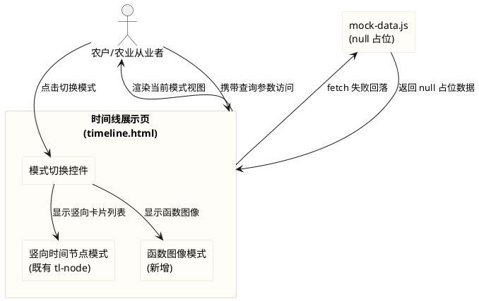
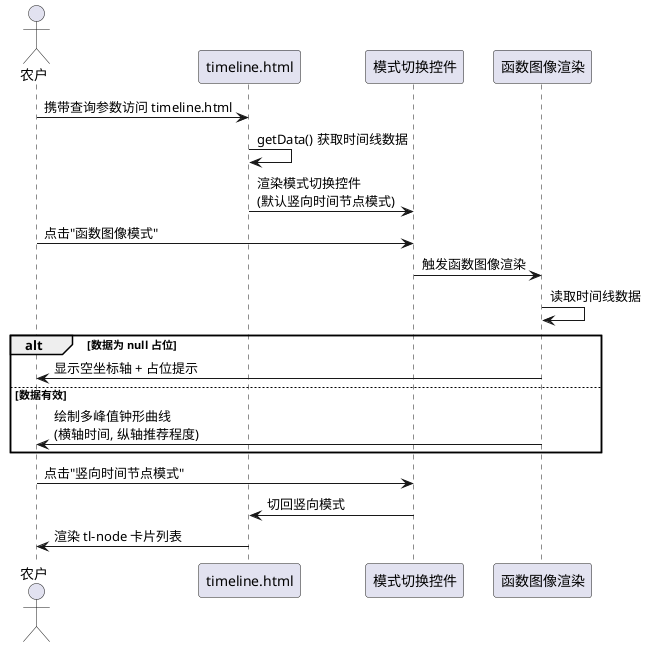
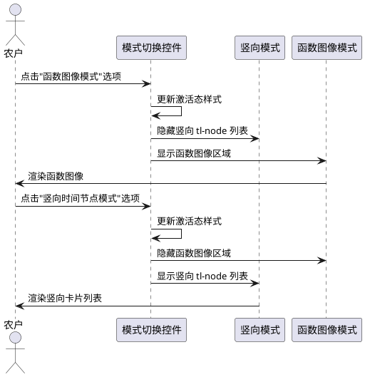
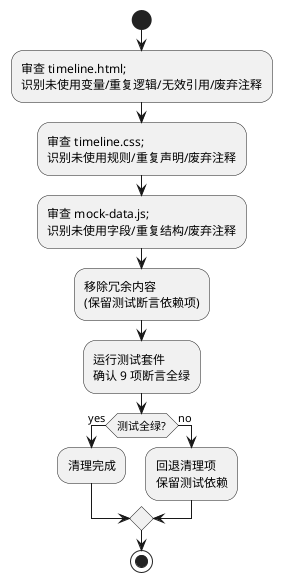

# 时间线函数图像模式（function_chart_mode）

> 本组件在 timeline.html 结果展示页新增"函数图像模式"，与既有"竖向时间节点模式"支持手动切换，并对 timeline.html / timeline.css / mock-data.js 进行冗余清理。mock 数据继续 null 占位，不硬编码假数据。

# **1. 组件定位**

## **1.1 核心职责**
本组件负责在 timeline.html 新增"函数图像模式"展示方式，将农事活动推荐程度以多峰值钟形曲线呈现，并与既有"竖向时间节点模式"支持用户手动切换，实现时间线结果的多维度可视化呈现。

## **1.2 核心输入**
1. 用户在 timeline.html 页面通过模式切换控件发出的切换指令。
2. 从 mock-data.js 或后端接口获取的时间线数据（含农事活动节点的时间与推荐程度信息）。
3. 首页表单提交传递的 URL 查询参数（crop、sowingDate、location 等）。

## **1.3 核心输出**
1. 在 timeline.html 渲染的函数图像（横轴时间、纵轴推荐程度、多峰值钟形曲线）。
2. 模式切换控件对用户操作的视觉反馈（当前激活态、切换动效）。
3. 切换模式时对既有竖向时间节点列表的显示/隐藏控制。

## **1.4 职责边界**
本组件**不负责**以下事项：
1. 首页（index.html）的输入表单逻辑——**明确不得改动**。
2. 公共样式（common.css）——**明确不得改动**。
3. 拍照识别组件（photo-capture.js）——**明确不得改动**。
4. 后端接口（/api/timeline）——纯前端项目，无后端，仅保留既有 fetch 失败回落 mock 的逻辑。
5. 时间线数据的生成算法——本组件仅负责展示，数据来源为 mock 或后端。
6. 既有 9 项测试断言的逻辑——仅可新增断言，**不得破坏既有**。

# **2. 领域术语**

**函数图像模式**
: 时间线结果的一种展示方式，以时间为横轴、农事活动推荐程度为纵轴，将各农事活动最合适时间点绘制为峰值，形成多峰值钟形或高斯分布曲线的图表视图。

**竖向时间节点模式**
: 时间线结果的既有展示方式，以竖向卡片列表（tl-node）逐个呈现农事活动节点，每个节点包含动作、决策、节气/天气注释、详情等信息。

**推荐程度**
: 农事活动在某一时间点执行的适宜性度量，取值范围 [0, 1]，在农事活动最合适时间点取峰值 1，其他时间逐渐递减。

**钟形曲线 / 高斯分布曲线**
: 以农事活动最合适时间点为均值中心、以时间窗口宽度为标准差的对称钟形函数，用于描述推荐程度随时间的变化。

**模式切换控件**
: 用户在两种展示模式之间手动切换的 UI 控件，放置于时间线内容区域上方，以标签页或按钮组形式呈现。

**EARS 需求编号约定**
: 本文档需求编号格式为 REQ-FCM-NNN，FCM 为 Function Chart Mode 缩写。编号前缀对应 EARS 句型：UBI（Ubiquitous）、EVT（Event-driven）、STA（State-driven）、OPT（Optional）、UNW（Unwanted）。

# **3. 角色与边界**

## **3.1 核心角色**
- **农户/农业从业者**：在 timeline.html 查看农事时间线，通过模式切换在不同展示方式间选择，辅助农事决策。
- **测试维护者**：运行 `node --test frontend/tests/pages.test.js` 验证既有 9 项断言全绿，并可新增针对函数图像模式的断言。

## **3.2 外部系统**
- **首页（index.html）**：通过 URL 查询参数跳转至 timeline.html，提供 crop、sowingDate、location 等输入，本次**不得改动**。
- **mock-data.js**：时间线数据的本地假数据来源，字段以 null 占位，本次仅可清理冗余内容，**不得硬编码假数据**。
- **后端接口（/api/timeline）**：未来真实数据来源，当前不可用，timeline.html 已有 fetch 失败回落 mock 的逻辑，本次不改动此逻辑。

## **3.3 交互上下文**

# **4. DFX约束**

## **4.1 性能**
1. 模式切换的渲染完成时间不得超过 300ms（含函数图像 SVG/Canvas 绘制）。
2. 函数图像绘制不得引入额外网络请求（纯前端 SVG/Canvas 计算）。
3. 函数图像在 375px 移动端视口下渲染帧率不低于 30fps，无明显卡顿。

## **4.2 可靠性**
1. 当时间线数据为 null 占位（mock 未接入真实数据）时，函数图像模式须显示占位状态（如空坐标轴或提示文案），不得抛出 JS 错误或白屏。
2. 模式切换不得导致页面状态丢失或 JS 错误，切换后切回时竖向模式的节点展开状态允许合理重置。
3. 函数图像绘制须以纯 SVG 或 Canvas 实现，不依赖任何外部图表库，即使 CDN 不可用仍可正常工作。

## **4.3 安全性**
1. 函数图像模式不引入任何外部脚本依赖，所有逻辑须内联于 timeline.html 或项目内本地脚本。
2. 模式切换控件与函数图像标注不得通过 innerHTML 注入用户可控内容，防范 XSS。

## **4.4 可维护性**
1. 模式切换控件的当前激活态须以 CSS 类名（如 .active）表达，不得通过内联 style 硬编码。
2. 函数图像的绘制参数（如峰值高度、曲线宽度、坐标轴范围）须以具名常量集中定义，不得在多处硬编码魔法数字。
3. 新增代码须与既有 timeline.html 内联脚本风格一致（IIFE、var 声明、函数式风格），不引入 ES Module 或框架语法。

## **4.5 兼容性**
1. **测试兼容（强制红线）**：本次改造不得破坏 `frontend/tests/pages.test.js` 的既有 9 项断言，包括但不限于：三字段 + 拍照入口、setDefaultValues、播种日期不能晚于今天、viewport、overflow-x:hidden、max-width:100%、tl-action/tl-decision/tl-note、classList.toggle('open')、未生成节点文案、predicted/certain、.tl-node.predicted dashed、node.copy、拍照组件断言、自定义日期选择器断言。可新增针对函数图像模式的断言，但既有断言须全绿。
2. **不可改动项兼容**：不得改动 index.html、common.css、photo-capture.js（除非模式切换功能必须的极小改动，且须明确说明）。
3. **浏览器兼容**：目标为现代移动端浏览器（Safari iOS、Chrome Android），SVG/Canvas 须兼容触屏交互，不依赖 hover 作为唯一交互手段。
4. **数据兼容**：mock-data.js 继续 null 占位策略，不硬编码假数据；函数图像模式须能处理 null 占位数据并显示占位状态。

# **5. 核心能力**

## **5.1 函数图像模式渲染**

### **5.1.1 业务规则**

1. **REQ-FCM-UBI-001（Ubiquitous）**：系统须在 timeline.html 新增"函数图像模式"展示方式，以时间为横轴、农事活动推荐程度为纵轴，将各农事活动最合适时间点绘制为峰值，形成多峰值钟形或高斯分布曲线。
   a. 验收条件：[timeline.html 加载并切换至函数图像模式] → [页面渲染包含横轴（时间）、纵轴（推荐程度）的坐标系，及多条以农事活动峰值为中心的钟形曲线]

2. **REQ-FCM-UBI-002（Ubiquitous）**：系统须以纯 SVG 或 Canvas 绘制函数图像，不引入任何外部图表库（如 Chart.js、ECharts、D3 等）。
   a. 验收条件：[代码审查] → [timeline.html 中函数图像绘制代码为原生 SVG 元素或 Canvas 2D API，无外部图表库引用]

3. **REQ-FCM-UBI-003（Ubiquitous）**：系统须保证函数图像的各峰值高度相同，即所有农事活动的推荐程度峰值在纵轴上取同一最大值。
   a. 验收条件：[多个农事活动节点存在时] → [各峰值在纵轴上的顶点位于同一水平线，无明显高低差异]

4. **REQ-FCM-UBI-004（Ubiquitous）**：系统须在函数图像中体现多个峰值，每个峰值对应一个农事活动的最合适时间点，峰值之间推荐程度逐渐递减。
   a. 验收条件：[时间线数据含 N 个农事活动节点] → [函数图像呈现 N 个峰值，峰值位于各节点最合适时间点，峰值之间曲线下凹]

5. **REQ-FCM-STA-005（State-driven）**：在时间线数据为 null 占位（mock 未接入真实数据）时，系统须在函数图像模式中显示占位状态，不得硬编码假数据绘制虚假曲线。
   a. 验收条件：[mock-data.js 中节点 date/name 等字段为 null 且切换至函数图像模式] → [显示空坐标轴或"数据待接入"等占位提示，不绘制含具体峰值位置的曲线]

6. **REQ-FCM-UBI-006（Ubiquitous）**：系统须在函数图像模式中提供可读的坐标轴标注，横轴标注时间（如日期或节气），纵轴标注推荐程度（如"低-高"或 0-1 刻度）。
   a. 验收条件：[函数图像模式渲染] → [横轴有时间刻度标注，纵轴有推荐程度刻度标注，用户可理解坐标含义]

7. **禁止项**：禁止引入外部图表库；禁止硬编码假数据绘制曲线（mock null 占位时须显示占位状态）；禁止函数图像模式破坏既有竖向时间节点模式的 DOM 结构与渲染逻辑。
   a. 验收条件：[代码审查] → [无外部图表库引用；mock null 时不绘制虚假曲线；既有 tl-node 渲染逻辑未被删改]

### **5.1.2 交互流程**

### **5.1.3 异常场景**

1. **时间线数据为 null 占位**
   a. 触发条件：mock-data.js 中节点字段为 null，后端未接入
   b. 系统行为：函数图像模式显示空坐标轴与"数据待接入"占位提示，不绘制含具体峰值位置的曲线
   c. 用户感知：看到坐标轴框架与提示文案，明确数据尚未接入

2. **时间线数据为空数组**
   a. 触发条件：getData() 返回 nodes 为空数组
   b. 系统行为：函数图像模式显示空坐标轴，与既有 empty-state 协调
   c. 用户感知：看到空坐标轴，无曲线绘制

3. **SVG/Canvas 不支持**
   a. 触发条件：极旧浏览器不支持 SVG 或 Canvas
   b. 系统行为：降级显示提示文案，建议升级浏览器
   c. 用户感知：看到提示文案，无 JS 错误

4. **模式切换时数据未加载完成**
   a. 触发条件：用户在 loading 骨架显示时点击模式切换
   b. 系统行为：切换控件可点击但函数图像区域显示 loading 状态，待数据到达后渲染
   c. 用户感知：切换控件响应，图像区域显示加载中

## **5.2 模式切换控件**

### **5.2.1 业务规则**

1. **REQ-FCM-UBI-007（Ubiquitous）**：系统须在 timeline.html 提供模式切换控件，支持用户在"竖向时间节点模式"与"函数图像模式"之间手动切换。
   a. 验收条件：[timeline.html 渲染完成] → [页面存在可交互的模式切换控件，包含两种模式选项]

2. **REQ-FCM-UBI-008（Ubiquitous）**：系统须明确模式切换控件的放置位置，控件须位于时间线内容区域上方，便于用户在查看内容前切换模式。
   a. 验收条件：[timeline.html 渲染完成] → [模式切换控件位于 conclusion-card 下方、timeline 内容区上方，用户无需滚动即可操作]

3. **REQ-FCM-UBI-009（Ubiquitous）**：系统须以标签页（tab）或按钮组形式实现模式切换控件，提供清晰的当前激活态视觉反馈。
   a. 验收条件：[任一模式激活] → [对应切换选项有明显的激活态视觉（如背景色、下划线、加粗），与非激活选项视觉区分明确]

4. **REQ-FCM-EVT-010（Event-driven）**：当用户点击模式切换控件的某一选项时，系统须立即切换至对应模式，隐藏当前模式内容并显示目标模式内容。
   a. 验收条件：[当前为竖向模式 且 用户点击"函数图像模式"] → [竖向 tl-node 列表隐藏，函数图像显示；反之亦然]

5. **REQ-FCM-STA-011（State-driven）**：在 timeline.html 首次加载时，系统须默认显示竖向时间节点模式，保持与既有用户体验一致。
   a. 验收条件：[timeline.html 首次加载] → [默认显示竖向时间节点模式，函数图像模式隐藏]

6. **REQ-FCM-UBI-012（Ubiquitous）**：系统须保证模式切换不破坏既有竖向时间节点模式的功能，包括节点展开（classList.toggle('open')）、空态提示、实线/虚线语义等。
   a. 验收条件：[切换至函数图像模式后切回竖向模式] → [竖向模式的节点展开、空态、实线/虚线等功能正常，与改造前行为一致]

7. **REQ-FCM-UBI-013（Ubiquitous）**：系统须保证模式切换控件在 375px 移动端视口下完整可见、无横向滚动、触屏可操作。
   a. 验收条件：[375px 视口下操作模式切换] → [控件完整可见，无横向滚动，触屏点击响应正常]

8. **禁止项**：禁止模式切换控件放置在页面底部或需滚动才能到达的位置；禁止切换时全页刷新（须局部切换）；禁止切换破坏既有 9 项测试断言。
   a. 验收条件：[代码审查 + 测试运行] → [控件位置在内容区上方；切换为局部 DOM 显隐；既有 9 项断言全绿]

### **5.2.2 交互流程**

### **5.2.3 异常场景**

1. **快速连续切换模式**
   a. 触发条件：用户在短时间内多次点击模式切换
   b. 系统行为：以最后一次点击为准，中间切换不产生闪烁或残影
   c. 用户感知：最终显示与最后一次点击一致的模式，无明显闪烁

2. **切换时数据加载中**
   a. 触发条件：数据未加载完成时用户切换至函数图像模式
   b. 系统行为：函数图像区域显示 loading 骨架或占位，待数据到达后渲染
   c. 用户感知：看到加载状态，数据到达后自动渲染

3. **空数据时切换**
   a. 触发条件：getData() 返回空数据时用户切换模式
   b. 系统行为：两种模式均显示空态，与既有 empty-state 协调
   c. 用户感知：看到空态提示，无 JS 错误

## **5.3 代码清理**

### **5.3.1 业务规则**

1. **REQ-FCM-UBI-014（Ubiquitous）**：系统须在实现函数图像模式与模式切换的同时，排查并移除 timeline.html 中的冗余内容，包括未使用的变量、重复的逻辑、无效的引用、注释掉的废弃代码等。
   a. 验收条件：[代码审查] → [timeline.html 中无未使用的变量、无重复逻辑、无无效引用、无注释掉的废弃代码]

2. **REQ-FCM-UBI-015（Ubiquitous）**：系统须排查并移除 timeline.css 中的冗余内容，包括未使用的 CSS 规则、重复的样式声明、注释掉的废弃规则等。
   a. 验收条件：[代码审查] → [timeline.css 中无未使用的规则、无重复声明、无注释掉的废弃规则；既有测试断言依赖的规则（如 .tl-node.predicted dashed）保留]

3. **REQ-FCM-UBI-016（Ubiquitous）**：系统须排查并移除 mock-data.js 中的冗余内容，包括未使用的字段、重复的结构、注释掉的废弃代码等，同时保持 null 占位策略不变。
   a. 验收条件：[代码审查] → [mock-data.js 中无未使用字段、无重复结构、无注释掉的废弃代码；时间/任务名/天气等字段保持 null 占位]

4. **禁止项**：禁止在代码清理中删改既有 9 项测试断言依赖的代码（如 tl-action、tl-decision、tl-note、classList.toggle('open')、predicted、certain、node.copy、未生成节点文案等）；禁止删改 index.html、common.css、photo-capture.js。
   a. 验收条件：[测试运行] → [既有 9 项断言全绿；index.html、common.css、photo-capture.js 无改动]

### **5.3.2 交互流程**

### **5.3.3 异常场景**

1. **清理导致测试断言失败**
   a. 触发条件：移除某冗余内容后，既有 9 项测试断言出现失败
   b. 系统行为：回退该清理项，保留测试依赖的代码
   c. 用户感知：无（开发阶段行为，确保测试全绿）

2. **清理误删功能代码**
   a. 触发条件：移除某内容后，timeline.html 功能异常（如节点不渲染、切换失效）
   b. 系统行为：回退该清理项，恢复功能
   c. 用户感知：无（开发阶段行为，确保功能正常）

## **5.4 模式适用场景与优缺点评估**

### **5.4.1 业务规则**

1. **REQ-FCM-UBI-017（Ubiquitous）**：系统须在 spec 文档中说明函数图像模式在实际应用中的适用场景与优势，包括但不限于：直观展示推荐时间窗口、辅助农事决策、对比多个农事活动的时间重叠与冲突、一眼识别最佳作业时机。
   a. 验收条件：[spec 文档审查] → [包含函数图像模式适用场景与优势的说明，涵盖直观展示推荐窗口、辅助决策、时间冲突对比等]

2. **REQ-FCM-UBI-018（Ubiquitous）**：系统须在 spec 文档中评估两种模式各自的优缺点，包括竖向时间节点模式与函数图像模式在信息密度、决策辅助、移动端可读性、交互深度等维度的对比。
   a. 验收条件：[spec 文档审查] → [包含两种模式优缺点对比表或列表，涵盖信息密度、决策辅助、移动端可读性、交互深度等维度]

3. **REQ-FCM-UBI-019（Ubiquitous）**：系统须在 spec 文档中评估模式切换交互对用户体验的影响，包括切换成本、学习曲线、默认模式选择理由、移动端切换便利性等。
   a. 验收条件：[spec 文档审查] → [包含模式切换交互对用户体验影响的评估，涵盖切换成本、学习曲线、默认模式选择理由、移动端便利性等]

### **5.4.2 模式优缺点对比**

**竖向时间节点模式（既有）**
- **优点**：
  - 信息密度高：每个节点可展示动作、决策、节气/天气、详情、建议等多层信息。
  - 交互深度好：节点可点击展开查看详情与原因。
  - 移动端可读性优：竖向列表适配窄屏，文字易读。
  - 语义明确：实线/虚线区分确定与预测节点，状态徽标颜色清晰。
- **缺点**：
  - 时间窗口不直观：难以一眼看出各农事活动的最佳时间区间。
  - 多活动对比难：节点逐个呈现，难以对比多个活动的时间重叠。
  - 决策辅助有限：需逐个阅读节点才能综合判断。

**函数图像模式（新增）**
- **优点**：
  - 推荐时间窗口直观：钟形曲线峰值一目了然，快速识别最佳作业时机。
  - 多活动对比优：多峰值同图呈现，易识别时间重叠与冲突。
  - 决策辅助强：一眼把握全局时间分布，辅助统筹安排。
  - 趋势感知好：曲线形态展示推荐程度递减趋势，量化时间敏感性。
- **缺点**：
  - 信息密度低：难以承载动作详情、节气/天气、原因等深层信息。
  - 交互深度弱：曲线以可视化为主，不便逐项展开详情。
  - 移动端可读性挑战：小屏下曲线与标注可能拥挤，需精心设计。
  - 数据依赖高：需明确的峰值时间与窗口宽度数据，null 占位时仅显示空坐标轴。

### **5.4.3 模式切换交互对用户体验的影响**

- **切换成本**：切换为局部 DOM 显隐，无全页刷新，成本极低（<300ms）。
- **学习曲线**：模式切换控件采用常见标签页/按钮组形式，用户熟悉度高，学习曲线平缓。
- **默认模式选择理由**：默认显示竖向时间节点模式，保持与既有用户体验一致，避免新用户困惑；函数图像模式作为辅助视图，用户按需切换。
- **移动端切换便利性**：切换控件位于内容区上方，单手可触达；触屏点击响应，不依赖 hover。
- **适用场景建议**：
  - 快速浏览全局时间分布、对比多活动时间窗口时，推荐函数图像模式。
  - 深入了解单个农事活动详情、查看节气/天气/原因时，推荐竖向时间节点模式。
  - 两种模式互补，用户可根据当前任务灵活切换。

# **6. 数据约束**

## **6.1 函数图像数据**
1. **横轴（时间）**：取值范围为时间线数据的最早时间至最晚时间，刻度标注为日期或节气；null 占位时显示空坐标轴。
2. **纵轴（推荐程度）**：取值范围 [0, 1]，0 表示不推荐，1 表示最推荐（峰值）；刻度标注"低-高"或 0-1。
3. **峰值时间点**：每个农事活动节点的最合适时间点，对应曲线峰值中心；null 占位时不绘制峰值。
4. **峰值高度**：所有峰值在纵轴上取同一最大值（如 1），保证各峰值高度相同。
5. **曲线宽度（标准差）**：描述推荐程度随时间递减的速率，以具名常量集中定义；null 占位时不绘制曲线。
6. **曲线形态**：钟形或高斯分布函数，以峰值时间点为均值中心、曲线宽度为标准差对称分布。

## **6.2 模式切换状态**
1. **当前模式**：取值为 "node"（竖向时间节点模式）或 "chart"（函数图像模式），默认 "node"。
2. **激活态视觉**：以 CSS 类名（如 .active）表达，不得内联 style 硬编码。
3. **切换控件位置**：位于 conclusion-card 下方、timeline 内容区上方，DOM 顺序固定。

## **6.3 既有时间线数据（mock-data.js，保持不变）**
1. **apiVersion**：字符串，当前 'v1'。
2. **dataSource**：字符串，当前 'cache'。
3. **dataTime**：null 占位。
4. **todayConclusion**：对象，各字段 null 占位。
5. **nodes**：数组，各节点 date/name/status/copy/weatherIcon 等字段 null 占位，nodeSeq 与 daysAfterSowing 有值。
6. **reminders**：数组，各字段 null 占位。