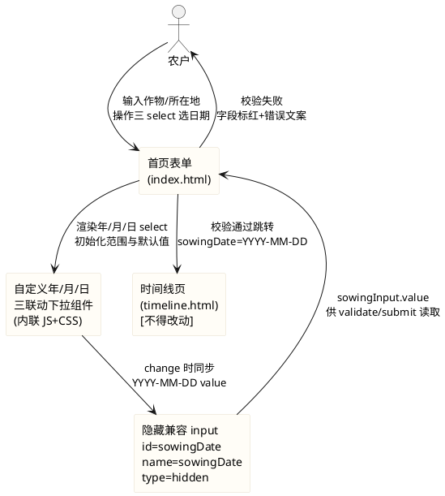
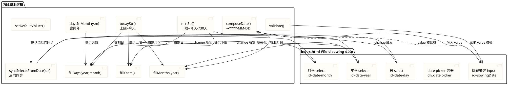
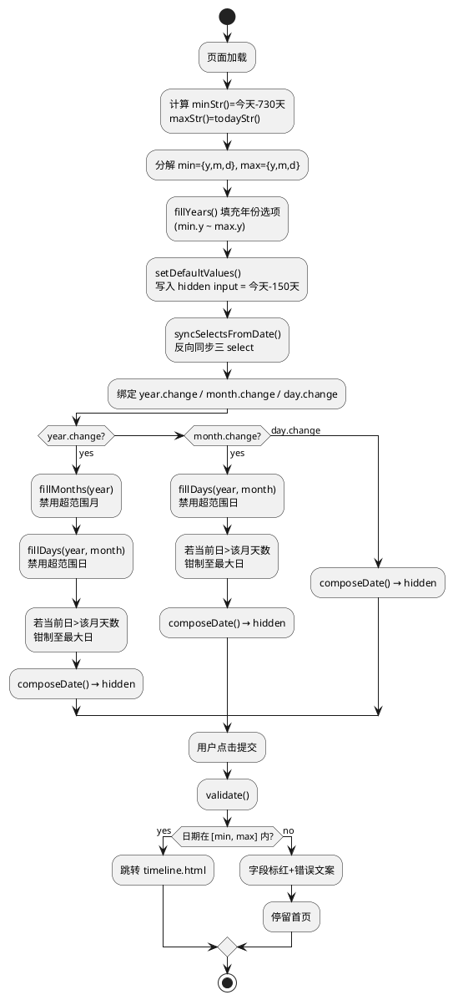
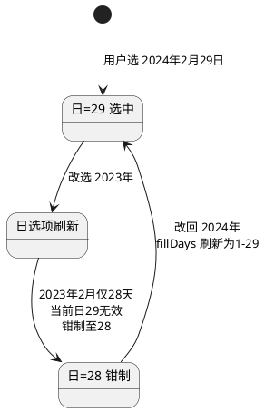
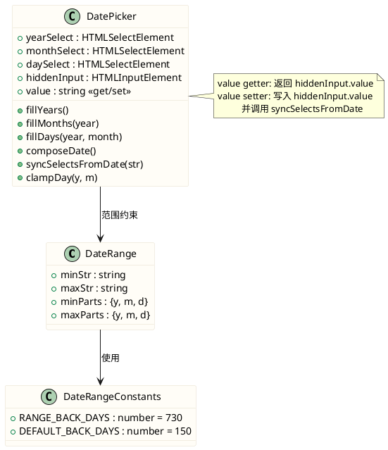

# 首页输入表单精细化优化 — 技术设计文档（home_input_refine）

> 对应需求规格：`.codeartsdoer/specs/home_input_refine/spec.md`（24 条需求，已固化）
> 设计范围：仅 `frontend/pages/index.html` 与 `frontend/assets/css/common.css`，不触碰 timeline.html、photo-capture.js、图片资产、测试既有断言。

---

# 一、需求与存量功能关系分析

## 1.1 需求功能与存量功能对比

### 1.1.1 已实现功能

| 需求功能 | 存量功能 | 代码位置 | 匹配度 |
|---------|---------|---------|--------|
| 播种日期上限校验（不晚于今天） | `validate()` 中 `sowingInput.value > todayStr()` 判断 | `index.html:140` | 100% |
| 错误文案"播种日期不能晚于今天" | `#error-sowingDate` 文本节点 | `index.html:39` | 100% |
| 字段标红机制 `setInvalid(fieldId, invalid)` | `setInvalid()` 切换 `.invalid` 类 | `index.html:124-126` | 100% |
| 所在地 placeholder 保留 | `<input id="location" ... placeholder="例如：山东省济宁市金乡县" />` | `index.html:44` | 100% |
| 所在地默认值"山东省济宁市金乡县" | `setDefaultValues()` 中 `locationInput.value = locationInput.value \|\| '山东省济宁市金乡县'` | `index.html:95` | 100% |
| `todayStr()` 返回 YYYY-MM-DD | `todayStr()` 函数 | `index.html:80-83` | 100% |
| 提交参数 URLSearchParams 标准编码 | submit 回调中 `new URLSearchParams({...})` | `index.html:165-171` | 100% |
| 提交 sowingDate 为 YYYY-MM-DD | submit 中 `sowingDate: sowingInput.value` | `index.html:167` | 100% |
| 移动端 `overflow-x:hidden` + `max-width:100%` | `common.css:28-29` | `common.css:25-30` | 100% |
| `.field input` 聚焦态（--leaf-2 边框+外发光） | `.field input:focus` | `common.css:156-161` | 100% |
| `.field.invalid input` 失败态（--red 边框+--red-soft 背景） | `.field.invalid input` | `common.css:163-166` | 100% |
| `.page` max-width:460px 居中布局 | `.page` 规则 | `common.css:45-50` | 100% |
| 测试断言 `id="sowingDate"` 存在 | `<input id="sowingDate" ...>` | `index.html:38` | 100% |
| 测试断言 `setDefaultValues` 存在 | 函数定义 | `index.html:94` | 100% |

### 1.1.2 需要扩展的功能

| 需求功能 | 存量功能 | 差异说明 | 扩展方向 |
|---------|---------|---------|---------|
| 播种日期默认值=今天-150天 | `setDefaultValues()` 已实现今天-150天写入 `sowingInput.value` | 当前写入 `<input type="date">` 的 value；改造后 `sowingInput` 变为隐藏兼容 input，写入值后须反向同步到三个 `<select>` | 保留 `sowingInput.value` 赋值语句，新增 `syncSelectsFromDate(value)` 反向同步函数；移除 `sowingInput.max = todayStr()`（对 hidden input 无意义），改为初始化选择器范围 |
| 日期校验增加下限（不早于今天-730天） | `validate()` 仅校验上限 `value > todayStr()` | 缺少下限校验；缺少下限错误文案 | `validate()` 增加下限判断 `value < minStr()`；`#error-sowingDate` 文案须动态切换（晚于今天 / 早于两年前 / 为空） |
| `setInvalid` 作用于自定义选择器 | `setInvalid('field-sowing-date', invalid)` 切换 `#field-sowing-date` 的 `.invalid` 类 | 当前 CSS `.field.invalid input` 仅匹配 `<input>`，不匹配 `<select>` | 新增 CSS 规则 `.field.invalid .date-picker select` 使失败态视觉作用于三个下拉 |
| 聚焦态视觉作用于 `<select>` | `.field input:focus` 仅匹配 input | `<select>` 不匹配 `.field input:focus` | 新增 `.date-picker select:focus` 规则，复用 --leaf-2 边框+外发光 |
| 移动端三 select 横排无溢出 | `.field input` width:100% 单控件 | 三个 select 横排需宽度分配，窄屏（375px）易溢出 | 新增 `.date-picker` flex 容器 + `select` flex 宽度分配 + `min-width:0` 防溢出 |

### 1.1.3 需要新增的功能或接口

按业务模块分组：

**模块 A：自定义年/月/日三联动下拉组件**

| 功能点 | 输入 | 输出 | 核心逻辑 | 依赖 |
|--------|------|------|---------|------|
| 选择器 HTML 结构渲染 | 无（静态 HTML） | 三个 `<select>`（年/月/日）+ 隐藏兼容 input | 替换 `index.html:38` 的 `<input type="date">` | 无 |
| 年份选项填充 | 今天、今天-730天 | 年份 `<option>` 列表（下限年～上限年） | 遍历年份范围生成 option | `todayStr()`、`minStr()` |
| 月份选项填充+禁用 | 选中年、下限/上限 | 月份 `<option>` 列表（1-12），超范围 disabled | 按选中年份钳制月份上下限 | 年份 select 值 |
| 日选项填充+禁用 | 选中年月、下限/上限 | 日 `<option>` 列表（1-N），超范围 disabled | 按年月计算天数（含闰年），钳制日上下限 | 年/月 select 值、`daysInMonth(y,m)` |
| 闰年判断 | 年份数值 | boolean | `(y%4===0 && y%100!==0) \|\| y%400===0` | 无 |
| 联动刷新 | 年或月 change 事件 | 刷新下游 select 选项+禁用态 | 年 change→刷新月+日；月 change→刷新日 | 上述填充函数 |
| 占位 option | 无 | 年/月/日各一个 `<option value="" disabled selected>` | 中文"年""月""日"占位 | 无 |
| 值组合为 YYYY-MM-DD | 三个 select 值 | `"YYYY-MM-DD"` 字符串 | padStart 拼装 | 无 |
| 反向同步（日期→三 select） | YYYY-MM-DD 字符串 | 三个 select 选中态 | 解析年月日分别设 value | 三个 select 引用 |

**模块 B：范围常量与边界计算**

| 功能点 | 输入 | 输出 | 核心逻辑 | 依赖 |
|--------|------|------|---------|------|
| 下限日期 `minStr()` | 无 | `"YYYY-MM-DD"`（今天-730天） | `new Date(); d.setDate(d.getDate()-730)` | 无 |
| 下限/上限年月日分解 | `minStr()`/`todayStr()` | `{y, m, d}` 对象 | split + parseInt | `minStr()`/`todayStr()` |

**模块 C：文案改动**

| 功能点 | 输入 | 输出 | 核心逻辑 | 依赖 |
|--------|------|------|---------|------|
| 删除 tagline | 无 | 移除 `<p class="tagline">...</p>` | 删除 `index.html:24` 整行 | 无 |
| 删除作物品种 placeholder | 无 | input 无 placeholder 属性 | 删除 `index.html:31` 的 `placeholder="例如：山东金乡大蒜"` 属性 | 无 |

## 1.2 存量功能详细分析

### 1.2.1 `setDefaultValues()`（index.html:94-102）

- **接口契约**：无入参；副作用为设置 `locationInput.value`、`sowingInput.value`、`sowingInput.max`；无返回值。
- **业务规则**：
  1. location 默认值仅在空值时填充（`locationInput.value || '山东省济宁市金乡县'`）。
  2. sowingDate 默认值仅在空值时填充今天-150天。
  3. `sowingInput.max = todayStr()` 设置 `<input type="date">` 的原生 max 属性。
- **扩展点**：无显式扩展点，但函数在 IIFE 末尾被直接调用（`index.html:176`）。
- **约束**：须在 DOM 就绪后调用（当前置于 IIFE 末尾，DOM 已就绪）。
- **改造影响**：`sowingInput.max` 行须移除（hidden input 无 max 语义）；`sowingInput.value` 赋值后须调用反向同步函数刷新三个 select。

### 1.2.2 `validate()`（index.html:137-145）

- **接口契约**：无入参；返回 boolean；副作用为对三个字段调用 `setInvalid`。
- **业务规则**：
  1. crop：空值→invalid。
  2. sowingDate：`!value || value > todayStr()`→invalid（仅上限校验）。
  3. location：空值→invalid。
- **扩展点**：无。
- **约束**：字符串比较 `value > todayStr()` 依赖 YYYY-MM-DD 格式的字典序等于日期序，须保持格式不变。
- **改造影响**：日期校验须增加下限 `value < minStr()`；错误文案须根据失败原因动态切换。

### 1.2.3 表单 submit（index.html:161-173）

- **接口契约**：无入参（事件回调）；副作用为 `e.preventDefault()` + 校验 + `window.location.href` 跳转。
- **业务规则**：校验失败→toast 提示并 return；校验通过→用 `URLSearchParams` 拼装 crop/sowingDate/location/latitude/longitude 跳转 `timeline.html`。
- **约束**：`sowingDate: sowingInput.value` 须为 YYYY-MM-DD 格式（timeline.html 依赖）。
- **改造影响**：若采用隐藏兼容 input 方案，`sowingInput.value` 引用不变，submit 逻辑无须改动。

### 1.2.4 `setInvalid(fieldId, invalid)`（index.html:124-126）

- **接口契约**：入参 `fieldId`（string）、`invalid`（boolean）；副作用为 `classList.toggle('invalid', invalid)`。
- **业务规则**：对 `#${fieldId}` 元素切换 `.invalid` 类。
- **约束**：依赖 CSS `.field.invalid input` / `.field.invalid .error` 规则生效。
- **改造影响**：`#field-sowing-date` 容器结构改变（input→date-picker+selects），须新增 CSS `.field.invalid .date-picker select` 规则使失败态视觉生效。

### 1.2.5 CSS `.field input` 体系（common.css:142-176）

- **接口契约**：无（CSS 规则）。
- **业务规则**：`.field input` 定义 padding/border/radius/transition；`:focus` 定义 --leaf-2 边框+外发光；`.field.invalid input` 定义 --red 边框+--red-soft 背景；`.field .error` 默认 display:none，`.field.invalid .error` display:block。
- **约束**：规则选择器为 `.field input`，不匹配 `<select>`。
- **改造影响**：须新增 `.date-picker select` 系列规则，视觉对齐 `.field input`；须新增 `.field.invalid .date-picker select` 对齐 `.field.invalid input`。

### 1.2.6 测试断言（pages.test.js:16-34）

- **接口契约**：Node.js `node:test` 断言。
- **业务规则**：index.html 须含 `id="sowingDate"`、`setDefaultValues`、`播种日期不能晚于今天`；common.css 须含 `overflow-x:hidden`、`max-width:100%`。
- **约束**：**红线**——不得破坏既有 8 项断言。
- **改造影响**：`id="sowingDate"` 须保留（隐藏兼容 input 方案满足）；`setDefaultValues` 函数名须保留；`播种日期不能晚于今天` 文案须保留。
---

# 二、增量设计方案

## 2.1 实现模型

### 2.1.1 上下文视图



**设计决策 — 隐藏兼容 input 方案**：

在 `#field-sowing-date` 内保留一个 `<input id="sowingDate" name="sowingDate" type="hidden">`，三个可见 `<select>` 负责 UI 交互。选择理由：

1. **测试兼容**：测试断言 `id="sowingDate"` 存在（pages.test.js:18），隐藏 input 满足此断言。
2. **提交逻辑零改动**：submit 回调中 `sowingDate: sowingInput.value`（index.html:167）引用不变，hidden input 的 value 即为 YYYY-MM-DD。
3. **validate 逻辑最小改动**：`sowingInput.value` 读写不变，仅增加下限判断。
4. **不违反禁止项**：禁止项为"禁止保留原生 `<input type="date">`"，hidden input 的 type 为 `hidden` 而非 `date`，满足 REQ-HIR-UBI-007 验收条件（`#field-sowing-date` 内为三个 `<select>` 而非 `<input type="date">`）。
5. **表单 name 兼容**：hidden input 保留 `name="sowingDate"`，即使 JS 失效表单仍可提交该字段（渐进增强）。

### 2.1.2 服务/组件总体架构



**模块划分与职责**：

| 模块 | 职责 | 实现位置 |
|------|------|---------|
| 范围常量 | `minStr()`（今天-730天）、`todayStr()`（今天）、`RANGE_BACK_DAYS=730`、`DEFAULT_BACK_DAYS=150` | index.html 内联脚本 |
| 闰年/天数 | `daysInMonth(y, m)` 返回该月天数 | index.html 内联脚本 |
| 选项填充 | `fillYears()`、`fillMonths(year)`、`fillDays(year, month)` 生成 option 并禁用超范围项 | index.html 内联脚本 |
| 联动事件 | 年/月 select 的 change 监听→触发下游填充+钳制 | index.html 内联脚本 |
| 值组合 | `composeDate()` 从三 select 取值拼 YYYY-MM-DD 写入 hidden input | index.html 内联脚本 |
| 反向同步 | `syncSelectsFromDate(str)` 解析日期字符串设置三 select 选中态 | index.html 内联脚本 |
| 兼容整合 | `setDefaultValues()`、`validate()` 改造以适配新结构 | index.html 内联脚本 |
| 样式 | `.date-picker` 容器、select 视觉、聚焦态、失败态、禁用 option | common.css 追加 |

### 2.1.3 实现设计文档

#### 2.1.3.1 联动刷新流程



#### 2.1.3.2 闰年二月天数切换状态处理



**钳制策略**：当年或月变化导致当前选中日超过该月实际天数时，自动将日 select 钳制至该月最大日（而非清空），避免出现空值导致校验失败。同时若钳制后的日期仍超出全局范围 [min, max]，则进一步钳制至范围边界。

#### 2.1.3.3 月份/日禁用边界判定

对于"禁用超范围项"采用**逐 option 判定**策略，而非整批重建：

- **月份禁用**：当选中年 = min.y 时，月份 < min.m 的 option 置 disabled；当选中年 = max.y 时，月份 > max.m 的 option 置 disabled；其余年份月份全部可选。
- **日禁用**：当选中年月 = min.y-min.m 时，日 < min.d 的 option 置 disabled；当选中年月 = max.y-max.m 时，日 > max.d 的 option 置 disabled；其余年月日全部可选（在 1~daysInMonth 范围内）。

选择逐 option 判定而非重建的理由：原生 `<select>` 的 option 列表在年/月变化时日列表需重建（天数变化），但月份列表固定 1-12 无需重建仅需切换 disabled，性能更优且避免闪烁。

## 2.2 接口设计

### 2.2.1 总体设计

本组件为纯前端内联脚本，无对外 API 暴露（IIFE 封装）。接口设计指内部函数契约。

| 接口 | 类型 | 稳定性 | 说明 |
|------|------|--------|------|
| `minStr()` | 内部函数 | 稳定 | 返回下限日期 YYYY-MM-DD |
| `todayStr()` | 内部函数（既有） | 稳定 | 返回上限日期 YYYY-MM-DD |
| `daysInMonth(y, m)` | 内部函数 | 稳定 | 返回指定年月的天数 |
| `fillYears()` | 内部函数 | 稳定 | 填充年份 select 选项 |
| `fillMonths(year)` | 内部函数 | 稳定 | 填充月份 select 选项+禁用 |
| `fillDays(year, month)` | 内部函数 | 稳定 | 填充日 select 选项+禁用 |
| `composeDate()` | 内部函数 | 稳定 | 组合三 select 值为 YYYY-MM-DD 写入 hidden input |
| `syncSelectsFromDate(str)` | 内部函数 | 稳定 | 反向同步：日期字符串→三 select 选中态 |
| `setDefaultValues()` | 内部函数（既有，改造） | 稳定 | 设置默认值（保留函数名以通过测试） |
| `validate()` | 内部函数（既有，改造） | 稳定 | 校验表单（保留下限+上限） |
| `setInvalid(fieldId, invalid)` | 内部函数（既有，不变） | 稳定 | 切换字段 invalid 类 |

### 2.2.2 接口清单

#### `minStr()`

- **签名**：`function minStr(): string`
- **业务说明**：计算播种日期下限（今天往前推 `RANGE_BACK_DAYS`=730 天），返回 YYYY-MM-DD 格式字符串。
- **前置条件**：无。
- **后置条件**：返回值与 `todayStr()` 均为有效日期，且 `minStr() < todayStr()`。
- **异常映射**：无（纯计算函数）。
- **核心算法**：
```js
var RANGE_BACK_DAYS = 730;
function minStr() {
  var d = new Date();
  d.setDate(d.getDate() - RANGE_BACK_DAYS);
  return d.getFullYear() + '-' +
    String(d.getMonth() + 1).padStart(2, '0') + '-' +
    String(d.getDate()).padStart(2, '0');
}
```

#### `daysInMonth(y, m)`

- **签名**：`function daysInMonth(y: number, m: number): number`（m 为 1-12）
- **业务说明**：返回指定年份月份的实际天数，含闰年二月判断。
- **前置条件**：y 为有效年份，m ∈ [1, 12]。
- **后置条件**：返回值 ∈ [28, 31]。
- **核心算法**：
```js
function daysInMonth(y, m) {
  if (m === 2) {
    var isLeap = (y % 4 === 0 && y % 100 !== 0) || y % 400 === 0;
    return isLeap ? 29 : 28;
  }
  if (m === 4 || m === 6 || m === 9 || m === 11) return 30;
  return 31;
}
```

#### `fillYears()`

- **签名**：`function fillYears(): void`
- **业务说明**：填充年份 select 的 option 列表，范围 [min.y, max.y]，含占位 option。
- **前置条件**：`minStr()` 与 `todayStr()` 可用；年份 select DOM 引用已获取。
- **后置条件**：年份 select 含占位 option（value="" disabled）+ 下限年到上限年的 option。
- **核心算法**：
```js
function fillYears() {
  var min = minStr().split('-').map(Number);
  var max = todayStr().split('-').map(Number);
  selYear.innerHTML = '<option value="" disabled>年</option>';
  for (var y = min[0]; y <= max[0]; y += 1) {
    var opt = document.createElement('option');
    opt.value = y;
    opt.textContent = y + '年';
    selYear.appendChild(opt);
  }
}
```

#### `fillMonths(year)`

- **签名**：`function fillMonths(year: number): void`
- **业务说明**：填充/刷新月份 select 的禁用态。月份列表固定 1-12，根据选中年份与全局下限/上限钳制禁用超范围月份。
- **前置条件**：year 为已选中年份（非空）。
- **后置条件**：月份 option 的 disabled 属性正确反映范围约束。
- **核心算法**：
```js
function fillMonths(year) {
  var min = minStr().split('-').map(Number);
  var max = todayStr().split('-').map(Number);
  // 首次填充时生成 1-12 option（含占位）
  if (selMonth.options.length <= 1) {
    selMonth.innerHTML = '<option value="" disabled>月</option>';
    for (var m = 1; m <= 12; m += 1) {
      var opt = document.createElement('option');
      opt.value = m;
      opt.textContent = m + '月';
      selMonth.appendChild(opt);
    }
  }
  // 逐 option 切换 disabled
  for (var i = 1; i < selMonth.options.length; i += 1) {
    var m = Number(selMonth.options[i].value);
    var disabled = false;
    if (year === min[0] && m < min[1]) disabled = true;
    if (year === max[0] && m > max[1]) disabled = true;
    selMonth.options[i].disabled = disabled;
  }
}
```

#### `fillDays(year, month)`

- **签名**：`function fillDays(year: number, month: number): void`
- **业务说明**：重建日 select 的 option 列表（1~daysInMonth），含占位 option，并禁用超范围日。
- **前置条件**：year、month 均为已选中有效值。
- **后置条件**：日 select 含占位 option + 1 到 daysInMonth 的 option，超范围日 disabled。
- **核心算法**：
```js
function fillDays(year, month) {
  var min = minStr().split('-').map(Number);
  var max = todayStr().split('-').map(Number);
  var days = daysInMonth(year, month);
  selDay.innerHTML = '<option value="" disabled>日</option>';
  for (var d = 1; d <= days; d += 1) {
    var opt = document.createElement('option');
    opt.value = d;
    opt.textContent = d + '日';
    var disabled = false;
    if (year === min[0] && month === min[1] && d < min[2]) disabled = true;
    if (year === max[0] && month === max[1] && d > max[2]) disabled = true;
    opt.disabled = disabled;
    selDay.appendChild(opt);
  }
}
```

#### `composeDate()`

- **签名**：`function composeDate(): void`
- **业务说明**：从三个 select 读取选中值，拼装为 YYYY-MM-DD 写入隐藏兼容 input（`sowingInput.value`）。
- **前置条件**：三个 select 引用已获取。
- **后置条件**：若三 select 均有选中值，`sowingInput.value` = `"YYYY-MM-DD"`；否则 `sowingInput.value` = `""`。
- **核心算法**：
```js
function composeDate() {
  var y = selYear.value, m = selMonth.value, d = selDay.value;
  sowingInput.value = (y && m && d)
    ? y + '-' + String(m).padStart(2, '0') + '-' + String(d).padStart(2, '0')
    : '';
}
```

#### `syncSelectsFromDate(str)`

- **签名**：`function syncSelectsFromDate(str: string): void`
- **业务说明**：将 YYYY-MM-DD 日期字符串反向同步到三个 select 的选中态。用于 `setDefaultValues()` 设置默认值后刷新 UI。
- **前置条件**：str 为有效 YYYY-MM-DD 格式或空字符串。
- **后置条件**：三 select 的 value 分别为年/月/日数值；若 str 为空则三 select 回到占位态。
- **核心算法**：
```js
function syncSelectsFromDate(str) {
  if (!str) { selYear.value = ''; selMonth.value = ''; selDay.value = ''; return; }
  var parts = str.split('-').map(Number);
  var y = parts[0], m = parts[1], d = parts[2];
  selYear.value = y;
  fillMonths(y);
  selMonth.value = m;
  fillDays(y, m);
  selDay.value = d;
}
```

#### `setDefaultValues()`（改造）

- **签名**：`function setDefaultValues(): void`（保留函数名以通过测试断言）
- **业务说明**：设置 location 默认值；设置播种日期默认值（今天-150天）并反向同步到三 select；初始化选择器范围。
- **前置条件**：DOM 元素引用已获取。
- **后置条件**：location 有默认值；hidden input 有今天-150天值；三 select 呈现今天-150天的年/月/日。
- **改造说明**：
  - 保留 `locationInput.value = locationInput.value || '山东省济宁市金乡县'`（不变）。
  - 保留 sowingDate 默认值计算逻辑（今天-150天），写入 `sowingInput.value`。
  - **移除** `sowingInput.max = todayStr()`（hidden input 无 max 语义）。
  - **新增** `fillYears()` 初始化年份选项。
  - **新增** `syncSelectsFromDate(sowingInput.value)` 反向同步三 select。
- **改造后核心逻辑**：
```js
var DEFAULT_BACK_DAYS = 150;
function setDefaultValues() {
  locationInput.value = locationInput.value || '山东省济宁市金乡县';
  fillYears();                          // 新增：初始化年份选项
  if (!sowingInput.value) {
    var d = new Date();
    d.setDate(d.getDate() - DEFAULT_BACK_DAYS);
    sowingInput.value = d.getFullYear() + '-' +
      String(d.getMonth() + 1).padStart(2, '0') + '-' +
      String(d.getDate()).padStart(2, '0');
  }
  syncSelectsFromDate(sowingInput.value);  // 新增：反向同步三 select
  // 移除：sowingInput.max = todayStr();
}
```

#### `validate()`（改造）

- **签名**：`function validate(): boolean`（保留函数名）
- **业务说明**：校验 crop/sowingDate/location，sowingDate 增加下限校验（不早于今天-730天），错误文案动态切换。
- **前置条件**：DOM 元素引用已获取。
- **后置条件**：返回 boolean；失败字段标红+错误文案显示。
- **改造说明**：
  - 日期校验从 `!value || value > todayStr()` 扩展为三分支：空值 / 晚于今天 / 早于两年前。
  - `#error-sowingDate` 文案根据失败原因动态设置。
  - **保留** `播种日期不能晚于今天` 文案（测试红线）。
  - **新增** `播种日期不能早于两年前` 文案。
- **改造后核心逻辑**：
```js
function validate() {
  var ok = true;
  if (!cropInput.value.trim()) { setInvalid('field-crop', true); ok = false; }
  else { setInvalid('field-crop', false); }

  var dateVal = sowingInput.value;
  var invalidDate = false;
  var dateError = document.getElementById('error-sowingDate');
  if (!dateVal) {
    invalidDate = true;
    dateError.textContent = '请选择播种日期';
  } else if (dateVal > todayStr()) {
    invalidDate = true;
    dateError.textContent = '播种日期不能晚于今天';   // 保留既有文案（测试红线）
  } else if (dateVal < minStr()) {
    invalidDate = true;
    dateError.textContent = '播种日期不能早于两年前';  // 新增下限文案
  }
  setInvalid('field-sowing-date', invalidDate);
  if (invalidDate) ok = false;

  if (!locationInput.value.trim()) { setInvalid('field-location', true); ok = false; }
  else { setInvalid('field-location', false); }
  return ok;
}
```

#### 联动事件绑定

- **签名**：事件监听器（无独立函数签名）
- **业务说明**：年份 change→刷新月+日+组合；月份 change→刷新日+组合；日 change→组合。
- **核心逻辑**：
```js
selYear.addEventListener('change', function () {
  var y = Number(selYear.value);
  if (!y) return;
  fillMonths(y);
  // 若当前月被禁用，钳制至该年第一个可选月
  if (selMonth.value && selMonth.options[selMonth.selectedIndex].disabled) {
    selMonth.value = '';
  }
  if (selMonth.value) {
    fillDays(y, Number(selMonth.value));
    clampDay(y, Number(selMonth.value));
  }
  composeDate();
});

selMonth.addEventListener('change', function () {
  var y = Number(selYear.value), m = Number(selMonth.value);
  if (!y || !m) return;
  fillDays(y, m);
  clampDay(y, m);
  composeDate();
});

selDay.addEventListener('change', composeDate);
```

其中 `clampDay(y, m)` 为钳制辅助函数：若当前选中日 > daysInMonth(y, m) 或当前日 option 被 disabled，则钳制至该年月最大可选日：
```js
function clampDay(y, m) {
  var days = daysInMonth(y, m);
  if (Number(selDay.value) > days) { selDay.value = String(days); }
  // 若钳制后仍 disabled，向下寻找最近可选日
  if (selDay.value && selDay.options[selDay.selectedIndex].disabled) {
    for (var d = days; d >= 1; d -= 1) {
      if (!selDay.options[d].disabled) { selDay.value = String(d); break; }
    }
  }
}
```

## 2.3 数据模型

### 2.3.1 设计目标

1. **支持的业务场景**：用户通过三联动下拉选择播种日期，选择范围被约束在 [今天-730天, 今天]；默认值为今天-150天；提交格式为 YYYY-MM-DD。
2. **性能目标**：选择器初始化 < 200ms（DOM 操作仅生成约 2 年年份+12 月+31 日 option，远低于阈值）；联动刷新 < 50ms（单次 fillDays 重建 ≤31 个 option）。
3. **兼容策略**：隐藏兼容 input 保留 `id="sowingDate"` 与 `name="sowingDate"`，既有 `sowingInput.value` 读写逻辑不变；CSS 追加新规则不删改既有规则。

### 2.3.2 模型实现



**核心领域对象**：

| 对象 | 属性 | 生命周期 | 持久化 |
|------|------|---------|--------|
| DateRange | minStr/maxStr/minParts/maxParts | 页面加载时计算一次，整个会话有效 | 无（纯内存） |
| DatePicker | yearSelect/monthSelect/daySelect/hiddenInput | DOM 渲染后创建，页面卸载销毁 | 无（DOM 元素） |
| DateRangeConstants | RANGE_BACK_DAYS=730/DEFAULT_BACK_DAYS=150 | 脚本加载时定义，常量 | 无 |

**HTML 结构模型**（`#field-sowing-date` 改造后）：

```html
<div class="field" id="field-sowing-date">
  <label for="date-year">播种日期</label>
  <input id="sowingDate" name="sowingDate" type="hidden" />
  <div class="date-picker">
    <select id="date-year"></select>
    <select id="date-month"></select>
    <select id="date-day"></select>
  </div>
  <div class="error" id="error-sowingDate">播种日期不能晚于今天</div>
</div>
```

**关键设计说明**：

1. **label for 改为 `date-year`**：`<label for="sowingDate">` 原指向 hidden input 无意义，改为指向年份 select 使点击标签聚焦第一个下拉。`#error-sowingDate` 的 id 保留不变（测试文案断言通过 `includes('播种日期不能晚于今天')` 匹配，初始 HTML 中保留该文案作为默认值，validate 运行时动态覆盖）。
2. **hidden input 无样式**：`type="hidden"` 不占布局空间，无需 CSS。
3. **三 select 横排**：`.date-picker` 为 flex 容器，三 select 等宽分配。

---

## 2.4 CSS 设计（common.css 追加）

**设计原则**：追加式，不删改既有任何规则（尤其不触碰 `overflow-x:hidden`、`max-width:100%`、`.page max-width:460px` 等测试红线规则）。所有颜色引用 `:root` 设计变量，不硬编码。

### 2.4.1 新增规则清单

```css
/* === 自定义日期选择器（追加，不改动既有规则） === */

.date-picker {
  display: flex;
  gap: 8px;
  width: 100%;
}

.date-picker select {
  flex: 1 1 0;
  min-width: 0;
  font-family: inherit;
  font-size: 18px;
  padding: 15px 10px;
  color: var(--ink);
  background: #fbf8f0;
  border: 1.5px solid var(--line);
  border-radius: var(--radius-sm);
  transition: border-color 0.18s, box-shadow 0.18s, background 0.18s;
  -webkit-appearance: none;
  appearance: none;
  /* 自定义下拉箭头 */
  background-image: url("data:image/svg+xml,%3Csvg xmlns='http://www.w3.org/2000/svg' width='12' height='8' viewBox='0 0 12 8'%3E%3Cpath d='M1 1l5 5 5-5' stroke='%238b9382' stroke-width='1.5' fill='none' stroke-linecap='round' stroke-linejoin='round'/%3E%3C/svg%3E");
  background-repeat: no-repeat;
  background-position: right 10px center;
  padding-right: 28px;
}

/* 年份 select 略宽（4位数+年），月/日 select 略窄 */
.date-picker select#date-year {
  flex: 1.3 1 0;
}

.date-picker select:focus {
  outline: none;
  border-color: var(--leaf-2);
  background-color: #fff;
  box-shadow: 0 0 0 4px rgba(63, 143, 86, 0.14);
}

/* 失败态：与 .field.invalid input 一致 */
.field.invalid .date-picker select {
  border-color: var(--red);
  background-color: var(--red-soft);
}

/* 禁用 option 灰显 */
.date-picker select option:disabled {
  color: var(--muted);
  opacity: 0.5;
}

/* 占位 option（value="" 的 disabled option）样式 */
.date-picker select option[value=""] {
  color: #b3b8a8;
}
```

### 2.4.2 移动端窄屏适配

三 select 在 `.date-picker` flex 容器中等宽分配（`flex: 1 1 0` + `min-width: 0`），年份略宽（`flex: 1.3`）。在 375px 视口下：

- `.page` padding 16px×2 = 32px，`.card` padding 18px×2 = 36px，可用宽度 ≈ 375 - 32 - 36 = 307px。
- 三 select gap 8px×2 = 16px，剩余 291px，按 1.3:1:1 分配 ≈ 年 98px / 月 96px / 日 96px。
- 年份 option "2026年" 约 5 字符 × 18px ≈ 60px + padding 38px = 98px，刚好容纳。
- `min-width: 0` 确保 flex 子项不溢出容器。

**无须额外 media query**，flex 布局自适应。若极端.460px 以下极端窄屏年份文本溢出，`select` 自身有 `overflow:hidden` 行为（文本截断），不影响布局。

### 2.4.3 tagline 删除后间距处理

删除 `<p class="tagline">` 后，`.brand`（margin-bottom:20px）与 `.term-ruler`（margin: 0 2px 20px）之间间距为 20px + 20px = 40px，视觉可接受，**无须额外调整**。`.tagline` CSS 规则保留不删（避免改动面扩大，且空规则无害）。

---

## 2.5 文案改动

### 2.5.1 tagline 删除

- **位置**：`index.html` 第 24 行。
- **操作**：整行删除 `<p class="tagline">输入三个字段，得到一条会看天、懂节气、知行情的时间线。</p>`。
- **影响**：品牌区下方不再显示 tagline；`.tagline` CSS 规则保留（无匹配元素，不影响渲染）。

### 2.5.2 作物品种 placeholder 删除

- **位置**：`index.html` 第 31 行。
- **操作**：移除 `placeholder="例如：山东金乡大蒜"` 属性。
- **改动后**：`<input id="crop" name="crop" type="text" autocomplete="off" />`。
- **选择移除属性而非置空的理由**：移除属性更干净，避免遗留空属性；置空 `placeholder=""` 效果相同但代码冗余。

### 2.5.3 所在地 placeholder 保留

- **位置**：`index.html` 第 44 行。
- **操作**：不改动，保留 `placeholder="例如：山东省济宁市金乡县"`。

---

## 2.6 index.html 精确改动清单

| 行号 | 当前内容 | 改动操作 | 改动后 |
|%------|---------|---------|--------|
| 24 | `<p class="tagline">输入三个字段，得到一条会看天、懂节气、知行情的时间线。</p>` | 删除整行 | （无） |
| 31 | `<input id="crop" name="crop" type="text" autocomplete="off" placeholder="例如：山东金乡大蒜" />` | 移除 placeholder 属性 | `<input id="crop" name="crop" type="text" autocomplete="off" />` |
| 37 | `<label for="sowingDate">播种日期</label>` | 改 for 指向 | `<label for="date-year">播种日期</label>` |
| 38 | `<input id="sowingDate" name="sowingDate" type="date" />` | 替换为隐藏 input + 三 select 容器 | 见下方 HTML 块 |
| 39 | `<div class="error" id="error-sowingDate">播种日期不能晚于今天</div>` | 保留不变（初始文案保留以通过测试） | 不变 |
| 75 | `var sowingInput = document.getElementById('sowingDate');` | 保留不变（仍引用 hidden input） | 不变 |
| 94-102 | `setDefaultValues()` 函数体 | 改造（见 2.2.2） | 增加 fillYears/syncSelectsFromDate，移除 sowingInput.max |
| 137-145 | `validate()` 函数体 | 改造（见 2.2.2） | 增加下限校验+动态错误文案 |
| 80-83 | `todayStr()` | 保留不变 | 不变 |
| 脚本区 | 无 | 新增 minStr/daysInMonth/fillYears/fillMonths/fillDays/composeDate/syncSelectsFromDate/clampDay + 事件绑定 | 见 2.2.2 各函数 |
| 161-173 | submit 回调 | 保留不变（sowingInput.value 引用不变） | 不变 |

**第 38 行替换后的 HTML**：
```html
<input id="sowingDate" name="sowingDate" type="hidden" />
<div class="date-picker">
  <select id="date-year"></select>
  <select id="date-month"></select>
  <select id="date-day"></select>
</div>
```

---

## 2.7 验证方案

### 2.7.1 前端测试回归

**既有 8 项断言（须全绿）**：

| 断言 | 兼容性说明 |
|------|-----------|
| index.html 含 `id="crop"` | 不改动 crop input ✓ |
| index.html 含 `id="sowingDate"` | 隐藏 input 保留该 id ✓ |
| index.html 含 `id="location"` | 不改动 location input ✓ |
| index.html 含 `id="crop-suggestions"` | 不改动 suggestions div ✓ |
| index.html 含 `id="photo-btn"` | 不改动 photo-btn ✓ |
| index.html 含 `setDefaultValues` | 函数名保留 ✓ |
| index.html 含 `播种日期不能晚于今天` | `#error-sowingDate` 初始文案保留 ✓ |
| common.css 含 `overflow-x:hidden` / `max-width:100%` | 不删改既有规则 ✓ |

**建议新增断言（可选，不破坏既有）**：

```js
test('自定义日期选择器：三 select + 隐藏兼容 input', () => {
  assert.match(indexHtml, /id="date-year"/);
  assert.match(indexHtml, /id="date-month"/);
  assert.match(indexHtml, /id="date-day"/);
  assert.match(indexHtml, /class="date-picker"/);
  assert.match(indexHtml, /id="sowingDate"\s+name="sowingDate"\s+type="hidden"/);
});

test('自定义日期选择器：移除原生 date input', () => {
  assert.doesNotMatch(indexHtml, /type="date"/);
});

test('自定义日期选择器：下限校验文案', () => {
  assert.ok(indexHtml.includes('播种日期不能早于两年前'));
});

test('文案优化：tagline 已删除', () => {
  assert.ok(!indexHtml.includes('class="tagline"'));
});

test('文案优化：作物品种 placeholder 已删除', () => {
  assert.ok(!indexHtml.includes('例如：山东金乡大蒜'));
  assert.ok(indexHtml.includes('例如：山东省济宁市金乡县')); // 所在地保留
});

test('范围常量集中定义', () => {
  assert.ok(indexHtml.includes('RANGE_BACK_DAYS'));
  assert.ok(indexHtml.includes('DEFAULT_BACK_DAYS'));
});
```

### 2.7.2 交互自测要点

| 场景 | 操作 | 预期结果 |
|------|------|---------|
| 初始加载 | 打开首页 | 三 select 显示今天-150天的年/月/日；无 `<input type="date">`；无 tagline；作物品种无 placeholder |
| 占位符 | 清空三 select | 分别显示"年""月""日"占位 |
| 年份范围 | 打开年份下拉 | 最早选项=今天-730天所在年，最晚选项=今天所在年，无超范围年 |
| 月份禁用（下限年） | 选中最早年 | 早于下限月的月份 disabled 灰显，不可选 |
| 月份禁用（上限年） | 选中今天所在年 | 晚于今天月的月份 disabled 灰显 |
| 日禁用（下限年月） | 选中最早年最早月 | 早于下限日的日 disabled |
| 日禁用（上限年月） | 选中今天年今天月 | 晚于今天日的日 disabled |
| 闰年二月 | 选 2024 年 2 月 | 日选项 1-29；改选 2023 年 2 月，日刷新为 1-28，若原选 29 则钳制至 28 |
| 联动刷新 | 改选年份 | 月份禁用态刷新；日选项按新年新月天数刷新 |
| 默认值在范围内 | 初始加载后直接提交 | 校验通过，跳转 timeline.html，URL 中 sowingDate=YYYY-MM-DD |
| 超下限提交拦截 | 手动构造早于今天-730天的日期并提交 | 字段标红，显示"播种日期不能早于两年前"，不跳转 |
| 超上限提交拦截 | 构造晚于今天的日期并提交 | 字段标红，显示"播种日期不能晚于今天"，不跳转 |
| 空值提交 | 清空日期后提交 | 字段标红，显示"请选择播种日期" |
| 提交格式 | 校验通过提交 | URL 中 `sowingDate=YYYY-MM-DD`（如 `sowingDate=2026-05-15`），月日两位补零 |
| 窄屏无溢出 | 375px 视口操作三 select | 三 select 横排完整可见，无横向滚动 |
| 聚焦态 | 聚焦任一 select | 边框变 --leaf-2，外发光 4px 绿色 |
| 失败态 | 日期校验失败 | 三 select 边框变 --red，背景变 --red-soft |
| 禁用 JS | 禁用 JS 打开首页 | 三 select 仍可操作（原生下拉），无联动与自定义校验 |

---

## 2.8 风险与回退

### 2.8.1 风险矩阵

| 风险 | 等级 | 触发条件 | 缓解措施 | 回退方案 |
|------|------|---------|---------|---------|
| 三 select 窄屏溢出 | 中 | 320px 以下视口年份文本过宽 | `flex: 1 1 0` + `min-width: 0` + 年份 `flex: 1.3`；select 自带文本截断 | 增加 `@media (max-width:360px)` 缩小 select font-size 至 16px |
| 联动边界：下限当月日禁用 | 中 | 用户选下限年下限月，下限日之前的日应禁用 | `fillDays` 中 `year===min[0] && month===min[1] && d<min[2]` 判定 | 边界单元自测覆盖 |
| 联动边界：上限当月日禁用 | 中 | 用户选今天年今天月，今天之后的日应禁用 | `fillDays` 中 `year===max[0] && month===max[1] && d>max[2]` 判定 | 边界单元自测覆盖 |
| 闰年切换日钳制 | 低 | 2024年2月29日→改选2023年 | `clampDay` 钳制至 28 | 自测覆盖 |
| 测试兼容：`id="sowingDate"` | 低 | 测试断言该 id 存在 | 隐藏 input 保留 id | 已满足，无风险 |
| 测试兼容：`播种日期不能晚于今天` 文案 | 低 | 测试断言该文案存在 | `#error-sowingDate` 初始 HTML 保留该文案 | 已满足，无风险 |
| `sowingInput.max` 移除影响 | 低 | hidden input 无 max 属性 | 移除该行，范围控制改由 select option disabled 实现 | 无（hidden input 本就无 max 语义） |
| label for 指向改变 | 低 | `<label for="sowingDate">`→`<label for="date-year">` | 点击标签聚焦年份 select | 无（hidden input 不可聚焦） |
| CSS 追加规则与既有冲突 | 低 | `.date-picker select` 与 `.field input` 选择器不重叠 | 选择器命名空间隔离（`.date-picker`） | 无 |
| tagline 删除后间距过大 | 低 | `.brand` margin-bottom:20px + `.term-ruler` margin-top:0 | 40px 间距视觉可接受 | 若过大可调 `.brand` margin-bottom 至 14px |

### 2.8.2 回退策略

本设计为纯增量改造（追加 CSS 规则 + 替换 HTML 片段 + 改造两个函数），回退路径清晰：

1. **HTML 回退**：将 `#field-sowing-date` 内恢复为 `<input id="sowingDate" name="sowingDate" type="date" />`，恢复 `<label for="sowingDate">`，恢复第 24 行 tagline，恢复第 31 行 placeholder。
2. **CSS 回退**：删除 `/* === 自定义日期选择器 === */` 注释下的所有追加规则。
3. **JS 回退**：恢复 `setDefaultValues()` 原始函数体（含 `sowingInput.max = todayStr()`），恢复 `validate()` 原始日期校验逻辑，删除新增函数。
4. **测试回退**：删除新增断言（如有）。

所有改动集中在两个文件（index.html、common.css），无跨文件依赖，回退可独立完成。

---

## 2.9 文件改动清单

| 文件 | 改动类型 | 改动范围 | 不得改动内容 |
|------|---------|---------|-------------|
| `frontend/pages/index.html` | 编辑 | 第 24 行删除、第 31 行删属性、第 37-38 行替换、脚本区函数改造+新增 | timeline.html 引用、photo-capture.js 引用、mock-data.js 引用、图片资产引用、crop/location/suggestions/photo-btn 元素 |
| `frontend/assets/css/common.css` | 追加 | 文件末尾追加 `.date-picker` 系列规则 | `:root` 变量、`overflow-x:hidden`、`max-width:100%`、`.page max-width:460px`、`.field input` 既有规则、`.tagline` 规则 |
| `frontend/tests/pages.test.js` | 可选追加 | 文件末尾追加新断言（可选） | 既有 8 项断言 |
| `frontend/pages/timeline.html` | **不得改动** | — | 全部 |
| `frontend/pages/photo-capture.js` | **不得改动** | — | 全部 |
| `frontend/assets/img/*` | **不得改动** | — | 全部 |