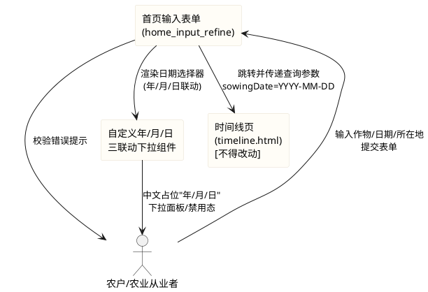
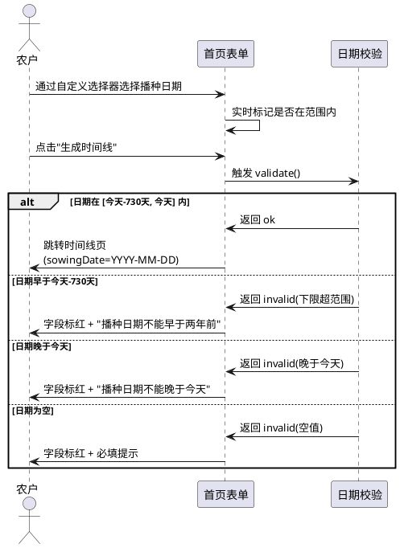
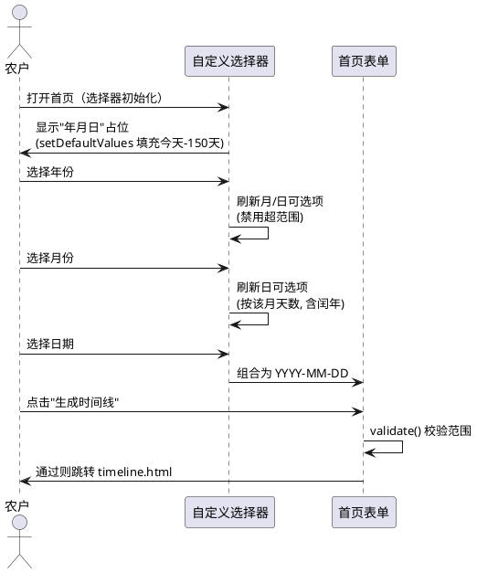
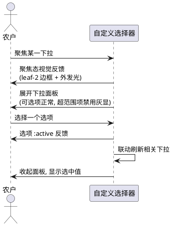
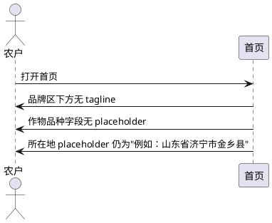

# 首页输入表单精细化优化（home_input_refine）

> 本文档已根据用户对第 7 章开放问题的确认结论（共 7 项决策）完成固化，所有需求条目均为确定性需求，可直接作为设计阶段输入。

# **1. 组件定位**

## **1.1 核心职责**
本组件负责优化「知农时」首页输入表单的时间选择合法性校验、占位符显示一致性、时间选择器视觉表现与交互体验、以及页面文案的精简调整，实现更严谨、专业、易用的农业时间线生成入口。

## **1.2 核心输入**
1. 用户在播种日期字段通过自定义年/月/日三联动下拉组件选择的日期值。
2. 用户在作物品种字段输入的文本及联想选择。
3. 用户在所在地字段输入的文本。

## **1.3 核心输出**
1. 经合法性校验后跳转至时间线页的查询参数（crop、sowingDate、location、latitude、longitude），其中 sowingDate 格式为 `YYYY-MM-DD`。
2. 校验失败时在字段下方显示的错误提示文案。
3. 用户聚焦/交互时自定义选择器控件的视觉反馈（聚焦态、下拉面板、选项 hover、禁用态）。

## **1.4 职责边界**
本组件**不负责**以下事项：
1. 时间线页（timeline.html）的展示逻辑与节点渲染——属已存在且**明确不得改动**的页面。
2. 拍照识别组件（photo-capture.js）的功能与文案——**明确不得改动**。
3. 作物数据集（CROPS）的数据内容增删——仅删除作物品种 placeholder 举例，不改动数据本身。
4. 后端识别接口（/api/recognition）——纯前端项目，无后端。
5. 时间线生成算法、气象/节气/行情数据的计算——本组件仅负责输入采集与校验。
6. 已接入的图片资产（common-logo.svg、index-bg.png）——**明确不得改动**。

# **2. 领域术语**

**播种日期**
: 用户选择的具体播种发生日期，通常为已过去的某一天，作为时间线生成的起始基准。

**时间范围校验**
: 对播种日期字段施加的业务合法性约束，下限为今天往前推 730 天（约 2 年），上限为今天，超出范围的日期应被拒绝并提示。

**自定义年/月/日三联动下拉组件**
: 以纯原生 JS+CSS 实现的日期选择器，由年、月、日三个 `<select>` 下拉联动构成，替代原生 `<input type="date">`。占位符与样式完全可控，无第三方依赖。
: 备注：联动指年/月变化时，日的可选项随该月实际天数（含闰年）刷新；超范围的月/日应禁用。

**占位符（placeholder）**
: 字段未输入时显示的提示性文本。自定义选择器中，年/月/日三个下拉未选择时分别显示中文"年""月""日"占位。

**EARS 需求编号约定**
: 本文档需求编号格式为 REQ-HIR-NNN，HIR 为 Home Input Refine 缩写。编号前缀对应 EARS 句型：UBI（Ubiquitous）、EVT（Event-driven）、STA（State-driven）、OPT（Optional）、UNW（Unwanted）。

# **3. 角色与边界**

## **3.1 核心角色**
- **农户/农业从业者**：在首页表单中输入作物品种、播种日期、所在地，提交后查看时间线。是本次优化的直接体验对象。
- **测试维护者**：运行 `node --test frontend/tests/pages.test.js` 验证既有 8 项断言全绿，并可新增针对自定义选择器的断言。

## **3.2 外部系统**
- **时间线页（timeline.html）**：表单提交后的跳转目标，接收 URL 查询参数（依赖 sowingDate 为 `YYYY-MM-DD` 格式），本次**不得改动**。
- **photo-capture.js**：拍照识别组件，本次**不得改动**。

## **3.3 交互上下文**

# **4. DFX约束**

## **4.1 性能**
1. 首页表单首屏渲染完成后，自定义选择器可交互延迟不得超过 200ms。
2. 自定义选择器初始化不得引入额外网络请求（项目无构建工具、无 CDN 依赖）。
3. 日期合法性校验须在用户触发提交或失焦时同步完成，响应时间不超过 50ms。

## **4.2 可靠性**
1. 日期范围校验逻辑须以原生 `<select>` 元素为基础实现，即使部分增强脚本未执行，下拉本身仍可用（渐进增强原则）。
2. 校验失败不得导致表单静默跳转或页面白屏，必须给出可读的错误提示。

## **4.3 安全性**
1. 表单提交参数须经 URLSearchParams 标准编码，防止参数注入（当前已实现，须保持）。
2. 本次优化不引入任何外部脚本依赖，所有逻辑须内联于 index.html 或项目内本地脚本。

## **4.4 可维护性**
1. 日期范围上下限（最早日期=今天-730天、最晚日期=今天）须以具名常量或函数集中定义，不得在多处硬编码魔法数字。
2. 所在地 placeholder 与 tagline 的变更须在 HTML 中可读、可定位。

## **4.5 兼容性**
1. **测试兼容（强制红线）**：本次优化不得破坏 `frontend/tests/pages.test.js` 的既有 8 项断言，包括但不限于：`setDefaultValues` 存在、`播种日期不能晚于今天` 文案存在、viewport 声明、`overflow-x:hidden`、`max-width:100%`、时间线页节点展开、实线/虚线语义、拍照组件断言。可新增针对自定义选择器的断言，但既有断言须全绿。
2. **资产兼容**：不得改动已接入的 logo 图片（common-logo.svg）、首页背景图（index-bg.png）及时间线页资产。
3. **浏览器兼容**：目标为现代移动端浏览器（Safari iOS、Chrome Android），自定义选择器须兼容触屏交互，不依赖鼠标悬停（hover）作为唯一交互手段。
4. **格式兼容**：提交至 timeline.html 的 sowingDate 参数须保持 `YYYY-MM-DD` 格式，timeline.html 依赖此格式。

# **5. 核心能力**

## **5.1 时间范围合法性校验**

### **5.1.1 业务规则**

1. **REQ-HIR-UBI-001（Ubiquitous）**：系统须对播种日期字段施加业务时间范围约束，最早允许日期（下限）为今天往前推 730 天（约 2 年），最晚允许日期（上限）为今天，二者均为可计算的有效日期。
   a. 验收条件：[页面加载完成] → [播种日期字段存在可计算的 min（今天-730天）与 max（今天）边界，且二者均为有效日期字符串]

2. **REQ-HIR-UBI-002（Ubiquitous）**：系统须将播种日期的最晚允许日期（上限）设定为当天日期，即播种日期不得晚于今天。
   a. 验收条件：[用户尝试选择晚于今天的日期] → [该日期被拒绝或提交校验失败，提示"播种日期不能晚于今天"]
   b. 备注：此规则为既有实现，须保留以通过测试断言。

3. **REQ-HIR-EVT-003（Event-driven）**：当用户提交表单时，若播种日期早于最早允许日期（今天-730天），系统须拒绝提交并显示下限超范围错误提示。
   a. 验收条件：[播种日期值 < 今天-730天 且 用户点击"生成时间线"] → [表单不跳转，日期字段标红，显示明确的下限错误提示，如"播种日期不能早于两年前"]

4. **REQ-HIR-EVT-004（Event-driven）**：当用户提交表单时，若播种日期晚于最晚允许日期（今天），系统须拒绝提交并显示上限超范围错误提示。
   a. 验收条件：[播种日期值 > 今天 且 用户点击"生成时间线"] → [表单不跳转，日期字段标红，显示"播种日期不能晚于今天"]

5. **REQ-HIR-STA-005（State-driven）**：在播种日期字段处于未输入状态时，系统须将默认值设定为今天往前推 150 天，且该默认值须落在合法时间范围内（150 < 730，始终在范围内）。
   a. 验收条件：[页面首次加载且用户未手动选择日期] → [播种日期自动填充为今天-150天，且该值通过范围校验，无需钳制]

6. **REQ-HIR-UNW-006（Unwanted）**：如果用户选择的播种日期超出合法时间范围 [今天-730天, 今天]，系统不得允许表单提交至时间线页。
   a. 验收条件：[播种日期超出区间 且 用户点击提交] → [window.location.href 不发生跳转，停留在首页并显示错误]

7. **禁止项**：禁止仅设置上限而不设置下限（当前缺陷）；禁止用"尽量""合理"等模糊表述定义范围边界，边界须为可计算的确定值（今天-730天 / 今天）。
   a. 验收条件：[代码审查] → [存在明确的最早日期与最晚日期计算逻辑，双边约束完备]

### **5.1.2 交互流程**

### **5.1.3 异常场景**

1. **浏览器禁用 JavaScript**
   a. 触发条件：用户浏览器禁用 JS
   b. 系统行为：原生 `<select>` 下拉仍可操作，但联动刷新与自定义校验不执行
   c. 用户感知：下拉可手动选择，但无联动禁用与自定义错误提示

2. **跨时区导致"今天"判定偏差**
   a. 触发条件：用户设备时区与服务预期时区不一致
   b. 系统行为：以用户本地设备时间为准计算"今天"与"今天-730天"（当前实现，须保持）
   c. 用户感知：日期边界以本地日期为准

## **5.2 自定义年/月/日三联动下拉选择器**

### **5.2.1 业务规则**

1. **REQ-HIR-UBI-007（Ubiquitous）**：系统须以纯原生 JS+CSS 实现自定义年/月/日三联动下拉组件，替代现有原生 `<input type="date">`，且不引入任何第三方依赖或构建工具。
   a. 验收条件：[代码审查] → [index.html 中 #field-sowing-date 内为三个 `<select>`（年/月/日）而非 `<input type="date">`，无外部库引用]

2. **REQ-HIR-UBI-008（Ubiquitous）**：系统须在自定义选择器未选择时，年/月/日三个下拉分别显示中文占位"年""月""日"，风格统一且与页面中文风格一致。
   a. 验收条件：[三个下拉均未选择] → [分别显示"年""月""日"占位，不存在"yyyy/mm/日"等中英混排不一致]

3. **REQ-HIR-EVT-009（Event-driven）**：当年或月下拉的选中值发生变化时，系统须刷新日下拉的可选项，使其匹配该年该月的实际天数（含闰年二月 28/29 天的判断）。
   a. 验收条件：[用户选择年=2024（闰年）、月=2月] → [日下拉可选项为 1-29；若改选年=2023，日下拉刷新为 1-28]

4. **REQ-HIR-STA-010（State-driven）**：在自定义选择器的某一下拉选项超出合法时间范围时，系统须将该选项置为禁用态（disabled），使其不可选。
   a. 验收条件：[年份下拉中存在早于今天-730天对应年份的选项] → [该年份选项 disabled，不可选；月/日同理，超范围选项禁用]

5. **REQ-HIR-UBI-011（Ubiquitous）**：系统须将自定义选择器与既有 `setDefaultValues()` 与 `validate()` 整合：原 `sowingInput` 引用须改为从自定义选择器取值/设值，或自定义选择器暴露兼容接口（如 value 属性的 get/set）。
   a. 验收条件：[setDefaultValues() 执行后] → [自定义选择器呈现今天-150天的年/月/日；[validate() 执行] → [从自定义选择器读取 YYYY-MM-DD 值参与校验]

6. **REQ-HIR-UBI-012（Ubiquitous）**：系统须保证提交表单时拼装的 sowingDate 参数格式为 `YYYY-MM-DD`，与 timeline.html 的依赖格式一致。
   a. 验收条件：[表单校验通过并提交] → [URL 中 sowingDate=YYYY-MM-DD 格式，如 sowingDate=2026-05-15]

7. **禁止项**：禁止保留原生 `<input type="date">`；禁止引入第三方日期选择库；禁止占位符出现中英混排不一致。
   a. 验收条件：[代码审查] → [无 `<input type="date">`，无第三方库，占位符统一中文]

### **5.2.2 交互流程**

### **5.2.3 异常场景**

1. **闰年二月天数切换**
   a. 触发条件：用户先选年=2024（闰年）、月=2月、日=29，再改选年=2023（平年）
   b. 系统行为：日=29 在 2023 年 2 月无效，须清空日选择或钳制至 28，并刷新日可选项
   c. 用户感知：日下拉自动刷新，无效选择被清除或修正

2. **选择器在小屏幕溢出**
   a. 触发条件：三个下拉宽度计算不当，在 320px 窄屏溢出
   b. 系统行为：三个下拉宽度自适应容器，不超出 .field 宽度
   c. 用户感知：选择器完整可见，无横向滚动

3. **选择器与背景图层级冲突**
   a. 触发条件：自定义下拉面板的 z-index 低于首页背景图或被遮挡
   b. 系统行为：下拉面板 z-index 高于背景图与表单内容
   c. 用户感知：面板完整浮于内容之上，无遮挡

## **5.3 时间选择器 UI 美化**

### **5.3.1 业务规则**

1. **REQ-HIR-UBI-013（Ubiquitous）**：系统须对自定义下拉控件进行视觉美化，使其与首页既有的暖米色/绿叶/暖阳设计语言协调，引用 :root 设计变量（--card、--line、--leaf-2、--radius-sm 等）而非硬编码颜色。
   a. 验收条件：[自定义选择器在首页呈现] → [配色、圆角、阴影、字体与 .card、.field input 等既有元素风格一致，无突兀感，无硬编码颜色]

2. **REQ-HIR-STA-014（State-driven）**：在自定义选择器下拉处于聚焦状态时，系统须提供清晰的聚焦视觉反馈，与现有 `.field input:focus` 样式（--leaf-2 边框 + 4px 绿色外发光）保持一致或协调。
   a. 验收条件：[任一下拉获得焦点] → [边框变为 --leaf-2 色，伴随柔和外发光，视觉与文本输入框聚焦态一致]

3. **REQ-HIR-STA-015（State-driven）**：在自定义选择器处于校验失败状态时，系统须以 --red 边框与 --red-soft 背景标识，与现有 `.field.invalid input` 样式一致。
   a. 验收条件：[日期校验失败] → [下拉边框为 --red (#c65547)，背景为 --red-soft (#f8e7e3)，错误文案显示]

4. **REQ-HIR-EVT-016（Event-driven）**：当用户与自定义选择器交互（点击下拉、选择选项）时，系统须提供符合移动端触屏习惯的交互反馈，包括下拉面板样式、选项 hover/active 态、禁用态视觉区分，不依赖 hover 态作为唯一交互信号。
   a. 验收条件：[在触屏设备上操作选择器] → [下拉面板有明确样式，选项有 :active 反馈，禁用选项有视觉区分（灰显），无仅 :hover 才可见的提示]

5. **REQ-HIR-UBI-017（Ubiquitous）**：系统须保证 UI 美化不引入横向滚动，维持 `overflow-x: hidden` 与 `max-width: 100%` 的移动端适配红线。
   a. 验收条件：[在 375px 及更窄视口下操作自定义选择器] → [无横向滚动条出现，页面不溢出]

6. **禁止项**：禁止引入第三方 UI 库或构建工具依赖；禁止使用与 :root 设计变量冲突的硬编码颜色；禁止破坏移动端 max-width:460px 居中布局。
   a. 验收条件：[代码审查] → [无 npm/CDN 新依赖，颜色引用 CSS 变量，布局未改变 .page max-width]

### **5.3.2 交互流程**

### **5.3.3 异常场景**

1. **下拉面板在窄屏被截断**
   a. 触发条件：下拉面板高度超出小屏幕可视区域
   b. 系统行为：面板内部可滚动，或限制可见选项数
   c. 用户感知：面板内容可完整操作，不超出屏幕

## **5.4 文案优化**

### **5.4.1 业务规则**

1. **REQ-HIR-UBI-018（Ubiquitous）**：系统须将 index.html 中的 tagline 元素（`
输入三个字段，得到一条会看天、懂节气、知行情的时间线。
`）整段移除。
   a. 验收条件：[首页加载完成] → [品牌区下方不存在 .tagline 元素，不含"会看天""懂节气""知行情"等口语化表述]
   b. 备注：用户决定先删除，后续如需再定。

2. **REQ-HIR-UBI-019（Ubiquitous）**：系统须将作物品种 input 的 placeholder 属性移除（删除属性或置空），消除"例如：山东金乡大蒜"这一不恰当举例。
   a. 验收条件：[作物品种字段为空] → [不显示任何 placeholder 提示文案，input 无 placeholder 属性或 placeholder=""]

3. **REQ-HIR-UBI-020（Ubiquitous）**：系统须保留所在地 input 的 placeholder 属性不变，维持"例如：山东省济宁市金乡县"。
   a. 验收条件：[所在地字段为空] → [placeholder 仍显示"例如：山东省济宁市金乡县"，与当前实现一致]

4. **禁止项**：禁止改动"说不清品种？拍一张照片""识别只给候选，需你点一下确认"等拍照入口文案（不在本次范围）；禁止改动 CROPS 数据集内容。
   a. 验收条件：[文案审查] → [拍照入口文案未变，CROPS 数组内容未变]

### **5.4.2 交互流程**

### **5.4.3 异常场景**

1. **tagline 删除后布局留白**
   a. 触发条件：移除 .tagline 后品牌区与表单卡片间距改变
   b. 系统行为：须调整间距使视觉协调，不出现过大留白
   c. 用户感知：品牌区与表单间距自然，无突兀空隙

## **5.5 不可改动项约束**

### **5.5.1 业务规则**

1. **REQ-HIR-UBI-021（Ubiquitous）**：系统须保持已接入的图片资产不变，包括 common-logo.svg 与 index-bg.png。
   a. 验收条件：[代码审查] → [logo 与背景图的引用路径、文件均未改动]

2. **REQ-HIR-UBI-022（Ubiquitous）**：系统须保持时间线页（timeline.html）与对应样式（timeline.css）不变。
   a. 验收条件：[代码审查] → [timeline.html、timeline.css 内容未改动]

3. **REQ-HIR-UBI-023（Ubiquitous）**：系统须保持拍照识别组件（photo-capture.js）不变。
   a. 验收条件：[代码审查] → [photo-capture.js 内容未改动]

4. **REQ-HIR-UBI-024（Ubiquitous）**：系统须保持既有 8 项测试断言全绿，可新增针对自定义选择器的断言但不破坏既有断言。
   a. 验收条件：[运行 `node --test frontend/tests/pages.test.js`] → [既有 8 项断言全部通过，新增断言（如有）亦通过]

# **6. 数据约束**

## **6.1 播种日期字段（sowingDate）**
1. **字段含义**：用户通过自定义年/月/日三联动下拉选择的作物播种发生日期，作为时间线生成的起始基准。
2. **取值格式**：ISO 8601 日期字符串 `YYYY-MM-DD`（如 `2026-05-15`），由年/月/日三个下拉值组合而成，与 timeline.html 依赖格式一致。
3. **取值范围**：须落在 [今天-730天, 今天] 闭区间内。下限=今天往前推 730 天（约 2 年），上限=今天。
4. **默认值**：今天往前推 150 天，格式为 `YYYY-MM-DD`。因 150 < 730，默认值始终在范围内。
5. **必填性**：必填，提交时不得为空（年/月/日三个下拉均须有选中值）。
6. **上限约束**：不得晚于今天（既有规则，须保留以通过测试）。
7. **下限约束**：不得早于今天-730天（新增规则）。

## **6.2 作物品种字段（crop）**
1. **字段含义**：用户输入或联想选择的作物品种名称。
2. **placeholder**：无（已移除 placeholder 属性）。
3. **联想数据源**：CROPS 数组，含 5 条记录（山东金乡大蒜、河南新乡小麦、黑龙江绥化玉米、湖北荆州水稻、山东寿光番茄），内容不变。
4. **必填性**：必填。

## **6.3 所在地字段（location）**
1. **字段含义**：用户输入的作物所在地，"省-市-县"或"省-市"格式。
2. **placeholder**：`例如：山东省济宁市金乡县`（保持不变）。
3. **默认值**：`山东省济宁市金乡县`（既有逻辑，须保留）。
4. **必填性**：必填。

## **6.4 tagline 文案**
1. **字段含义**：首页品牌区下方的一句话产品价值主张。
2. **当前值**：`输入三个字段，得到一条会看天、懂节气、知行情的时间线。`
3. **约束**：整段移除（删除 `
...
` 元素），后续如需再定。

# **7. 决策记录**

> 本章记录用户对初始开放问题（OP-01～OP-07）的确认结论。所有决策已固化至第 1-6 章对应需求条目中，本章作为决策溯源存档。

## **DR-01：时间选择器形式 — 采用自定义年/月/日三联动下拉组件**
- **决策**：采用纯原生 JS+CSS 实现的自定义年/月/日三联动下拉组件，替换原生 `<input type="date">`。
- **依据**：完全可控占位符与 UI，与现有设计语言协调；项目无构建工具、无第三方依赖，纯原生实现可行。
- **影响需求**：REQ-HIR-UBI-007、REQ-HIR-UBI-008、REQ-HIR-UBI-011、5.2 全节、5.3 全节。

## **DR-02：时间范围 — 过去 2 年内（下限=今天-730天，上限=今天）**
- **决策**：播种日期合法范围为过去 2 年内，下限=今天-730天，上限=今天。保留既有"不晚于今天"校验，新增下限校验。
- **依据**：播种日期通常为已发生的过去日期，2 年范围覆盖常见作物播种周期；上限保留今天以通过测试红线。
- **影响需求**：REQ-HIR-UBI-001、REQ-HIR-EVT-003、REQ-HIR-STA-005、REQ-HIR-UNW-006、6.1。

## **DR-03：占位符风格 — 统一中文"年/月/日"**
- **决策**：未选择时三个下拉分别显示中文"年""月""日"占位，与页面中文风格一致。
- **依据**：页面整体为中文风格，中文占位符对农户更友好。
- **影响需求**：REQ-HIR-UBI-008。

## **DR-04：UI 美化方向 — 对齐设计变量，触屏友好**
- **决策**：自定义下拉控件对齐既有设计变量（--card/--line/--leaf-2/--radius-sm 等），聚焦态、下拉面板、选项 hover、禁用态均需样式；触屏友好，无横向滚动（红线）。
- **依据**：保持视觉一致性，移动端优先。
- **影响需求**：REQ-HIR-UBI-013、REQ-HIR-STA-014、REQ-HIR-STA-015、REQ-HIR-EVT-016、REQ-HIR-UBI-017。

## **DR-05：tagline 文案 — 先删除**
- **决策**：将 index.html 第 24 行整段 tagline（`
...
`）移除，后续如需再定。
- **依据**：用户决定先删除口语化表述，暂不替换为专业术语。
- **影响需求**：REQ-HIR-UBI-018、6.4。

## **DR-06：placeholder 举例 — 作物品种删除，所在地保留**
- **决策**：移除作物品种 input 的 placeholder（`例如：山东金乡大蒜`）；所在地 placeholder（`例如：山东省济宁市金乡县`）保留不动。
- **依据**：用户决定先删除不恰当举例，所在地举例保持格式示意作用。
- **影响需求**：REQ-HIR-UBI-019、REQ-HIR-UBI-020、6.2、6.3。

## **DR-07：测试边界 — 不破坏既有 8 项，可新增**
- **决策**：不得破坏既有 8 项断言；可新增针对自定义选择器的断言（如存在年/月/日三个 select、默认值在范围内、超范围选项禁用等），但保持既有断言全绿。
- **依据**：既有断言为回归红线，新增断言提升覆盖度。
- **影响需求**：REQ-HIR-UBI-024、4.5 兼容性。

## **DR-08：整合与格式约束（补充）**
- **决策**：自定义选择器须与既有 `setDefaultValues()`（默认=今天-150天）与 `validate()` 整合；提交时 sowingDate 格式保持 `YYYY-MM-DD`；年/月变化时日可选项随该月实际天数（含闰年）刷新，超范围日禁用。
- **依据**：保持与 timeline.html 的格式契约，确保联动正确性。
- **影响需求**：REQ-HIR-EVT-009、REQ-HIR-STA-010、REQ-HIR-UBI-011、REQ-HIR-UBI-012。