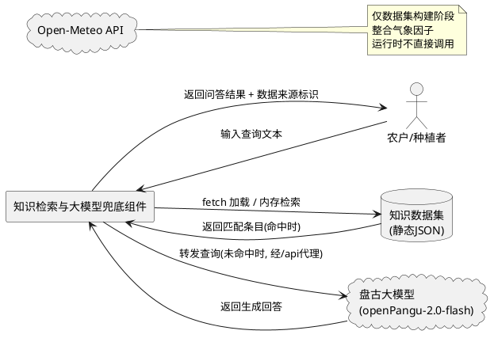
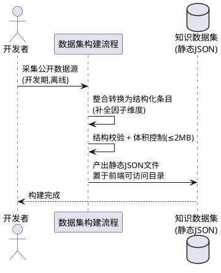
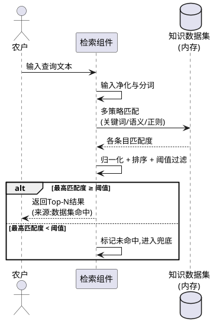

# 基于数据集的知识检索与大模型兜底（knowledge_retrieval_llm_fallback）

> 本文档定义 agritime（知农时）项目中一套"数据集优先检索 + 大模型兜底"的知识问答机制：系统先在本地结构化数据集中执行模糊匹配检索，命中则直接返回；未命中才调用华为云盘古大模型兜底回答，以降低模型调用开销与响应延迟。
> 范围红线：仅允许修改 `frontend/` 目录下文件；不得修改后端（`/opt/crop-calendar`）、`contract/`、`tools/`、`deploy/` 等非前端模块；不引入框架、构建工具或第三方依赖。数据集以静态资源（JSON）形式置于前端可访问目录，检索逻辑在浏览器端执行。

# **1. 组件定位**

## **1.1 核心职责**
本组件负责对用户输入的农业知识查询执行"本地数据集模糊检索优先、大模型兜底"的两级应答策略，实现快速、低成本、可离线的知识问答能力。

## **1.2 核心输入**
1. 用户在前端页面输入的自然语言查询文本（如作物种植问题、农时咨询等）。
2. 本地结构化数据集（前端静态 JSON 资源，涵盖作物、农时、气象、病虫害、农事操作等多因子条目）。
3. 华为云盘古大模型（openPangu-2.0-flash）的 API 响应（仅在兜底触发时调用，经 nginx 反向代理 `/api` 访问后端转发）。
4. Open-Meteo API 返回的天气数据（作为检索因子补充，非本组件直接依赖，但数据集构建时可整合）。

## **1.3 核心输出**
1. 检索命中时，返回数据集中匹配条目的结构化知识结果（含答案文本、来源标记、匹配度）。
2. 检索未命中且兜底触发时，返回大模型生成的回答文本（含来源标记"大模型兜底"）。
3. 检索未命中且兜底失败/超时时，返回降级提示信息。
4. 每次查询的检索路径日志（命中/兜底/降级），供前端展示数据来源标识。

## **1.4 职责边界**
本组件**不负责**以下事项：
1. 后端服务及 `/api/timeline`、`/api/recognition`、盘古大模型调用转发的实现——**不得修改**，前端仅按既有代理路径调用。
2. 后端盘古大模型超时根因治理（当前 `/api/timeline` 约 61 秒）——本组件通过"数据集优先"策略**规避**对大模型的直接依赖，而非修复后端。
3. `contract/`、`tools/`、`deploy/`、`docs/` 等非前端模块——**不得修改**。
4. 引入任何框架、构建工具、第三方检索库（如 Fuse.js、Lunr.js）——**明确禁止**，检索算法以原生 JS 实现。
5. 数据集的在线实时采集与爬虫——数据集为**离线构建**的静态资源，运行时不发起互联网采集请求。
6. 天气数据的实时获取与解析——本组件仅在数据集构建阶段可整合天气因子，运行时天气数据由既有链路处理。

# **2. 领域术语**

**知识数据集（Knowledge Dataset）**
: 以结构化 JSON 格式存储的农业知识条目集合，每条目包含问题关键词、语义标签、答案文本、因子维度等字段，作为模糊检索的数据源。
: 备注：置于前端静态资源目录，通过 fetch 加载至浏览器内存。

**模糊检索（Fuzzy Retrieval）**
: 对用户查询文本与数据集条目执行非精确匹配的检索过程，综合关键词命中、语义相似度、正则匹配等多策略计算匹配度，按阈值过滤并排序返回结果。

**匹配度（Match Score）**
: 模糊检索中对单条数据集条目与用户查询相关性的量化评分，取值范围 [0, 1]，用于排序与阈值过滤。

**匹配阈值（Match Threshold）**
: 判定检索命中的匹配度下限，当最高匹配度 ≥ 阈值时视为命中，低于阈值时视为未命中并触发兜底。

**大模型兜底（LLM Fallback）**
: 当数据集模糊检索未命中任何有效结果时，将用户查询转发至大语言模型生成回答的策略。
: 备注：兜底是**最后手段**，非默认路径，旨在降低模型调用频率与成本。

**检索因子（Retrieval Factor）**
: 数据集条目中用于匹配的特征维度，包括但不限于作物种类、生育阶段、农事操作类型、气象条件、病虫害名称、地域等。

**兜底降级（Fallback Degradation）**
: 大模型兜底调用失败或超时时，返回预设提示而非中断页面的容错行为。

**数据来源标识（Source Tag）**
: 标记每次回答来源的标签，取值包括"数据集命中""大模型兜底""兜底降级"，用于前端展示与可追溯性。

# **3. 角色与边界**

## **3.1 核心角色**
- **农户/种植者**：在前端页面输入农业知识查询，接收并阅读系统返回的问答结果。

## **3.2 外部系统**
- **华为云盘古大模型（openPangu-2.0-flash）**：经后端 nginx 反向代理 `/api` 转发调用，仅在兜底触发时交互，接收查询文本、返回生成回答。
- **Open-Meteo API**：天气数据源，仅在数据集离线构建阶段整合气象因子时间接相关，运行时不由本组件直接调用。
- **前端静态资源服务**：提供知识数据集 JSON 文件的 HTTP 访问，供浏览器 fetch 加载。

## **3.3 交互上下文**



# **4. DFX约束**

## **4.1 性能**
1. **数据集加载**：知识数据集 JSON 文件体积不得超过 2MB，浏览器首次加载至内存可检索状态的耗时不得超过 500ms。
2. **模糊检索响应**：单次模糊检索（含加载后内存检索、匹配度计算、排序）耗时不得超过 200ms。
3. **兜底调用超时**：大模型兜底请求前端超时阈值设为 20 秒（与既有 `TIMELINE_TIMEOUT_MS` 对齐），超时后触发降级。
4. **端到端响应（命中路径）**：当检索命中时，从用户提交查询到结果展示的端到端耗时不得超过 800ms。
5. **端到端响应（兜底路径）**：当触发大模型兜底时，端到端耗时不得超过 25 秒（含 20 秒超时上限 + 降级处理）。

## **4.2 可靠性**
1. **检索可用性**：数据集加载失败时，系统不得崩溃，须直接降级至大模型兜底路径。
2. **兜底容错**：大模型调用失败（网络异常、HTTP 非 2xx、超时）时，须返回降级提示，页面不白屏、不中断。
3. **数据集完整性**：数据集 JSON 须通过结构校验，缺失必填字段的条目须被跳过而非导致整体检索失败。
4. **离线可用性**：当网络不可用且数据集已加载至内存时，检索命中路径须正常工作，仅兜底路径降级。

## **4.3 安全性**
1. **API Key 保护**：盘古大模型 API Key 不得出现在前端代码中，须由后端配置持有，前端仅经 `/api` 代理调用。
2. **输入净化**：用户查询文本在传递至大模型前须进行基本净化（去除脚本标签等），防止注入风险。
3. **数据来源可追溯**：每次返回结果须携带数据来源标识，便于审计与质量回溯。

## **4.4 可维护性**
1. **数据集更新**：知识数据集须支持以替换 JSON 静态文件的方式更新，无需修改检索代码。
2. **阈值可配置**：匹配阈值须以常量形式定义在前端配置区，便于调整而无需修改检索逻辑。
3. **日志规范**：每次查询须在控制台输出检索路径日志（查询摘要、命中/兜底/降级、耗时、匹配度），格式统一。
4. **测试覆盖**：检索逻辑、阈值判定、兜底触发、降级处理须有对应单元测试，通过 `node --test` 可执行。

## **4.5 兼容性**
1. **浏览器兼容**：检索逻辑须基于原生 JS 实现，兼容主流现代浏览器（Chrome、Edge、Firefox、Safari 最新两个版本），不依赖 ES2022+ 特性。
2. **数据集格式兼容**：数据集 JSON 结构变更时，须保持向后兼容或提供版本标识以适配检索逻辑。
3. **既有链路兼容**：本组件不得破坏既有 `/api/timeline`、`/api/recognition` 调用链路与超时降级机制。

# **5. 核心能力**

## **5.1 数据集采集与构建**

### **5.1.1 业务规则**

1. **数据集来源规则**：数据集须从互联网公开可用的农业知识数据源采集，涵盖尽可能多的检索因子（作物种类、生育阶段、农事操作、气象条件、病虫害、地域、土壤类型等）。
   a. 验收条件：[数据集构建完成] → [数据集条目覆盖至少 5 种作物 × 多生育阶段 × 多农事操作的组合，每条目含 ≥ 3 个检索因子字段]

2. **数据集结构化规则**：采集到的原始数据须整合转换为统一的结构化 JSON 格式，每条目包含问题关键词、语义标签、答案文本、因子维度、来源标注等字段。
   a. 验收条件：[数据集 JSON 加载] → [所有条目通过结构校验，必填字段齐全，可被检索逻辑直接消费]

3. **数据集离线构建规则**：数据集的采集与构建须在离线阶段（开发期）完成，产出静态 JSON 文件置于前端可访问目录，运行时不发起互联网采集请求。
   a. 验收条件：[前端运行时检索] → [除 fetch 本地 JSON 与兜底经 /api 代理外，不产生任何外部采集网络请求]

4. **数据集体积约束规则**：数据集 JSON 文件体积不得超过 2MB，条目数量须在保证覆盖度的前提下控制规模。
   a. 验收条件：[数据集文件构建] → [JSON 文件 ≤ 2MB，浏览器加载耗时 ≤ 500ms]

5. **禁止项**：禁止在运行时执行爬虫或在线数据采集；禁止将未经结构化的原始文本直接作为数据集。
   a. 验收条件：[运行时网络请求审计] → [无爬虫/采集请求]；[数据集加载] → [所有条目为结构化对象而非原始文本]

### **5.1.2 交互流程**



### **5.1.3 异常场景**

1. **数据集加载失败**
   a. 触发条件：fetch 请求 JSON 文件返回非 2xx 或网络不可用
   b. 系统行为：捕获加载错误，跳过检索阶段，直接进入大模型兜底路径
   c. 用户感知：回答来源标识为"大模型兜底"或"兜底降级"，页面不报错中断

2. **数据集格式不合法**
   a. 触发条件：JSON 解析失败或条目缺少必填字段
   b. 系统行为：跳过不合法条目，以合法条目继续检索；若全部不合法则降级至兜底
   c. 用户感知：检索可能返回较少结果或触发兜底，无前端报错

3. **数据集体积超限**
   a. 触发条件：JSON 文件 > 2MB
   b. 系统行为：构建阶段须告警并要求精简；运行时仍尝试加载但可能影响性能
   c. 用户感知：首次加载可能偏慢，检索功能正常

## **5.2 模糊检索**

### **5.2.1 业务规则**

1. **检索优先规则**：当用户输入查询时，系统必须首先在已加载的数据集中执行模糊检索，而非直接调用大模型。
   a. 验收条件：[用户提交查询] → [系统先执行本地数据集模糊检索，不先调用大模型]

2. **多策略匹配规则**：模糊检索须综合至少以下匹配策略计算匹配度：关键词命中（分词后词项重叠）、语义相似度（基于标签/因子维度匹配）、正则匹配（模式规则命中）。
   a. 验收条件：[用户查询与数据集条目匹配] → [匹配度由多策略加权计算得出，非单一精确匹配]

3. **匹配度归一化规则**：每条目的匹配度须归一化至 [0, 1] 区间，1 表示完全匹配，0 表示无任何关联。
   a. 验收条件：[任意查询与任意条目] → [匹配度 ∈ [0, 1]]

4. **阈值命中规则**：当最高匹配度 ≥ 匹配阈值时，视为检索命中，返回匹配度排序后的 Top-N 结果（N 默认为 5）；当最高匹配度 < 阈值时，视为未命中。
   a. 验收条件：[最高匹配度 ≥ 阈值] → [返回排序结果，来源标识"数据集命中"]；[最高匹配度 < 阈值] → [不返回数据集结果，进入兜底判定]

5. **结果排序规则**：命中结果须按匹配度降序排列，匹配度相同时按数据集条目优先级（如有）排列。
   a. 验收条件：[多条目命中] → [返回列表按匹配度降序排列]

6. **空查询拦截规则**：当用户输入为空或仅含空白字符时，系统不得执行检索或调用大模型，须提示用户输入有效查询。
   a. 验收条件：[用户提交空查询] → [不执行检索/兜底，返回"请输入有效查询"提示]

7. **禁止项**：禁止在检索命中时仍调用大模型；禁止返回匹配度低于阈值的条目作为命中结果。
   a. 验收条件：[检索命中] → [不发起大模型调用]；[返回结果] → [所有条目匹配度 ≥ 阈值]

### **5.2.2 交互流程**



### **5.2.3 异常场景**

1. **数据集未加载至内存**
   a. 触发条件：数据集 fetch 失败或尚未加载完成时用户提交查询
   b. 系统行为：跳过检索，直接进入大模型兜底路径
   c. 用户感知：来源标识"大模型兜底"或"兜底降级"

2. **检索过程异常**
   a. 触发条件：匹配度计算或排序过程中抛出异常（如数据类型不匹配）
   b. 系统行为：捕获异常，降级至大模型兜底路径，控制台输出错误日志
   c. 用户感知：来源标识"大模型兜底"或"兜底降级"，无前端报错

3. **查询文本含特殊字符**
   a. 触发条件：用户输入含正则元字符、HTML 标签等
   b. 系统行为：对正则匹配进行转义处理，对 HTML 标签进行净化
   c. 用户感知：检索正常执行，无注入风险

## **5.3 大模型兜底**

### **5.3.1 业务规则**

1. **兜底触发规则**：仅当数据集模糊检索未命中任何有效结果（最高匹配度 < 阈值）或数据集不可用时，才触发调用大语言模型。
   a. 验收条件：[检索未命中] → [触发大模型兜底]；[检索命中] → [不触发大模型兜底]

2. **兜底请求规则**：兜底调用须经 nginx 反向代理 `/api` 路径转发至后端，由后端调用盘古大模型，前端不直接持有 API Key。
   a. 验收条件：[兜底触发] → [请求经 /api 代理发出，前端代码中无 API Key 明文]

3. **兜底超时规则**：兜底请求前端超时阈值为 20 秒，超时后中止请求并触发降级。
   a. 验收条件：[兜底请求 > 20秒] → [AbortController 中止请求，进入降级处理]

4. **兜底结果规则**：大模型返回有效回答时，须标注来源标识"大模型兜底"返回给用户；返回异常时进入降级。
   a. 验收条件：[大模型返回有效回答] → [来源标识"大模型兜底"]；[大模型返回异常] → [进入降级]

5. **降级提示规则**：兜底失败/超时时，须返回预设降级提示文本，页面不白屏、不中断，并标注来源"兜底降级"。
   a. 验收条件：[兜底失败或超时] → [返回降级提示，页面正常展示，来源标识"兜底降级"]

6. **禁止项**：禁止将大模型作为默认/首选回答路径；禁止在前端代码中硬编码盘古 API Key；禁止兜底请求无超时保护。
   a. 验收条件：[正常查询流程] → [大模型非首选路径]；[前端代码审计] → [无 API Key 明文]；[兜底请求] → [必有超时控制]

### **5.3.2 交互流程**

```plantuml
@startuml
actor "农户" as User
participant "兜底组件" as Fallback
cloud "盘古大模型\n(经/api代理)" as LLM

User -> Fallback : 检索未命中,触发兜底
Fallback -> Fallback : 输入净化
Fallback -> LLM : 转发查询\n(20s超时, AbortController)
alt 大模型正常返回
  LLM --> Fallback : 生成回答
  Fallback --> User : 返回回答\n(来源:大模型兜底)
else 超时/失败
  Fallback -> Fallback : 降级处理
  Fallback --> User : 返回降级提示\n(来源:兜底降级)
end
@enduml
```

### **5.3.3 异常场景**

1. **大模型接口超时**
   a. 触发条件：兜底请求超过 20 秒未响应
   b. 系统行为：AbortController 中止请求，进入降级处理，控制台输出超时日志
   c. 用户感知：返回降级提示，来源标识"兜底降级"

2. **大模型接口返回非 2xx**
   a. 触发条件：后端转发大模型返回 HTTP 错误状态码
   b. 系统行为：捕获 HTTP 错误，进入降级处理
   c. 用户感知：返回降级提示，来源标识"兜底降级"

3. **网络不可用**
   a. 触发条件：fetch 请求因网络离线失败
   b. 系统行为：捕获网络错误，进入降级处理
   c. 用户感知：返回降级提示，来源标识"兜底降级"

4. **大模型返回空内容**
   a. 触发条件：大模型响应体为空或无有效文本
   b. 系统行为：判定为无效回答，进入降级处理
   c. 用户感知：返回降级提示，来源标识"兜底降级"

# **6. 数据约束**

## **6.1 知识数据集条目（KnowledgeEntry）**
1. **id**：条目唯一标识，字符串类型，不得为空，全数据集内唯一。
2. **keywords**：问题关键词数组，字符串数组类型，不得为空，用于关键词匹配策略。
3. **semanticTags**：语义标签数组，字符串数组类型，可空，用于语义相似度匹配策略。
4. **factors**：检索因子对象，包含作物种类、生育阶段、农事操作、气象条件、病虫害、地域等维度字段，可部分为空，用于多因子匹配。
5. **answer**：答案文本，字符串类型，不得为空，为检索命中时返回给用户的核心内容。
6. **answerRegex**：正则匹配模式数组，字符串数组类型，可空，用于正则匹配策略。
7. **priority**：条目优先级，数值类型，可空，默认 0，用于匹配度相同时的排序。
8. **source**：数据来源标注，字符串类型，不得为空，标记该条目知识的原始来源（如"XX农业公开数据集"）。

## **6.2 查询请求（QueryRequest）**
1. **text**：用户输入的查询文本，字符串类型，不得为空（空查询须被拦截）。
2. **timestamp**：查询提交时间戳，数值类型，不得为空，用于日志与审计。

## **6.3 检索结果（RetrievalResult）**
1. **entries**：命中条目数组，每项含 KnowledgeEntry 及其 matchScore，按 matchScore 降序排列。
2. **hit**：是否命中布尔值，true 表示最高匹配度 ≥ 阈值，false 表示未命中。
3. **maxScore**：最高匹配度，数值类型，∈ [0, 1]。
4. **elapsedMs**：检索耗时（毫秒），数值类型，不得为空。

## **6.4 兜底响应（FallbackResponse）**
1. **answer**：大模型生成的回答文本，字符串类型，正常时不得为空。
2. **source**：来源标识，字符串类型，取值"大模型兜底"或"兜底降级"。
3. **reason**：降级原因，字符串类型，仅当 source 为"兜底降级"时填充（如"timeout""http_error""network_error""empty_response"）。
4. **elapsedMs**：兜底耗时（毫秒），数值类型，不得为空。

# **7. 技术分析维度**

> 本章回应需求中"请补充说明以下技术分析维度"的要求，从产品与业务视角分析方案特性，不含具体代码实现。

## **7.1 适用场景与局限性**

### **7.1.1 适用场景**
1. **高频标准化问答**：当用户查询集中在常见、可枚举的农业知识领域（如"大蒜什么时候播种""冬小麦越冬管理"），数据集可覆盖大部分查询，命中率高，大模型调用极少。
2. **成本敏感场景**：当大模型按调用次数计费且预算有限时，数据集优先策略可显著降低调用频次与费用。
3. **低延迟要求场景**：当用户期望秒级响应而大模型端到端耗时达数十秒时，数据集命中路径（< 800ms）可满足体验要求。
4. **离线/弱网场景**：当网络不稳定但数据集已加载至内存时，命中路径仍可工作，仅兜底路径受影响。

### **7.1.2 局限性**
1. **长尾查询覆盖不足**：对于数据集未覆盖的冷门、复合、个性化问题，检索无法命中，仍需依赖大模型兜底，此时响应延迟与纯大模型方案无差异。
2. **数据集维护成本**：农业知识随地域、品种、气候动态变化，数据集须持续更新才能保持命中率，存在维护开销。
3. **语义理解深度有限**：原生 JS 模糊检索的语义匹配能力远不及大模型，对复杂句式、隐含意图、跨领域关联查询的理解准确度较低。
4. **数据集体积与覆盖度矛盾**：受 2MB 体积约束，数据集覆盖度存在上限，无法无限扩充条目。
5. **匹配阈值调优难度**：阈值过高导致命中率低、兜底频繁；阈值过低导致误命中、答案不相关，须持续调优。

## **7.2 模糊检索实现方式与匹配阈值设定**

### **7.2.1 实现方式（业务视角）**
1. **关键词匹配**：对用户查询与条目 keywords 进行分词后词项重叠计算，重叠率越高匹配度越高。
2. **语义标签匹配**：对用户查询提取语义标签与条目 semanticTags 比对，标签重叠度反映语义相关度。
3. **因子维度匹配**：从用户查询中识别作物、农事操作等因子，与条目 factors 对应维度比对，因子命中数越多匹配度越高。
4. **正则模式匹配**：对预设的 answerRegex 模式进行匹配，命中则给予固定匹配度加分。
5. **加权融合**：各策略匹配度按预设权重加权求和，归一化至 [0, 1] 得出最终匹配度。

### **7.2.2 匹配阈值设定策略**
1. **初始值**：建议初始阈值设为 0.6，在保证一定命中率的同时过滤低相关结果。
2. **调优方法**：基于历史查询日志统计命中/兜底比例与用户反馈（如有），动态调整阈值——命中率过低则适当下调，误命中过多则适当上调。
3. **分级阈值（可选）**：可对不同查询类型（如作物类、病虫害类）设定差异化阈值，提升精准度。
4. **可配置性**：阈值须以前端常量形式定义，支持快速调整而无需修改检索逻辑。

## **7.3 数据库更新与维护策略**

1. **更新方式**：以替换前端静态 JSON 文件的方式更新数据集，无需修改检索代码，部署时覆盖文件即可。
2. **更新频率**：建议按季度或农事季节周期更新，补充新作物品种、新病虫害知识、新地域农时数据。
3. **更新来源**：持续从公开农业数据源、农业科研机构开放数据、用户高频兜底问题（反哺数据集）中采集新条目。
4. **质量校验**：每次更新须执行结构校验（必填字段、体积 ≤ 2MB）、去重校验（id 唯一）、内容抽检（答案准确性）。
5. **版本管理**：数据集 JSON 须包含版本号与更新时间字段，便于追溯与兼容性处理。
6. **反哺机制**：对大模型兜底回答中高频出现且用户反馈良好的查询，可人工审核后纳入数据集，逐步提升命中率、降低兜底频率。

## **7.4 与纯大模型方案优劣对比**

| 对比维度 | 纯大模型方案 | 数据集优先 + 大模型兜底方案 |
|---|---|---|
| **响应速度** | 每次查询均依赖大模型，端到端 20~60 秒（当前盘古约 61 秒），体验差 | 命中路径 < 800ms，仅未命中时才承受大模型延迟，整体体验显著优于纯大模型 |
| **调用成本** | 每次查询均计费，高频场景成本高 | 仅未命中时计费，命中率越高成本越低，长期成本可控 |
| **回答准确性** | 大模型语义理解强，对复杂/开放问题准确度高；但对专业农业领域可能产生幻觉 | 数据集命中准确性取决于数据集质量，专业领域可控性强；复杂长尾问题退化为大模型准确度 |
| **可用性/离线** | 完全依赖网络与大模型可用性，离线不可用 | 命中路径离线可用（数据集已加载），仅兜底路径依赖网络 |
| **可维护性** | 无数据集维护成本，但依赖大模型服务稳定性 | 须持续维护数据集，但降低了对大模型服务的强依赖 |
| **覆盖范围** | 理论上覆盖任意自然语言查询 | 数据集覆盖范围内命中率高，范围外退化为大模型 |
| **可控性/可追溯** | 回答由大模型生成，难以追溯与审核 | 数据集命中结果来源明确、可审核、可追溯；兜底结果标注来源 |
| **适用规模** | 适合查询量小、问题开放、无预算约束场景 | 适合查询量大、问题相对标准化、成本/延迟敏感场景 |

**综合结论**：对于 agritime（知农时）这类面向农户的农业知识问答场景，查询多集中在作物种植、农时管理、病虫害防治等标准化领域，且当前后端大模型响应延迟严重（约 61 秒），"数据集优先 + 大模型兜底"方案在响应速度、成本、可用性上具有显著优势，同时通过兜底机制保证长尾查询的覆盖能力。该方案的核心风险在于数据集维护投入与匹配阈值调优，须通过反哺机制与持续迭代逐步化解。