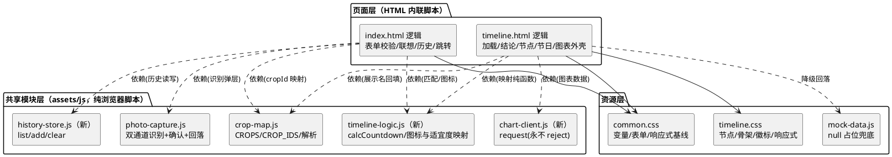
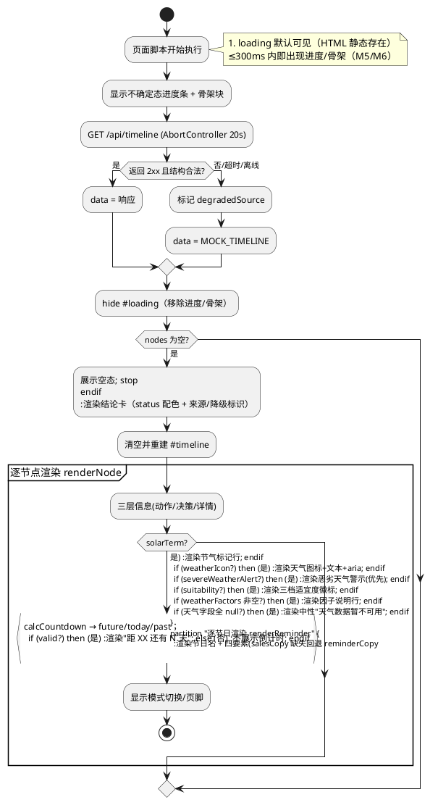
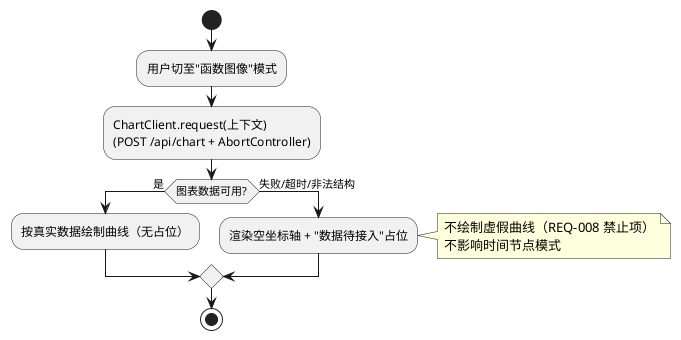
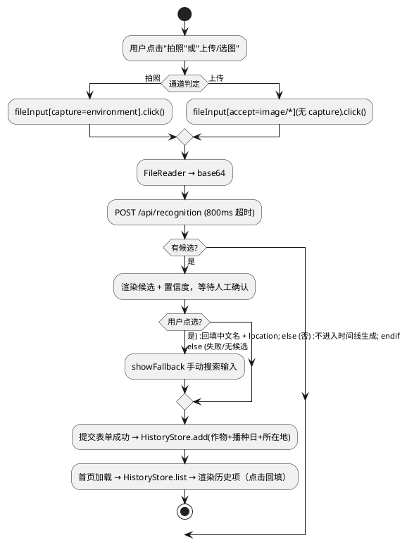
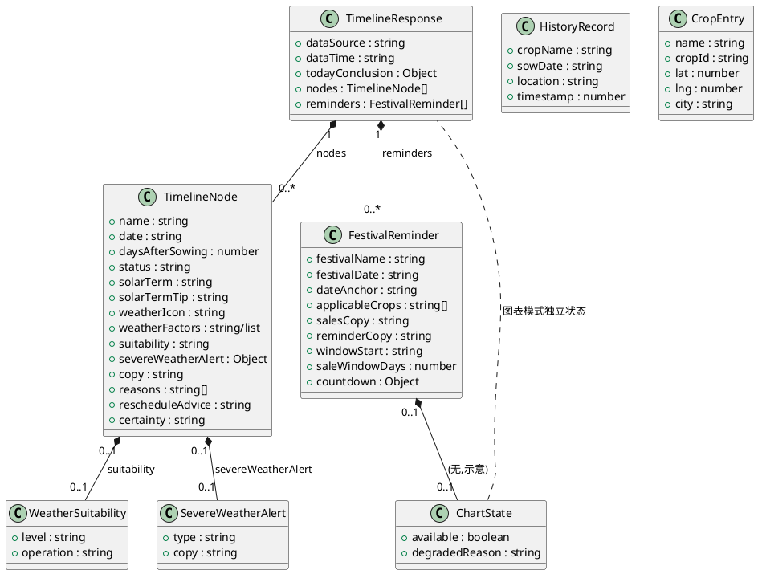

# 第二阶段前端增强与数据对齐 · 技术设计（stage2_frontend）

> 需求来源：`.codeartsdoer/specs/stage2_frontend/spec.md`（REQ-S2F-*-001 ~ REQ-S2F-*-060，共 60 条）
> 设计范围：**仅 `frontend/` 目录**；纯原生 JS + 原生 CSS，无框架 / 构建工具 / 第三方库。
> 强约束：不改后端（Java/8080、`crop-protocols.json`、`market-festivals.json`、`scoreNode`）、不改 `contract/`、`data/`、`deploy/`、`docs/`、不改 nginx/systemd；`frontend/tests/pages.test.js` 既有 **22 项**断言必须全绿，仅允许新增。
> 权威数据边界：节日日期（`festivalDate`）与天气适宜度结论（`suitability` / `scoreNode`）均以接口返回为准；前端**不硬编码日期、不推算农历、不自算权威阈值、不直连 Open-Meteo**。

# 一、需求与存量功能关系分析

## 1.1 需求功能与存量功能对比

### 1.1.1 已实现功能

| 需求功能 | 存量功能 | 代码位置 | 匹配度 |
|---------|---------|---------|--------|
| 首屏加载容器 + 骨架块（M5/M6 前置） | `#loading` 内含 3 个 `.skeleton` 块，默认可见 | `frontend/pages/timeline.html:31-35`；`frontend/assets/css/timeline.css:206-227` | 50%（有骨架块，无进度文案/进度条，骨架尺寸未对齐节点卡） |
| 节点三层信息渲染（动作/决策/详情） | `renderNode`（`tl-action`/`tl-decision`/`tl-note`/`tl-detail`） | `frontend/pages/timeline.html:194-262` | 100% |
| 节气标注（基础） | `renderNode` 中 `node.solarTerm` 分支 | `frontend/pages/timeline.html:230-237` | 50%（与 `weatherIcon` 为 `else if` 互斥，无法共存） |
| 天气图标与文案（基础） | `WEATHER_WORD`（9 类文案）+ `nodeIcon('weather')`（**单一** `timeline-weather-icon.svg`） | `frontend/pages/timeline.html:61-64,156-168,238-246` | 50%（仅 1 张图，晴/雨/风等无法区分；无扩展类型；无 aria） |
| 图表占位/降级视图 | `buildEmptyChartSVG` + `renderChart` 真实/占位闸门 | `frontend/pages/timeline.html:314-412` | 75%（**未接入 `POST /api/chart`**，仅按 timeline 节点本地绘制） |
| 节日/销售窗口渲染（多节日遍历） | `render()` 中 `Array.isArray(data.reminders)` 遍历 + `renderReminder` | `frontend/pages/timeline.html:264-291,449-454` | 50%（无线性倒计时、无四要素字段渲染） |
| 搜索联想 | `renderSuggestions`（CROPS 关键字包含匹配）+ 点击回填 `crop+location` | `frontend/pages/index.html:170-188` | 75%（无去抖、无键盘可达、无高亮） |
| 拍照识别（单入口）+ 人工确认 + 失败回落 | `PhotoCapture.open`、`renderCandidates`、`showFallback`、`AbortController` | `frontend/pages/photo-capture.js:68-101,106-127,129-147,155-189` | 50%（仅 1 个 `capture` 入口，无双通道） |
| 中文名 ↔ cropId 映射（M3） | `CropMap`（`CROPS`/`CROP_IDS`/`resolveCropId`/`buildCropParam`） | `frontend/assets/js/crop-map.js:6-101` | 100% |
| 自定义日期三联动 + 范围校验 | `fillYears/fillMonths/fillDays/clampDay/validate` | `frontend/pages/index.html:90-153,203-227` | 100% |
| 20s 超时 + 降级标识（不静默） | `getData()` + `TIMELINE_TIMEOUT_MS` + `degradedSource` + "本地兜底数据"文案 | `frontend/pages/timeline.html:117-140,170-192` | 100% |
| 离线 null 占位兜底数据 | `MOCK_TIMELINE`（字段 null、`reasons: []`） | `frontend/assets/mock/mock-data.js:6-28` | 100%（尚未补 v1.1 新增字段） |
| 响应式基线（375px 无横滚） | `html,body{overflow-x:hidden;max-width:100%}`、`.page{max-width:460px}` | `frontend/assets/css/common.css:25-30,45-50` | 25%（仅 375px 单档，无 768/1024 适配） |
| 前端单测基座（22 项） | `node --test` 文本断言套件 | `frontend/tests/pages.test.js:18-163` | 100% |

### 1.1.2 需要扩展的功能

| 需求功能 | 存量功能 | 差异说明 | 扩展方向 |
|---------|---------|---------|---------|
| M5 首次加载进度提示（REQ-001~003） | `#loading` 仅有骨架块 | 缺"正在进行中"文案/进度反馈；`#brand-sub` 静态"正在读取农时…" | 在 `#loading` 内新增进度提示行（**不确定态**进度条 + 阶段文案），默认可见，数据返回/降级时隐藏 |
| M6 骨架屏占位（REQ-004~006） | 3 个 `.skeleton` 块高 84px | 骨架结构与最终节点卡尺寸不完全一致，易跳动；无 aria | 骨架块高度/圆角/间距对齐 `.tl-card`，增加 `aria-hidden` 与加载语义；纯 CSS 保留（不引第三方动画） |
| M7 图表失败优雅降级（REQ-007~009） | `renderChart` 仅消费 timeline 节点 | **未接入 `POST /api/chart`**；无"图表接口失败"专用提示 | 新增图表数据客户端：优先 `POST /api/chart`，失败/超时/非法结构 → 占位降级；**请求串须置于独立脚本**（见决策 D-02） |
| M8 天气图标可视化（REQ-010~012） | `WEATHER_WORD` 9 类文案 + 1 张图 | 无法区分晴/雨/风；无扩展类型；无文本/aria 说明 | 新增具名常量 `WEATHER_ICON_MAP`（类型→图标+文本+aria），至少覆盖晴/雨/风/阴/雪/雾/雷/多云 + 兜底 |
| M9 时间线节气标注（REQ-013~015） | `solarTerm` 与 `weatherIcon` 互斥 | 节气与天气无法共存；节气标记视觉不突出 | 拆为独立展示：节气标记（独立样式类）+ 天气行各自渲染，互不排斥 |
| M10 响应式 768/1024（REQ-016~018） | 仅 375px 单档 | 无媒体查询；宽屏下 `.page` 固定 460px 留白失衡 | 纯 CSS 媒体查询：≥768px 放宽/多列、≥1024px 居中定宽；**保留** `overflow-x:hidden` 与 `max-width:100%` |
| M11 拍照识别双通道（REQ-019~022） | 单 `fileInput`（`capture=environment`） | 仅一个"拍照/选图"入口 | 拆为两个并列入口：**拍照**（`capture`）与**上传**（无 `capture`，`accept="image/*"`），复用同一识别流程与回落 |
| M12 搜索联想增强（REQ-023~026） | `renderSuggestions` 关键字包含 | 无输入去抖、无键盘上下选择、无输入为空时的显式隐藏收敛 | 保留本地匹配（不发请求），增加去抖 + 键盘可达 + 高亮匹配片段 |
| M13 历史记录 localStorage（REQ-027~030） | **无** | 无本地历史持久化 | 新增 `HistoryStore` 封装（读写/去重/上限5/损坏容错/不可用静默降级）+ 首页历史 UI 与回填 |
| M14 节日倒计时（REQ-031~034） | `renderReminder` 无倒计时 | 无"距 XX 还有 N 天"；过期/缺失未定义 | 扩展 `renderReminder`：本地日期差倒计时；0→"就是今天"、<0→"已过/已结束"、非法→不展示 |
| v1.1 天气适宜度（REQ-056） | 无 | 无 `suitability` 三档标识 | 新增 `SUITABILITY_MAP`（green/yellow/red）语义复用后端枚举，节点渲染适宜度徽标+文案 |
| v1.1 恶劣天气提醒（REQ-057） | 无 | 无 `severeWeatherAlert` | 新增 `SEVERE_WEATHER_MAP`（暴雨/大风/高温/霜冻）；**警示优先于适宜度**展示 |
| v1.1 天气因子说明（REQ-059） | 无 | 无 `weatherFactors` 展示 | 节点新增因子说明行，支持字符串/数组，缺失时不渲染 |
| v1.1 天气数据降级（REQ-060） | 无 | 无天气缺失的中性态 | `weatherIcon`/适宜度/因子均 null → 展示中性"天气数据暂不可用"，**不臆造**结论；每次渲染重建 DOM 以清除上次状态 |
| v1.1 节日规则扩充（REQ-054/055） | `renderReminder` 仅渲染名/日期/文案 | 缺四要素（`dateAnchor`/`applicableCrops`/`salesCopy`）；≥6 并列未验证 | 渲染四要素（`salesCopy` 缺失回退 `reminderCopy`），列表遍历不设上限、不截断 |
| M1-M4 数据对齐前端侧（REQ-035~038） | mock 结构与渲染口径 | mock 缺 v1.1 字段；节点数无上限（已满足） | mock 补齐字段（**保持 null 占位、不造假**）；crop-map 保持 5 cropId；仅消费 `status`/`suitability` 枚举 |

### 1.1.3 需要新增的功能或接口

**A. 纯函数逻辑模块（新增文件，无 DOM，便于 `node --test` 行为断言）**

| 功能点 | 输入 | 输出 | 核心逻辑 | 依赖 |
|-------|------|------|---------|------|
| `calcCountdown` | `festivalDate`(YYYY-MM-DD)、本地今天 | `{days, state}`，state∈`future/today/past/invalid` | 仅本地日期差，不发起网络请求 | 无 |
| `getWeatherIcon` | `weatherIcon` 类型值 | `{svg, text, aria}` | 查 `WEATHER_ICON_MAP`，未识别 → 通用兜底 + 原文案 | 常量表 |
| `getSuitability` | `suitability` 枚举 | `{label, className}` | 映射 green/yellow/red；null → 中性态 | 常量表 |
| `getSevereAlert` | `severeWeatherAlert` 对象/字符串 | `{icon, copy}` 或 `null` | 查 `SEVERE_WEATHER_MAP`，未识别 → 原文案 | 常量表 |
| `normalizeFactors` | `weatherFactors`(string\|string[]\|null) | `string[]` | 统一为数组，过滤空值 | 无 |

**B. 历史记录模块（新增文件）**

| 功能点 | 输入 | 输出 | 核心逻辑 | 依赖 |
|-------|------|------|---------|------|
| `HistoryStore.list` | — | `HistoryRecord[]`（≤5） | 读 `localStorage`，解析失败 → `[]` | localStorage（不可用则静默降级） |
| `HistoryStore.add` | `{cropName,sowDate,location}` | 新列表 | 去重（同 crop+sowDate+location）+ 头插 + 截断 5 条 + 写回 | `list` |
| `HistoryStore.clear` | — | — | 清空键 | — |

**C. 图表数据客户端（新增文件，隔离 POST 字面串）**

| 功能点 | 输入 | 输出 | 核心逻辑 | 依赖 |
|-------|------|------|---------|------|
| `ChartClient.request` | 节点/查询上下文 | `Promise<{ok, data|degradedReason}>` | `POST /api/chart` + `AbortController` 超时；失败/非法结构 → 降级态（**永不 reject**） | 无 |

**D. 页面新增能力（内嵌于 HTML/模块）**

- timeline.html：进度提示渲染、天气图标行、适宜度徽标、恶劣天气警示、天气因子说明、节气标记独立化、节日倒计时与四要素、天气中性降级态。
- index.html：历史记录区块 UI（列表 + 点击回填 + 清空）、双通道入口按钮、联想增强。

**E. 测试断言补充**（`frontend/tests/pages.test.js`，见 2.5）

## 1.2 存量功能详细分析

### 1.2.1 `getData()`（`timeline.html:117-140`）

- **接口契约**：无入参；返回 `Promise<响应对象>`；**永不 reject**（`catch` 内回落 `window.MOCK_TIMELINE`）。
- **业务规则**：`AbortController` + `TIMELINE_TIMEOUT_MS=20000`；`!res.ok` → `degradedSource='http'`；结构非法（无 `nodes` 数组）→ `'invalid'`；`AbortError`→`'timeout'`，其余→`'offline'`。
- **扩展点**：`degradedSource` 为降级原因标记，是所有降级文案的唯一上游。
- **约束**：`getData().then(render)` 无 `.catch`，新逻辑必须保持"永不 reject"约定，否则产生未捕获 Promise 异常（违反 REQ-060）。v1.1 天气降级须复用该标记，不得新增独立请求。

### 1.2.2 `render(data)`（`timeline.html:435-457`）

- **接口契约**：入参响应对象或 `null`；副作用为切换 `#loading`/`#empty-state`/`#timeline`/`#footer`/`#mode-switch` 显隐。
- **业务规则**：空节点 → 空态 `return`；否则 → 结论卡 → 缓存 `cachedData` → 模式切换 → 节点列表 → 可选 reminders。
- **约束**：
  1. `#loading` 隐藏发生在 `render` 入口第一行，**M5/M6 的"数据返回即隐藏"由此承载**，无需新增隐藏逻辑。
  2. `data.todayConclusion` 直接读取（`renderConclusion`），缺字段会抛错，须保留守卫。
  3. `#timeline.innerHTML=''` 每次重建 DOM —— 天然满足 REQ-060/4.2.7"不残留上次天气状态"。

### 1.2.3 `renderNode(node)`（`timeline.html:194-262`）

- **接口契约**：入参 `nodes[]` 单元素；返回 `HTMLElement`；无抛异常路径。
- **业务规则**：`certainty==='predicted'`→虚线；`status`→配色类；`solarTerm` 优先、否则 `weatherIcon`（**互斥分支，须拆开**）；`reasons` 数组→`<ul>`。
- **扩展点**：无显式钩子；新增天气/适宜度/警示/因子行均为**追加子节点**，不改既有三层结构。
- **约束**：既有断言依赖 `tl-action`/`tl-decision`/`tl-note`/`node.copy`/`predicted`/`certain` 字符串，改造须保留。

### 1.2.4 `renderReminder(r)` / `renderChart(data)`（`timeline.html:264-291,403-412`）

- **契约**：`renderReminder` 入参单条 reminder → 节点卡片；`renderChart` 入参整份响应 → 向 `#chart` 注入 SVG，置 `chartRendered=true`。
- **业务规则（图表）**：`hasRealData && hasValidDays` 为真实/占位闸门；`buildChartSVG` **自身不判真假**，只能经 `renderChart` 入口调用。
- **约束**：
  1. `renderReminder` 须保留（既有断言 `Array.isArray(data.reminders)` 与 `renderReminder` 能力）；扩展时**不得删除**既有字段渲染。
  2. `CHART_CONFIG`/`SIGMA`/`数据待接入`/`createElementNS`/`id="chart"` 为断言依赖字符串，改造须保留。

### 1.2.5 `renderSuggestions`（`index.html:170-188`）

- **契约**：入参关键字字符串；副作用为 `#crop-suggestions` 显隐与候选按钮渲染。
- **业务规则**：`CROPS.filter(c => c.name.indexOf(kw) !== -1)`；点击回填 `crop` + `location`（`hit.city`）。
- **约束**：`CROPS` 为联想唯一数据源（与 crop-map 共享），不得引入后端不存在的作物标识（REQ-026 禁止项）。

### 1.2.6 `photo-capture.js`（`index.html:68-101,155-189`）

- **契约**：`PhotoCapture.open(onConfirm)`；`onConfirm(cropName:string)` 传入后端候选**中文名**。
- **业务规则**：单 `fileInput(capture=environment)`；`FALLBACK_TIMEOUT_MS=800` 超时；失败/无候选 → `showFallback` 手动搜索回落；识别结果须人工点选确认。
- **约束**：既有断言依赖 `needConfirm|确认`、`fallback|手动搜索`、`AbortController`、`/api/recognition` 字面串，双通道改造须全部保留。

### 1.2.7 样式基座（`common.css` / `timeline.css`）

- **契约**：CSS 变量（`--leaf/--sun/--red/--rain/...`）为配色单一来源；`.badge.green/yellow/red`、`.tl-node.status-*` 已定义三档语义。
- **约束**：`html,body{overflow-x:hidden}` 与 `max-width:100%` 为既有断言（第 3 项）依赖，响应式改造须保留；骨架 `.skeleton` 动画须保留纯 CSS（REQ-006 禁止第三方动画库）。
# 二、增量设计方案

## 2.0 总体策略与关键决策

| 决策编号 | 决策点 | 结论 | 决策理由 |
|---------|-------|------|---------|
| D-01 | 加载反馈形态（M5） | `#loading` 内新增**不确定态**进度条 + 阶段文案，**不展示百分比** | 前端无真实进度事件，展示百分比属臆造；不确定态既满足"可见反馈"又不误导（REQ-001/002/003） |
| D-02 | `POST /api/chart` 落点 | 抽到独立脚本 `chart-client.js`，timeline.html 仅 `<script src>` 引入并调用其 `request()` | **既有断言第 14 项** `assert.ok(!timelineHtml.includes("method: 'POST'"))` 明确禁止 `POST` 字面串出现在 timeline.html；同时保留 `/method:\s*'GET'/` |
| D-03 | 天气图标载体（M8/v1.1） | 内联 SVG 字符串常量集 `WEATHER_ICON_MAP`，未识别类型回退通用图标 + 原文案 | 无外部请求（REQ-012/4.1.5）、跨平台渲染一致（emoji 字形差异大）、便于逐类区分 |
| D-04 | 纯函数（倒计时/映射）归属 | 抽到 `timeline-logic.js`，采用"挂 `window` + 条件 `module.exports`"双导出，无 DOM 依赖 | 既有测试为文本断言，无法验证行为；双导出后可 `require` 直接做行为断言，且仍满足"项目内本地脚本"约定，不引依赖 |
| D-05 | 历史记录存储（M13） | 键名 `agritime.history.v1`；≤5 条、同（作物+播种日+所在地）去重、头插、`try/catch` 全包 | localStorage 在隐私模式会抛错（REQ-030），必须静默降级；仅存非敏感字段（REQ-028/6.1） |
| D-06 | 天气判定边界（v1.1） | 前端仅**消费** `suitability`/`severeWeatherAlert`/`weatherFactors`，**不实现任何阈值计算** | REQ-056/4.4.1 红线：权威算法在后端 `scoreNode`，前端自算即违规 |
| D-07 | 节气与天气共存（M9） | 拆为两条独立备注行（节气行 + 天气行），删除 `else if` 互斥 | REQ-013 要求节气独立标注，且 REQ-010 要求天气图标始终按字段渲染，二者不应互斥 |
| D-08 | 响应式实现（M10） | 纯 CSS 媒体查询：≥768px 放宽/分栏、≥1024px 居中定宽；**保留** `overflow-x:hidden` 与 `max-width:100%` | REQ-018 禁止栅格框架；保留字符串以满足既有断言第 3 项；禁止以"隐藏内容"换无滚动（REQ-016 禁止项） |
| D-09 | 降级机制复用（v1.1/M7） | 天气降级、图表降级共用既有 `degradedSource` 与"本地兜底数据"标识口径，**不新增独立网络请求** | REQ-060/4.1.6/4.2.5 要求复用既有 20s 机制且降级可见；避免额外请求 |
| D-10 | 多节日并列（REQ-055） | `reminders` 遍历**不设条数上限、不截断**；0 条不渲染区块、1 条正常、≥6 条纵向排布 | REQ-055/6.3.9 要求数量由接口决定 |
| D-11 | 恶劣天气与适宜度冲突（异常场景4） | **警示优先**：同时存在时以警示呈现并给出解释 | REQ 异常场景 4 要求避免用户按"适宜"误操作 |
| D-12 | mock 对齐口径（M1-M4） | 补 `solarTerm/solarTermTip/weatherFactors/suitability/severeWeatherAlert/dateAnchor/applicableCrops/salesCopy` 字段，**全部保持 null 占位** | REQ-035/036 要求结构对齐；REQ 4.1/禁止项要求不得造假 |

## 2.1 实现模型

### 2.1.1 上下文视图

新需求不改变对外部系统的依赖形态，仅在既有交互上**增加同源接口消费**与**本地持久化**。

```plantuml
@startuml
skinparam rectangle { BackgroundColor #fffdf7
  BorderColor #e4ddcb }
skinparam componentStyle rectangle
actor "农户/农业从业者" as user
rectangle "index.html\n表单+联想+历史+双通道" as idx
rectangle "timeline.html\n加载/节点/图表/节日" as tl
rectangle "timeline-logic.js\n(纯函数/映射常量)" as logic
rectangle "history-store.js\n(localStorage 封装)" as hist
rectangle "chart-client.js\n(POST /api/chart)" as chart
rectangle "crop-map.js\n(中文名↔cropId)" as cmap
rectangle "mock-data.js\n(null 占位兜底)" as mock
rectangle "浏览器 localStorage\n(≤5 条历史)" as ls
rectangle "GET /api/timeline" as api
rectangle "POST /api/chart" as capi
rectangle "POST /api/recognition" as rapi

user --> idx : 输入/联想/历史/拍照上传
user --> tl : 查看/切换/展开
idx <-> ls : HistoryStore 读写
idx --> rapi : 图片识别(超时800ms)
rapi --> idx : 候选中文名
tl --> api : GET(20s 超时)
api --> tl : 契约响应 / 超时失败
tl --> chart : 图表数据请求
chart --> capi : POST(超时)
capi --> chart : 图表数据 / 失败
chart --> tl : 真实曲线 / 降级态
tl --> logic : 图标/适宜度/倒计时映射
idx --> logic : 联想匹配辅助
tl --> mock : 超时/失败回落
idx --> mock : 离线候选兜底
@enduml
```

### 2.1.2 服务/组件总体架构



**模块职责与依赖规则**

| 模块 | 职责 | 依赖 | 变更类型 |
|------|------|------|---------|
| `index.html` 内联脚本 | 表单校验、联想渲染、历史 UI、提交跳转、双通道入口联动 | `CropMap`、`HistoryStore`、`TimelineLogic`、`PhotoCapture` | 修改 |
| `timeline.html` 内联脚本 | 加载反馈、结论/节点/节日渲染、天气展示、模式切换、图表外壳 | `CropMap`、`TimelineLogic`、`ChartClient`、`MOCK_TIMELINE` | 修改（**禁含任何 POST 字面串**） |
| `crop-map.js` | 中文名↔cropId、位置回填 | 无 | 保持（5 cropId 不变，断言 17/18 保护） |
| `timeline-logic.js`（新） | 倒计时计算、天气图标/适宜度/警示/因子映射常量 | 无 | 新增 |
| `history-store.js`（新） | localStorage 封装，容量/去重/容错 | 无 | 新增 |
| `chart-client.js`（新） | `POST /api/chart` + 超时 + 降级态 | 无 | 新增 |
| `photo-capture.js` | 识别双通道 + 人工确认 + 回落搜索 | 无 | 修改（保留断言依赖串） |
| `mock-data.js` | 离线兜底，字段 null 占位 | 无 | 修改（补 v1.1 字段） |
| `common.css` / `timeline.css` | 布局、响应式、骨架、徽标、适宜度/警示样式 | 无 | 修改 |

### 2.1.3 实现设计文档

#### 流程一：时间线加载与渲染（M5/M6/M8/M9/M14/v1.1）



#### 流程二：天气适宜度与恶劣天气展示（v1.1 冲突优先 + 降级）

```plantuml
@startuml
start
:取 node.weatherIcon / suitability / severeWeatherAlert / weatherFactors;
if (天气数据是否可用?\n(weatherIcon 与适宜度与因子均 null)) then (不可用)
  :渲染中性提示"天气数据暂不可用";
  note right: 不臆造图标/适宜度/结论（REQ-060）
else (可用)
  if (severeWeatherAlert 非空?) then (是)
    :渲染警示标识 + 文案；
    note right: 警示优先于适宜度（D-11）
    if (suitability == green?) then (是)
      :追加"虽有适宜条件但存在极端天气，建议调整";
    endif
  else (否)
    if (suitability 非空?) then (是) :渲染三档徽标 green/yellow/red; endif
  endif
  if (weatherFactors 非空?) then (是) :渲染因子说明(标准化为数组); endif
endif
stop
@enduml
```

#### 流程三：图表模式降级（M7）



**图表外壳与既有能力的关系**：`#chart` 容器、`mode-switch` 切换、`CHART_CONFIG`/高斯曲线/占位 SVG 均为既有能力，**保留**；`renderChart` 的"真实/占位闸门"保留为最后一道防线 —— 即便图表接口返回非法结构，闸门仍保证渲染占位而非崩溃。`ChartClient` 只在有明确图表数据源时接入，失败即降级，**永不 reject**。

#### 流程四：双通道识别与历史记录（M11/M13）



## 2.2 接口设计

### 2.2.1 总体设计

| 接口分类 | 归属 | 稳定性 | 说明 |
|---------|------|-------|------|
| `GET /api/timeline` | 后端（只消费） | 稳定 | timeline.html 唯一取数入口；参数 `crop/sowDate/lat/lon` 全链路统一（断言 14/15 保护） |
| `POST /api/chart` | 后端（只消费） | 实验 | 经 `chart-client.js` 调用，**POST 字面串禁止出现在 timeline.html** |
| `POST /api/recognition` | 后端（只消费） | 稳定 | 经 `photo-capture.js` 调用；返回候选中文名 |
| `window.CropMap.*` | 前端模块 | 稳定 | 中文名↔cropId，两页面共用（断言 17 保护） |
| `window.TimelineLogic.*` | 前端模块 | 稳定（新增） | 纯函数映射，双导出以便测试 |
| `window.HistoryStore.*` | 前端模块 | 稳定（新增） | localStorage 封装 |
| `window.ChartClient.request` | 前端模块 | 稳定（新增） | 图表数据 + 降级态 |

**变更策略**：后端接口契约只读、不改；前端模块新增命名空间挂载（`window.X`），保持既有 `window.CropMap` / `window.PhotoCapture` / `window.MOCK_TIMELINE` 命名不变。

### 2.2.2 接口清单

#### A. 后端消费契约（前端侧解读）

- **`GET /api/timeline?crop&sowDate&lat&lon`** → `TimelineResponse`
  - 前置条件：`crop` 为 cropId 或中文名（`CropMap.buildCropParam` 保证非空）；`lat/lon` 为数值。
  - 后置条件：成功 → 渲染节点与节日；失败/超时/非法 → 降级到 `MOCK_TIMELINE` 并展示降级标识。
  - 异常映射：非 2xx → `http`；`AbortError` → `timeout`；无 `nodes` 数组 → `invalid`；网络错误 → `offline`。
- **`POST /api/chart`** → 图表数据
  - 前置条件：由 `ChartClient.request` 在切至图模式时调用。
  - 后置条件：成功 → 真实曲线；失败/超时/非法 → 占位降级视图（可读提示），不影响节点模式。
- **`POST /api/recognition`**（`{image: base64}` → `{candidates:[{crop,confidence}]}`）
  - 后置条件：候选须人工确认；无候选/失败 → 手动搜索回落。

#### B. 前端模块接口

- **`CropMap`**（保持）：`CROP_IDS`、`CROPS`、`getCropByName(name)`、`resolveCropId(name)`、`buildCropParam(name)`。
- **`TimelineLogic`**（新增，纯函数）
  - `calcCountdown(festivalDate: string|null, today?: Date)` → `{ days: number|null, state: 'future'|'today'|'past'|'invalid' }`
    - 语义：`state==='future'` 且 `days>0`；`days===0`→`today`；`days<0`→`past`；不可解析→`invalid`（不展示）。
  - `getWeatherIcon(type: string|null)` → `{ svg: string, text: string, aria: string } | null`（null 类型返回 null，不渲染）。
  - `getSuitability(value: string|null)` → `{ label: string, className: string } | null`。
  - `getSevereAlert(alert)` → `{ icon: string, copy: string } | null`。
  - `normalizeFactors(input: string|string[]|null)` → `string[]`。
- **`HistoryStore`**（新增）
  - `list()` → `HistoryRecord[]`（≤5；解析失败或不可用 → `[]`）。
  - `add(record: {cropName, sowDate, location})` → 更新后的列表。
  - `clear()` → 清空。
  - 前置条件：仅写入非敏感字段；不可用时不抛出。
- **`ChartClient.request(context)`** → `Promise<{ ok: boolean, data?: object, degradedReason?: string }>`（**永不 reject**）。
- **`PhotoCapture.open(onConfirm)`**（保持）→ 双通道入口 + 人工确认 + 失败回落。

#### C. 新增 DOM 契约（供断言与联动）

| DOM | 页面 | 用途 | 关联需求 |
|-----|------|------|---------|
| `#loading`（扩展为含进度提示 + 骨架） | timeline | 加载反馈 | M5/M6 |
| `#crop-suggestions`（增强） | index | 联想下拉 | M12 |
| 历史区块（如 `#history-list`） | index | 历史记录列表 | M13 |
| 双通道按钮（拍照 / 上传各一） | index | 识别入口 | M11 |
| 节日倒计时元素（如 `.tl-countdown`） | timeline | 倒计时 | M14 |
| 适宜度徽标（如 `.tl-suitability`） | timeline | 三档标识 | v1.1 |
| 恶劣天气警示（如 `.tl-alert`） | timeline | 警示 | v1.1 |
| 天气因子行（如 `.tl-factors`） | timeline | 因子说明 | v1.1 |

## 2.3 数据模型

### 2.3.1 设计目标

1. 支持"动态数量"渲染：节点数（如 soybean 8 节点）与节日数（≥6）均无前端上限，由接口返回决定（REQ-035/055）。
2. 支持"天气三态"表达：**有有效判定** / **恶劣天气警示** / **天气不可用（中性）**，供渲染层切换（REQ-056/057/060）。
3. 与存量数据兼容：mock 保持 null 占位、不造假；新增字段对旧响应缺省即为 null（可安全缺省）。
4. 与 spec 术语一致：`suitability` / `weatherFactors` / `severeWeatherAlert` / `dateAnchor` / `applicableCrops` / `salesCopy` 命名与 spec 第 6 章完全对齐。

### 2.3.2 模型实现



**对象语义与生命周期**

| 对象 | 创建 | 缺省/空值语义 | 渲染策略 |
|------|------|--------------|---------|
| `TimelineNode` | 后端返回 / mock 占位 | 各字段可为 null | 字段级守卫，null 不渲染对应行 |
| `TimelineNode.suitability` | 后端 `scoreNode` 结论 | null → 不可判定 | 中性不渲染，**不臆造三档**（REQ-056/060） |
| `TimelineNode.severeWeatherAlert` | 后端天气预警 | null → 无预警 | 非空 → 警示优先展示（D-11） |
| `TimelineNode.weatherFactors` | 后端天气因子 | null/[] → 无因子 | 非空 → 渲染说明行；`normalizeFactors` 统一形态 |
| `FestivalReminder` | 后端节日规则 / mock 占位 | `festivalDate` null → 无倒计时 | 名 + 四要素，`salesCopy` 缺失回退 `reminderCopy` |
| `HistoryRecord` | 前端提交成功时写入 | 不可用 → 空列表 | 同步本地操作，不阻塞渲染 |

**持久化策略（不含表结构）**：`HistoryRecord[]` 序列化为 JSON 存于 localStorage 单一键 `agritime.history.v1`；读取失败/键缺失 → 空数组；写入前按（cropName+sowDate+location）去重并截断 5 条。

## 2.4 文件变更清单

| 文件 | 变更 | 职责 | 关联需求 |
|------|------|------|---------|
| `frontend/pages/index.html` | 修改 | 历史记录 UI 与回填、双通道入口、联想增强 | M11/M12/M13 |
| `frontend/pages/timeline.html` | 修改 | 加载进度提示、骨架对齐、节气独立行、天气图标/适宜度/警示/因子、节日倒计时与四要素、天气中性降级、引入新脚本 | M5~M9、M14、v1.1（**禁含 POST 字面串**） |
| `frontend/pages/photo-capture.js` | 修改 | 拍照 + 上传双通道，复用识别与回落 | M11（保留断言依赖串） |
| `frontend/assets/js/timeline-logic.js` | **新增** | 倒计时计算 + 天气图标/适宜度/警示/因子映射常量（纯函数、双导出） | M8/M14/v1.1 |
| `frontend/assets/js/history-store.js` | **新增** | localStorage 读写、去重、上限 5、容错 | M13 |
| `frontend/assets/js/chart-client.js` | **新增** | `POST /api/chart` + 超时 + 降级态（隔离 POST 字面串） | M7 |
| `frontend/assets/js/crop-map.js` | 保持 | 5 cropId 映射不变（断言 17/18） | M3 |
| `frontend/assets/mock/mock-data.js` | 修改 | 补 v1.1 字段（**null 占位、不造假**） | M1/M2/v1.1 |
| `frontend/assets/css/common.css` | 修改 | ≥768/≥1024 响应式、历史区块样式（保留 `overflow-x:hidden`/`max-width:100%`） | M10/M13 |
| `frontend/assets/css/timeline.css` | 修改 | 骨架对齐、节气/天气/适宜度/警示/倒计时样式、宽屏分栏 | M6/M8/M9/M14/v1.1 |
| `frontend/tests/pages.test.js` | 修改 | 新增断言（既有 22 项保持全绿） | M5~M14/v1.1 |

## 2.5 测试策略

**总体原则**：延续既有"文本断言"风格（读文件 + 正则匹配），并**新增行为断言**（`require` 纯函数模块）。既有 22 项断言原文一字不改（REQ-039/040 禁止弱化）。

**文本断言层（新增，示例覆盖点）**

| 断言主题 | 目标文件 | 校验点 | 关联需求 |
|---------|---------|-------|---------|
| 加载反馈与骨架 | timeline.html / timeline.css | 进度提示元素、骨架类保留、纯 CSS（无第三方动画库） | M5/M6 |
| 节气独立与天气共存 | timeline.html | 节气行与天气行非 `else if` 互斥 | M9 |
| 天气图标扩展 | timeline-logic.js / timeline.css | 含 阴/雪/雾/雷/多云 映射与兜底分支 | M8/v1.1 |
| 图表降级隔离 | timeline.html **与** chart-client.js | timeline.html **不含** `method: 'POST'`；`/api/chart` 出现在 chart-client.js | M7（保护断言14） |
| 双通道 | photo-capture.js | 两个并列入口（`capture` 与 无 `capture`），保留 `确认`/`fallback`/`AbortController`/`/api/recognition` | M11 |
| 历史记录 | history-store.js / index.html | 键名、上限 5、去重、try/catch、无敏感字段 | M13 |
| 倒计时与多节日 | timeline-logic.js / timeline.html | `calcCountdown`、`就是今天`/`已过`、"还有 N 天"、reminders 不设上限 | M14/v1.1 |
| 适宜度/警示/因子 | timeline-logic.js / timeline.html | 三档映射、警示优先、因子行 | v1.1 |
| 响应式 | common.css / timeline.css | `@media` 768/1024、保留 `overflow-x:hidden`/`max-width:100%` | M10 |
| 数据不造假 | mock-data.js | 新字段均 `null` 占位 | M1-M4 |

**行为断言层（新增）**：`require('../assets/js/timeline-logic.js')` 与 `history-store.js`（可在测试中以内存 mock 注入），断言：
- `calcCountdown`：未来/今天/过期/非法四态与天数正确；
- `getWeatherIcon` / `getSuitability` / `getSevereAlert`：已知值映射 + 未识别值兜底 + null 返回 null；
- `normalizeFactors`：字符串/数组/null 归一化；
- `HistoryStore`：注入可用/不可用存储时的上限、去重、容错行为。

**回归红线**：`node --test frontend/tests/pages.test.js` → 既有 22 项 + 新增全部通过。

## 2.6 风险与权衡

| 编号 | 风险 | 影响 | 权衡/缓解 |
|------|------|------|----------|
| R-01 | 既有断言第 14 项禁止 timeline.html 出现 `method: 'POST'` | 若就地接入图表 POST 会破坏断言 | **D-02**：POST 全部封装进 `chart-client.js`，页面仅引入脚本 |
| R-02 | 后端 timeline 实测 ~61s，远超前端 20s 阈值 | 正常后端下前端几乎必然走降级路径 | 复用既有降级与可见标识；前端不提高阈值（不掩盖后端耗时），耗时治理列入第 7 章分析报告 |
| R-03 | 天气字段（`weatherIcon`/适宜度/因子）后端可能未就绪 | 误展示误导性结论 | **D-06/D-09**：null → 中性"天气数据暂不可用"，绝不臆造；数据就绪即自动生效，无需改前端 |
| R-04 | 响应式改造与既有 `overflow-x:hidden`/`max-width:100%` 冲突 | 破坏断言第 3 项 | **D-08**：媒体查询只改布局尺寸，保留既有约束字符串；宽屏采用分栏而非隐藏内容 |
| R-05 | 天气图标载体选择（emoji vs 内联 SVG） | emoji 跨平台字形/颜色不一致、可能被系统字体覆盖 | **D-03**：内联 SVG 常量，样式统一、无外部请求、逐类可区分 |
| R-06 | localStorage 隐私模式抛错 | 历史功能导致主流程中断 | **D-05**：全包 `try/catch` + 静默降级为空列表 |
| R-07 | 纯函数模块双导出写法（`window` + `module.exports`） | 若处理不当，浏览器端 `module` 未定义报错 | 采用 `typeof module !== 'undefined' && module.exports` 条件导出，浏览器端跳过 |
| R-08 | 新增天气/警示/适宜度行可能挤压节点核心文案 | 违反 M8 禁止项（图标遮挡文案） | 各行沿用 `.tl-note` 系列独立成行、不绝对定位；宽屏分栏缓解拥挤 |
| R-09 | mock 结构对齐时误填真实日期/数值 | 违反"不造假"红线 | **D-12**：仅补字段名并置 null，测试新增"字段 null 占位"断言 |
| R-10 | 多节日并列 ≥6 可能撑高页面 | 布局/性能 | 纵向流式排布（无虚拟滚动需求，条数由接口决定，通常有限）；复用现有节点样式 |

**不做的事（边界重申）**：不引入框架/构建工具/第三方库；不改后端与数据文件；不落地 nginx/systemd/HTTPS 配置（第 7 章 13 条分析需求以**分析报告交付物**形式规划，不纳入前端编码）；前端不推算农历、不自算天气阈值、不直连 Open-Meteo。