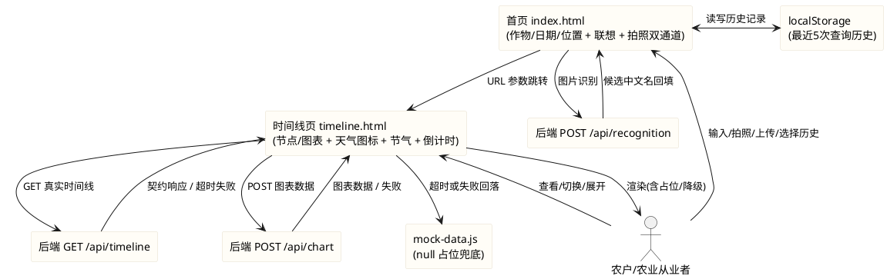
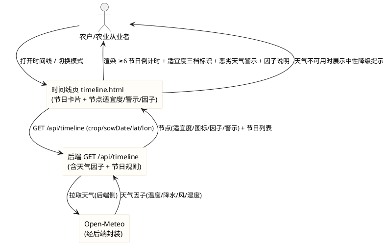

# 第二阶段前端增强与数据对齐需求规格（stage2_frontend）

> **版本记录**
> - v1.0：第二阶段前端增强（M5–M14）与数据对齐（M1–M4）首版需求，需求编号范围 `REQ-S2F-*-001` ~ `REQ-S2F-*-053`，共 53 条。
> - **v1.1（本次增补）**：在不改动既有需求的前提下，**新增第 5.13 节「节日规则扩充与天气农事判断」**，新增需求编号 `REQ-S2F-UBI-054` ~ `REQ-S2F-OPT-060` 共 **7 条**；需求总数由 **53 条调整为 60 条**；同步扩充第 2 章术语（5 项）、第 3.2 节外部系统（Open-Meteo）、第 4 章 DFX（天气降级与图标常量）、第 6 章数据约束（节点/节日/天气适宜度对象）与第 8 章交付边界。
> - 本次增补仅涉及**文档内容**，不引入任何新依赖、不改变原有范围红线。

> 本文档用于规范 agritime（知农时 · 会看天的农事日历）**第二阶段**前端体验增强（成员1 · 数据与前端 16 项任务中的前端可执行部分）的验收标准，并将需与后端对齐的数据类需求在**前端侧**的应对齐部分界定清楚；同时增列服务器维护与安全分析章节，以"分析报告 + 建议修改项"形式交付，**不直接改动服务器配置**。
> 范围红线：仅允许修改 `frontend/` 目录下文件；不得修改后端（`/opt/crop-calendar`、Java/8080）、`contract/`、`data/`、`deploy/`、`docs/`；不引入框架、构建工具或任何第三方依赖；不得破坏 `frontend/tests/pages.test.js` 既有断言。
> 交付形式：本文档描述**做什么（What）**与**验收标准（Acceptance Criteria）**，不描述技术实现方式（How）；技术架构与代码结构由后续 design 阶段承接。

# **1. 组件定位**

## **1.1 核心职责**
本组件负责在纯原生 JS 前提下，为 agritime 前端（index.html 输入页 + timeline.html 结果页）补齐第二阶段的加载反馈、可视化、响应式、交互增强能力，并在前端侧完成与后端数据结构的一致性对齐。

## **1.2 核心输入**
1. 用户在 `frontend/pages/index.html` 输入并提交的作物品种、播种日期、所在地。
2. index.html → timeline.html 通过 URL 查询参数（crop、sowDate、lat、lon、location）传递的参数链路。
3. 后端接口响应：`GET /api/timeline`（timeline）、`POST /api/recognition`（识图候选）、`POST /api/chart`（图表数据）。
4. 用户在 `frontend/pages/timeline.html` 的交互操作：模式切换（时间节点 / 函数图像）、节点卡片展开、返回修改。
5. 用户在 index.html 的输入事件：作物名输入（触发搜索联想）、点击"拍照 / 选图"（触发识别双通道）。
6. 本地持久化输入：浏览器 `localStorage` 中既有的历史查询记录。
7. 离线兜底数据 `frontend/assets/mock/mock-data.js`（字段以 null 占位）。

## **1.3 核心输出**
1. 加载过程中的进度反馈与骨架屏占位 UI。
2. timeline.html 上渲染的今日结论卡片、竖向时间节点列表（含天气图标、节气标注）、函数图像两种模式。
3. 列表项上的天气图标（晴 / 雨 / 风）与时间轴节气标记。
4. 在 375px / 768px / 1024px 三档宽度下均无横向滚动的响应式页面。
5. 识别双通道入口（拍照 + 本地图片上传）与搜索联想候选下拉。
6. 写入 `localStorage` 的最近 5 次查询历史记录。
7. 节日提醒的倒计时展示，以及**多个节日并列展示**（时间线页同时展示 ≥6 个即将到来的节日）。
8. 节点上的**天气适宜度三档标识**（适宜 / 谨慎 / 不宜）、**恶劣天气警示**与**天气因子说明文案**（如"因未来 3 天有雨，建议推迟打药"）。
9. 本规格第 7 章的**服务器维护与安全分析报告（建议修改项清单）**（文档交付物，非代码）。

## **1.4 职责边界**
本组件**不负责**以下事项：
1. 后端 Java 服务（`/opt/crop-calendar`，8080）、`crop-protocols.json`、`market-festivals.json`、阈值表与 `scoreNode` 算法的实现——**不得修改**；前端仅按契约对齐与展示。
2. `frontend/assets/mock/mock-data.js` 的**内容造假**——禁止硬编码虚假节点/日期/天气；仅允许同步结构、补齐 null 占位的字段。
3. nginx 反向代理（80→8080）、systemd 服务、日志轮转等服务器配置的**实际修改**——第 7 章仅以分析报告形式给出建议，不落地配置变更。
4. `M16（PPT 更新含实际截图）`——属文档交付任务，**排除在本次编码范围之外**（见第 8.4 节）。
5. 任何框架、构建工具、第三方库（含图表库 Chart.js / ECharts / D3）——**明确禁止**。
6. 不影响既有测试断言：不得为通过新需求而删除或弱化 `frontend/tests/pages.test.js` 的既有断言。
7. **节日规则的权威定义**（节日日期、日期锚点、适用作物、销售文案）——归后端 `market-festivals.json`，前端**不得硬编码节日日期**，仅按契约渲染。
8. **天气适宜度的权威判定算法**（阈值与 `scoreNode` 打分）——归后端；前端仅**消费并展示**后端给出的适宜度结论与天气因子，**不得在前端自造权威阈值**。
9. **前端直连天气数据源（Open-Meteo）**——前端**不直接调用**第三方天气接口，天气数据一律经后端 `GET /api/timeline` 获取。

# **2. 领域术语**

**cropId**
: 后端约定的作物英文标识，取值范围 5 个：`dry_garlic`（山东金乡大蒜）、`wheat_winter`（冬小麦）、`corn_summer`（夏玉米）、`rice`（水稻）、`soybean`（大豆）。
: 备注：时间线接口的 `crop` 参数须传 cropId，而非作物中文名。

**进度提示（Progress Feedback）**
: 指数据请求进行中，向用户展示"正在进行中"的阶段性可见反馈（文案/进度条/百分比），让用户感知系统未卡死。

**骨架屏（Skeleton Screen）**
: 指数据尚未返回时，用与最终布局结构一致的灰色占位块预占版面，避免布局跳动与空白。

**优雅降级（Graceful Degradation）**
: 指当某项数据或某个功能不可用时，系统以可用形态继续服务（如显示占位提示），不出现白屏、不抛未捕获错误。

**双通道（Dual Channel）**
: 指拍照识别的两个并列入口：设备相机直拍（调用摄像头）与从本地相册选择图片上传。

**搜索联想（Autocomplete / Suggestion）**
: 指用户输入作物名时，系统基于本地作物库实时匹配并以下拉候选形式提示，用户点选后回填。

**历史记录（Query History）**
: 指将用户最近成功发起的查询（作物 + 播种日 + 所在地）保存在浏览器本地，供快速回填或再次查看，最多保留 5 条。

**节气（Solar Term）**
: 中国农历二十四节气中的某一天，用于在时间轴上标注关键农时节令位置。

**天气图标（Weather Icon）**
: 表示节点对应天气的视觉符号，本阶段至少覆盖晴 / 雨 / 风三类。

**倒计时（Countdown）**
: 指节日提醒中，从当天到目标节日（销售窗口）之间的剩余天数展示。

**天气适宜度（Weather Suitability）**
: 指依据温度、降水、风速、湿度等天气因子，对"当前或未来某日是否适宜执行某类农事操作（播种 / 灌溉 / 施肥 / 打药 / 收获）"给出的三档结论：适宜、谨慎、不宜。
: 备注：权威判定来源于后端（`scoreNode` 基于天气打分），前端仅消费与展示；判定局限在于仅代表气象条件层面的适宜性，不含土壤、机具、人工等非气象因素。

**天气因子（Weather Factor）**
: 指影响某次农事适宜度判定结论的具体气象要素（如"未来 3 天有雨""气温低于 5℃""风力 6 级"），用于向用户解释"为什么建议 / 不建议"。

**恶劣天气预警（Severe Weather Alert）**
: 指预报出现暴雨、大风、高温、霜冻等极端天气时，针对受影响节点给出的警示标识与提示文案。

**日期锚点（Date Anchor）**
: 指节日日期相对某基准的确定方式，分为"固定公历"（如双十一为 11-11）与"农历浮动"（如春节、端午、中秋按农历推算，每年公历日期不同）。
: 备注：前端不得自行推算农历，节日具体公历日期以后端 `market-festivals.json` 给出的 `festivalDate` 为准。

**农事 / 销售节点（Farming & Sales Node）**
: 指与农时或销售窗口相关的关键时间点，既包括农事操作窗口（播种、打药、收获等），也包括销售促销节点（丰收节、双十一、618 等）。

**EARS 需求编号约定**
: 本文档需求编号格式为 `REQ-S2F-XXX-NNN`，`S2F` 为 Stage2 Frontend 缩写。前缀对应 EARS 句型：UBI（Ubiquitous，通用）、EVT（Event-driven，事件驱动）、STA（State-driven，状态驱动）、OPT（Optional，可选/带前提）、UNW（Unwanted，非期望行为）。

# **3. 角色与边界**

## **3.1 核心角色**
- **农户 / 农业从业者**：在首页填写作物/日期/所在地并提交，在时间线页查看结论、时间线、函数图像与节日倒计时；在弱网/离线环境下仍能获得可用视图；是全部体验增强的受益对象。
- **测试维护者**：运行 `node --test frontend/tests/pages.test.js`，确认既有断言全绿并补充新需求断言。
- **开发者 / 交付者**：在 `frontend/` 范围内改动代码、上传至目标服务器 `/agritime/frontend` 并提交 Git。

## **3.2 外部系统**
- **后端时间线接口（`GET /api/timeline?crop&sowDate&lat&lon`）**：真实数据来源，返回含 todayConclusion、nodes 的契约对象。
- **后端识别接口（`POST /api/recognition`）**：请求 JSON `{image: base64}`，返回候选作物（中文名 + 置信度）。
- **后端图表接口（`POST /api/chart`）**：图表数据来源，异常时前端须优雅降级。
- **后端健康检查（`GET /health`）**：用于判断后端可用性（第 7 章分析对象）。
- **Open-Meteo（经后端封装，前端不直连）**：天气数据上游来源；温度、降水、风速、湿度等天气因子与天气类型由后端接入 Open-Meteo 后，经 `GET /api/timeline` 的 `weatherIcon`、天气因子等字段间接传递给前端。
- **后端节日规则（`market-festivals.json`，经时间线接口输出）**：节日名、日期、日期锚点、适用作物、销售文案的权威来源；前端仅按接口返回渲染（第 5.13 节）。
- **mock-data.js**：离线兜底数据来源，字段 null 占位。
- **浏览器 localStorage**：历史记录持久化载体（前端本地，无服务端依赖）。
- **nginx（80 → 8080）**：前端与后端的反向代理承载（第 7 章分析对象，不修改）。

## **3.3 交互上下文**

# **4. DFX约束**

## **4.1 性能**
1. 首屏加载反馈须"即时"：页面在脚本开始执行后 **≤ 300ms** 内须已显示进度/骨架反馈，不得出现空白等待。
2. 时间线主请求（`GET /api/timeline`）的 p95 端到端感知时延须 **< 2 秒**；当后端不可达或超过既有 **20 秒（20000ms）**超时上限时，须立即降级，不让用户无反馈等待。
3. 搜索联想须为**纯本地匹配**（基于本地作物库），不发起网络请求，输入到候选展示 ≤ 100ms。
4. 历史记录读写须为同步本地操作，不阻塞页面渲染。
5. 页面不得因新增的图标、骨架屏、倒计时等元素显著增大首屏渲染成本（保持纯静态资源，无外部请求）。
6. 天气适宜度判断、恶劣天气警示、多节日渲染须**复用 `GET /api/timeline` 已有响应数据**，不得为新增需求引入额外网络请求或第三方天气接口调用。

## **4.2 可靠性**
1. 任一后端接口（timeline / chart / recognition）失败、超时或返回非法结构时，页面须优雅降级，**不得白屏**、不得抛出未捕获 JS 错误。
2. 图表接口失败时，函数图像模式须回退到占位/降级视图，并给出可读提示。
3. `localStorage` 不可用（隐私模式/被禁用）时，历史记录功能须静默降级，不影响主流程。
4. mock 的 null 占位字段须能正常渲染，不因字段为 null 抛异常。
5. 降级须有可见标识（如"本地兜底数据"文案），不得静默失败。
6. 当天气数据缺失（`weatherIcon` / 天气因子为 null）或天气获取异常时，页面须**不展示误导性的适宜度判断与天气图标**，改以中性占位提示（如"天气数据暂不可用"）呈现，不得臆造适宜度或天气结论。
7. 恶劣天气警示与适宜度标识须始终与当前天气数据保持一致；数据刷新或降级后不得残留上一次的警示/标识状态。

## **4.3 安全性**
1. 所有请求参数须经标准 URL 编码（`URLSearchParams`）拼装，防止参数注入。
2. 写入 `localStorage` 的内容仅限作物名/日期/所在地等非敏感信息；**禁止**在本地存储中写入任何 API Key、令牌或凭据。
3. 渲染用户可控文本时须使用 `textContent` 等安全方式，禁止将未转义的用户输入拼入 `innerHTML`（防 XSS）。
4. 本次不引入任何外部脚本依赖，所有逻辑内联或使用项目内本地脚本。
5. 第 7 章安全分析中涉及的 API Key 明文、CORS、目录权限等**仅给出分析与建议**，不改动服务器。

## **4.4 可维护性**
1. 新增的可配置项（如超时上限、历史条数上限、天气图标映射〔含扩展天气类型〕、节气名称表、节日文案映射、适宜度与恶劣天气警示文案映射）须以**具名常量**集中定义，不得多处硬编码；未知或新增的天气类型 / 节日类型须有统一回退分支，避免新增类型导致渲染报错。
2. 参数名（crop / sowDate / lat / lon）须全链路统一，不得一处 `sowingDate` 另一处 `sowDate`。
3. 前端可执行任务与后端数据任务的边界须在文档中明确，避免职责蔓延。

## **4.5 兼容性**
1. **测试兼容（强制红线）**：不得破坏 `frontend/tests/pages.test.js` 的既有断言；可新增断言，既有断言须全绿。运行命令：`node --test frontend/tests/pages.test.js`。
2. **响应式兼容**：375px、768px、1024px 三档宽度下均须无横向滚动。
3. **不可引入依赖**：不得引入框架、构建工具、第三方库（含图表库）。
4. **文件范围兼容**：不得修改后端及 `contract/`、`data/`、`deploy/`、`docs/` 等模块。
5. **接口兼容**：不得改变前端既有的 GET /api/timeline 取数方式与参数命名。
6. **浏览器兼容**：须在主流现代浏览器（Chrome/Edge/Safari 近两版）与移动端 WebView 下可用（原生 JS 语法须避免仅新引擎支持的特性或在必要时降级）。

# **5. 核心能力**

> 本章按任务分组，逐一给出业务规则（EARS）、交互流程与异常场景。纯前端可执行任务为 M5–M14 共 10 项；数据对齐类任务 M1–M4 在 5.11 中界定前端侧应对齐部分。

## **5.1 首次加载进度提示（M5）**

### **5.1.1 业务规则**

1. **REQ-S2F-EVT-001（Event-driven）**：当时间线页开始向后端发起数据请求时，系统须立即展示"正在加载"的进度反馈（文案或进度条），使首屏非空白。
   a. 验收条件：[进入 timeline.html 并触发数据请求] → [≤300ms 内页面上出现进度反馈元素，用户可见"正在加载/正在读取农时"类提示]

2. **REQ-S2F-STA-002（State-driven）**：在数据请求进行中且尚未返回时，系统须持续保持进度反馈处于可见状态。
   a. 验收条件：[请求进行中] → [进度反馈持续可见，不消失、不闪烁]

3. **REQ-S2F-EVT-003（Event-driven）**：当数据返回（真实或降级）后，系统须隐藏进度反馈，切换为结果视图。
   a. 验收条件：[数据返回并开始渲染] → [进度反馈被隐藏，结果列表/图表可见]

4. **禁止项**：禁止在数据请求期间展示空白页或无任何加载反馈。
   a. 验收条件：[请求进行中查看页面] → [存在可见的加载反馈元素，页面非空白]

### **5.1.3 异常场景**

1. **请求超时但进度仍在展示**
   a. 触发条件：超过 20 秒未返回
   b. 系统行为：隐藏进度反馈，进入降级渲染
   c. 用户感知：先看到加载反馈，随后看到兜底视图，无卡死感

## **5.2 骨架屏占位（M6）**

### **5.2.1 业务规则**

1. **REQ-S2F-STA-004（State-driven）**：在数据加载中且结果尚未就绪时，系统须展示与最终布局结构一致的骨架屏占位块，预占版面。
   a. 验收条件：[数据加载中] → [页面出现骨架占位块（灰色占位条/块），其排布与最终节点列表结构相近]

2. **REQ-S2F-EVT-005（Event-driven）**：当结果渲染完成或进入降级视图时，系统须移除骨架屏占位。
   a. 验收条件：[结果渲染完成] → [骨架占位块被隐藏，被真实内容取代]

3. **REQ-S2F-UBI-006（Ubiquitous）**：骨架屏须使用纯 CSS 占位，不依赖外部图片或第三方加载动画库。
   a. 验收条件：[代码审查] → [骨架屏样式由项目内 CSS 定义，无外部资源请求]

4. **禁止项**：禁止加载过程中出现布局大幅跳动（骨架尺寸与最终内容明显不符）。
   a. 验收条件：[加载中与加载完成对比] → [骨架占位区域与最终内容区域尺寸/位置基本一致，无剧烈跳动]

## **5.3 图表失败优雅降级（M7）**

### **5.3.1 业务规则**

1. **REQ-S2F-UNW-007（Unwanted）**：如果图表数据获取失败（`POST /api/chart` 失败、超时或返回非法结构），系统不得出现白屏或未捕获错误。
   a. 验收条件：[图表接口失败后切至函数图像模式] → [页面正常显示，无白屏、无控制台未捕获错误]

2. **REQ-S2F-STA-008（State-driven）**：当图表数据不可用时，函数图像模式须展示可读的占位/降级视图（空坐标轴或"数据待接入/暂不可用"提示）。
   a. 验收条件：[图表数据不可用且切至函数图像模式] → [显示占位视图与提示文案，不绘制虚假曲线]

3. **REQ-S2F-EVT-009（Event-driven）**：当图表数据可正常获取时，函数图像模式须按真实节点数据绘制曲线。
   a. 验收条件：[图表数据正常] → [按节点数据绘制曲线，无占位提示]

4. **禁止项**：禁止在图表失败时硬编码假曲线；禁止函数图像模式的失败影响时间节点模式的正常展示。
   a. 验收条件：[图表失败后切回时间节点模式] → [时间节点列表仍正常展示]

### **5.3.3 异常场景**

1. **切至图表模式瞬间接口尚未返回**
   a. 触发条件：用户切换模式时图表数据仍在请求中
   b. 系统行为：展示加载/占位态，待返回后渲染或降级
   c. 用户感知：看到占位提示，不白屏

## **5.4 节点天气图标可视化（M8）**

### **5.4.1 业务规则**

1. **REQ-S2F-UBI-010（Ubiquitous）**：系统须依据节点天气字段，在节点卡片上展示对应天气图标，至少覆盖**晴、雨、风**三类可区分图标。
   a. 验收条件：[节点天气为晴天] → [展示晴类图标]；[天气为雨天] → [展示雨类图标]；[天气为风] → [展示风类图标]

2. **REQ-S2F-UBI-011（Ubiquitous）**：天气图标须附带可读的文字说明（如"天气 · 晴"），不得仅有图形而无可访问文本。
   a. 验收条件：[查看含天气的节点] → [图标旁或图标上有文字/aria 标签说明天气类型]

3. **REQ-S2F-OPT-012（Optional/带前提）**：当节点无天气字段（null 或缺失）时，系统须不展示天气图标行，且不得因此报错。
   a. 验收条件：[节点天气字段为 null] → [不渲染天气图标行，其余内容正常]

4. **禁止项**：禁止用同一图标表示所有天气类型；禁止天气图标遮挡/挤压节点核心文案。
   a. 验收条件：[代码审查 + 视觉核对] → [不同天气映射不同图标；图标与文案布局不重叠]

## **5.5 时间线节气标注（M9）**

### **5.5.1 业务规则**

1. **REQ-S2F-EVT-013（Event-driven）**：当节点关联节气信息时，系统须在时间轴上对该位置展示节气标记（名称，可选附提示）。
   a. 验收条件：[节点含节气字段] → [时间轴对应节点处展示节气名称标记]

2. **REQ-S2F-UBI-014（Ubiquitous）**：节气标记须在视觉上可辨识（区别于普通节点），且不破坏时间轴的竖向排布。
   a. 验收条件：[含节气的时间轴] → [节气标记可辨识，时间轴结构不乱]

3. **REQ-S2F-OPT-015（Optional/带前提）**：当节点无节气信息时，系统须不展示节气标记，不报错。
   a. 验收条件：[节点无节气字段] → [不展示节气标记，正常渲染]

## **5.6 响应式适配 768px / 1024px（M10）**

### **5.6.1 业务规则**

1. **REQ-S2F-UBI-016（Ubiquitous）**：系统须在 **375px、768px、1024px** 三档视口宽度下均无横向滚动条。
   a. 验收条件：[分别在 375/768/1024px 宽度打开 index.html 与 timeline.html] → [三档下页面均无横向滚动]

2. **REQ-S2F-UBI-017（Ubiquitous）**：在 768px 及以上宽度下，内容须适配为多列/居中定宽布局，不得出现元素拉伸变形或大面积留白失衡。
   a. 验收条件：[768px/1024px 宽度查看] → [卡片/时间线/图表布局协调，元素不变形]

3. **REQ-S2F-UBI-018（Ubiquitous）**：响应式须使用纯 CSS（媒体查询/流式布局）实现，不引入任何栅格框架。
   a. 验收条件：[代码审查] → [响应式由项目内 CSS 实现，无第三方栅格库]

4. **禁止项**：禁止通过隐藏核心内容（如同义地不展示时间线）来"规避"横向滚动。
   a. 验收条件：[三档宽度核对] → [核心内容均完整可见，未以隐藏内容换取无滚动]

## **5.7 拍照识别双通道（M11）**

### **5.7.1 业务规则**

1. **REQ-S2F-UBI-019（Ubiquitous）**：系统须提供**两个并列入口**：调用设备摄像头直接拍照，以及从本地文件/相册选择图片上传。
   a. 验收条件：[打开识别入口] → [同时存在"拍照"与"上传/选图"两个可点击入口]

2. **REQ-S2F-EVT-020（Event-driven）**：当用户选择任一通道并提交图片后，系统须发起识别请求并进入候选确认流程（识别只给候选，须用户点选确认）。
   a. 验收条件：[拍照或选图后] → [发起识别，返回候选列表并等待用户确认，未确认不进入时间线生成]

3. **REQ-S2F-UNW-021（Unwanted）**：如果识别失败或超时，系统须回落为手动输入/搜索，流程不中断，不得卡死在识别弹层。
   a. 验收条件：[识别失败/超时] → [展示手动输入或搜索框，用户可继续操作]

4. **REQ-S2F-UBI-022（Ubiquitous）**：识别结果回填的作物中文名须经"中文名 → cropId"映射后再用于时间线请求。
   a. 验收条件：[识别回填"水稻"并确认] → [后续请求 `crop=rice`]

5. **禁止项**：禁止仅保留单一通道（只有拍照或只有上传）；禁止未确认即自动进入时间线生成。
   a. 验收条件：[代码审查 + 交互核对] → [双通道均存在；识别结果须人工确认]

### **5.7.3 异常场景**

1. **用户拒绝摄像头权限**
   a. 触发条件：浏览器拒绝摄像头访问
   b. 系统行为：引导使用本地图片上传/搜索
   c. 用户感知：仍有可用通道，流程不中断

## **5.8 搜索联想功能（M12）**

### **5.8.1 业务规则**

1. **REQ-S2F-EVT-023（Event-driven）**：当用户在作物输入框输入字符时，系统须基于本地作物库实时匹配并展示候选下拉列表。
   a. 验收条件：[输入"玉"] → [下拉展示含"玉米"的候选]

2. **REQ-S2F-EVT-024（Event-driven）**：当用户点击某个联想想项时，系统须回填作物名称（并可按规则回填对应地区/坐标）。
   a. 验收条件：[点击候选"山东金乡大蒜"] → [作物输入框回填该名称，所在地按规则回填]

3. **REQ-S2F-STA-025（State-driven）**：当输入为空或无匹配结果时，系统须隐藏候选下拉。
   a. 验收条件：[输入为空或无匹配] → [下拉隐藏]

4. **REQ-S2F-UBI-026（Ubiquitous）**：联想匹配须为纯本地计算，不发起网络请求。
   a. 验收条件：[输入过程中] → [无任何网络请求被触发]

5. **禁止项**：禁止联想结果与本地作物库不一致（如展示后端不存在的作物标识）；禁止候选下拉遮挡输入框导致无法继续输入。
   a. 验收条件：[代码审查 + 交互核对] → [候选来源为本地作物库，布局不遮挡输入]

## **5.9 历史记录 localStorage（M13）**

### **5.9.1 业务规则**

1. **REQ-S2F-EVT-027（Event-driven）**：当用户成功发起一次查询（提交表单）后，系统须将该次查询（作物 + 播种日 + 所在地）写入浏览器本地历史记录。
   a. 验收条件：[成功提交一次查询] → [本地历史记录新增该条]

2. **REQ-S2F-UBI-028（Ubiquitous）**：历史记录最多保留**最近 5 条**，超出时按时间淘汰最旧（或按规则去重后保留最新）。
   a. 验收条件：[连续发起 6 次以上查询] → [历史记录恒 ≤ 5 条，且为最近的 5 条]

3. **REQ-S2F-EVT-029（Event-driven）**：当用户点击某条历史记录时，系统须能快速回填/复用该次查询条件。
   a. 验收条件：[点击一条历史] → [作物/日期/所在地被回填或可直接复现该查询]

4. **REQ-S2F-OPT-030（Optional/带前提）**：当本地存储不可用（隐私模式/被禁用）时，系统须静默降级，不阻塞主流程、不报错。
   a. 验收条件：[localStorage 抛错/不可用] → [主查询流程正常，无未捕获错误]

5. **禁止项**：禁止在历史记录中存储敏感信息（API Key、令牌、凭据）。
   a. 验收条件：[审查 localStorage 内容] → [仅含作物名/日期/所在地等非敏感字段]

### **5.9.3 异常场景**

1. **历史记录数据损坏**
   a. 触发条件：localStorage 中历史数据非法/无法解析
   b. 系统行为：忽略损坏数据并重置为空，不报错
   c. 用户感知：历史区域为空或不可用，主流程正常

## **5.10 节日提醒倒计时（M14）**

### **5.10.1 业务规则**

1. **REQ-S2F-EVT-031（Event-driven）**：当存在节日提醒（销售窗口）且其目标日期有效时，系统须展示从当天到该日期的剩余天数倒计时。
   a. 验收条件：[提醒含有效节日日期] → [展示"距 XX 还有 N 天"类倒计时]

2. **REQ-S2F-STA-032（State-driven）**：当倒计时为 0 或已过期时，系统须展示明确的"今天/已过"状态，不得展示负数天数。
   a. 验收条件：[目标日期为今天或已过] → [展示"就是今天"或"已过/已结束"，不显示负值]

3. **REQ-S2F-OPT-033（Optional/带前提）**：当节日日期缺失或非法时，系统须不展示倒计时且不报错。
   a. 验收条件：[提醒日期缺失/非法] → [不展示倒计时，其余内容正常]

4. **REQ-S2F-UBI-034（Ubiquitous）**：倒计时计算须基于**本地日期**，仅做日期差计算，不发起网络请求。
   a. 验收条件：[代码审查] → [倒计时为本地日期差计算，无网络请求]

## **5.11 数据对齐类任务（M1–M4，前端侧应对齐部分）**

> 说明：M1–M4 的**权威数据源在后端**（`crop-protocols.json`、`market-festivals.json`、阈值表/`scoreNode` 算法），前端**不得**修改其后端内容。本节仅界定**前端侧**（mock-data.js、crop-map.js、渲染逻辑、既有测试）需要对齐的部分，以保证前端能正确承接后端数据。

### **5.11.1 业务规则**

1. **REQ-S2F-UBI-035（Ubiquitous，M1 soybean 补 1 节点）**：前端须保证能够无截断地渲染后端返回的 **8 个节点**；离线兜底 mock 的节点结构与真实响应结构一致（含 nodeSeq、daysAfterSowing 等字段），不得对节点数量设前端上限。
   a. 验收条件：[后端返回 soybean 8 节点] → [时间线页完整渲染 8 个节点，无截断/丢失；mock 结构与响应结构字段一致]

2. **REQ-S2F-UBI-036（Ubiquitous，M2 节日规则补 3 个 → ≥ 6 个节日）**：前端 reminders（节日提醒）渲染须支持**多个节日**并列展示，不得假设仅有一个节日；mock 的 reminders 结构须与后端约定字段一致。
   a. 验收条件：[后端返回 ≥6 个节日提醒] → [全部渲染，无覆盖/丢失；mock reminders 字段结构对齐]
   b. 补充（v1.1）：本项已由第 5.13 节 **REQ-S2F-UBI-054（节日规则扩充）** 与 **REQ-S2F-UBI-055（多节日并列展示 ≥6 个）** 进一步扩充，节日覆盖范围与四要素结构以 5.13 为准。

3. **REQ-S2F-UBI-037（Ubiquitous，M3 前后端数据同步对齐，5 作物节点一致）**：前端作物标识集合须与后端支持集合一致，**恰为 5 个 cropId**（dry_garlic、wheat_winter、corn_summer、rice、soybean），不得臆造后端不支持的 cropId。
   a. 验收条件：[审查 `frontend/assets/js/crop-map.js`] → [cropId 取值全部落在后端 5 个 cropId 之内，无臆造值]

4. **REQ-S2F-UBI-038（Ubiquitous，M4 阈值表与 scoreNode 对齐）**：前端须仅消费后端输出的节点状态枚举（适宜/谨慎/不宜，即 green/yellow/red），**不参与阈值计算**，且状态到文案/样式的映射须与后端枚举一致。
   a. 验收条件：[后端返回某状态枚举] → [前端按对应语义渲染徽标/样式，无前端自算阈值]

5. **禁止项**：禁止在前端硬编码后端权威数据（节点日期、阈值数值、节日日期）；禁止将后端数据任务纳入前端代码修改范围。
   a. 验收条件：[代码审查] → [前端无硬编码的权威业务数值，mock 仍保持 null 占位]

### **5.11.3 异常场景**

1. **后端节点/节日数量变化**
   a. 触发条件：后端节点数或节日数增加
   b. 系统行为：前端按返回数量动态渲染，无需改代码即可承接
   c. 用户感知：新增节点/节日正常展示

## **5.12 测试与可运行性**

### **5.12.1 业务规则**

1. **REQ-S2F-UBI-039（Ubiquitous）**：改造后前端须逻辑正确、无报错，且 `frontend/tests/pages.test.js` 既有断言全部通过。
   a. 验收条件：[运行 `node --test frontend/tests/pages.test.js`] → [既有断言全绿，无失败]

2. **REQ-S2F-UBI-040（Ubiquitous）**：系统须针对本次新增能力补充必要测试断言（如骨架屏/进度提示存在、天气图标映射、双通道入口、联想候选、历史记录上限、倒计时计算等），且不得破坏既有断言。
   a. 验收条件：[测试套件运行] → [新增断言通过，既有断言仍全绿]

3. **禁止项**：禁止为通过测试而删除、注释或弱化既有断言。
   a. 验收条件：[代码审查] → [既有断言原文保留且通过]

## **5.13 节日规则扩充与天气农事判断（v1.1 新增）**

> 本节为 v1.1 增补内容，对应"再增加几条节日、天气什么的判断"的诉求：**A 部分**扩充原 M2 节日规则；**B 部分**新增基于天气数据的农事适宜度判断、恶劣天气提醒、天气图标扩展、天气因子说明与天气数据降级。所有天气与节日的**权威数据仍来自后端**（`GET /api/timeline` + `market-festivals.json` + Open-Meteo 经后端封装），前端仅消费与展示。

### **5.13.1 业务规则**

1. **REQ-S2F-UBI-054（Ubiquitous，节日规则扩充，增强 M2）**：节日规则须覆盖更广的中国传统节日与农事 / 销售节点，**至少包含**：春节、元宵、清明、端午、中秋、重阳、腊八、小年、双十一、618、丰收节，以及节气相关的农事销售节点；每个节日须含四要素：**节日名、日期锚点（固定公历 / 农历浮动）、适用作物、销售提示文案**；节日数据权威源为后端 `market-festivals.json`，前端须能无损渲染后端返回的全部节日，**不得硬编码节日日期、不得自行推算农历**。
   a. 验收条件：[后端返回多个节日（含固定公历与农历浮动两类）] → [前端按返回内容渲染节日名、四要素与倒计时，无前端硬编码日期、无因缺字段导致的渲染异常]
   b. 验收条件：[代码审查] → [节日名称 / 文案映射以具名常量定义，节日日期来源均为接口返回]

2. **REQ-S2F-UBI-055（Ubiquitous，多节日并列展示 ≥6 个）**：时间线页须能**同时展示 ≥6 个"即将到来"的节日及其倒计时**，多个节日须**并列完整展示、不截断、不覆盖**；当返回节日数量超过一屏时须可纵向排布且不丢失任何一条。
   a. 验收条件：[后端返回 ≥6 个未过期节日提醒] → [页面同时展示 ≥6 个节日及其倒计时，无截断、无覆盖、数量与返回一致]
   b. 验收条件：[返回 1 个节日] → [正常展示 1 个]；[返回 0 个] → [不展示节日区块且不报错]

3. **REQ-S2F-UBI-056（Ubiquitous，天气适宜度判断）**：系统须依据天气因子（温度、降水、风速、湿度等），对"当前 / 未来某日是否适宜某类农事操作（播种 / 灌溉 / 施肥 / 打药 / 收获）"给出**三档适宜度标识：适宜（green）/ 谨慎（yellow）/ 不宜（red）**，并在节点上以标识 + 可读文案呈现；三档语义须与后端节点状态枚举保持一致，前端**只消费后端判定结论、不自算权威阈值**。
   a. 验收条件：[某节点适宜度为"适宜 / 谨慎 / 不宜"] → [展示对应三档标识与可读文案，语义与后端枚举一致]
   b. 验收条件：[代码审查] → [前端未实现权威阈值计算逻辑，适宜度取自接口数据]

4. **REQ-S2F-UNW-057（Unwanted，恶劣天气提醒）**：如果预报出现极端天气（暴雨、大风、高温、霜冻等），系统须在时间线**对应节点**给出**警示标识与提示文案**，不得静默忽略该警示。
   a. 验收条件：[某节点对应日期预报含极端天气] → [该节点展示恶劣天气警示标识与文案，且与节点农事建议关联]
   b. 验收条件：[无极端天气] → [不展示恶劣天气警示，页面其余内容正常]

5. **REQ-S2F-UBI-058（Ubiquitous，天气图标扩展）**：在原有"晴 / 雨 / 风"三类基础上，系统须**扩展更多天气类型**的图标映射与展示规则，**至少覆盖：阴、雪、雾、雷、多云**；每类须映射到可区分图标并附可读文本；对未识别的天气类型须回退为通用图标 + 原始类型文案，不得报错或空白。
   a. 验收条件：[节点天气为阴 / 雪 / 雾 / 雷 / 多云之一] → [展示对应可区分图标与文本说明]
   b. 验收条件：[天气类型为未识别值] → [展示通用兜底图标与原文案，不抛异常]

6. **REQ-S2F-UBI-059（Ubiquitous，天气因子说明）**：系统须在时间线节点上展示**影响该农事判断的天气因子说明**（如"因未来 3 天有雨，建议推迟打药"），说明须与该节点的操作类型和结论相对应，可读且不误导。
   a. 验收条件：[节点因天气被建议推迟 / 调整] → [展示对应天气因子文案，说明原因]
   b. 验收条件：[节点无天气因子数据] → [不展示因子说明行，其余内容正常]

7. **REQ-S2F-OPT-060（Optional/带前提，天气数据降级）**：当天气数据缺失（`weatherIcon` / 天气因子为 null）或天气获取异常 / 超时时，系统须**不展示误导性的适宜度判断与天气图标**，改为中性提示；该降级须与既有 **20 秒（20000ms）超时降级机制**衔接，不白屏、不抛未捕获错误。
   a. 验收条件：[天气字段为 null 或天气数据不可用] → [不展示适宜度标识 / 天气图标（或展示中性"天气数据暂不可用"），页面其余内容正常]
   b. 验收条件：[天气请求超时（>20s）] → [进入降级视图，天气相关判断不显示误导结论，无未捕获错误]

8. **禁止项**：禁止前端硬编码节日日期或自行推算农历；禁止前端自造天气适宜度权威阈值；禁止在天气数据缺失时臆造适宜度或天气图标；禁止用同一图标表示所有天气类型。
   a. 验收条件：[代码审查 + 降级核对] → [节日日期均来自接口；适宜度取自后端结论；数据缺失时无臆造标识；不同天气映射不同图标]

### **5.13.2 交互流程**

### **5.13.3 异常场景**

1. **天气数据缺失或接口异常**
   a. 触发条件：`weatherIcon` / 天气因子为 null，或天气获取失败 / 超时（>20s）
   b. 系统行为：不展示适宜度判断与天气图标，改以中性提示；与既有超时降级机制一致地回落
   c. 用户感知：看到"天气数据暂不可用"类中性提示，无误导性结论，主流程不受影响

2. **节日日期缺失或非法**
   a. 触发条件：某节日 `festivalDate` 缺失或不可解析
   b. 系统行为：跳过该节日倒计时（或标注"日期待定"），其余节日正常展示
   c. 用户感知：其它节日倒计时正常，无报错

3. **天气类型未识别**
   a. 触发条件：后端返回前端映射表中不存在的天气类型值
   b. 系统行为：回退通用兜底图标 + 原文案展示
   c. 用户感知：仍能看到天气文本说明，界面不空白、不报错

4. **极端天气警示与适宜度冲突**
   a. 触发条件：节点适宜度为"适宜"但同时存在极端天气警示
   b. 系统行为：以警示优先呈现并给出可读解释，避免误导用户按"适宜"操作
   c. 用户感知：看到警示提示与调整建议，理解风险

# **6. 数据约束**

## **6.1 查询历史记录（localStorage）**
1. **crop**：作物中文名或 cropId，非空字符串。
2. **sowDate**：播种日期，格式 `YYYY-MM-DD`。
3. **location**：所在地中文文本，可为空字符串。
4. **timestamp**：记录时间戳，用于排序与淘汰最旧记录。
5. **数量约束**：总数 ≤ 5，超出按时间淘汰最旧。

## **6.2 节点展示对象（渲染用）**
1. **name**：节点名称，非空字符串。
2. **date**：节点日期，格式 `YYYY-MM-DD`，可为 null（占位）。
3. **status**：状态枚举，取值 green / yellow / red（适宜/谨慎/不宜）。
4. **weatherIcon**：天气类型标识，须可映射到**晴 / 雨 / 风 / 阴 / 雪 / 雾 / 雷 / 多云**等图标；可为 null（null 时不展示天气图标）。
5. **solarTerm**：节气名称，可为 null；非 null 时展示节气标记。
6. **solarTermTip**：节气提示，可为 null。
7. **daysAfterSowing**：播种后天数，数值，函数图像横轴依据。
8. **weatherFactors**（v1.1 新增）：影响该节点农事判断的天气因子说明（文本或文本列表），可为 null；非空时展示因子说明行。
9. **suitability**（v1.1 新增）：天气适宜度三档标识，取值 green / yellow / red（适宜 / 谨慎 / 不宜），语义须与 **status** 一致，可为 null。
10. **severeWeatherAlert**（v1.1 新增）：恶劣天气警示信息（类型：暴雨 / 大风 / 高温 / 霜冻等 + 文案），可为 null；非 null 时须展示警示标识与文案。

## **6.3 节日提醒对象（渲染用）**
1. **festivalName**：节日名称，非空字符串。
2. **festivalDate**：节日日期，格式 `YYYY-MM-DD`，可为 null。
3. **reminderCopy**：提醒文案，非空字符串。
4. **倒计时**：由 festivalDate 与本地当天计算得出，非负整数天。
5. **dateAnchor**（v1.1 新增）：日期锚点，取值"固定公历"或"农历浮动"，描述该节日日期的确定方式，可为 null。
6. **applicableCrops**（v1.1 新增）：适用作物列表，可为 null（null 表示对全部作物适用，或按后端语义处理）。
7. **salesCopy**（v1.1 新增）：销售提示文案，可为 null；缺失时回退展示 reminderCopy。
8. **windowStart / saleWindowDays**：销售窗口起始日期与窗口天数，可为 null；缺失时不影响节日名与倒计时展示。
9. **展示数量约束**（v1.1 新增）：须可**并列展示 ≥6 个未过期节日**，数量由接口返回决定，前端不得设展示上限或截断。

## **6.4 图表状态对象**
1. **数据可用性**：区分"可绘制真实曲线"与"须降级占位"两种状态。
2. **降级提示文案**：图表不可用时的可读提示文本。

## **6.5 天气适宜度对象（渲染用，v1.1 新增）**
1. **适用操作**：播种 / 灌溉 / 施肥 / 打药 / 收获 之一，可为 null。
2. **适宜度等级**：取值 green / yellow / red，分别表示适宜 / 谨慎 / 不宜；为 null 时表示不可判定，须按降级处理、**不得臆造等级**。
3. **天气因子**：温度、降水、风速、湿度等要素的说明文本，可为 null；非空时展示因子说明。
4. **恶劣天气类型**：暴雨 / 大风 / 高温 / 霜冻等枚举，可为 null；非 null 时须展示警示。
5. **降级态标识**：须区分"有有效判定"与"天气不可用（中性提示）"两种状态，供渲染层据此切换展示。

# **7. 服务器维护与安全分析（分析报告 + 建议修改项）**

> 本章为**审计/分析类需求**，交付形式为"分析报告 + 建议修改项清单"，**不直接改动服务器配置**。所有涉及服务器、nginx、systemd、API Key 等的条目，仅给出问题定位与建议，落地实施属运维范围，不纳入本次前端编码范围。

## **7.1 服务器运维问题（分析与建议）**

1. **REQ-S2F-UBI-041（Ubiquitous）**：系统须产出后端服务（`/opt/crop-calendar`，Java，8080）的**运行形态分析**，明确其启动方式、是否为常驻进程、是否注册为系统服务。
   a. 验收条件：[分析报告] → [给出后端启动方式与是否具备 systemd 服务注册的现状与建议]

2. **REQ-S2F-UBI-042（Ubiquitous）**：系统须产出**开机自启**与**崩溃自愈**的分析，建议以 systemd `enable` + `Restart=on-failure` 等方式保障服务随机器启动并在异常退出后自动拉起。
   a. 验收条件：[分析报告] → [给出开机自启与崩溃自愈的建议配置方向（描述性，不含落地操作）]

3. **REQ-S2F-UBI-043（Ubiquitous）**：系统须产出**日志管理**分析，建议配置日志轮转（logrotate 或 journald 策略），避免日志无限增长占满磁盘。
   a. 验收条件：[分析报告] → [给出日志轮转策略建议与风险提示]

4. **REQ-S2F-UBI-044（Ubiquitous）**：系统须产出**健康检查**分析，建议定期探测 `GET /health`、8080 端口与 nginx 80 端口可用性，并明确告警触发条件。
   a. 验收条件：[分析报告] → [给出健康检查对象（/health、8080、80）与告警建议]

5. **REQ-S2F-UBI-045（Ubiquitous）**：系统须产出**上游依赖检测**分析，覆盖后端对外部依赖（天气数据源、大模型接口、识别服务等）不可用时的表现与检测方式。
   a. 验收条件：[分析报告] → [列出上游依赖清单、失效表现与检测建议]

6. **REQ-S2F-UBI-046（Ubiquitous）**：系统须产出**时间线接口耗时**分析（实测约 61 秒），指出其超过前端 20 秒超时阈值的体验风险，并给出方向性建议（如后端异步/缓存/超时治理），**不落地修改后端**。
   a. 验收条件：[分析报告] → [给出耗时现状、影响（触发前端降级）与建议方向]

## **7.2 安全问题（分析与建议）**

1. **REQ-S2F-UBI-047（Ubiquitous）**：系统须产出 **API Key / 凭据明文泄露风险**分析，覆盖天气数据源 Key、大模型 Key 是否以明文出现在代码/配置/前端产物或版本库中，并给出整改建议（环境变量、密钥托管、禁止入库）。
   a. 验收条件：[分析报告] → [明确 Key 的可能暴露位置与整改建议；**禁止**在报告或前端中回显真实密钥]

2. **REQ-S2F-UBI-048（Ubiquitous）**：系统须产出 **nginx 配置安全**分析，覆盖反向代理只暴露必要路径（`/api`、`/agritime`）、隐藏版本号、限制请求方法、限制请求体大小、安全响应头（如 X-Content-Type-Options、X-Frame-Options）等。
   a. 验收条件：[分析报告] → [给出 nginx 安全项清单与建议，属描述性建议]

3. **REQ-S2F-UBI-049（Ubiquitous）**：系统须产出**目录权限**分析，覆盖前端静态目录（`/agritime/frontend`）与后端目录（`/opt/crop-calendar`）的属主/权限最小化，避免全局可写。
   a. 验收条件：[分析报告] → [给出目录权限现状分析与最小权限建议]

4. **REQ-S2F-UBI-050（Ubiquitous）**：系统须产出**敏感信息暴露**分析，覆盖错误堆栈/调试信息是否返回给前端、是否存在目录列表、是否有备份/配置文件的公网可访问风险。
   a. 验收条件：[分析报告] → [列出敏感信息暴露面与收敛建议]

5. **REQ-S2F-UBI-051（Ubiquitous）**：系统须产出 **CORS 配置**分析，明确前后端同源（经 nginx 反代）前提下是否应显式限制跨域来源，避免 `Access-Control-Allow-Origin: *` 的宽松配置。
   a. 验收条件：[分析报告] → [给出 CORS 现状判断与收紧建议]

6. **REQ-S2F-UBI-052（Ubiquitous）**：系统须产出**输入校验**分析，覆盖 `crop`/`sowDate`/`lat`/`lon` 及识别图片在**前端侧**的校验（非空、日期范围、经纬度范围、图片类型/大小），并指出后端侧须做同等或更严的校验（**仅建议，不改后端**）。
   a. 验收条件：[分析报告] → [给出前端校验清单与后端校验建议]

7. **REQ-S2F-UBI-053（Ubiquitous）**：系统须产出**传输安全**（HTTP/HTTPS）分析，指出当前以 HTTP（80）暴露的风险，建议启用 HTTPS 并说明证书与重定向方向。
   a. 验收条件：[分析报告] → [给出传输加密现状与建议]

8. **禁止项**：禁止在本章报告中回显真实密钥、口令等敏感值；禁止将本章分析结论转为实际服务器配置变更。
   a. 验收条件：[审阅报告] → [无真实敏感值回显，无配置变更指令]

# **8. 需求归类与交付边界**

> 本章明确区分"前端代码修改（允许且必须）"、"数据对齐类任务的前端侧范围"、"分析类交付物"与"排除项"。

## **8.1 前端代码修改（允许且必须，范围限 `frontend/`）**
1. `frontend/pages/timeline.html`：加载进度提示、骨架屏、图表降级、天气图标（含扩展类型）、节气标注、节日倒计时、**天气适宜度三档标识、恶劣天气警示、天气因子说明、多节日并列展示（v1.1 新增）**。—— 对应 REQ-S2F-EVT-001~005、UNW-007~009、UBI-010~015、EVT-031~034、**UBI-054~060**。
2. `frontend/pages/index.html`：搜索联想增强、历史记录读写与回填、双通道入口联动。—— 对应 REQ-S2F-EVT-023~026、EVT-027~030、UBI-019~022。
3. `frontend/pages/photo-capture.js`：拍照 + 上传双通道、失败回落搜索。—— 对应 REQ-S2F-UBI-019~022。
4. `frontend/assets/css/*`：响应式（768/1024）、骨架屏、图标与倒计时样式、**扩展天气类型图标样式、适宜度与恶劣天气警示标识样式（v1.1 新增）**。—— 对应 REQ-S2F-UBI-016~018、**UBI-058**。
5. `frontend/assets/js/crop-map.js`：保持 5 个 cropId 与后端一致（M3）。—— 对应 REQ-S2F-UBI-037。
6. `frontend/assets/mock/mock-data.js`：结构与后端响应对齐（节点 / reminders 字段，**含 weatherFactors / suitability / severeWeatherAlert / dateAnchor 等 v1.1 新增字段**），**保持 null 占位，不得造假**。—— 对应 REQ-S2F-UBI-035、UBI-036、**UBI-054~060**。
7. `frontend/tests/pages.test.js`：新增断言（含**天气适宜度 / 恶劣天气警示 / 多节日并列 / 天气图标扩展**等 v1.1 断言），既有断言保持全绿。—— 对应 REQ-S2F-UBI-039、UBI-040、**UBI-054~060**。

## **8.2 数据对齐类任务的前端侧范围（M1–M4）**
1. **M1（soybean 补 1 节点）**：数据源在后端 `crop-protocols.json`；**前端侧**仅保证可完整渲染 8 节点、mock 结构对齐（REQ-S2F-UBI-035）。
2. **M2（节日规则补 3 个，≥6 节日）**：数据源在后端 `market-festivals.json`；**前端侧**仅保证多节日并列渲染与结构对齐（REQ-S2F-UBI-036）。**v1.1 扩充**：节日规则进一步扩展至覆盖春节、元宵、清明、端午、中秋、重阳、腊八、小年、双十一、618、丰收节及节气销售节点，并明确四要素（节日名 / 日期锚点 / 适用作物 / 销售文案）与 ≥6 节日并列展示，见第 **5.13** 节（REQ-S2F-UBI-054、UBI-055）。
3. **M3（前后端数据同步对齐，5 作物节点一致）**：**前端侧**保证 cropId 集合与后端一致、无臆造（REQ-S2F-UBI-037）。
4. **M4（阈值表与 scoreNode 对齐）**：**前端侧**仅消费状态枚举、不参与阈值计算（REQ-S2F-UBI-038）。
5. **（v1.1 新增）天气与节日增强范围界定**：天气适宜度判断、恶劣天气提醒、天气图标扩展、天气因子说明、天气数据降级与节日规则扩充，属**前端展示层增强**；权威天气数据（Open-Meteo 经后端封装）、适宜度打分（`scoreNode`）与节日规则（`market-festivals.json`）**仍在后端**，前端不实现算法、不直连天气源。

## **8.3 分析类交付物（第 7 章）**
1. 服务器运维与安全分析报告（建议修改项清单），作为文档交付，**不落地服务器变更**。—— 对应 REQ-S2F-UBI-041~053。
2. 分析结论可作为后续运维任务的输入，但不属本次前端编码范围。

## **8.4 明确排除项（本次不纳入范围）**
1. **M16（PPT 更新含实际截图）**：属文档交付任务，**排除在本次编码范围之外**。
2. **后端 Java 改动**：`/opt/crop-calendar`、8080 服务、`crop-protocols.json`、`market-festivals.json`、阈值表、`scoreNode` 算法——**不得修改**。
3. **服务器配置实际变更**：nginx、systemd、logrotate、防火墙、HTTPS 证书等——**仅分析建议，不落地**。
4. **框架/构建工具/第三方依赖引入**：**明确禁止**。
5. **`contract/`、`data/`、`deploy/`、`docs/` 等非前端模块**：**不得修改**。
6. **（v1.1 补充）节日日期推算与天气适宜度算法**：农历推算（如春节 / 端午 / 中秋的公历日期）、天气适宜度权威阈值与 `scoreNode` 打分、Open-Meteo 直连接入——**均属后端职责，排除在本次前端编码范围之外**；前端仅消费接口返回的 `festivalDate` 与适宜度结论。

## **8.5 约束条件汇总**
1. **纯前端**：改动仅限 `frontend/` 目录。
2. **无框架**：纯原生 JS + 原生 CSS，无第三方依赖。
3. **不改后端**：不修改任何后端代码与数据文件。
4. **不破坏既有测试**：`node --test frontend/tests/pages.test.js` 既有断言须全绿。
5. **无敏感信息**：不在前端与报告中回显真实密钥。6. **（v1.1）数据权威源不变**：节日日期与天气适宜度结论均以后端返回为准，前端不硬编码、不直连第三方天气接口、不自算权威阈值。