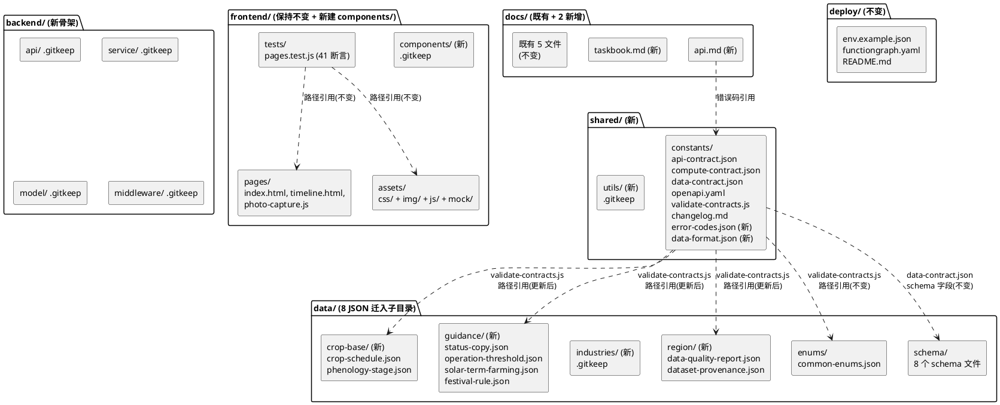
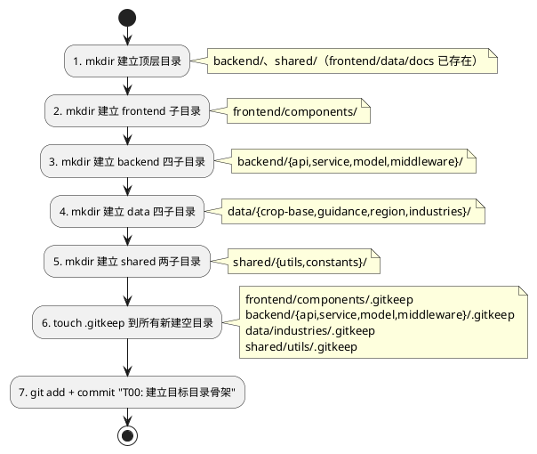
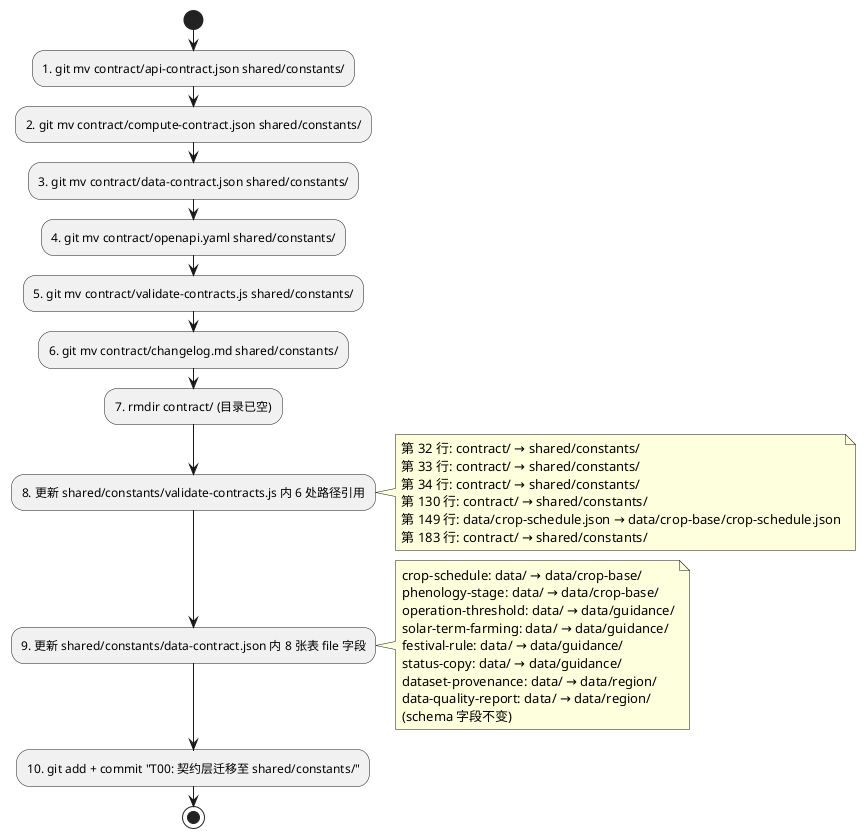
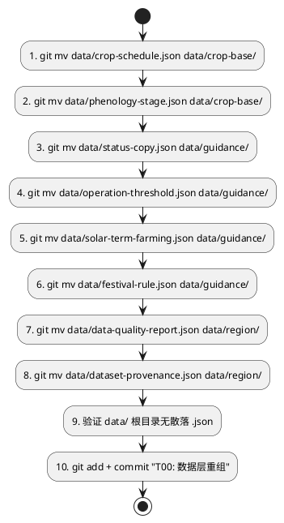
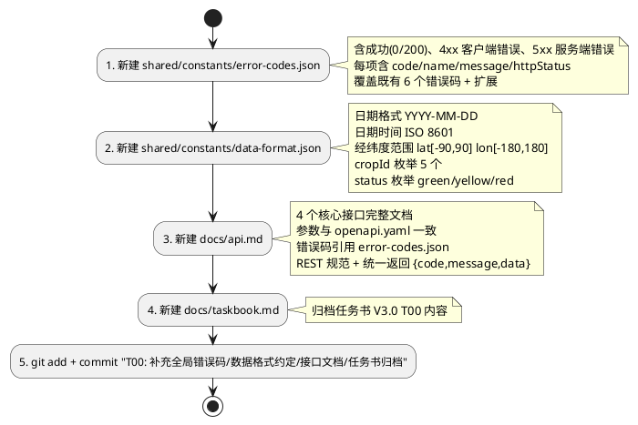
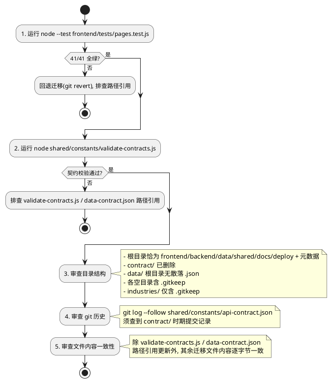
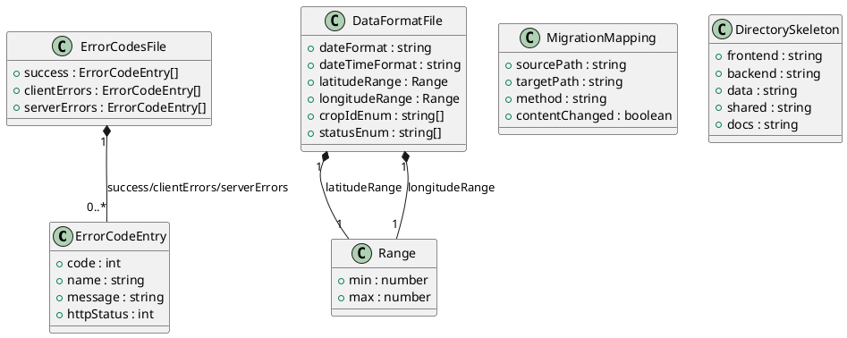

# T00 基建与目录规整 · 技术设计（t00_directory_migration）

> 本方案基于 `t00_directory_migration/spec.md`（REQ-TDM-UBI-001 ~ REQ-TDM-UBI-049，共 49 条 EARS 需求）生成。
> 设计范围：**全项目目录重组**（`frontend/`、`backend/`、`data/`、`shared/`、`docs/` 五层），但**不改动前端业务逻辑、不实现后端代码、不引入框架/构建工具/第三方库**。
> 强约束（红线）：
> 1. 前端 41/41 测试全绿（`node --test frontend/tests/pages.test.js`）；
> 2. 原有 4 个核心接口（`GET /api/timeline`、`POST /api/recognition`、`POST /api/chart`、`GET /health`）完全兼容；
> 3. nginx 部署路径不变（`root /agritime/frontend/pages`）；
> 4. 纯原生 JS，无框架 / 构建工具 / 第三方库；
> 5. 迁移通过 `git mv` 保留文件历史。
> 全局约束继承自 `stage2_frontend`（spec.md 60 条 / design.md D-01~D-12）与 `date_picker_range`（spec.md 20 条 / design.md D-DPR-01~D-DPR-12）：纯原生 JS + 原生 CSS、前端测试断言不可弱化、`sowDate` 参数命名不变、`crop-map.js` 5 个 cropId 不变、`timeline.html` 禁含 `method: 'POST'` 字面串、mock 保持 null 占位不造假。

# 一、需求与存量功能关系分析

## 1.1 需求功能与存量功能对比

### 1.1.1 已实现功能

> 已实现功能是指目标目录骨架中**已部分存在**的目录与文件，迁移时保留或仅补充缺失部分。

| 需求功能 | 存量功能 | 代码位置 | 匹配度 |
|---------|---------|---------|--------|
| 五层顶层目录骨架（REQ-TDM-UBI-001） | `frontend/`、`data/`、`docs/` 已存在；`backend/`、`shared/` 不存在 | 项目根目录 | 60%（3/5 顶层已存在） |
| `frontend/pages/` 子目录（REQ-TDM-UBI-007） | `frontend/pages/` 已存在，含 index.html、timeline.html、photo-capture.js | `frontend/pages/` | 100% |
| `frontend/assets/` 子目录结构（REQ-TDM-UBI-008） | `frontend/assets/` 已存在，含 css/、img/、js/、mock/ 四个子目录及全部文件 | `frontend/assets/{css,img,js,mock}/` | 100% |
| `frontend/tests/` 子目录（REQ-TDM-UBI-009） | `frontend/tests/pages.test.js` 已存在，41 项断言全绿 | `frontend/tests/pages.test.js` | 100% |
| `data/` 下 enums/ 与 schema/ 保留（REQ-TDM-UBI-018/019） | `data/enums/common-enums.json`、`data/schema/`（8 个 schema 文件）已存在 | `data/enums/`、`data/schema/` | 100% |
| `docs/` 既有文件保留（spec 7.3 不触碰项） | `docs/` 已存在，含 acceptance.md、architecture.svg、data-sources.md、demo-record/、demo-script.md | `docs/` | 100% |
| `deploy/` 保留不变（spec 7.3 不触碰项） | `deploy/` 已存在，含 env.example.json、functiongraph.yaml、README.md | `deploy/` | 100% |
| 契约层文件集合（REQ-TDM-UBI-012） | `contract/` 已存在，含 6 个文件（api-contract.json、compute-contract.json、data-contract.json、openapi.yaml、validate-contracts.js、changelog.md） | `contract/` | 100%（文件齐全，待迁移） |
| 数据层散落 JSON 文件（REQ-TDM-UBI-015~017） | `data/` 根目录下 8 个散落 JSON：crop-schedule.json、phenology-stage.json、status-copy.json、operation-threshold.json、solar-term-farming.json、festival-rule.json、data-quality-report.json、dataset-provenance.json | `data/` 根目录 | 100%（文件齐全，待归入子目录） |
| 前端测试路径引用基座（REQ-TDM-UBI-048） | `pages.test.js` 以 `__dirname` 相对路径引用 `frontend/` 内文件，全部指向 `frontend/` 内部 | `frontend/tests/pages.test.js:6-19,251,275` | 100%（因 frontend/ 内文件位置不变，路径引用无需更新） |

### 1.1.2 需要扩展的功能

> 需要扩展的功能是指存量目录/文件**部分匹配**目标结构，需在现有基础上补充或迁移的部分。

| 需求功能 | 存量功能 | 差异说明 | 扩展方向 |
|---------|---------|---------|---------|
| `frontend/components/` 子目录（REQ-TDM-UBI-010） | 不存在 | 目标结构要求 `frontend/` 下含 components/ 子目录，当前缺失 | 新建 `frontend/components/` + `.gitkeep`（当前无公共组件文件需迁入，仅建目录预留） |
| `backend/` 顶层目录及四子目录（REQ-TDM-UBI-003） | 不存在 | 目标结构要求 `backend/{api,service,model,middleware}/`，当前完全缺失 | 新建 `backend/` 及四子目录，各含 `.gitkeep`（仅骨架预留，不实现后端代码） |
| `shared/` 顶层目录及两子目录（REQ-TDM-UBI-005/024） | 不存在 | 目标结构要求 `shared/{utils,constants}/`，当前完全缺失 | 新建 `shared/` 及两子目录；`shared/constants/` 由契约迁移填充，`shared/utils/` 含 `.gitkeep` |
| `data/` 下 crop-base/guidance/region/industries/ 四子目录（REQ-TDM-UBI-004/015~017/020） | 不存在 | 目标结构要求四个业务子目录，当前 `data/` 下仅含 enums/、schema/ 与散落 JSON | 新建四子目录；将 8 个散落 JSON 经 `git mv` 归入 crop-base/guidance/region/；industries/ 仅含 `.gitkeep` |
| 契约层迁移至 `shared/constants/`（REQ-TDM-UBI-012~014） | `contract/` 下 6 个文件 | 文件齐全但位于 `contract/`，须迁移至 `shared/constants/` | 6 个文件经 `git mv` 迁移至 `shared/constants/`，保留文件名不变；迁移后 `contract/` 目录删除 |
| `validate-contracts.js` 路径引用更新（REQ-TDM-UBI-049） | 脚本内部硬编码 `contract/`、`data/crop-schedule.json` 等路径 | 迁移后契约文件位于 `shared/constants/`、数据文件位于 `data/crop-base/`，若不更新路径引用则脚本运行失败 | 更新 `validate-contracts.js` 内部 5 处路径引用（见 D-TDM-12），作为"逐字节一致"约束的必要豁免 |
| `data-contract.json` 路径字段更新（REQ-TDM-UBI-049） | JSON 内部 `tables[*].file`/`tables[*].schema` 字段硬编码 `data/*.json`、`data/schema/*.json` 路径 | 迁移后数据文件位于 `data/crop-base/`、`data/guidance/`、`data/region/`，若不更新路径字段则契约校验失败 | 更新 `data-contract.json` 内部 8 张表的 `file` 字段为新路径（`schema` 字段不变，因 schema/ 保留原位），作为"逐字节一致"约束的必要豁免（见 D-TDM-13） |
| `data/` 根目录无散落 JSON（REQ-TDM-UBI-021/047） | `data/` 根目录下 8 个散落 JSON | 迁移后 `data/` 根目录须仅含子目录，无散落 .json 文件 | 8 个散落 JSON 全部经 `git mv` 归入对应子目录 |
| `contract/` 目录删除（REQ-TDM-UBI-046） | `contract/` 目录存在 | 迁移后 `contract/` 须已删除 | 6 个文件迁出后 `contract/` 目录自动清空，git 提交后删除 |

### 1.1.3 需要新增的功能或接口

> 需要新增的功能是指目标结构中**完全不存在**的文件，须新建。

**A. 空目录占位文件（.gitkeep，纳入 git 跟踪）**

| 新增文件 | 所在目录 | 用途 | 关联需求 |
|---------|---------|------|---------|
| `frontend/components/.gitkeep` | `frontend/components/` | 公共组件目录预留 | REQ-TDM-UBI-010 |
| `backend/api/.gitkeep` | `backend/api/` | 后端接口层骨架预留 | REQ-TDM-UBI-003/006 |
| `backend/service/.gitkeep` | `backend/service/` | 后端服务层骨架预留 | REQ-TDM-UBI-003/006 |
| `backend/model/.gitkeep` | `backend/model/` | 后端模型层骨架预留 | REQ-TDM-UBI-003/006 |
| `backend/middleware/.gitkeep` | `backend/middleware/` | 后端中间件层骨架预留 | REQ-TDM-UBI-003/006 |
| `data/industries/.gitkeep` | `data/industries/` | 扩展品类预留（不放实际数据） | REQ-TDM-UBI-020 |
| `shared/utils/.gitkeep` | `shared/utils/` | 多端共享工具函数预留 | REQ-TDM-UBI-023 |

**B. 全局错误码定义文件（REQ-TDM-UBI-025~028）**

| 新增文件 | 位置 | 格式 | 核心内容 | 关联需求 |
|---------|------|------|---------|---------|
| `shared/constants/error-codes.json` | `shared/constants/` | JSON | 成功（0/200）、4xx 客户端错误、5xx 服务端错误三类枚举；每项含 `code`/`name`/`message`/`httpStatus` 四字段 | REQ-TDM-UBI-025~028 |

**C. 数据格式约定文件（REQ-TDM-UBI-029~031）**

| 新增文件 | 位置 | 格式 | 核心内容 | 关联需求 |
|---------|------|------|---------|---------|
| `shared/constants/data-format.json` | `shared/constants/` | JSON | 日期格式（`YYYY-MM-DD`）、日期时间格式（ISO 8601）、经纬度范围、cropId 枚举（5 个）、status 枚举（green/yellow/red） | REQ-TDM-UBI-029~031 |

**D. 接口文档（REQ-TDM-UBI-032~035）**

| 新增文件 | 位置 | 核心内容 | 关联需求 |
|---------|------|---------|---------|
| `docs/api.md` | `docs/` | 4 个核心接口（`GET /api/timeline`、`POST /api/recognition`、`POST /api/chart`、`GET /health`）的路径、方法、请求参数、响应结构、错误码引用、示例；REST 规范说明与统一返回格式 `{code, message, data}` | REQ-TDM-UBI-032~035 |

**E. 任务书归档（REQ-TDM-UBI-036）**

| 新增文件 | 位置 | 核心内容 | 关联需求 |
|---------|------|---------|---------|
| `docs/taskbook.md` | `docs/` | 功能扩展任务书 V3.0 的 T00 任务描述、目标目录结构、验收标准 | REQ-TDM-UBI-036 |

## 1.2 存量功能详细分析

### 1.2.1 `validate-contracts.js` 路径引用分析（`contract/validate-contracts.js`，迁移后 `shared/constants/validate-contracts.js`）

- **接口契约**：无入参；副作用为校验三份契约间字段交叉引用一致性，输出校验结果到 stdout/stderr，失败时 `process.exit(1)`。
- **业务规则**：以 `ROOT = path.resolve(__dirname, '..')` 为项目根目录基准，通过 `readJson(rel)` 读取相对路径文件。
- **路径引用清单（迁移前）**：
  1. 第 32 行：`readJson('contract/api-contract.json')` → 迁移后须改为 `shared/constants/api-contract.json`
  2. 第 33 行：`readJson('contract/compute-contract.json')` → 迁移后须改为 `shared/constants/compute-contract.json`
  3. 第 34 行：`readJson('contract/data-contract.json')` → 迁移后须改为 `shared/constants/data-contract.json`
  4. 第 35 行：`readJson('data/enums/common-enums.json')` → **不变**（enums/ 保留原位）
  5. 第 130 行：`path.join(ROOT, 'contract/changelog.md')` → 迁移后须改为 `shared/constants/changelog.md`
  6. 第 149 行：`readJson('data/crop-schedule.json')` → 迁移后须改为 `data/crop-base/crop-schedule.json`
  7. 第 183 行（stderr 文案）：`contract/changelog.md` → 迁移后须改为 `shared/constants/changelog.md`
- **约束**：
  1. `ROOT` 基于 `__dirname`（脚本自身位置），脚本从 `contract/` 迁至 `shared/constants/` 后 `__dirname` 变化，但 `path.resolve(__dirname, '..')` 仍指向项目根目录（因 `shared/constants/` 与 `contract/` 均为根目录下二级目录），**ROOT 不变**，无需修改。
  2. 第 64/75/76/143 行通过 `tables[tableName].file`/`tables[tableName].schema`/`m.file` 动态读取路径，这些路径值定义在 `data-contract.json` 与 `compute-contract.json` 中（见 1.2.2/1.2.3）。
  3. `compute-contract.json` 中 `m.file` 引用 `compute/*.js`（后端计算模块），脚本已标记"后端已移除，跳过模块文件检查"（第 65/144 行），不影响。
- **扩展点**：须更新 6 处硬编码路径引用（第 32/33/34/130/149/183 行），使脚本在迁移后仍能正确定位文件。
- **与"逐字节一致"约束的冲突**：REQ-TDM-UBI-013 要求契约文件逐字节一致，但 `validate-contracts.js` 本质是路径依赖的校验脚本，路径变更后须同步更新引用才能运行（REQ-TDM-UBI-049）。此冲突须在增量设计中以关键决策豁免处理（见 D-TDM-12）。

### 1.2.2 `data-contract.json` 路径字段分析（`contract/data-contract.json`，迁移后 `shared/constants/data-contract.json`）

- **接口契约**：JSON 文件，定义 8 张数据表的表名、字段、主键、文件路径（`file`）与 schema 路径（`schema`）。
- **路径字段清单（迁移前）**：
  | 表名 | `file` 字段（迁移前） | `file` 字段（迁移后） | `schema` 字段（不变） |
  |------|---------------------|---------------------|---------------------|
  | crop-schedule | `data/crop-schedule.json` | `data/crop-base/crop-schedule.json` | `data/schema/crop-schedule-schema.json` |
  | operation-threshold | `data/operation-threshold.json` | `data/guidance/operation-threshold.json` | `data/schema/operation-threshold-schema.json` |
  | solar-term-farming | `data/solar-term-farming.json` | `data/guidance/solar-term-farming.json` | `data/schema/solar-term-farming-schema.json` |
  | festival-rule | `data/festival-rule.json` | `data/guidance/festival-rule.json` | `data/schema/festival-rule-schema.json` |
  | status-copy | `data/status-copy.json` | `data/guidance/status-copy.json` | `data/schema/status-copy-schema.json` |
  | phenology-stage |! `data/phenology-stage.json` | `data/crop-base/phenology-stage.json` | `data/schema/phenology-stage-schema.json` |
  | dataset-provenance | `data/dataset-provenance.json` | `data/region/dataset-provenance.json` | `data/schema/dataset-provenance-schema.json` |
  | data-quality-report | `data/data-quality-report.json` | `data/region/data-quality-report.json` | `data/schema/data-quality-report-schema.json` |
- **约束**：`validate-contracts.js` 第 75 行 `fs.existsSync(path.join(ROOT, tables[tableName].file))` 依赖此字段定位数据文件；迁移后若 `file` 字段不更新，校验失败。
- **与"逐字节一致"约束的冲突**：`data-contract.json` 为契约数据文件，REQ-TDM-UBI-013 要求逐字节一致，但其 `file` 字段定义的是物理文件位置，迁移后须与实际位置一致。此冲突须以关键决策豁免处理（见 D-TDM-13）。

### 1.2.3 `compute-contract.json` 路径字段分析（`contract/compute-contract.json`，迁移后 `shared/constants/compute-contract.json`）

- **路径字段**：10 个模块的 `file` 字段引用 `compute/*.js`（如 `compute/node-generator.js`、`compute/cma-adapter.js` 等），第 143 行引用 `compute/mock/all-modules.mock.js`。
- **约束**：`validate-contracts.js` 第 64/143 行检查这些模块文件存在性，但已标记"后端已移除，跳过模块文件检查"（第 65/144 行 `missingModuleFiles.forEach(... process.stdout.write('⚠ ...跳过...'))`），**不因文件缺失而报错**。
- **结论**：`compute-contract.json` 内部 `compute/*.js` 路径引用**无需更新**，可保持逐字节一致（满足 REQ-TDM-UBI-013）。后端计算模块独立部署于服务器 `/opt/crop-calendar`，本次迁移不触碰。

### 1.2.4 前端测试路径引用分析（`frontend/tests/pages.test.js`）

- **路径引用方式**：全部以 `__dirname`（`frontend/tests/`）为基准的相对路径，`..` 指向 `frontend/`。
  - 第 6 行：`path.resolve(__dirname, '..', 'pages')` → `frontend/pages/`
  - 第 7 行：`path.resolve(__dirname, '..', 'assets', 'css')` → `frontend/assets/css/`
  - 第 10-14 行：读 `frontend/pages/` 下 3 文件 + `frontend/assets/css/` 下 2 文件
  - 第 15-19 行：读 `frontend/assets/js/` 下 4 文件 + `frontend/assets/mock/` 下 1 文件
  - 第 251 行：`require('../assets/js/timeline-logic.js')`
  - 第 275 行：`require('../assets/js/history-store.js')`
- **约束**：本次迁移**不改动 `frontend/` 内任何文件位置**（REQ-TDM-UBI-007/008/009，spec 7.3 不触碰项），故测试文件路径引用**全部有效，无需更新**。
- **结论**：`pages.test.js` 保持内容与位置不变，41 项断言自然全绿（因被测文件位置与内容均不变）。

### 1.2.5 前端文件对 `contract/` 的引用分析

- **grep 结果**：仅 `frontend/assets/mock/mock-data.js` 第 3 行注释 `* 与 contract/api-contract.json 的响应结构保持一致。` 引用了 `contract/` 路径。
- **约束**：此为**注释**，非代码引用，不影响运行。但 spec 7.3 要求前端文件内容不变，故注释中的旧路径**保留不动**（即使迁移后 `contract/` 已删除，注释仅作文档参考，不产生运行时影响）。
- **结论**：无需更新前端文件中的注释路径。

### 1.2.6 `deploy/` 目录分析

- **内容**：`env.example.json`、`functiongraph.yaml`、`README.md`。
- **约束**：spec 7.3 明确 `deploy/` 位置与内容不变（部署配置不纳入本次迁移）。
- **结论**：`deploy/` 保持不变。spec 7.4 排除项第 4 条明确禁止服务器配置实际修改。

### 1.2.7 `docs/` 既有文件分析

- **内容**：`acceptance.md`、`architecture.svg`、`data-sources.md`、`demo-record/README.md`、`demo-script.md`。
- **约束**：spec 7.3 明确 `docs/` 下既有文件位置与内容不变。
- **结论**：既有 5 个文件/目录保持不变；本次仅新增 `docs/api.md` 与 `docs/taskbook.md`。
# 二、增量设计方案

## 2.0 总体策略与关键决策

| 决策编号 | 决策点 | 结论 | 决策理由 |
|---------|-------|------|---------|
| D-TDM-01 | `contract/` 迁移目标 | 整体迁移至 `shared/constants/`，6 个文件经 `git mv` 保留文件名不变；迁移后 `contract/` 目录删除 | REQ-TDM-UBI-012 要求契约文件迁至 `shared/constants/`；`git mv` 保留历史（REQ-TDM-UBI-014/043/044）；契约属全局共享常量范畴，归入 `shared/constants/` 符合五层分离语义 |
| D-TDM-02 | `data/` 散落 JSON 归入规则 | 按业务语义归入四子目录：crop-base/（作物基础库）、guidance/（农事指导规则库）、region/（地理与环境数据）、industries/（预留扩展品类，仅 .gitkeep） | REQ-TDM-UBI-015~017/020 明确每个文件的归属子目录；业务语义分类便于后续维护与扩展 |
| D-TDM-03 | `data/enums/` 与 `data/schema/` 保留原位 | enums/ 保留在 `data/enums/`（属数据范畴，非全局常量）；schema/ 保留在 `data/schema/`（属数据校验定义） | REQ-TDM-UBI-018/019 明确保留策略；enums 虽可迁至 `shared/constants/enums/`，但 spec 采取保留在 `data/` 的策略（属数据范畴） |
| D-TDM-04 | `frontend/components/` 建立方式 | 新建空目录 + `.gitkeep`，**不从现有代码提取组件** | REQ-TDM-UBI-010 明确"当前无公共组件文件需迁入，仅建目录预留"；spec 7.4 排除项第 2 条禁止改动前端业务逻辑，提取组件属前端重构，超出本次范围 |
| D-TDM-05 | `backend/` 各子目录建立方式 | 新建 `backend/{api,service,model,middleware}/` 四个空目录，各含 `.gitkeep`，**不实现后端代码** | REQ-TDM-UBI-003/042 明确 backend/ 仅为骨架预留；spec 1.4/7.4 明确不实现后端 Java 代码，后端服务独立部署于服务器 `/opt/crop-calendar` |
| D-TDM-06 | `shared/utils/` 建立方式 | 新建空目录 + `.gitkeep`，当前无既有文件需迁入 | REQ-TDM-UBI-023 明确"当前无既有文件需迁入，仅建目录预留" |
| D-TDM-07 | `data/industries/` 建立方式 | 新建空目录 + `.gitkeep`，**不放置实际数据文件** | REQ-TDM-UBI-020/禁止项明确 industries/ 为预留扩展品类，仅含 .gitkeep |
| D-TDM-08 | 全局错误码定义文件格式与位置 | `shared/constants/error-codes.json`，JSON 格式（非 .js） | REQ-TDM-UBI-025 允许 .json 或 .js；选 JSON 因：①错误码为静态数据而非可执行逻辑，JSON 更语义化；②与同目录既有契约文件（api-contract.json 等）格式一致；③无框架/构建工具约束下 JSON 可被前后端通用解析 |
| D-TDM-09 | 数据格式约定文件格式与位置 | `shared/constants/data-format.json`，JSON 格式 | 同 D-TDM-08 理由；数据格式约定为静态规范定义，JSON 格式与契约文件一致 |
| D-TDM-10 | `docs/api.md` 内容结构 | Markdown 文档，按接口分节：每个接口含路径、方法、请求参数表（名/类型/必填/取值范围）、响应结构、错误码引用（引用 `shared/constants/error-codes.json`）、示例；末尾附 REST 规范说明与统一返回格式 `{code, message, data}` | REQ-TDM-UBI-032~035 明确接口文档须含 4 个核心接口完整描述、参数与 openapi.yaml 一致、错误码引用全局定义、REST 规范说明 |
| D-TDM-11 | `docs/taskbook.md` 内容来源 | 归档功能扩展任务书 V3.0 的 T00 任务内容（任务编号、目标目录结构、验收标准），内容与任务书原文一致，不篡改 | REQ-TDM-UBI-036/禁止项要求归档任务书原始内容，禁止篡改 |
| D-TDM-12 | `validate-contracts.js` 路径引用更新（"逐字节一致"豁免） | **豁免** REQ-TDM-UBI-013 对 `validate-contracts.js` 的逐字节一致要求；须更新内部 6 处路径引用（第 32/33/34/130/149/183 行），使脚本迁移后仍能运行（满足 REQ-TDM-UBI-049） | `validate-contracts.js` 本质是路径依赖的校验脚本，其核心职责是按路径定位文件并校验存在性；迁移后物理路径变更，脚本引用不更新则无法运行（违反 REQ-TDM-UBI-049 强制红线）；"逐字节一致"约束的立法本意是防止迁移过程中意外篡改文件内容，而非禁止路径引用的必要同步更新。此豁免仅限路径字符串更新，不涉及校验逻辑变更 |
| D-TDM-13 | `data-contract.json` 路径字段更新（"逐字节一致"豁免） | **豁免** REQ-TDM-UBI-013 对 `data-contract.json` 的逐字节一致要求；须更新内部 8 张表的 `file` 字段为新路径（`schema` 字段不变，因 schema/ 保留原位），使契约路径与物理位置一致 | `data-contract.json` 的 `file` 字段定义的是数据文件的物理位置，迁移后物理位置变更，契约路径须同步更新否则 `validate-contracts.js` 第 75 行校验失败（违反 REQ-TDM-UBI-049）；此豁免仅限 `file` 字段路径字符串更新，不涉及字段定义/类型/约束等契约语义变更 |
| D-TDM-14 | 测试文件路径引用是否需更新 | **无需更新**；`pages.test.js` 全部路径引用指向 `frontend/` 内部，本次迁移不改动 `frontend/` 内文件位置 | REQ-TDM-UBI-007/008/009 明确 frontend/pages/、frontend/assets/、frontend/tests/ 下文件位置不变；测试文件以 `__dirname` 相对路径引用，基准不变故引用有效 |
| D-TDM-15 | `git mv` 执行顺序 | **先建目录再迁移**：(1) 先 `mkdir` 建立所有目标子目录 + `.gitkeep`；(2) 再 `git mv` 迁移 `contract/` 6 文件至 `shared/constants/`；(3) 再 `git mv` 迁移 `data/` 8 个散落 JSON 至对应子目录；(4) 最后更新 `validate-contracts.js` 与 `data-contract.json` 路径引用 | `git mv` 要求目标目录已存在；先建骨架确保迁移有落脚点；契约迁移在数据迁移之前因 `validate-contracts.js` 路径更新须同时引用新契约路径与新数据路径，须在两者迁移完成后统一更新 |
| D-TDM-16 | 前端文件保持不变 | `frontend/` 下全部文件（pages/、assets/、tests/）位置与内容**逐字节不变** | REQ-TDM-UBI-007/008/009/011 + spec 7.3 不触碰项 + 禁止项明确禁止改动前端业务逻辑；前端 41/41 测试全绿的前提是被测文件不变 |
| D-TDM-17 | `deploy/` 保留不变 | `deploy/` 目录及 3 个文件位置与内容不变 | spec 7.3 不触碰项第 4 条明确 deploy/ 不纳入本次迁移 |
| D-TDM-18 | `docs/` 既有文件保留不变 | `docs/` 下 5 个既有文件/目录（acceptance.md、architecture.svg、data-sources.md、demo-record/、demo-script.md）位置与内容不变；仅新增 api.md 与 taskbook.md | spec 7.3 不触碰项第 5 条明确 docs/ 既有文件不变 |
| D-TDM-19 | 错误码与既有接口兼容 | 新增错误码须覆盖既有 4 个核心接口的既有错误返回语义，不得改变既有错误码语义；新增错误码取值避开既有码段 | REQ-TDM-UBI-028 要求与既有接口错误返回兼容；既有错误码定义在 `api-contract.json` 的 `errorCodes` 字段（含 INVALID_INPUT/UNSUPPORTED_CROP/WEATHER_UNAVAILABLE/INTERNAL_ERROR/RECOGNITION_EMPTY/RECOGNITION_TIMEOUT），新增错误码须包含这些既有定义并扩展 |
| D-TDM-20 | 数据格式约定与契约一致性 | `data-format.json` 中的字段格式定义须与 `shared/constants/api-contract.json`、`shared/constants/openapi.yaml` 保持一致，不得矛盾 | REQ-TDM-UBI-031 要求与既有契约一致；日期格式 YYYY-MM-DD、cropId 枚举 5 个、status 枚举 green/yellow/red 均须与契约对齐 |

## 2.1 实现模型

### 2.1.1 上下文视图

本次为目录迁移任务，不改变系统对外部系统的交互形态，仅重组项目内部目录结构。

```plantuml
@startuml
skinparam rectangle { BackgroundColor #fffdf7
  BorderColor #e4ddcb }
skinparam componentStyle rectangle
actor "开发者/交付者" as dev
rectangle "agritime 项目\n(目录迁移 T00)" as project {
  rectangle "frontend/\npages+components(新)+assets+tests\n(位置不变, 仅新建 components/)" as fe
  rectangle "backend/ (新骨架)\napi+service+model+middleware\n(仅 .gitkeep)" as be
  rectangle "data/\ncrop-base(新)+guidance(新)+region(新)\n+industries(新)+enums+schema\n(8 JSON 迁入子目录)" as data
  rectangle "shared/ (新)\nutils(新)+constants\n(contract/ 6 文件迁入)" as shared
  rectangle "docs/\napi.md(新)+taskbook.md(新)\n+既有 5 文件不变" as docs
}
rectangle "Git 仓库\n(git mv 保留历史)" as git
rectangle "目标服务器\n(nginx root /agritime/frontend/pages\n后端 /opt/crop-calendar 8080)" as server
rectangle "前端测试\n(node --test 41 断言)" as test
rectangle "契约校验\n(node shared/constants/\nvalidate-contracts.js)" as validate

dev --> project : git mv 迁移 + 建骨架 + 补约定
project --> git : 提交(保留历史)
project --> server : 部署路径不变(frontend/pages/ 不动)
project --> test : 41/41 全绿(被测文件不变)
project --> validate : 脚本路径更新后正常运行
@enduml
```

### 2.1.2 服务/组件总体架构



**模块职责与依赖规则**

| 模块 | 职责 | 变更类型 | 关联需求 |
|------|------|---------|---------|
| `frontend/pages/` | 前端页面（index.html、timeline.html、photo-capture.js） | 保持不变 | REQ-TDM-UBI-007 |
| `frontend/components/` | 公共组件目录预留 | 新建（空 + .gitkeep） | REQ-TDM-UBI-010 |
| `frontend/assets/` | 前端资源（css/img/js/mock） | 保持不变 | REQ-TDM-UBI-008 |
| `frontend/tests/` | 前端测试（pages.test.js，41 断言） | 保持不变 | REQ-TDM-UBI-009/048 |
| `backend/{api,service,model,middleware}/` | 后端骨架预留 | 新建（空 + .gitkeep） | REQ-TDM-UBI-003/042 |
| `data/crop-base/` | 作物基础数据 | 新建目录 + 迁入 2 文件 | REQ-TDM-UBI-015 |
| `data/guidance/` | 农事指导规则 | 新建目录 + 迁入 4 文件 | REQ-TDM-UBI-016 |
| `data/region/` | 地理与环境数据 | 新建目录 + 迁入 2 文件 | REQ-TDM-UBI-017 |
| `data/industries/` | 扩展品类预留 | 新建（空 + .gitkeep） | REQ-TDM-UBI-020 |
| `data/enums/` | 公共枚举 | 保持不变 | REQ-TDM-UBI-018 |
| `data/schema/` | 数据校验 schema | 保持不变 | REQ-TDM-UBI-019 |
| `shared/constants/` | 全局常量与契约 | 新建目录 + 迁入 6 文件 + 新增 2 文件 | REQ-TDM-UBI-012/024/025/029 |
| `shared/utils/` | 多端共享工具 | 新建（空 + .gitkeep） | REQ-TDM-UBI-023 |
| `docs/api.md` | 接口文档 | 新增 | REQ-TDM-UBI-032~035 |
| `docs/taskbook.md` | 任务书归档 | 新增 | REQ-TDM-UBI-036 |
| `deploy/` | 部署配置 | 保持不变 | spec 7.3 |

### 2.1.3 实现设计文档

#### 流程一：目录骨架建立（REQ-TDM-UBI-001~006）



#### 流程二：契约层迁移（REQ-TDM-UBI-012~014）



#### 流程三：数据层重组（REQ-TDM-UBI-015~022）



#### 流程四：新增约定文件与文档（REQ-TDM-UBI-025~036）



#### 流程五：迁移后校验（REQ-TDM-UBI-048/049）



## 2.2 接口设计

### 2.2.1 总体设计

> 本次为目录迁移任务，不新增运行时接口。本节定义的是**新增约定文件的数据接口**（错误码定义、数据格式约定的结构契约）与**既有接口的兼容性保障策略**。

| 约定文件 | 归属 | 稳定性 | 说明 |
|---------|------|-------|------|
| `shared/constants/error-codes.json` | 全局共享常量 | 稳定（新增） | 全项目共用的错误码枚举，所有接口返回与前端降级提示的一致性来源 |
| `shared/constants/data-format.json` | 全局共享常量 | 稳定（新增） | 前后端共用的数据字段格式规范 |
| `docs/api.md` | 文档 | 稳定（新增） | 4 个核心接口的完整文档，与 `shared/constants/openapi.yaml` 保持一致 |
| `docs/taskbook.md` | 文档 | 稳定（新增） | 任务书 V3.0 归档 |
| 既有 4 个核心接口 | 后端（不触碰） | 稳定（保持） | 路径/方法/参数/返回结构完全兼容，迁移不改变任何契约要素 |

**变更策略**：既有接口契约只读、不改（REQ-TDM-UBI-037/039）；新增约定文件为静态 JSON/Markdown，无运行时逻辑。

### 2.2.2 约定文件结构清单

#### A. `shared/constants/error-codes.json`（全局错误码定义）

- **结构契约**：JSON 对象，含 `success`、`clientErrors`、`serverErrors` 三个数组。
- **每个错误码条目须含四字段**（REQ-TDM-UBI-027）：
  - `code`：错误码，整数，全局唯一（成功为 0，4xx 客户端错误为 400-499，5xx 服务端错误为 500-599）。
  - `name`：错误名称，大写下划线格式（如 `PARAM_INVALID`）。
  - `message`：用户可读描述，中文文案。
  - `httpStatus`：对应 HTTP 状态码，整数（200/400/401/403/404/405/500/502/503/504 等）。
- **覆盖范围**（REQ-TDM-UBI-026）：
  - 成功：`SUCCESS`（code=0, httpStatus=200）。
  - 客户端错误（4xx）：`PARAM_INVALID`（400）、`UNAUTHORIZED`（401）、`FORBIDDEN`（403）、`NOT_FOUND`（404）、`METHOD_NOT_ALLOWED`（405）、`UNSUPPORTED_CROP`（400）、`RECOGNITION_EMPTY`（400）、`RECOGNITION_TIMEOUT`（408）。
  - 服务端错误（5xx）：`INTERNAL_ERROR`（500）、`WEATHER_UNAVAILABLE`（502）、`UPSTREAM_TIMEOUT`（504）、`SERVICE_UNAVAILABLE`（503）。
- **与既有接口兼容**（REQ-TDM-UBI-028/D-TDM-19）：须包含 `api-contract.json` 中既有 6 个错误码（INVALID_INPUT、UNSUPPORTED_CROP、WEATHER_UNAVAILABLE、INTERNAL_ERROR、RECOGNITION_EMPTY、RECOGNITION_TIMEOUT）的语义定义，不得改变其语义；新增错误码取值避开既有码段。

#### B. `shared/constants/data-format.json`（数据格式约定）

- **结构契约**：JSON 对象，含 `dateFormat`、`dateTimeFormat`、`latitudeRange`、`longitudeRange`、`cropIdEnum`、`statusEnum` 字段。
- **字段定义**（REQ-TDM-UBI-030/D-TDM-20）：
  - `dateFormat`：`"YYYY-MM-DD"`。
  - `dateTimeFormat`：`"YYYY-MM-DDTHH:mm:ssZ"`（ISO 8601）。
  - `latitudeRange`：`{ "min": -90, "max": 90 }`。
  - `longitudeRange`：`{ "min": -180, "max": 180 }`。
  - `cropIdEnum`：`["dry_garlic", "wheat_winter", "corn_summer", "rice", "soybean"]`（与 `crop-map.js` 5 个 cropId 一致）。
  - `statusEnum`：`["green", "yellow", "red"]`（适宜/谨慎/不宜）。
- **与契约一致性**（REQ-TDM-UBI-031）：须与 `shared/constants/api-contract.json`、`shared/constants/openapi.yaml` 中的字段格式定义一致，不得矛盾。

#### C. `docs/api.md`（接口文档）

- **结构契约**：Markdown 文档，按接口分节。
- **每个接口须含**（REQ-TDM-UBI-032~034）：
  - 接口标题（路径 + 方法）。
  - 请求参数表（参数名、类型、是否必填、取值范围）。
  - 响应结构（成功与失败两种）。
  - 错误码引用（引用 `shared/constants/error-codes.json` 中的错误码 name）。
  - 请求/响应示例。
- **REST 规范说明**（REQ-TDM-UBI-035）：文档末尾附 REST 规范说明（资源命名用名词复数、HTTP 方法语义化、错误返回统一 JSON 结构 `{code, message, data}`）。
- **与契约一致性**：参数定义须与 `shared/constants/openapi.yaml` 一致（REQ-TDM-UBI-033）。

#### D. `docs/taskbook.md`（任务书归档）

- **结构契约**：Markdown 文档，归档功能扩展任务书 V3.0 的 T00 任务内容。
- **内容须含**（REQ-TDM-UBI-036）：任务编号 T00、目标目录结构（五层分离）、验收标准。
- **禁止篡改**：内容与任务书原文一致（REQ-TDM-UBI-036 禁止项）。
## 2.3 数据模型

### 2.3.1 设计目标

1. 建立"五层分离"目标目录骨架，使项目内所有代码与数据文件按 frontend/backend/data/shared/docs 五层归位，无散落。
2. 通过 `git mv` 保留全部迁移文件的变更历史，使 `git log --follow` 可追溯迁移前提交记录。
3. 补充全局错误码与数据格式约定，为前后端接口返回与数据字段格式提供统一规范来源。
4. 与存量数据兼容：迁移文件内容逐字节一致（`validate-contracts.js` 与 `data-contract.json` 路径引用更新除外）；既有 4 个核心接口契约要素不变；前端 41/41 测试全绿。
5. 与 spec 术语一致：`error-codes` / `data-format` / `crop-base` / `guidance` / `region` / `industries` 命名与 spec 第 2 章领域术语对齐。

### 2.3.2 模型实现



**对象语义与生命周期**

| 对象 | 创建 | 缺省/空值语义 | 持久化策略 |
|------|------|--------------|-----------|
| `ErrorCodeEntry` | 新建 `error-codes.json` 时定义 | 无缺省（每项须含四字段） | JSON 文件，静态定义 |
| `DataFormatFile` | 新建 `data-format.json` 时定义 | 无缺省（各字段须显式定义） | JSON 文件，静态定义 |
| `MigrationMapping` | 迁移执行时由 `git mv` 隐式产生 | `contentChanged` 迁移文件为 false，新增文件为 true | git 历史（rename 记录） |
| `DirectorySkeleton` | 迁移第一步建目录时产生 | 空目录以 `.gitkeep` 占位 | git 跟踪 |

**持久化策略**：本次为目录迁移任务，无运行时持久化需求；所有新增约定文件为静态 JSON/Markdown，由 git 版本控制持久化。

## 2.4 迁移映射表（精确的现有路径 → 目标路径）

### 2.4.1 契约层迁移（contract/ → shared/constants/）

| 序号 | 现有路径 | 目标路径 | 迁移方式 | 内容变更 | 关联需求 |
|------|---------|---------|---------|---------|---------|
| M-01 | `contract/api-contract.json` | `shared/constants/api-contract.json` | `git mv` | false | REQ-TDM-UBI-012/013 |
| M-02 | `contract/compute-contract.json` | `shared/constants/compute-contract.json` | `git mv` | false | REQ-TDM-UBI-012/013 |
| M-03 | `contract/data-contract.json` | `shared/constants/data-contract.json` | `git mv` | **true**（8 处 file 字段路径更新，D-TDM-13 豁免） | REQ-TDM-UBI-012/049 |
| M-04 | `contract/openapi.yaml` | `shared/constants/openapi.yaml` | `git mv` | false | REQ-TDM-UBI-012/013 |
| M-05 | `contract/validate-contracts.js` | `shared/constants/validate-contracts.js` | `git mv` | **true**（6 处路径引用更新，D-TDM-12 豁免） | REQ-TDM-UBI-012/049 |
| M-06 | `contract/changelog.md` | `shared/constants/changelog.md` | `git mv` | false | REQ-TDM-UBI-012/013 |

### 2.4.2 数据层重组（data/ 散落 JSON → data/ 子目录）

| 序号 | 现有路径 | 目标路径 | 迁移方式 | 内容变更 | 关联需求 |
|------|---------|---------|---------|---------|---------|
| M-07 | `data/crop-schedule.json` | `data/crop-base/crop-schedule.json` | `git mv` | false | REQ-TDM-UBI-015/022 |
| M-08 | `data/phenology-stage.json` | `data/crop-base/phenology-stage.json` | `git mv` | false | REQ-TDM-UBI-015/022 |
| M-09 | `data/status-copy.json` | `data/guidance/status-copy.json` | `git mv` | false | REQ-TDM-UBI-016/022 |
| M-10 | `data/operation-threshold.json` | `data/guidance/operation-threshold.json` | `git mv` | false | REQ-TDM-UBI-016/022 |
| M-11 | `data/solar-term-farming.json` | `data/guidance/solar-term-farming.json` | `git mv` | false | REQ-TDM-UBI-016/022 |
| M-12 | `data/festival-rule.json` | `data/guidance/festival-rule.json` | `git mv` | false | REQ-TDM-UBI-016/022 |
| M-13 | `data/data-quality-report.json` | `data/region/data-quality-report.json` | `git mv` | false | REQ-TDM-UBI-017/022 |
| M-14 | `data/dataset-provenance.json` | `data/region/dataset-provenance.json` | `git mv` | false | REQ-TDM-UBI-017/022 |

### 2.4.3 保留不变（不迁移）

| 序号 | 路径 | 保留原因 | 关联需求 |
|------|------|---------|---------|
| K-01 | `frontend/pages/{index.html,timeline.html,photo-capture.js}` | 前端页面位置不变 | REQ-TDM-UBI-007 |
| K-02 | `frontend/assets/{css,img,js,mock}/` 全部文件 | 前端资源位置不变 | REQ-TDM-UBI-008 |
| K-03 | `frontend/tests/pages.test.js` | 前端测试位置与内容不变 | REQ-TDM-UBI-009/048 |
| K-04 | `data/enums/common-enums.json` | enums 属数据范畴，保留原位 | REQ-TDM-UBI-018 |
| K-05 | `data/schema/` 8 个 schema 文件 | schema 属数据校验定义，保留原位 | REQ-TDM-UBI-019 |
| K-06 | `deploy/` 3 个文件 | 部署配置不纳入迁移 | spec 7.3 |
| K-07 | `docs/` 既有 5 文件/目录 | 既有文档不变 | spec 7.3 |

### 2.4.4 新建文件

| 序号 | 新建路径 | 类型 | 关联需求 |
|------|---------|------|---------|
| N-01 | `frontend/components/.gitkeep` | 空目录占位 | REQ-TDM-UBI-010 |
| N-02 | `backend/api/.gitkeep` | 空目录占位 | REQ-TDM-UBI-003/006 |
| N-03 | `backend/service/.gitkeep` | 空目录占位 | REQ-TDM-UBI-003/006 |
| N-04 | `backend/model/.gitkeep` | 空目录占位 | REQ-TDM-UBI-003/006 |
| N-05 | `backend/middleware/.gitkeep` | 空目录占位 | REQ-TDM-UBI-003/006 |
| N-06 | `data/industries/.gitkeep` | 空目录占位 | REQ-TDM-UBI-020 |
| N-07 | `shared/utils/.gitkeep` | 空目录占位 | REQ-TDM-UBI-023 |
| N-08 | `shared/constants/error-codes.json` | 全局错误码定义 | REQ-TDM-UBI-025~028 |
| N-09 | `shared/constants/data-format.json` | 数据格式约定 | REQ-TDM-UBI-029~031 |
| N-10 | `docs/api.md` | 接口文档 | REQ-TDM-UBI-032~035 |
| N-11 | `docs/taskbook.md` | 任务书归档 | REQ-TDM-UBI-036 |

### 2.4.5 删除（迁移后自动清空）

| 序号 | 路径 | 删除原因 | 关联需求 |
|------|------|---------|---------|
| D-01 | `contract/` 目录 | 6 个文件迁出后目录空，git 提交后删除 | REQ-TDM-UBI-046 |

## 2.5 改动点清单（精确到文件级别）

### 2.5.1 新建目录（7 个）

| 目录 | .gitkeep | 关联需求 |
|------|---------|---------|
| `frontend/components/` | 是 | REQ-TDM-UBI-010 |
| `backend/api/` | 是 | REQ-TDM-UBI-003 |
| `backend/service/` | 是 | REQ-TDM-UBI-003 |
| `backend/model/` | 是 | REQ-TDM-UBI-003 |
| `backend/middleware/` | 是 | REQ-TDM-UBI-003 |
| `data/crop-base/` | 否（迁入文件） | REQ-TDM-UBI-015 |
| `data/guidance/` | 否（迁入文件） | REQ-TDM-UBI-016 |
| `data/region/` | 否（迁入文件） | REQ-TDM-UBI-017 |
| `data/industries/` | 是 | REQ-TDM-UBI-020 |
| `shared/utils/` | 是 | REQ-TDM-UBI-023 |
| `shared/constants/` | 否（迁入文件） | REQ-TDM-UBI-012 |

### 2.5.2 迁移文件（14 个，经 git mv）

| 文件 | 变更类型 | 关联需求 |
|------|---------|---------|
| `contract/api-contract.json` → `shared/constants/api-contract.json` | 迁移（内容不变） | REQ-TDM-UBI-012/013 |
| `contract/compute-contract.json` → `shared/constants/compute-contract.json` | 迁移（内容不变） | REQ-TDM-UBI-012/013 |
| `contract/data-contract.json` → `shared/constants/data-contract.json` | 迁移 + 修改（8 处 file 字段路径更新） | REQ-TDM-UBI-012/049 |
| `contract/openapi.yaml` → `shared/constants/openapi.yaml` | 迁移（内容不变） | REQ-TDM-UBI-012/013 |
| `contract/validate-contracts.js` → `shared/constants/validate-contracts.js` | 迁移 + 修改（6 处路径引用更新） | REQ-TDM-UBI-012/049 |
| `contract/changelog.md` → `shared/constants/changelog.md` | 迁移（内容不变） | REQ-TDM-UBI-012/013 |
| `data/crop-schedule.json` → `data/crop-base/crop-schedule.json` | 迁移（内容不变） | REQ-TDM-UBI-015/022 |
| `data/phenology-stage.json` → `data/crop-base/phenology-stage.json` | 迁移（内容不变） | REQ-TDM-UBI-015/022 |
| `data/status-copy.json` → `data/guidance/status-copy.json` | 迁移（内容不变） | REQ-TDM-UBI-016/022 |
| `data/operation-threshold.json` → `data/guidance/operation-threshold.json` | 迁移（内容不变） | REQ-TDM-UBI-016/022 |
| `data/solar-term-farming.json` → `data/guidance/solar-term-farming.json` | 迁移（内容不变） | REQ-TDM-UBI-016/022 |
| `data/festival-rule.json` → `data/guidance/festival-rule.json` | 迁移（内容不变） | REQ-TDM-UBI-016/022 |
| `data/data-quality-report.json` → `data/region/data-quality-report.json` | 迁移（内容不变） | REQ-TDM-UBI-017/022 |
| `data/dataset-provenance.json` → `data/region/dataset-provenance.json` | 迁移（内容不变） | REQ-TDM-UBI-017/022 |

### 2.5.3 新建文件（11 个）

| 文件 | 变更类型 | 关联需求 |
|------|---------|---------|
| `frontend/components/.gitkeep` | 新建 | REQ-TDM-UBI-010 |
| `backend/api/.gitkeep` | 新建 | REQ-TDM-UBI-003/006 |
| `backend/service/.gitkeep` | 新建 | REQ-TDM-UBI-003/006 |
| `backend/model/.gitkeep` | 新建 | REQ-TDM-UBI-003/006 |
| `backend/middleware/.gitkeep` | 新建 | REQ-TDM-UBI-003/006 |
| `data/industries/.gitkeep` | 新建 | REQ-TDM-UBI-020 |
| `shared/utils/.gitkeep` | 新建 | REQ-TDM-UBI-023 |
| `shared/constants/error-codes.json` | 新建 | REQ-TDM-UBI-025~028 |
| `shared/constants/data-format.json` | 新建 | REQ-TDM-UBI-029~031 |
| `docs/api.md` | 新建 | REQ-TDM-UBI-032~035 |
| `docs/taskbook.md` | 新建 | REQ-TDM-UBI-036 |

### 2.5.4 删除（1 个目录）

| 路径 | 变更类型 | 关联需求 |
|------|---------|---------|
| `contract/` 目录 | 删除（6 文件迁出后空目录自动消失） | REQ-TDM-UBI-046 |

### 2.5.5 保持不变（明确排除）

| 路径 | 保持不变原因 | 关联需求 |
|------|------------|---------|
| `frontend/pages/` 3 文件 | 前端页面位置与内容不变 | REQ-TDM-UBI-007 |
| `frontend/assets/` 全部文件 | 前端资源位置与内容不变 | REQ-TDM-UBI-008 |
| `frontend/tests/pages.test.js` | 测试位置与内容不变，41/41 全绿 | REQ-TDM-UBI-009/048 |
| `data/enums/common-enums.json` | enums 保留原位 | REQ-TDM-UBI-018 |
| `data/schema/` 8 文件 | schema 保留原位 | REQ-TDM-UBI-019 |
| `deploy/` 3 文件 | 部署配置不纳入迁移 | spec 7.3 |
| `docs/` 既有 5 文件/目录 | 既有文档不变 | spec 7.3 |

### 2.5.6 改动统计

| 类别 | 数量 |
|------|------|
| 新建目录 | 11 |
| 迁移文件（git mv） | 14 |
| 新建文件 | 11 |
| 删除目录 | 1 |
| 保持不变 | frontend 全部 + data/enums + data/schema + deploy + docs 既有 |
| **总改动文件数** | **25**（14 迁移 + 11 新建） |

## 2.6 风险与边界情况

| 编号 | 风险 | 影响 | 权衡/缓解 |
|------|------|------|----------|
| R-TDM-01 | `validate-contracts.js` 路径引用与"逐字节一致"约束冲突 | 若不更新路径引用，脚本运行失败（违反 REQ-TDM-UBI-049）；若更新则违反 REQ-TDM-UBI-013 字面要求 | **D-TDM-12**：豁免 `validate-contracts.js` 的逐字节一致要求，仅限 6 处路径字符串更新，不涉及校验逻辑变更；理由是脚本本质为路径依赖的校验工具，路径引用随物理位置变更是必要同步而非内容篡改 |
| R-TDM-02 | `data-contract.json` 路径字段与"逐字节一致"约束冲突 | 若不更新 file 字段，`validate-contracts.js` 第 75 行校验失败；若更新则违反 REQ-TDM-UBI-013 字面要求 | **D-TDM-13**：豁免 `data-contract.json` 的逐字节一致要求，仅限 8 处 file 字段路径更新，不涉及字段定义/类型/约束等契约语义变更；schema 字段不变（因 schema/ 保留原位） |
| R-TDM-03 | `mock-data.js` 注释引用旧路径 `contract/api-contract.json` | 迁移后 `contract/` 已删除，注释路径过时 | 注释为文档参考，非代码引用，不影响运行；spec 7.3 要求前端文件内容不变，故注释保留不动；后续可在前端任务中更新注释 |
| R-TDM-04 | 前端测试因路径变更失败 | 若误迁 frontend/ 内文件，测试路径引用断裂 | **D-TDM-14/16**：frontend/ 内文件位置与内容逐字节不变，测试以 `__dirname` 相对路径引用，基准不变故引用有效；迁移后须运行 `node --test frontend/tests/pages.test.js` 确认 41/41 全绿 |
| R-TDM-05 | nginx 部署路径失效 | 若误迁 `frontend/pages/` 下文件，nginx root `/agritime/frontend/pages` 指向空目录 | **D-TDM-16**：`frontend/pages/` 下 index.html、timeline.html 位置不变，nginx root 路径仍有效；spec 7.3/REQ-TDM-UBI-040 明确部署兼容 |
| R-TDM-06 | 后端服务引用项目内 data/ 路径 | 若后端以硬编码路径引用 `data/crop-schedule.json` 等文件，迁移后路径失效 | spec 1.4/3.2 明确后端服务独立部署于服务器 `/opt/crop-calendar`，**不引用项目内 data/ 路径**；项目内校验脚本 `validate-contracts.js` 引用已由 D-TDM-12 处理 |
| R-TDM-07 | `git mv` 未被识别为 rename 而是 delete+add | 若先删除旧文件再新建新文件，git 历史断裂 | **D-TDM-15**：严格使用 `git mv` 命令，git 自动识别为 rename；迁移后须验证 `git log --follow <新路径>` 能查到迁移前提交记录 |
| R-TDM-08 | 目标子目录已部分存在 | 若 `data/crop-base/` 等目录迁移前已存在，`mkdir` 报错 | spec 5.1.3 异常场景 1 已界定：保留既有内容，仅补充缺失子目录；执行时用 `mkdir -p` 或先检查存在性 |
| R-TDM-09 | 错误码与既有接口错误码冲突 | 新增错误码取值与既有接口返回的错误码数值重复 | **D-TDM-19**：新增错误码须包含既有 6 个错误码语义定义（INVALID_INPUT/UNSUPPORTED_CROP/WEATHER_UNAVAILABLE/INTERNAL_ERROR/RECOGNITION_EMPTY/RECOGNITION_TIMEOUT），扩展错误码避开既有码段 |
| R-TDM-10 | 数据格式约定与契约矛盾 | `data-format.json` 中字段格式与 `api-contract.json`/`openapi.yaml` 不一致 | **D-TDM-20**：`data-format.json` 的 cropId 枚举（5 个）、status 枚举（green/yellow/red）、日期格式（YYYY-MM-DD）须与契约对齐；生成时须交叉校验 |
| R-TDM-11 | `compute-contract.json` 内部 `compute/*.js` 路径引用 | 迁移后 `compute/` 目录仍不存在（后端模块独立部署） | `validate-contracts.js` 已标记"后端已移除，跳过模块文件检查"（第 65/144 行），不因文件缺失报错；`compute-contract.json` 保持逐字节不变（D-TDM-01） |
| R-TDM-12 | 迁移后 `contract/` 目录残留 | 若 `git mv` 未完全迁出或目录未删除 | 迁移后须审查 `contract/` 目录已删除（REQ-TDM-UBI-046）；6 个文件全部迁出后目录自动空，git 提交后删除 |
| R-TDM-13 | `data/` 根目录残留散落 JSON | 若 8 个散落 JSON 未全部迁入子目录 | 迁移后须审查 `data/` 根目录仅含子目录（crop-base/guidance/region/industries/enums/schema），无散落 .json（REQ-TDM-UBI-021/047） |
| R-TDM-14 | `industries/` 误放实际数据文件 | 若误将数据文件放入预留目录 | **D-TDM-07**：`data/industries/` 仅含 `.gitkeep`，禁止放置实际数据（REQ-TDM-UBI-020/禁止项）；迁移后须审查 |
| R-TDM-15 | `backend/` 误放实际后端代码 | 若误将 Java 代码放入 backend/ 子目录 | **D-TDM-05**：`backend/` 各子目录仅含 `.gitkeep`，不实现后端代码（REQ-TDM-UBI-042/排除项）；后端服务独立部署于服务器 |
| R-TDM-16 | 目录层级过深 | 若迁移后文件路径超过 4 层 | spec 4.1.2 要求根目录到任一文件不超过 4 层；本次迁移最深路径为 `shared/constants/validate-contracts.js`（3 层）、`data/crop-base/crop-schedule.json`（3 层），均未超限 |
| R-TDM-17 | 迁移不可回滚 | 若迁移导致测试失败或部署异常，无法回退 | spec 4.2.3 要求迁移可回滚；本次通过 git 提交执行，可 `git revert` 回退至迁移前状态 |
| R-TDM-18 | 敏感信息泄露到新增文件 | 若 `error-codes.json`/`data-format.json`/`docs/api.md` 误含 API Key/令牌/服务器内部路径 | spec 4.3.1/2/REQ-TDM-UBI-025 禁止项要求新增文件不得含敏感信息；生成时须审查无密钥/凭据/内部路径 |

**不做的事（边界重申）**：
- **不实现后端 Java 代码**：`backend/` 仅为骨架预留，后端服务独立部署于服务器 `/opt/crop-calendar`（spec 1.4/7.4 排除项）。
- **不改动前端业务逻辑**：`frontend/` 下文件位置与内容逐字节不变，仅新建 `components/` 空目录（spec 1.4/7.3/7.4）。
- **不引入框架/构建工具/第三方库**：本次为纯目录迁移，不引入任何依赖（spec 1.4/4.5/7.4）。
- **不修改服务器配置**：nginx/systemd 配置不修改，仅保证 `frontend/pages/` 位置不变使部署路径兼容（spec 1.4/7.3/7.4）。
- **不在 `data/industries/` 放置实际数据**：仅预留目录 + `.gitkeep`（spec 7.4 排除项）。
- **不弱化前端测试断言**：`pages.test.js` 内容不变，41/41 全绿（spec 1.4/4.5/7.3）。
- **不改变既有接口契约要素**：4 个核心接口的路径/方法/参数/返回结构完全兼容（spec 4.5/5.10）。