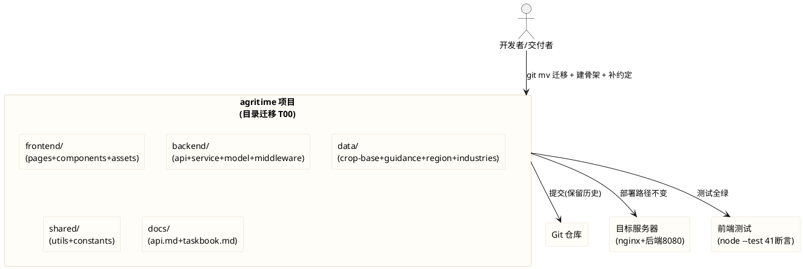
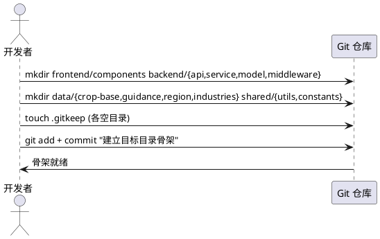
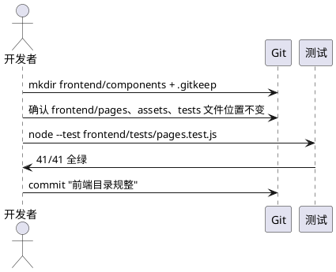
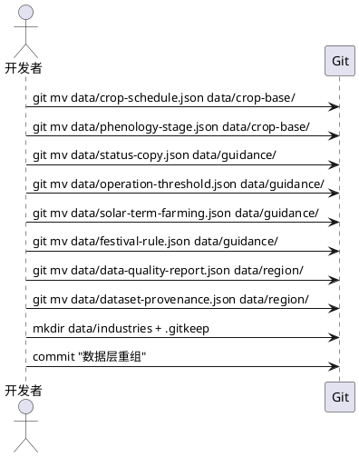

# T00 基建与目录规整（t00_directory_migration）

> 本文档用于规范 agritime（知农时 · 会看天的农事日历）功能扩展任务书 V3.0 中任务编号 T00 的验收标准：完成现有代码的目录迁移，统一命名规范与接口协议；补充全局错误码、数据格式约定；同步更新接口文档。
> 范围红线：本次为**目录迁移与基建规整**任务，涉及全项目目录重组，但须保证（1）前端 41/41 测试全绿、（2）原有 4 个核心接口完全兼容、（3）服务器部署不受影响、（4）不引入框架/构建工具/第三方库、（5）迁移通过 `git mv` 保留文件历史。
> 交付形式：本文档描述**做什么（What）**与**验收标准（Acceptance Criteria）**，不描述技术实现方式（How）；技术架构与代码结构由后续 design 阶段承接。

# **1. 组件定位**

## **1.1 核心职责**
本组件负责对 agritime 项目全量代码与数据进行目录结构迁移与命名规整，建立"前端 / 后端 / 数据 / 共享 / 文档"五层分离的目标目录骨架，并补充全局错误码与数据格式约定，实现项目基建标准化。

## **1.2 核心输入**
1. 现有项目目录结构与文件分布（`contract/`、`data/`、`deploy/`、`docs/`、`frontend/`）。
2. 功能扩展任务书 V3.0 规定的目标目录结构（frontend/backend/data/shared/docs 五层）。
3. 现有 4 个核心接口契约（`GET /api/timeline`、`POST /api/recognition`、`POST /api/chart`、`GET /health`）。
4. 现有前端测试套件 `frontend/tests/pages.test.js`（41 项断言）。
5. 现有服务器部署配置（nginx root `/agritime/frontend/pages`，后端 `/opt/crop-calendar` Java 8080 端口）。

## **1.3 核心输出**
1. 符合目标目录结构的项目骨架（含 `frontend/components/`、`backend/{api,service,model,middleware}/`、`data/{crop-base,guidance,region,industries}/`、`shared/{utils,constants}/`）。
2. 迁移后的全量代码与数据文件（经 `git mv` 保留历史）。
3. 全局错误码定义文件与数据格式约定文件。
4. 更新后的接口文档 `docs/api.md`。
5. 任务书归档文件 `docs/taskbook.md`。

## **1.4 职责边界**
本组件**不负责**以下事项：
1. 后端 Java 服务（`/opt/crop-calendar`，8080）的业务逻辑实现——本次仅在项目内建立 `backend/` 目录骨架，**不实现后端代码**（后端服务独立部署于服务器，本次迁移不触碰服务器上的 Java 工程）。
2. 前端业务功能的新增或修改——本次仅做目录迁移与文件搬运，**不改动前端业务逻辑**（页面交互、渲染、取数逻辑保持不变）。
3. nginx、systemd 等服务器配置的实际修改——属部署运维范围，本次仅保证迁移后部署路径不变。
4. 任何框架、构建工具、第三方库的引入——**明确禁止**。
5. 前端测试断言的删除或弱化——**明确禁止**为通过迁移而修改测试预期。

# **2. 领域术语**

**目录迁移（Directory Migration）**
: 将项目内文件从现有目录结构搬运至目标目录结构的过程，须通过 `git mv` 执行以保留文件变更历史。

**目标目录结构（Target Directory Structure）**
: 功能扩展任务书 V3.0 规定的五层分离目录骨架：`frontend/`（前端）、`backend/`（后端）、`data/`（数据）、`shared/`（共享）、`docs/`（文档）。

**契约层（Contract Layer）**
: 现有 `contract/` 目录下的接口契约文件集合（api-contract.json、compute-contract.json、data-contract.json、openapi.yaml、validate-contracts.js、changelog.md），定义前后端接口协议。

**数据层重组（Data Layer Reorganization）**
: 将 `data/` 目录下散落的 JSON 数据文件按业务语义归入 `crop-base/`（作物基础库）、`guidance/`（农事指导规则库）、`region/`（地理与环境数据）、`industries/`（扩展品类预留）四个子目录。

**全局错误码（Global Error Codes）**
: 在 `shared/constants/` 下统一定义的、全项目共用的错误码枚举，用于所有接口返回与前端降级提示的一致性。

**数据格式约定（Data Format Convention）**
: 在 `shared/constants/` 下统一定义的、前后端共用的数据字段格式规范（日期格式、坐标格式、枚举取值等）。

**核心接口（Core Interfaces）**
: 现有 4 个须保持兼容的接口：`GET /api/timeline`（时间线）、`POST /api/recognition`（拍照识别）、`POST /api/chart`（图表数据）、`GET /health`（健康检查）。

**git mv 迁移**
: 使用 git 原生 `mv` 命令执行文件移动，使 git 识别为重命名而非删除+新增，从而在 `git log --follow` 中保留文件完整历史。

**EARS 需求编号约定**
: 本文档需求编号格式为 `REQ-TDM-XXX-NNN`，`TDM` 为 Task Directory Migration 缩写。前缀对应 EARS 句型：UBI（Ubiquitous，通用）、EVT（Event-driven，事件驱动）、STA（State-driven，状态驱动）、OPT（Optional，可选/带前提）、UNW（Unwanted，非期望行为）。

# **3. 角色与边界**

## **3.1 核心角色**
- **开发者 / 交付者**：执行目录迁移、建立目标骨架、补充错误码与数据格式约定、更新接口文档，并提交 Git。
- **测试维护者**：运行 `node --test frontend/tests/pages.test.js`，确认迁移后 41 项断言全绿。
- **部署运维者**：确认迁移后服务器部署路径（nginx root、后端目录）不受影响。

## **3.2 外部系统**
- **Git 仓库（lj-tang/agritime）**：迁移须经 `git mv` 提交，保留文件历史。
- **目标服务器（115.175.44.27 的 /agritime）**：部署目标，迁移后 nginx root `/agritime/frontend/pages` 须仍能正确指向前端页面。
- **后端 Java 服务（/opt/crop-calendar，8080）**：独立部署于服务器，本次迁移**不触碰**该工程；项目内 `backend/` 目录仅为骨架预留。
- **前端测试运行时（node --test）**：迁移后须能正常执行 `frontend/tests/pages.test.js` 且 41 项断言全绿。

## **3.3 交互上下文**

# **4. DFX约束**

## **4.1 性能**
1. 目录迁移为一次性操作，无运行时性能指标。
2. 迁移后项目目录层级深度须合理（根目录到任一文件不超过 4 层），避免过深嵌套影响可维护性。

## **4.2 可靠性**
1. 迁移过程中须保证无文件丢失：迁移前后文件总数一致（除新增骨架目录的 .gitkeep 外）。
2. 迁移后须保证无文件内容篡改：除文件路径变更外，文件内容须与迁移前逐字节一致（接口文档、错误码、数据格式约定等**新增文件**除外）。
3. 迁移须可回滚：若迁移导致测试失败或部署异常，须能通过 `git revert` 回退至迁移前状态。

## **4.3 安全性**
1. 迁移不得引入任何敏感信息（API Key、令牌、凭据）到新增的错误码或数据格式约定文件中。
2. 新增的接口文档不得回显真实密钥或服务器内部路径细节。

## **4.4 可维护性**
1. 目标目录结构须与功能扩展任务书 V3.0 完全一致，不得自行增删顶层目录。
2. 每个新建的空目录（如 `backend/middleware/`、`data/industries/`）须放置 `.gitkeep` 文件以纳入 git 跟踪。
3. 全局错误码与数据格式约定须以具名常量集中定义于 `shared/constants/`，不得散落多处。

## **4.5 兼容性**
1. **前端测试兼容（强制红线）**：迁移后 `node --test frontend/tests/pages.test.js` 须 41/41 全绿，不得因路径变更导致测试失败。
2. **接口兼容（强制红线）**：原有 4 个核心接口（`GET /api/timeline`、`POST /api/recognition`、`POST /api/chart`、`GET /health`）的路径、方法、参数、返回结构须保持完全兼容。
3. **部署兼容（强制红线）**：nginx root `/agritime/frontend/pages` 须仍能正确指向前端页面目录；后端 `/opt/crop-calendar` 不受影响。
4. **git 历史兼容**：所有迁移文件须经 `git mv` 执行，`git log --follow <新路径>` 须能查到迁移前的提交历史。
5. **无构建工具**：不得引入任何框架、构建工具、打包器或第三方库。

# **5. 核心能力**

## **5.1 目标目录骨架建立**

### **5.1.1 业务规则**

1. **REQ-TDM-UBI-001（Ubiquitous）**：系统须在项目根目录下建立符合功能扩展任务书 V3.0 的五层目录骨架：`frontend/`、`backend/`、`data/`、`shared/`、`docs/`。
   a. 验收条件：[迁移完成后审查根目录] → [存在 frontend/、backend/、data/、shared/、docs/ 五个顶层目录，无散落的非目标顶层目录]

2. **REQ-TDM-UBI-002（Ubiquitous）**：系统须在 `frontend/` 下建立 `pages/`、`components/`、`assets/` 三个子目录。
   a. 验收条件：[审查 frontend/ 目录] → [存在 pages/、components/、assets/ 子目录]

3. **REQ-TDM-UBI-003（Ubiquitous）**：系统须在 `backend/` 下建立 `api/`、`service/`、`model/`、`middleware/` 四个子目录。
   a. 验收条件：[审查 backend/ 目录] → [存在 api/、service/、model/、middleware/ 子目录]

4. **REQ-TDM-UBI-004（Ubiquitous）**：系统须在 `data/` 下建立 `crop-base/`、`guidance/`、`region/`、`industries/` 四个子目录。
   a. 验收条件：[审查 data/ 目录] → [存在 crop-base/、guidance/、region/、industries/ 子目录]

5. **REQ-TDM-UBI-005（Ubiquitous）**：系统须在 `shared/` 下建立 `utils/`、`constants/` 两个子目录。
   a. 验收条件：[审查 shared/ 目录] → [存在 utils/、constants/ 子目录]

6. **REQ-TDM-UBI-006（Ubiquitous）**：系统须为每个新建的空目录放置 `.gitkeep` 文件，使其纳入 git 跟踪。
   a. 验收条件：[审查所有新建空目录] → [每个空目录下存在 .gitkeep 文件]

7. **禁止项**：禁止自行增删目标目录结构之外的顶层目录；禁止在 `data/industries/` 下放置实际数据文件（该目录为预留，仅含 .gitkeep）。
   a. 验收条件：[审查目录结构] → [顶层目录恰为五层目标，industries/ 仅含 .gitkeep]

### **5.1.2 交互流程**

### **5.1.3 异常场景**

1. **目录已存在**
   a. 触发条件：目标子目录在迁移前已部分存在
   b. 系统行为：保留既有内容，仅补充缺失的子目录与 .gitkeep
   c. 用户感知：无冲突报错，目录结构最终符合目标

## **5.2 前端代码迁移**

### **5.2.1 业务规则**

1. **REQ-TDM-UBI-007（Ubiquitous）**：系统须保持 `frontend/pages/` 下现有文件（index.html、timeline.html、photo-capture.js）位置不变，通过 `git mv` 确认其归属（若已在此目录则无需移动）。
   a. 验收条件：[迁移后审查 frontend/pages/] → [index.html、timeline.html、photo-capture.js 仍在 frontend/pages/ 下]

2. **REQ-TDM-UBI-008（Ubiquitous）**：系统须保持 `frontend/assets/` 下现有子目录（css/、img/、js/、mock/）结构不变，各文件位置不变。
   a. 验收条件：[迁移后审查 frontend/assets/] → [css/、img/、js/、mock/ 子目录及其文件位置不变]

3. **REQ-TDM-UBI-009（Ubiquitous）**：系统须保持 `frontend/tests/` 下现有测试文件（pages.test.js）位置不变。
   a. 验收条件：[迁移后审查 frontend/tests/] → [pages.test.js 仍在 frontend/tests/ 下]

4. **REQ-TDM-UBI-010（Ubiquitous）**：系统须新建 `frontend/components/` 目录用于存放公共组件，并放置 `.gitkeep`（当前无公共组件文件需迁入，仅建目录预留）。
   a. 验收条件：[迁移后审查 frontend/components/] → [目录存在且含 .gitkeep]

5. **REQ-TDM-UBI-011（Ubiquitous）**：迁移后前端测试须 41/41 全绿，运行命令 `node --test frontend/tests/pages.test.js`。
   a. 验收条件：[迁移后运行 node --test frontend/tests/pages.test.js] → [41 项断言全部通过，无失败]

6. **禁止项**：禁止改动前端业务逻辑代码（index.html、timeline.html、photo-capture.js、timeline-logic.js、history-store.js、chart-client.js、crop-map.js、mock-data.js、common.css、timeline.css、pages.test.js 的**内容**）；禁止将前端文件迁出 `frontend/` 目录。
   a. 验收条件：[git diff 审查] → [前端文件内容无修改，仅路径可能变更；所有前端文件均在 frontend/ 下]

### **5.2.2 交互流程**

### **5.2.3 异常场景**

1. **迁移后测试失败**
   a. 触发条件：目录迁移导致测试文件引用路径断裂
   b. 系统行为：回退迁移，排查路径引用，修正后重新迁移
   c. 用户感知：最终 41/41 全绿

## **5.3 契约层迁移至共享常量**

### **5.3.1 业务规则**

1. **REQ-TDM-UBI-012（Ubiquitous）**：系统须将 `contract/` 目录下的全部文件通过 `git mv` 迁移至 `shared/constants/` 目录下，保留文件名不变。
   a. 验收条件：[迁移后审查] → [shared/constants/ 下存在 api-contract.json、compute-contract.json、data-contract.json、openapi.yaml、validate-contracts.js、changelog.md，且 contract/ 目录已删除]

2. **REQ-TDM-UBI-013（Ubiquitous）**：迁移后 `shared/constants/` 下的契约文件内容须与迁移前逐字节一致。
   a. 验收条件：[git diff 审查] → [契约文件仅路径变更，内容无修改]

3. **REQ-TDM-UBI-014（Ubiquitous）**：系统须通过 `git mv` 执行契约文件迁移，使 `git log --follow shared/constants/<文件名>` 能查到迁移前在 `contract/` 下的提交历史。
   a. 验收条件：[运行 git log --follow shared/constants/api-contract.json] → [能查到该文件在 contract/ 时期的提交记录]

4. **禁止项**：禁止以"删除+新增"方式迁移文件（须用 git mv）；禁止迁移过程中修改契约文件内容。
   a. 验收条件：[git status 审查] → [迁移表现为 rename 而非 delete+add]

### **5.3.3 异常场景**

1. **契约文件被其他代码引用**
   a. 触发条件：validate-contracts.js 内部以相对路径引用同目录其他契约文件
   b. 系统行为：相对路径在同目录迁移后不变，无需修改；若存在跨目录引用则须同步更新引用路径
   c. 用户感知：契约校验脚本仍可正常运行

## **5.4 数据层重组**

### **5.4.1 业务规则**

1. **REQ-TDM-UBI-015（Ubiquitous）**：系统须将作物基础数据文件通过 `git mv` 迁移至 `data/crop-base/`：`crop-schedule.json`、`phenology-stage.json`。
   a. 验收条件：[迁移后审查 data/crop-base/] → [存在 crop-schedule.json、phenology-stage.json]

2. **REQ-TDM-UBI-016（Ubiquitous）**：系统须将农事指导规则文件通过 `git mv` 迁移至 `data/guidance/`：`status-copy.json`、`operation-threshold.json`、`solar-term-farming.json`、`festival-rule.json`。
   a. 验收条件：[迁移后审查 data/guidance/] → [存在 status-copy.json、operation-threshold.json、solar-term-farming.json、festival-rule.json]

3. **REQ-TDM-UBI-017（Ubiquitous）**：系统须将地理与环境数据文件通过 `git mv` 迁移至 `data/region/`：`data-quality-report.json`、`dataset-provenance.json`。
   a. 验收条件：[迁移后审查 data/region/] → [存在 data-quality-report.json、dataset-provenance.json]

4. **REQ-TDM-UBI-018（Ubiquitous）**：系统须将 `data/enums/` 目录通过 `git mv` 迁移至 `data/enums/`（若 enums 属公共枚举，亦可迁至 `shared/constants/enums/`；本次采取保留在 `data/enums/` 的策略，因其属数据范畴）。
   a. 验收条件：[迁移后审查] → [data/enums/ 目录存在且含 common-enums.json]

5. **REQ-TDM-UBI-019（Ubiquitous）**：系统须将 `data/schema/` 目录保留在 `data/schema/`（schema 属数据校验定义，保留原位）。
   a. 验收条件：[迁移后审查] → [data/schema/ 目录存在且含全部 7 个 schema 文件]

6. **REQ-TDM-UBI-020（Ubiquitous）**：系统须新建 `data/industries/` 目录并放置 `.gitkeep`，不在其中放置实际数据文件（预留扩展品类）。
   a. 验收条件：[迁移后审查 data/industries/] → [仅含 .gitkeep，无数据文件]

7. **REQ-TDM-UBI-021（Ubiquitous）**：迁移后 `data/` 根目录下不得残留散落数据文件（所有 JSON 数据文件须已归入对应子目录）。
   a. 验收条件：[审查 data/ 根目录] → [仅含子目录（crop-base/、guidance/、region/、industries/、enums/、schema/），无散落 .json 文件]

8. **REQ-TDM-UBI-022（Ubiquitous）**：迁移后数据文件内容须与迁移前逐字节一致。
   a. 验收条件：[git diff 审查] → [数据文件仅路径变更，内容无修改]

9. **禁止项**：禁止以非 `git mv` 方式迁移数据文件；禁止在迁移过程中修改数据文件内容；禁止在 `data/industries/` 放置实际数据。
   a. 验收条件：[git status 审查] → [迁移表现为 rename；data/industries/ 仅含 .gitkeep]

### **5.4.2 交互流程**

### **5.4.3 异常场景**

1. **数据文件被后端或脚本以路径引用**
   a. 触发条件：后端服务或校验脚本以硬编码路径引用 data/ 下文件
   b. 系统行为：后端服务独立部署于服务器（/opt/crop-calendar），不引用项目内 data/ 路径；项目内校验脚本（validate-contracts.js）引用 contract/ 而非 data/，故无影响
   c. 用户感知：数据重组不影响后端运行与契约校验

## **5.5 共享逻辑层建立**

### **5.5.1 业务规则**

1. **REQ-TDM-UBI-023（Ubiquitous）**：系统须新建 `shared/utils/` 目录并放置 `.gitkeep`，用于存放多端共享的通用工具函数（当前无既有文件需迁入，仅建目录预留）。
   a. 验收条件：[迁移后审查 shared/utils/] → [目录存在且含 .gitkeep]

2. **REQ-TDM-UBI-024（Ubiquitous）**：系统须确保 `shared/constants/` 目录已建立（由 5.3 契约层迁移完成），用于存放全局常量与数据协议。
   a. 验收条件：[审查 shared/constants/] → [存在契约文件及后续新增的错误码、数据格式约定文件]

3. **禁止项**：禁止在 `shared/utils/` 放置与前端业务耦合的工具函数（须为多端通用）。
   a. 验收条件：[代码审查] → [shared/utils/ 仅含通用工具，无前端专属逻辑]

## **5.6 全局错误码定义**

### **5.6.1 业务规则**

1. **REQ-TDM-UBI-025（Ubiquitous）**：系统须在 `shared/constants/` 下新建全局错误码定义文件（如 `error-codes.json` 或 `error-codes.js`），统一定义全项目共用的错误码枚举。
   a. 验收条件：[审查 shared/constants/] → [存在 error-codes 定义文件，含错误码枚举]

2. **REQ-TDM-UBI-026（Ubiquitous）**：全局错误码须覆盖以下类别：成功（0/200）、客户端请求错误（4xx 系列：参数校验失败、资源不存在、方法不允许等）、服务端错误（5xx 系列：内部异常、上游服务不可用、超时等）。
   a. 验收条件：[审查错误码定义] → [覆盖成功、4xx 客户端错误、5xx 服务端错误类别，每项含错误码、错误名、描述]

3. **REQ-TDM-UBI-027（Ubiquitous）**：每个错误码定义须包含：错误码（code）、错误名称（name）、用户可读描述（message）、HTTP 状态码映射（httpStatus）。
   a. 验收条件：[审查每个错误码条目] → [含 code、name、message、httpStatus 四个字段]

4. **REQ-TDM-UBI-028（Ubiquitous）**：全局错误码须与原有 4 个核心接口的既有错误返回兼容，不得改变既有接口的错误码语义。
   a. 验收条件：[对比迁移前后接口错误返回] → [既有错误码语义不变，新增错误码不与既有冲突]

5. **禁止项**：禁止将错误码硬编码散落于多个文件；禁止在错误码定义中包含敏感信息。
   a. 验收条件：[代码审查] → [错误码集中定义于 shared/constants/，无散落，无敏感信息]

### **5.6.3 异常场景**

1. **错误码与既有接口冲突**
   a. 触发条件：新增错误码与既有接口返回的错误码数值重复
   b. 系统行为：调整新增错误码取值，避开既有码段
   c. 用户感知：既有接口错误返回不变

## **5.7 数据格式约定**

### **5.7.1 业务规则**

1. **REQ-TDM-UBI-029（Ubiquitous）**：系统须在 `shared/constants/` 下新建数据格式约定文件（如 `data-format.json` 或 `data-format.js`），统一定义前后端共用的数据字段格式规范。
   a. 验收条件：[审查 shared/constants/] → [存在 data-format 定义文件]

2. **REQ-TDM-UBI-030（Ubiquitous）**：数据格式约定须覆盖以下字段格式：日期格式（`YYYY-MM-DD`）、日期时间格式（ISO 8601）、经纬度格式（数值标量，lat 范围 [-90,90]、lon 范围 [-180,180]）、作物标识 cropId 枚举（dry_garlic、wheat_winter、corn_summer、rice、soybean）、状态枚举（green/yellow/red）。
   a. 验收条件：[审查数据格式约定] → [覆盖日期、经纬度、cropId 枚举、状态枚举等字段格式定义]

3. **REQ-TDM-UBI-031（Ubiquitous）**：数据格式约定须与原有接口契约（现迁移至 `shared/constants/` 下的 api-contract.json、openapi.yaml）保持一致，不得矛盾。
   a. 验收条件：[对比数据格式约定与 api-contract.json/openapi.yaml] → [字段格式定义一致，无矛盾]

4. **禁止项**：禁止在数据格式约定中引入与既有契约冲突的格式定义；禁止包含敏感信息。
   a. 验收条件：[代码审查] → [格式约定与契约一致，无敏感信息]

## **5.8 接口文档更新**

### **5.8.1 业务规则**

1. **REQ-TDM-UBI-032（Ubiquitous）**：系统须在 `docs/` 下新建接口文档 `docs/api.md`，描述原有 4 个核心接口的路径、方法、请求参数、响应结构、错误码与示例。
   a. 验收条件：[审查 docs/api.md] → [包含 GET /api/timeline、POST /api/recognition、POST /api/chart、GET /health 四个接口的完整文档]

2. **REQ-TDM-UBI-033（Ubiquitous）**：接口文档须明确每个接口的请求参数名、类型、是否必填、取值范围，与既有契约（shared/constants/openapi.yaml）保持一致。
   a. 验收条件：[对比 docs/api.md 与 shared/constants/openapi.yaml] → [参数定义一致]

3. **REQ-TDM-UBI-034（Ubiquitous）**：接口文档须为每个接口标注其使用的错误码（引用 `shared/constants/` 下的全局错误码定义），保证错误码与返回格式一致。
   a. 验收条件：[审查 docs/api.md 各接口错误码部分] → [引用全局错误码定义，无自行编造的错误码]

4. **REQ-TDM-UBI-035（Ubiquitous）**：接口文档须说明新增接口统一遵循 REST 规范（资源命名用名词复数、HTTP 方法语义化、错误返回统一 JSON 结构 `{code, message, data}`）。
   a. 验收条件：[审查 docs/api.md] → [包含 REST 规范说明与统一返回格式约定]

5. **禁止项**：禁止在接口文档中回显真实密钥或服务器内部路径；禁止文档与契约文件矛盾。
   a. 验收条件：[审阅 docs/api.md] → [无敏感信息，与契约一致]

## **5.9 任务书归档**

### **5.9.1 业务规则**

1. **REQ-TDM-UBI-036（Ubiquitous）**：系统须在 `docs/` 下新建（或更新）`docs/taskbook.md`，归档功能扩展任务书 V3.0 的内容（含任务编号 T00、目标目录结构、验收标准）。
   a. 验收条件：[审查 docs/taskbook.md] → [包含任务书 V3.0 的 T00 任务描述、目标目录结构与验收标准]

2. **禁止项**：禁止在任务书归档中篡改任务书原始内容。
   a. 验收条件：[对比 docs/taskbook.md 与任务书原文] → [内容一致]

## **5.10 接口兼容性保障**

### **5.10.1 业务规则**

1. **REQ-TDM-UBI-037（Ubiquitous）**：迁移后原有 4 个核心接口（`GET /api/timeline`、`POST /api/recognition`、`POST /api/chart`、`GET /health`）的路径、HTTP 方法、请求参数、响应结构须保持完全兼容。
   a. 验收条件：[迁移后对比接口契约] → [4 个核心接口定义无变化]

2. **REQ-TDM-UBI-038（Ubiquitous）**：新增接口须统一遵循 REST 规范：资源命名用名词、HTTP 方法语义化（GET 查询、POST 创建、PUT 更新、DELETE 删除）、错误返回统一 JSON 结构 `{code, message, data}`。
   a. 验收条件：[审查新增接口文档] → [符合 REST 规范与统一返回格式]

3. **REQ-TDM-UBI-039（Ubiquitous）**：新增接口的错误码须引用 `shared/constants/` 下的全局错误码定义，不得自行编造。
   a. 验收条件：[审查新增接口错误返回] → [错误码均来自全局定义]

4. **禁止项**：禁止迁移过程中改变既有接口的任何契约要素（路径、方法、参数、返回结构）。
   a. 验收条件：[对比迁移前后契约文件] → [既有接口契约无变化]

## **5.11 部署兼容性保障**

### **5.11.1 业务规则**

1. **REQ-TDM-UBI-040（Ubiquitous）**：迁移后 nginx 配置 `root /agritime/frontend/pages` 须仍能正确指向前端页面目录（即 `frontend/pages/` 目录位置不变）。
   a. 验收条件：[迁移后审查 frontend/pages/] → [index.html、timeline.html 仍在 frontend/pages/ 下，nginx root 路径有效]

2. **REQ-TDM-UBI-041（Ubiquitous）**：迁移不得影响服务器上后端 Java 服务（`/opt/crop-calendar`，8080 端口）的部署与运行。
   a. 验收条件：[迁移审查] → [未触碰 /opt/crop-calendar，后端服务不受影响]

3. **REQ-TDM-UBI-042（Ubiquitous）**：迁移后项目内 `backend/` 目录仅为骨架预留（含 .gitkeep），不包含实际后端代码（后端服务独立部署于服务器）。
   a. 验收条件：[审查 backend/ 各子目录] → [仅含 .gitkeep，无实际后端代码文件]

4. **禁止项**：禁止将前端文件迁出 `frontend/` 导致 nginx root 失效；禁止在项目内 `backend/` 放置实际后端 Java 代码。
   a. 验收条件：[审查] → [前端文件均在 frontend/ 下；backend/ 仅为骨架]

### **5.11.3 异常场景**

1. **迁移后 nginx 404**
   a. 触发条件：前端页面文件被迁出 frontend/pages/
   b. 系统行为：回退迁移，确保 frontend/pages/ 下文件位置不变
   c. 用户感知：服务器访问正常，无 404

## **5.12 git 历史保留**

### **5.12.1 业务规则**

1. **REQ-TDM-UBI-043（Ubiquitous）**：所有文件迁移须通过 `git mv` 执行，使 git 识别为重命名（rename）而非删除+新增。
   a. 验收条件：[git status 审查] → [迁移文件显示为 renamed，非 deleted+added]

2. **REQ-TDM-UBI-044（Ubiquitous）**：迁移后对任一迁移文件执行 `git log --follow <新路径>`，须能查到该文件在迁移前路径下的完整提交历史。
   a. 验收条件：[运行 git log --follow shared/constants/api-contract.json] → [能查到该文件在 contract/ 时期的全部提交记录]

3. **禁止项**：禁止以"删除旧文件 + 新建新文件"方式迁移；禁止迁移过程中修改文件内容（新增文件除外）。
   a. 验收条件：[git diff 审查] → [迁移文件无内容修改，仅路径变更]

## **5.13 无散落文件校验**

### **5.13.1 业务规则**

1. **REQ-TDM-UBI-045（Ubiquitous）**：迁移完成后，项目内所有代码与数据文件须按目标目录结构存放，不得存在散落于非目标位置的文件。
   a. 验收条件：[审查全项目文件分布] → [所有文件均在目标目录结构内，无散落文件]

2. **REQ-TDM-UBI-046（Ubiquitous）**：迁移完成后，`contract/` 目录须已删除（其文件已迁至 `shared/constants/`）。
   a. 验收条件：[审查根目录] → [不存在 contract/ 目录]

3. **REQ-TDM-UBI-047（Ubiquitous）**：迁移完成后，`data/` 根目录下不得残留散落的 .json 数据文件（须已归入 crop-base/、guidance/、region/ 等子目录）。
   a. 验收条件：[审查 data/ 根目录] → [仅含子目录，无散落 .json 文件]

4. **禁止项**：禁止在目标目录结构之外保留任何代码或数据文件（.git/、.codeartsdoer/ 等元数据目录除外）。
   a. 验收条件：[审查根目录] → [仅含 frontend/、backend/、data/、shared/、docs/、deploy/ 及元数据目录]

## **5.14 可运行性与测试**

### **5.14.1 业务规则**

1. **REQ-TDM-UBI-048（Ubiquitous）**：迁移完成后前端测试须全部通过，运行命令 `node --test frontend/tests/pages.test.js`，41 项断言全绿。
   a. 验收条件：[迁移后运行 node --test frontend/tests/pages.test.js] → [41 项断言全部通过，无失败]

2. **REQ-TDM-UBI-049（Ubiquitous）**：迁移完成后契约校验脚本（若存在）须仍能正常运行，运行命令 `node shared/constants/validate-contracts.js`（路径随契约迁移更新）。
   a. 验收条件：[迁移后运行 node shared/constants/validate-contracts.js] → [脚本正常执行，无路径错误]

3. **禁止项**：禁止为通过测试而删除、注释或弱化既有测试断言；禁止修改测试文件内容以适配路径变更（须通过保持文件位置不变来保证测试通过）。
   a. 验收条件：[git diff 审查 frontend/tests/pages.test.js] → [文件内容无修改]

# **6. 数据约束**

## **6.1 全局错误码对象**
1. **code**：错误码，整数，全局唯一，成功为 0，4xx 客户端错误为 400-499，5xx 服务端错误为 500-599。
2. **name**：错误名称，非空字符串，大写下划线格式（如 `PARAM_INVALID`）。
3. **message**：用户可读描述，非空字符串，中文文案。
4. **httpStatus**：对应的 HTTP 状态码，整数，取值 200/400/401/403/404/405/500/502/503/504 等。

## **6.2 数据格式约定对象**
1. **dateFormat**：日期格式，字符串，固定为 `YYYY-MM-DD`。
2. **dateTimeFormat**：日期时间格式，字符串，固定为 ISO 8601（如 `YYYY-MM-DDTHH:mm:ssZ`）。
3. **latitudeRange**：纬度取值范围，数值区间 [-90, 90]。
4. **longitudeRange**：经度取值范围，数值区间 [-180, 180]。
5. **cropIdEnum**：作物标识枚举，数组，取值恰为 `["dry_garlic", "wheat_winter", "corn_summer", "rice", "soybean"]`。
6. **statusEnum**：状态枚举，数组，取值 `["green", "yellow", "red"]`，分别表示适宜/谨慎/不宜。

## **6.3 接口统一返回格式**
1. **code**：错误码，整数，引用全局错误码定义。
2. **message**：错误或成功消息，字符串。
3. **data**：业务数据对象，成功时为实际数据，失败时为 null。

## **6.4 目录迁移映射对象**
1. **源路径**：迁移前文件相对路径，非空字符串。
2. **目标路径**：迁移后文件相对路径，非空字符串。
3. **迁移方式**：固定为 `git mv`。
4. **内容变更**：布尔值，迁移文件须为 false（仅新增文件为 true）。

# **7. 需求归类与交付边界**

> 本章明确区分"目录迁移操作（允许且必须）"、"新增文件（允许）"、"不触碰项"与"排除项"。

## **7.1 目录迁移操作（允许且必须，经 git mv）**
1. `contract/` 全部文件 → `shared/constants/`（6 个文件：api-contract.json、compute-contract.json、data-contract.json、openapi.yaml、validate-contracts.js、changelog.md）。—— 对应 REQ-TDM-UBI-012~014。
2. `data/crop-schedule.json`、`data/phenology-stage.json` → `data/crop-base/`。—— 对应 REQ-TDM-UBI-015。
3. `data/status-copy.json`、`data/operation-threshold.json`、`data/solar-term-farming.json`、`data/festival-rule.json` → `data/guidance/`。—— 对应 REQ-TDM-UBI-016。
4. `data/data-quality-report.json`、`data/dataset-provenance.json` → `data/region/`。—— 对应 REQ-TDM-UBI-017。
5. `data/enums/`、`data/schema/` 保留原位（属数据范畴）。—— 对应 REQ-TDM-UBI-018、UBI-019。

## **7.2 新建目录与文件（允许）**
1. `frontend/components/` + `.gitkeep`。—— 对应 REQ-TDM-UBI-010。
2. `backend/api/`、`backend/service/`、`backend/model/`、`backend/middleware/` 各含 `.gitkeep`。—— 对应 REQ-TDM-UBI-003。
3. `data/industries/` + `.gitkeep`。—— 对应 REQ-TDM-UBI-020。
4. `shared/utils/` + `.gitkeep`。—— 对应 REQ-TDM-UBI-023。
5. `shared/constants/error-codes.json`（或 .js）：全局错误码定义。—— 对应 REQ-TDM-UBI-025~028。
6. `shared/constants/data-format.json`（或 .js）：数据格式约定。—— 对应 REQ-TDM-UBI-029~031。
7. `docs/api.md`：接口文档。—— 对应 REQ-TDM-UBI-032~035。
8. `docs/taskbook.md`：任务书归档。—— 对应 REQ-TDM-UBI-036。

## **7.3 不触碰项（保持不变）**
1. `frontend/pages/` 下文件（index.html、timeline.html、photo-capture.js）：位置与内容不变。—— 对应 REQ-TDM-UBI-007。
2. `frontend/assets/` 下全部文件（css/、img/、js/、mock/）：位置与内容不变。—— 对应 REQ-TDM-UBI-008。
3. `frontend/tests/pages.test.js`：位置与内容不变，41/41 全绿。—— 对应 REQ-TDM-UBI-009、UBI-048。
4. `deploy/` 目录及文件：位置与内容不变（部署配置不纳入本次迁移）。
5. `docs/` 下既有文件（acceptance.md、architecture.svg、data-sources.md、demo-record/、demo-script.md）：位置与内容不变。
6. 服务器后端 Java 服务（`/opt/crop-calendar`，8080）：不触碰。—— 对应 REQ-TDM-UBI-041。
7. nginx 配置：不修改（迁移后 frontend/pages/ 位置不变，root 仍有效）。—— 对应 REQ-TDM-UBI-040。

## **7.4 排除项**
1. 后端 Java 代码的实现：本次仅在项目内建立 `backend/` 骨架，**不实现后端代码**。
2. 前端业务功能的新增或修改：本次仅做目录迁移，**不改动前端业务逻辑**。
3. 框架/构建工具/第三方库的引入：**明确禁止**。
4. 服务器配置（nginx、systemd）的实际修改：**明确禁止**，仅保证部署路径兼容。
5. `data/industries/` 下放置实际数据：**明确禁止**（仅预留目录）。

## **7.5 交付任务**
1. **Git 提交**：迁移完成后须提交并推送至 GitHub 仓库 `lj-tang/agritime`，提交信息须体现 T00 任务编号。
2. **服务器同步**：修改后的项目须能同步至目标服务器 115.175.44.27 的 `/agritime`，且 nginx root 路径仍有效。
3. **测试验证**：交付前须运行 `node --test frontend/tests/pages.test.js` 确认 41/41 全绿。