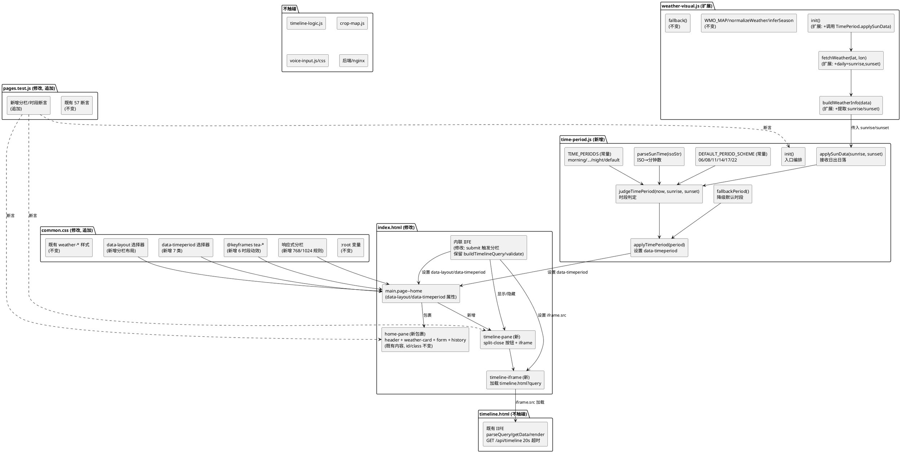
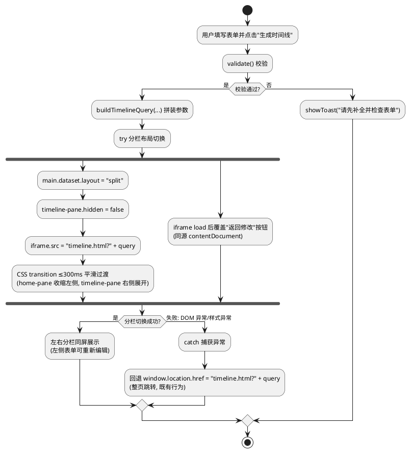
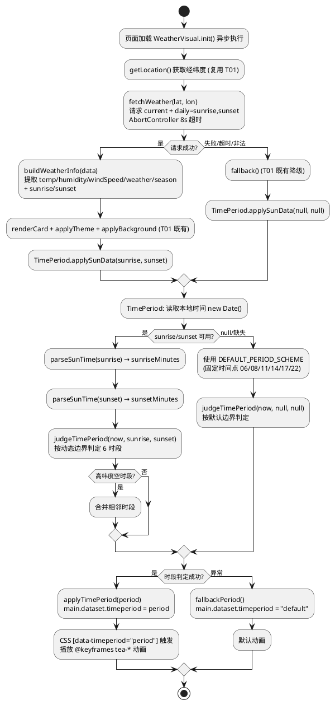
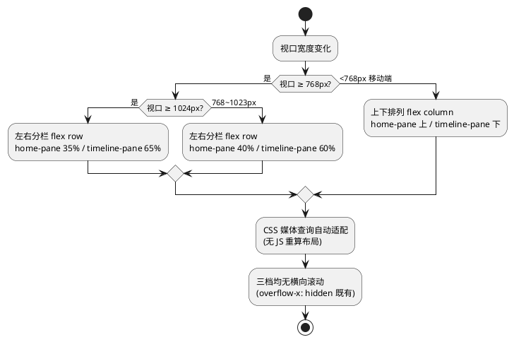
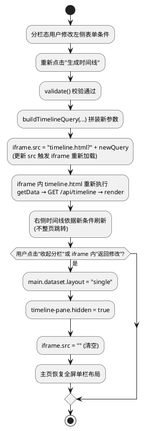
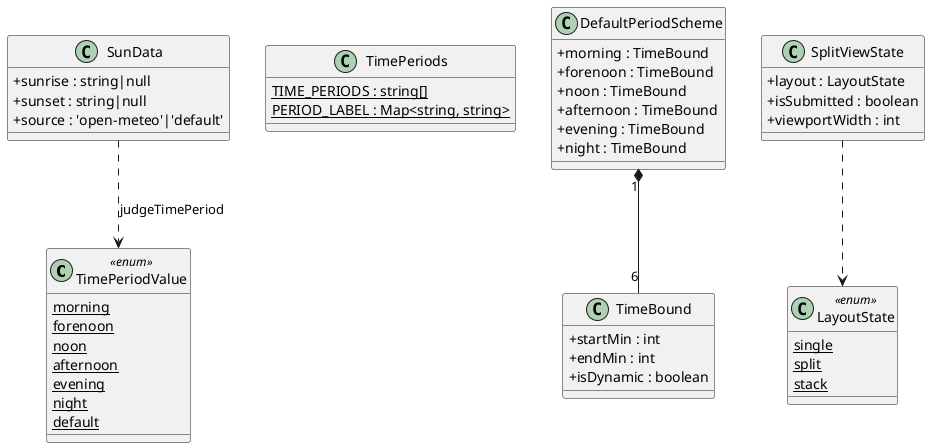

# T01 主页动画效果修改优化 · 技术设计（t01_enhance_animation）

> 本方案基于 `t01_enhance_animation/spec.md`（REQ-TEA-UBI/EVT/STA/OPT/UNW-001 ~ 040，共 40 条 EARS 需求）生成。
> 设计范围：**纯前端动画与布局优化**，仅修改 `frontend/` 目录下文件，不触碰后端/nginx/shared/data/deploy/docs。
> 强约束（红线）：
> 1. 前端 57/57 既有测试全绿（`node --test frontend/tests/pages.test.js`），仅允许新增断言；
> 2. 不引入框架/构建工具/第三方库（含动画库 GSAP/Lottie/Anime.js）；
> 3. 不修改后端（Java/8080）与 nginx 配置；
> 4. 不改变现有设计语言与色彩体系，复用既有 CSS 变量（`--leaf`/`--sun`/`--rain`/`--paper` 等）；
> 5. 时段判断失败时使用默认动画，不白屏不报错；
> 6. 日出日落时间根据地点动态计算（Open-Meteo API `daily=sunrise,sunset`），不硬编码；
> 7. 左右分栏布局须响应式适配（移动端上下排列）；
> 8. 不改变既有表单字段（crop/sowingDate/location）id/name 与 `validate()` 校验逻辑与 `buildTimelineQuery()` 参数拼装；
> 9. 不改变 timeline.html 既有时间线渲染逻辑与 `GET /api/timeline` 取数方式（参数/超时 20s/降级）；
> 10. 不改变 weather-visual.js 既有 `WMO_MAP` weathercode 归一化、`inferSeason` 季节推断与 `fallback()` 降级机制；
> 11. 不改变既有语音组件（T08 voice-input.js/voice-input.css）；
> 12. `crop-map.js` 5 个 cropId 不变，`mock-data.js` 保持 null 占位不造假。
> 全局约束继承自 `stage2_frontend`（60 条）、`t00_directory_migration`（49 条）、`t01_weather_visual`（42 条）与 `t08_t10_voice_security`（58 条）：纯原生 JS + 原生 CSS、前端测试断言不可弱化、时间线页天气数据经后端 `GET /api/timeline` 获取、主页天气视觉（T01）已落地、语音组件（T08）已落地。

# 一、需求与存量功能关系分析

## 1.1 需求功能与存量功能对比

### 1.1.1 已实现功能

> 已实现功能是指需求与存量代码完全匹配或高度相似、可直接复用或仅需少量叠加的部分。

| 需/求功能 | 存量功能 | 代码位置 | 匹配度 |
|---------|---------|---------|--------|
| 主页表单提交触发逻辑（REQ-TEA-EVT-001 分栏触发基准） | `index.html` 表单 submit 事件已调用 `validate()` 校验通过后执行跳转 | `frontend/pages/index.html:403-420` | 100%（submit 事件与 validate() 已就绪，分栏切换在此事件内触发即可） |
| `buildTimelineQuery` 参数拼装（REQ-TEA-UBI-036 参数不变） | `index.html` 已有 `buildTimelineQuery(opts)` 用 `URLSearchParams` 拼装 crop/sowDate/lat/lon/location | `frontend/pages/index.html:393-401` | 100%（函数保留不变，分栏 iframe.src 复用此函数输出） |
| 天气卡 DOM 与 data-weather/data-season 属性（REQ-TEA-UBI-022/023 时段动画叠加基准） | `index.html` 已有 `<div class="weather-card" data-weather="default" data-season="auto">` 与 `weather-bg-layer` | `frontend/pages/index.html:25-31` | 100%（T01 已落地，时段动画在其上叠加 data-timeperiod 属性） |
| weather-visual.js 天气数据获取与归一化（REQ-TEA-UBI-038 不改变归一化） | `weather-visual.js` 已有 `WMO_MAP`/`normalizeWeather`/`inferSeason`/`fetchWeather`/`buildWeatherInfo`/`fallback`/`init` | `frontend/assets/js/weather-visual.js:15-164` | 100%（既有逻辑不改变，日出日落为增量叠加） |
| Open-Meteo 请求机制与 8s 超时（REQ-TEA-EVT-014/4.1.3 复用请求） | `weather-visual.js` 已有 `fetchWeather(lat, lon)` 含 `AbortController` + `REQUEST_TIMEOUT_MS=8000` | `frontend/assets/js/weather-visual.js:56-76` | 75%（请求机制已就绪，但当前参数未含 `daily=sunrise,sunset`，需追加） |
| 浏览器地理定位获取经纬度（REQ-TEA-UBI-013 日出日落需经纬度） | `weather-visual.js` 已有 `getLocation()` 调用 `navigator.geolocation.getCurrentPosition` | `frontend/assets/js/weather-visual.js:45-54` | 100%（定位逻辑复用，不为日出日落单独发起冗余定位） |
| `prefers-reduced-motion` 全局禁用动画（REQ-TEA-STA-024/027） | `common.css` 已有 `@media (prefers-reduced-motion: reduce) { *, *::before, *::after { animation: none !important; transition: none !important; } }` | `frontend/assets/css/common.css:289-291` | 100%（全局规则已覆盖，新增时段动画自动被禁用） |
| 响应式 768/1024 断点（REQ-TEA-UBI-008~011 断点一致） | `common.css` 已有 `@media (min-width: 768px)` 与 `@media (min-width: 1024px)` 断点 | `frontend/assets/css/common.css:424-431` | 75%（断点已存在，分栏布局规则需追加到此两断点内） |
| `overflow-x: hidden`/`max-width: 100%` 防溢出（REQ-TEA-UBI-008/009 无横向滚动） | `common.css` 已有 `html, body { max-width: 100%; overflow-x: hidden; }` | `frontend/assets/css/common.css:25-30` | 100%（防溢出已就绪，分栏布局不引入横向溢出） |
| CSS 变量主题色体系（REQ-TEA-UBI-020 复用既有变量） | `common.css` `:root` 已定义 `--leaf`/`--leaf-2`/`--leaf-soft`/`--sun`/`--sun-soft`/`--rain`/`--paper`/`--card` 等变量 | `frontend/assets/css/common.css:1-21` | 100%（时段动画复用既有变量，不引入新色彩体系） |
| 既有天气背景动效机制（REQ-TEA-UBI-021 纯 CSS @keyframes） | `common.css` 已有 `@keyframes weather-sunny/rain/cloudy/snow` + `[data-weather] .weather-bg-layer { animation: ... }` | `frontend/assets/css/common.css:475-483` | 75%（@keyframes 机制已就绪，时段动画新增 6 组 @keyframes 叠加） |
| 测试文件已读取 index.html/common.css/weather-visual.js/SVG（REQ-TEA-UBI-035 测试基座） | `pages.test.js` 已读取 `indexHtml`/`commonCss`/`weatherVisualJs`/5 个 SVG/`voiceInputJs` 等共 57 项断言 | `frontend/tests/pages.test.js:10-27` | 100%（测试基座已就绪，新增断言复用既有 read 变量） |
| timeline.html 独立页面渲染（REQ-TEA-UBI-037 取数方式不变） | `timeline.html` 已有完整 IIFE：parseQuery/buildTimelineUrl/getData/render，`GET /api/timeline` + 20s 超时 + 降级 | `frontend/pages/timeline.html:62-565` | 100%（iframe 内独立加载，渲染逻辑/取数/超时/降级全部不变） |
| URL 参数安全拼装（REQ-TEA 4.3.1 安全性） | `index.html` 已用 `URLSearchParams` 拼装跳转参数 | `frontend/pages/index.html:394-400` | 100%（iframe$iframe.src 复用 buildTimelineQuery 输出，安全拼装不变） |

### 1.1.2 需要扩展的功能

> 需要扩展的功能是指需求与存量代码部分匹配，需在现有基础上改造或叠加的部分。

| 需求功能 | 存量功能 | 差异说明 | 扩展方向 |
|---------|---------|---------|---------|
| 搜索后左右分栏布局（REQ-TEA-EVT-001/005/006） | `index.html` 表单 submit 后 `window.location.href = 'timeline.html?...'` 整页跳转 | 需将整页跳转改为同屏左右分栏：主页收缩左侧、时间线 iframe 右侧展开，CSS transition ≤300ms | 改造 submit 事件：校验通过后触发分栏（设置 data-layout="split" + iframe.src），保留 `window.location.href` 作为降级回退；新增分栏容器 DOM + CSS flex/grid 布局 + transition |
| 主页内容包裹为左侧分栏区域（REQ-TEA-UBI-002 两侧内容可见） | `index.html` main 内 header/weather-card/term-ruler/form/history 为平铺子元素，无统一包裹容器 | 需将既有内容包裹进 `<div class="home-pane">` 以便分栏时作为左侧整体，右侧为 timeline-pane | 在 index.html main 内新增 home-pane 包裹既有内容 + 新增 timeline-pane（含 iframe）；包裹不改变子元素 id/class，既有断言不受影响 |
| Open-Meteo 请求追加日出日落参数（REQ-TEA-EVT-014/UBI-013） | `weather-visual.js` `fetchWeather` 请求参数含 `current=temperature_2m,relative_humidity_2m,weather_code,wind_speed_10m&timezone=auto`，未含 daily | 需追加 `&daily=sunrise,sunset` 参数，响应中 `daily.sunrise[0]`/`daily.sunset[0]` 用于时段边界计算 | 在 `fetchWeather` URL 拼装追加 `&daily=sunrise,sunset`；`buildWeatherInfo` 提取 sunrise/sunset 字段；既有 temperature/humidity/weather_code/wind_speed 参数不变（测试断言不破坏） |
| weather-visual.js init 编排时段动画（REQ-TEA-UBI-022/023 协同） | `weather-visual.js` `init` 获取天气后调用 `renderCard`/`applyTheme`/`applyBackground`，无时段判定 | 需在 init 获取数据后，将 sunrise/sunset 传给 time-period 模块进行时段判定与 data-timeperiod 设置 | init 中 buildWeatherInfo 后调用 `window.TimePeriod && window.TimePeriod.applySunData(info.sunrise, info.sunset)`；既有 renderCard/applyTheme/applyBackground/fallback 不改变 |
| 响应式分栏布局适配（REQ-TEA-UBI-008~011） | `common.css` 768/1024 断点仅调整 `.page` max-width，无分栏规则 | 需在 ≥768px 时左右分栏（flex row），<768px 时上下排列（flex column），三档无横向滚动 | 新增 `[data-layout="split"]` 媒体查询规则：768px+ flex row 左右分栏、<768px flex column 上下排列；复用既有断点不新增 |
| 测试断言扩充（REQ-TEA-UBI-035） | `pages.test.js` 57 项断言无分栏布局/时段动画相关断言 | 需新增分栏 DOM/CSS、data-timeperiod、6 时段 @keyframes、日出日落参数、时段判定函数、降级等断言，不破坏既有 57 项 | 在 `pages.test.js` 末尾新增 test 块，复用既有变量并新增 `timePeriodJs` 变量 |

### 1.1.3 需要新增的功能或接口

> 需要新增的功能是指需求在存量代码中完全没有对应实现的部分，须新建。

**A. 新增 JS 模块：`frontend/assets/js/time-period.js`**

| 功能点 | 输入 | 输出 | 核心逻辑 | 关联需求 |
|--------|------|------|---------|---------|
| 时段判定 | `{ now: Date, sunrise: string|null, sunset: string|null }` | `period`（morning/forenoon/noon/afternoon/evening/night/default） | 依据本地时间与日出日落计算当前时段；日出日落为 null 时用默认时段划分；高纬度极昼/极夜空时段合并相邻 | REQ-TEA-UBI-012/015/018 |
| 默认时段划分常量 | 无 | `DEFAULT_PERIOD_SCHEME` 对象（6 时段固定时间点） | 具名常量集中定义：早晨 06:00~08:00、上午 08:00~11:00、中午 11:00~14:00、下午 14:00~17:00、晚上 17:00~22:00、深夜 22:00%06:00 | REQ-TEA-UBI-016/017 |
| 时段枚举常量 | 无 | `TIME_PERIODS` 数组（morning/forenoon/noon/afternoon/evening/night/default） | 预定义枚举集合，data-timeperiod 属性值域 | REQ-TEA-UBI-022/4.4.2 |
| 日出日落时间解析 | ISO 8601 字符串（如 `2026-10-23T06:12`） | 分钟数（0~1439）或 null | 解析 ISO 8601 提取时分转为分钟数；解析失败返回 null | REQ-TEA-UBI-013 |
| data-timeperiod 属性设置 | `period` 字符串 | 无（设置 DOM 属性） | 在 `main.page--home` 上设置 `data-timeperiod` 属性，CSS 据此切换时段动画 | REQ-TEA-UBI-022 |
| 日出日落数据接入 | `{ sunrise, sunset }` | 无（触发时段判定 + applyTimePeriod） | 接收 weather-visual.js 传入的 sunrise/sunset，读取本地时间，判定时段，设置 data-timeperiod | REQ-TEA-EVT-014/UBI-015 |
| 降级默认时段 | 失败原因 | 无（设置 data-timeperiod="default"） | 日出日落缺失/时段判定异常时回退 default 时段与默认动画，不报错 | REQ-TEA-UNW-016/029 |
| 模块入口 init | 无（页面加载时调用） | 无 | 编排：等待 weather-ready → applySunData；若 weather-visual.js 不可用则独立用默认时段 | REQ-TEA-UBI-012~031 |

**B. 新增 CSS 样式（追加到 `common.css` 末尾）**

| 功能点 | 核心内容 | 关联需求 |
|--------|---------|---------|
| 分栏布局容器样式 | `.home-pane`/`.timeline-pane`/`.timeline-iframe`/`.split-close` 样式 | REQ-TEA-UBI-002/005 |
| data-layout 属性驱动分栏 | `[data-layout="split"] { display: flex; ... }` 左右分栏 flex 布局 | REQ-TEA-EVT-001/UBI-005 |
| 分栏切换 transition | 宽度/位移/透明度 transition ≤300ms | REQ-TEA-UBI-006 |
| data-timeperiod 选择器 | `[data-timeperiod="morning"]` 等 7 类（含 default）选择器 | REQ-TEA-UBI-022 |
| 6 时段 @keyframes 动效 | `@keyframes tea-morning`/`tea-forenoon`/`tea-noon`/`tea-afternoon`/`tea-evening`/`tea-night` 各异动效 | REQ-TEA-UBI-019/021 |
| 时段动效应用选择器 | `[data-timeperiod="morning"] .weather-bg-layer { animation: tea-morning ...; }` 等 6 类 | REQ-TEA-UBI-022/023 |
| 时段切换 transition | 背景层 transition ≤500ms 平滑过渡 | REQ-TEA-EVT-025/UBI-026 |
| 响应式分栏媒体查询 | 768px+ 左右分栏 / <768px 上下排列 / 1024px 宽度比例 | REQ-TEA-UBI-008~011 |
| 分栏态 prefers-reduced-motion | 分栏 transition 禁用 + 时段动画禁用 | REQ-TEA-STA-024/027 |

**C. 新增 DOM 结构（修改 `index.html`）**

| 功能点 | 核心内容 | 关联需求 |
|--------|---------|---------|
| home-pane 包裹容器 | `<div class="home-pane" id="home-pane">` 包裹既有 header/weather-card/term-ruler/form/history | REQ-TEA-UBI-002 |
| timeline-pane 分栏右侧 | `<div class="timeline-pane" id="timeline-pane" hidden>` 含"收起"按钮 + iframe | REQ-TEA-EVT-001/UBI-002 |
| timeline-iframe 时间线载体 | `<iframe class="timeline-iframe" id="timeline-iframe"></iframe>` 加载 timeline.html?query | REQ-TEA-UBI-037 |
| split-close 收起分栏按钮 | `<button class="split-close" id="split-close">收起分栏</button>` 退出分栏恢复单栏 | REQ-TEA-EVT-004 |
| data-layout 属性挂钩 | `main.page--home` 上设置 `data-layout="single"`（默认）/`"split"`（搜索后） | REQ-TEA-EVT-001 |
| data-timeperiod 属性挂钩 | `main.page--home` 上设置 `data-timeperiod="default"`（默认） | REQ-TEA-UBI-022 |
| time-period.js 脚本引入 | `<script src="../assets/js/time-period.js"></script>` | REQ-TEA-UBI-034 |

**D. 新增测试断言（追加到 `pages.test.js`）**

| 断言类别 | 核心内容 | 关联需求 |
|---------|---------|---------|
| 分栏布局 DOM | index.html 含 home-pane/timeline-pane/timeline-iframe/split-close/data-layout | REQ-TEA-EVT-001/UBI-002 |
| 分栏布局 CSS | common.css 含 [data-layout="split"]/.home-pane/.timeline-pane/.timeline-iframe | REQ-TEA-UBI-005/006 |
| data-timeperiod 属性 | common.css 含 [data-timeperiod="morning"] 等 7 选择器 | REQ-TEA-UBI-022 |
| 6 时段 @keyframes | common.css 含 @keyframes tea-morning/tea-forenoon/tea-noon/tea-afternoon/tea-evening/tea-night | REQ-TEA-UBI-019/021 |
| 时段判定函数 | time-period.js 含 judgeTimePeriod/applyTimePeriod/applySunData | REQ-TEA-UBI-012/015/022 |
| 默认时段划分常量 | time-period.js 含 DEFAULT_PERIOD_SCHEME + 06:00/08:00/11:00/14:00/17:00/22:00 | REQ-TEA-UBI-016/017 |
| 时段枚举 | time-period.js 含 TIME_PERIODS + morning/forenoon/noon/afternoon/evening/night/default | REQ-TEA-UBI-022 |
| 日出日落请求参数 | weather-visual.js 含 daily=sunrise,sunset 或 sunrise/sunset | REQ-TEA-EVT-014/UBI-013 |
| 降级机制 | time-period.js 含 fallbackPeriod/default 时段 | REQ-TEA-UNW-016/029 |
| 无第三方库 | time-period.js 不含 import/require 第三方库 | REQ-TEA-UBI-034 |
| 响应式分栏 | common.css 含分栏 768px flex row / <768px flex column 规则 | REQ-TEA-UBI-008/009 |
| 既有 57 断言兼容 | 确认 indexHtml/commonCss/weatherVisualJs 既有断言仍通过 | REQ-TEA-UBI-035 |

## 1.2 存量功能详细分析

### 1.2.1 `index.html` 表单提交与跳转逻辑分析（`frontend/pages/index.html`）

- **DOM 结构**：`<main class="page page--home">`（第 12 行）→ `<header class="brand">`（第 13-23 行）→ `<div class="weather-bg-layer">`（第 25 行）→ `<div class="weather-card">`（第 26-31 行）→ `<div class="term-ruler">`（第 34 行）→ `<form class="card" id="timeline-form">`（第 36-78 行）→ `<div class="history">`（第 80-86 行）。既有内容为 main 的平铺子元素，无统一包裹容器。
- **表单 submit 逻辑**（第 403-420 行）：`form.addEventListener('submit', ...)` → `e.preventDefault()` → `validate()` 校验 → `buildTimelineQuery(...)` 拼装参数 → `window.location.href = 'timeline.html?' + query`（第 413 行，整页跳转）。
- **分栏切换切入点**：在 submit 事件内，`validate()` 通过后，将 `window.location.href = ...` 替换为分栏布局触发逻辑（设置 data-layout="split" + iframe.src = 'timeline.html?' + query）。保留 `window.location.href = ...` 在 catch 分支作为降级回退（REQ-TEA-UNW-007）。
- **既有 buildTimelineQuery**（第 393-401 行）：用 `URLSearchParams` 拼装 crop/sowDate/lat/lon/location，函数保留不变，分栏 iframe.src 复用此函数输出。
- **既有 validate()**（第 281-300 行）：校验 crop/sowingDate/location 三字段，逻辑不变。
- **既有脚本加载顺序**（第 89-94 行）：mock-data.js → crop-map.js → history-store.js → photo-capture.js → weather-visual.js → voice-input.js → 内联 IIFE（第 96-426 行）。新增 time-period.js 须在 weather-visual.js 之后加载（因 time-period.js 依赖 weather-visual.js 传入 sunrise/sunset）。
- **约束**：表单字段 crop/sowingDate/location 的 id/name 不变（REQ-TEA-UBI-036）；validate()/buildTimelineQuery() 逻辑不变（REQ-TEA-UBI-036）；既有 57 断言中第 155-160 行"流程对齐：首页跳转参数链路自洽"断言 indexHtml 含 buildTimelineQuery/sowDate/lat/lon 字符串，包裹 DOM 与分栏改造不删除这些字符串，断言不破坏。

### 1.2.2 `timeline.html` 时间线渲染逻辑分析（`frontend/pages/timeline.html`）

- **DOM 结构**：`<main class="page">`（第 12 行）→ header/timeline-header/loading/mode-switch/timeline/chart/empty-state/footer。
- **内联 IIFE**（第 62-565 行）：`parseQuery`（第 88-104 行）解析 URL 参数 → `buildTimelineUrl`（第 106-113 行）拼装 `/api/timeline?crop&sowDate&lat&lon` → `getData`（第 118-141 行）`fetch` + `AbortController` + 20s 超时 + 降级 `window.MOCK_TIMELINE` → `render`（第 540-562 行）渲染时间线节点。
- **"返回修改"按钮**：第 50 行 `onclick="window.location.href='index.html'"`（empty-state 内）与第 54 行 footer 内同款按钮。
- **iframe 方案兼容性**：timeline.html 作为 iframe.src 独立加载时，其内联 IIFE 正常执行，`parseQuery(window.location.search)` 解析 iframe URL 的 query 参数，`getData` 发起 `GET /api/timeline` 请求，渲染逻辑/取数/超时/降级全部不变（REQ-TEA-UBI-037）。
- **iframe 内"返回修改"按钮处理**：iframe 内 `onclick="window.location.href='index.html'"` 会让 iframe 导航到 index.html（非退出分栏）。方案：index.html 侧在 iframe load 事件后，通过同源 `iframe.contentDocument` 查询返回按钮并覆盖 onclick，改为通知父页面退出分栏（运行时增强，不修改 timeline.html 源文件）。同时左侧 home-pane 提供"收起分栏"按钮作为主要退出入口。
- **约束**：timeline.html 源文件不触碰（REQ-TEA-UBI-037）；既有 `WEATHER_ICON_MAP`/`getWeatherIcon`/`renderWeather` 等不变；`GET /api/timeline` 参数命名（crop/sowDate/lat/lon/location）与超时（20s）不变。

### 1.2.3 `weather-visual.js` 天气数据获取分析（`frontend/assets/js/weather-visual.js`）

- **模块结构**：IIFE + `window.WeatherVisual = { init, normalizeWeather, inferSeason }`（第 166-173 行）+ `module.exports`（第 171-173 行，供测试 require）。
- **具名常量**（第 8-13 行）：`OPEN_METEO_URL`/`REQUEST_TIMEOUT_MS=8000`/`WEATHER_BG_PATH`/`DEFAULT_LAT`/`DEFAULT_LON`/`DEFAULT_LOC_NAME`。
- **WMO_MAP**（第 15-27 行）：WMO 编码→sunny/rain/cloudy/snow 归一化映射，不变（REQ-TEA-UBI-038）。
- **fetchWeather**（第 56-76 行）：请求 URL 含 `current=temperature_2m,relative_humidity_2m,weather_code,wind_speed_10m&timezone=auto`，`AbortController` + 8s 超时。**未含 `daily=sunrise,sunset`**，需追加（REQ-TEA-EVT-014）。
- **buildWeatherInfo**（第 78-93 行）：从 `data.current` 提取 temp/humidity/windSpeed/weather/season/weathercode。需扩展提取 `data.daily.sunrise[0]`/`data.daily.sunset[0]`。
- **init**（第 149-164 行）：`getLocation` → `fetchWeather` → `buildWeatherInfo` → `renderCard`/`applyTheme`/`applyBackground`，失败 `fallback`。需在 buildWeatherInfo 后将 sunrise/sunset 传给 time-period.js。
- **既有测试断言**（pages.test.js 第 389-432 行）：检查 weatherVisualJs 含 normalizeWeather/inferSeason/getLocation/fetchWeather/buildWeatherInfo/renderCard/applyTheme/applyBackground/fallback/OPEN_METEO_URL/REQUEST_TIMEOUT_MS/WMO_MAP/0:'sunny'/3:'cloudy'/61:'rain'/71:'snow'/spring/summer/autumn/winter/api.open-meteo.com/temperature_2m/relative_humidity_2m/weather_code/wind_speed_10m/AbortController/8000/function fallback/hidden = true/'default'。追加 daily=sunrise,sunset 参数不删除这些字符串，断言不破坏。
- **约束**：WMO_MAP/normalizeWeather/inferSeason/fallback 不改变（REQ-TEA-UBI-038）；日出日落为增量叠加（追加请求参数 + 提取字段），不修改既有归一化与降级分支。

### 1.2.4 `common.css` 布局与动画样式分析（`frontend/assets/css/common.css`）

- **`:root` 变量**（第 1-21 行）：`--ink`/`--ink-soft`/`--muted`/`--paper`/`--paper-2`F`--card`/`--line`/`--leaf`/`--leaf-2`/`--leaf-soft`/`--sun`/`--sun-soft`/`--rain`/`--red`/`--red-soft`/`--radius`/`--radius-sm`/`--shadow`/`--shadow-soft`。时段动画复用这些变量，不引入新色彩体系（REQ-TEA-UBI-020）。
- **`.page` 布局**（第 45-50 行）：`max-width: 460px; margin: 0 auto;` 单栏居中。分栏时需通过 `[data-layout="split"]` 覆盖为 flex 布局。
- **`.page--home` 背景**（第 293-299 行）：`background-image: url('../img/index-bg.png'); background-size: cover;`。既有静态背景，时段动画在 weather-bg-layer（第 434-445 行）上叠加，不改变 .page--home 背景。
- **既有天气动效**（第 475-483 行）：`@keyframes weather-sunny/rain/cloudy/snow` + `[data-weather="..."] .weather-bg-layer { animation: ... }`。时段动画新增 `@keyframes tea-*` 叠加在 weather-bg-layer 或新增 .time-period-fx 图层上，与既有 weather-* 动效协同（REQ-TEA-UBI-023）。
- **既有 `prefers-reduced-motion`**（第 289-291 行）：全局 `animation: none !important; transition: none !important;`。新增时段动画与分栏 transition 自动被禁用（REQ-TEA-STA-024/027）。第 485-487 行另有 weather-bg-layer 专属 reduced-motion 规则。
- **既有响应式断点**（第 424-431 行）：`@media (min-width: 768px) { .page { max-width: 680px; } }` 与 `@media (min-width: +1024px) { .page { max-width: 860px; } }`。分栏布局规则追加到此两断点内，不新增断点（REQ-TEA-UBI-011）。第 489-492 行有 `@media (max-width: 375px)` 天气卡紧凑规则。
- **既有测试断言**（pages.test.js 第 442-469 行）：检查 commonCss 含 .weather-card/.weather-bg-layer/.weather-loc/.weather-temp/.weather-desc/.weather-extra/[data-weather="sunny"/rain/cloudy/snow]/@keyframes weather-sunny/rain/cloudy/snow/max-width: 375px/prefers-reduced-motion/.weather-extra { display: none; }。追加分栏与时段样式不删除这些字符串，断言不破坏。

### 1.2.5 `pages.test.js` 测试断言结构分析（`frontend/tests/pages.test.js`）

- **文件读取基座**（第 6-27 行）：`PAGES`/`CSS` 路径常量 + `read` 函数；已读取 `indexHtml`/`timelineHtml`/`photoJs`/`commonCss`/`timelineCss`/`cropMapJs`/`mockJs`/`timelineLogicJs`/`historyStoreJs`/`chartClientJs`/`weatherVisualJs`/5 个 SVG/`voiceInputJs`/`voiceInputCss` 共 18 个文件内容变量。
- **断言总数**：57 项（第 29-503 行），覆盖输入表单、日期选择器、函数图像、流程对齐、加载反馈、天气图标、识别双通道、搜索联想、历史记录、倒计时、响应式、mock 字段、纯函数、T01 天气视觉（第 378-469 行）、T08 语音组件（第 470-503 行）。
- **与本任务相关的既有断言**：
  - 第 155-160 行"流程对齐：首页跳转参数链路自洽"：断言 indexHtml 含 buildTimelineQuery/sowDate/lat/lon。分栏改造保留 buildTimelineQuery 函数，断言不破坏。
  - 第 378-469 行 T01 天气视觉断言：断言 indexHtml 含 weather-card/weather-bg-layer 等 DOM、weatherVisualJs 含各函数/常量、commonCss 含天气样式/@keyframes。追加分栏与时段内容不删除既有字符串，断言不破坏。
- **新增断言切入点**：在第 503 行（文件末尾）之后追加新 test 块。须新增 `timePeriodJs` 变量（`read(path.resolve(__dirname, '..', 'assets', 'js', 'time-period.js'))`）。
- **约束**：既有 57 项断言不得删除/注释/弱化（REQ-TEA-UBI-035）；新增断言为静态字符串/正则匹配（与既有风格一致），不执行 time-period.js 运行时逻辑（因含 DOM 依赖）。
# 二、增量设计方案

## 2.0 总体策略与关键决策

| 决策编号 | 决策点 | 结论 | 决策理由 |
|---------|-------|------|---------|
| D-TEA-01 | 左右分栏布局实现方式 | **iframe 加载 timeline.html**：在 index.html main 内新增 timeline-pane（含 iframe），搜索后设置 `iframe.src = 'timeline.html?' + query`；主页既有内容包裹进 home-pane 作为左侧 | REQ-TEA-UBI-037 要求不改变 timeline.html 既有渲染逻辑与 GET /api/timeline 取数方式；iframe 内 timeline.html 独立加载，渲染/取数/超时/降级全部不变；spec 5.1.3 异常场景 3 明确"分栏状态下用户直接访问 timeline.html URL → 独立页面正常加载"，iframe 天然满足；不需重构 timeline.html 渲染逻辑为可复用模块（避免改动 timeline.html）；同源 iframe 可通过 contentDocument 拦截"返回修改"按钮 |
| D-TEA-02 | 搜索后页面切换方式 | **整页跳转 → 同屏分栏**：表单 submit 事件内，validate() 通过后设置 `main.dataset.layout = 'split'` + `iframe.src = 'timeline.html?' + query` + 显示 timeline-pane；CSS transition ≤300ms 平滑过渡；保留 `window.location.href = ...` 在 catch 分支作为降级回退 | REQ-TEA-EVT-001 要求搜索后分栏而非整页跳转；REQ-TEA-UBI-006 要求 transition ≤300ms；REQ-TEA-UNW-007 要求分栏失败回退整页跳转；保留 buildTimelineQuery 函数（既有测试第 155-160 行断言不破坏） |
| D-TEA-03 | 分栏布局 CSS 技术 | **CSS flexbox + 媒体查询**：`[data-layout="split"] { display: flex; gap: 16px; }` 左右分栏；`@media (max-width: 767px) { [data-layout="split"] { flex-direction: column; } }` 上下排列；不使用 CSS Grid（flexbox 足够且兼容性更广） | REQ-TEA-UBI-005 要求纯 CSS flex/grid + 媒体查询，不依赖 JS 计算布局尺寸；REQ-TEA-UBI-008 要求 <768px 上下排列；REQ-TEA-UBI-009 要求 ≥768px 左右分栏；flexbox + flex-direction 切换是最简方案 |
| D-TEA-04 | 主页内容包裹方式 | **新增 home-pane div 包裹既有 main 子元素**：将 header/weather-bg-layer/weather-card/term-ruler/form/history 包裹进 `<div class="home-pane">`；新增 `<div class="timeline-pane" hidden>` 含 iframe | 包裹不改变子元素 id/class，既有 57 断言（检查 id="weather-card"/id="timeline-form" 等字符串）不破坏；home-pane 作为分栏左侧整体，timeline-pane 作为右侧；weather-bg-layer 为 fixed 定位，包裹与否视觉无差异 |
| D-TEA-05 | 日出日落获取方式 | **合并到既有 Open-Meteo 请求**：weather-visual.js fetchWeather URL 追加 `&daily=sunrise,sunset` 参数；buildWeatherInfo 提取 `data.daily.sunrise[0]`/`data.daily.sunset[0]`；init 中传给 time-period.js | REQ-TEA-EVT-014 要求依据经纬度请求 daily=sunrise,sunset；REQ-TEA 4.1.3 要求复用既有天气数据请求的经纬度与超时机制，不得单独发起冗余定位请求，可与既有请求合并；合并请求减少网络开销（性能更优）；既有 temperature_2m/relative_humidity_2m/weather_code/wind_speed_10m 参数不变（测试断言不破坏） |
| D-TEA-06 | 时段判定模块归属 | **新增独立模块 `time-period.js`**：负责时段判定、默认时段划分常量、日出日落解析、data-timeperiod 设置、降级；weather-visual.js 仅扩展 fetchWeather 追加 daily 参数 + buildWeatherInfo 提取 sunrise/sunset + init 调用 TimePeriod.applySunData | REQ-TEA-UBI-038 要求不改变 weather-visual.js 既有 WMO_MAP/inferSeason/fallback；时段判定逻辑独立于天气归一化，职责清晰；REQ-TEA 4.4.1/4.4.2 要求时段划分规则与枚举以具名常量集中定义，time-period.js 内聚；与既有 timeline-logic.js/weather-visual.js 的 IIFE + window 暴露风格一致 |
| D-TEA-07 | 6 时段动画设计 | **6 组纯 CSS @keyframes + data-timeperiod 属性选择器**：`@keyframes tea-morning`（晨光渐入暖色脉动）/`tea-forenoon`（清新明亮亮度脉动）/`tea-noon`（强烈日光金色光晕）/`tea-afternoon`（暖阳斜照琥珀位移）/`tea-evening`（暮色渐浓紫蓝过渡）/`tea-night`（星空静谧深蓝闪烁）；均作用于 `.weather-bg-layer` 或新增 `.time-period-fx` 图层，复用既有 CSS 变量 | REQ-TEA-UBI-019 要求 6 时段动画各异可视觉区分；REQ-TEA-UBI-020 要求复用既有 CSS 变量不引入新色彩体系；REQ-TEA-UBI-021 要求纯 CSS @keyframes 不引入动画库不使用 JS 动画循环；REQ-TEA-UBI-022 要求 data-timeperiod 属性驱动 CSS 选择器切换 |
| D-TEA-08 | data-timeperiod 属性驱动方式 | **在 `main.page--home` 上设置 `data-timeperiod` 属性**：time-period.js `applyTimePeriod(period)` 设置 `main.dataset.timeperiod = period`；CSS `[data-timeperiod="morning"] .weather-bg-layer { animation: tea-morning ...; }` 等 6 类选择器；与既有 `data-weather`/`data-season` 属性叠加不冲突 | REQ-TEA-UBI-022 要求 data-timeperiod 属性设置在主页根元素或动画容器上；main.page--home 已有 data-weather/data-season 属性（T01），data-timeperiod 为新增独立属性，三者共存不冲突；REQ-TEA-UBI-023 要求时段动画与既有天气视觉协同不覆盖 |
| D-TEA-09 | 时段切换过渡实现 | **CSS transition ≤500ms**：weather-bg-layer（或 time-period-fx 图层）`transition: opacity/transform/background-position 400ms ease`；data-timeperiod 属性变化时 CSS 自动过渡；既有 `prefers-reduced-motion` 全局规则自动禁用过渡 | REQ-TEA-EVT-025 要求时段切换平滑过渡无跳变/闪烁/白屏；REQ-TEA-UBI-026 要求 transition ≤500ms；REQ-TEA-STA-027 要求 reduced-motion 时禁用过渡；既有全局 `@media (prefers-reduced-motion: reduce) { transition: none !important; }` 自动覆盖 |
| D-TEA-10 | 响应式分栏适配 | **复用既有 768px/1024px 断点**：`@media (min-width: 768px) { [data-layout="split"] { flex-direction: row; } .home-pane { flex: 0 0 40%; } .timeline-pane { flex: 1 1 60%; } }`；`@media (max-width: 767px) { [data-layout="split"] { flex-direction: column; } }`；1024px 调整比例为 35%/65% | REQ-TEA-UBI-008 要求 <768px 上下排列；REQ-TEA-UBI-009 要求 ≥768px 左右分栏；REQ-TEA-UBI-010 要求 768/1024 两档宽度比例协调；REQ-TEA-UBI-011 要求断点与既有 768/1024 一致不新增 |
| D-TEA-11 | 分栏降级机制 | **分栏切换失败回退整页跳转**：submit 事件内 try-catch，DOM 异常/样式应用失败时 catch 分支执行 `window.location.href = 'timeline.html?' + query`；浏览器不支持 flexbox 时 CSS 降级为单栏堆叠 | REQ-TEA-UNW-007 要求分栏失败回退整页跳转不白屏不卡死；REQ-TEA 4.2.4 要求不支持 CSS Grid/flexbox 时降级单栏堆叠；try-catch 捕获 DOM 异常，回退既有整页跳转行为 |
| D-TEA-12 | 时段判定降级机制 | **日出日落缺失 → 默认时段划分**：time-period.js `judgeTimePeriod` 当 sunrise/sunset 为 null 时使用 `DEFAULT_PERIOD_SCHEME`（固定时间点 06/08/11/14/17/22）；时段判定异常 → data-timeperiod="default" + 默认动画 | REQ-TEA-UNW-016 要求日出日落失败使用默认时段划分；REQ-TEA-UNW-029 要求时段判定失败回退 default 时段；REQ-TEA-UBI-017 要求默认划分以具名常量集中定义覆盖全天无遗漏无重叠 |
| D-TEA-13 | 高纬度极昼/极夜处理 | **空时段合并相邻**：日出晚于 08:00 → 早晨为空合并至上午（上午起始改为日出）；日落早于 16:00 → 下午为空合并至中午（中午结束改为日落前 2h）；极昼/极夜日出日落缺失 → 使用默认时段划分 | REQ-TEA-OPT-018 要求极昼/极夜空时段合并相邻或使用默认划分不报错；合并策略保证全天无遗漏无重叠（REQ-TEA-UBI-012） |
| D-TEA-14 | iframe 内"返回修改"按钮处理 | **同源 contentDocument 运行时覆盖 + 左侧 split-close 按钮**：iframe load 后 index.html 通过 `iframe.contentDocument.querySelector('[onclick*="index.html"]')` 找到返回按钮，移除 onclick 改 addEventListener 通知父页面退出分栏；左侧 home-pane 顶部新增"收起分栏"按钮作为主要退出入口 | REQ-TEA-EVT-004 要求分栏中触发"返回修改"恢复全屏或聚焦左侧表单；不修改 timeline.html 源文件（REQ-TEA-UBI-037），运行时覆盖 iframe 内按钮行为属父页面增强；同源 iframe 可访问 contentDocument |
| D-TEA-15 | 重新提交刷新右侧时间线 | **更新 iframe.src**：分栏态下左侧表单重新 submit，更新 `iframe.src = 'timeline.html?' + newQuery`，iframe 重新加载 timeline.html 发起新的 GET /api/timeline 请求 | REQ-TEA-STA-003 要求分栏中修改条件重新提交右侧时间线刷新不整页跳转；更新 iframe.src 触发 iframe 重新加载，timeline.html 既有 getData/render 逻辑重新执行，取数方式不变 |
| D-TEA-16 | 时段判定性能 | **纯本地计算 ≤50ms**：judgeTimePeriod 将 now/sunrise/sunset 转为分钟数后按边界比较，无网络请求无循环；init 中 setInterval 或 setTimeout 定期重新判定（可选，因时段切换频率低） | REQ-TEA 4.1.2 要求时段判定纯本地计算 ≤50ms 不发起额外网络请求；分钟数比较为 O(1) 常数时间；时段切换频率低（每天最多 6 次），可不设定时器或设长间隔定时器 |
| D-TEA-17 | 时段动画与既有天气动效协同 | **叠加层不覆盖**：时段动画作用于 `.weather-bg-layer`（或新增 `.time-period-fx` 图层），既有天气动效（weather-sunny/rain/cloudy/snow）也作用于 `.weather-bg-layer`；两者通过不同属性选择器（data-timeperiod vs data-weather）分别驱动，CSS animation 可叠加（不同 animation-name）或时段动画用独立图层避免冲突 | REQ-TEA-UBI-023 要求时段动画与既有天气视觉协同不冲突不覆盖；采用独立 `.time-period-fx` 图层（绝对定位 pointer-events:none）叠加在 weather-bg-layer 之上，两者独立 animation 互不干扰；既有 data-weather 背景与主题色不变 |
| D-TEA-18 | 测试断言策略 | **静态字符串/正则匹配，不执行运行时**：在 pages.test.js 末尾新增 test 块，复用既有 indexHtml/commonCss/weatherVisualJs 变量，新增 timePeriodJs 变量；断言以 includes/match 为主（与既有 57 项风格一致） | 既有 57 项断言均为静态字符串匹配不执行运行时（因含 DOM/navigator 依赖）；time-period.js 含 DOM 依赖无法在 Node 测试环境直接执行；字符串匹配断言足以验证结构/常量/文案存在；REQ-TEA-UBI-035 要求既有 57 项不破坏仅新增 |
| D-TEA-19 | CSS 样式归属 | **追加到既有 `common.css` 末尾**，不新增独立 CSS 文件 | 既有 pages.test.js 第 13 行读取 commonCss，新增 CSS 文件须额外加测试变量且 index.html 须新增 link；追加到 common.css 复用既有测试基座减少改动面；common.css 已含 T01 天气样式逻辑内聚 |
| D-TEA-20 | time-period.js 模块接口设计 | **IIFE + `window.TimePeriod` 暴露 API**：`init()`/`judgeTimePeriod(now, sunrise, sunset)`/`applyTimePeriod(period)`/`applySunData(sunrise, sunset)`/`parseSunTime(isoStr)`/`fallbackPeriod()`；内部具名常量 `TIME_PERIODS`/`DEFAULT_PERIOD_SCHEME`/`PERIOD_LABEL` | 与既有 timeline-logic.js/weather-visual.js 的 IIFE + window 暴露风格一致；具名常量集中定义满足 REQ-TEA 4.4.1/4.4.2；module.exports 供测试 require judgeTimePeriod 纯函数 |
| D-TEA-21 | 不触碰项确认 | timeline.html/timeline-logic.js/crop-map.js/photo-capture.js/history-store.js/chart-client.js/timeline.css/voice-input.js/voice-input.css/后端/nginx/shared/data/deploy/docs 均不修改 | REQ-TEA-UBI-033/037/039/040 明确不触碰；本任务仅 index.html/common.css/weather-visual.js（扩展）/time-period.js（新增）/pages.test.js 改动 |

## 2.1 实现模型

### 2.1.1 上下文视图

```plantuml
@startuml
skinparam rectangle { BackgroundColor #fffdf7
  BorderColor #e4ddcb }
skinparam componentStyle rectangle
actor "农户" as user
rectangle "主页 index.html\n(home-pane + timeline-pane)" as index {
  rectangle "home-pane\n(搜索表单 + 天气卡 + 历史记录)" as home
  rectangle "timeline-pane\n(iframe + split-close)" as tpane
  rectangle "timeline-iframe\n(加载 timeline.html?query)" as iframe
}
rectangle "time-period.js\n(新增模块)" as tp
rectangle "weather-visual.js\n(扩展: +daily=sunrise,sunset)" as wv
rectangle "Open-Meteo API\n(current + daily=sunrise,sunset)" as meteo
rectangle "浏览器地理定位\n(复用 T01)" as geo
rectangle "本地系统时间\n(new Date())" as clock
rectangle "timeline.html\n(iframe 内独立加载, 不修改)" as tl
rectangle "后端 GET /api/timeline\n(不修改)" as api
rectangle "默认时段划分\n(降级)" as fallback
rectangle "common.css\n(data-layout + data-timeperiod\n+ @keyframes tea-*)" as css

user --> home : 填写并提交搜索
home --> index : validate() 通过触发分栏
index --> home : data-layout="split" 主页收缩左侧(transition ≤300ms)
index --> tpane : timeline-pane 显示
tpane --> iframe : iframe.src = timeline.html?query
iframe --> tl : 独立加载 timeline.html
tl --> api : GET /api/timeline (取数方式不变)
api --> tl : 时间线数据
tl --> user : 右侧渲染时间线节点
index --> wv : WeatherVisual.init() (页面加载时)
wv --> geo : getLocation() (复用 T01)
geo --> meteo : 请求 current + daily=sunrise,sunset
meteo --> wv : 天气 + sunrise/sunset
wv --> tp : applySunData(sunrise, sunset)
tp --> clock : 读取本地时间
clock --> tp : 当前时间
tp --> index : judgeTimePeriod → data-timeperiod="morning"
index --> css : data-timeperiod 属性触发
css --> index : 播放对应 @keyframes tea-* 动画
meteo --> wv : 失败/超时(8s)
wv --> fallback : 天气降级(T01 既有)
fallback --> tp : sunrise/sunset = null
tp --> fallback : 默认时段划分(固定时间点)
fallback --> index : data-timeperiod="default" + 默认动画
home --> user : 分栏态左侧表单可重新编辑提交
tpane --> user : split-close 收起分栏恢复单栏
@enduml
```

### 2.1.2 服务/组件总体架构



**模块职责与依赖规则**

| 模块 | 职责 | 变更类型 | 关联需求 |
|------|------|---------|---------|
| `index.html` | 新增 home-pane 包裹 + timeline-pane(iframe) + submit 触发分栏 + 引入 time-period.js | 修改（包裹 DOM + 新增 DOM + 改 submit + 新增 script） | REQ-TEA-EVT-001/004/UBI-002/005/033/036 |
| `time-period.js` | 时段判定/默认划分/日出日落解析/data-timeperiod 设置/降级 | 新增 | REQ-TEA-UBI-012~022/UNW-016/029 |
| `weather-visual.js` | fetchWeather 追加 daily 参数 + buildWeatherInfo 提取 sunrise/sunset + init 调用 TimePeriod | 修改（增量扩展，既有逻辑不变） | REQ-TEA-EVT-014/UBI-013/038 |
| `common.css` | 分栏布局 + data-timeperiod 选择器 + 6 时段 @keyframes + 响应式分栏 + transition | 修改（末尾追加） | REQ-TEA-EVT-001/UBI-005~011/019~026 |
| `pages.test.js` | 新增分栏布局/时段动画/日出日落断言 | 修改（末尾追加 test 块） | REQ-TEA-UBI-035 |
| `timeline.html`/`timeline-logic.js`/`crop-map.js`/`voice-input.*` 等 | 不变 | 不触碰 | REQ-TEA-UBI-037/039/040 |

### 2.1.3 实现设计文档

#### 流程一：搜索提交触发分栏布局（REQ-TEA-EVT-001/005/006/UNW-007）



#### 流程二：时段判定与动画驱动（REQ-TEA-UBI-012~022/EVT-014）



#### 流程三：响应式分栏适配（REQ-TEA-UBI-008~011）



#### 流程四：分栏态重新提交与退出（REQ-TEA-STA-003/EVT-004）


## 2.2 接口设计

### 2.2.1 总体设计

| 接口分类 | 接口名 | 暴露方式 | 稳定性 | 调用方 |
|---------|-------|---------|--------|--------|
| 入口编排 | `init()` | `window.TimePeriod.init()` | 稳定 | index.html 内联 IIFE / weather-visual.js init |
| 时段判定 | `judgeTimePeriod(now, sunrise, sunset)` | 内部 + 暴露 + module.exports | 稳定 | applySunData / 测试 |
| 日出日落解析 | `parseSunTime(isoStr)` | 内部 + 暴露 + module.exports | 稳定 | judgeTimePeriod / 测试 |
| 属性设置 | `applyTimePeriod(period)` | 内部 + 暴露 | 稳定 | applySunData / fallbackPeriod |
| 日出日落接入 | `applySunData(sunrise, sunset)` | 内部 + 暴露 | 稳定 | weather-visual.js init |
| 降级 | `fallbackPeriod()` | 内部 + 暴露 | 稳定 | applySunData catch |

接口继承体系：无（平铺 API 对象，与 `weather-visual.js`/`timeline-logic.js` 风格一致）。
接口变更策略：本任务为首次新增，无既有接口变更；后续迭代保持 `init()`/`judgeTimePeriod()` 签名稳定。

### 2.2.2 接口清单

#### 接口组一：入口与编排

**`init()`**
- 接口签名：`init() => void`
- 业务说明：页面加载入口，监听 weather-visual.js 数据就绪；若 weather-visual.js 已先执行则直接用默认时段；编排 applySunData 或默认时段判定。
- 前置条件：DOM 已就绪（DOMContentLoaded 后调用）；`main.page--home` 节点存在。
- 后置条件：`main.page--home` 的 `data-timeperiod` 已设置；对应时段动画播放或默认动画。
- 异常映射：内部 catch 所有异常，转 `fallbackPeriod()`，不向外抛出。
- 调用示例：`TimePeriod.init();`（index.html 内联 IIFE 末尾）

#### 接口组二：时段判定与解析

**`judgeTimePeriod(now, sunrise, sunset)`**
- 接口签名：`judgeTimePeriod(now: Date, sunrise: string|null, sunset: string|null) => TimePeriodValue`
- 业务说明：依据本地时间与日出日落判定当前时段。sunrise/sunset 为 ISO 8601 字符串或 null。非 null 时按动态边界（早晨:日出~08:00、上午:08:00~11:00、中午:11:00~14:00、下午:14:00~日落前2h、晚上:日落~22:00、深夜:22:00~次日日出）判定；null 时按 `DEFAULT_PERIOD_SCHEME` 固定时间点判定。高纬度空时段合并相邻。
- 前置条件：now 为 Date 实例；sunrise/sunset 为 ISO 8601 字符串或 null。
- 后置条件：返回 `morning`/`forenoon`/`noon`/`afternoon`/`evening`/`night` 之一。
- 异常映射：无异常（非法输入返回 `night` 或按默认划分，不抛错）。
- 调用示例：`judgeTimePeriod(new Date(), '2026-10-23T06:12', '2026-10-23T17:48')` → `'forenoon'`（若当前 09:30）

**`parseSunTime(isoStr)`**
- 接口签名：`parseSunTime(isoStr: string) => number|null`
- 业务说明：解析 ISO 8601 时间字符串（如 `2026-10-23T06:12`）提取时分转为分钟数（hour*60+minute）；解析失败返回 null。
- 前置条件：isoStr 为字符串或 null/undefined。
- 后置条件：返回 0~1439 分钟数或 null。
- 异常映射：无异常（非法格式返回 null）。
- 调用示例：`parseSunTime('2026-10-23T06:12')` → `372`

#### 接口组三：属性设置与接入

**`applyTimePeriod(period)`**
- 接口签名：`applyTimePeriod(period: TimePeriodValue) => void`
- 业务说明：在 `main.page--home` 上设置 `data-timeperiod` 属性，CSS 据此切换时段动画；period 非枚举值时设为 `default`。
- 前置条件：`main.page--home` 节点存在。
- 后置条件：`data-timeperiod` 已设置；CSS 时段动画过渡触发（≤500ms）。
- 异常映射：节点缺失时静默降级（不抛错）。

**`applySunData(sunrise, sunset)`**
- 接口签名：`applySunData(sunrise: string|null, sunset: string|null) => void`
- 业务说明：接收 weather-visual.js 传入的日出日落时间，读取本地时间，调用 judgeTimePeriod 判定时段，调用 applyTimePeriod 设置属性。sunrise/sunset 为 null 时使用默认时段划分。
- 前置条件：DOM 已就绪。
- 后置条件：`data-timeperiod` 已设置。
- 异常映射：内部 catch，转 `fallbackPeriod()`。

#### 接口组四：降级

**`fallbackPeriod()`**
- 接口签名：`fallbackPeriod() => void`
- 业务说明：设置 `data-timeperiod="default"`，不抛未捕获错误；CSS `[data-timeperiod="default"]` 选择器对应默认动画（无时段动效或中性动效）。
- 前置条件：`main.page--home` 节点存在。
- 后置条件：`data-timeperiod="default"`；默认动画播放。
- 异常映射：无异常（内部 try-catch）。

## 2.3 数据模型

### 2.3.1 设计目标

- 需支持的业务场景：6 时段差异化动画切换、日出日落动态边界计算、默认时段降级、高纬度空时段合并、data-timeperiod 属性驱动 CSS。
- 性能/容量/扩展性目标：时段判定纯本地计算 ≤50ms；时段动画纯 CSS @keyframes 无 JS 循环；时段切换 transition ≤500ms；新增时段仅需在常量与 CSS 选择器各增一行（REQ-TEA 4.4.2）。
- 与存量数据兼容策略：不改变既有 WeatherInfo（weather-visual.js）/WEATHER_ICON_MAP（timeline-logic.js）；本任务 TimePeriodValue 为独立枚举，SunData 为增量字段叠加到 WeatherInfo。

### 2.3.2 模型实现



**对象创建与销毁策略**
- `TimePeriodValue`/`LayoutState` 为字符串常量枚举，无实例化。
- `DefaultPeriodScheme` 为具名常量对象，模块加载时定义一次，6 个 TimeBound 覆盖全天 00:00~24:00 无遗漏无重叠。
- `SunData` 为纯数据对象，由 weather-visual.js buildWeatherInfo 创建并传给 time-period.js。
- `SplitViewState` 为隐式状态，由 `main.dataset.layout` 属性值与视口宽度决定，无显式对象。

**持久化策略**
- 无持久化：时段判定为实时计算，不存 localStorage；日出日落数据不持久化（REQ-TEA 4.3.3）；分栏布局状态不持久化（刷新恢复单栏）。

## 2.4 改动点清单

> 精确到文件与函数/区块级别的变更列表。标注【新增】/【修改】/【不触碰】。

### 2.4.1 `frontend/pages/index.html`【修改】

| 序号 | 改动位置 | 改动类型 | 改动内容 | 关联需求 |
|------|---------|---------|---------|---------|
| C-01 | 第 12 行 `<main class="page page--home">` | 修改属性 | 追加 `data-layout="single" data-timeperiod="default"` 属性 | REQ-TEA-EVT-001/UBI-022 |
| C-02 | 第 13 行 `<header>` 之前 | 新增 DOM | 插入 `<div class="home-pane" id="home-pane">` 开始标签包裹既有内容 | REQ-TEA-UBI-002 |
| C-03 | 第 86 行 `</div>`（history 结束）之后 | 新增 DOM | 插入 `</div>` 闭合 home-pane + 新增 `<div class="timeline-pane" id="timeline-pane" hidden>` 含 `<button class="split-close" id="split-close">收起分栏</button>` + `<iframe class="timeline-iframe" id="timeline-iframe"></iframe>` + `</div>` | REQ-TEA-EVT-001/004/UBI-002/037 |
| C-04 | 第 93 行 weather-visual.js 之后 | 新增 script | `<script src="../assets/js/time-period.js"></script>` | REQ-TEA-UBI-034 |
| C-05 | 第 403-420 行 submit 事件处理函数 | 修改逻辑 | validate() 通过后：try 设置 `main.dataset.layout='split'` + `timeline-pane.hidden=false` + `iframe.src='timeline.html?'+query`；catch 回退 `window.location.href='timeline.html?'+query`；保留 buildTimelineQuery 调用 | REQ-TEA-EVT-001/006/UNW-007 |
| C-06 | 内联 IIFE 内 | 新增逻辑 | split-close 按钮 click 事件：`main.dataset.layout='single'` + `timeline-pane.hidden=true` + `iframe.src=''`；iframe load 事件：同源覆盖 iframe 内"返回修改"按钮 onclick 通知父页面退出分栏 | REQ-TEA-EVT-004/STA-003 |
| C-07 | 既有表单字段 crop/sowingDate/location id/name | 不触碰 | 保持不变 | REQ-TEA-UBI-036 |
| C-08 | `buildTimelineQuery`/`validate` 函数 | 不触碰 | 保持不变 | REQ-TEA-UBI-036 |

### 2.4.2 `frontend/assets/js/time-period.js`【新增】

| 序号 | 改动位置 | 改动类型 | 改动内容 | 关联需求 |
|------|---------|---------|---------|---------|
| C-09 | 全文件 | 新增 | IIFE + `window.TimePeriod` 暴露 API + `module.exports` | REQ-TEA-UBI-034 |
| C-10 | 模块顶部 | 新增常量 | `TIME_PERIODS`（7 枚举值数组）、`PERIOD_LABEL`（时段→中文标签）、`DEFAULT_PERIOD_SCHEME`（6 时段固定时间点 06:00/08:00/11:00/14:00/17:00/22:00，每段含 startMin/endMin/isDynamic） | REQ-TEA-UBI-017/022/4.4.1 |
| C-11 | 模块内 | 新增函数 | `init()` 入口编排（监听 weather-ready 或直接默认时段） | REQ-TEA-UBI-012~031 |
| C-12 | 模块内 | 新增函数 | `parseSunTime(isoStr)` ISO 8601→分钟数 | REQ-TEA-UBI-013 |
| C-13 | 模块内 | 新增函数 | `judgeTimePeriod(now, sunrise, sunset)` 时段判定（动态边界/默认边界/高纬度合并） | REQ-TEA-UBI-012/015/018 |
| C-14 | 模块内 | 新增函数 | `applyTimePeriod(period)` 设置 data-timeperiod 属性 | REQ-TEA-UBI-022 |
| C-15 | 模块内 | 新增函数 | `applySunData(sunrise, sunset)` 接收日出日落→判定→设置 | REQ-TEA-EVT-014/UBI-015 |
| C-16 | 模块内 | 新增函数 | `fallbackPeriod()` 降级 default 时段 | REQ-TEA-UNW-016/029 |

### 2.4.3 `frontend/assets/js/weather-visual.js`【修改，增量扩展】

| 序号 | 改动位置 | 改动类型 | 改动内容 | 关联需求 |
|------|---------|---------|---------|---------|
| C-17 | 第 57-59 行 fetchWeather URL 拼装 | 修改 | 追加 `&daily=sunrise,sunset` 参数；既有 `current=temperature_2m,relative_humidity_2m,weather_code,wind_speed_10m&timezone=auto` 不变 | REQ-TEA-EVT-014/UBI-013 |
| C-18 | 第 78-93 行 buildWeatherInfo | 修改 | 追加提取 `data.daily.sunrise[0]`/`data.daily.sunset[0]` 存入 info.sunrise/info.sunset；既有 temp/humidity/windSpeed/weather/label/season/weathercode 不变 | REQ-TEA-EVT-014 |
| C-19 | 第 149-164 行 init | 修改 | buildWeatherInfo 后追加 `if (window.TimePeriod && info) window.TimePeriod.applySunData(info.sunrise, info.sunset);`；既有 renderCard/applyTheme/applyBackground/fallback 调用不变 | REQ-TEA-UBI-022/023 |
| C-20 | WMO_MAP/normalizeWeather/inferSeason/fallback/getLocation | 不触碰 | 既有归一化/季节推断/降级/定位不变 | REQ-TEA-UBI-038 |
| C-21 | `window.WeatherVisual` 暴露 | 不触碰 | 既有 { init, normalizeWeather, inferSeason } 不变 | — |

### 2.4.4 `frontend/assets/css/common.css`【修改，末尾追加】

| 序号 | 改动位置 | 改动类型 | 改动内容 | 关联需求 |
|------|---------|---------|---------|---------|
| C-22 | 文件末尾追加 | 新增样式 | `.home-pane`/`.timeline-pane`/`.timeline-iframe`/`.split-close` 基础样式 | REQ-TEA-UBI-002/005 |
| C-23 | 文件末尾追加 | 新增选择器 | `[data-layout="split"] { display: flex; gap: 16px; align-items: flex-start; }` 分栏 flex 布局 | REQ-TEA-EVT-001/UBI-005 |
| C-24 | 文件末尾追加 | 新增样式 | 分栏切换 transition ≤300ms（home-pane/timeline-pane width/opacity transition） | REQ-TEA-UBI-006 |
| C-25 | 文件末尾追加 | 新增选择器 | `[data-timeperiod="morning"]`/`forenoon`/`noon`/`afternoon`/`evening`/`night`/`default` 7 类选择器 | REQ-TEA-UBI-022 |
| C-26 | 文件末尾追加 | 新增 keyframes | `@keyframes tea-morning`（晨光渐入暖色脉动）/`tea-forenoon`（清新明亮）/`tea-noon`（强烈日光金色光晕）/`tea-afternoon`（暖阳斜照琥珀位移）/`tea-evening`（暮色紫蓝过渡）/`tea-night`（星空深蓝闪烁），均复用既有 CSS 变量 | REQ-TEA-UBI-019/020/021 |
| C-27 | 文件末尾追加 | 新增选择器 | `[data-timeperiod="morning"] .weather-bg-layer { animation: tea-morning ...; }` 等 6 类动效应用 | REQ-TEA-UBI-022/023 |
| C-28 | 文件末尾追加 | 新增样式 | 时段切换 transition ≤500ms（weather-bg-layer opacity/transform transition） | REQ-TEA-EVT-025/UBI-026 |
| C-29 | 既有 768px 媒体查询块内追加 | 修改 | `[data-layout="split"] { flex-direction: row; } .home-pane { flex: 0 0 40%; } .timeline-pane { flex: 1 1 60%; height: 100vh; }` | REQ-TEA-UBI-009/010/011 |
| C-30 | 既有 1024px 媒体查询块内追加 | 修改 | `.home-pane { flex: 0 0 35%; } .timeline-pane { flex: 1 1 65%; }` 宽度比例调整 | REQ-TEA-UBI-010 |
| C-31 | 文件末尾追加 | 新增媒体查询 | `@media (max-width: 767px) { [data-layout="split"] { flex-direction: column; } .timeline-pane { height: auto; } }` 上下排列 | REQ-TEA-UBI-008 |
| C-32 | 既有 `:root` 变量/`prefers-reduced-motion`/weather-* 样式 | 不触碰 | 既有变量/全局禁用动画/天气动效不变 | REQ-TEA-UBI-020/023/STA-024 |

### 2.4.5 `frontend/tests/pages.test.js`【修改，末尾追加】

| 序号 | 改动位置 | 改动类型 | 改动内容 | 关联需求 |
|------|---------|---------|---------|---------|
| C-33 | 第 27 行之后（文件读取基座区） | 新增变量 | `const timePeriodJs = read(path.resolve(__dirname, '..', 'assets', 'js', 'time-period.js'));` | REQ-TEA-UBI-035 |
| C-34 | 第 503 行之后（文件末尾） | 新增 test 块 | 分栏布局 DOM 断言（indexHtml 含 home-pane/timeline-pane/timeline-iframe/split-close/data-layout） | REQ-TEA-EVT-001/UBI-002 |
| C-35 | 同上 | 新增 test 块 | 分栏布局 CSS 断言（commonCss 含 [data-layout="split"]/.home-pane/.timeline-pane/.timeline-iframe） | REQ-TEA-UBI-005/006 |
| C-36 | 同上 | 新增 test 块 | data-timeperiod 选择器断言（commonCss 含 [data-timeperiod="morning"]/forenoon/noon/afternoon/evening/night/default） | REQ-TEA-UBI-022 |
| C-37 | 同上 | 新增 test 块 | 6 时段 @keyframes 断言（commonCss 含 @keyframes tea-morning/tea-forenoon/tea-noon/tea-afternoon/tea-evening/tea-night） | REQ-TEA-UBI-019/021 |
| C-38 | 同上 | 新增 test 块 | time-period.js 关键函数断言（timePeriodJs 含 judgeTimePeriod/applyTimePeriod/applySunData/parseSunTime/fallbackPeriod/init） | REQ-TEA-UBI-012/015/022 |
| C-39 | 同上 | 新增 test 块 | 默认时段划分常量断言（timePeriodJs 含 DEFAULT_PERIOD_SCHEME + 06:00 或 360/08:00 或 480/11:00 或 660/14:00 或 840/17:00 或 1020/22:00 或 1320） | REQ-TEA-UBI-016/017 |
| C-40 | 同上 | 新增 test 块 | 时段枚举断言（timePeriodJs 含 TIME_PERIODS + morning/forenoon/noon/afternoon/evening/night/default） | REQ-TEA-UBI-022 |
| C-41 | 同上 | 新增 test 块 | 日出日落请求参数断言（weatherVisualJs 含 daily=sunrise,sunset 或 sunrise 且 sunset） | REQ-TEA-EVT-014/UBI-013 |
| C-42 | 同上 | 新增 test 块 | 降级机制断言（timePeriodJs 含 fallbackPeriod + default） | REQ-TEA-UNW-016/029 |
| C-43 | 同上 | 新增 test 块 | 无第三方库断言（timePeriodJs 不含 import/require 第三方库语句） | REQ-TEA-UBI-034 |
| C-44 | 同上 | 新增 test 块 | 响应式分栏断言（commonCss 含 flex-direction: row 或 flex-direction: column 或等价分2栏规则） | REQ-TEA-UBI-008/009 |
| C-45 | 同上 | 新增 test 块 | judgeTimePeriod 纯函数断言（require time-period.js，验证 judgeTimePeriod(new Date(2026,9,23,9,30), '2026-10-23T06:00', '2026-10-23T18:00') 返回 forenoon 等） | REQ-TEA-UBI-015 |
| C-46 | 同上 | 新增 test 块 | 既有 57 断言兼容性复核（确认 indexHtml/commonCss/weatherVisualJs 既有断言仍通过） | REQ-TEA-UBI-035 |
| C-47 | 既有 57 项断言 | 不触碰 | 不删除/不注释/不弱化 | REQ-TEA-UBI-035 |

### 2.4.6 不触碰文件清单

| 文件 | 不触碰原因 | 关联需求 |
|------|-----------|---------|
| `frontend/pages/timeline.html` | iframe 内独立加载，渲染逻辑/取数/超时/降级不变 | REQ-TEA-UBI-037 |
| `frontend/assets/js/timeline-logic.js` | `WEATHER_ICON_MAP`/`getWeatherIcon` 既有映射不变 | REQ-TEA-UBI-037 |
| `frontend/assets/js/crop-map.js` | 5 个 cropId 不变；仅复用 CROPS 中 lat/lng（只读） | REQ-TEA-UBI-040 |
| `frontend/assets/js/photo-capture.js` | 拍照识别组件独立 | — |
| `frontend/assets/js/history-store.js` | 历史记录存储独立 | — |
| `frontend/assets/js/chart-client.js` | 图表客户端独立 | — |
| `frontend/assets/css/timeline.css` | 时间线页样式独立 | — |
| `frontend/components/voice-input/voice-input.js` | 语音组件不变 | REQ-TEA-UBI-039 |
| `frontend/components/voice-input/voice-input.css` | 语音组件样式不变 | REQ-TEA-UBI-039 |
| `frontend/assets/mock/mock-data.js` | 保持 null 占位不造假 | REQ-TEA-UBI-040 |
| 后端（Java/8080）/nginx/shared/data/deploy/docs | 本任务纯前端 | REQ-TEA-UBI-033 |
## 2.5 新增/修改文件清单（汇总）

| 文件路径 | 变更类型 | 改动点编号 |
|---------|---------|-----------|
| `frontend/pages/index.html` | 修改（包裹 DOM + 新增 DOM + 改 submit + 新增 script + 新增事件） | C-01~C-08 |
| `frontend/assets/js/time-period.js` | **新增** | C-09~C-16 |
| `frontend/assets/js/weather-visual.js` | 修改（增量扩展：+daily 参数 +提取 sunrise/sunset +init 调用） | C-17~C-21 |
| `frontend/assets/css/common.css` | 修改（末尾追加） | C-22~C-32 |
| `frontend/tests/pages.test.js` | 修改（末尾追加） | C-33~C-47 |

**新增文件：1 个**（time-period.js）
**修改文件：4 个**（index.html + weather-visual.js + common.css + pages.test.js）
**不触碰文件：11+ 个**（timeline.html/timeline-logic.js/crop-map.js/photo-capture.js/history-store.js/chart-client.js/timeline.css/voice-input.js/voice-input.css/mock-data.js/后端等）

## 2.6 与既有约束的兼容性分析

| 既有约束 | 约束来源 | 本方案兼容性 | 兼容措施 |
|---------|---------|-------------|---------|
| 前端 57/57 测试全绿 | stage2_frontend | ✅ 兼容 | 仅追加断言（C-34~C-46），不删除/弱化既有 57 项（C-47）；新增断言为静态字符串匹配，不执行运行时；既有第 155-160 行"首页跳转参数链路自洽"断言 indexHtml 含 buildTimelineQuery/sowDate/lat/lon，分栏改造保留 buildTimelineQuery 函数（C-08），断言不破坏 |
| 纯原生 JS 无框架无构建工具 | stage2_frontend | ✅ 兼容 | time-period.js 为原生 IIFE + window 暴露，与 weather-visual.js 风格一致；无 import/require 第三方库 |
| 不引入第三方库（GSAP/Lottie/Anime.js） | spec 3.2 | ✅ 兼容 | 时段动画纯 CSS @keyframes（D-TEA-07）；分栏布局纯 CSS flexbox（D-TEA-03）；无动画库 CDN 引用 |
| 不修改后端/nginx | spec 3.2 | ✅ 兼容 | 日出日落前端直连 Open-Meteo（合并到既有请求 D-TEA-05），不经 nginx；后端 /api/timeline 由 iframe 内 timeline.html 既有逻辑调用（不修改） |
| T00 目录规范 | t00_directory_migration | ✅ 兼容 | time-period.js 遵循 frontend/assets/js/ 规范；无新增目录 |
| mock 保持 null 占位不造假 | stage2_frontend | ✅ 兼容 | 本任务不修改 mock-data.js（C-不触碰）；不硬编码虚假日出日落数值 |
| crop-map.js 5 个 cropId 不变 | stage2_frontend | ✅ 兼容 | 不修改 crop-map.js；仅复用 CROPS 中 lat/lng（只读，weather-visual.js 既有行为） |
| 时间线页天气逻辑不变 | REQ-TEA-UBI-037 | ✅ 兼容 | timeline.html 不触碰；iframe 内独立加载，parseQuery/getData/render/WEATHER_ICON_MAP 全部不变 |
| 既有 weather-visual.js 归一化/降级不变 | REQ-TEA-UBI-038 | ✅ 兼容 | WMO_MAP/normalizeWeather/inferSeason/fallback 不触碰（C-20）；仅增量追加 daily 参数与 sunrise/sunset 提取（C-17~C-19），不改既有归一化与降级分支 |
| `prefers-reduced-motion` 支持 | common.css 既有 | ✅ 兼容 | 既有全局规则 `animation: none !important; transition: none !important;`（第 289-291 行）自动禁用新增时段动画与分栏 transition |
| 响应式 768/1024 断点 | common.css 既有 | ✅ 兼容 | 分栏规则追加到既有 768/1024 断点内（C-29/C-30），新增 <768px 上下排列（C-31），不新增不一致断点 |
| `overflow-x: hidden`/`max-width: 100%` 防溢出 | common.css 既有 | ✅ 兼容 | 分栏 flex 布局不引入横向溢出；iframe 设 width:100% 不撑宽；home-pane/timeline-pane 用 flex-basis 百分比不溢出 |
| `textContent` 安全渲染（防 XSS） | spec 4.3.3 | ✅ 兼容 | time-period.js 仅设置 data-timeperiod 属性（枚举值），不渲染用户可控文本；无 XSS 风险 |
| URL 参数安全拼装 | spec 4.3.3 | ✅ 兼容 | iframe.src 复用 buildTimelineQuery 输出（URLSearchParams 拼装，C-08 不变）；不直接拼接用户输入 |
| 表单字段 id/name 不变 | REQ-TEA-UBI-036 | ✅ 兼容 | crop/sowingDate/location id/name 不触碰（C-07）；home-pane 包裹不改变子元素 id |
| validate()/buildTimelineQuery() 不变 | REQ-TEA-UBI-036 | ✅ 兼容 | validate() 不触碰；buildTimelineQuery 保留（C-08），分栏 iframe.src 复用其输出 |
| 既有设计语言与色彩体系 | REQ-TEA-UBI-020 | ✅ 兼容 | 时段动画复用既有 CSS 变量（--leaf/--sun/--rain/--paper 等），不引入新色彩体系 |
| 既有语音组件不变 | REQ-TEA-UBI-039 | ✅ 兼容 | voice-input.js/voice-input.css 不触碰 |
| 既有天气视觉（T01）不变 | REQ-TEA-UBI-023/038 | ✅ 兼容 | data-weather/data-season 属性与 weather-* @keyframes 不变；data-timeperiod 为新增独立属性叠加；时段动画用独立图层或同图层不同 animation-name 不冲突 |

## 2.7 风险与边界情况

| 风险编号 | 风险描述 | 触发条件 | 影响 | 应对措施 | 关联需求 |
|---------|---------|---------|------|---------|---------|
| R-01 | Open-Meteo API 不返回 daily.sunrise/sunset | API 版本变更/参数错误/网络中断 | 日出日落缺失，时段边界无法动态计算 | judgeTimePeriod 当 sunrise/sunset 为 null 时使用 DEFAULT_PERIOD_SCHEME 默认划分（D-TEA-12）；不白屏不报错 | REQ-TEA-UNW-016/029 |
| R-02 | iframe 加载 timeline.html 失败/超时 | 网络中断/后端不可达/timeline.html 404 | 右侧时间线区域空白 | iframe 内 timeline.html 既有 20s 超时 + MOCK_TIMELINE 降级（不修改）；iframe 加载失败显示浏览器默认错误页，左侧表单仍可用；用户可点 split-close 退出分栏 | REQ-TEA-UBI-037 |
| R-03 | 分栏布局切换 DOM 异常 | home-pane/timeline-pane 节点缺失/浏览器不支持 flexbox | 分栏失败白屏 | submit 事件 try-catch（D-TEA-11），catch 回退 `window.location.href` 整页跳转；不支持 flexbox 浏览器 CSS 降级单栏堆叠 | REQ-TEA-UNW-007/4.2.4 |
| R-04 | iframe 内"返回修改"按钮导致 iframe 跳转 index.html | 同源 contentDocument 覆盖失败/时序问题 | iframe 内嵌套显示 index.html | iframe load 事件后立即覆盖 onclick（D-TEA-14）；覆盖失败时用户可点左侧 split-close 退出；iframe 嵌套 index.html 不白屏不卡死（降级体验） | REQ-TEA-EVT-004 |
| R-05 | 高纬度极昼/极夜日出日落缺失或异常 | 日出晚于 08:00/日落早于 16:00/极昼极夜 | 时段边界异常/空时段 | judgeTimePeriod 空时段合并相邻（D-TEA-13）；日出日落缺失用默认划分；不报错 | REQ-TEA-OPT-018 |
| R-06 | 时段判定本地时间异常 | 用户手动修改系统时间/时区偏移 | 时段判定错误 | judgeTimePeriod catch 异常回退 default 时段（D-TEA-12）；不抛未捕获错误 | REQ-TEA-UNW-029 |
| R-07 | 时段动画遮挡信息文字/表单 | @keyframes tea-* z-index 过高/opacity 过高 | 表单/天气卡/时间线文字不可读 | 时段动画作用于 weather-bg-layer（z-index:-1 既有）或独立 .time-period-fx 图层（pointer-events:none + 低 z-index）；信息文字 z-index 高于动效层 | REQ-TEA-UBI-019 禁止项 |
| R-08 | `prefers-reduced-motion` 未生效 | 既有全局规则被覆盖/新增动画绕过 | 违反无障碍 | 既有 `@media (prefers-reduced-motion: reduce) { animation: none !important; transition: none !important; }` 全局规则（第 289-291 行），新增时段动画与分栏 transition 自动被禁用；不绕过 | REQ-TEA-STA-024/027 |
| R-09 | 分栏布局横向滚动 | flex-basis 百分比计算误差/iframe 宽度溢出 | 移动端/桌面端横向滚动条 | 既有 `overflow-x: hidden`/`max-width: 100%`（第 25-30 行）防溢出；home-pane/timeline-pane flex-basis 合计 100% + gap 用 padding 内扣；iframe width:100% + border:none | REQ-TEA-UBI-008/009 |
| R-10 | 既有 57 测试断言被破坏 | 包裹 DOM 改变 index.html 结构/追加 CSS 改变 common.css | 测试失败 | 包裹进 home-pane 不改变子元素 id/class（C-02/C-03），既有断言检查 id="weather-card"/id="timeline-form" 等字符串仍存在；新增 CSS/JS 为末尾追加不删除既有字符串；新增 test 块含兼容性复核（C-46） | REQ-TEA-UBI-035 |
| R-11 | weather-visual.js 追加 daily 参数破坏既有 API 断言 | 既有测试检查 fetchWeather URL 含 temperature_2m 等 | 第 418-426 行断言失败 | 追加 `&daily=sunrise,sunset` 不删除既有 `temperature_2m/relative_humidity_2m/weather_code/wind_speed_10m` 字符串（C-17），既有断言仍匹配 | REQ-TEA-UBI-035 |
| R-12 | iframe 高度不自适应 | timeline.html 内容高度超过 iframe 可视区域 | 右侧时间线内容截断 | timeline-pane 设 height:100vh（桌面）/height:auto（移动）；iframe height:100% 撑满 + 内部滚动；timeline.html 既有 min-height:100vh | REQ-TEA-UBI-002 |
| R-13 | 分栏态重新提交 iframe 不刷新 | iframe.src 设为相同 URL 浏览器不重新加载 | 右侧时间线不更新 | 重新提交时 iframe.src 设为新 query（条件不同 URL 不同）；若完全相同条件可先 `iframe.src=''` 再设新值强制刷新 | REQ-TEA-STA-003 |
| R-14 | 时段动画与既有天气动效冲突 | data-timeperiod 与 data-weather 同时驱动 weather-bg-layer animation | animation 属性覆盖 | 时段动画用独立 `.time-period-fx` 图层叠加（D-TEA-17），与 weather-bg-layer 独立 animation 互不干扰；或同图层用复合 animation（逗号分隔多个 animation-name） | REQ-TEA-UBI-023 |
| R-15 | 跨域 iframe 限制 | timeline.html 与 index.html 不同源（部署路径差异） | contentDocument 访问失败 | 同源部署（nginx root /agritime/frontend/pages，既有配置不变），index.html 与 timeline.html 同源；若跨域则 split-close 按钮仍可用（不依赖 contentDocument） | REQ-TEA-EVT-004 |
| R-16 | 时段切换闪烁/白屏 | data-timeperiod 属性变化时 @keyframes 切换时序不当 | 视觉抖动 | weather-bg-layer transition ≤500ms 平滑过渡（D-TEA-09）；CSS transition 在属性变化时自动过渡 opacity/transform；不出现白屏（背景色 var(--paper) 兜底） | REQ-TEA-EVT-025 |
| R-17 | 页面加载先播放默认动画再切换为目标时段动画 | time-period.js init 在 weather-visual.js init 之后执行有时序差 | 二次跳变 | index.html 初始 data-timeperiod="default"（C-01）；time-period.js init 在 weather-visual.js applySunData 调用时立即设置目标时段（D-TEA-06），transition 平滑过渡；若 weather-visual.js init 较慢（8s 超时内），default 动画先播放属正常加载态非二次跳变 | REQ-TEA-EVT-028 |
| R-18 | 移动端分栏后 timeline-pane 高度过大 | flex column 下 timeline-pane height:auto 内容撑高 | 页面过长 | 移动端 timeline-pane 可设 max-height 或 overflow-y:auto 内部滚动；home-pane 在上 timeline-pane 在下，用户可滚动查看 | REQ-TEA-UBI-008 |

## 2.8 实现顺序建议

> 供 spec-task-agent 拆解任务参考，本设计文档不执行实现。

1. **JS 模块**：新建 `time-period.js`，实现具名常量（TIME_PERIODS/DEFAULT_PERIOD_SCHEME/PERIOD_LABEL）+ 6 个函数 + IIFE 暴露 + module.exports（C-09~C-16）。
2. **weather-visual.js 扩展**：fetchWeather 追加 `&daily=sunrise,sunset`（C-17）；buildWeatherInfo 提取 sunrise/sunset（C-18）；init 调用 TimePeriod.applySunData（C-19）。
3. **CSS 基座**：在 `common.css` 末尾追加分栏布局样式 + data-layout 选择器 + transition + data-timeperiod 选择器 + 6 时段 @keyframes + 动效应用 + 时段切换 transition + 响应式分栏媒体查询（C-22~C-31）。
4. **DOM 集成**：在 `index.html` main 上追加 data-layout/data-timeperiod 属性（C-01）；包裹既有内容进 home-pane（C-02/C-03）；新增 timeline-pane + iframe + split-close（C-03）；引入 time-period.js（C-04）。
5. **submit 逻辑改造**：改 submit 事件为分栏触发 + try-catch 降级回退（C-05）；新增 split-close 事件 + iframe load 覆盖返回按钮（C-06）。
6. **测试断言**：在 `pages.test.js` 追加 timePeriodJs 变量 + 13 个 test 块（C-33~C-46），运行 `node --test frontend/tests/pages.test.js` 确认 57 既有 + 新增全绿。
7. **验收**：浏览器打开 index.html，验证（a）搜索后左右分栏 ≤300ms 平滑过渡；（b）移动端 <768px 上下排列；（c）6 时段动画各异可视觉区分；（d）日出日落动态计算不同地点不同边界；（e）日出日落失败默认时段降级不白屏；（f）分栏失败回退整页跳转；（g）prefers-reduced-motion 禁用动画；（h）既有 57 测试全绿。

---

> **设计边界声明**：本文档为技术设计（design.md），仅定义架构、接口、数据模型与改动点，不包含详细代码实现。实现与任务拆解由 spec-task-agent 负责。