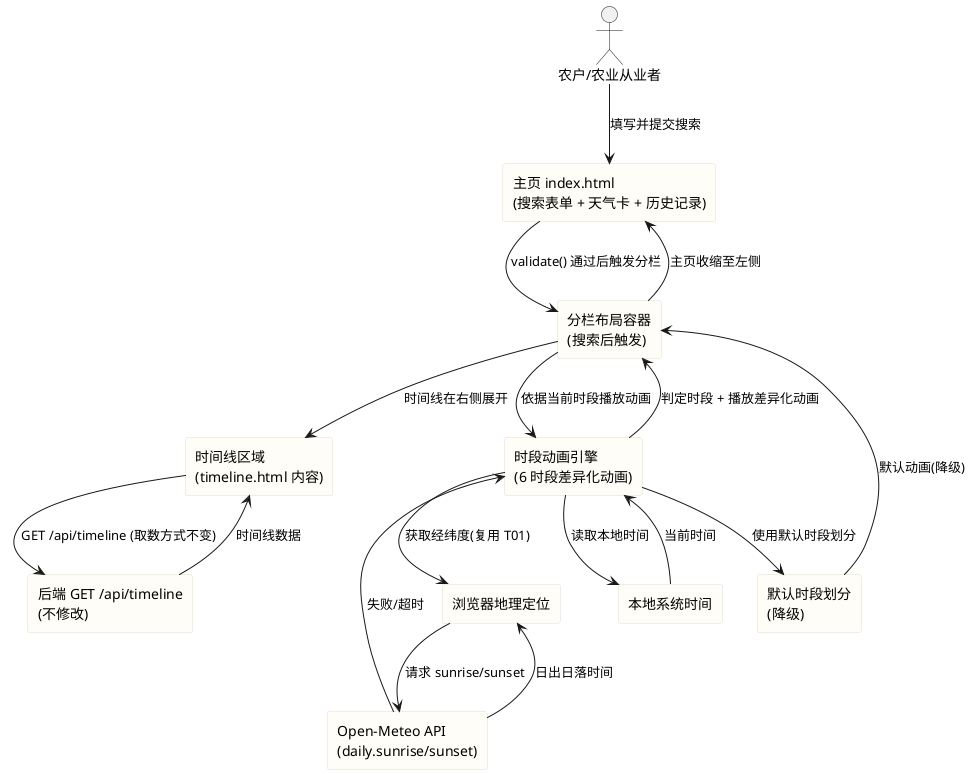
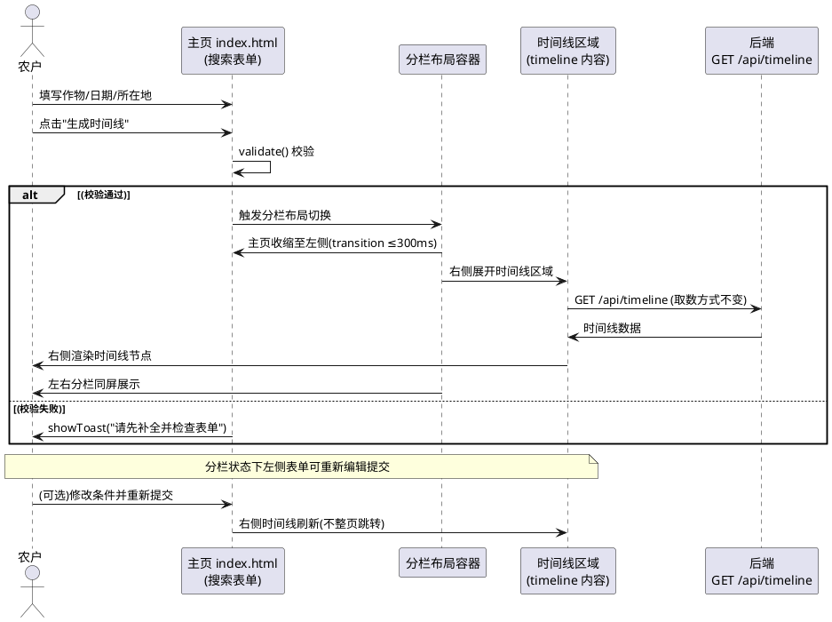
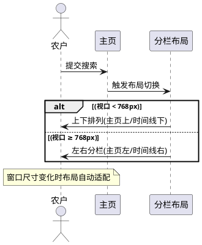
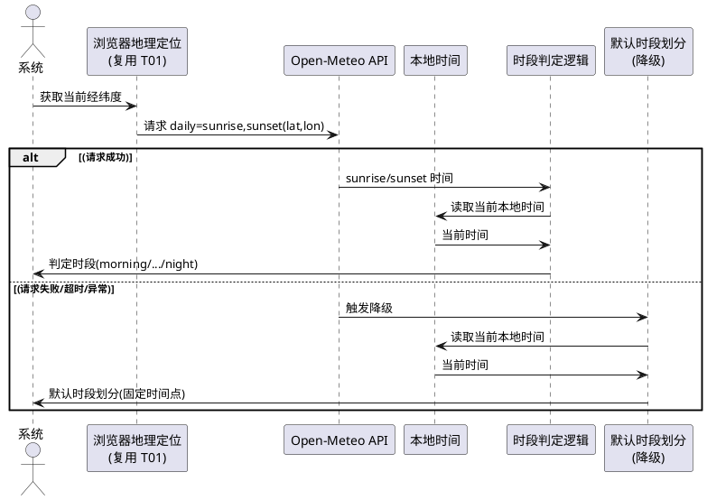
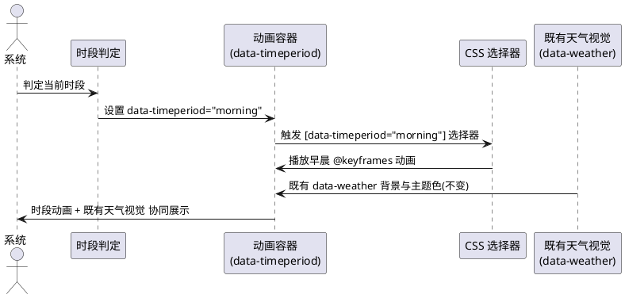
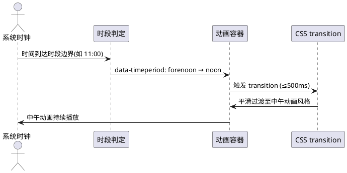

# T01 主页动画效果修改优化（t01_enhance_animation）

> 本文档用于规范 agritime（知农时 · 会看天的农事日历）主页动画效果修改优化的验收标准，包含两项核心需求：（1）重新调整主页当前动画的展示效果与交互表现——搜索后主页归左、农事时间线页归右，形成左右分栏布局而非整页跳转；（2）基于时间段的差异化动画方案——将一天划分为 6 个时段（早晨/上午/中午/下午/晚上/深夜），各时段有不同的动画风格、过渡效果与视觉元素，日出日落时间根据当前地点动态计算。
> 范围红线：本次为**纯前端动画与布局优化**任务，仅允许修改 `frontend/` 目录下文件；须保证（1）前端 57/57 既有测试全绿、仅允许新增断言、（2）不引入框架/构建工具/第三方库（含动画库 GSAP/Lottie）、（3）不修改后端（Java/8080）与 nginx 配置、（4）不改变现有设计语言与色彩体系、（5）时段判断失败时使用默认动画不白屏不报错、（6）日出日落时间根据地点动态计算不硬编码、（7）左右分栏布局须响应式适配（移动端上下排列）。
> 交付形式：本文档描述**做什么（What）**与**验收标准（Acceptance Criteria）**，不描述技术实现方式（How）；技术架构与代码结构由后续 design 阶段承接。
> 全局约束继承自 `stage2_frontend`（spec.md 60 条）、`t00_directory_migration`（49 条）、`t01_weather_visual`（42 条）与 `t08_t10_voice_security`（58 条）：纯原生 JS + 原生 CSS、前端测试断言不可弱化、`crop-map.js` 5 个 cropId 不变、mock 保持 null 占位不造假、时间线页天气数据经后端 `GET /api/timeline` 获取、主页天气视觉（T01）已落地不改变其 weathercode 归一化与降级机制、语音组件（T08）已落地不改变。

# **1. 组件定位**

## **1.1 核心职责**
本组件负责在主页（index.html）提交搜索后将主页与农事时间线页（timeline.html）以左右分栏布局同屏展示（而非整页跳转），并依据当前地点动态计算的日出日落时间将一天划分为 6 个时段，为每个时段提供差异化的动画风格与平滑过渡效果，实现随时间流转的动态视觉体验。

## **1.2 核心输入**
1. 用户在主页（index.html）提交搜索表单（作物品种/播种日期/所在地）触发的搜索指令——经既有 `validate()` 校验通过后触发分栏布局切换。
2. 浏览器地理定位 API（`navigator.geolocation`）或所在地输入推断提供的当前经纬度——用于获取当前地点的日出日落时间。
3. Open-Meteo API（`https://api.open-meteo.com/v1/forecast`）返回的 daily.sunrise/sunset 数据——用于动态计算日出日落时间，不硬编码。
4. 本地系统时间（`new Date()`）——用于判定当前所处时段（早晨/上午/中午/下午/晚上/深夜）。
5. 既有天气数据（T01 weather-visual.js 已获取的 weathercode/温度/季节等）——时段动画与既有天气视觉协同，不重复请求。
6. 后端 `GET /api/timeline` 响应——左右分栏布局中时间线区域的数据来源，取数方式不变。

## **1.3 核心输出**
1. 搜索提交后的左右分栏布局视图：主页（搜索表单+天气卡）收缩至屏幕左侧，农事时间线页面内容在屏幕右侧展开显示。
2. 移动端（< 768px）的上下排列布局：主页在上、时间线在下。
3. 依据当前时段（data-timeperiod 属性）动态切换的差异化动画效果——6 个时段各有不同的动画风格、过渡效果与视觉元素。
4. 时段切换时的平滑过渡动画（CSS transition），无突兀跳变/闪烁。
5. 日出日落时间获取失败时的默认时段划分与默认动画（降级态）。
6. `prefers-reduced-motion` 开启时的动画禁用（即时切换，无动画播放）。

## **1.4 职责边界**
本组件**不负责**以下事项：
1. 后端 Java 服务（`/opt/crop-calendar`，8080）的任何修改——**明确禁止**修改后端代码、新增后端接口或改动后端配置。
2. nginx 反向代理配置的修改——**明确禁止**；本任务不依赖 nginx 新增代理路径。
3. 时间线页（timeline.html）既有时间线渲染逻辑与 `GET /api/timeline` 取数方式的修改——分栏布局中时间线区域复用既有渲染逻辑，取数方式不变。
4. 既有 weather-visual.js 的 weathercode 归一化（`WMO_MAP`）与降级机制的修改——时段动画在既有天气视觉基础上叠加，不改变其归一化映射与降级分支。
5. 既有表单字段（crop/sowingDate/location）id/name 与校验逻辑（`validate()`）的改变——分栏布局由既有表单提交触发，表单结构与校验不变。
6. 既有语音组件（T08 voice-input）的修改——本任务不触碰语音按钮与 Web Speech API 逻辑。
7. 任何框架、构建工具、第三方库（含动画库 GSAP/Lottie/Anime.js）的引入——**明确禁止**。
8. 既有前端测试断言的删除或弱化——**明确禁止**为通过新需求而修改 `frontend/tests/pages.test.js` 既有 57 项断言的预期。
9. 现有设计语言与色彩体系的改变——时段动画须复用既有 CSS 变量（`--leaf`/`--sun`/`--rain`/`--paper` 等），不引入新色彩体系。

# **2. 领域术语**

**左右分栏布局（Split-View Layout）**
: 指用户在主页提交搜索后，主页（搜索表单+天气卡）收缩/移动至屏幕左侧，农事时间线页面内容在屏幕右侧展开显示的同屏布局形态，替代当前的整页跳转（`window.location.href = 'timeline.html?...'`）。

**时段（Time Period）**
: 指依据当前地点的日出日落时间将一天划分的 6 个时间区间之一，取值为早晨（morning）、上午（forenoon）、中午（noon）、下午（afternoon）、晚上（evening）、深夜（night）。

**早晨（Morning）**
: 指从当日日出到 08:00 的时间区间；若日出晚于 08:00（高纬度冬季），则该时段为空或合并至上午。

**上午（Forenoon）**
: 指从 08:00 到 11:00 的时间区间。

**中午（Noon）**
: 指从 11:00 到 14:00 的时间区间。

**下午（Afternoon）**
: 指从 14:00 到当日日落前 2 小时的时间区间；若日落早于 16:00（高纬度冬季），则该时段为空或合并至中午。

**晚上（Evening）**
: 指从当日日落后到 22:00 的时间区间。

**深夜（Night）**
: 指从 22:00 到次日日出的时间区间。

**日出日落时间（Sunrise/Sunset Time）**
: 指特定地点在特定日期的太阳升起与落下的本地时间，由 Open-Meteo API 的 `daily.sunrise`/`daily.sunset` 字段提供；须根据当前地点经纬度动态获取，不得硬编码固定值。

**时段差异化动画（Period-Specific Animation）**
: 指为 6 个时段各自设计的不同动画风格、过渡效果与视觉元素，通过 `data-timeperiod` 属性驱动 CSS 选择器切换；各时段动画须可视觉区分但整体设计语言保持一致。

**时段切换平滑过渡（Period Transition）**
: 指当时段发生切换（如从上午进入中午）时，动画风格以 CSS transition 平滑过渡完成切换，不出现突兀跳变、闪烁或白屏。

**默认时段划分（Default Period Scheme）**
: 指日出日落时间获取失败时的降级时段划分方案，按固定时间点划分（如早晨 06:00~08:00、上午 08:00~11:00、中午 11:00~14:00、下午 14:00~17:00、晚上 17:00~22:00、深夜 22:00~06:00），不依赖日出日落数据。

**EARS 需求编号约定**
: 本文档需求编号格式为 `REQ-TEA-XXX-NNN`，`TEA` 为 T01 Enhance Animation 缩写。前缀对应 EARS 句型：UBI（Ubiquitous，通用）、EVT（Event-driven，事件驱动）、STA（State-driven，状态驱动）、OPT（Optional，可选/带前提）、UNW（Unwanted，非期望行为）。

# **3. 角色与边界**

## **3.1 核心角色**
- **农户 / 农业从业者**：在主页填写并提交搜索条件后，在同屏左右分栏布局中同时查看主页表单与农事时间线结果，并根据当前时段看到差异化的动画效果；在移动端看到上下排列布局。
- **测试维护者**：运行 `node --test frontend/tests/pages.test.js`，确认既有 57 项断言全绿并补充分栏布局与时段动画相关新断言。
- **开发者 / 交付者**：在 `frontend/` 范围内修改 index.html、timeline.html、common.css、weather-visual.js（或新增模块）与 pages.test.js，提交 Git。

## **3.2 外部系统**
- **Open-Meteo API（`https://api.open-meteo.com/v1/forecast`）**：日出日落时间数据来源；前端直连（与 T01 天气数据获取方式一致），请求参数含 `latitude`/`longitude`/`daily=sunrise,sunset`/`timezone=auto`；无需 API Key。
- **浏览器地理定位 API（`navigator.geolocation`）**：当前地点经纬度来源，用于获取对应地点的日出日落时间；与 T01 既有定位逻辑复用。
- **后端 `GET /api/timeline`**：左右分栏布局中时间线区域的数据来源，取数方式与参数命名不变（crop/sowDate/lat/lon/location）。
- **浏览器本地时间（`new Date()`）**：时段判定依据，纯本地计算无网络请求。
- **既有 weather-visual.js（T01 已落地）**：时段动画与既有天气视觉协同；日出日落请求可与既有天气数据请求合并或独立发起，不改变既有 weathercode 归一化与降级机制。

## **3.3 交互上下文**

# **4. DFX约束**

## **4.1 性能**
1. 搜索提交后左右分栏布局切换须在 **≤ 300ms** 内完成视觉过渡，不得让用户感知明显延迟或白屏等待。
2. 时段判定（依据本地时间与日出日落计算当前时段）须为**纯本地计算**，判定耗时 **≤ 50ms**，不发起额外网络请求。
3. 日出日落时间请求须复用既有天气数据请求的经纬度与超时机制（T01 已有 8s 超时），不得为日出日落单独发起冗余定位请求；日出日落数据可与既有天气数据请求合并（同一 Open-Meteo 请求附加 `daily=sunrise,sunset` 参数）或独立发起但共享定位结果。
4. 时段动画须使用纯 CSS `@keyframes` animation/transition 实现，不使用 JS 动画循环（`requestAnimationFrame`/`setInterval`），不引入动画库，不显著增加 CPU/GPU 负载。
5. 左右分栏布局的渲染不得阻塞主页表单的交互；分栏后左侧表单须立即可重新编辑提交。
6. 时间线区域的数据请求（`GET /api/timeline`）不得因分栏布局而重复发起或改变超时阈值（保持既有 20s 超时与降级机制）。

## **4.2 可靠性**
1. 日出日落时间获取失败（Open-Meteo 超时/网络错误/响应结构异常）时，系统须使用默认时段划分（按固定时间点划分）作为降级，不白屏、不抛未捕获 JS 错误、不影响既有天气视觉与表单交互。
2. 时段判定失败（本地时间异常/日出日落数据缺失/计算溢出）时，系统须回退为默认时段（如 default）与默认动画，不报错。
3. 左右分栏布局切换失败（DOM 异常/样式应用失败）时，系统须回退为既有整页跳转行为（`window.location.href = 'timeline.html?...'`），不白屏不卡死。
4. 浏览器不支持某些 CSS 特性（如 CSS Grid/flexbox 在极旧浏览器）时，分栏布局须降级为单栏堆叠（主页在上、时间线在下或整页跳转），不报错。
5. 时段动画在天气数据降级（T01 既有降级，`data-weather="default"`）时须仍能依据本地时间与默认日出日落正常播放，不因天气降级导致时段动画失效。
6. `prefers-reduced-motion` 开启时，所有时段动画与切换过渡须被禁用（即时切换），不播放任何动画。

## **4.3 安全性**
1. 日出日落时间请求参数（latitude/longitude）须经标准方式拼装，防止参数注入；与 T01 既有 Open-Meteo 请求方式一致。
2. 时段判定与动画切换不涉及用户可控文本的渲染，不产生 XSS 风险；`data-timeperiod` 属性值须为预定义枚举（morning/forenoon/noon/afternoon/evening/night/default），不得将用户可控文本直接作为属性值。
3. 日出日落数据不在前端持久化（不写 localStorage），仅用于实时时段判定与动画切换。

## **4.4 可维护性**
1. 时段划分规则（6 个时段的时间边界）、默认时段划分（降级用固定时间点）、各时段动画文案/标识须以**具名常量**集中定义，不得多处硬编码。
2. `data-timeperiod` 属性值须为预定义枚举集合，新增时段仅需在常量定义与 CSS 选择器中增一行，不须修改核心判定逻辑。
3. 日出日落请求参数与超时阈值须以具名常量定义，与 T01 既有 `OPEN_METEO_URL`/`REQUEST_TIMEOUT_MS` 风格一致。
4. 分栏布局的断点阈值（768px/1024px）须与既有响应式断点一致，不引入新的不一致断点。

## **4.5 兼容性**
1. **测试兼容（强制红线）**：不得破坏 `frontend/tests/pages.test.js` 的既有 57 项断言；可新增断言，既有断言须全绿。运行命令：`node --test frontend/tests/pages.test.js`。
2. **文件范围兼容**：仅修改/新增 `frontend/` 目录下文件，不修改后端（Java/8080）、nginx 配置、shared/data/deploy/docs。
3. **不可引入依赖**：不得引入框架、构建工具、第三方库（含动画库 GSAP/Lottie/Anime.js）。
4. **既有表单兼容**：分栏布局由既有表单提交触发，不改变 index.html 既有表单字段（crop/sowingDate/location）的 id/name/类型与 `validate()` 校验逻辑。
5. **既有取数兼容**：时间线区域数据仍经后端 `GET /api/timeline` 获取，不改变参数命名（crop/sowDate/lat/lon/location）与超时阈值（20s）。
6. **既有天气视觉兼容**：不改变 weather-visual.js 既有 `WMO_MAP` weathercode 归一化、`inferSeason` 季节推断与 `fallback()` 降级机制；时段动画在既有 `data-weather`/`data-season` 属性基础上叠加 `data-timeperiod` 属性，不冲突。
7. **响应式兼容**：分栏布局在 375px、768px、1024px 三档宽度下均须无横向滚动；768px 以下为上下排列，768px 及以上为左右分栏。
8. **设计语言兼容**：时段动画须复用既有 CSS 变量（`--leaf`/`--leaf-2`/`--leaf-soft`/`--sun`/`--sun-soft`/`--rain`/`--paper`/`--card` 等），不引入新色彩体系，不改变既有视觉风格。
9. **浏览器兼容**：分栏布局与时段动画须在主流现代浏览器（Chrome/Edge/Safari 近两版）与移动端 WebView 下可用；不支持 CSS Grid 的极旧浏览器降级为单栏堆叠。

# **5. 核心能力**

## **5.1 左右分栏布局（搜索后主页归左、时间线归右）**

### **5.1.1 业务规则**

1. **REQ-TEA-EVT-001（Event-driven）**：当用户在主页提交搜索表单且既有 `validate()` 校验通过后，系统须将主页（搜索表单+天气卡）收缩/移动到屏幕左侧，将农事时间线页面内容在屏幕右侧展开显示，形成左右分栏布局，而非当前的整页跳转（`window.location.href = 'timeline.html?...'`）。
   a. 验收条件：[在主页填写有效条件并点击"生成时间线"] → [页面不发生整页跳转，主页内容收缩至屏幕左侧，时间线内容在屏幕右侧展开显示，形成左右分栏布局]

2. **REQ-TEA-UBI-002（Ubiquitous）**：左右分栏布局须保持主页左侧区域（搜索表单+天气卡+历史记录）与时间线右侧区域的核心内容均可见且可交互，不得因分栏导致任一侧内容被裁剪、遮挡或不可访问。
   a. 验收条件：[分栏布局状态下查看左右两侧] → [左侧表单字段可点击编辑、天气卡可见、右侧时间线节点可查看滚动，两侧内容均完整可见]

3. **REQ-TEA-STA-003（State-driven）**：在左右分栏布局状态下，主页左侧区域的搜索表单须保持可重新编辑并再次提交，支持用户修改条件后重新生成时间线（右侧时间线区域刷新）。
   a. 验收条件：[分栏布局中修改左侧表单的作物品种并重新提交] → [右侧时间线区域依据新条件刷新，不发生整页跳转]

4. **REQ-TEA-EVT-004（Event-driven）**：当用户在分栏布局中触发"返回修改"操作时，系统须恢复主页为全屏单栏布局（退出分栏），或保持分栏但聚焦/滚动至左侧表单区域，不卡死在分栏态无法返回。
   a. 验收条件：[分栏布局中点击"返回修改"] → [主页恢复全屏单栏布局或左侧表单获得焦点可立即编辑，用户可重新填写条件]

5. **REQ-TEA-UBI-005（Ubiquitous）**：左右分栏布局须使用纯 CSS（flexbox/grid + 媒体查询）实现，不引入布局框架（如 Bootstrap/Tailwind），不依赖 JS 计算布局尺寸。
   a. 验收条件：[代码审查] → [分栏布局由 CSS flex/grid + @media 实现，无第三方布局框架引用，无 JS 像素级布局计算]

6. **REQ-TEA-UBI-006（Ubiquitous）**：左右分栏布局切换须以 CSS transition 平滑过渡（如宽度变化/位移/透明度淡入），过渡时长 **≤ 300ms**，不出现突兀跳变或闪烁。
   a. 验收条件：[提交搜索瞬间观察布局切换] → [≤300ms 内平滑过渡至分栏布局，无跳变/闪烁/白屏]

7. **REQ-TEA-UNW-007（Unwanted）**：如果左右分栏布局切换失败（DOM 异常/样式应用失败/浏览器不支持 CSS Grid），系统须回退为既有整页跳转行为（`window.location.href = 'timeline.html?...'`），不白屏、不卡死、不抛未捕获错误。
   a. 验收条件：[模拟分栏切换异常] → [回退为整页跳转到 timeline.html，用户仍可查看时间线，无白屏/未捕获错误]

8. **禁止项**：禁止分栏布局导致横向滚动条出现；禁止分栏后任一侧内容被裁剪不可见；禁止分栏布局改变既有表单字段的 id/name 与 `validate()` 校验逻辑。
   a. 验收条件：[分栏布局下检查页面] → [无横向滚动条；两侧内容完整可见；表单字段 id/name 与校验逻辑不变]

### **5.1.2 交互流程**

### **5.1.3 异常场景**

1. **分栏布局切换失败**
   a. 触发条件：DOM 节点缺失、CSS Grid 不支持、样式应用抛异常
   b. 系统行为：捕获异常，回退为既有整页跳转（`window.location.href = 'timeline.html?...'`）
   c. 用户感知：页面跳转到 timeline.html，可正常查看时间线，无白屏/卡死

2. **时间线区域数据请求失败**
   a. 触发条件：`GET /api/timeline` 超时（>20s）或返回非法结构
   b. 系统行为：右侧时间线区域展示既有降级视图（骨架屏/占位提示/mock 兜底），左侧主页保持可用
   c. 用户感知：右侧显示降级提示，左侧表单可修改重试

3. **分栏状态下用户直接访问 timeline.html URL**
   a. 触发条件：用户在分栏布局中复制右侧时间线 URL 或直接访问 timeline.html?query
   b. 系统行为：timeline.html 独立页面正常加载渲染（既有行为不变）
   c. 用户感知：timeline.html 全屏展示，与既有行为一致

## **5.2 响应式分栏适配（移动端上下排列）**

### **5.2.1 业务规则**

1. **REQ-TEA-UBI-008（Ubiquitous）**：在视口宽度 < 768px（移动端）时，搜索后的分栏布局须自动切换为上下排列（主页在上、时间线在下），不出现横向滚动。
   a. 验收条件：[在 375px 宽度下提交搜索] → [主页在上、时间线在下，上下排列，无横向滚动条]

2. **REQ-TEA-UBI-009（Ubiquitous）**：在视口宽度 ≥ 768px 时，搜索后的布局须采用左右分栏（主页左侧、时间线右侧），两侧内容均可见可用。
   a. 验收条件：[在 768px 与 1024px 宽度下提交搜索] → [主页在左、时间线在右，左右分栏，两侧内容完整可见]

3. **REQ-TEA-UBI-010（Ubiquitous）**：分栏布局在 768px 与 1024px 两档断点下须合理分配左右宽度比例，不得出现一侧过窄不可用或一侧过宽留白失衡。
   a. 验收条件：[768px 宽度下查看分栏] → [左右宽度比例协调，左侧表单可正常填写，右侧时间线可正常查看]；[1024px 宽度下查看分栏] → [左右宽度比例协调，无大面积留白失衡]

4. **REQ-TEA-UBI-011（Ubiquitous）**：分栏布局的响应式断点须与既有 `common.css` 的 768px/1024px 断点一致，不引入新的不一致断点。
   a. 验收条件：[代码审查] → [分栏媒体查询使用 768px/1024px 断点，与既有 `.page` 响应式规则一致]

5. **禁止项**：禁止移动端（< 768px）强制左右分栏导致内容挤压不可读；禁止分栏布局在任一断点下出现横向滚动。
   a. 验收条件：[375px/768px/1024px 三档宽度检查] → [移动端为上下排列不挤压；三档均无横向滚动]

### **5.2.2 交互流程**

### **5.2.3 异常场景**

1. **窗口尺寸在分栏阈值附近频繁变化**
   a. 触发条件：用户拖拽窗口在 768px 附近频繁切换
   b. 系统行为：CSS 媒体查询自动适配，无 JS 重算布局开销
   c. 用户感知：布局平滑切换，无卡顿/闪烁

## **5.3 时段划分与日出日落动态计算**

### **5.3.1 业务规则**

1. **REQ-TEA-UBI-012（Ubiquitous）**：系统须将一天划分为 6 个时段：早晨（日出 ~ 08:00）、上午（08:00 ~ 11:00）、中午（11:00 ~ 14:00）、下午（14:00 ~ 日落前 2 小时）、晚上（日落后 ~ 22:00）、深夜（22:00 ~ 次日日出），每个时刻须唯一归属一个时段。
   a. 验收条件：[任一本地时间] → [可判定唯一归属 6 个时段之一（早晨/上午/中午/下午/晚上/深夜）]

2. **REQ-TEA-UBI-013（Ubiquitous）**：日出日落时间须根据当前地点经纬度动态获取（Open-Meteo API `daily=sunrise,sunset`），不得硬编码固定日出日落时间。
   a. 验收条件：[代码审查] → [日出日落时间来自 Open-Meteo API 响应的 daily.sunrise/sunset 字段，无硬编码固定时间值]；[不同地点（如北京 vs 哈尔滨）提交搜索] → [时段边界依据各自日出日落动态不同]

3. **REQ-TEA-EVT-014（Event-driven）**：当系统获取天气/日出日落数据时，须依据当前地点经纬度请求 Open-Meteo API 的 `daily=sunrise,sunset` 数据（可与既有天气数据请求合并或独立发起），用于时段边界计算。
   a. 验收条件：[主页加载或提交搜索] → [发起含 daily=sunrise,sunset 参数的 Open-Meteo 请求，获取当前地点日出日落时间]

4. **REQ-TEA-UBI-015（Ubiquitous）**：系统须依据当前本地时间（`new Date()`）与动态日出日落时间，判定当前所处时段，时段标识取值为 `morning`/`forenoon`/`noon`/`afternoon`/`evening`/`night` 之一。
   a. 验收条件：[本地时间 09:30 且日出 06:00 日落 18:00] → [判定为上午（forenoon）]；[本地时间 19:00 且日落 18:00] → [判定为晚上（evening）]；[本地时间 23:00] → [判定为深夜（night）]

5. **REQ-TEA-UNW-016（Unwanted）**：如果日出日落时间获取失败（Open-Meteo 超时/网络错误/响应结构异常）或数据缺失，系统须使用默认时段划分（按固定时间点划分，如早晨 06:00~08:00、上午 08:00~11:00、中午 11:00~14:00、下午 14:00~17:00、晚上 17:00~22:00、深夜 22:00~06:00）作为降级，不白屏、不报错、不影响既有天气视觉与表单交互。
   a. 验收条件：[模拟日出日落请求失败] → [使用默认固定时间点划分时段，时段动画正常播放，无白屏/未捕获错误]

6. **REQ-TEA-UBI-017（Ubiquitous）**：默认时段划分（降级用）的固定时间点须以具名常量集中定义，便于后续调整；默认划分须覆盖全天 24 小时无遗漏、无重叠。
   a. 验收条件：[代码审查] → [默认时段时间点为具名常量；6 个时段覆盖 00:00~24:00 无遗漏无重叠]

7. **REQ-TEA-OPT-018（Optional/带前提）**：当高纬度地区出现极昼/极夜（日出日落缺失或异常，如日出晚于 08:00 或日落早于 16:00）时，系统须将空时段合并至相邻时段或使用默认时段划分，不报错。
   a. 验收条件：[模拟极夜场景（日出/日落缺失）] → [使用默认时段划分或合并相邻时段，时段判定不报错]

8. **禁止项**：禁止硬编码日出日落时间（须根据地点动态获取）；禁止时段判定抛出未捕获错误；禁止时段划分出现时间覆盖遗漏或重叠（任一时刻须唯一归属一个时段）。
   a. 验收条件：[代码审查 + 多地点/多时间测试] → [日出日落为动态获取；时段判定无未捕获错误；全天无遗漏无重叠]

### **5.3.2 交互流程**

### **5.3.3 异常场景**

1. **日出日落时间格式异常**
   a. 触发条件：Open-Meteo 返回的 sunrise/sunset 字段非预期 ISO 8601 格式或为 null
   b. 系统行为：捕获解析异常，使用默认时段划分
   c. 用户感知：时段动画按默认划分正常播放，无报错

2. **本地时间异常（如用户手动修改系统时间）**
   a. 触发条件：`new Date()` 返回异常值或时区偏移导致计算溢出
   b. 系统行为：捕获异常，回退为 default 时段与默认动画
   c. 用户感知：默认动画播放，无报错

3. **高纬度极昼/极夜**
   a. 触发条件：日出日落缺失或日出晚于 08:00 / 日落早于 16:00
   b. 系统行为：空时段合并至相邻时段或使用默认划分
   c. 用户感知：时段动画连续播放，无空档/无报错

## **5.4 时段差异化动画**

### **5.4.1 业务规则**

1. **REQ-TEA-UBI-019（Ubiquitous）**：每个时段须有差异化的动画风格、过渡效果与视觉元素，6 个时段（早晨/上午/中午/下午/晚上/深夜）的动画须可视觉区分，不得所有时段使用同一动画。
   a. 验收条件：[分别在不同时段查看主页动画] → [6 个时段动画风格各异，可视觉区分（如早晨柔和晨光、中午强烈日光、深夜静谧星空等）]

2. **REQ-TEA-UBI-020（Ubiquitous）**：时段差异化动画须保持整体设计语言一致，复用既有 CSS 变量（`--leaf`/`--sun`/`--rain`/`--paper` 等）与色彩体系，不引入新色彩体系，不改变既有视觉风格。
   a. 验收条件：[代码审查 + 视觉核对] → [时段动画使用既有 CSS 变量，色彩与既有设计语言协调，无新色彩体系]

3. **REQ-TEA-UBI-021（Ubiquitous）**：时段动画须使用纯 CSS `@keyframes` animation/transition 实现，不引入动画库（GSAP/Lottie/Anime.js 等），不使用 JS 动画循环（`requestAnimationFrame`/`setInterval`）。
   a. 验收条件：[代码审查] → [时段动画由 CSS @keyframes/transition 实现，无动画库 import/CDN 引用，无 requestAnimationFrame/setInterval 动画循环]

4. **REQ-TEA-UBI-022（Ubiquitous）**：系统须通过 `data-timeperiod` 属性（值域：`morning`/`forenoon`/`noon`/`afternoon`/`evening`/`night`/`default`）驱动 CSS 选择器切换时段动画，属性设置在主页根元素或动画容器上，CSS 据此选择对应 `@keyframes`。
   a. 验收条件：[代码审查] → [存在 data-timeperiod 属性设置逻辑；CSS 含 [data-timeperiod="morning"] 等选择器对应不同 @keyframes 动画]

5. **REQ-TEA-UBI-023（Ubiquitous）**：时段动画须与既有天气视觉（T01 `data-weather`/`data-season` 属性驱动的背景与主题色）协同，不冲突、不覆盖既有天气背景与微动效；时段动画为叠加层，既有天气视觉保持不变。
   a. 验收条件：[同时存在 data-weather="rain" 与 data-timeperiod="evening"] → [既有雨天背景与主题色正常显示，时段动画叠加播放，两者不冲突]

6. **REQ-TEA-STA-024（State-driven）**：在 `prefers-reduced-motion` 开启时，所有时段动画须被禁用（既有全局规则 `animation: none !important; transition: none !important;` 自动覆盖），不播放任何动画。
   a. 验收条件：[开启 prefers-reduced-motion 后查看主页] → [时段动画不播放，页面静态展示，无动画运行]

7. **禁止项**：禁止所有时段使用同一动画；禁止时段动画遮挡/覆盖既有表单/天气卡/时间线的核心信息文字导致不可读；禁止时段动画引入新色彩体系。
   a. 验收条件：[各时段动画视觉核对] → [6 时段动画各异；核心信息文字可读不被遮挡；色彩复用既有变量]

### **5.4.2 交互流程**

### **5.4.3 异常场景**

1. **时段动画 CSS 加载失败**
   a. 触发条件：CSS 文件加载失败或 @keyframes 定义缺失
   b. 系统行为：页面无动画播放但内容正常展示（CSS 失败不影响 DOM 结构）
   c. 用户感知：页面静态展示，无动画但内容完整可读

2. **data-timeperiod 属性值非法**
   a. 触发条件：时段判定返回非预定义枚举值
   b. 系统行为：CSS 选择器无匹配，回退为默认样式（无动画或默认动画）
   c. 用户感知：页面正常展示，无报错

## **5.5 时段切换平滑过渡**

### **5.5.1 业务规则**

1. **REQ-TEA-EVT-025（Event-driven）**：当时段发生切换（如从上午进入中午，或用户跨时区/刷新页面后时段变化）时，系统须以平滑过渡（CSS transition）完成动画风格切换，不出现突兀跳变、闪烁或白屏。
   a. 验收条件：[时段从上午切换到中午的瞬间] → [动画风格平滑过渡切换，无突兀跳变/闪烁/白屏]

2. **REQ-TEA-UBI-026（Ubiquitous）**：时段切换过渡时长须 **≤ 500ms**，不得过长导致用户感知卡顿，也不得过短导致突兀跳变。
   a. 验收条件：[代码审查] → [时段切换 transition 时长 ≤ 500ms（如 300ms~500ms 区间）]

3. **REQ-TEA-STA-027（State-driven）**：在 `prefers-reduced-motion` 开启时，时段切换过渡须被禁用（即时切换），不播放过渡动画。
   a. 验收条件：[开启 prefers-reduced-motion 后触发时段切换] → [即时切换无过渡动画，既有全局规则自动覆盖]

4. **REQ-TEA-EVT-028（Event-driven）**：当页面加载或刷新时，系统须依据当前时段立即设置 `data-timeperiod` 属性并播放对应时段动画，不出现先播放默认动画再切换为目标动画的二次跳变。
   a. 验收条件：[在中午时段刷新页面] → [直接播放中午时段动画，不先播放默认再切换]

5. **禁止项**：禁止时段切换出现白屏/闪烁/布局跳动；禁止时段切换过渡时长 > 500ms 导致感知卡顿。
   a. 验收条件：[多次触发时段切换] → [每次切换平滑无白屏/闪烁/跳动；过渡时长 ≤ 500ms]

### **5.5.2 交互流程**

### **5.5.3 异常场景**

1. **时段切换瞬间动画资源未就绪**
   a. 触发条件：时段切换时对应 @keyframes 或背景资源尚未加载完成
   b. 系统行为：CSS transition 会在资源就绪后自然过渡，或暂时无动画展示内容
   c. 用户感知：可能短暂无动画，内容始终可见，无白屏

## **5.6 降级机制**

### **5.6.1 业务规则**

1. **REQ-TEA-UNW-029（Unwanted）**：如果时段判断失败（日出日落不可用、本地时间异常、计算溢出等），系统须使用默认时段（`data-timeperiod="default"`）与默认动画，不白屏、不抛未捕获 JavaScript 错误、不影响既有天气视觉与表单交互。
   a. 验收条件：[模拟时段判断全失败] → [data-timeperiod="default"，默认动画播放，页面内容完整可见，控制台无未捕获错误]

2. **REQ-TEA-UNW-030（Unwanted）**：如果天气数据不可用（T01 既有降级，`data-weather="default"`），时段动画须仍能依据本地时间与默认日出日落正常播放，不因天气降级导致时段动画失效。
   a. 验收条件：[模拟天气数据降级（data-weather="default"）] → [时段动画依据本地时间正常播放，不因天气降级而失效]

3. **REQ-TEA-UBI-031（Ubiquitous）**：降级态须有可见标识（如保持默认主题色与默认动画），不得静默失败导致用户无感知异常；降级后刷新页面或重新获取数据可恢复（幂等重试）。
   a. 验收条件：[降级态查看页面] → [默认主题色与默认动画可见；刷新页面后重新获取数据，恢复正常时段动画]

4. **REQ-TEA-UNW-032（Unwanted）**：如果左右分栏布局与时段动画同时出现异常，系统须保证页面核心内容（表单/天气卡/时间线）仍可访问，不因动画/布局异常导致整体白屏。
   a. 验收条件：[模拟分栏+动画双重异常] → [回退整页跳转 + 默认无动画，核心内容可访问，无白屏]

5. **禁止项**：禁止降级时抛出未捕获 JavaScript 错误；禁止降级导致页面白屏；禁止降级后无法恢复（须支持刷新重试）。
   a. 验收条件：[各降级场景测试] → [无未捕获错误；无白屏；刷新可恢复]

### **5.6.2 异常场景**

1. **Open-Meteo API 完全不可用**
   a. 触发条件：网络断开或 Open-Meteo 服务宕机
   b. 系统行为：天气降级（T01 既有）+ 默认时段划分 + 默认动画
   c. 用户感知：默认主题 + 默认动画，表单可正常使用，无报错

2. **浏览器不支持 CSS Grid/flexbox**
   a. 触发条件：极旧浏览器无 CSS Grid 支持
   b. 系统行为：分栏布局降级为单栏堆叠或整页跳转
   c. 用户感知：单栏布局内容可访问，或整页跳转到 timeline.html

## **5.7 既有功能兼容与测试保障**

### **5.7.1 业务规则**

1. **REQ-TEA-UBI-033（Ubiquitous）**：本次改动须仅修改/新增 `frontend/` 目录下文件，不修改后端（Java/8080）、nginx 配置、shared/data/deploy/docs。
   a. 验收条件：[代码审查 + git diff] → [改动文件均在 frontend/ 目录内，后端/nginx/shared/data/deploy/docs 无改动]

2. **REQ-TEA-UBI-034（Ubiquitous）**：本次改动须不引入框架/构建工具/第三方库（含动画库 GSAP/Lottie/Anime.js），保持纯原生 JS + 原生 CSS。
   a. 验收条件：[代码审查] → [无 import/require/CDN 引用第三方库，无 package.json 新增依赖，无构建工具配置]

3. **REQ-TEA-UBI-035（Ubiquitous）**：本次改动须不破坏 `frontend/tests/pages.test.js` 既有 57 项断言，仅允许新增断言；运行 `node --test frontend/tests/pages.test.js` 须全绿。
   a. 验收条件：[运行测试] → [既有 57 项断言全绿，新增断言通过，无失败]

4. **REQ-TEA-UBI-036（Ubiquitous）**：本次改动须不改变 index.html 既有表单字段（crop/sowingDate/location）的 id/name/类型与 `validate()` 校验逻辑与 `buildTimelineQuery()` 参数拼装逻辑。
   a. 验收条件：[代码审查] → [表单字段 id/name/类型不变；validate() 逻辑不变；buildTimelineQuery() 参数不变]

5. **REQ-TEA-UBI-037（Ubiquitous）**：本次改动须不改变 timeline.html 既有时间线渲染逻辑与 `GET /api/timeline` 取数方式（参数命名 crop/sowDate/lat/lon/location、超时 20s、降级机制）。
   a. 验收条件：[代码审查] → [时间线渲染逻辑不变；取数参数与超时不变；降级机制不变]

6. **REQ-TEA-UBI-038（Ubiquitous）**：本次改动须不改变 weather-visual.js 既有 `WMO_MAP` weathercode 归一化、`inferSeason` 季节推断与 `fallback()` 降级机制；日出日落请求为增量叠加，不修改既有归一化与降级分支。
   a. 验收条件：[代码审查] → [WMO_MAP 映射不变；inferSeason 逻辑不变；fallback() 降级分支不变；日出日落为新增独立或合并请求]

7. **REQ-TEA-UBI-039（Ubiquitous）**：本次改动须不改变既有语音组件（T08 voice-input）的任何逻辑，不触碰 voice-input.js/voice-input.css。
   a. 验收条件：[代码审查] → [voice-input.js/voice-input.css 无改动]

8. **REQ-TEA-UBI-040（Ubiquitous）**：本次改动须不改变 `crop-map.js` 5 个 cropId（dry_garlic/wheat_winter/corn_summer/rice/soybean），不改变 `mock-data.js` null 占位不造假红线。
   a. 验收条件：[代码审查] → [crop-map.js 5 个 cropId 不变；mock-data.js 保持 null 占位无造假]

9. **禁止项**：禁止为通过新需求而删除/注释/弱化既有 57 项测试断言；禁止改变既有表单/时间线/天气视觉/语音组件的核心逻辑。
   a. 验收条件：[代码审查 + 测试运行] → [既有断言原文保留且通过；核心逻辑不变]

### **5.7.2 异常场景**

1. **新增改动导致既有测试失败**
   a. 触发条件：分栏布局或时段动画改动意外破坏既有断言
   b. 系统行为：须立即修复，不得通过修改既有断言预期来"通过"
   c. 用户感知：测试维护者运行测试发现失败，开发者修复后全绿

# **6. 数据约束**

## **6.1 时段对象**
1. **timeperiod**：时段标识，取值枚举 `morning`（早晨）/`forenoon`（上午）/`noon`（中午）/`afternoon`（下午）/`evening`（晚上）/`night`（深夜）/`default`（默认/降级），须为预定义枚举值，不得为用户可控文本。
2. **startTime**：时段起始时间，ISO 8601 时间字符串或 `HH:MM` 格式，可为动态（日出/日落）或固定（08:00/11:00 等）。
3. **endTime**：时段结束时间，格式同 startTime。
4. **isDynamic**：时段边界是否为动态（依赖日出日落），布尔值；`true` 表示边界由日出日落计算，`false` 表示固定时间点。

## **6.2 日出日落数据对象**
1. **sunrise**：日出时间，ISO 8601 字符串（如 `2026-10-23T06:12`），来自 Open-Meteo `daily.sunrise`；可为 null（降级态）。
2. **sunset**：日落时间，ISO 8601 字符串，来自 Open-Meteo `daily.sunset`；可为 null。
3. **source**：数据来源标识，取值 `open-meteo`（正常获取）/`default`（降级默认值），用于区分动态与降级。
4. **lat**：纬度，数值，范围 [-90, 90]，用于请求日出日落的位置标识。
5. **lon**：经度，数值，范围 [-180, 180]，用于请求日出日落的位置标识。

## **6.3 默认时段划分常量**
1. **morning**：默认 06:00 ~ 08:00。
2. **forenoon**：默认 08:00 ~ 11:00。
3. **noon**：默认 11:00 ~ 14:00。
4. **afternoon**：默认 14:00 ~ 17:00。
5. **evening**：默认 17:00 ~ 22:00。
6. **night**：默认 22:00 ~ 次日 06:00。
7. **覆盖约束**：6 个默认时段须覆盖全天 24 小时（00:00 ~ 24:00）无遗漏、无重叠，任一时刻唯一归属一个时段。

## **6.4 分栏布局状态对象**
1. **layout**：布局模式，取值 `single`（单栏/全屏主页）/`split`（左右分栏）/`stack`（上下排列/移动端），由视口宽度与搜索状态决定。
2. **isSubmitted**：是否已提交搜索，布尔值；`true` 时触发分栏/上下排列，`false` 时为单栏主页。
3. **viewportWidth**：视口宽度，数值；< 768 为上下排列，≥ 768 为左右分栏。