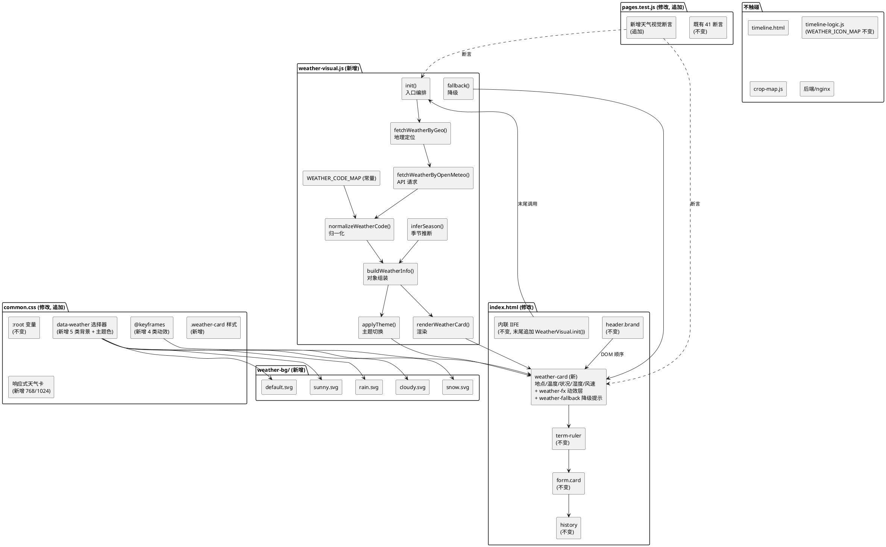
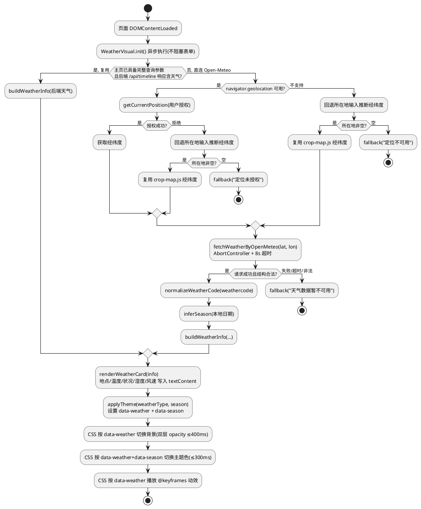
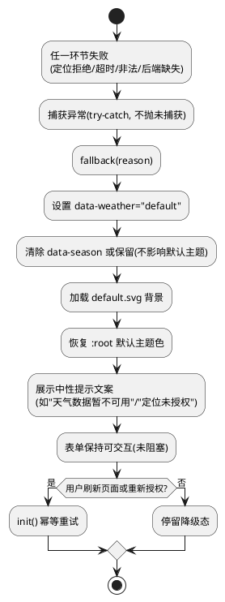
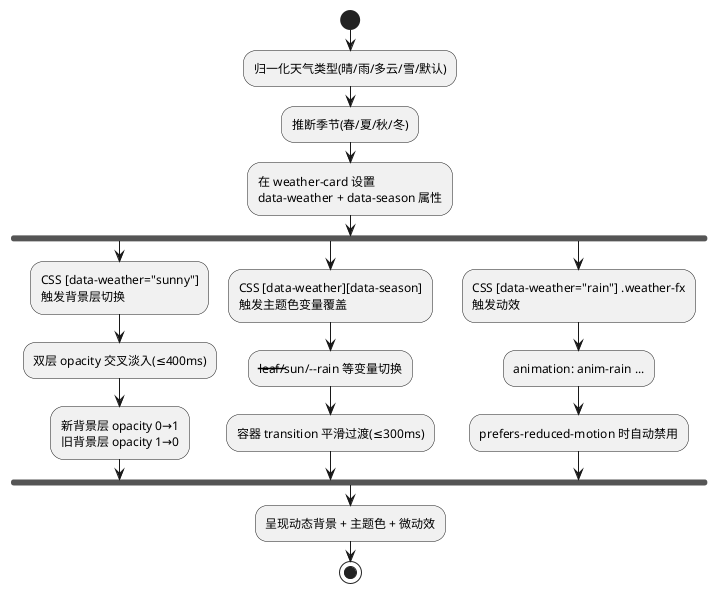
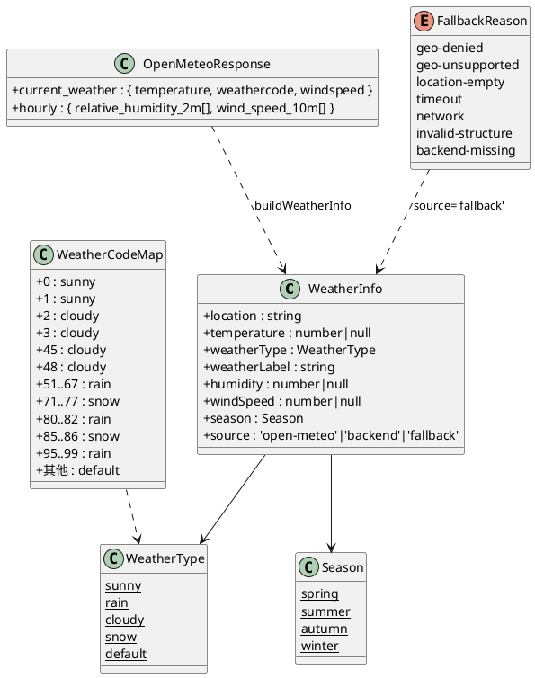

# T01 主页天气与视觉动态适配 · 技术设计（t01_weather_visual）

> 本方案基于 `t01_weather_visual/spec.md`（REQ-TWV-UBI/EVT/OPT/UNW-001 ~ 042，共 42 条 EARS 需求）生成。
> 设计范围：**纯前端视觉动态适配**，仅修改 `frontend/` 目录下文件，不触碰后端/nginx/shared/data/deploy/docs。
> 强约束（红线）：
> 1. 前端 41/41 既有测试全绿（`node --test frontend/tests/pages.test.js`），仅允许新增断言；
> 2. 不引入框架/构建工具/第三方库（含动画库 GSAP/Lottie、天气库、图表库）；
> 3. 不修改后端（Java/8080）与 nginx 配置；
> 4. 天气数据不可用时降级为默认主题，不白屏、不抛未捕获 JS 错误；
> 5. 天气背景资源放 `frontend/assets/weather-bg/`，遵循 T00 目录规范；
> 6. 不改变 index.html 既有表单字段（crop/sowingDate/location）id/name 与提交跳转逻辑；
> 7. 不改变时间线页（timeline.html）既有天气逻辑，`timeline-logic.js` 的 `WEATHER_ICON_MAP`/`getWeatherIcon` 保持不变；
> 8. `mock-data.js` 保持 null 占位不造假。
> 全局约束继承自 `stage2_frontend`（spec.md 60 条）：纯原生 JS + 原生 CSS、前端测试断言不可弱化、`crop-map.js` 5 个 cropId 不变、时间线页天气数据经后端 `GET /api/timeline` 获取。

# 一、需求与存量功能关系分析

## 1.1 需求功能与存量功能对比

### 1.1.1 已实现功能

> 已实现功能是指需求与存量代码完全匹配或高度相似、可直接复用或仅需少量叠加的部分。

| 需求功能 | 存量功能 | 代码位置 | 匹配度 |
|---------|---------|---------|--------|
| 主页顶部品牌头结构（REQ-TWV-UBI-001 区域定位基准） | `index.html` 已有 `<header class="brand">` 品牌头 | `frontend/pages/index.html:12-22` | 100%（品牌头已存在，天气区域插入其下方即可） |
| 主页表单卡片结构（REQ-TWV-UBI-001 区域定位基准） | `index.html` 已有 `<form class="card" id="timeline-form">` | `frontend/pages/index.html:27-69` | 100%（表单已存在，天气区域插入其上方即可） |
| CSS 变量主题色体系（REQ-TWV-UBI-023 主题色基础） | `common.css` `:root` 已定义 `--leaf`/`--leaf-2`/`--sun`/`--sun-soft`/`--rain`/`--paper`/`--card` 等变量 | `frontend/assets/css/common.css:1-21` | 75%（变量已存在，但无按天气类型切换的变量集与 `data-weather` 选择器） |
| 主页背景图机制（REQ-TWV-UBI-015~019 背景切换基础） | `common.css` 已有 `.page--home { background-image: url('../img/index-bg.png'); background-size: cover; }` | `frontend/assets/css/common.css:293-299` | 50%（已有静态背景图，但无按天气类型动态切换、无 transition 过渡、无 weather-bg 资源） |
| `prefers-reduced-motion` 支持（REQ-TWV-UBI-021） | `common.css` 已有 `@media (prefers-reduced-motion: reduce) { *, *::before, *::after { animation: none !important; transition: none !important; } }` | `frontend/assets/css/common.css:289-291` | 100%（全局禁用动画已就绪，新增微动效自动被覆盖） |
| 响应式 768/1024 断点（REQ-TWV-UBI-032~035） | `common.css` 已有 `@media (min-width: 768px)` 与 `@media (min-width: 1024px)` 断点，`html,body` 已 `overflow-x: hidden; max-width: 100%` | `frontend/assets/css/common.css:25-30,420-427` | 75%（断点已存在，但天气信息卡在三档下的布局需新增媒体查询规则） |
| 天气类型中文映射（REQ-TWV-UBI-014 归一化参考） | `timeline-logic.js` `WEATHER_ICON_MAP` 已覆盖 clear/sunny/multiCloud/cloudy/overcast/rain/snow/fog 等类型→中文标签映射 | `frontend/assets/js/timeline-logic.js:7-25` | 50%（映射已存在但属时间线页，且键为后端天气字符串而非 Open-Meteo weathercode；本任务需新增 weathercode→四类归一化，且不得改动此文件） |
| 测试文件已读取 index.html/common.css/timeline-logic.js（REQ-TWV-UBI-038 测试基座） | `pages.test.js` 已 `read(index.html)`、`read(common.css)`、`read(timeline-logic.js)` 并有 41 项断言 | `frontend/tests/pages.test.js:10-19` | 100%（测试基座已就绪，新增断言可直接复用既有 read 变量） |
| URL 参数拼装方式（REQ-TWV-EVT-010 安全拼装） | `index.html` 已用 `URLSearchParams` 拼装跳转参数 | `frontend/pages/index.html:360-366` | 100%（Open-Meteo 请求参数可沿用 URLSearchParams 方式） |
| `textContent` 安全渲染（REQ-TWV 安全性 4.3.3） | `index.html` 历史记录渲染已用 `btn.textContent = label` | `frontend/pages/index.html:342` | 100%（天气信息渲染可沿用 textContent 方式） |

### 1.1.2 需要扩展的功能

> 需要扩展的功能是指需求与存量代码部分匹配，需在现有基础上改造或叠加的部分。

| 需求功能 | 存量功能 | 差异说明 | 扩展方向 |
|---------|---------|---------|---------|
| 主页顶部天气信息展示区域（REQ-TWV-UBI-001~008） | `index.html` 顶部仅有品牌头 + 节气刻度 + 表单，无天气区域 | 需在品牌头（`header.brand`）与表单（`form.card`）之间新增天气信息卡 DOM 节点，展示地点/温度/状况/湿度/风速 | 在 `index.html` 第 22 行（`</header>`）与第 24 行（`<div class="term-ruler">`）之间插入天气信息卡 HTML 结构；新增 CSS 样式；新增 JS 渲染逻辑 |
| 主页背景图动态切换（REQ-TWV-UBI-015~020） | `common.css` `.page--home` 为单一静态背景 `index-bg.png`，无切换机制 | 需按天气类型（晴/雨/多云/雪/默认）切换背景图，且切换须 CSS transition 平滑过渡 ≤400ms，无闪烁/白屏 | 改造 `.page--home` 背景为双层叠加切换机制（或 `data-weather` 属性选择器切换 `background-image`），新增 `weather-bg/` 5 类背景资源，新增 transition 过渡规则 |
| 主题色按天气类型切换（REQ-TWV-UBI-023~026） | `common.css` `:root` 变量为静态定义，无按天气类型切换机制 | 需通过 `data-weather` + `data-season` 属性选择器覆盖 `:root` 变量，实现晴/雨/多云/雪四类 × 春夏秋冬四季的主题色微调 | 新增 `[data-weather="sunny"]` 等属性选择器变量覆盖规则；在主页根元素或天气容器上设置 `data-weather`/`data-season` 属性；新增主题色 transition ≤300ms |
| 响应式天气信息卡布局（REQ-TWV-UBI-032~034） | `common.css` 768/1024 断点仅覆盖 `.page`/`.suggestions`，无天气卡规则 | 天气信息卡在 375px 须紧凑（单行/两行），768px+ 须宽松布局，背景须三档铺满 | 新增天气信息卡在 768/1024 断点下的媒体查询规则；确保 `background-size: cover` 三档生效 |
| 测试断言扩充（REQ-TWV-UBI-038~039） | `pages.test.js` 41 项断言无天气视觉相关断言 | 需新增天气区域存在、weathercode 归一化、四类背景资源存在、降级默认主题、data-weather 属性切换等断言，且不破坏既有 41 项 | 在 `pages.test.js` 末尾新增 test 块，复用既有 `indexHtml`/`commonCss` 变量并新增 `weatherVisualJs`/`weatherBgDir` 变量 |

### 1.1.3 需要新增的功能或接口

> 需要新增的功能是指需求在存量代码中完全没有对应实现的部分，须新建。

**A. 新增 JS 模块：`frontend/assets/js/weather-visual.js`**

| 功能点 | 输入 | 输出 | 核心逻辑 | 关联需求 |
|--------|------|------|---------|---------|
| 浏览器地理定位获取经纬度 | 无（调用 `navigator.geolocation.getCurrentPosition`） | `Promise<{lat, lon}>` 或定位失败原因 | 用户授权后获取经纬度；不支持/拒绝时 reject | REQ-TWV-UBI-009 |
| Open-Meteo 天气数据请求 | `{lat, lon}` | `Promise<{temperature, weathercode, humidity, windSpeed}>` 或失败 | 前端直连 `https://api.open-meteo.com/v1/forecast`，参数含 `latitude`/`longitude`/`current_weather=true`/`hourly=relative_humidity_2m`，超时 8s | REQ-TWV-EVT-010/012 |
| weathercode 归一化 | Open-Meteo weathercode（整数） | `{weatherType, weatherLabel}`（weatherType ∈ sunny/rain/cloudy/snow/default） | 具名常量 `WEATHER_CODE_MAP` 集中定义 WMO 编码→四类映射；未识别回退 default | REQ-TWV-UBI-014 |
| 季节推断 | 本地系统日期 | `season`（spring/summer/autumn/winter） | `new Date().getMonth()` 按月份划分（3-5 春、6-8 夏、9-11 秋、12-2 冬） | REQ-TWV-UBI-025 |
| 天气信息对象组装 | Open-Meteo 响应 + 地点文本 + 季节 | 归一化天气信息对象（见 2.3 数据模型） | 组合温度/天气类型/湿度/风速/地点/季节为统一对象 | REQ-TWV-UBI-001~008 |
| 主题切换（data-weather/data-season 属性设置） | 归一化天气对象 | 无（设置 DOM 属性） | 在天气容器上设置 `data-weather` 与 `data-season` 属性，CSS 据此切换背景与主题色 | REQ-TWV-UBI-024 |
| 天气信息卡渲染 | 归一化天气对象 | 无（更新 DOM textContent） | 将地点/温度/状况/湿度/风速写入天气卡各字段；缺失字段展示"--" | REQ-TWV-UBI-002~008 |
| 降级默认主题 | 失败原因 | 无（设置 data-weather="default" + 中性提示） | 清除或重置 data-weather 为 default，展示"天气数据暂不可用"等中性提示 | REQ-TWV-UNW-027/UBI-028/029 |
| 后端天气数据复用（可选） | 后端 `/api/timeline` 响应中天气字段 | 归一化天气对象或 null | 当主页已具备完整查询参数且后端响应含天气时复用，避免重复请求 Open-Meteo | REQ-TWV-OPT-011 |
| 模块入口 init | 无（页面加载时调用） | 无 | 编排：定位→请求→归一化→渲染→主题切换；任一环节失败降级 | REQ-TWV-UBI-009~031 |

**B. 新增 CSS 样式（追加到 `common.css` 或新增 `weather-visual.css`）**

| 功能点 | 核心内容 | 关联需求 |
|--------|---------|---------|
| 天气信息卡样式 | `.weather-card` 容器、地点/温度/状况/湿度/风速各字段样式、紧凑/宽松布局 | REQ-TWV-UBI-001~008 |
| 四类天气背景 `data-weather` 选择器 | `[data-weather="sunny"] { background-image: url('../weather-bg/sunny.jpg'); }` 等 5 类（含 default） | REQ-TWV-UBI-015~019 |
| 背景切换 transition | `.page--home` 背景过渡 ≤400ms（双层叠加或 opacity 淡入淡出） | REQ-TWV-UBI-020 |
| 四类 × 四季主题色变量覆盖 | `[data-weather="sunny"][data-season="summer"] { --leaf: ...; --sun: ...; }` 等组合 | REQ-TWV-UBI-023/025 |
| 主题色 transition | CSS 变量过渡 ≤300ms（通过容器 transition 实现） | REQ-TWV-UBI-026 |
| 四类微动效 `@keyframes` | `@keyframes anim-sunny`（日光晕脉动）、`anim-rain`（雨滴下落）、`anim-cloudy`（云层飘移）、`anim-snow`（雪花飘落） | REQ-TWV-UBI-015~018/021 |
| 微动效图层 DOM + animation 应用 | `.weather-fx` 动效图层容器 + `[data-weather="rain"] .weather-fx { animation: anim-rain ...; }` | REQ-TWV-UBI-015~021 |
| 响应式天气卡媒体查询 | 375px 紧凑/768px+ 宽松布局规则 | REQ-TWV-UBI-032/033 |

**C. 新增天气背景资源：`frontend/assets/weather-bg/`**

| 资源文件 | 用途 | 体积约束 | 关联需求 |
|---------|------|---------|---------|
| `sunny.<ext>` | 晴天背景图 | ≤300KB | REQ-TWV-UBI-015/019 |
| `rain.<ext>` | 雨天背景图 | ≤300KB | REQ-TWV-UBI-016/019 |
| `cloudy.<ext>` | 多云背景图 | ≤300KB | REQ-TWV-UBI-017/019 |
| `snow.<ext>` | 雪天背景图 | ≤300KB | REQ-TWV-UBI-018/019 |
| `default.<ext>` | 默认背景图（降级用） | ≤300KB | REQ-TWV-UBI-019/028 |

**D. 新增测试断言（追加到 `pages.test.js`）**

| 断言类别 | 核心内容 | 关联需求 |
|---------|---------|---------|
| 天气信息区域存在 | index.html 含天气卡 DOM 结构（id/class） | REQ-TWV-UBI-001 |
| weathercode 归一化映射 | weather-visual.js 含 WEATHER_CODE_MAP 具名常量，覆盖 0/1/61/71 等编码 | REQ-TWV-UBI-014 |
| 四类背景资源存在 | `weather-bg/` 下存在 sunny/rain/cloudy/snow/default 5 文件 | REQ-TWV-UBI-019 |
| data-weather 属性切换 | weather-visual.js 含 `data-weather` 属性设置逻辑 | REQ-TWV-UBI-024 |
| 降级默认主题 | weather-visual.js 含降级分支与中性提示文案 | REQ-TWV-UNW-027/029 |
| Open-Meteo 请求参数 | weather-visual.js 含 `api.open-meteo.com` 与 `current_weather` 参数 | REQ-TWV-EVT-010 |
| 超时 8s 常量 | weather-visual.js 含 `8000` 超时常量 | REQ-TWV-OPT-030 |
| 季节推断 | weather-visual.js 含季节推断逻辑与 3-5/6-8/9-11/12-2 月份划分 | REQ-TWV-UBI-025 |
| 纯 CSS 动效 | common.css 含 `@keyframes anim-sunny`/`anim-rain`/`anim-cloudy`/`anim-snow` | REQ-TWV-UBI-015~018 |
| 无第三方库 | weather-visual.js 不含 import/require 第三方库语句 | REQ-TWV-UBI-037 |

## 1.2 存量功能详细分析

### 1.2.1 `index.html` 顶部结构分析（`frontend/pages/index.html`）

- **DOM 结构**：`<main class="page page--home">` → `<header class="brand">`（品牌头，第 12-22 行）→ `<div class="term-ruler" id="term-ruler">`（节气刻度装饰，第 25 行）→ `<form class="card" id="timeline-form">`（表单卡片，第 27-69 行）→ `<div class="history" id="history">`（历史记录，第 71-77 行）。
- **插入点**：REQ-TWV-UBI-001 要求天气区域位于"品牌头下方、表单上方"。精确插入点为第 22 行 `</header>` 之后、第 24 行 `<div class="term-ruler">` 之前（或 term-ruler 之后、form 之前）。推荐插入在 `</header>` 与 `<div class="term-ruler">` 之间，使天气卡紧跟品牌头。
- **既有表单字段约束**：`crop`（第 30 行）、`sowingDate`（第 41 行）、`location`（第 49 行）的 id/name 不得改变；`buildTimelineQuery`（第 359 行）与 submit 跳转逻辑（第 369-386 行）不得改变（REQ-TWV-UBI-040）。
- **既有脚本加载顺序**：`mock-data.js` → `crop-map.js` → `history-store.js` → `photo-capture.js` → 内联 IIFE（第 80-393 行）。新增 `weather-visual.js` 须在此加载链中插入，且其 init 调用须在 DOM 就绪后执行（可放在内联 IIFE 末尾或 weather-visual.js 自身 DOMContentLoaded）。
- **约束**：天气卡不得遮挡或挤压既有表单卡片（REQ-TWV-UBI-001 禁止项）；天气数值均来自接口或定位，无硬编码（REQ-TWV-UBI-013）。

### 1.2.2 `common.css` CSS 变量与背景机制分析（`frontend/assets/css/common.css`）

- **`:root` 变量清单**（第 1-21 行）：`--ink`/`--ink-soft`/`--muted`（文字色）、`--paper`/`--paper-2`/`--card`（背景色）、`--line`（边框）、`--leaf`/`--leaf-2`/`--leaf-soft`（绿色系）、`--sun`/`--sun-soft`（金色系）、`--rain`（蓝色系）、`--red`/`--red-soft`（红色系）、`--radius`/`--radius-sm`/`--shadow`/`--shadow-soft`（圆角阴影）。
- **主题色切换切入点**：REQ-TWV-UBI-024 要求通过 `data-weather` 属性 + CSS 变量实现，不通过 JS 逐个赋值。方案为在天气容器（或 `main.page--home`）上设置 `data-weather`/`data-season`，新增 `[data-weather="sunny"] { --leaf: ...; --sun: ...; }` 等属性选择器覆盖 `:root` 变量。由于 CSS 变量继承特性，天气容器上设置的变量会覆盖其子树继承的 `:root` 值。
- **既有背景机制**（第 293-299 行）：`.page--home { background-image: url('../img/index-bg.png'); background-size: cover; background-position: top center; background-repeat: no-repeat; background-color: var(--paper); }`。此为单一静态背景，无切换机制。
- **背景切换方案**：将 `.page--home` 的 `background-image` 改为由 `data-weather` 属性选择器驱动（如 `[data-weather="sunny"] { background-image: url('../weather-bg/sunny.jpg'); }`），并新增 transition 过渡。由于 `background-image` 的 transition 兼容性有限，采用**双层叠加切换**（两个背景层 opacity 交叉淡入淡出）或**容器 transition + background-image 属性选择器**方案（见 D-TWV-04）。
- **既有 `prefers-reduced-motion`**（第 289-291 行）：`@media (prefers-reduced-motion: reduce) { *, *::before, *::after { animation: none !important; transition: none !important; } }`。此全局规则已覆盖所有动画/过渡，新增微动效自动被禁用，满足 REQ-TWV-UBI-021。
- **既有响应式断点**（第 420-427 行）：`@media (min-width: 768px) { .page { max-width: 680px; ... } }` 与 `@media (min-width: 1024px) { .page { max-width: 860px; } }`。天气卡响应式规则须追加到此两断点内。

### 1.2.3 `timeline-logic.js` 天气映射分析（`frontend/assets/js/timeline-logic.js`）

- **`WEATHER_ICON_MAP`**（第 7-25 行）：已覆盖 clear/sunny/multiCloud/cloudy/overcast/lightRain/rain/heavyRain/storm/thunder/snow/fog/windy/gale/hot/cold/haze 共 17 种天气类型→中文标签+emoji 图标映射。键为**后端天气字符串**（如 `'clear'`/`'rain'`），非 Open-Meteo weathercode 整数。
- **`getWeatherIcon`**（第 87-93 行）：接收天气类型字符串，返回 `{label, icon, known}`；未识别返回兜底图标 + 原文案。
- **约束**：REQ-TWV-UBI-041 明确要求此文件既有映射不变。本任务**不修改** `timeline-logic.js`，主页天气视觉的 weathercode 归一化在**新增的 `weather-visual.js`** 中独立实现。
- **关系**：`weather-visual.js` 的 weathercode→四类归一化与 `timeline-logic.js` 的天气字符串→图标映射是**不同维度**的映射（前者是 Open-Meteo WMO 编码→四类主类型，后者是后端天气字符串→图标），二者独立，不冲突。

### 1.2.4 `pages.test.js` 测试断言结构分析（`frontend/tests/pages.test.js`）

- **文件读取基座**（第 6-19 行）：`PAGES`/`CSS` 路径常量 + `read` 函数；已读取 `indexHtml`/`timelineHtml`/`photoJs`/`commonCss`/`timelineCss`/`cropMapJs`/`mockJs`/`timelineLogicJs`/`historyStoreJs`/`chartClientJs` 共 10 个文件内容变量。
- **断言总数**：41 项（第 21-369 行），覆盖输入表单、日期选择器、函数图像、流程对齐、加载反馈、天气图标扩展、识别双通道、搜索联想、历史记录、倒计时、响应式、mock 字段、纯函数等。
- **既有天气相关断言**（第 181-190 行"天气图标扩展与适宜度/警示/因子"）：断言 `timelineLogicJs` 含 overcast/snow/fog/thunder/multiCloud、`WEATHER_ICON_FALLBACK`，`timelineHtml` 含 `tl-suitability`/`tl-alert`/`tl-factors`/`天气数据暂不可用`。此断言针对**时间线页**，本任务新增断言针对**主页天气视觉**，二者不冲突。
- **新增断言切入点**：在第 369 行（文件末尾）之后追加新 test 块。须新增 `weatherVisualJs` 变量（`read(path.resolve(__dirname, '..', 'assets', 'js', 'weather-visual.js'))`）与 `weatherBgDir` 变量（`fs.readdirSync(path.resolve(__dirname, '..', 'assets', 'weather-bg'))`）。
- **约束**：既有 41 项断言不得删除、注释或弱化（REQ-TWV-UBI-038）；新增断言不得破坏既有断言（REQ-TWV-UBI-039）。

### 1.2.5 `frontend/assets/` 目录现状分析

- **子目录**：`css/`、`img/`、`js/`、`mock/`，无 `weather-bg/` 目录。
- **新增目录**：须新建 `frontend/assets/weather-bg/`，存放 5 类背景资源（sunny/rain/cloudy/snow/default），遵循 T00 目录规范（REQ-TWV-UBI-019/036）。
- **资源格式选择**：JPG/PNG/SVG 均可（REQ-TWV 4.1.5），单张 ≤300KB。考虑背景图质量与体积平衡，推荐 JPG（照片类背景）或 SVG（矢量图形类背景），见 D-TWV-05。

### 1.2.6 `mock-data.js` 约束分析

- **既有约束**：mock 保持 null 占位不造假（stage2_frontend 红线）；`pages.test.js` 第 163-166 行断言 `mockJs` 含 `date: null`/`name: null`，第 244-248 行断言含 `weatherFactors: null`/`suitability: null`/`severeWeatherAlert: null`/`dateAnchor: null`/`applicableCrops: null`/`salesCopy: null`。
- **本任务对 mock 的影响**：REQ-TWV-UBI-042 允许同步扩充主页天气占位字段（值为 null），不造假。可在 mock-data.js 中新增主页天气相关字段（如 `homeWeather: null`），值为 null，满足"结构同步、值不造假"。
- **约束**：不得硬编码虚假天气数值（温度/湿度/风速）；mock 新字段须为 null 占位。
# 二、增量设计方案

## 2.0 总体策略与关键决策

| 决策编号 | 决策点 | 结论 | 决策理由 |
|---------|-------|------|---------|
| D-TWV-01 | 天气数据获取主方式 | 前端直连 Open-Meteo API（`https://api.open-meteo.com/v1/forecast`），参数 `latitude`/`longitude`/`current_weather=true`/`hourly=relative_humidity_2m,wind_speed_10m`；无需 API Key | REQ-TWV-EVT-010 明确前端直连 Open-Meteo；spec 1.2 核心输入第 3 条指定 Open-Meteo 为主来源；Open-Meteo 为免费公开 API 无需 Key（REQ-TWV 4.3.2）；不经 nginx 代理（spec 3.2 明确前端直连外部 HTTPS） |
| D-TWV-02 | 天气数据获取优先级 | (1) 优先复用后端 `/api/timeline` 响应中天气信息（当主页已具备完整 crop/sowDate/lat/lon 参数时）；(2) 否则前端直连 Open-Meteo；(3) 两者均不可用降级默认主题 | REQ-TWV-OPT-011 要求可复用后端天气避免重复请求；spec 2.领域术语"天气数据获取优先级"明确取数顺序；降级为最后兜底（REQ-TWV-UNW-027） |
| D-TWV-03 | 经纬度获取方式 | (1) 优先 `navigator.geolocation.getCurrentPosition`（用户授权后）；(2) 拒绝/不支持时回退所在地输入推断经纬度（复用 `crop-map.js` 中作物→城市→经纬度映射）；(3) 所在地为空降级默认主题 | REQ-TWV-UBI-009 要求浏览器地理定位；REQ-TWV 4.2.4 要求拒绝授权回退所在地；`crop-map.js` 已有 CROPS 数组含 lat/lng 字段可复用 |
| D-TWV-04 | 4 类天气背景实现方式 | **CSS `background-image` + `data-weather` 属性选择器**，不使用图片标签 ``；背景切换采用**双层叠加 opacity 交叉淡入淡出**（两个绝对定位背景层，新层 opacity 0→1，旧层 1→0，transition ≤400ms） | REQ-TWV-UBI-020 要求 CSS transition ≤400ms 无闪烁；`background-image` 直接 transition 兼容性差（多数浏览器不支持 background-image 渐变过渡），双层 opacity 叠加是成熟无闪烁方案；属性选择器驱动满足 REQ-TWV-UBI-024（CSS 变量+data-weather，非 JS 逐个赋值） |
| D-TWV-05 | 背景资源格式 | **SVG 矢量图形**（5 类：sunny/rain/cloudy/snow/default），单张 ≤300KB | SVG 体积小（远 <300KB）、无损缩放、三档宽度下 `background-size: cover` 无变形（REQ-TWV-UBI-034）、可用 CSS 颜色变量联动主题色；JPG 照片类体积大且固定分辨率，窄屏放大易模糊；PNG 体积偏大。若需照片质感可后续替换为 JPG，接口不变 |
| D-TWV-06 | 微动效实现方式 | **纯 CSS `@keyframes` animation**，4 类各一组（`anim-sunny` 日光晕脉动 / `anim-rain` 雨滴下落 / `anim-cloudy` 云层飘移 / `anim-snow` 雪花飘落）；动效图层为独立 `.weather-fx` 绝对定位 div，`pointer-events: none` 不阻挡表单；由 `[data-weather="rain"] .weather-fx { animation: anim-rain ...; }` 驱动 | REQ-TWV-UBI-021 明确纯 CSS animation/transition，禁 JS 动画循环（requestAnimationFrame/setInterval）；独立动效图层避免遮挡信息文字与表单（REQ-TWV-UBI-015~018 禁止项）；既有 `prefers-reduced-motion` 全局规则自动禁用（1.2.2 已分析） |
| D-TWV-07 | 主题色切换方式 | **CSS 自定义属性（变量）+ `data-weather`/`data-season` 属性选择器**，在 `main.page--home` 上设置属性；新增 `[data-weather="sunny"][data-season="summer"] { --leaf: #...; --sun: #...; }` 等组合覆盖 `:root` 变量；主题色过渡通过容器 `transition: background-color/border-color/color 300ms` 实现 | REQ-TWV-UBI-024 明确 CSS 变量+data-weather 属性，禁 JS 逐个赋值；REQ-TWV-UBI-025 要求季节微调；REQ-TWV-UBI-026 要求 transition ≤300ms；CSS 变量继承特性使天气容器上变量覆盖其子树 |
| D-TWV-08 | weathercode 归一化映射 | 具名常量 `WEATHER_CODE_MAP` 集中定义于 `weather-visual.js`，WMO 编码→四类（sunny/rain/cloudy/snow）；未识别回退 `default`；映射规则：0/1→sunny，2/3/45/48→cloudy，51-67/80-82/95-99→rain，71/73/75/77/85-86→snow | REQ-TWV-UBI-014 要求具名常量集中定义；spec 6.3 明确映射规则；未识别回退默认（REQ-TWV 4.2.5）；与 `timeline-logic.js` 的 WEATHER_ICON_MAP 独立（1.2.3 已分析） |
| D-TWV-09 | 季节推断规则 | `new Date().getMonth()` 按公历月份划分：3-5→spring、6-8→summer、9-11→autumn、12/0/1→winter；不发起网络请求 | REQ-TWV-UBI-025/spec 6.4 明确规则；本地日期推断无网络请求 |
| D-TWV-10 | 天气信息卡 DOM 结构与位置 | 插入在 `index.html` 第 22 行 `</header>` 之后、第 24 行 `<div class="term-ruler">` 之前；结构为 `<section class="weather-card" id="weather-card" data-weather="default" data-season="...">` 含地点/温度/状况/湿度/风速 5 个字段 + 动效图层 `.weather-fx` + 降级提示 `.weather-fallback` | REQ-TWV-UBI-001 要求品牌头下方表单上方；5 字段对应 REQ-TWV-UBI-002~006；`data-weather`/`data-season` 属性挂钩主题切换（D-TWV-07） |
| D-TWV-11 | 新增 JS 模块接口设计 | `weather-visual.js` 以 IIFE + `window.WeatherVisual` 暴露 API：`init()`（入口编排）、`fetchWeatherByGeo()`、`fetchWeatherByOpenMeteo(lat, lon)`、`normalizeWeatherCode(code)`、`inferSeason(date)`、`buildWeatherInfo(...)`、`renderWeatherCard(info)`、`applyTheme(weatherType, season)`、`fallback(reason)`；内部具名常量 `WEATHER_CODE_MAP`/`WEATHER_TYPE_LABEL`/`SEASON_MAP`/`OPEN_METEO_URL`/`WEATHER_REQUEST_TIMEOUT_MS=8000` | 与既有 `timeline-logic.js`（IIFE + `window.TimelineLogic`）/`history-store.js`（IIFE + `window.HistoryStore`）模块风格一致；具名常量集中定义满足 REQ-TWV 4.4.1；超时 8s 满足 REQ-TWV-OPT-030 |
| D-TWV-12 | 降级机制实现 | 任一环节失败（定位拒绝/Open-Meteo 超时/非法结构/后端天气缺失）→ 调用 `fallback(reason)`：设置 `data-weather="default"`、展示中性提示文案（如"天气数据暂不可用"/"定位未授权"）、不抛未捕获错误；降级后刷新页面或重新授权可重试（init 幂等） | REQ-TWV-UNW-027/UBI-028/029/031 明确降级要求；8s 超时 < 既有 20s 超时，天气先降级不影响表单提交（REQ-TWV-OPT-030） |
| D-TWV-13 | Open-Meteo 请求超时实现 | `AbortController` + `setTimeout(8000)`，超时 `abort()` 并降级；与 `timeline.html` 既有 20s 超时机制独立（天气请求在主页发起，时间线页超时机制在 timeline.html） | REQ-TWV-OPT-030 要求 8s 超时；`AbortController` 是既有项目已用的超时模式（`photo-capture.js`/`timeline.html` 均用）；主页与时间线页超时独立互不影响 |
| D-TWV-14 | CSS 样式归属 | **追加到既有 `common.css` 末尾**，不新增 `weather-visual.css` | 既有 `pages.test.js` 第 13 行读取 `commonCss`，新增 `weather-visual.css` 须额外加测试变量且 index.html 须新增 `<link>`；追加到 common.css 复用既有测试基座，减少改动面；common.css 已含主页样式（.page--home）逻辑内聚 |
| D-TWV-15 | 测试断言策略 | 在 `pages.test.js` 末尾新增 test 块，复用既有 `indexHtml`/`commonCss` 变量，新增 `weatherVisualJs`（read weather-visual.js）与 `weatherBgDir`（readdir weather-bg）变量；断言以**字符串包含/正则匹配**为主（与既有 41 项断言风格一致），不执行 weather-visual.js 运行时逻辑（因含 DOM/navigator.geolocation 依赖） | 既有 41 项断言均为静态字符串/正则匹配（如 `assert.match(indexHtml, /id="crop"/)`），不执行运行时；weather-visual.js 含浏览器 API 依赖无法在 Node 测试环境直接执行；字符串匹配断言足以验证结构/常量/文案存在 |
| D-TWV-16 | mock-data.js 改动 | 可选扩充主页天气占位字段（如 `homeWeather: null`），值为 null；若不扩充则不改 mock | REQ-TWV-UBI-042 允许但不强制扩充；mock 保持 null 占位不造假红线不变 |
| D-TWV-17 | 不触碰项确认 | `timeline.html`/`timeline-logic.js`/`crop-map.js`/`photo-capture.js`/`history-store.js`/`chart-client.js`/`timeline.css`/后端/nginx/shared/data/deploy/docs 均不修改 | REQ-TWV-UBI-036/040/041 明确不触碰；本任务仅主页增量叠加 |
| D-TWV-18 | 天气请求不阻塞表单 | `weather-visual.js` 的 `init()` 异步执行（Promise 链），不 `await` 阻塞主线程；表单提交逻辑（index.html 内联 IIFE）独立运行，不依赖天气请求完成 | REQ-TWV 4.1.6 要求天气请求不阻塞表单交互；异步 init 使表单可立即填写提交 |

## 2.1 实现模型

### 2.1.1 上下文视图

```plantuml
@startuml
skinparam rectangle { BackgroundColor #fffdf7
  BorderColor #e4ddcb }
skinparam componentStyle rectangle
actor "农户" as user
rectangle "主页 index.html\n(天气卡 + 动态背景 + 主题色 + 微动效)" as index {
  rectangle "weather-card\n(data-weather/data-season)" as wcard
  rectangle "weather-fx\n(CSS 动效图层)" as wfx
  rectangle "既有表单\n(crop/sowingDate/location)" as form
}
rectangle "weather-visual.js\n(新增模块)" as wv
rectangle "浏览器定位\nnavigator.geolocation" as geo
rectangle "Open-Meteo API\n(api.open-meteo.com)" as meteo
rectangle "后端 GET /api/timeline\n(可选复用, 不修改)" as api
rectangle "weather-bg/\n(sunny/rain/cloudy/snow/default)" as bg
rectangle "common.css\n(:root 变量 + data-weather 选择器\n+ @keyframes 动效)" as css
rectangle "默认主题\n(降级)" as fallback

user --> index : 打开主页
index --> wv : init() 异步
wv --> geo : getCurrentPosition()
geo --> wv : 经纬度 / 拒绝
wv --> meteo : GET 当前天气(lat,lon, current_weather)
meteo --> wv : 温度/weathercode/湿度/风速
wv --> api : (可选)复用天气
api --> wv : 天气 / 不可用
wv --> wcard : renderWeatherCard(info)
wv --> wcard : applyTheme(weatherType, season)
wcard --> css : data-weather/data-season 属性触发
css --> bg : 按属性加载对应背景
css --> wfx : 按属性播放对应动效
meteo --> wv : 失败/超时(8s)
wv --> fallback : fallback(reason)
fallback --> wcard : data-weather="default" + 中性提示
form --> user : 表单始终可交互(不阻塞)
@enduml
```

### 2.1.2 服务/组件总体架构



**模块职责与依赖规则**

| 模块 | 职责 | 变更类型 | 关联需求 |
|------|------|---------|---------|
| `index.html` | 新增天气卡 DOM + 引入 weather-visual.js + 末尾 init 调用 | 修改（插入 DOM + script + 1 行 init 调用） | REQ-TWV-UBI-001~008/036/040 |
| `weather-visual.js` | 天气数据获取/归一化/季节推断/渲染/主题切换/降级 | 新增 | REQ-TWV-UBI-009~014/027~031 |
| `common.css` | 天气卡样式 + data-weather 背景与主题色选择器 + @keyframes 动效 + 响应式 | 修改（末尾追加） | REQ-TWV-UBI-015~026/032~035 |
| `weather-bg/` | 5 类背景资源 | 新增目录 + 5 文件 | REQ-TWV-UBI-015~019 |
| `pages.test.js` | 新增天气视觉断言 | 修改（末尾追加 test 块） | REQ-TWV-UBI-038~039 |
| `mock-data.js` | 可选扩充 null 占位字段 | 修改（可选，仅 null） | REQ-TWV-UBI-042 |
| `timeline.html`/`timeline-logic.js`/`crop-map.js` 等 | 不变 | 不触碰 | REQ-TWV-UBI-040/041 |

### 2.1.3 实现设计文档

#### 流程一：页面加载天气初始化（REQ-TWV-UBI-009~031）



#### 流程二：降级机制（REQ-TWV-UNW-027/UBI-028/029/031）



#### 流程三：背景与主题色切换（REQ-TWV-UBI-015~026）


## 2.2 接口设计

### 2.2.1 总体设计

| 接口分类 | 接口名 | 暴露方式 | 稳定性 | 调用方 |
|---------|-------|---------|--------|--------|
| 入口编排 | `init()` | `window.WeatherVisual.init()` | 稳定 | index.html 内联 IIFE |
| 数据获取 | `fetchWeatherByGeo()` | 内部 + 暴露 | 稳定 | init |
| 数据获取 | `fetchWeatherByOpenMeteo(lat, lon)` | 内部 + 暴露 | 稳定 | init |
| 归一化 | `normalizeWeatherCode(code)` | 内部 + 暴露 | 稳定 | init / 测试 |
| 季节推断 | `inferSeason(date)` | 内部 + 暴露 | 稳定 | init / 测试 |
| 对象组装 | `buildWeatherInfo(...)` | 内部 + 暴露 | 稳定 | init |
| 渲染 | `renderWeatherCard(info)` | 内部 + 暴露 | 稳定 | init |
| 主题切换 | `applyTheme(weatherType, season)` | 内部 + 暴露 | 稳定 | init |
| 降级 | `fallback(reason)` | 内部 + 暴露 | 稳定 | init 各环节 catch |

接口继承体系：无（平铺 API 对象，与 `timeline-logic.js`/`history-store.js` 风格一致）。
接口变更策略：本任务为首次新增，无既有接口变更；后续迭代保持 `init()` 签名稳定。

### 2.2.2 接口清单

#### 接口组一：入口与编排

**`init(options?)`**
- 接口签名：`init(options?: { preferBackend?: boolean }) => Promise<void>`
- 业务说明：页面加载入口，编排定位→请求→归一化→渲染→主题切换；任一环节失败降级。`preferBackend` 为 true 时优先复用后端天气（REQ-TWV-OPT-011）。
- 前置条件：DOM 已就绪（DOMContentLoaded 后调用）；`weather-card` 节点存在。
- 后置条件：`weather-card` 的 `data-weather`/`data-season` 已设置；各字段已渲染或展示降级提示。
- 异常映射：内部 catch 所有异常，转 `fallback(reason)`，不向外抛出。
- 调用示例：`WeatherVisual.init();`（index.html 内联 IIFE 末尾）

#### 接口组二：数据获取

**`fetchWeatherByGeo()`**
- 接口签名：`fetchWeatherByGeo() => Promise<{ lat: number, lon: number, source: 'geo'|'location' }>`
- 业务说明：优先 `navigator.geolocation.getCurrentPosition`；拒绝/不支持回退所在地输入推断经纬度（复用 crop-map.js CROPS 中 lat/lng）。
- 前置条件：浏览器环境；`navigator.geolocation` 可用或所在地输入非空。
- 后置条件：返回经纬度或 reject（reason 含 `'geo-denied'`/`'geo-unsupported'`/`'location-empty'`）。
- 异常映射：reject 时 reason 为字符串标识，由 init catch 后降级。

**`fetchWeatherByOpenMeteo(lat, lon)`**
- 接口签名：`fetchWeatherByOpenMeteo(lat: number, lon: number) => Promise<{ temperature: number, weathercode: number, humidity: number|null, windSpeed: number|null }>`
- 业务说明：前端直连 `https://api.open-meteo.com/v1/forecast`，参数 `latitude`/`longitude`/`current_weather=true`/`hourly=relative_humidity_2m,wind_speed_10m`；`AbortController` + `setTimeout(8000)` 超时。
- 前置条件：lat/lon 为有效数值；网络可用。
- 后置条件：返回归一化前的原始天气数据或 reject（reason 含 `'timeout'`/`'network'`/`'invalid-structure'`）。
- 异常映射：超时 `abort()` → reject `'timeout'`；HTTP 非 2xx → reject `'network'`；响应结构缺字段 → reject `'invalid-structure'`。
- 调用示例：`const data = await WeatherVisual.fetchWeatherByOpenMeteo(30.67, 104.06);`

#### 接口组三：归一化与推断

**`normalizeWeatherCode(code)`**
- 接口签名：`normalizeWeatherCode(code: number) => { weatherType: 'sunny'|'rain'|'cloudy'|'snow'|'default', weatherLabel: string }`
- 业务说明：WMO weathercode → 四类主类型 + 中文标签；依据 `WEATHER_CODE_MAP` 具名常量；未识别回退 `default`。
- 前置条件：code 为整数（0-99 范围内为合法 WMO 编码，超出亦回退 default）。
- 后置条件：返回归一化结果，`weatherType` 恒为五类之一。
- 异常映射：无异常（非法输入返回 default）。
- 调用示例：`normalizeWeatherCode(61)` → `{ weatherType: 'rain', weatherLabel: '雨' }`

**`inferSeason(date)`**
- 接口签名：`inferSeason(date?: Date) => 'spring'|'summer'|'autumn'|'winter'`
- 业务说明：按公历月份划分季节（3-5 春、6-8 夏、9-11 秋、12/0/1 冬）；缺省取 `new Date()`。
- 前置条件：date 为 Date 实例或缺省。
- 后置条件：返回四季之一。
- 异常映射：无异常。
- 调用示例：`inferSeason(new Date(2026, 6, 1))` → `'summer'`

#### 接口组四：组装与渲染

**`buildWeatherInfo(raw, locationText, season)`**
- 接口签名：`buildWeatherInfo(raw: { temperature, weathercode, humidity, windSpeed }, locationText: string, season: string) => WeatherInfo`
- 业务说明：组合原始天气数据 + 地点文本 + 季节为统一 `WeatherInfo` 对象（见 2.3 数据模型）；内部调用 `normalizeWeatherCode`。
- 前置条件：raw 含 temperature/weathercode；locationText 可为空字符串。
- 后置条件：返回完整 `WeatherInfo` 对象。
- 异常映射：无异常（缺失字段填 null 或 "--"）。

**`renderWeatherCard(info)`**
- 接口签名：`renderWeatherCard(info: WeatherInfo) => void`
- 业务说明：将地点/温度/状况/湿度/风速写入 `weather-card` 各字段 `textContent`；缺失字段展示 "--"。
- 前置条件：`weather-card` 节点存在；info 为 `WeatherInfo` 对象。
- 后置条件：DOM 各字段已更新。
- 异常映射：节点缺失时静默降级（不抛错）。

**`applyTheme(weatherType, season)`**
- 接口签名：`applyTheme(weatherType: string, season: string) => void`
- 业务说明：在 `weather-card` 上设置 `data-weather` 与 `data-season` 属性，CSS 据此切换背景与主题色。
- 前置条件：`weather-card` 节点存在。
- 后置条件：`data-weather`/`data-season` 已设置；CSS 背景与主题色过渡触发。
- 异常映射：节点缺失时静默降级。

#### 接口组五：降级

**`fallback(reason)`**
- 接口签名：`fallback(reason: string) => void`
- 业务说明：设置 `data-weather="default"`，展示中性提示文案（按 reason 映射不同提示），不抛未捕获错误。
- 前置条件：`weather-card` 节点存在。
- 后置条件：`data-weather="default"`；降级提示展示；表单保持可交互。
- 异常映射：无异常（内部 try-catch）。
- 调用示例：`fallback('timeout')` → 展示"天气数据暂不可用"

## 2.3 数据模型

### 2.3.1 设计目标

- 需支持的业务场景：主页天气信息展示（5 字段）、4 类背景切换、4 类 × 4 季主题色切换、4 类微动效、降级默认主题。
- 性能/容量/扩展性目标：背景资源单张 ≤300KB；天气请求 8s 超时；主题色/背景切换 transition ≤400ms；动效纯 CSS 无 JS 循环。
- 与存量数据兼容策略：不改变既有 `WeatherInfo`（时间线页用，若有）/`WEATHER_ICON_MAP`；本任务 `WeatherInfo` 为主页专用独立对象。

### 2.3.2 模型实现



**对象创建与销毁策略**
- `WeatherInfo` 为纯数据对象（POJO），由 `buildWeatherInfo` 创建，无生命周期管理需求。
- `WeatherType`/`Season` 为字符串常量集合，无实例化。
- `WeatherCodeMap` 为具名常量对象，模块加载时定义一次。

**持久化策略**
- 无持久化：天气信息为实时展示，不存 localStorage（与 `history-store.js` 的历史记录存储独立）。
- 降级状态不持久化：刷新页面重新请求（init 幂等）。

## 2.4 改动点清单

> 精确到文件与函数/区块级别的变更列表。标注【新增】/【修改】/【不触碰】。

### 2.4.1 `frontend/pages/index.html`【修改】

| 序号 | 改动位置 | 改动类型 | 改动内容 | 关联需求 |
|------|---------|---------|---------|---------|
| C-01 | 第 22 行 `</header>` 之后、第 24 行 `<div class="term-ruler">` 之前 | 新增 DOM | 插入 `<section class="weather-card" id="weather-card" data-weather="default" data-season="summer">` 含 5 字段（地点/温度/状况/湿度/风速）+ `.weather-fx` 动效图层 + `.weather-fallback` 降级提示 | REQ-TWV-UBI-001~008 |
| C-02 | `<script>` 加载区（既有 mock-data.js/crop-map.js/history-store.js/photo-capture.js 之后） | 新增 script | `<script src="../assets/js/weather-visual.js"></script>` | REQ-TWV-UBI-036 |
| C-03 | 内联 IIFE 末尾（第 393 行 `})();` 之前） | 新增调用 | `WeatherVisual.init();`（异步，不 await 阻塞） | REQ-TWV-UBI-009/4.1.6 |
| C-04 | 既有表单字段（crop/sowingDate/location）id/name | 不触碰 | 保持不变 | REQ-TWV-UBI-040 |
| C-05 | `buildTimelineQuery`/submit 跳转逻辑 | 不触碰 | 保持不变 | REQ-TWV-UBI-040 |

### 2.4.2 `frontend/assets/js/weather-visual.js`【新增】

| 序号 | 改动位置 | 改动类型 | 改动内容 | 关联需求 |
|------|---------|---------|---------|---------|
| C-06 | 全文件 | 新增 | IIFE + `window.WeatherVisual` 暴露 API | REQ-TWV-UBI-036 |
| C-07 | 模块顶部 | 新增常量 | `WEATHER_CODE_MAP`（WMO 编码→四类）、`WEATHER_TYPE_LABEL`（四类→中文）、`SEASON_MAP`（四季→标签）、`OPEN_METEO_URL`、`WEATHER_REQUEST_TIMEOUT_MS = 8000` | REQ-TWV-UBI-014/025/OPT-030 |
| C-08 | 模块内 | 新增函数 | `init(options?)` 入口编排 | REQ-TWV-UBI-009~031 |
| C-09 | 模块内 | 新增函数 | `fetchWeatherByGeo()` 地理定位 + 所在地回退 | REQ-TWV-UBI-009/4.2.4 |
| C-10 | 模块内 | 新增函数 | `fetchWeatherByOpenMeteo(lat, lon)` Open-Meteo 请求 + AbortController 8s 超时 | REQ-TWV-EVT-010/012/OPT-030 |
| C-11 | 模块内 | 新增函数 | `normalizeWeatherCode(code)` 归一化 | REQ-TWV-UBI-014 |
| C-12 | 模块内 | 新增函数 | `inferSeason(date)` 季节推断 | REQ-TWV-UBI-025 |
| C-13 | 模块内 | 新增函数 | `buildWeatherInfo(raw, locationText, season)` 对象组装 | REQ-TWV-UBI-001~008 |
| C-14 | 模块内 | 新增函数 | `renderWeatherCard(info)` 渲染（textContent 安全） | REQ-TWV-UBI-002~008/4.3.3 |
| C-15 | 模块内 | 新增函数 | `applyTheme(weatherType, season)` data-weather/data-season 属性设置 | REQ-TWV-UBI-024 |
| C-16 | 模块内 | 新增函数 | `fallback(reason)` 降级 + 中性提示 | REQ-TWV-UNW-027/UBI-028/029/031 |

### 2.4.3 `frontend/assets/css/common.css`【修改，末尾追加】

| 序号 | 改动位置 | 改动类型 | 改动内容 | 关联需求 |
|------|---------|---------|---------|---------|
| C-17 | 文件末尾追加 | 新增样式 | `.weather-card` 容器 + 5 字段样式 + `.weather-fx` 动效图层 + `.weather-fallback` 降级提示 | REQ-TWV-UBI-001~008 |
| C-18 | 文件末尾追加 | 新增选择器 | `[data-weather="sunny"]`/`rain`/`cloudy`/`snow`/`default` 5 类背景 `background-image` 指向 `weather-bg/*.svg` | REQ-TWV-UBI-015~019 |
| C-19 | 文件末尾追加 | 新增样式 | 双层背景叠加切换机制（`.weather-bg-layer` 绝对定位 + opacity transition ≤400ms） | REQ-TWV-UBI-020 |
| C-20 | 文件末尾追加 | 新增选择器 | `[data-weather="sunny"][data-season="summer"]` 等四类 × 四季主题色变量覆盖（`--leaf`/`--sun`/`--rain` 等） | REQ-TWV-UBI-023/025 |
| C-21 | 文件末尾追加 | 新增样式 | 主题色 transition ≤300ms（容器 `transition: background-color/border-color/color 300ms`） | REQ-TWV-UBI-026 |
| C-22 | 文件末尾追加 | 新增 keyframes | `@keyframes anim-sunny`/`anim-rain`/`anim-cloudy`/`anim-snow` 4 类微动效 | REQ-TWV-UBI-015~018 |
| C-23 | 文件末尾追加 | 新增选择器 | `[data-weather="rain"] .weather-fx { animation: anim-rain ...; }` 等 4 类动效应用 | REQ-TWV-UBI-015~018/021 |
| C-24 | 既有 768/1024 媒体查询块内追加 | 修改 | 天气卡响应式布局（375px 紧凑/768px+ 宽松） | REQ-TWV-UBI-032/033 |
| C-25 | 既有 `:root` 变量 | 不触碰 | 保持不变（新增选择器覆盖而非修改 :root） | REQ-TWV-UBI-023 |
| C-26 | 既有 `prefers-reduced-motion` 规则 | 不触碰 | 全局禁用动画已覆盖新增动效 | REQ-TWV-UBI-021 |

### 2.4.4 `frontend/assets/weather-bg/`【新增目录 + 5 文件】

| 序号 | 改动位置 | 改动类型 | 改动内容 | 关联需求 |
|------|---------|---------|---------|---------|
| C-27 | `frontend/assets/weather-bg/` | 新增目录 | 存放 5 类背景资源 | REQ-TWV-UBI-019/036 |
| C-28 | `weather-bg/sunny.svg` | 新增文件 | 晴天背景（≤300KB） | REQ-TWV-UBI-015/019 |
| C-29 | `weather-bg/rain.svg` | 新增文件 | 雨天背景（≤300KB） | REQ-TWV-UBI-016/019 |
| C-30 | `weather-bg/cloudy.svg` | 新增文件 | 多云背景（≤300KB） | REQ-TWV-UBI-017/019 |
| C-31 | `weather-bg/snow.svg` | 新增文件 | 雪天背景（≤300KB） | REQ-TWV-UBI-018/019 |
| C-32 | `weather-bg/default.svg` | 新增文件 | 默认背景（≤300KB，降级用） | REQ-TWV-UBI-019/028 |

### 2.4.5 `frontend/tests/pages.test.js`【修改，末尾追加】

| 序号 | 改动位置 | 改动类型 | 改动内容 | 关联需求 |
|------|---------|---------|---------|---------|
| C-33 | 第 19 行之后（文件读取基座区） | 新增变量 | `const weatherVisualJs = read(path.resolve(__dirname, '..', 'assets', 'js', 'weather-visual.js'));` 与 `const weatherBgDir = fs.readdirSync(path.resolve(__dirname, '..', 'assets', 'weather-bg'));` | REQ-TWV-UBI-038 |
| C-34 | 第 369 行之后（文件末尾） | 新增 test 块 | 天气信息区域存在断言（indexHtml 含 weather-card DOM） | REQ-TWV-UBI-001 |
| C-35 | 同上 | 新增 test 块 | weathercode 归一化映射断言（weatherVisualJs 含 WEATHER_CODE_MAP + 0/1/61/71 等编码） | REQ-TWV-UBI-014 |
| C-36 | 同上 | 新增 test 块 | 四类背景资源存在断言（weatherBgDir 含 sunny/rain/cloudy/snow/default） | REQ-TWV-UBI-019 |
| C-37 | 同上 | 新增 test 块 | data-weather 属性切换断言（weatherVisualJs 含 data-weather 设置逻辑） | REQ-TWV-UBI-024 |
| C-38 | 同上 | 新增 test 块 | 降级默认主题断言（weatherVisualJs 含 fallback + 中性提示文案） | REQ-TWV-UNW-027/029 |
| C-39 | 同上 | 新增 test 块 | Open-Meteo 请求参数断言（weatherVisualJs 含 api.open-meteo.com + current_weather） | REQ-TWV-EVT-010 |
| C-40 | 同上 | 新增 test 块 | 超时 8s 常量断言（weatherVisualJs 含 8000） | REQ-TWV-OPT-030 |
| C-41 | 同上 | 新增 test 块 | 季节推断断言（weatherVisualJs 含 3-5/6-8/9-11/12-2 月份划分逻辑） | REQ-TWV-UBI-025 |
| C-42 | 同上 | 新增 test 块 | 纯 CSS 动效断言（commonCss 含 @keyframes anim-sunny/anim-rain/anim-cloudy/anim-snow） | REQ-TWV-UBI-015~018 |
| C-43 | 同上 | 新增 test 块 | 无第三方库断言（weatherVisualJs 不含 import/require 第三方库） | REQ-TWV-UBI-037 |
| C-44 | 同上 | 新增 test 块 | 既有 41 断言兼容性复核（确认 indexHtml/commonCss/timelineLogicJs 既有断言仍通过） | REQ-TWV-UBI-038/039 |
| C-45 | 既有 41 项断言 | 不触碰 | 不删除/不注释/不弱化 | REQ-TWV-UBI-038 |

### 2.4.6 `frontend/assets/mock/mock-data.js`【修改，可选】

| 序号 | 改动位置 | 改动类型 | 改动内容 | 关联需求 |
|------|---------|---------|---------|---------|
| C-46 | mock 数据对象 | 可选新增字段 | `homeWeather: null`（null 占位，不造假） | REQ-TWV-UBI-042 |
| C-47 | 既有 null 占位字段 | 不触碰 | 保持不变 | stage2 红线 |

### 2.4.7 不触碰文件清单

| 文件 | 不触碰原因 | 关联需求 |
|------|-----------|---------|
| `frontend/pages/timeline.html` | 时间线页天气逻辑独立，本任务仅主页 | REQ-TWV-UBI-040 |
| `frontend/assets/js/timeline-logic.js` | `WEATHER_ICON_MAP`/`getWeatherIcon` 既有映射不变 | REQ-TWV-UBI-041 |
| `frontend/assets/js/crop-map.js` | 5 个 cropId 不变；仅复用其 CROPS 中 lat/lng（只读） | stage2 红线 |
| `frontend/assets/js/photo-capture.js` | 拍照识别组件独立 | — |
| `frontend/assets/js/history-store.js` | 历史记录存储独立 | — |
| `frontend/assets/js/chart-client.js` | 图表客户端独立 | — |
| `frontend/assets/css/timeline.css` | 时间线页样式独立 | — |
| 后端（Java/8080）/nginx/shared/data/deploy/docs | 本任务纯前端 | spec 3.2 |

## 2.5 新增/修改文件清单（汇总）

| 文件路径 | 变更类型 | 改动点编号 |
|---------|---------|-----------|
| `frontend/pages/index.html` | 修改 | C-01~C-05 |
| `frontend/assets/js/weather-visual.js` | **新增** | C-06~C-16 |
| `frontend/assets/css/common.css` | 修改（末尾追加） | C-17~C-26 |
| `frontend/assets/weather-bg/sunny.svg` | **新增** | C-28 |
| `frontend/assets/weather-bg/rain.svg` | **新增** | C-29 |
| `frontend/assets/weather-bg/cloudy.svg` | **新增** | C-30 |
| `frontend/assets/weather-bg/snow.svg` | **新增** | C-31 |
| `frontend/assets/weather-bg/default.svg` | **新增** | C-32 |
| `frontend/tests/pages.test.js` | 修改（末尾追加） | C-33~C-45 |
| `frontend/assets/mock/mock-data.js` | 修改（可选，仅 null） | C-46~C-47 |

**新增文件：7 个**（weather-visual.js + 5 个 weather-bg SVG + 1 个目录）
**修改文件：3~4 个**（index.html + common.css + pages.test.js + 可选 mock-data.js）
**不触碰文件：8+ 个**（timeline.html/timeline-logic.js/crop-map.js/photo-capture.js/history-store.js/chart-client.js/timeline.css/后端等）

## 2.6 与既有约束的兼容性分析

| 既有约束 | 约束来源 | 本方案兼容性 | 兼容措施 |
|---------|---------|-------------|---------|
| 前端 41/41 测试全绿 | stage2_frontend | ✅ 兼容 | 仅追加断言（C-33~C-44），不删除/弱化既有 41 项（C-45）；新增断言为静态字符串匹配，不执行运行时 |
| 纯原生 JS 无框架无构建工具 | stage2_frontend | ✅ 兼容 | weather-visual.js 为原生 IIFE + window 暴露，与 timeline-logic.js 风格一致；无 import/require 第三方库 |
| 不引入第三方库（GSAP/Lottie/天气库/图表库） | spec 3.2 | ✅ 兼容 | 微动效纯 CSS @keyframes（D-TWV-06）；天气请求用原生 fetch + AbortController |
| 不修改后端/nginx | spec 3.2 | ✅ 兼容 | 天气数据前端直连 Open-Meteo（D-TWV-01），不经 nginx 代理；后端 /api/timeline 仅可选复用（只读，不修改） |
| T00 目录规范 | t00_directory_migration | ✅ 兼容 | weather-bg/ 遵循 frontend/assets/ 子目录规范；weather-visual.js 遵循 frontend/assets/js/ 规范 |
| mock 保持 null 占位不造假 | stage2_frontend | ✅ 兼容 | mock 新字段（若有）为 null 占位（C-46）；不硬编码虚假天气数值 |
| crop-map.js 5 个 cropId 不变 | stage2_frontend | ✅ 兼容 | 仅复用 CROPS 中 lat/lng（只读），不修改 crop-map.js |
| 时间线页天气逻辑不变 | REQ-TWV-UBI-040/041 | ✅ 兼容 | timeline.html/timeline-logic.js 不触碰；主页 weathercode 归一化在 weather-visual.js 独立实现 |
| `prefers-reduced-motion` 支持 | common.css 既有 | ✅ 兼容 | 既有全局规则自动禁用新增动效（1.2.2 已分析） |
| 响应式 768/1024 断点 | common.css 既有 | ✅ 兼容 | 天气卡响应式规则追加到既有断点内（C-24），不新增断点 |
| `overflow-x: hidden`/`max-width: 100%` 防溢出 | common.css 既有 | ✅ 兼容 | 天气卡不引入横向溢出元素；动效图层 `pointer-events: none` + 绝对定位不撑宽 |
| `textContent` 安全渲染（防 XSS） | spec 4.3.3 | ✅ 兼容 | renderWeatherCard 用 textContent 写入（C-14），不用 innerHTML |
| URL 参数安全拼装 | spec 4.3.3 | ✅ 兼容 | Open-Meteo 请求参数用 URLSearchParams（D-TWV-01），与 index.html 既有跳转参数拼装方式一致 |
| 表单字段 id/name 不变 | REQ-TWV-UBI-040 | ✅ 兼容 | crop/sowingDate/location id/name 不触碰（C-04） |
| 提交跳转逻辑不变 | REQ-TWV-UBI-040 | ✅ 兼容 | buildTimelineQuery/submit 不触碰（C-05） |

## 2.7 风险与边界情况

| 风险编号 | 风险描述 | 触发条件 | 影响 | 应对措施 | 关联需求 |
|---------|---------|---------|------|---------|---------|
| R-01 | Open-Meteo API 不可达/超时 | 网络中断/API 服务波动/跨域 | 天气数据获取失败 | 8s 超时 + AbortController（D-TWV-13）→ fallback 降级默认主题（D-TWV-12），不白屏不阻塞表单 | REQ-TWV-UNW-027/OPT-030 |
| R-02 | 用户拒绝地理定位授权 | 浏览器定位权限弹窗用户选"拒绝" | 无法获取精确经纬度 | 回退所在地输入推断经纬度（D-TWV-03），复用 crop-map.js CROPS 中 lat/lng；所在地为空再降级 | REQ-TWV-UBI-009/4.2.4 |
| R-03 | 浏览器不支持 `navigator.geolocation` | 旧浏览器/非安全上下文（HTTP 非 HTTPS） | 定位不可用 | 同 R-02 回退所在地；所在地为空降级默认主题 | REQ-TWV-UBI-009 |
| R-04 | Open-Meteo 响应结构异常/缺字段 | API 版本变更/返回非预期 JSON | 解析失败 | 校验响应结构（current_weather.temperature/weathercode 必须存在），缺失 reject `'invalid-structure'` → fallback | REQ-TWV-UNW-027 |
| R-05 | weathercode 超出已知映射范围 | Open-Meteo 返回未覆盖的 WMO 编码 | 归一化失败 | normalizeWeatherCode 未识别回退 `default`（D-TWV-08），不抛错 | REQ-TWV-UBI-014/4.2.5 |
| R-06 | 背景资源加载失败/404 | weather-bg/*.svg 缺失/路径错误 | 背景不显示 | CSS `background-color: var(--paper)` 兜底（common.css 既有）；default.svg 为降级背景；不影响信息展示 | REQ-TWV-UBI-019/028 |
| R-07 | 背景切换闪烁/白屏 | 双层 opacity 切换时序不当 | 视觉抖动 | 双层叠加 opacity 交叉淡入（新层 0→1 与旧层 1→0 同时进行），transition ≤400ms（D-TWV-04） | REQ-TWV-UBI-020 |
| R-08 | 动效遮挡信息文字或表单 | `.weather-fx` 动效图层 z-index 过高 | 表单不可点击 | 动效图层 `pointer-events: none` + z-index 低于表单；信息文字 z-index 高于动效层（D-TWV-06） | REQ-TWV-UBI-015~018 禁止项 |
| R-09 | `prefers-reduced-motion` 未生效 | 既有全局规则被覆盖/新增动效绕过 | 违反无障碍 | 既有 `@media (prefers-reduced-motion: reduce) { animation: none !important; }` 全局规则（1.2.2），新增动效自动被禁用；不绕过 | REQ-TWV-UBI-021 |
| R-10 | 主题色切换破坏既有视觉 | data-weather 变量覆盖范围过大 | 表单/历史记录颜色异常 | data-weather/data-season 仅设在 weather-card（或 main.page--home），变量覆盖范围限定主页天气区域；表单卡片用固定色或不受影响变量 | REQ-TWV-UBI-023/024 |
| R-11 | 天气请求阻塞表单交互 | init() 同步 await | 表单无法立即填写 | init() 异步执行不阻塞主线程（D-TWV-18）；表单提交逻辑独立 | REQ-TWV 4.1.6 |
| R-12 | 既有 41 测试断言被破坏 | 新增 DOM/CSS 影响 index.html/common.css 结构 | 测试失败 | 新增内容为追加（末尾/插入点），不改变既有断言匹配的字符串；新增 test 块含兼容性复核（C-44） | REQ-TWV-UBI-038/039 |
| R-13 | mock 新字段破坏既有 mock 断言 | mock-data.js 新增 homeWeather 字段 | 第 244-248 行 mock 断言失败 | mock 新字段为 null 占位（C-46），既有断言匹配的是 `weatherFactors: null` 等特定字段，新增 `homeWeather: null` 不影响既有匹配 | REQ-TWV-UBI-042 |
| R-14 | 跨域请求 Open-Meteo 被浏览器拦截 | Open-Meteo 未返回 CORS 头 | fetch 失败 | Open-Meteo 为公开 API 已支持 CORS（spec 4.3.2 确认）；若被拦截 → fallback 降级 | REQ-TWV-EVT-010 |
| R-15 | 后端 /api/timeline 复用天气时后端无天气字段 | 后端响应未含天气 | 复用失败 | 复用为可选优先（D-TWV-02），后端无天气时回退直连 Open-Meteo；不依赖后端必有天气 | REQ-TWV-OPT-011 |
| R-16 | 季节推断与实际气候不符 | 公历月份划分与地域气候差异 | 主题色微调不符预期 | 季节推断为本地系统日期按公历（D-TWV-09），spec 6.4 明确此规则；主题色微调为视觉增强非业务关键，不符可接受 | REQ-TWV-UBI-025 |
| R-17 | 天气信息卡在极窄屏（<375px）溢出 | 非主流设备宽度 | 布局错乱 | 既有 `overflow-x: hidden`/`max-width: 100%` 防溢出（common.css 既有）；天气卡用 flex/inline 布局自适应 | REQ-TWV-UBI-032/034 |

## 2.8 实现顺序建议

> 供 spec-task-agent 拆解任务参考，本设计文档不执行实现。

1. **资源准备**：创建 `frontend/assets/weather-bg/` 目录 + 5 个 SVG 背景文件（C-27~C-32）。
2. **CSS 基座**：在 `common.css` 末尾追加天气卡样式 + data-weather 背景选择器 + 双层切换 + 主题色变量覆盖 + @keyframes 动效 + 响应式（C-17~C-24）。
3. **JS 模块**：新建 `weather-visual.js`，实现具名常量 + 9 个函数 + IIFE 暴露（C-06~C-16）。
4. **DOM 集成**：在 `index.html` 插入天气卡 DOM + script 引入 + init 调用（C-01~C-03）。
5. **测试断言**：在 `pages.test.js` 追加变量 + 12 个 test 块（C-33~C-44），运行 `node --test frontend/tests/pages.test.js` 确认全绿。
6. **mock 可选**：按需在 mock-data.js 追加 null 占位字段（C-46）。
7. **验收**：浏览器打开 index.html，验证四类天气背景/主题色/微动效/降级/响应式/无障碍。

---

> **设计边界声明**：本文档为技术设计（design.md），仅定义架构、接口、数据模型与改动点，不包含详细代码实现。实现与任务拆解由 spec-task-agent 负责。