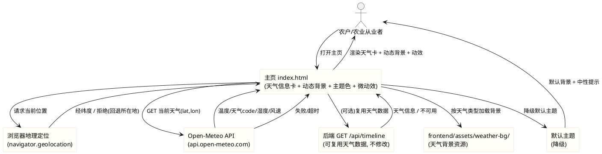
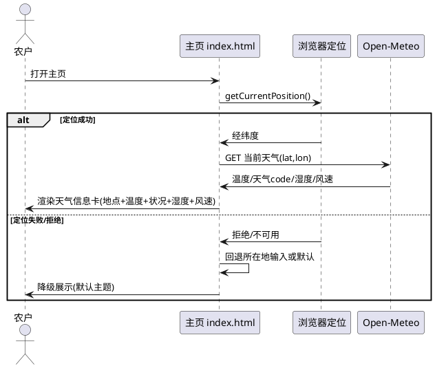
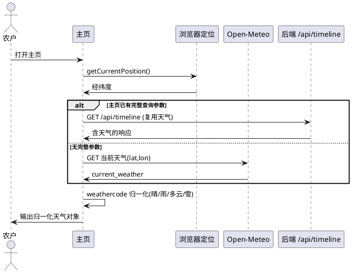
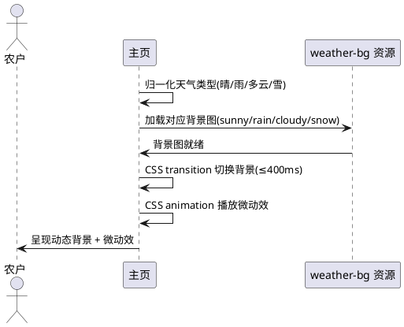
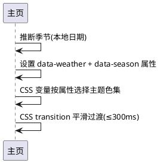
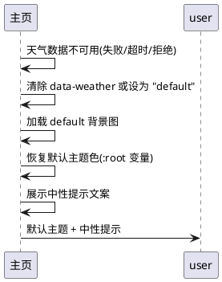

# T01 主页天气与视觉动态适配（t01_weather_visual）

> 本文档用于规范 agritime（知农时 · 会看天的农事日历）功能扩展任务书 V3.0 中任务编号 T01 的验收标准：主页新增当前地点与实时天气信息展示；根据实时天气（晴/雨/多云/雪等）与季节，自动切换主页背景图、主题色与微动效，模拟天气预报视觉效果。
> 范围红线：本次为**纯前端视觉动态适配**任务，仅允许修改 `frontend/` 目录下文件；须保证（1）前端 41/41 既有测试全绿、仅允许新增断言、（2）不引入框架/构建工具/第三方库、（3）不修改后端（Java/8080）与 nginx 配置、（4）天气数据不可用时降级为默认主题不白屏不报错、（5）天气背景资源放 `frontend/assets/weather-bg/` 遵循 T00 目录规范。
> 交付形式：本文档描述**做什么（What）**与**验收标准（Acceptance Criteria）**，不描述技术实现方式（How）；技术架构与代码结构由后续 design 阶段承接。
> 全局约束继承自 `stage2_frontend`（spec.md 60 条）：纯原生 JS + 原生 CSS、前端测试断言不可弱化、`crop-map.js` 5 个 cropId 不变、mock 保持 null 占位不造假、时间线页天气数据经后端 `GET /api/timeline` 获取。本任务**不改变时间线页既有天气逻辑**，仅新增**主页（index.html）顶部天气展示与视觉动态适配**。

# **1. 组件定位**

## **1.1 核心职责**
本组件负责在主页（index.html）顶部展示当前地点与实时天气信息，并依据实时天气类型与季节自动切换主页背景图、主题色与微动效，实现模拟天气预报的视觉动态效果。

## **1.2 核心输入**
1. 浏览器地理定位 API（`navigator.geolocation`）提供的当前经纬度——用于获取用户当前位置天气。
2. 用户在 index.html 所在地输入框填写的中文地名——地理定位不可用时的回退定位来源。
3. Open-Meteo API（`https://api.open-meteo.com/v1/forecast`）返回的当前天气数据——含温度、天气状况、湿度、风速。
4. 后端 `GET /api/timeline` 响应中可能包含的天气信息——当主页已具备 crop/sowDate/lat/lon 参数时（如从历史记录回填后）可复用后端天气数据，避免重复请求。
5. 本地系统日期——用于推断当前季节（春/夏/秋/冬），纳入主题色与背景考量。
6. 离线兜底数据 `frontend/assets/mock/mock-data.js`——天气数据不可用时的降级参照。

## **1.3 核心输出**
1. 主页顶部天气信息展示区域：当前地点 + 实时温度 + 天气状况 + 湿度 + 风速。
2. 依据天气类型动态切换的主页背景图（晴/雨/多云/雪四类）。
3. 依据天气类型与季节动态切换的主题色（通过 CSS 变量覆盖）。
4. 依据天气类型播放的微动效（晴日光、雨滴落、云飘移、雪飘落等，纯 CSS animation/transition 实现）。
5. 天气数据不可用时的默认主题视图（默认背景 + 默认主题色 + 中性提示）。

## **1.4 职责边界**
本组件**不负责**以下事项：
1. 后端 Java 服务（`/opt/crop-calendar`，8080）的任何修改——**明确禁止**修改后端代码、新增后端天气接口或改动后端配置。
2. nginx 反向代理配置的修改——**明确禁止**；本任务不依赖 nginx 新增代理路径。
3. 时间线页（timeline.html）既有天气逻辑的修改——时间线页天气数据仍经后端 `GET /api/timeline` 获取，节点天气图标映射（`timeline-logic.js` 的 `WEATHER_ICON_MAP`）保持不变。
4. 任何框架、构建工具、第三方库（含动画库 GSAP、天气库、图表库）的引入——**明确禁止**。
5. `frontend/tests/pages.test.js` 既有断言的删除、注释或弱化——**明确禁止**为通过新需求而修改既有测试预期。
6. `frontend/assets/mock/mock-data.js` 的内容造假——禁止硬编码虚假天气数据；mock 保持 null 占位。
7. 天气适宜度判定、农事建议等业务逻辑——归后端与时间线页；主页仅展示天气信息与视觉效果，不产生农事判断。

# **2. 领域术语**

**实时天气（Real-time Weather）**
: 指当前时刻某地点的气象状态，包含温度、天气状况（晴/雨/多云/雪等）、湿度、风速等要素，由 Open-Meteo API 或后端接口提供。

**天气主题（Weather Theme）**
: 指依据天气类型映射的一组视觉样式集合，包含背景图、主题色（CSS 变量）与微动效，用于动态适配主页视觉。

**微动效（Micro Animation）**
: 指依据天气类型在主页背景层播放的轻量级动态视觉效果（如晴日光晕脉动、雨滴下落、云层飘移、雪花飘落），须以纯 CSS `animation`/`transition` 实现，不依赖 JavaScript 动画库。

**降级主题（Fallback Theme）**
: 指天气数据不可用（定位失败、请求超时、接口异常、返回非法结构）时，主页回退使用的默认视觉样式（默认背景图 + 默认主题色 + 无动效或中性动效），保证页面不白屏、不报错。

**天气背景资源（Weather Background Asset）**
: 指存放于 `frontend/assets/weather-bg/` 目录下、按天气类型分类的背景图片资源（如 `sunny.jpg`、`rain.jpg`、`cloudy.jpg`、`snow.jpg`、`default.jpg`）。

**季节（Season）**
: 指依据本地系统日期推断的春夏秋冬四季，用于在相同天气类型下微调主题色（如冬季晴天偏冷蓝、夏季晴天偏暖金），推断规则为公历月份划分（3-5 月春、6-8 月夏、9-11 月秋、12-2 月冬）。

**Open-Meteo**
: 指开源气象数据 API（`https://api.open-meteo.com/v1/forecast`），提供基于经纬度的免费天气数据，无需 API Key；本任务中由前端直接调用以获取主页顶部实时天气。

**天气数据获取优先级（Weather Data Priority）**
: 指主页天气数据的取数顺序：优先复用后端 `GET /api/timeline` 响应中已含的天气信息（当主页已具备完整查询参数时）；其次前端直连 Open-Meteo API（基于浏览器定位或所在地经纬度）；两者均不可用时降级为默认主题。

**天气类型归一化（Weather Type Normalization）**
: 指将 Open-Meteo 的 weathercode（WMO 天气编码）或后端天气字段映射为前端四类主天气类型（晴/雨/多云/雪）的过程，未识别编码回退为默认类。

**EARS 需求编号约定**
: 本文档需求编号格式为 `REQ-TWV-XXX-NNN`，`TWV` 为 Task Weather Visual 缩写。前缀对应 EARS 句型：UBI（Ubiquitous，通用）、EVT（Event-driven，事件驱动）、STA（State-driven，状态驱动）、OPT（Optional，可选/带前提）、UNW（Unwanted，非期望行为）。

# **3. 角色与边界**

## **3.1 核心角色**
- **农户 / 农业从业者**：打开主页即看到当前地点与实时天气，视觉随天气动态变化；是本任务的直接受益对象。
- **测试维护者**：运行 `node --test frontend/tests/pages.test.js`，确认既有 41 项断言全绿并补充天气视觉相关新断言。
- **开发者 / 交付者**：在 `frontend/` 范围内改动代码（index.html、common.css、新增 weather-bg 资源与天气逻辑脚本）、提交 Git 并同步至服务器。

## **3.2 外部系统**
- **Open-Meteo API（`https://api.open-meteo.com/v1/forecast`）**：主页顶部实时天气数据的主来源（当后端天气数据不可复用时）；前端直接调用，传入经纬度与 current_weather 参数，返回温度、weathercode、风速、湿度等。
- **浏览器地理定位（`navigator.geolocation`）**：获取用户当前经纬度，作为 Open-Meteo 请求参数来源；用户拒绝授权或不可用时回退至所在地输入。
- **后端时间线接口（`GET /api/timeline?crop&sowDate&lat&lon`）**：当主页已具备完整查询参数（如历史记录回填后）时，可复用其响应中的天气信息，避免重复请求；本任务**不修改**该接口。
- **后端健康检查（`GET /health`）**：用于判断后端可用性（本任务不依赖，不修改）。
- **本地系统时钟**：提供当前日期，用于季节推断。
- **nginx（80 → 8080）**：前端与后端的反向代理承载（本任务不修改 nginx 配置；Open-Meteo 为前端直连外部 HTTPS 接口，不经 nginx 代理）。

## **3.3 交互上下文**

# **4. DFX约束**

## **4.1 性能**
1. 主页天气信息展示须在页面加载后 **≤ 1.5 秒**内呈现（含地理定位 + Open-Meteo 请求）；超时须降级为默认主题，不让用户无反馈等待。
2. 天气背景图切换须**无卡顿**：切换须以 CSS `transition`（如 `background-image` 淡入淡出或双层叠加切换）实现，单次切换过渡时长 ≤ 400ms，不得出现闪烁、白屏或布局跳动。
3. 微动效须以纯 CSS `animation`/`transition` 实现，**不使用 JavaScript 动画循环**（不使用 `requestAnimationFrame`、`setInterval` 驱动动画），避免主线程占用。
4. Open-Meteo 请求须设置超时上限 **≤ 8 秒（8000ms）**，超时后降级为默认主题。
5. 天气背景资源须为静态图片（JPG/PNG/SVG），单张体积 **≤ 300KB**，避免拖慢首屏加载。
6. 天气数据请求与背景资源加载须**不阻塞**主页表单的交互（用户可在天气加载期间正常填写作物/日期/所在地并提交）。

## **4.2 可靠性**
1. 天气数据不可用（定位失败、Open-Meteo 请求失败/超时、返回非法结构、后端天气数据缺失）时，主页须**降级为默认主题**，不白屏、不抛未捕获 JS 错误。
2. 降级须有**可见标识**（如"天气数据暂不可用"文案或默认背景），不得静默失败导致用户困惑。
3. 天气信息展示与实际天气数据须**保持一致**：数据刷新后展示须同步更新，不得残留上一次的天气信息或主题状态。
4. 浏览器不支持 `navigator.geolocation` 或用户拒绝授权时，须回退至所在地输入推断经纬度；所在地也为空时降级为默认主题。
5. Open-Meteo 返回的 weathercode 未识别时，须回退为默认天气类型，不报错、不空白。

## **4.3 安全性**
1. Open-Meteo API 调用须使用标准 URL 参数拼装（`URLSearchParams` 或等价编码），防止参数注入。
2. Open-Meteo 为免费公开 API，**无需 API Key**；禁止在前端代码中硬编码任何 API Key、令牌或凭据。
3. 渲染天气信息（地点、温度、天气状况等）时须使用 `textContent` 等安全方式，禁止将未转义的外部数据拼入 `innerHTML`（防 XSS）。
4. 浏览器地理定位须在**用户授权**后使用，不得静默获取；须遵循浏览器隐私权限规范。
5. 不得在 `localStorage` 或任何本地存储中写入用户精确经纬度等敏感位置信息（历史记录仅存作物名/日期/所在地中文文本，沿用既有约定）。

## **4.4 可维护性**
1. 天气类型映射（Open-Meteo weathercode → 晴/雨/多云/雪四类）、主题色映射、背景资源路径映射、季节推断规则须以**具名常量**集中定义，不得多处硬编码。
2. 未识别的 weathercode 或天气类型须有**统一回退分支**，避免新增编码导致渲染报错。
3. 天气背景资源须按 `frontend/assets/weather-bg/<天气类型>.<扩展名>` 命名规范存放，便于维护与扩展。
4. 天气数据获取逻辑须与视觉渲染逻辑**解耦**：取数模块输出归一化天气对象，渲染模块消费该对象，便于后续替换数据源或扩展天气类型。

## **4.5 兼容性**
1. **测试兼容（强制红线）**：不得破坏 `frontend/tests/pages.test.js` 的既有 41 项断言；可新增断言，既有断言须全绿。运行命令：`node --test frontend/tests/pages.test.js`。
2. **响应式兼容**：375px、768px、1024px 三档宽度下均须无横向滚动，天气信息卡与动态背景须在三档下均正常展示。
3. **不可引入依赖**：不得引入框架、构建工具、第三方库（含动画库、天气库、图表库）。
4. **文件范围兼容**：仅修改 `frontend/` 目录下文件；不得修改后端、`shared/`、`data/`、`deploy/`、`docs/` 等模块。
5. **接口兼容**：不得改变前端既有的 `GET /api/timeline` 取数方式与参数命名；不得改变 index.html 既有表单字段（crop/sowingDate/location）的 id 与提交逻辑。
6. **浏览器兼容**：须在主流现代浏览器（Chrome/Edge/Safari 近两版）与移动端 WebView 下可用；`navigator.geolocation` 不可用时须优雅降级。
7. **目录规范兼容**：天气背景资源须存放于 `frontend/assets/weather-bg/`，遵循 T00 目录规范。

# **5. 核心能力**

## **5.1 主页顶部天气信息展示**

### **5.1.1 业务规则**

1. **REQ-TWV-UBI-001（Ubiquitous）**：系统须在主页（index.html）顶部、品牌头与表单卡片之间，设置一个天气信息展示区域，作为天气视觉动态适配的信息载体。
   a. 验收条件：[打开 index.html] → [页面顶部存在天气信息展示区域，位于品牌头下方、表单上方]

2. **REQ-TWV-UBI-002（Ubiquitous）**：天气信息展示区域须展示**当前地点**（中文地名或"当前位置"），地点来源为浏览器地理定位逆解析、所在地输入或默认占位。
   a. 验收条件：[天气数据加载完成] → [天气区域展示当前地点文本，非空]

3. **REQ-TWV-UBI-003（Ubiquitous）**：天气信息展示区域须展示**实时温度**（单位 ℃），温度值来自 Open-Meteo 或后端天气数据。
   a. 验收条件：[天气数据含温度 25℃] → [天气区域展示"25℃"或"25 °C"类温度文本]

4. **REQ-TWV-UBI-004（Ubiquitous）**：天气信息展示区域须展示**天气状况**（如"晴""雨""多云""雪"），天气状况由 weathercode 归一化为可读中文。
   a. 验收条件：[weathercode 对应晴天] → [天气区域展示"晴"]；[对应雨天] → [展示"雨"]

5. **REQ-TWV-UBI-005（Ubiquitous）**：天气信息展示区域须展示**湿度**（单位 %），湿度值来自 Open-Meteo current_weather 或 hourly 数据。
   a. 验收条件：[天气数据含湿度 65%] → [天气区域展示"65%"或"湿度 65%"类文本]

6. **REQ-TWV-UBI-006（Ubiquitous）**：天气信息展示区域须展示**风速**（单位 m/s 或 km/h），风速值来自 Open-Meteo current_weather。
   a. 验收条件：[天气数据含风速 3.2 m/s] → [天气区域展示"3.2 m/s"或等价风速文本]

7. **REQ-TWV-EVT-007（Event-driven）**：当天气数据刷新（如重新定位、重新请求）时，系统须同步更新天气信息展示区域的内容。
   a. 验收条件：[天气数据由晴变为雨] → [天气区域温度/状况/湿度/风速同步更新为雨的数据]

8. **REQ-TWV-OPT-008（Optional/带前提）**：当某天气字段缺失（如 Open-Meteo 未返回湿度）时，系统须对该字段展示占位（如"--"）或不展示该字段，且不得因此报错。
   a. 验收条件：[湿度字段缺失] → [湿度位置展示"--"或隐藏，其余字段正常，无报错]

9. **禁止项**：禁止天气信息展示区域遮挡或挤压既有表单卡片（作物/日期/所在地输入区）；禁止展示虚假/硬编码的天气数值。
   a. 验收条件：[视觉核对 + 代码审查] → [天气区域与表单不重叠；天气数值均来自接口或定位，无硬编码]

### **5.1.2 交互流程**

### **5.1.3 异常场景**

1. **浏览器不支持地理定位**
   a. 触发条件：`navigator.geolocation` 为 undefined
   b. 系统行为：回退至所在地输入推断经纬度，或直接降级默认主题
   c. 用户感知：天气区域展示默认主题或提示"定位不可用"，表单正常可用

2. **Open-Meteo 返回非法结构**
   a. 触发条件：响应非 JSON 或缺少 current_weather 字段
   b. 系统行为：捕获异常，降级为默认主题
   c. 用户感知：看到默认背景与中性提示，无白屏、无控制台错误

## **5.2 天气数据获取**

### **5.2.1 业务规则**

1. **REQ-TWV-UBI-009（Ubiquitous）**：系统须通过浏览器地理定位 API（`navigator.geolocation.getCurrentPosition`）获取用户当前经纬度，作为天气请求的位置参数；定位须在用户授权后执行。
   a. 验收条件：[用户授权定位] → [系统获取经纬度并用于天气请求]；[用户拒绝] → [回退所在地输入或降级]

2. **REQ-TWV-EVT-010（Event-driven）**：当获取到经纬度后，系统须前端直连 Open-Meteo API（`https://api.open-meteo.com/v1/forecast`）请求当前天气数据，请求参数须包含 `latitude`、`longitude`、`current_weather=true` 及湿度/风速相关参数。
   a. 验收条件：[获取经纬度 (35.07, 116.31)] → [发起 Open-Meteo 请求，URL 含该经纬度与 current_weather 参数]

3. **REQ-TWV-OPT-011（Optional/带前提）**：当主页已具备完整查询参数（crop/sowDate/lat/lon，如从历史记录回填后）且后端 `GET /api/timeline` 响应中含天气信息时，系统可优先复用后端天气数据，避免重复请求 Open-Meteo。
   a. 验收条件：[主页已有完整参数且后端响应含天气] → [复用后端天气数据，不发起 Open-Meteo 请求]

4. **REQ-TWV-UNW-012（Unwanted）**：如果天气数据请求（Open-Meteo 或后端）失败、超时（>8 秒）或返回非法结构，系统不得抛出未捕获 JS 错误，须进入降级流程。
   a. 验收条件：[Open-Meteo 请求超时] → [无未捕获错误，进入降级默认主题]

5. **REQ-TWV-UBI-013（Ubiquitous）**：主页展示的天气数据须与数据源（Open-Meteo 或后端天气接口）保持一致，不得在前端臆造或篡改温度、湿度、风速等数值。
   a. 验收条件：[Open-Meteo 返回温度 25℃] → [主页展示 25℃，无前端修正/臆造]

6. **REQ-TWV-UBI-014（Ubiquitous）**：系统须将 Open-Meteo 的 weathercode（WMO 天气编码）归一化为前端四类主天气类型（晴/雨/多云/雪），归一化映射须以具名常量集中定义；未识别的 weathercode 须回退为默认类型。
   a. 验收条件：[weathercode=0（晴天）] → [归一化为"晴"]；[weathercode=61（小雨）] → [归一化为"雨"]；[未识别 code] → [回退默认]

7. **禁止项**：禁止在前端硬编码天气数值（温度/湿度/风速）；禁止存储或泄露用户精确经纬度至本地存储；禁止未经用户授权静默调用地理定位。
   a. 验收条件：[代码审查] → [天气数值来自接口；本地无经纬度存储；定位经用户授权]

### **5.2.2 交互流程**

### **5.2.3 异常场景**

1. **Open-Meteo 请求超时**
   a. 触发条件：请求超过 8 秒未返回
   b. 系统行为：中止请求，降级为默认主题
   c. 用户感知：看到默认背景与"天气数据暂不可用"提示

2. **用户拒绝地理定位授权**
   a. 触发条件：浏览器弹出授权请求，用户选择拒绝
   b. 系统行为：回退至所在地输入推断经纬度；所在地为空则降级默认主题
   c. 用户感知：天气区域提示"定位未授权"或展示默认主题，表单正常可用

## **5.3 四类天气背景与动效**

### **5.3.1 业务规则**

1. **REQ-TWV-UBI-015（Ubiquitous）**：系统须为**晴天**类型提供专属背景图与微动效：背景图存放于 `frontend/assets/weather-bg/sunny.<ext>`，微动效为日光晕脉动或光线流动效果，以纯 CSS `animation` 实现。
   a. 验收条件：[天气归一化为"晴"] → [主页背景切换为 sunny 背景图，播放日光类微动效]

2. **REQ-TWV-UBI-016（Ubiquitous）**：系统须为**雨天**类型提供专属背景图与微动效：背景图存放于 `frontend/assets/weather-bg/rain.<ext>`，微动效为雨滴下落效果，以纯 CSS `animation` 实现。
   a. 验收条件：[天气归一化为"雨"] → [主页背景切换为 rain 背景图，播放雨滴下落微动效]

3. **REQ-TWV-UBI-017（Ubiquitous）**：系统须为**多云**类型提供专属背景图与微动效：背景图存放于 `frontend/assets/weather-bg/cloudy.<ext>`，微动效为云层飘移效果，以纯 CSS `animation` 实现。
   a. 验收条件：[天气归一化为"多云"] → [主页背景切换为 cloudy 背景图，播放云层飘移微动效]

4. **REQ-TWV-UBI-018（Ubiquitous）**：系统须为**雪天**类型提供专属背景图与微动效：背景图存放于 `frontend/assets/weather-bg/snow.<ext>`，微动效为雪花飘落效果，以纯 CSS `animation` 实现。
   a. 验收条件：[天气归一化为"雪"] → [主页背景切换为 snow 背景图，播放雪花飘落微动效]

5. **REQ-TWV-UBI-019（Ubiquitous）**：所有天气背景资源须存放于 `frontend/assets/weather-bg/` 目录下，遵循 T00 目录规范；该目录须至少含 sunny、rain、cloudy、snow、default 五类背景资源。
   a. 验收条件：[审查 frontend/assets/weather-bg/] → [存在 sunny、rain、cloudy、snow、default 背景资源文件]

6. **REQ-TWV-UBI-020（Ubiquitous）**：天气背景切换须无卡顿：切换须以 CSS `transition`（淡入淡出或双层叠加）实现，过渡时长 ≤ 400ms，不得出现闪烁、白屏或布局跳动。
   a. 验收条件：[天气由晴切为雨] → [背景在 ≤400ms 内平滑过渡，无闪烁/白屏/跳动]

7. **REQ-TWV-UBI-021（Ubiquitous）**：所有微动效须以纯 CSS `animation`/`transition` 实现，**不使用 JavaScript 动画循环**（不使用 `requestAnimationFrame`、`setInterval` 驱动动画），且须尊重 `prefers-reduced-motion` 媒体查询，用户设置减少动效时须禁用动效。
   a. 验收条件：[代码审查] → [动效由 CSS animation 实现，无 JS 动画循环；开启减少动效时动效禁用]

8. **REQ-TWV-OPT-022（Optional/带前提）**：当天气类型不属于晴/雨/多云/雪四类（如阴、雾、雷等）时，系统须将其映射至最接近的四类之一（如阴→多云、雾→多云、雷→雨）或回退为默认背景，不报错。
   a. 验收条件：[天气为"阴"] → [背景映射为多云或默认，无报错]；[天气为"雾"] → [映射为多云或默认]

9. **禁止项**：禁止用同一背景表示所有天气类型；禁止动效遮挡天气信息文字与表单输入区；禁止动效导致 CPU 持续高占用（须为 CSS 合成层动画）。
   a. 验收条件：[视觉核对 + 代码审查] → [不同天气映射不同背景；动效不遮挡信息与表单；动效为 CSS 合成层]

### **5.3.2 交互流程**

### **5.3.3 异常场景**

1. **天气背景资源加载失败**
   a. 触发条件：背景图 404 或加载超时
   b. 系统行为：回退为 default 背景或纯色背景
   c. 用户感知：看到默认背景，无破图、无白屏

2. **用户开启减少动效偏好**
   a. 触发条件：`prefers-reduced-motion: reduce`
   b. 系统行为：禁用所有微动效，仅展示静态背景图
   c. 用户感知：背景为静态图片，无动画

## **5.4 主题色切换**

### **5.4.1 业务规则**

1. **REQ-TWV-UBI-023（Ubiquitous）**：系统须为四类天气类型定义对应的主题色集合（通过 CSS 变量覆盖 `:root` 既有变量或新增天气主题变量），如晴天偏暖金/绿、雨天偏冷蓝、多云偏灰蓝、雪天偏冷白蓝。
   a. 验收条件：[天气为晴] → [主题色切换为晴天色系]；[天气为雨] → [切换为雨天色系]

2. **REQ-TWV-UBI-024（Ubiquitous）**：主题色切换须通过 CSS 自定义属性（CSS 变量）实现：在主页根元素或天气区域容器上设置 `data-weather` 属性（如 `data-weather="sunny"`），CSS 依据该属性选择对应变量集，**不通过 JavaScript 直接操作样式**逐个赋值。
   a. 验收条件：[代码审查] → [主题色由 CSS 变量 + data-weather 属性选择器实现，无 JS 逐个赋值样式]

3. **REQ-TWV-UBI-025（Ubiquitous）**：系统须将**季节**因素纳入主题色考量：依据本地系统日期推断当前季节（3-5 月春、6-8 月夏、9-11 月秋、12-2 月冬），在相同天气类型下微调主题色（如冬季晴天偏冷蓝、夏季晴天偏暖金）。
   a. 验收条件：[当前为冬季且天气为晴] → [主题色偏冷蓝]；[当前为夏季且天气为晴] → [主题色偏暖金]

4. **REQ-TWV-UBI-026（Ubiquitous）**：主题色切换须与背景切换同步进行，且切换过渡须平滑（CSS `transition` 实现，时长 ≤ 300ms），不得出现色彩跳变。
   a. 验收条件：[天气由晴切为雨] → [主题色在 ≤300ms 内平滑过渡，无跳变]

5. **禁止项**：禁止主题色导致文字对比度不足（须保证 WCAG AA 级文字对比度）；禁止主题色影响时间线页（timeline.html）的既有配色。
   a. 验收条件：[视觉核对] → [文字可读性良好；timeline.html 配色不变]

### **5.4.2 交互流程**

### **5.4.3 异常场景**

1. **季节推断异常**
   a. 触发条件：系统日期不可用或非法
   b. 系统行为：回退为默认季节（如春秋）主题色
   c. 用户感知：主题色为默认色系，无报错

## **5.5 降级机制**

### **5.5.1 业务规则**

1. **REQ-TWV-UNW-027（Unwanted）**：如果天气数据不可用（定位失败、Open-Meteo 请求失败/超时、后端天气数据缺失、返回非法结构），系统不得白屏、不得抛未捕获错误，须降级为默认主题。
   a. 验收条件：[天气数据不可用] → [主页展示默认背景 + 默认主题色，无白屏、无未捕获错误]

2. **REQ-TWV-UBI-028（Ubiquitous）**：默认主题须包含：默认背景图（`frontend/assets/weather-bg/default.<ext>`）、默认主题色（沿用既有 `:root` 变量）、无微动效或中性微动效。
   a. 验收条件：[降级触发] → [背景为 default 背景图，主题色为既有默认色，无天气动效]

3. **REQ-TWV-UBI-029（Ubiquitous）**：降级须有**可见标识**：天气信息展示区域须展示中性提示（如"天气数据暂不可用"或"定位未授权"），不得静默降级导致用户困惑。
   a. 验收条件：[降级触发] → [天气区域展示可读的中性提示文案]

4. **REQ-TWV-OPT-030（Optional/带前提）**：当天气请求超时（>8 秒）时，系统须中止请求并降级为默认主题，且降级须与既有 20 秒（20000ms）超时降级机制衔接（天气请求超时阈值 8 秒 < 既有 20 秒，天气先降级，不影响后续表单提交逻辑）。
   a. 验收条件：[Open-Meteo 请求 >8 秒] → [中止请求，降级默认主题，表单仍可正常提交]

5. **REQ-TWV-UBI-031（Ubiquitous）**：降级后若用户手动刷新页面或重新授权定位，系统须重新尝试获取天气数据，不永久停留在降级态。
   a. 验收条件：[降级后刷新页面并授权定位] → [重新请求天气，成功则恢复动态主题]

6. **禁止项**：禁止降级时展示误导性天气信息（如硬编码"晴 25℃"）；禁止降级影响表单正常提交；禁止降态后残留上一次的天气主题状态。
   a. 验收条件：[降级核对] → [无硬编码天气数值；表单可提交；无残留主题]

### **5.5.2 交互流程**

### **5.5.3 异常场景**

1. **默认背景资源也加载失败**
   a. 触发条件：`default.<ext>` 404
   b. 系统行为：回退为纯色背景（CSS `background-color`）
   c. 用户感知：看到纯色背景与中性提示，无白屏

## **5.6 响应式适配**

### **5.6.1 业务规则**

1. **REQ-TWV-UBI-032（Ubiquitous）**：系统须在 **375px、768px、1024px** 三档视口宽度下均无横向滚动条，天气信息展示区域与动态背景须在三档下均正常展示。
   a. 验收条件：[分别在 375/768/1024px 宽度打开 index.html] → [三档下均无横向滚动，天气区域与背景正常]

2. **REQ-TWV-UBI-033（Ubiquitous）**：天气信息展示区域须在窄屏（375px）下紧凑布局（如单行或两行排列），在宽屏（768px+）下可展开为更宽松的布局，须使用纯 CSS 媒体查询实现。
   a. 验收条件：[375px 查看] → [天气区域紧凑无溢出]；[768px 查看] → [天气区域宽松布局，元素不变形]

3. **REQ-TWV-UBI-034（Ubiquitous）**：动态背景须在三档宽度下均**铺满**视口（`background-size: cover` 或等价），不得出现背景图重复、留白或变形。
   a. 验收条件：[三档宽度查看背景] → [背景铺满视口，无重复/留白/变形]

4. **REQ-TWV-UBI-035（Ubiquitous）**：响应式须使用纯 CSS（媒体查询/流式布局）实现，不引入任何栅格框架或第三方响应式库。
   a. 验收条件：[代码审查] → [响应式由项目内 CSS 媒体查询实现，无第三方库]

5. **禁止项**：禁止通过隐藏天气信息或核心表单内容来"规避"横向滚动。
   a. 验收条件：[三档宽度核对] → [天气信息与表单均完整可见，未以隐藏内容换取无滚动]

## **5.7 范围与兼容性约束**

### **5.7.1 业务规则**

1. **REQ-TWV-UBI-036（Ubiquitous）**：本次改动须**仅限 `frontend/` 目录**：仅修改 `frontend/pages/index.html`、`frontend/assets/css/common.css`（或新增天气样式文件）、新增 `frontend/assets/weather-bg/` 背景资源、新增天气逻辑脚本（如 `frontend/assets/js/weather-visual.js`）；不得修改后端、`shared/`、`data/`、`deploy/`、`docs/`。
   a. 验收条件：[git diff 审查] → [改动文件均在 frontend/ 下，无后端/shared/data/deploy/docs 改动]

2. **REQ-TWV-UBI-037（Ubiquitous）**：不得引入任何框架、构建工具、第三方库（含动画库 GSAP/Lottie、天气库、图表库、CSS 框架 Tailwind/Bootstrap）；所有逻辑须以纯原生 JS + 原生 CSS 实现。
   a. 验收条件：[代码审查 + package.json 审查] → [无新增依赖，无 import 第三方库语句]

3. **REQ-TWV-UBI-038（Ubiquitous）**：改造后前端测试须 `node --test frontend/tests/pages.test.js` 既有 41 项断言全部通过，不得删除、注释或弱化既有断言。
   a. 验收条件：[运行 node --test frontend/tests/pages.test.js] → [既有 41 项断言全绿，无失败]

4. **REQ-TWV-UBI-039（Ubiquitous）**：系统须针对本次新增能力补充必要测试断言（如天气信息区域存在、weathercode 归一化映射、四类天气背景资源存在、降级默认主题、data-weather 属性切换等），且不得破坏既有断言。
   a. 验收条件：[测试套件运行] → [新增断言通过，既有 41 项断言仍全绿]

5. **REQ-TWV-UBI-040（Ubiquitous）**：本次改动须**不改变 index.html 既有表单字段**（crop/sowingDate/location 的 id 与 name）与**提交逻辑**（`buildTimelineQuery`、跳转 timeline.html 的既有行为），天气展示与视觉适配须作为**增量叠加**，不破坏既有交互。
   a. 验收条件：[代码审查 + 交互核对] → [表单字段 id/name 不变，提交跳转逻辑不变，天气为增量叠加]

6. **REQ-TWV-UBI-041（Ubiquitous）**：本次改动须**不改变时间线页（timeline.html）既有天气逻辑**：`timeline-logic.js` 的 `WEATHER_ICON_MAP`、`getWeatherIcon` 等既有映射保持不变，时间线页天气数据仍经后端 `GET /api/timeline` 获取。
   a. 验收条件：[git diff 审查 timeline-logic.js] → [既有天气映射不变]

7. **REQ-TWV-UBI-042（Ubiquitous）**：`frontend/assets/mock/mock-data.js` 须保持 null 占位不造假，不得为天气视觉适配硬编码虚假天气数值；mock 结构可同步扩充天气相关字段（如主页天气占位），但值须为 null。
   a. 验收条件：[审查 mock-data.js] → [天气相关字段为 null 占位，无硬编码数值]

8. **禁止项**：禁止修改后端 Java 代码或新增后端天气接口；禁止修改 nginx 配置；禁止为天气视觉适配引入任何第三方依赖；禁止弱化既有测试断言。
   a. 验收条件：[git diff + 代码审查] → [无后端/nginx 改动，无新依赖，测试断言未弱化]

# **6. 数据约束**

## **6.1 天气信息对象（展示用）**
1. **location**：当前地点文本，字符串，可为中文地名或"当前位置"；定位失败时为"定位未授权"或空。
2. **temperature**：实时温度，数值，单位 ℃；可为 null（数据缺失时占位"--"）。
3. **weatherType**：归一化天气类型，枚举值 `sunny`（晴）/`rain`（雨）/`cloudy`（多云）/`snow`（雪）/`default`（默认/未识别）；须可映射到背景与主题。
4. **weatherLabel**：天气状况可读文本，字符串，如"晴""雨""多云""雪"；由 weatherType 映射，未识别时为原始 weathercode 文本或"未知"。
5. **humidity**：湿度，数值，取值范围 [0, 100]，单位 %；可为 null。
6. **windSpeed**：风速，数值，单位 m/s；可为 null。
7. **weathercode**：Open-Meteo WMO 天气编码，整数；归一化前原始值，用于映射 weatherType。
8. **season**：季节，枚举值 `spring`（春）/`summer`（夏）/`autumn`（秋）/`winter`（冬）；由本地日期推断。

## **6.2 天气主题对象（视觉用）**
1. **weatherType**：天气类型，枚举值同 6.1.weatherType，用于 `data-weather` 属性。
2. **season**：季节，枚举值同 6.1.season，用于 `data-season` 属性。
3. **backgroundImage**：背景图路径，字符串，格式 `../assets/weather-bg/<weatherType>.<ext>`；default 类型为 `../assets/weather-bg/default.<ext>`。
4. **themeVars**：主题色 CSS 变量集合，对象，含 `--leaf`、`--sun`、`--rain` 等变量覆盖值；由 weatherType + season 联合决定。
5. **animationClass**：微动效 CSS 类名，字符串，如 `anim-sunny`、`anim-rain`、`anim-cloudy`、`anim-snow`；default 类型为空或 `anim-default`。

## **6.3 weathercode 归一化映射（WMO 编码 → 四类）**
1. **晴天类（sunny）**：weathercode 0（晴天）、1（主要晴）；可含 2（部分多云）视设计而定。
2. **多云类（cloudy）**：weathercode 2（部分多云）、3（阴天）、45（雾）、48（雾凇）。
3. **雨天类（rain）**：weathercode 51-67（毛毛雨至冻雨）、71-77 可归雪、80-82（阵雨）、95-99（雷暴）。
4. **雪天类（snow）**：weathercode 71（小雪）、73（中雪）、75（大雪）、77（雪粒）、85-86（阵雪）。
5. **默认类（default）**：未识别的 weathercode 或数据缺失时回退。
6. **映射须以具名常量集中定义**，不得散落多处硬编码。

## **6.4 季节推断规则**
1. **春季（spring）**：3、4、5 月。
2. **夏季（summer）**：6、7、8 月。
3. **秋季（autumn）**：9、10、11 月。
4. **冬季（winter）**：12、1、2 月。
5. **推断依据**：本地系统日期 `new Date().getMonth()`（0-11），不发起网络请求。

# **7. 需求归类与交付边界**

> 本章明确区分"前端代码修改（允许且必须）"、"新增资源（允许）"、"不触碰项"与"排除项"。

## **7.1 前端代码修改（允许且必须，范围限 `frontend/`）**
1. `frontend/pages/index.html`：新增天气信息展示区域（顶部）、引入天气视觉脚本、设置 `data-weather`/`data-season` 属性挂钩。—— 对应 REQ-TWV-UBI-001~008、023~026、036~040。
2. `frontend/assets/css/common.css`（或新增 `frontend/assets/css/weather-visual.css`）：天气信息卡样式、四类天气背景与主题色 CSS 变量集、微动效 `@keyframes`、响应式媒体查询、`prefers-reduced-motion` 支持。—— 对应 REQ-TWV-UBI-015~021、023~026、032~035。
3. 新增 `frontend/assets/js/weather-visual.js`（或等价脚本）：天气数据获取（地理定位 + Open-Meteo）、weathercode 归一化、季节推断、主题切换、降级逻辑。—— 对应 REQ-TWV-UBI-009~014、027~031。
4. `frontend/tests/pages.test.js`：新增天气视觉相关断言（天气区域存在、归一化映射、背景资源存在、降级默认主题等），既有 41 项断言保持全绿。—— 对应 REQ-TWV-UBI-038~039。
5. `frontend/assets/mock/mock-data.js`：可同步扩充主页天气占位字段（值为 null），不造假。—— 对应 REQ-TWV-UBI-042。

## **7.2 新增资源（允许）**
1. `frontend/assets/weather-bg/sunny.<ext>`：晴天背景图。—— 对应 REQ-TWV-UBI-015/019。
2. `frontend/assets/weather-bg/rain.<ext>`：雨天背景图。—— 对应 REQ-TWV-UBI-016/019。
3. `frontend/assets/weather-bg/cloudy.<ext>`：多云背景图。—— 对应 REQ-TWV-UBI-017/019。
4. `frontend/assets/weather-bg/snow.<ext>`：雪天背景图。—— 对应 REQ-TWV-UBI-018/019。
5. `frontend/assets/weather-bg/default.<ext>`：默认背景图（降级用）。—— 对应 REQ-TWV-UBI-019/028。

## **7.3 不触碰项（保持不变）**
1. 后端 Java 服务（`/opt/crop-calendar`，8080）：不修改代码、不新增接口、不改动配置。—— 对应 REQ-TWV-UBI-036/041。
2. nginx 配置：不修改（Open-Meteo 为前端直连外部 HTTPS，不经 nginx 代理）。—— 对应 REQ-TWV-UBI-036。
3. `frontend/pages/timeline.html`：时间线页既有天气逻辑不变。—— 对应 REQ-TWV-UBI-041。
4. `frontend/assets/js/timeline-logic.js`：既有 `WEATHER_ICON_MAP`、`getWeatherIcon` 等映射不变。—— 对应 REQ-TWV-UBI-041。
5. `frontend/assets/js/crop-map.js`：5 个 cropId 不变。—— 继承 stage2_frontend。
6. index.html 既有表单字段（crop/sowingDate/location）的 id、name 与提交跳转逻辑：不变。—— 对应 REQ-TWV-UBI-040。
7. `shared/`、`data/`、`deploy/`、`docs/`：不修改。—— 对应 REQ-TWV-UBI-036。

## **7.4 排除项**
1. 后端天气接口的新增或修改：**明确禁止**（仅改前端）。
2. nginx 代理 Open-Meteo 的配置新增：**明确禁止**（不修改 nginx）。
3. 框架/构建工具/第三方库的引入：**明确禁止**。
4. 时间线页天气逻辑的修改：**明确禁止**（本任务仅主页）。
5. 天气适宜度判定/农事建议等业务逻辑：**明确禁止**（归后端与时间线页）。
6. mock 数据造假：**明确禁止**（保持 null 占位）。

## **7.5 交付任务**
1. **Git 提交**：完成后须提交并推送至 GitHub 仓库 `lj-tang/agritime`，提交信息须体现 T01 任务编号。
2. **服务器同步**：修改后的项目须能同步至目标服务器 115.175.44.27 的 `/agritime`，且 nginx root `/agritime/frontend/pages` 路径仍有效（因 frontend/pages/ 位置不变）。
3. **测试验证**：交付前须运行 `node --test frontend/tests/pages.test.js` 确认既有 41 项断言全绿 + 新增断言通过。
4. **视觉验证**：交付前须在晴天/雨天/多云/雪天四类天气下分别验证主页背景、主题色、微动效切换无卡顿，并在天气不可用时验证降级默认主题不白屏。