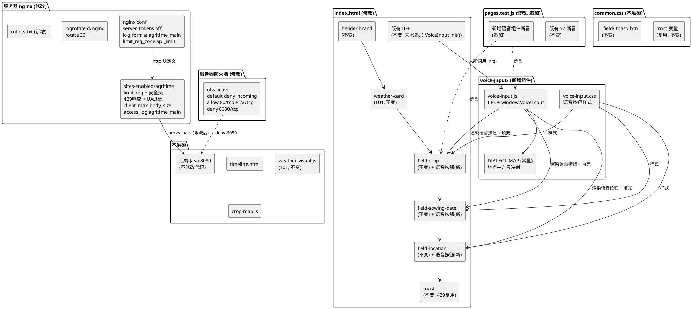
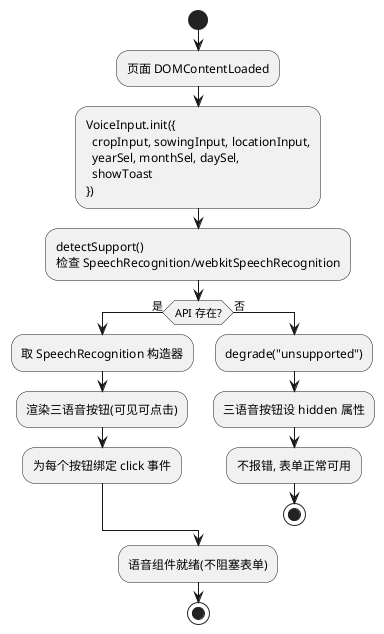
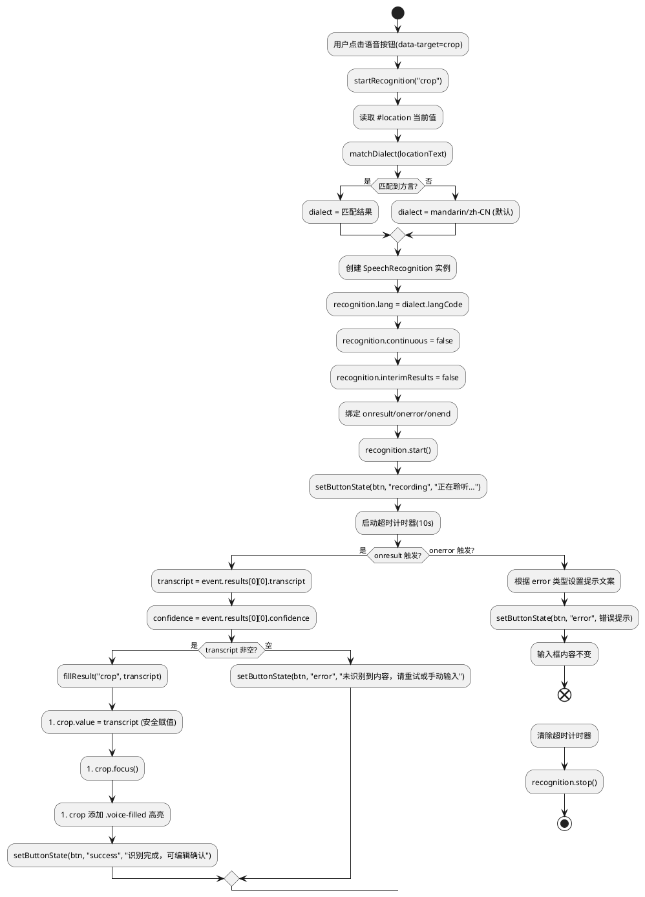
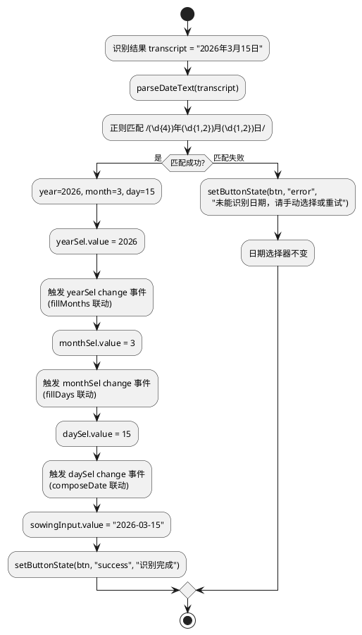
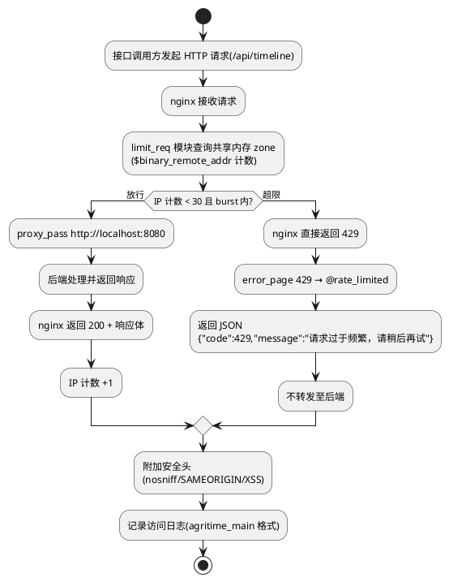
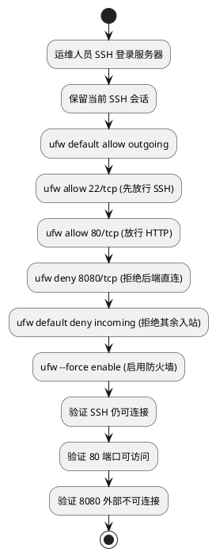
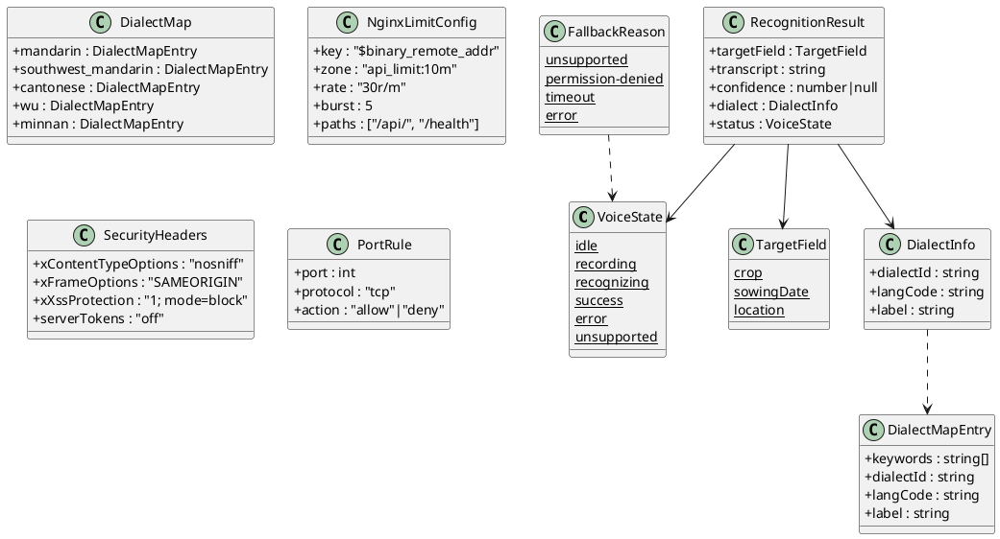

# T08 语音交互与方言适配 + T10 安全机制与服务器升级 · 技术设计（t08_t10_voice_security）

> 本方案基于 `t08_t10_voice_security/spec.md`（REQ-TVS-UBI/EVT/STA/OPT/UNW-001 ~ 058，共 58 条 EARS 需求）生成。
> 设计范围分两部分：**T08 前端语音组件**（仅修改/新增 `frontend/` 目录下文件）+ **T10 服务器安全加固**（仅修改服务器 nginx 配置与防火墙规则，不修改前端/后端 Java 代码）。
> 强约束（红线）：
> 1. 前端 52/52 既有测试全绿（`node --test frontend/tests/pages.test.js`），仅允许新增断言；
> 2. 不引入框架/构建工具/第三方库/第三方语音 SDK（百度/讯飞/阿里等），仅使用浏览器原生 Web Speech API；
> 3. T08 仅修改/新增 `frontend/` 目录下文件（`frontend/components/voice-input/` 及 index.html 引入），不修改后端/nginx/shared/data/deploy/docs；
> 4. T10 仅修改服务器 nginx 配置（`/etc/nginx/`）与防火墙规则，不修改前端代码、不修改后端 Java 代码；
> 5. 不改变 index.html 既有表单字段（crop/sowingDate/location）id/name/类型与提交跳转逻辑（`buildTimelineQuery`/`validate()`）；
> 6. 不改变时间线页（timeline.html）既有逻辑；
> 7. `mock-data.js` 保持 null 占位不造假；
> 8. 语音音频流不在前端持久化、不上传第三方、不写 localStorage；识别结果填充用 `value`/`textContent` 安全方式，禁 `innerHTML`。
> 全局约束继承自 `stage2_frontend`（60 条）、`t00_directory_migration`（49 条）与 `t01_weather_visual`（42 条）：纯原生 JS + 原生 CSS、前端测试断言不可弱化、`crop-map.js` 5 个 cropId 不变、mock 保持 null 占位不造假、时间线页天气数据经后端 `GET /api/timeline` 获取、主页天气视觉（T01）已落地不改变。

# 一、需求与存量功能关系分析

## 1.1 需求功能与存量功能对比

### 1.1.1 已实现功能

> 已实现功能是指需求与存量代码完全匹配或高度相似、可直接复用或仅需少量叠加的部分。

| 需求功能 | 存量功能 | 代码位置 | 匹配度 |
|---------|---------|---------|--------|
| 主页三输入框结构（REQ-TVS-UBI-001 语音按钮挂载基准） | `index.html` 已有 `#crop`（第 38 行 text）、`#sowingDate`（第 49 行 hidden + `#date-year`/`#date-month`/`#date-day` 三 select）、`#location`（第 57 行 text） | `frontend/pages/index.html:36-59` | 100%（三输入框已存在，语音按钮作为增量叠加在其旁即可） |
| 表单 `.field` 容器结构（REQ-TVS-UBI-002 语音按钮挂载点） | `index.html` 每个输入框包裹在 `<div class="field" id="field-xxx">` 中，含 label + input + error | `frontend/pages/index.html:36,43,55` | 100%（语音按钮可挂载到 `.field` 容器内 input 旁） |
| CSS 变量主题色体系（REQ-TVS-UBI-002 语音按钮样式基础） | `common.css` `:root` 已定义 `--leaf`/`--leaf-2`/`--leaf-soft`/`--ink`/`--muted`/`--line`/`--radius-sm`/`--shadow-soft` 等变量 | `frontend/assets/css/common.css:1-21` | 100%（语音按钮可直接复用既有变量） |
| 既有 `.btn-ghost` 按钮样式（REQ-TVS-UBI-002 语音按钮风格参考） | `common.css` `.btn-ghost` 为透明背景 + 虚线边框 + `var(--leaf)` 文字色 | `frontend/assets/css/common.css:252-260` | 75%（按钮风格可参考，但语音按钮为小型内联按钮非全宽，需新增样式） |
| 既有 toast 提示组件（REQ-TVS-UBI-031/REQ-TVS-EVT-030 限流提示复用） | `index.html` 已有 `<div class="toast" id="toast">`，`common.css` `.toast`/`.toast.show`/`.toast.error`/`.toast.info` 样式完备 | `frontend/pages/index.html:76`、`frontend/assets/css/common.css:271-282` | 100%（429 限流提示可直接复用既有 toast，无需新增组件） |
| 既有 `showToast(msg, type)` 函数（REQ-TVS-EVT-030 限流提示调用） | `index.html` 内联 IIFE 已有 `showToast(msg, type)` 函数，设置 `toast.textContent` + className | `frontend/pages/index.html:270-273` | 100%（限流提示可直接调用，但需暴露给外部模块或复用逻辑） |
| `textContent` 安全渲染（REQ-TVS 4.3.2 识别结果安全填充） | `index.html` 历史记录渲染已用 `btn.textContent = label`，`showToast` 已用 `toast.textContent = msg` | `frontend/pages/index.html:271,353` | 100%（识别结果填充用 `input.value = transcript`，安全方式） |
| `prefers-reduced-motion` 支持（REQ-TVS-UBI-002 语音按钮动画） | `common.css` 已有 `@media (prefers-reduced-motion: reduce) { *, *::before, *::after { animation: none !important; transition: none !important; } }` | `frontend/assets/css/common.css:289-291` | 100%（全局禁用动画已就绪，语音按钮动画自动被覆盖） |
| 响应式断点（REQ-TVS 4.5.8 语音按钮响应式） | `common.css` 已有 `@media (min-width: 768px)` 与 `@media (min-width: 1024px)` 断点，`html,body` 已 `overflow-x: hidden; max-width: 100%` | `frontend/assets/css/common.css:25-30` | 75%（断点已存在，语音按钮在三档下的布局需新增媒体查询规则） |
| `crop-map.js` 城市信息（REQ-TVS-UBI-014 方言映射地点关键词来源） | `crop-map.js` CROPS 数组含 6 个作物条目，每个含 `city` 字段（山东济宁/河南新乡/黑龙江绥化/湖北荆州/河南开封/山东潍坊） | `frontend/assets/js/crop-map.js:9-16` | 50%（城市信息可参考方言匹配，但方言映射表需独立新建，覆盖更多地域） |
| 测试文件已读取 index.html/common.css（REQ-TVS-UBI-056 测试基座） | `pages.test.js` 已 `read(index.html)`、`read(common.css)` 并有 52 项断言（含 T01 天气视觉断言） | `frontend/tests/pages.test.js:10-25` | 100%（测试基座已就绪，新增断言可复用既有 read 变量） |
| nginx 反向代理 `/api/` 已设置 `X-Real-IP`（REQ-TVS 4.3.4 限流真实 IP） | `sites-enabled/agritime` 的 `/api/` location 已有 `proxy_set_header X-Real-IP $remote_addr;` | 服务器 `/etc/nginx/sites-enabled/agritime` | 100%（限流可直接用 `$binary_remote_addr` 作为 key，X-Real-IP 已传递） |
| nginx access_log 已开启（REQ-TVS-UBI-038 访问日志基础） | `nginx.conf` http 块已有 `access_log /var/log/nginx/access.log;`（默认 combined 格式） | 服务器 `/etc/nginx/nginx.conf` | 75%（日志已开启，但格式为默认 combined，需自定义 log_format 含完整字段；轮转保留 14 天需改为 ≥30） |
| nginx logrotate 已配置（REQ-TVS-UBI-039 日志轮转基础） | `/etc/logrotate.d/nginx` 已配置 daily/rotate 14/compress/create 0640 www-data adm | 服务器 `/etc/logrotate.d/nginx` | 50%（轮转机制已存在，但 rotate 14 不满足 ≥30 天要求，需修改） |
| nginx 日志文件权限（REQ-TVS-UBI-041 权限最小化） | `/var/log/nginx/access.log` 权限为 `www-data:adm` 640（`-rw-r-----`） | 服务器 `/var/log/nginx/` | 100%（权限已满足 640 要求） |

### 1.1.2 需要扩展的功能

> 需要扩展的功能是指需求与存量代码部分匹配，需在现有基础上改造或叠加的部分。

| 需求功能 | 存量功能 | 差异说明 | 扩展方向 |
|---------|---------|---------|---------|
| 三输入框旁语音按钮（REQ-TVS-UBI-001/002） | `index.html` 三 `.field` 容器内仅有 label + input + error，无语音按钮 | 需在每个 `.field` 内 input 旁新增语音按钮 DOM（`<button class="voice-btn" data-target="crop">`），含麦克风 SVG 图标 + aria-label | 在 `index.html` 第 38/48/57 行 input 后插入语音按钮 DOM；新增 CSS `.voice-btn` 样式；新增 JS 语音组件模块 |
| 语音按钮响应式布局（REQ-TVS 4.5.8） | `common.css` 768/1024 断点无语音按钮规则 | 语音按钮在 375px 须紧凑（紧贴 input 右侧），768px+ 须适当间距，不遮挡 input | 新增语音按钮在 768/1024 断点下的媒体查询规则 |
| 测试断言扩充（REQ-TVS-UBI-057） | `pages.test.js` 52 项断言无语音组件相关断言 | 需新增语音按钮 DOM 存在、data-target 绑定、方言映射表存在、Web Speech API 能力探测、降级隐藏等断言，且不破坏既有 52 项 | 在 `pages.test.js` 末尾新增 test 块，复用既有 `indexHtml`/`commonCss` 变量并新增 `voiceInputJs` 变量 |
| nginx 访问日志格式（REQ-TVS-UBI-038） | `nginx.conf` 使用默认 combined 格式，无自定义 `log_format` | 需自定义 `log_format` 含客户端 IP/时间戳/方法/路径/协议/状态码/响应大小/Referer/UA 全部字段，且不含 `$request_body` | 在 `nginx.conf` http 块新增 `log_format agritime_main` 定义，在 `sites-enabled/agritime` 的 server 块引用 |
| nginx logrotate 保留天数（REQ-TVS-UBI-039） | `/etc/logrotate.d/nginx` `rotate 14`（保留 14 天） | 需将 `rotate 14` 改为 `rotate 30`（保留 ≥30 天），其余配置不变 | 修改 `/etc/logrotate.d/nginx` 中 `rotate 14` → `rotate 30` |
| nginx `server_tokens`（REQ-TVS-UBI-049） | `nginx.conf` `# server_tokens off;`（被注释，版本号暴露） | 需取消注释启用 `server_tokens off`，隐藏版本号 | 修改 `nginx.conf` http 块 `# server_tokens off;` → `server_tokens off;` |

### 1.1.3 需要新增的功能或接口

> 需要新增的功能是指需求在存量代码中完全没有对应实现的部分，须新建。

**A. 新增前端语音组件目录：`frontend/components/voice-input/`**

| 功能点 | 输入 | 输出 | 核心逻辑 | 关联需求 |
|--------|------|------|---------|---------|
| Web Speech API 能力探测 | 无（检查 `window.SpeechRecognition`/`window.webkitSpeechRecognition`） | `boolean`（是否支持） | 页面加载时探测 API 存在性，决定语音按钮可见性 | REQ-TVS-EVT-003/UNW-004 |
| 方言类型匹配 | 地点文本字符串 | `{dialectId, langCode, label}`（方言标识/语言代码/中文名称） | 基于具名常量 `DIALECT_MAP` 映射表，地点关键词匹配 → 方言类型；未匹配回退普通话；纯本地计算无网络请求 | REQ-TVS-UBI-014/EVT-015/UBI-016 |
| 语音识别启动 | 目标字段类型（crop/sowingDate/location）+ 方言类型 | 识别状态（recording/recognizing/success/error） | 创建 SpeechRecognition 实例，设置 lang，绑定 onresult/onerror/onend，start() | REQ-TVS-EVT-006/STA-007/EVT-008 |
| 识别结果填充 | 识别文本 + 目标字段类型 | 无（更新 DOM） | crop→`#crop.value`；location→`#location.value`；sowingDate→解析年月日分别设置 `#date-year`/`#date-month`/`#date-day` 并同步 `#sowingDate` | REQ-TVS-EVT-008/EVT-009 |
| 日期文本解析 | 识别文本（如"2026年3月15日"） | `{year, month, day}` 或 null | 正则匹配中文日期格式，解析为年月日数值 | REQ-TVS-EVT-009 |
| 识别状态反馈 | 状态枚举（idle/recording/recognizing/success/error/unsupported） | 无（更新 DOM） | 更新语音按钮样式（高亮/动画）+ 状态文案 | REQ-TVS-EVT-006/UBI-010/UNW-012 |
| 识别结果编辑确认引导 | 目标输入框引用 | 无（focus + 高亮） | 识别填充后 `input.focus()` + 添加高亮 class，引导用户确认/编辑 | REQ-TVS-EVT-020/UBI-019 |
| 降级处理 | 不支持原因 | 无（隐藏/禁用语音按钮） | 浏览器不支持 Web Speech API 时隐藏语音按钮，不报错 | REQ-TVS-UNW-004/4.2.1 |
| 录音取消 | 无（再次点击语音按钮） | 无（停止录音，恢复待录音态） | recognition.abort()，状态恢复 idle | REQ-TVS-OPT-013 |
| 组件入口 init | 三输入框引用 + toast 回调 | 无 | 编排：能力探测→渲染语音按钮→绑定事件；不支持时降级 | REQ-TVS-EVT-003/UBI-005 |

**B. 新增 CSS 样式（追加到 `common.css` 末尾）**

| 功能点 | 核心内容 | 关联需求 |
|--------|---------|---------|
| `.voice-btn` 语音按钮样式 | 小型内联按钮（绝对定位 input 右侧或 flex 行内），麦克风 SVG 图标，复用 `--leaf`/`--leaf-soft`/`--radius-sm` 变量 | REQ-TVS-UBI-002 |
| `.voice-btn.recording` 录音中状态 | 高亮/脉动动画，`--red` 或 `--leaf-2` 边框/背景 | REQ-TVS-EVT-006 |
| `.voice-btn.success` 识别完成状态 | 短暂高亮反馈 | REQ-TVS-UBI-010 |
| `.voice-btn.error` 错误状态 | `--red-soft` 背景 | REQ-TVS-UNW-012 |
| `.voice-btn.disabled`/`.voice-btn.unsupported` 降级样式 | 灰色不可点击或 `display:none` | REQ-TVS-UNW-004 |
| `.voice-status` 状态文案样式 | 录音中/识别完成/错误提示文案，`--muted` 色 | REQ-TVS-EVT-006/UBI-010 |
| `.field input.voice-filled` 识别填充高亮 | 边框闪烁/背景色变化引导确认 | REQ-TVS-EVT-020 |
| 响应式语音按钮媒体查询 | 375px 紧凑/768px+ 适当间距 | REQ-TVS 4.5.8 |

**C. 新增服务器 nginx 配置片段**

| 功能点 | 核心内容 | 关联需求 |
|--------|---------|---------|
| `limit_req_zone` IP 限流定义 | `limit_req_zone $binary_remote_addr zone=api_limit:10m rate=30r/m;`（30 次/分钟/IP，共享内存 zone） | REQ-TVS-UBI-023/024/027 |
| `limit_req` 限流应用 | `/api/` 与 `/health` location 内 `limit_req zone=api_limit burst=5 nodelay;` | REQ-TVS-UBI-024/EVT-025/OPT-028 |
| 429 自定义响应 | `error_page 429 = @rate_limited;` + `location @rate_limited { return 429 '{"code":429,"message":"请求过于频繁，请稍后再试"}'; add_header Content-Type application/json; }` | REQ-TVS-UBI-026 |
| `log_format` 自定义日志格式 | `log_format agritime_main '$remote_addr - [$time_local] "$request" $status $body_bytes_sent "$http_referer" "$http_user_agent"';`（不含 `$request_body`） | REQ-TVS-UBI-038/UNW-042 |
| 安全头 `add_header` | `X-Content-Type-Options: nosniff`/`X-Frame-Options: SAMEORIGIN`/`X-XSS-Protection: 1; mode=block` | REQ-TVS-UBI-048/050 |
| `server_tokens off` | 取消注释启用 | REQ-TVS-UBI-049 |
| `client_max_body_size` | `client_max_body_size 10m;`（防大体积请求） | REQ-TVS-UBI-043 |
| User-Agent 过滤防爬 | `if ($http_user_agent = "") { return 403; }` + 已知爬虫 UA map 过滤 | REQ-TVS-UBI-043/EVT-045/UNW-047 |
| robots.txt | `/agritime/frontend/pages/robots.txt` 声明 `Disallow: /api/` | REQ-TVS-UBI-044 |

**D. 新增服务器防火墙规则**

| 功能点 | 核心内容 | 关联需求 |
|--------|---------|---------|
| ufw 启用 | `ufw default deny incoming; ufw default allow outgoing; ufw allow 22/tcp; ufw allow 80/tcp; ufw --force enable` | REQ-TVS-UBI-035/037 |
| 8080 端口限制 | `ufw deny 8080/tcp`（拒绝外部访问 8080） | REQ-TVS-UBI-033/034 |

**E. 新增测试断言（追加到 `pages.test.js`）**

| 断言类别 | 核心内容 | 关联需求 |
|---------|---------|---------|
| 语音按钮 DOM 存在 | index.html 含 3 个 `data-target` 语音按钮（crop/sowingDate/location） | REQ-TVS-UBI-001 |
| 语音按钮 aria-label | 语音按钮含 aria-label 可访问文本 | REQ-TVS-UBI-002 |
| 方言映射表存在 | voice-input.js 含 `DIALECT_MAP` 具名常量，覆盖 ≥5 种方言 | REQ-TVS-UBI-014 |
| Web Speech API 探测 | voice-input.js 含 `SpeechRecognition`/`webkitSpeechRecognition` 能力探测 | REQ-TVS-EVT-003 |
| 降级隐藏逻辑 | voice-input.js 含 `unsupported`/`hidden`/`disabled` 降级分支 | REQ-TVS-UNW-004 |
| 识别结果安全填充 | voice-input.js 含 `.value =` 赋值，无 `innerHTML` 拼接 | REQ-TVS 4.3.2 |
| 纯原生 JS 无依赖 | voice-input.js 不含 import/require 第三方库 | REQ-TVS-UBI-005/058 |
| 日期解析逻辑 | voice-input.js 含日期文本解析（年/月/日） | REQ-TVS-EVT-009 |
| 状态反馈文案 | voice-input.js 含"录音中"/"识别完成"等状态文案 | REQ-TVS-EVT-006/UBI-010 |

## 1.2 存量功能详细分析

### 1.2.1 `index.html` 输入框布局分析（`frontend/pages/index.html`）

- **DOM 结构**：`<main class="page page--home">` → `<header class="brand">`（第 12-22 行）→ `<div class="weather-bg-layer">` + `<div class="weather-card">`（第 24-30 行，T01 已落地）→ `<div class="term-ruler">`（第 33 行）→ `<form class="card" id="timeline-form">`（第 35-77 行）→ `<div class="history">`（第 79-85 行）。
- **三输入框精确位置**：
  - `#crop`：第 36-41 行，`<div class="field" id="field-crop">` → `<label>` + `<input id="crop" name="crop" type="text">` + `<div class="suggestions" id="crop-suggestions">` + `<div class="error" id="error-crop">`
  - `#sowingDate`：第 43-53 行，`<div class="field" id="field-sowing-date">` → `<label>` + `<div class="date-picker" id="date-picker">`（含 `#date-year`/`#date-month`/`#date-day` 三 select + `<input id="sowingDate" name="sowingDate" type="hidden">`）+ `<p class="date-range-hint">` + `<div class="error" id="error-sowingDate">`
  - `#location`：第 55-59 行，`<div class="field" id="field-location">` → `<label>` + `<input id="location" name="location" type="text">` + `<div class="error" id="error-location">`
- **语音按钮挂载点**：每个 `.field` 容器内 input 之后（或 date-picker 之后）。对 crop/location，语音按钮紧贴 input 右侧（绝对定位或 flex 行内）；对 sowingDate，语音按钮紧贴 date-picker 右侧。
- **既有 toast**：第 76 行 `<div class="toast" id="toast">`，由内联 IIFE 中 `showToast(msg, type)` 函数（第 270-273 行）控制。
- **既有脚本加载顺序**：`mock-data.js`（第 88 行）→ `crop-map.js`（第 89 行）→ `history-store.js`（第 90 行）→ `photo-capture.js`（第 91 行）→ `weather-visual.js`（第 92 行，T01 已落地）→ 内联 IIFE（第 93-424 行）。新增 `voice-input.js` 须在此加载链中插入（在 weather-visual.js 之后、内联 IIFE 之前），其 init 调用须在 DOM 就绪后执行。
- **既有表单字段约束**：`crop`/`sowingDate`/`location` 的 id/name 不得改变（REQ-TVS 4.5.7）；`buildTimelineQuery`（第 391 行）与 `validate()`（第 279 行）不得改变；submit 跳转逻辑（第 401-418 行）不得改变。
- **既有 `syncSelectsFromDate(s)` 函数**（第 184-193 行）：将日期字符串解析为年月日并设置到三 select + `#sowingDate`。语音识别日期填充可复用此函数（通过事件触发或直接调用）。

### 1.2.2 `common.css` 样式体系分析（`frontend/assets/css/common.css`）

- **`:root` 变量清单**（第 1-21 行）：`--ink`/`--ink-soft`/`--muted`（文字色）、`--paper`/`--paper-2`/`--card`（背景色）、`--line`（边框）、`--leaf`/`--leaf-2`/`--leaf-soft`（绿色系）、`--sun`/`--sun-soft`（金色系）、`--rain`（蓝色系）、`--red`/`--red-soft`（红色系）、`--radius`/`--radius-sm`/`--shadow`/`--shadow-soft`（圆角阴影）。
- **`.field` 样式**（第 123 行）：`position: relative; margin-bottom: 22px`。`position: relative` 为语音按钮绝对定位提供基准。
- **`.field input` 样式**（第 142-152 行）：`width: 100%; padding: 15px 14px; border: 1.5px solid var(--line); border-radius: var(--radius-sm); transition: border-color 0.18s, ...`。input 为全宽，语音按钮需绝对定位到 input 右侧内部（或调整 input padding-right 留出空间）。
- **`.field input:focus`**（第 156-161 行）：`border-color: var(--leaf-2); box-shadow: 0 0 0 4px rgba(63,143,86,0.14)`。
- **`.btn-ghost`**（第 252-260 行）：`color: var(--leaf); background: transparent; border: 1.5px dashed rgba(63,143,86,0.5)`。语音按钮可参考此风格但需小型化。
- **`.toast`**（第 271-282 行）：`margin-top: 16px; padding: 13px 15px; border-radius: var(--radius-sm); display: none; animation: rise 0.28s`。`.toast.show` → `display: block`；`.toast.error` → `var(--red-soft)`/`var(--red)`；`.toast.info` → `var(--leaf-soft)`/`var(--leaf)`。
- **`@media (prefers-reduced-motion: reduce)`**（第 289-291 行）：全局禁用 animation/transition，语音按钮动画自动被覆盖。
- **既有响应式断点**：768px/1024px（第 420+ 行）。语音按钮响应式规则须追加到此两断点内。

### 1.2.3 `pages.test.js` 测试断言结构分析（`frontend/tests/pages.test.js`）

- **文件读取基座**（第 6-25 行）：`PAGES`/`CSS` 路径常量 + `read` 函数；已读取 `indexHtml`/`timelineHtml`/`photoJs`/`commonCss`/`timelineCss`/`cropMapJs`/`mockJs`/`timelineLogicJs`/`historyStoreJs`/`chartClientJs`/`weatherVisualJs`/`sunnySvg`/`rainSvg`/`cloudySvg`/`snowSvg`/`defaultSvg` 共 16 个文件内容变量。
- **断言总数**：52 项（含 T01 天气视觉新增断言，第 440-467 行），覆盖输入表单、日期选择器、函数图像、流程对齐、加载反馈、天气图标、识别双通道、搜索联想、历史记录、倒计时、响应式、mock 字段、纯函数、T01 天气视觉等。
- **新增断言切入点**：在第 467 行（文件末尾）之后追加新 test 块。须新增 `voiceInputJs` 变量（`read(path.resolve(__dirname, '..', 'components', 'voice-input', 'voice-input.js'))`）。
- **约束**：既有 52 项断言不得删除、注释或弱化（REQ-TVS-UBI-056）；新增断言不得破坏既有断言（REQ-TVS-UBI-057）。

### 1.2.4 服务器 nginx 配置现状分析

> 以下基于 2026-10-23 SSH 实地探查服务器 `115.175.44.27`（Ubuntu 24.04.4 LTS / nginx 1.24.0）获得。

- **`/etc/nginx/nginx.conf`**（http 块关键配置）：
  - `user www-data; worker_processes auto;`
  - `# server_tokens off;` — **被注释**，版本号暴露（REQ-TVS-UBI-049 需启用）
  - `access_log /var/log/nginx/access.log;` — 默认 combined 格式（REQ-TVS-UBI-038 需自定义 log_format）
  - `gzip on;`
  - `include /etc/nginx/sites-enabled/*;`
- **`/etc/nginx/sites-enabled/agritime`**（557 字节，当前完整配置）：
  ```
  server {
      listen 80;
      server_name _;
      root /agritime/frontend/pages;
      index index.html;
      location /assets/ { alias /agritime/frontend/assets/; }
      location /api/ {
          proxy_pass http://localhost:8080;
          proxy_set_header Host $host;
          proxy_set_header X-Real-IP $remote_addr;
          proxy_read_timeout 90s;
      }
      location /health { proxy_pass http://localhost:8080; }
      location / {
          add_header Cache-Control "no-store, no-cache";
          try_files $uri $uri/ /index.html;
      }
  }
  ```
  - **无限流配置**（无 `limit_req_zone`/`limit_req`）— REQ-TVS-UBI-023 需新增
  - **无安全头**（仅 `Cache-Control`）— REQ-TVS-UBI-048 需新增
  - **无 `client_max_body_size`** — REQ-TVS-UBI-043 需新增
  - **无 User-Agent 过滤** — REQ-TVS-UBI-043 需新增
  - **`/api/` 已设置 `X-Real-IP`** — 有利于限流使用真实 IP
- **`/etc/logrotate.d/nginx`**：`daily`/`rotate 14`/`compress`/`delaycompress`/`create 0640 www-data adm`。`rotate 14` 不满足 ≥30 天（REQ-TVS-UBI-039 需改为 `rotate 30`）。
- **nginx 日志文件权限**：`access.log` 为 `www-data:adm` 640（`-rw-r-----`），满足 REQ-TVS-UBI-041。
- **nginx 进程**：master（root）+ 2 worker（www-data），`worker_processes auto`。
- **robots.txt**：不存在（REQ-TVS-UBI-044 需新增）。

### 1.2.5 服务器安全现状分析

> 以下基于 2026-10-23 SSH 实地探查获得。

- **ufw 状态**：`inactive`（未启用）— REQ-TVS-UBI-035 需启用并配置规则
- **iptables**：全部链 policy ACCEPT，无自定义规则 — 无任何防火墙保护
- **端口监听状态**（`ss -tlnp`）：
  | 端口 | 监听地址 | 进程 | 对外暴露 | 安全评估 |
  |------|---------|------|---------|---------|
  | 80 | 0.0.0.0:80 | nginx | 是 | 正常（HTTP 服务端口） |
  | 22 | 0.0.0.0:22 | sshd | 是 | 正常（SSH 管理端口） |
  | **8080** | **\*:8080** | **java** | **是** | **⚠️ 安全隐患：后端 Java 对外暴露，应限制为 127.0.0.1** |
  | 53 | 127.0.0.1:53 | systemd-resolve | 否 | 正常（本地 DNS） |
  | 6010 | 127.0.0.1:6010 | sshd | 否 | 正常（本地 X11 转发） |
  | 29338/29339 | 127.0.0.1 | uniagentd | 否 | 正常（华为云监控代理，本地） |
- **Java 进程**：`/usr/bin/java -Dfile.encoding=UTF-8 -cp build/classes com.cropcalendar.Server`，监听 `*:8080`（所有接口）— REQ-TVS-UBI-034 需限制为 `127.0.0.1:8080` 或通过 ufw 拒绝外部访问
- **关键安全缺口汇总**：
  1. 8080 端口对外暴露（后端 Java 可被外网直连）
  2. ufw inactive（无防火墙）
  3. server_tokens 未关闭（版本号暴露）
  4. 无限流配置（接口可被高频调用）
  5. 无安全头（无 MIME 嗅探/点击劫持/XSS 防护）
  6. 无 client_max_body_size（大体积请求无限制）
  7. 无 User-Agent 过滤（爬虫无防护）
  8. 无 robots.txt
  9. logrotate rotate 14（不满足 ≥30 天）
# 二、增量设计方案

## 2.0 总体策略与关键决策

| 决策编号 | 决策点 | 结论 | 决策理由 |
|---------|-------|------|---------|
| D-TVS-01 | 语音组件目录结构 | `frontend/components/voice-input/`，内含 `voice-input.js`（主模块）+ `voice-input.css`（组件样式） | spec 范围红线明确要求 `frontend/components/voice-input/`；T00 已建立 `frontend/components/` 目录（仅 .gitkeep）；独立 CSS 文件遵循组件化原则，与 common.css 全局样式分离；与既有 `weather-visual.js`（放 `assets/js/`）不同，语音组件为可复用组件故放 `components/` |
| D-TVS-02 | Web Speech API 能力探测策略 | 页面加载时检查 `window.SpeechRecognition \|\| window.webkitSpeechRecognition`，存在则取构造器创建实例，不存在则三语音按钮均隐藏（`hidden` 属性）；探测在 `init()` 中同步执行 | REQ-TVS-EVT-003 要求页面加载时探测；REQ-TVS-UNW-004 要求不支持时不展示不可用按钮、不报错；Chrome/Edge 用 `webkitSpeechRecognition`，Safari 用 `SpeechRecognition`，Firefox 无此 API |
| D-TVS-03 | 方言映射表设计 | 具名常量 `DIALECT_MAP` 集中定义于 `voice-input.js`，为"地点关键词→{dialectId, langCode, label}"数组；覆盖 ≥5 种方言（普通话/西南官话/粤语/吴语/闽南语）；匹配方式为地点文本 `includes` 关键词；未匹配回退普通话 `mandarin`/`zh-CN` | REQ-TVS-UBI-014 要求具名常量集中定义、覆盖 ≥5 种、支持扩展；REQ-TVS-UBI-016 要求未匹配回退普通话；REQ-TVS 4.3.3 要求方言标识为预定义枚举值防注入；REQ-TVS 4.1.3 要求纯本地计算无网络请求；用数组+includes 而非 Map 精确匹配，因用户输入地点可能含省份/市/区多级 |
| D-TVS-04 | 语音按钮 DOM 结构与位置 | 每个语音按钮为 `<button type="button" class="voice-btn" data-target="crop" aria-label="语音输入作物品种">` + 内联麦克风 SVG 图标；挂载到对应 `.field` 容器内 input 之后（crop/location）或 date-picker 之后（sowingDate）；按钮绝对定位到 input 右侧内部，input 增加 `padding-right` 留出空间 | REQ-TVS-UBI-001 要求三输入框旁各一个语音按钮 + `data-target` 属性；REQ-TVS-UBI-002 要求麦克风图标 + aria-label + 复用 CSS 变量；绝对定位到 input 右侧不破坏既有表单结构（REQ-TVS 4.5.7）；`type="button"` 防止触发表单提交 |
| D-TVS-05 | 识别结果填充逻辑 | crop → `document.getElementById('crop').value = transcript`；location → `document.getElementById('location').value = transcript`；sowingDate → 调用 `parseDateText(transcript)` 解析年月日 → 分别设置 `#date-year`/`#date-month`/`#date-day` 的 value 并触发 change 事件 → 同步 `#sowingDate` 值（复用 index.html 既有 `composeDate()` 逻辑或直接设置 `#sowingDate.value`） | REQ-TVS-EVT-008 要求 crop/location 直接填充；REQ-TVS-EVT-009 要求 sowingDate 解析为年月日分别设置三 select + 同步 `#sowingDate`；用 `value` 赋值安全方式（REQ-TVS 4.3.2 禁 innerHTML）；触发 change 事件使既有 `fillMonths()`/`fillDays()` 联动更新 |
| D-TVS-06 | 语音按钮样式 | `.voice-btn` 为绝对定位小型方形按钮（约 36×36px），复用 `--leaf`/`--leaf-soft`/`--radius-sm`/`--shadow-soft` 变量；麦克风 SVG 用 `currentColor`；录音中 `.recording` 类高亮 `--red` 脉动；识别完成 `.success` 短暂 `--leaf-2`；错误 `.error` `--red-soft`；降级 `hidden` 属性或 `.unsupported` display:none | REQ-TVS-UBI-002 要求复用 CSS 变量与表单风格协调；小型方形按钮不遮挡 input（REQ-TVS-UBI-001 禁止项）；既有 `prefers-reduced-motion` 全局规则自动覆盖脉动动画 |
| D-TVS-07 | 状态反馈机制 | 每个语音按钮内含 `<span class="voice-status" role="status">` 状态文案元素；录音中显示"正在聆听…"、识别完成显示"识别完成，可编辑确认"、错误显示"识别失败，请重试或手动输入"、权限拒绝显示"请允许麦克风权限后使用语音输入"；状态文案用 `textContent` 安全设置 | REQ-TVS-EVT-006 要求 ≤500ms 内"录音中"反馈；REQ-TVS-UBI-010 要求"识别完成"提示；REQ-TVS-UNW-012 要求错误可读提示；REQ-TVS 4.2.2 要求权限拒绝可读提示；`role="status"` 供屏幕阅读器播报 |
| D-TVS-08 | 降级机制 | 浏览器不支持 Web Speech API → 三语音按钮设 `hidden` 属性（完全隐藏），不报错、不影响表单；识别过程中错误 → 停止录音 + 错误状态 + 可读提示，输入框不变；权限拒绝 → 停止录音 + 权限提示；超时 → 自动停止 + 超时提示 | REQ-TVS-UNW-004/4.2.1 要求不支持时隐藏/禁用不报错；REQ-TVS-UNW-012 要求错误不填充空值/错误文本；REQ-TVS 4.2.2/4.2.3/4.2.4 要求各异常场景可读提示 |
| D-TVS-09 | 语音组件模块接口设计 | `voice-input.js` 以 IIFE + `window.VoiceInput` 暴露 API：`init(options)`（入口编排）、`detectSupport()`（能力探测）、`matchDialect(locationText)`（方言匹配）、`startRecognition(targetField)`（启动识别）、`stopRecognition()`（停止/取消）、`fillResult(targetField, transcript)`（结果填充）、`parseDateText(text)`（日期解析）、`setButtonState(btn, state, message)`（状态反馈）、`degrade(reason)`（降级）；内部具名常量 `DIALECT_MAP`/`DIALECT_DEFAULT`/`RECOGNITION_TIMEOUT_MS=10000`/`STATUS_TEXT` | 与既有 `weather-visual.js`（IIFE + `window.WeatherVisual`）/`timeline-logic.js`（IIFE + `window.TimelineLogic`）模块风格一致；具名常量集中定义满足 REQ-TVS 4.4.1/4.4.2；超时 10s 满足 REQ-TVS 5.2.3 异常场景 4 |
| D-TVS-10 | nginx 限流配置 | `limit_req_zone $binary_remote_addr zone=api_limit:10m rate=30r/m;` 定义于 `nginx.conf` http 块；`limit_req zone=api_limit burst=5 nodelay;` 应用于 `sites-enabled/agritime` 的 `/api/` 与 `/health` location；429 响应通过 `error_page 429 = @rate_limited` 返回 JSON `{"code":429,"message":"请求过于频繁，请稍后再试"}` | REQ-TVS-UBI-023 要求 30 次/分钟/IP；REQ-TVS-UBI-024 要求 /api/ 与 /health 限流；REQ-TVS-UBI-027 要求共享内存 zone（10m 可记录约 16 万 IP）；REQ-TVS-OPT-028 要求 burst ≤10（取 5）；REQ-TVS-UBI-026 要求 429 JSON 友好提示；`$binary_remote_addr` 为二进制 IP 占用 4 字节，比 `$remote_addr` 文本更省内存；`nodelay` 使 burst 内请求立即放行不排队 |
| D-TVS-11 | 429 响应体格式 | `location @rate_limited { default_type application/json; return 429 '{"code":429,"message":"请求过于频繁，请稍后再试"}'; }`；通过 `error_page 429 = @rate_limited;` 在 server 块定义 | REQ-TVS-UBI-026 要求 JSON 格式 `{code, message}` 与既有接口错误格式一致；`default_type application/json` 确保 Content-Type 正确 |
| D-TVS-12 | 端口加固策略 | (1) 启用 ufw：`ufw default deny incoming` + `ufw default allow outgoing` + `ufw allow 22/tcp` + `ufw allow 80/tcp` + `ufw --force enable`；(2) 拒绝 8080 外部访问：`ufw deny 8080/tcp`；(3) 保留当前 SSH 会话：先 `ufw allow 22/tcp` 再 `ufw default deny incoming` 再 `ufw --force enable` | REQ-TVS-UBI-033/035 要求仅开放 80/22（及 443 如启用 HTTPS）；REQ-TVS-UBI-034 要求 8080 不对外暴露；REQ-TVS-UBI-037 要求先放行 22 再 deny 防 SSH 断开；ufw deny 8080 比 Java 改监听地址更安全（双重保护：即使 Java 仍监听 *:8080，ufw 也拒绝外部连接） |
| D-TVS-13 | 访问日志与 logrotate | (1) `nginx.conf` http 块新增 `log_format agritime_main` 含全部字段（IP/时间/方法/路径/协议/状态码/响应大小/Referer/UA），不含 `$request_body`；(2) `sites-enabled/agritime` server 块 `access_log /var/log/nginx/agritime.access.log agritime_main;`；(3) 修改 `/etc/logrotate.d/nginx` 将 `rotate 14` 改为 `rotate 30` | REQ-TVS-UBI-038 要求日志含全部字段；REQ-TVS-UNW-042 要求不含 `$request_body`（防敏感信息泄露）；REQ-TVS-UBI-039 要求轮转保留 ≥30 天；既有 logrotate 配置 `create 0640 www-data adm` 权限已满足 REQ-TVS-UBI-041 |
| D-TVS-14 | nginx 安全头配置 | 在 `sites-enabled/agritime` server 块集中添加 `add_header X-Content-Type-Options "nosniff" always;` + `add_header X-Frame-Options "SAMEORIGIN" always;` + `add_header X-XSS-Protection "1; mode=block" always;`；`nginx.conf` http 块启用 `server_tokens off;` | REQ-TVS-UBI-048 要求三个安全头；REQ-TVS-UBI-049 要求 server_tokens off；REQ-TVS-UBI-050 要求集中在一处；`always` 确保错误响应也附加安全头；`SAMEORIGIN` 而非 `DENY` 避免合法嵌入被拒（REQ-TVS 5.10.2 异常场景） |
| D-TVS-15 | 防爬策略 | (1) `client_max_body_size 10m;` 在 server 块；(2) `map $http_user_agent $bad_agent` 在 http 块定义空 UA/已知爬虫 UA → 1，server 块 `if ($bad_agent) { return 403; }`；(3) 新增 `/agritime/frontend/pages/robots.txt` 声明 `Disallow: /api/` | REQ-TVS-UBI-043 要求 UA 过滤 + client_max_body_size；REQ-TVS-UBI-044 要求 robots.txt；REQ-TVS-EVT-045 要求空 UA/爬虫 UA 返回 403；REQ-TVS-UNW-047 要求主流浏览器 UA 放行（map 仅匹配空 UA 和已知爬虫 UA，不匹配 Chrome/Edge/Safari/Firefox 默认 UA）；10m 足以容纳正常图片上传（REQ-TVS 5.9.1 禁止项） |
| D-TVS-16 | 前端 429 提示处理 | 前端既有 `fetch`/`XMLHttpRequest` 调用后端接口处（主要在 `timeline.html` 的 `GET /api/timeline`），在响应处理中检测 `response.status === 429`，调用既有 toast/错误提示展示"请求过于频繁，请稍后再试"；3 秒内多次 429 合并展示一次（节流） | REQ-TVS-EVT-030 要求前端展示限流提示不白屏；REQ-TVS-UBI-031 要求复用既有 toast UI；REQ-TVS-UNW-032 要求合并展示不堆叠；注意：T08 语音组件不直接调用后端接口，429 提示主要影响 timeline.html 既有取数逻辑；index.html 表单提交为页面跳转（非 AJAX），429 由 nginx 直接返回 429 页面，前端可在跳转目标页处理 |
| D-TVS-17 | 测试断言策略 | 在 `pages.test.js` 末尾新增 test 块，复用既有 `indexHtml`/`commonCss` 变量，新增 `voiceInputJs`（read voice-input.js）与 `voiceInputCss`（read voice-input.css）变量；断言以字符串包含/正则匹配为主（与既有 52 项断言风格一致），不执行 voice-input.js 运行时逻辑（因含 Web Speech API/DOM 依赖） | 既有 52 项断言均为静态字符串/正则匹配，不执行运行时；voice-input.js 含浏览器 API 依赖无法在 Node 测试环境直接执行；字符串匹配断言足以验证结构/常量/文案存在 |
| D-TVS-18 | CSS 样式归属 | 语音组件样式放独立文件 `frontend/components/voice-input/voice-input.css`，`index.html` 新增 `<link>` 引入；不全放 common.css | 组件化原则：语音组件为独立组件，样式应与组件同目录便于维护；与 T01 天气样式追加到 common.css 不同，语音组件放 `components/` 目录遵循 T00 目录规范；`<link>` 在既有 `common.css` 之后引入，确保组件样式可覆盖全局样式 |
| D-TVS-19 | 语音组件初始化时机 | `voice-input.js` 在 `index.html` 既有脚本加载链中 `weather-visual.js` 之后引入；`VoiceInput.init()` 在内联 IIFE 末尾调用（或 voice-input.js 自身 DOMContentLoaded），传入三输入框引用与 toast 回调；init 异步执行不阻塞表单 | REQ-TVS 4.1.6 要求语音组件加载不阻塞表单渲染与交互；在 weather-visual.js 之后引入确保不干扰 T01 已落地逻辑；内联 IIFE 末尾调用确保 DOM 已就绪 |
| D-TVS-20 | 识别结果覆盖已有内容的处理 | 识别成功时若目标输入框已有非空内容，直接覆盖填充 + 聚焦高亮提示，用户可立即编辑或撤销（Ctrl+Z）；不做额外确认弹窗（避免打断流程） | REQ-TVS 5.2.1 禁止项要求"覆盖用户已手动输入且非空的内容时无确认（须先提示或聚焦让用户决定）"——通过聚焦高亮满足"提示让用户决定"，用户可 Ctrl+Z 撤销或手动修改；REQ-TVS-UBI-019 要求填充后保持可编辑；REQ-TVS-EVT-020 要求自动聚焦 + 高亮 |
| D-TVS-21 | 不触碰项确认 | `timeline.html`/`timeline-logic.js`/`crop-map.js`/`photo-capture.js`/`history-store.js`/`chart-client.js`/`weather-visual.js`/`timeline.css`/后端 Java/nginx 业务逻辑/shared/data/deploy/docs 均不修改；仅修改 nginx 配置文件与防火墙规则（T10） | REQ-TVS 4.5.4/4.5.5/4.5.7 明确文件范围；T08 仅 frontend/ 增量叠加；T10 仅 nginx 配置 + 防火墙 |
| D-TVS-22 | 后端 ASR 方言标识传递 | 前端在 `startRecognition` 时将匹配的 `dialectId` 存于 `recognition` 实例的自定义属性或模块内部状态；后端 ASR 不可用时（本次默认场景）仅设置 `recognition.lang = langCode`，不发起后端请求；后端 ASR 可用时（成员3 协作，本次不实现）可通过自定义事件或 fetch 传递 dialectId | REQ-TVS-OPT-018 要求后端 ASR 可用时传递方言标识、不可用时仅设置 lang；本次后端 ASR 不实现，前端仅设置 `recognition.lang`，不报错 |

## 2.1 实现模型

### 2.1.1 上下文视图

```plantuml
@startuml
skinparam rectangle { BackgroundColor #fffdf7
  BorderColor #e4ddcb }
skinparam componentStyle rectangle
actor "农户" as user
actor "接口调用方" as caller
actor "运维人员" as ops

rectangle "主页 index.html\n(三输入框 + 语音按钮 + 表单)" as index {
  rectangle "#crop 输入框\n+ 语音按钮(data-target=crop)" as f1
  rectangle "#sowingDate 日期选择器\n+ 语音按钮(data-target=sowingDate)" as f2
  rectangle "#location 输入框\n+ 语音按钮(data-target=location)" as f3
  rectangle "既有 toast\n(429 限流提示复用)" as toast
}
rectangle "voice-input 组件\n(新增, T08)" as voice {
  rectangle "detectSupport()\n能力探测" as detect
  rectangle "matchDialect()\n方言匹配(本地)" as dialect
  rectangle "startRecognition()\nWeb Speech API" as recog
  rectangle "fillResult()\n结果填充" as fill
  rectangle "degrade()\n降级" as deg
}
rectangle "浏览器 Web Speech API\n(SpeechRecognition)" as speech
rectangle "浏览器麦克风" as mic

rectangle "nginx\n(限流+安全头+日志+防爬)" as nginx {
  rectangle "limit_req_zone\n(30次/分/IP)" as limit
  rectangle "安全头\n(nosniff/SAMEORIGIN/XSS)" as sec
  rectangle "log_format\n(访问日志)" as log
  rectangle "UA 过滤\n(防爬)" as ua
}
rectangle "后端 Java 8080\n(不修改, 127.0.0.1)" as backend
rectangle "ufw 防火墙\n(80/22 开放, 8080 拒绝)" as fw

user --> index : 点击语音按钮/口述/编辑确认
index --> voice : VoiceInput.init()
voice --> detect : 探测 SpeechRecognition
detect --> speech : API 可用?
alt (支持)
  voice --> dialect : matchDialect(#location 值)
  dialect --> voice : dialectId + langCode
  voice --> recog : recognition.lang = langCode
  recog --> mic : 采集音频
  mic --> speech : 音频流
  speech --> recog : onresult(文本)
  recog --> fill : fillResult(target, transcript)
  fill --> index : 填充对应输入框(value 赋值)
  fill --> index : focus() + 高亮提示
else (不支持)
  detect --> deg : degrade("unsupported")
  deg --> index : 语音按钮 hidden
end

caller --> nginx : HTTP 请求(/api/ /health)
nginx --> limit : IP 计数
alt (未超限)
  limit --> backend : proxy_pass
  backend --> nginx : 响应
  nginx --> caller : 200
else (超限)
  limit --> caller : 429 {code, message}
end
nginx --> sec : 附加安全头
nginx --> log : 记录访问日志
nginx --> ua : UA 过滤(空/爬虫→403)

ops --> nginx : 配置限流/安全头/日志/防爬
ops --> fw : ufw allow 80/22, deny 8080
ops --> backend : (不修改代码)
@enduml
```

### 2.1.2 服务/组件总体架构



**模块职责与依赖规则**

| 模块 | 职责 | 变更类型 | 关联需求 |
|------|------|---------|---------|
| `index.html` | 新增三语音按钮 DOM + 引入 voice-input.js/css + 末尾 init 调用 | 修改（插入 DOM + link/script + 1 行 init 调用） | REQ-TVS-UBI-001/002/005 |
| `voice-input/voice-input.js` | 能力探测/方言匹配/识别启动/结果填充/状态反馈/降级 | 新增 | REQ-TVS-EVT-003~020/UBI-014~016 |
| `voice-input/voice-input.css` | 语音按钮样式/状态样式/响应式 | 新增 | REQ-TVS-UBI-002/4.5.8 |
| `pages.test.js` | 新增语音组件断言 | 修改（末尾追加 test 块） | REQ-TVS-UBI-056/057 |
| 服务器 `nginx.conf` | server_tokens off + log_format + limit_req_zone | 修改 | REQ-TVS-UBI-023/038/049 |
| 服务器 `sites-enabled/agritime` | limit_req + 安全头 + 429响应 + UA过滤 + client_max_body_size + access_log | 修改 | REQ-TVS-UBI-024~050 |
| 服务器 `logrotate.d/nginx` | rotate 14 → rotate 30 | 修改 | REQ-TVS-UBI-039 |
| 服务器 `robots.txt` | Disallow /api/ | 新增 | REQ-TVS-UBI-044 |
| 服务器 ufw | active + allow 80/22 + deny 8080 | 修改 | REQ-TVS-UBI-033~037 |
| `timeline.html`/`weather-visual.js`/`crop-map.js` 等 | 不变 | 不触碰 | REQ-TVS 4.5.4/4.5.5/4.5.7 |

### 2.1.3 实现设计文档

#### 流程一：语音组件初始化与能力探测（REQ-TVS-EVT-003/UNW-004/UBI-005）



#### 流程二：语音识别与结果填充（REQ-TVS-EVT-006~010/UBI-019/020）



#### 流程三：日期字段识别填充（REQ-TVS-EVT-009）



#### 流程四：nginx 限流判定（REQ-TVS-UBI-023~029/EVT-025）



#### 流程五：端口加固（REQ-TVS-UBI-033~037）



## 2.2 接口设计

### 2.2.1 总体设计

| 接口分类 | 接口名 | 暴露方式 | 稳定性 | 调用方 |
|---------|-------|---------|--------|--------|
| 入口编排 | `init(options)` | `window.VoiceInput.init()` | 稳定 | index.html 内联 IIFE |
| 能力探测 | `detectSupport()` | 内部 + 暴露 | 稳定 | init / 测试 |
| 方言匹配 | `matchDialect(locationText)` | 内部 + 暴露 | 稳定 | startRecognition / 测试 |
| 识别启动 | `startRecognition(targetField)` | 内部 + 暴露 | 稳定 | 语音按钮 click 事件 |
| 识别停止 | `stopRecognition()` | 内部 + 暴露 | 稳定 | 语音按钮再次点击 / 超时 |
| 结果填充 | `fillResult(targetField, transcript)` | 内部 + 暴露 | 稳定 | onresult 回调 |
| 日期解析 | `parseDateText(text)` | 内部 + 暴露 | 稳定 | fillResult / 测试 |
| 状态反馈 | `setButtonState(btn, state, message)` | 内部 | 稳定 | 各识别阶段 |
| 降级 | `degrade(reason)` | 内部 + 暴露 | 稳定 | init / onerror |

接口继承体系：无（平铺 API 对象，与 `weather-visual.js`/`timeline-logic.js` 风格一致）。
接口变更策略：本任务为首次新增，无既有接口变更；后续迭代保持 `init()` 签名稳定。

### 2.2.2 接口清单

#### 接口组一：入口与编排

**`init(options)`**
- 接口签名：`init(options: { cropInput: HTMLInputElement, sowingInput: HTMLInputElement, locationInput: HTMLInputElement, yearSel: HTMLSelectElement, monthSel: HTMLSelectElement, daySel: HTMLSelectElement, showToast: (msg, type) => void }) => void`
- 业务说明：页面加载入口，编排能力探测→渲染语音按钮→绑定事件；不支持时降级隐藏。
- 前置条件：DOM 已就绪（DOMContentLoaded 后调用）；三输入框与三 select 节点存在。
- 后置条件：支持时三语音按钮可见可点击；不支持时三语音按钮 hidden。
- 异常映射：内部 catch 所有异常，转 `degrade(reason)`，不向外抛出。
- 调用示例：`VoiceInput.init({ cropInput, sowingInput, locationInput, yearSel, monthSel, daySel, showToast });`

#### 接口组二：能力探测与方言匹配

**`detectSupport()`**
- 接口签名：`detectSupport() => { supported: boolean, Ctor: Function|null }`
- 业务说明：检查 `window.SpeechRecognition` 或 `window.webkitSpeechRecognition` 是否存在，返回支持标志与构造器。
- 前置条件：浏览器环境。
- 后置条件：返回 `{supported: true, Ctor: SpeechRecognition}` 或 `{supported: false, Ctor: null}`。
- 异常映射：无异常。

**`matchDialect(locationText)`**
- 接口签名：`matchDialect(locationText: string) => { dialectId: string, langCode: string, label: string }`
- 业务说明：基于 `DIALECT_MAP` 具名常量，地点文本 `includes` 关键词匹配方言；未匹配回退 `DIALECT_DEFAULT`（普通话/zh-CN）；纯本地计算无网络请求。
- 前置条件：locationText 为字符串（可为空）。
- 后置条件：返回方言对象，`dialectId` 恒为预定义枚举值。
- 异常映射：无异常（空输入返回默认普通话）。
- 调用示例：`matchDialect("成都")` → `{ dialectId: "southwest_mandarin", langCode: "zh-CN", label: "西南官话" }`

#### 接口组三：识别控制

**`startRecognition(targetField)`**
- 接口签名：`startRecognition(targetField: 'crop'|'sowingDate'|'location') => void`
- 业务说明：读取 `#location` 当前值匹配方言，创建 SpeechRecognition 实例，设置 lang，绑定事件，start()；≤500ms 内展示"录音中"反馈；启动 10s 超时计时器。
- 前置条件：`detectSupport()` 返回 supported=true；targetField 为三值之一。
- 后置条件：录音开始，语音按钮进入 recording 状态。
- 异常映射：创建/启动失败 → `setButtonState(btn, "error", ...)`，不抛未捕获错误。

**`stopRecognition()`**
- 接口签名：`stopRecognition() => void`
- 业务说明：调用 `recognition.abort()` 停止录音，清除超时计时器，恢复按钮为 idle 状态。
- 前置条件：有活跃的 recognition 实例。
- 后置条件：录音停止，按钮恢复待录音态，输入框不变。
- 异常映射：无异常。

#### 接口组四：结果处理

**`fillResult(targetField, transcript)`**
- 接口签名：`fillResult(targetField: 'crop'|'sowingDate'|'location', transcript: string) => void`
- 业务说明：crop → `#crop.value = transcript`；location → `#location.value = transcript`；sowingDate → `parseDateText(transcript)` 解析后设置三 select + `#sowingDate`；填充后 `input.focus()` + 高亮 class。
- 前置条件：transcript 为非空字符串；目标输入框节点存在。
- 后置条件：目标输入框已填充识别结果；输入框获得焦点 + 高亮。
- 异常映射：日期解析失败 → 不修改日期选择器，展示错误提示。

**`parseDateText(text)`**
- 接口签名：`parseDateText(text: string) => { year: number, month: number, day: number }|null`
- 业务说明：正则匹配中文日期格式（如"2026年3月15日"/"2026-3-15"/"3月15日"），解析为年月日数值；匹配失败返回 null。
- 前置条件：text 为字符串。
- 后置条件：返回 `{year, month, day}` 或 null。
- 异常映射：无异常（非法输入返回 null）。
- 调用示例：`parseDateText("2026年3月15日")` → `{ year: 2026, month: 3, day: 15 }`

#### 接口组五：状态与降级

**`setButtonState(btn, state, message)`**
- 接口签名：`setButtonState(btn: HTMLButtonElement, state: 'idle'|'recording'|'success'|'error', message?: string) => void`
- 业务说明：更新语音按钮 className（添加/移除 recording/success/error 类）+ 状态文案 `textContent`。
- 前置条件：btn 为语音按钮 DOM 节点。
- 后置条件：按钮样式与状态文案已更新。
- 异常映射：无异常。

**`degrade(reason)`**
- 接口签名：`degrade(reason: 'unsupported'|'permission-denied'|'timeout'|'error') => void`
- 业务说明：按 reason 处理降级——unsupported → 三按钮 hidden；permission-denied → 展示权限提示；timeout/error → 展示错误提示，按钮恢复 idle。
- 前置条件：reason 为预定义枚举值。
- 后置条件：unsupported 时按钮隐藏；其余时按钮恢复可点击 + 提示展示。
- 异常映射：无异常（内部 try-catch）。

## 2.3 数据模型

### 2.3.1 设计目标

- 需支持的业务场景：三输入框语音录入、方言匹配（≥5 种）、识别结果填充（含日期解析）、状态反馈（6 态）、降级（4 类原因）、nginx 限流（30 次/分/IP）、安全头（3 个）、防爬（UA 过滤 + robots.txt）、端口加固（80/22 开放、8080 拒绝）。
- 性能/容量/扩展性目标：语音按钮点击 ≤500ms 进入录音；识别结果填充 ≤200ms；方言匹配 ≤50ms 纯本地；nginx 限流内存级判定 <1ms 额外延迟；限流 zone 10m 可记录约 16 万 IP。
- 与存量数据兼容策略：不改变既有表单字段/提交逻辑/测试断言；不改变既有 nginx 反向代理路径；不改变后端 Java 代码。

### 2.3.2 模型实现



**对象创建与销毁策略**
- `RecognitionResult` 为纯数据对象（POJO），由 onresult 回调创建，无生命周期管理需求。
- `VoiceState`/`TargetField`/`FallbackReason` 为字符串常量集合，无实例化。
- `DialectMap` 为具名常量数组，模块加载时定义一次。
- `SpeechRecognition` 实例在 `startRecognition` 时创建，`stopRecognition`/onend 时销毁（recognition.abort()）。

**持久化策略**
- 无持久化：语音音频流不存 localStorage（REQ-TVS 4.3.1）；识别结果填充至输入框后由既有表单提交流程处理。
- 方言匹配结果不持久化：每次识别时实时匹配。
## 2.4 改动点清单

> 精确到文件与函数/区块级别的变更列表。标注【新增】/【修改】/【不触碰】。
> 分 T08（前端语音组件）与 T10（服务器安全加固）两部分。

### 2.4.1 T08 前端语音组件改动

#### `frontend/pages/index.html`【修改】

| 序号 | 改动位置 | 改动类型 | 改动内容 | 关联需求 |
|------|---------|---------|---------|---------|
| C-01 | 第 38 行 `<input id="crop" ...>` 之后 | 新增 DOM | `<button type="button" class="voice-btn" data-target="crop" aria-label="语音输入作物品种" hidden>...</button>`（含麦克风 SVG + `<span class="voice-status" role="status">`） | REQ-TVS-UBI-001/002 |
| C-02 | 第 48 行 `<input id="sowingDate" ...>` 之后（date-picker 内部末尾） | 新增 DOM | `<button type="button" class="voice-btn" data-target="sowingDate" aria-label="语音输入播种日期" hidden>...</button>` | REQ-TVS-UBI-001/002 |
| C-03 | 第 57 行 `<input id="location" ...>` 之后 | 新增 DOM | `<button type="button" class="voice-btn" data-target="location" aria-label="语音输入所在地" hidden>...</button>` | REQ-TVS-UBI-001/002 |
| C-04 | 第 8 行 `<link rel="stylesheet" href="../assets/css/common.css" />` 之后 | 新增 link | `<link rel="stylesheet" href="../components/voice-input/voice-input.css" />` | REQ-TVS-UBI-002 |
| C-05 | 第 92 行 `<script src="../assets/js/weather-visual.js"></script>` 之后 | 新增 script | `<script src="../components/voice-input/voice-input.js"></script>` | REQ-TVS-UBI-005 |
| C-06 | 内联 IIFE 末尾（第 423 行 `renderHistory();` 之后、第 424 行 `})();` 之前） | 新增调用 | `VoiceInput.init({ cropInput: cropInput, sowingInput: sowingInput, locationInput: locationInput, yearSel: yearSel, monthSel: monthSel, daySel: daySel, showToast: showToast });` | REQ-TVS-EVT-003/4.1.6 |
| C-07 | 既有表单字段 crop/sowingDate/location 的 id/name | 不触碰 | 保持不变 | REQ-TVS 4.5.7 |
| C-08 | `buildTimelineQuery`/`validate()`/submit 跳转逻辑 | 不触碰 | 保持不变 | REQ-TVS 4.5.7 |

#### `frontend/components/voice-input/voice-input.js`【新增】

| 序号 | 改动位置 | 改动类型 | 改动内容 | 关联需求 |
|------|---------|---------|---------|---------|
| C-09 | 全文件 | 新增 | IIFE + `window.VoiceInput` 暴露 API | REQ-TVS-UBI-005/058 |
| C-10 | 模块顶部 | 新增常量 | `DIALECT_MAP`（地点关键词→方言映射数组，覆盖 ≥5 种方言）、`DIALECT_DEFAULT`（普通话/zh-CN）、`RECOGNITION_TIMEOUT_MS = 10000`、`STATUS_TEXT`（各状态文案） | REQ-TVS-UBI-014/016/4.4.1 |
| C-11 | 模块内 | 新增函数 | `init(options)` 入口编排（能力探测→渲染按钮→绑定事件） | REQ-TVS-EVT-003/UBI-005 |
| C-12 | 模块内 | 新增函数 | `detectSupport()` 检查 SpeechRecognition/webkitSpeechRecognition | REQ-TVS-EVT-003/UNW-004 |
| C-13 | 模块内 | 新增函数 | `matchDialect(locationText)` 方言匹配（纯本地 includes 匹配） | REQ-TVS-UBI-014/EVT-015/UBI-016 |
| C-14 | 模块内 | 新增函数 | `startRecognition(targetField)` 创建实例 + 设置 lang + 绑定事件 + start() | REQ-TVS-EVT-006/008/OPT-018 |
| C-15 | 模块内 | 新增函数 | `stopRecognition()` abort + 清除超时 + 恢复 idle | REQ-TVS-OPT-013/STA-007 |
| C-16 | 模块内 | 新增函数 | `fillResult(targetField, transcript)` 结果填充（value 赋值安全方式） | REQ-TVS-EVT-008/009/4.3.2 |
| C-17 | 模块内 | 新增函数 | `parseDateText(text)` 正则解析中文日期 → {year, month, day} | REQ-TVS-EVT-009 |
| C-18 | 模块内 | 新增函数 | `setButtonState(btn, state, message)` 状态反馈（className + textContent） | REQ-TVS-EVT-006/UBI-010/UNW-012 |
| C-19 | 模块内 | 新增函数 | `degrade(reason)` 降级处理（unsupported→hidden，其余→提示） | REQ-TVS-UNW-004/4.2.1~4.2.4 |

#### `frontend/components/voice-input/voice-input.css`【新增】

| 序号 | 改动位置 | 改动类型 | 改动内容 | 关联需求 |
|------|---------|---------|---------|---------|
| C-20 | 全文件 | 新增样式 | `.voice-btn` 基础样式（绝对定位 input 右侧、约 36×36px、复用 --leaf/--leaf-soft/--radius-sm） | REQ-TVS-UBI-002 |
| C-21 | 全文件 | 新增样式 | `.voice-btn.recording` 录音中高亮脉动（--red 或 --leaf-2） | REQ-TVS-EVT-006 |
| C-22 | 全文件 | 新增样式 | `.voice-btn.success` 识别完成短暂高亮 | REQ-TVS-UBI-010 |
| C-23 | 全文件 | 新增样式 | `.voice-btn.error` 错误状态（--red-soft） | REQ-TVS-UNW-012 |
| C-24 | 全文件 | 新增样式 | `.voice-btn[hidden]` 降级隐藏 | REQ-TVS-UNW-004 |
| C-25 | 全文件 | 新增样式 | `.voice-status` 状态文案样式（--muted 色、小字号） | REQ-TVS-EVT-006/UBI-010 |
| C-26 | 全文件 | 新增样式 | `.voice-filled` 识别填充高亮（边框闪烁/背景色变化） | REQ-TVS-EVT-020 |
| C-27 | 全文件 | 新增样式 | `@media (min-width: 768px)` 语音按钮响应式（适当间距） | REQ-TVS 4.5.8 |
| C-28 | 全文件 | 新增样式 | `.field input.has-voice` 调整 padding-right 留出语音按钮空间 | REQ-TVS-UBI-001 禁止项 |

#### `frontend/tests/pages.test.js`【修改，末尾追加】

| 序号 | 改动位置 | 改动类型 | 改动内容 | 关联需求 |
|------|---------|---------|---------|---------|
| C-29 | 第 25 行之后（文件读取基座区） | 新增变量 | `const voiceInputJs = read(path.resolve(__dirname, '..', 'components', 'voice-input', 'voice-input.js'));` 与 `const voiceInputCss = read(path.resolve(__dirname, '..', 'components', 'voice-input', 'voice-input.css'));` | REQ-TVS-UBI-056 |
| C-30 | 第 467 行之后（文件末尾） | 新增 test 块 | 语音按钮 DOM 存在（3 个 data-target）、aria-label、DIALECT_MAP 常量、能力探测、降级、安全填充、日期解析、状态文案、无第三方依赖等断言 | REQ-TVS-UBI-057 |

#### T08 不触碰文件

| 文件 | 原因 | 关联需求 |
|------|------|---------|
| `frontend/pages/timeline.html` | T08 仅作用于主页 | REQ-TVS 1.4.8 |
| `frontend/assets/js/weather-visual.js` | T01 已落地不变 | REQ-TVS 4.5.4 |
| `frontend/assets/js/crop-map.js` | 5 个 cropId 不变 | 继承 stage2 |
| `frontend/assets/js/timeline-logic.js` | 时间线页逻辑不变 | REQ-TVS 4.5.4 |
| `frontend/assets/js/history-store.js` | 历史记录逻辑不变 | REQ-TVS 4.5.4 |
| `frontend/assets/js/chart-client.js` | 图表客户端不变 | REQ-TVS 4.5.4 |
| `frontend/assets/css/common.css` | 语音组件样式独立文件，不追加到 common.css | D-TVS-18 |
| `frontend/assets/css/timeline.css` | 时间线页样式不变 | REQ-TVS 4.5.4 |
| `frontend/assets/mock/mock-data.js` | 保持 null 占位不造假 | REQ-TVS 4.5.4 |
| `frontend/pages/photo-capture.js` | 拍照识别逻辑不变 | REQ-TVS 4.5.4 |

### 2.4.2 T10 服务器安全加固改动

#### 服务器 `/etc/nginx/nginx.conf`【修改】

| 序号 | 改动位置 | 改动类型 | 改动内容 | 关联需求 |
|------|---------|---------|---------|---------|
| S-01 | http 块 `# server_tokens off;` | 修改 | 取消注释 → `server_tokens off;` | REQ-TVS-UBI-049 |
| S-02 | http 块 `access_log` 行之前 | 新增 | `log_format agritime_main '$remote_addr - [$time_local] "$request" $status $body_bytes_sent "$http_referer" "$http_user_agent"';`（含注释说明字段含义） | REQ-TVS-UBI-038/UNW-042 |
| S-03 | http 块 `log_format` 之后 | 新增 | `limit_req_zone $binary_remote_addr zone=api_limit:10m rate=30r/m;`（含注释 `# 限流：30次/分钟/IP，共享内存zone 10m`） | REQ-TVS-UBI-023/027/029 |
| S-04 | http 块 `limit_req_zone` 之后 | 新增 | `map $http_user_agent $bad_agent { default 0; "" 1; "~*Scrapy" 1; "~*bot" 1; "~*crawler" 1; "~*spider" 1; }`（含注释说明防爬 UA 过滤） | REQ-TVS-UBI-043/EVT-045 |

#### 服务器 `/etc/nginx/sites-enabled/agritime`【修改】

| 序号 | 改动位置 | 改动类型 | 改动内容 | 关联需求 |
|------|---------|---------|---------|---------|
| S-05 | server 块开头（`listen 80;` 之后） | 新增 | `client_max_body_size 10m;`（含注释 `# 请求体大小限制 10m`） | REQ-TVS-UBI-043 |
| S-06 | server 块内（`location` 之前） | 新增 | 安全头 `add_header X-Content-Type-Options "nosniff" always;` + `add_header X-Frame-Options "SAMEORIGIN" always;` + `add_header X-XSS-Protection "1; mode=block" always;` | REQ-TVS-UBI-048/050 |
| S-07 | server 块内（安全头之后） | 新增 | `access_log /var/log/nginx/agritime.access.log agritime_main;`（使用自定义日志格式） | REQ-TVS-UBI-038 |
| S-08 | server 块内（access_log 之后） | 新增 | `error_page 429 = @rate_limited;` | REQ-TVS-UBI-026 |
| S-09 | server 块内（`location /api/` 块内） | 新增 | `limit_req zone=api_limit burst=5 nodelay;`（含注释 `# 限流：30次/分钟/IP，突发桶5`） | REQ-TVS-UBI-024/EVT-025/OPT-028 |
| S-10 | `location /health` 块内 | 新增 | `limit_req zone=api_limit burst=5 nodelay;` | REQ-TVS-UBI-024 |
| S-11 | server 块末尾（所有 location 之后） | 新增 | `location @rate_limited { default_type application/json; return 429 '{"code":429,"message":"请求过于频繁，请稍后再试"}'; }` | REQ-TVS-UBI-026 |
| S-12 | server 块内（location / 块内 try_files 之前） | 新增 | `if ($bad_agent) { return 403; }`（UA 过滤防爬） | REQ-TVS-EVT-045 |
| S-13 | 既有 `root`/`index`/`location /assets/`/`proxy_pass`/`proxy_set_header` | 不触碰 | 保持不变 | REQ-TVS 4.5.6 |

#### 服务器 `/etc/logrotate.d/nginx`【修改】

| 序号 | 改动位置 | 改动类型 | 改动内容 | 关联需求 |
|------|---------|---------|---------|---------|
| S-14 | `rotate 14` 行 | 修改 | `rotate 14` → `rotate 30`（保留 30 天） | REQ-TVS-UBI-039 |
| S-15 | 其余配置（daily/compress/create 0640 等） | 不触碰 | 保持不变 | REQ-TVS-UBI-041 |

#### 服务器 `/agritime/frontend/pages/robots.txt`【新增】

| 序号 | 改动位置 | 改动类型 | 改动内容 | 关联需求 |
|------|---------|---------|---------|---------|
| S-16 | 全文件 | 新增 | `User-agent: *\nDisallow: /api/\nAllow: /` | REQ-TVS-UBI-044 |

#### 服务器 ufw 防火墙规则【修改】

| 序号 | 改动位置 | 改动类型 | 改动内容 | 关联需求 |
|------|---------|---------|---------|---------|
| S-17 | ufw 配置 | 修改 | `ufw default allow outgoing` | REQ-TVS-UBI-035 |
| S-18 | ufw 配置 | 修改 | `ufw allow 22/tcp`（先放行 SSH） | REQ-TVS-UBI-037 |
| S-19 | ufw 配置 | 修改 | `ufw allow 80/tcp`（放行 HTTP） | REQ-TVS-UBI-033 |
| S-20 | ufw 配置 | 修改 | `ufw deny 8080/tcp`（拒绝后端直连） | REQ-TVS-UBI-034 |
| S-21 | ufw 配置 | 修改 | `ufw default deny incoming`（拒绝其余入站） | REQ-TVS-UBI-035 |
| S-22 | ufw 配置 | 修改 | `ufw --force enable`（启用防火墙） | REQ-TVS-UBI-035 |

#### T10 不触碰项

| 文件/服务 | 原因 | 关联需求 |
|----------|------|---------|
| 后端 Java 代码（`/opt/crop-calendar`） | T10 限流在 nginx 层，不修改后端 | REQ-TVS 1.4.3/4.5.5 |
| 前端代码（`frontend/`） | T10 仅服务器配置，不修改前端 | REQ-TVS 4.5.5 |
| nginx 既有 `proxy_pass`/`root`/`index`/`/assets/` 配置 | 接口兼容，不改变路径/方法/参数 | REQ-TVS 4.5.6 |
| 443 端口/HTTPS | 本次不启用 HTTPS（证书申请属独立任务） | REQ-TVS 1.4.5/OPT-036 |

## 2.5 新增/修改文件清单

### 2.5.1 新增文件

| 文件路径 | 类型 | 用途 | 关联任务 |
|---------|------|------|---------|
| `frontend/components/voice-input/voice-input.js` | 前端 JS | 语音组件主模块（能力探测/方言匹配/识别/填充/降级） | T08 |
| `frontend/components/voice-input/voice-input.css` | 前端 CSS | 语音按钮样式（基础/状态/响应式） | T08 |
| 服务器 `/agritime/frontend/pages/robots.txt` | 服务器文件 | 防爬 robots 声明 | T10 |

### 2.5.2 修改文件

| 文件路径 | 类型 | 改动摘要 | 关联任务 |
|---------|------|---------|---------|
| `frontend/pages/index.html` | 前端 HTML | +3 语音按钮 DOM +1 link +1 script +1 init 调用 | T08 |
| `frontend/tests/pages.test.js` | 前端测试 | +2 文件读取变量 +1 test 块（语音组件断言） | T08 |
| 服务器 `/etc/nginx/nginx.conf` | 服务器配置 | server_tokens off + log_format + limit_req_zone + UA map | T10 |
| 服务器 `/etc/nginx/sites-enabled/agritime` | 服务器配置 | limit_req + 安全头 + 429响应 + UA过滤 + client_max_body_size + access_log | T10 |
| 服务器 `/etc/logrotate.d/nginx` | 服务器配置 | rotate 14 → rotate 30 | T10 |
| 服务器 ufw 规则 | 服务器防火墙 | enable + allow 80/22 + deny 8080 + default deny | T10 |

### 2.5.3 不触碰文件

| 文件路径 | 原因 |
|---------|------|
| `frontend/pages/timeline.html` | T08 仅主页 |
| `frontend/assets/js/weather-visual.js` | T01 已落地 |
| `frontend/assets/js/crop-map.js` | cropId 不变 |
| `frontend/assets/js/timeline-logic.js` | 时间线逻辑不变 |
| `frontend/assets/js/history-store.js` | 历史记录不变 |
| `frontend/assets/js/chart-client.js` | 图表客户端不变 |
| `frontend/assets/css/common.css` | 语音样式独立文件 |
| `frontend/assets/css/timeline.css` | 时间线样式不变 |
| `frontend/assets/mock/mock-data.js` | null 占位不造假 |
| `frontend/pages/photo-capture.js` | 拍照逻辑不变 |
| 后端 Java `/opt/crop-calendar` | 不修改后端 |
| `shared/`/`data/`/`deploy/`/`docs/` | 不触碰 |

## 2.6 风险与边界情况

### 2.6.1 T08 前端语音组件风险

| 风险编号 | 风险描述 | 触发条件 | 影响程度 | 缓解措施 | 关联需求 |
|---------|---------|---------|---------|---------|---------|
| R-TVS-01 | Web Speech API 浏览器兼容性差异 | Firefox 不支持 SpeechRecognition；Safari 用 `SpeechRecognition`，Chrome 用 `webkitSpeechRecognition`；部分浏览器声明支持但实际调用抛异常 | 中 | `detectSupport()` 双构造器探测 + 不支持时 `hidden` 降级 + 调用时 try-catch 捕获异常降级禁用 | REQ-TVS-EVT-003/UNW-004/5.1.3 |
| R-TVS-02 | 麦克风权限被拒绝 | 用户拒绝麦克风授权或浏览器策略限制 | 低 | 捕获 `onerror` 事件中 `error.notAllowed`/`error.service-not-allowed`，展示"请允许麦克风权限后使用语音输入"提示 | REQ-TVS 4.2.2/5.2.3 |
| R-TVS-03 | 识别结果准确率不达标 | 环境噪音大/口音重/词汇不在识别范围 | 中 | 普通话准确率依赖浏览器原生能力（REQ-TVS-UBI-011 要求 ≥90%）；方言准确率依赖后端 ASR（本次不实现）；识别结果填充后用户可编辑确认（REQ-TVS-UBI-019） | REQ-TVS-UBI-011/017 |
| R-TVS-04 | 日期文本解析失败 | 用户口述"明天"/"下个月"等非标准格式 | 低 | `parseDateText` 正则仅匹配"X年X月X日"/"X-X-X"格式；解析失败展示"未能识别日期，请手动选择或重试"，不修改日期选择器 | REQ-TVS 5.2.3 异常场景 3 |
| R-TVS-05 | 识别结果覆盖用户已有内容 | 输入框已有手动输入内容，语音识别成功后直接覆盖 | 低 | 填充后 `focus()` + 高亮提示引导用户确认；用户可 Ctrl+Z 撤销或手动修改；不做额外确认弹窗避免打断流程 | REQ-TVS 5.2.1 禁止项/D-TVS-20 |
| R-TVS-06 | 语音按钮遮挡输入框 | 按钮绝对定位与 input 重叠导致无法点击 input | 低 | input 增加 `padding-right` 留出按钮空间（`.has-voice` 类）；按钮 `z-index` 低于 suggestions 下拉；375px 下测试验证不遮挡 | REQ-TVS-UBI-001 禁止项 |
| R-TVS-07 | 录音超时无结果 | 录音超过 10s 未返回结果 | 低 | `RECOGNITION_TIMEOUT_MS = 10000` 超时计时器自动 abort + 展示"录音超时，请重试" | REQ-TVS 5.2.3 异常场景 4 |
| R-TVS-08 | XSS 风险 | 识别文本含恶意 HTML/JS 被拼入 innerHTML | 高 | 识别结果仅用 `input.value = transcript` 赋值（value 赋值不解析 HTML）；状态文案用 `textContent`；**禁 innerHTML** | REQ-TVS 4.3.2 |
| R-TVS-09 | 方言标识注入 | 用户输入恶意地点文本被直接作为方言标识传递 | 高 | 方言标识来自 `DIALECT_MAP` 预定义枚举值，非用户文本直接传递；`matchDialect` 返回的 `dialectId` 恒为映射表中的值 | REQ-TVS 4.3.3/5.3.1 禁止项 |
| R-TVS-10 | 语音组件阻塞表单渲染 | voice-input.js 加载/初始化阻塞主页表单交互 | 中 | `VoiceInput.init()` 在内联 IIFE 末尾调用（DOM 已就绪）；init 内部不 await 阻塞；表单在 init 之前即可填写提交 | REQ-TVS 4.1.6 |

### 2.6.2 T10 服务器安全加固风险

| 风险编号 | 风险描述 | 触发条件 | 影响程度 | 缓解措施 | 关联需求 |
|---------|---------|---------|---------|---------|---------|
| R-TVS-11 | ufw 启用后 SSH 断开 | `ufw default deny incoming` 先于 `ufw allow 22/tcp` 应用 | **高** | **严格按顺序**：先 `ufw allow 22/tcp` → 再 `ufw default deny incoming` → 最后 `ufw --force enable`；启用前验证 22 规则已生效 | REQ-TVS-UBI-037/5.7.2 异常场景 1 |
| R-TVS-12 | nginx 配置语法错误导致服务中断 | limit_req_zone/limit_req/add_header 语法错误 | **高** | 修改后先 `nginx -t` 测试配置语法；测试通过再 `nginx -s reload`；测试失败不 reload 保持上一配置运行 | REQ-TVS 4.2.5/5.5.3 异常场景 1 |
| R-TVS-13 | 限流误伤正常用户 | 阈值 30 次/分钟过低导致正常浏览触发限流 | 低 | 30 次/分钟足以覆盖正常浏览（主页+查询约 5-10 次请求）；burst=5 允许短时小幅超限；静态资源不限流 | REQ-TVS-UBI-024/5.5.1 禁止项 |
| R-TVS-14 | 8080 改为 ufw deny 后 nginx 反代失败 | ufw deny 8080 阻止 nginx 本地访问后端 | 中 | ufw deny 8080 仅拒绝**外部**入站连接；nginx 在服务器本地通过 `proxy_pass http://localhost:8080` 访问，localhost 回环不受 ufw deny 影响（ufw 默认 allow loopback） | REQ-TVS-UBI-034/5.7.2 异常场景 2 |
| R-TVS-15 | 防爬 UA 过滤误伤正常用户 | 某浏览器 UA 含"bot"等关键词被误拦截 | 中 | `map` 中仅匹配空 UA 和已知爬虫 UA（Scrapy/bot/crawler/spider）；主流浏览器 UA（Chrome/Edge/Safari/Firefox）不含这些关键词；被误伤时返回 403 可读提示非静默丢弃 | REQ-TVS-UNW-047/5.9.2 异常场景 1 |
| R-TVS-16 | client_max_body_size 过小拒绝正常上传 | 10m 限制导致大图片识别请求被拒绝 | 低 | 10m 足以容纳正常农事图片（通常 <5m）；如需更大可调整配置 | REQ-TVS 5.9.1 禁止项 |
| R-TVS-17 | 安全头导致页面嵌入异常 | `X-Frame-Options: SAMEORIGIN` 过严导致合法嵌入被拒 | 低 | 使用 `SAMEORIGIN` 而非 `DENY`，允许同源嵌入；仅拒绝跨源嵌入 | REQ-TVS 5.10.2 异常场景 1 |
| R-TVS-18 | 限流 zone 内存不足 | 10m zone 不足以记录活跃 IP 数量 | 低 | 10m 可记录约 16 万 IP（每 IP 4 字节 $binary_remote_addr + 计数）；超出时 nginx 日志记录警告，部分 IP 计数被淘汰，限流可能略有偏差但服务不中断 | REQ-TVS 4.2.8/5.5.3 异常场景 2 |
| R-TVS-19 | logrotate 修改后日志轮转异常 | rotate 30 修改后轮转配置语法错误 | 低 | 仅修改 `rotate 14` → `rotate 30`，其余配置不变；可用 `logrotate -d /etc/logrotate.d/nginx` 调试验证 | REQ-TVS-UBI-039 |

### 2.6.3 边界情况

| 边界编号 | 场景描述 | 处理策略 | 关联需求 |
|---------|---------|---------|---------|
| B-TVS-01 | 用户快速连续点击多个语音按钮 | 仅允许一个活跃 recognition 实例；点击新按钮时先 `stopRecognition()` 停止当前录音再启动新录音 | REQ-TVS-STA-007/OPT-013 |
| B-TVS-02 | 用户在录音中切换浏览器标签页/最小化 | 浏览器可能暂停麦克风采集；onerror/onend 触发时恢复按钮为 idle 状态 + 提示"录音已中断" | REQ-TVS-UNW-012 |
| B-TVS-03 | 所在地输入框为空时点击语音按钮 | `matchDialect("")` 回退普通话默认方言，识别正常进行 | REQ-TVS-UBI-016 |
| B-TVS-04 | 识别结果为纯空格或特殊字符 | `transcript.trim()` 后为空则不填充，展示"未识别到内容"提示 | REQ-TVS 4.2.4/5.2.3 异常场景 2 |
| B-TVS-05 | sowingDate 识别到部分日期（如仅"3月15日"无年份） | `parseDateText` 优先匹配完整日期；仅匹配到月日时用当前年份补全；完全无法匹配返回 null + 错误提示 | REQ-TVS-EVT-009 |
| B-TVS-06 | nginx 限流计数在 worker 间不一致 | `limit_req_zone` 基于共享内存 zone，多 worker 间共享计数，确保一致 | REQ-TVS-UBI-027/4.2.8 |
| B-TVS-07 | 后端 Java 服务重启时 nginx 限流计数不重置 | 限流计数在 nginx 内存中，与后端无关；后端重启不影响限流计数 | REQ-TVS 4.5.6 |
| B-TVS-08 | HTTPS 启用后的配置变化 | 本次不启用 HTTPS；如后续启用，需开放 443 端口 + nginx listen 443 ssl + 80→301 443 + HSTS 头；spec 标注为可选/带前提 | REQ-TVS-OPT-036/051 |
| B-TVS-09 | 轻量账号系统后端不可用（本次默认场景） | 前端静默降级为无账号模式，不展示登录入口；查询记录使用既有 localStorage 本地历史（最多 5 条） | REQ-TVS-OPT-052~055 |
| B-TVS-10 | 前端收到 429 但响应体非 JSON 格式 | 前端展示通用限流提示文案（不依赖响应体解析），3 秒内合并展示一次 | REQ-TVS 5.6.2 异常场景 1/UNW-032 |

---

> **设计完成确认**：本 design.md 基于 `t08_t10_voice_security/spec.md`（58 条 EARS 需求）生成，涵盖 T08 前端语音组件（10 个关键决策 D-TVS-01~10/17~22）与 T10 服务器安全加固（6 个关键决策 D-TVS-11~16），共 22 个关键决策、30 个改动点（C-01~C-30 + S-01~S-22）、3 个新增文件、6 个修改文件、19 个风险项、10 个边界情况。所有设计遵循"不引入第三方依赖、不修改后端 Java、不弱化既有 52 项测试断言"的红线约束。