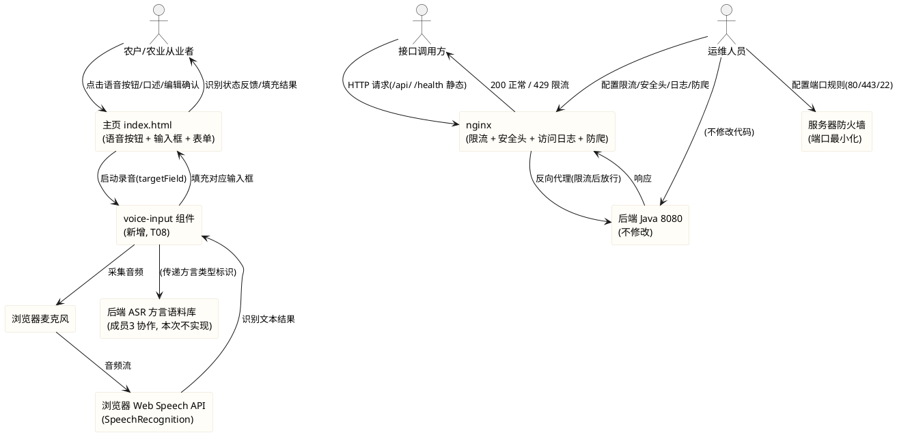
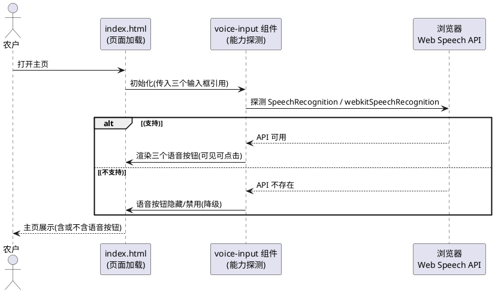
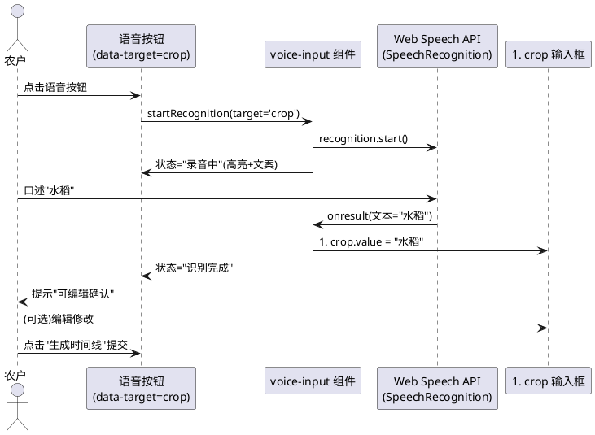
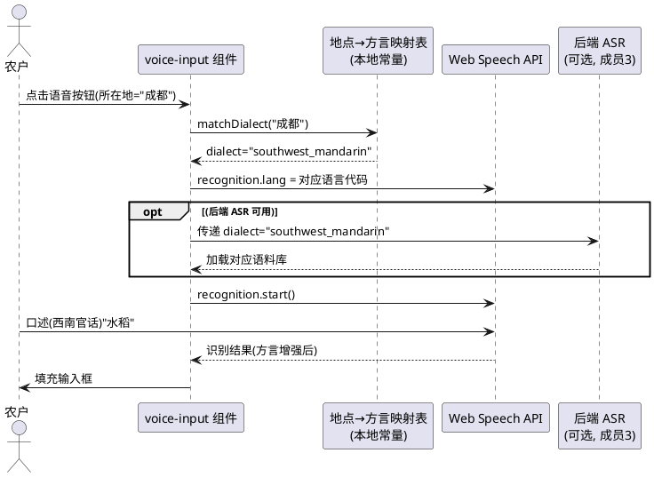
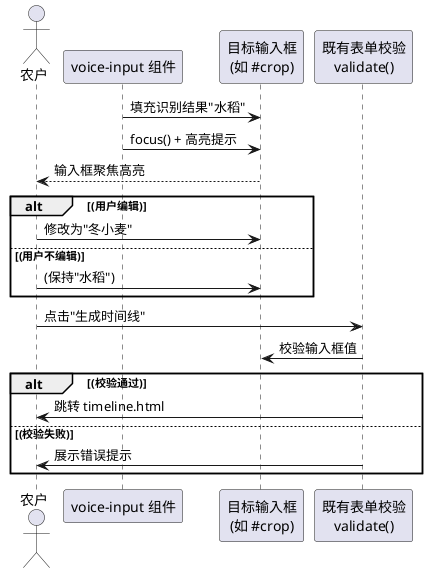
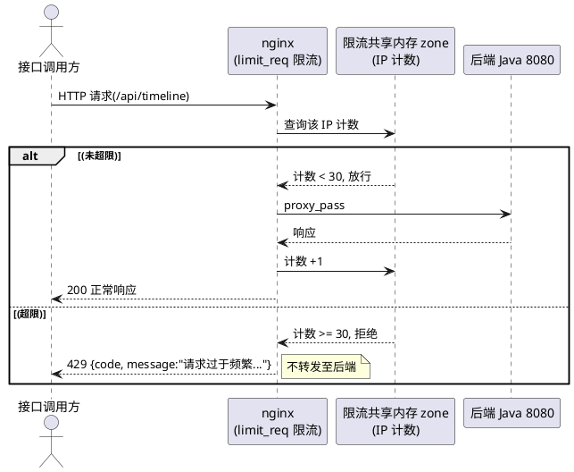

# T08 语音交互与方言适配 + T10 安全机制与服务器升级（t08_t10_voice_security）

> 本文档用于规范 agritime（知农时 · 会看天的农事日历）功能扩展任务书中任务编号 T08 与 T10 的验收标准。
> **T08**：支持语音输入「作物名、时间、地点」三类信息；基于当前地点自动匹配方言类型，调用对应语料库提升识别准确率；识别结果自动填充至对应输入框，支持编辑确认。
> **T10**：IP 限流（同一 IP 1 分钟内接口调用上限 30 次，超限返回 429 与友好提示）；可选轻量账号系统（手机号注册登录，绑定个人查询记录）；服务器安全加固（关闭无用端口、配置访问日志、增加基础防爬策略）。
> 范围红线：T08 仅实现**前端语音组件**（`frontend/components/voice-input/`），使用浏览器原生 Web Speech API，不引入第三方语音 SDK；后端 ASR 服务属成员3 协作范围，本次不实现。T10 限流在 **nginx 层**实现（`limit_req_zone`），不修改 Java 后端；安全加固为服务器运维操作。两个任务均须保证（1）前端 52/52 既有测试全绿、仅允许新增断言、（2）不引入框架/构建工具/第三方库、（3）不修改后端 Java 业务逻辑。
> 交付形式：本文档描述**做什么（What）**与**验收标准（Acceptance Criteria）**，不描述技术实现方式（How）；技术架构与代码结构由后续 design 阶段承接。
> 全局约束继承自 `stage2_frontend`（spec.md 60 条）、`t00_directory_migration`（49 条）与 `t01_weather_visual`（42 条）：纯原生 JS + 原生 CSS、前端测试断言不可弱化、`crop-map.js` 5 个 cropId 不变、mock 保持 null 占位不造假、时间线页天气数据经后端 `GET /api/timeline` 获取、主页天气视觉（T01）已落地不改变。

# **1. 组件定位**

## **1.1 核心职责**
本组件负责两项独立但协同的业务能力：（1）在主页输入表单旁提供语音录入入口，通过浏览器原生 Web Speech API 识别「作物名、时间、地点」语音信息并自动填充至对应输入框，依据当前地点匹配方言类型以提升识别准确率，识别结果可编辑后确认提交；（2）在 nginx 层实现 IP 限流与 429 友好响应，在服务器层实施端口最小化、访问日志留存、防爬策略与安全头加固，保障接口可用性与可追溯性。

## **1.2 核心输入**
1. 用户在主页（index.html）点击语音按钮触发的录音指令——含目标字段类型（作物名/时间/地点）。
2. 浏览器麦克风采集的语音音频流——经 Web Speech API（SpeechRecognition）识别为文本。
3. 主页所在地输入框（`#location`）的当前值或浏览器地理定位提供的地点信息——用于方言类型匹配。
4. 后端 ASR 方言语料库（属成员3 协作范围，本次前端仅传递方言类型标识，不直接调用后端 ASR）。
5. 用户对识别结果的编辑修正——识别填充后用户可手动修改再提交。
6. 外部客户端对 nginx 暴露接口（`/api/`、`/health`、静态资源）的 HTTP 请求——含来源 IP、请求路径、请求方法、User-Agent、请求频率。
7. 服务器当前端口监听状态（`ss -tlnp`）与防火墙状态（`ufw`）——安全加固的基线参照。
8. nginx 当前配置文件（`/etc/nginx/sites-enabled/agritime`、`/etc/nginx/nginx.conf`）——限流与安全头配置的改动对象。

## **1.3 核心输出**
1. 主页三个输入框（作物品种/播种日期/所在地）旁的语音按钮 DOM 节点——点击后启动录音与识别。
2. 语音识别结果文本自动填充至对应输入框（作物名→`#crop`、时间→日期选择器 year/month/day select、地点→`#location`）。
3. 识别过程中的状态反馈（录音中/识别中/识别完成/识别失败）——以可见 UI 元素呈现。
4. 方言类型匹配结果——前端根据地点推断的方言标识，用于设置 SpeechRecognition 语言参数或传递给后端 ASR 服务。
5. 浏览器不支持 Web Speech API 时语音按钮的降级表现（隐藏或禁用）——不报错、不白屏。
6. nginx IP 限流配置——同一 IP 1 分钟内接口调用上限 30 次，超限返回 HTTP 429。
7. 429 限流响应体——含友好提示文案（如"请求过于频繁，请稍后再试"），前端可据此展示明确错误提示。
8. 服务器端口最小化后的监听状态——仅开放 80（HTTP）/443（HTTPS，如启用）/22（SSH），其余端口（含 8080）不对外暴露。
9. nginx 访问日志——每条请求的来源 IP、时间戳、请求方法、路径、状态码、响应大小、User-Agent 等字段，完整留存可追溯。
10. nginx 安全响应头——`X-Content-Type-Options: nosniff`、`X-Frame-Options: SAMEORIGIN`、`X-XSS-Protection` 等。
11. 基础防爬策略配置——异常 User-Agent 过滤、robots.txt、请求体大小限制等。

## **1.4 职责边界**
本组件**不负责**以下事项：
1. 后端 ASR（自动语音识别）服务的实现——属成员3 协作范围，本次前端仅实现语音组件（按钮、Web Speech API 调用、结果填充、方言匹配标识传递），**不实现后端 ASR 接口、不修改后端 Java 代码**。
2. 第三方语音 SDK 的引入——**明确禁止**引入百度语音、讯飞语音、阿里语音等第三方 SDK；仅使用浏览器原生 Web Speech API（`SpeechRecognition` / `webkitSpeechRecognition`）。
3. 后端 Java 服务（`/opt/crop-calendar`，8080）业务逻辑的修改——T10 限流在 nginx 层实现，**不修改 Java 后端**；T10 安全加固为服务器/nginx 运维操作，不触碰 Java 代码。
4. 轻量账号系统的后端实现——手机号注册登录需后端支持（短信验证码、用户持久化），但本次约束"不修改 Java 后端"，故账号系统标注为**可选/带前提**需求，仅在 spec 中描述业务行为，实际落地需后端协作配合。
5. HTTPS 证书的申请与部署——T10 端口安全提及 443 端口，但证书申请属独立运维任务，本规格仅描述"如启用 HTTPS 则 443 须开放"的前提条件，不强制要求本次启用 HTTPS。
6. 既有前端测试断言的删除或弱化——**明确禁止**为通过新需求而修改 `frontend/tests/pages.test.js` 既有 52 项断言的预期。
7. 既有主页表单字段（crop/sowingDate/location）id/name 与提交跳转逻辑的改变——语音按钮为**增量叠加**，不改变既有表单结构与提交流程。
8. 时间线页（timeline.html）既有逻辑的修改——T08 仅作用于主页（index.html）输入表单，不触碰时间线页。

# **2. 领域术语**

**语音识别（Speech Recognition）**
: 指通过浏览器原生 Web Speech API（`SpeechRecognition` / `webkitSpeechRecognition`）将用户麦克风采集的语音音频转换为文本的过程。
: 备注：本次仅使用浏览器原生 API，不引入第三方语音 SDK。

**Web Speech API**
: 指 W3C 草案定义的浏览器原生语音识别接口，含 `SpeechRecognition`（识别）与 `SpeechSynthesis`（合成）两部分；本次仅使用 `SpeechRecognition` 部分。

**方言适配（Dialect Adaptation）**
: 指根据用户当前所在地自动匹配对应方言类型（如四川话、粤语、吴语等），并据此调整语音识别语言参数或传递方言标识给后端 ASR 服务，以提升识别准确率的过程。

**方言类型（Dialect Type）**
: 指按地域划分的汉语方言变体标识，至少包含普通话（mandarin）及若干主要方言区（如西南官话、粤语、吴语、闽南语等）；前端根据地点匹配后以标识符形式传递。

**语料库（Corpus）**
: 指特定方言类型的语音识别参考语料集合，由后端 ASR 服务加载使用；前端不直接管理语料库，仅传递方言类型标识。

**目标字段（Target Field）**
: 指语音识别结果须填充到的主页输入框类型，取值为 `crop`（作物品种）、`sowingDate`（播种日期）、`location`（所在地）三者之一；每个语音按钮绑定一个目标字段。

**IP 限流（IP Rate Limiting）**
: 指以客户端来源 IP 为维度，在指定时间窗口内限制其接口调用次数的机制；本次限流窗口为 1 分钟，阈值为 30 次，在 nginx 层实现。

**限流窗口（Rate Limit Window）**
: 指限流计数的时间区间，本次为 1 分钟（60 秒）；窗口结束时计数重置。

**限流阈值（Rate Limit Threshold）**
: 指限流窗口内允许的最大请求次数，本次为 30 次；超出阈值的请求被拒绝并返回 HTTP 429。

**访问日志（Access Log）**
: 指 nginx 对每个 HTTP 请求记录的结构化日志条目，含来源 IP、时间戳、请求方法、路径、HTTP 状态码、响应大小、User-Agent 等字段，用于追溯与审计。

**防爬策略（Anti-Crawler Strategy）**
: 指通过 User-Agent 过滤、请求频率限制、robots.txt 声明、请求体大小限制等手段，降低自动化爬虫对接口的异常消耗的基础防护措施。

**安全头（Security Headers）**
: 指 nginx 在 HTTP 响应中附加的安全相关响应头，如 `X-Content-Type-Options: nosniff`（防 MIME 嗅探）、`X-Frame-Options: SAMEORIGIN`（防点击劫持）、`X-XSS-Protection`（防反射型 XSS）等。

**端口最小化（Port Minimization）**
: 指服务器仅开放业务必需端口（80/443/22），关闭或限制其余端口（特别是 8080 不对外暴露，仅允许本地回环访问）的安全加固措施。

**EARS 需求编号约定**
: 本文档需求编号格式为 `REQ-TVS-XXX-NNN`，`TVS` 为 T08 Voice + T10 Security 缩写。前缀对应 EARS 句型：UBI（Ubiquitous，通用）、EVT（Event-driven，事件驱动）、STA（State-driven，状态驱动）、OPT（Optional，可选/带前提）、UNW（Unwanted，非期望行为）。

# **3. 角色与边界**

## **3.1 核心角色**
- **农户 / 农业从业者**：在主页通过语音按钮口述作物名/时间/地点，识别结果自动填充后可编辑确认并提交查询；在接口被限流时看到友好提示。
- **接口调用方 / 自动化客户端**：通过 HTTP 访问 `/api/`、`/health` 或静态资源的外部客户端；高频调用者触发限流后收到 429 响应。
- **运维人员 / 部署者**：在服务器上配置 nginx 限流、安全头、端口最小化、访问日志与防爬策略，并验证加固效果。
- **测试维护者**：运行 `node --test frontend/tests/pages.test.js`，确认既有 52 项断言全绿并补充语音组件相关新断言。
- **开发者 / 交付者**：在 `frontend/` 范围内新增语音组件代码、在服务器上落地 nginx 与安全加固配置并提交 Git。

## **3.2 外部系统**
- **浏览器 Web Speech API（`SpeechRecognition` / `webkitSpeechRecognition`）**：语音识别能力来源；浏览器原生提供，无需引入第三方 SDK；不同浏览器与操作系统对方言/语言的支持程度不同。
- **浏览器麦克风（`getUserMedia` 隐式调用）**：Web Speech API 内部调用麦克风采集音频；用户须授权麦克风权限。
- **后端 ASR 方言语料库（属成员3 协作范围，本次不实现）**：后端根据前端传递的方言类型标识加载对应语料库提升识别准确率；本次前端仅传递标识，不直接调用。
- **nginx（80 → 8080 反向代理）**：T10 限流、安全头、访问日志、防爬策略的配置载体；当前配置位于 `/etc/nginx/sites-enabled/agritime` 与 `/etc/nginx/nginx.conf`。
- **后端 Java 服务（`/opt/crop-calendar`，8080）**：被 nginx 反向代理的业务后端；T10 不修改其代码，仅通过 nginx 层限流与端口限制保护其不被直接外部访问。
- **服务器防火墙（ufw / iptables）**：端口最小化的执行载体；当前 ufw 状态为 inactive，须启用并配置规则。
- **服务器 SSH（22 端口）**：运维操作通道；端口最小化后须保留 22 端口开放以维持远程管理能力。

## **3.3 交互上下文**

# **4. DFX约束**

## **4.1 性能**
1. 语音按钮点击后须在 **≤ 500ms** 内进入录音状态并给出"录音中"可见反馈，不得让用户感知无响应。
2. 语音识别结果返回后须在 **≤ 200ms** 内完成对应输入框的填充与状态反馈切换，不得出现明显延迟。
3. 方言类型匹配须为**纯本地计算**（基于地点→方言映射表），不发起网络请求，匹配耗时 **≤ 50ms**。
4. nginx IP 限流判定须在请求处理管线**最前端**完成，限流命中时直接返回 429，不转发至后端 Java 服务，避免后端资源被无效请求消耗。
5. 限流配置不得显著增加正常请求的延迟开销（nginx `limit_req` 模块为内存级判定，正常请求额外延迟须 **< 1ms**）。
6. 语音组件的加载与初始化不得阻塞主页表单的渲染与交互；表单须在语音组件初始化前即可填写提交。

## **4.2 可靠性**
1. 浏览器不支持 Web Speech API（`SpeechRecognition` / `webkitSpeechRecognition` 均不存在）时，语音按钮须**降级隐藏或禁用**，不报错、不白屏、不影响表单正常使用。
2. 用户拒绝麦克风权限时，语音按钮须给出可读提示（如"请允许麦克风权限后使用语音输入"），不卡死、不抛未捕获错误。
3. 语音识别过程中发生网络错误、识别错误或无结果时，系统须回落为手动输入，展示可读提示，不中断表单流程。
4. 语音识别结果为空或置信度极低时，须提示用户"未识别到内容，请重试或手动输入"，不将空值填充至输入框。
5. nginx 限流配置加载（`nginx -t` + `nginx -s reload`）失败时，须自动回滚至上一可用配置，不得导致 nginx 崩溃或全部请求 502。
6. 端口最小化操作不得导致 SSH（22）或 nginx（80）服务中断；防火墙规则应用前须保留当前 SSH 会话，避免远程连接断开。
7. 访问日志须持续写入，不得因日志文件满或轮转配置错误导致请求处理中断。
8. 限流状态须在 nginx worker 进程间共享（基于共享内存 zone），不得因多 worker 架构导致限流计数不准确。

## **4.3 安全性**
1. 语音音频流仅经浏览器 Web Speech API 处理，**不在前端持久化**、不上传至第三方服务、不写入 localStorage。
2. 语音识别结果文本在填充至输入框时须使用安全方式（`value` 赋值或 `textContent`），禁止将未转义的识别文本拼入 `innerHTML`（防 XSS）。
3. 方言类型标识须为前端映射表中预定义的枚举值，不得将用户可控的地点文本直接作为方言标识传递给后端，防注入。
4. nginx 限流须以客户端真实 IP（`$remote_addr` 或经 `X-Real-IP`/`X-Forwarded-For` 解析）为维度，不得被伪造请求头绕过。
5. 服务器 8080 端口（后端 Java）**不得对外网暴露**，仅允许 nginx 本地回环（127.0.0.1）访问；防火墙规则须拒绝外部对 8080 的直接连接。
6. nginx 须隐藏版本号（`server_tokens off`），不得在响应头或错误页中暴露 nginx 版本信息。
7. 访问日志中不得记录请求体中的敏感信息（如图片 base64、密码、验证码）；日志文件权限须最小化（仅 nginx 运行用户与 root 可读）。
8. 防爬策略不得误伤正常浏览器用户；被拦截的请求须返回合理状态码（如 403）与可读提示，不得静默丢弃。

## **4.4 可维护性**
1. 语音组件的可配置项（如方言映射表、识别语言代码映射、状态反馈文案、超时时间）须以**具名常量**集中定义，不得多处硬编码。
2. 方言映射表须支持扩展（新增方言类型仅需在映射表中增一行），不须修改组件核心逻辑。
3. nginx 限流参数（窗口大小、阈值、突发桶大小）须以**变量或注释明确标注**的方式定义在配置文件中，便于后续调整。
4. 访问日志格式须遵循统一规范（如 `log_format` 定义），字段顺序与含义须有注释说明。
5. 安全头配置须集中在一处（如 nginx `server` 块或 `include` 片段），便于统一管理与后续扩展。
6. 端口最小化的防火墙规则须以**可追溯脚本**形式记录（如 `ufw` 命令序列或 iptables 规则文件），便于复盘与回滚。

## **4.5 兼容性**
1. **测试兼容（强制红线）**：不得破坏 `frontend/tests/pages.test.js` 的既有 52 项断言；可新增断言，既有断言须全绿。运行命令：`node --test frontend/tests/pages.test.js`。
2. **浏览器兼容**：Web Speech API 须进行能力探测，Chrome/Edge 优先使用 `webkitSpeechRecognition`，Safari 使用 `SpeechRecognition`；不支持时降级隐藏语音按钮，不影响 Firefox 等不支持浏览器上的表单正常使用。
3. **不可引入依赖**：不得引入框架、构建工具、第三方库（含第三方语音 SDK）。
4. **文件范围兼容（T08）**：T08 仅修改/新增 `frontend/` 目录下文件（`frontend/components/voice-input/` 及 index.html 引入），不修改后端、nginx、shared、data、deploy、docs。
5. **文件范围兼容（T10）**：T10 仅修改服务器 nginx 配置（`/etc/nginx/`）与防火墙规则，不修改前端代码、不修改后端 Java 代码。
6. **接口兼容**：T10 限流不得改变既有接口的路径、方法、参数与正常响应结构；仅对超限请求返回 429。
7. **既有表单兼容**：T08 语音按钮为增量叠加，不改变 index.html 既有表单字段（crop/sowingDate/location）的 id/name/类型与提交跳转逻辑。
8. **响应式兼容**：语音按钮在 375px、768px、1024px 三档宽度下均须正常布局，不破坏既有响应式断点。

# **5. 核心能力**

## **5.1 语音按钮与浏览器能力探测（T08）**

### **5.1.1 业务规则**

1. **REQ-TVS-UBI-001（Ubiquitous）**：系统须在主页三个输入框（作物品种 `#crop`、播种日期 `#sowingDate`、所在地 `#location`）旁各提供一个语音按钮，每个按钮须绑定一个目标字段类型（crop/sowingDate/location）。
   a. 验收条件：[打开 index.html] → [作物品种、播种日期、所在地三个输入框旁各存在一个可点击的语音按钮，按钮有 `data-target` 属性标识目标字段]

2. **REQ-TVS-UBI-002（Ubiquitous）**：语音按钮须有可辨识的视觉样式（麦克风图标 + 可访问文本/aria-label），与既有表单视觉风格协调，复用 `common.css` 既有 CSS 变量（`--leaf`/`--ink`/`--radius-sm` 等）。
   a. 验收条件：[视觉核对 + 代码审查] → [语音按钮含麦克风图标与 aria-label，样式使用既有 CSS 变量，与表单整体风格一致]

3. **REQ-TVS-EVT-003（Event-driven）**：当页面加载时，系统须探测浏览器是否支持 Web Speech API（`SpeechRecognition` 或 `webkitSpeechRecognition` 是否存在），并据此决定语音按钮的可见性。
   a. 验收条件：[在支持 Web Speech API 的浏览器中打开 index.html] → [语音按钮可见且可点击]；[在不支持的浏览器（如 Firefox）中打开] → [语音按钮隐藏或禁用，不报错]

4. **REQ-TVS-UNW-004（Unwanted）**：如果浏览器不支持 Web Speech API，系统不得展示不可用的语音按钮，不得抛出未捕获的 JavaScript 错误，不得影响表单的正常填写与提交。
   a. 验收条件：[在不支持浏览器中操作表单] → [语音按钮不可见/禁用，表单填写与提交流程完全正常，控制台无未捕获错误]

5. **REQ-TVS-UBI-005（Ubiquitous）**：语音按钮须使用纯原生 JS + 原生 CSS 实现，不引入任何第三方语音 SDK（百度/讯飞/阿里等）或第三方库。
   a. 验收条件：[代码审查] → [语音组件代码无 import/require 第三方语音 SDK 语句，无外部 CDN 引用，仅使用浏览器原生 `SpeechRecognition`/`webkitSpeechRecognition`]

6. **禁止项**：禁止仅对部分输入框提供语音按钮（三个目标字段均须覆盖）；禁止语音按钮遮挡或挤压既有输入框导致无法正常输入。
   a. 验收条件：[视觉核对] → [三个输入框旁均有语音按钮，按钮不遮挡输入框，输入框可正常点击与输入]

### **5.1.2 交互流程**

### **5.1.3 异常场景**

1. **Web Speech API 存在但无法正常工作**
   a. 触发条件：浏览器声明支持 SpeechRecognition 但实际调用时抛异常（如权限策略限制、内部错误）
   b. 系统行为：捕获异常，将语音按钮降级为禁用态，展示"语音输入不可用"提示
   c. 用户感知：语音按钮灰色不可点击，表单可正常手动填写

## **5.2 语音录入与识别结果填充（T08）**

### **5.2.1 业务规则**

1. **REQ-TVS-EVT-006（Event-driven）**：当用户点击某语音按钮时，系统须启动对应目标字段的录音，并立即展示"录音中"的可见状态反馈（如按钮高亮/动画/文案"正在聆听…"）。
   a. 验收条件：[点击作物品种旁语音按钮] → [≤500ms 内按钮进入录音态，展示"录音中/正在聆听"类反馈]

2. **REQ-TVS-STA-007（State-driven）**：在录音与识别进行中时，系统须持续保持录音状态反馈可见，且语音按钮须可再次点击以取消录音。
   a. 验收条件：[录音过程中] → [录音反馈持续可见；再次点击语音按钮可取消录音]

3. **REQ-TVS-EVT-008（Event-driven）**：当语音识别返回结果时，系统须将识别文本自动填充至该语音按钮绑定的目标字段输入框。
   a. 验收条件：[点击作物品种语音按钮并口述"水稻"，识别成功] → [作物品种输入框 `#crop` 填充为"水稻"]；[点击所在地语音按钮并口述"济南"，识别成功] → [所在地输入框 `#location` 填充为"济南"]

4. **REQ-TVS-EVT-009（Event-driven）**：当目标字段为播种日期（sowingDate）时，系统须将识别到的日期文本解析为年/月/日并分别设置到日期选择器的三个 select（`#date-year`/`#date-month`/`#date-day`），同步更新隐藏 input `#sowingDate` 的值。
   a. 验收条件：[点击播种日期语音按钮并口述"2026年3月15日"，识别成功] → [年 select 设为 2026、月 select 设为 3、日 select 设为 15，`#sowingDate` 值为"2026-03-15"]

5. **REQ-TVS-UBI-010（Ubiquitous）**：语音识别结果填充至输入框后，系统须将状态反馈切换为"识别完成"，并提示用户可编辑确认或直接提交。
   a. 验收条件：[识别结果填充后] → [展示"识别完成，可编辑确认"类提示，输入框内容可被用户继续修改]

6. **REQ-TVS-UBI-011（Ubiquitous）**：普通话语音识别准确率须 **≥ 90%**（在支持 Web Speech API 的主流浏览器下，对作物名/日期/地点三类常见农事词汇的识别正确率）。
   a. 验收条件：[使用普通话口述 20 条常见作物名/日期/地点测试语料] → [识别正确条数 ≥ 18 条]

7. **REQ-TVS-UNW-012（Unwanted）**：如果语音识别过程中发生错误（网络错误/识别错误/无结果/超时），系统须停止录音，展示可读的错误提示（如"识别失败，请重试或手动输入"），不将空值或错误文本填充至输入框。
   a. 验收条件：[识别发生错误或无结果] → [录音停止，展示错误提示，输入框内容不变（不被空值或错误文本覆盖）]

8. **REQ-TVS-OPT-013（Optional/带前提）**：当用户在录音过程中再次点击同一语音按钮时，系统须取消当前录音，恢复为待录音态，不产生识别结果填充。
   a. 验收条件：[录音中再次点击语音按钮] → [录音取消，状态恢复为待录音，输入框不变]

9. **禁止项**：禁止识别结果未经验证直接提交表单（须填充后由用户确认或手动提交）；禁止识别结果覆盖用户已手动输入且非空的内容时无确认（须先提示或聚焦让用户决定）。
   a. 验收条件：[输入框已有内容时语音识别成功] → [识别结果填充后输入框聚焦高亮，用户可确认或撤销]

### **5.2.2 交互流程**

### **5.2.3 异常场景**

1. **用户拒绝麦克风权限**
   a. 触发条件：浏览器弹出麦克风授权提示，用户选择拒绝
   b. 系统行为：捕获权限拒绝事件，停止录音，展示"请允许麦克风权限后使用语音输入"提示
   c. 用户感知：看到权限提示文案，可手动输入或重新授权后重试

2. **识别结果为空或置信度极低**
   a. 触发条件：用户口述内容无法被识别或识别置信度低于阈值
   b. 系统行为：不填充输入框，展示"未识别到内容，请重试或手动输入"提示
   c. 用户感知：看到重试提示，输入框内容不变

3. **日期解析失败**
   a. 触发条件：目标字段为 sowingDate 但识别文本无法解析为有效日期（如口述"明天"但格式不匹配）
   b. 系统行为：展示"未能识别日期，请手动选择或重试"提示，不修改日期选择器
   c. 用户感知：日期选择器不变，看到重试提示

4. **录音超时**
   a. 触发条件：录音持续超过设定时长（如 10 秒）无结果返回
   b. 系统行为：自动停止录音，展示"录音超时，请重试"提示
   c. 用户感知：录音自动停止，看到超时提示

## **5.3 方言匹配与识别增强（T08）**

### **5.3.1 业务规则**

1. **REQ-TVS-UBI-014（Ubiquitous）**：系统须维护一份"地点→方言类型"映射表，覆盖中国主要方言区（至少包含普通话/西南官话/粤语/吴语/闽南语等），映射表以具名常量集中定义，支持扩展。
   a. 验收条件：[代码审查] → [存在具名常量映射表，覆盖 ≥ 5 种方言类型，每项含地点关键词与方言标识]

2. **REQ-TVS-EVT-015（Event-driven）**：当用户触发语音识别时，系统须根据当前所在地（`#location` 输入框值或浏览器地理定位）匹配方言类型，并将匹配结果用于设置 SpeechRecognition 的语言参数或传递给后端 ASR 服务。
   a. 验收条件：[所在地为"成都"时点击语音按钮] → [匹配方言类型为西南官话，SpeechRecognition.lang 设为对应语言代码或传递方言标识]

3. **REQ-TVS-UBI-016（Ubiquitous）**：当所在地无法匹配到任何方言类型时，系统须回退为普通话（mandarin）作为默认方言，不报错。
   a. 验收条件：[所在地为空或未匹配到方言] → [使用普通话默认方言，识别正常进行]

4. **REQ-TVS-UBI-017（Ubiquitous）**：对应地点方言识别准确率须 **≥ 80%**（在支持该方言的浏览器/后端 ASR 配合下，对当地方言口音的作物名/日期/地点识别正确率）。
   a. 验收条件：[使用对应方言口述 20 条测试语料] → [识别正确条数 ≥ 16 条]

5. **REQ-TVS-OPT-018（Optional/带前提）**：当后端 ASR 方言语料库可用时（成员3 协作实现），前端须将匹配的方言类型标识传递给后端 ASR 服务以加载对应语料库；后端 ASR 不可用时前端仅依赖浏览器 Web Speech API 的语言参数设置。
   a. 验收条件：[后端 ASR 可用 + 方言为粤语] → [前端传递 dialect= Cantonese 标识给后端]；[后端 ASR 不可用] → [前端仅设置 SpeechRecognition.lang，不报错]

6. **禁止项**：禁止将用户可控的地点文本未经映射直接作为方言标识传递（防注入）；禁止方言匹配发起网络请求（须为纯本地映射计算）。
   a. 验收条件：[代码审查] → [方言标识来自预定义映射表枚举值，非用户文本直接传递；匹配过程无网络请求]

### **5.3.2 交互流程**

### **5.3.3 异常场景**

1. **浏览器不支持当前方言的语言代码**
   a. 触发条件：匹配到的方言对应的 SpeechRecognition.lang 值不被浏览器/操作系统支持
   b. 系统行为：回退为普通话 lang 值（如 `zh-CN`），展示"当前方言不支持，已切换为普通话"提示
   c. 用户感知：识别以普通话进行，看到切换提示

2. **后端 ASR 服务不可用**
   a. 触发条件：前端传递方言标识给后端 ASR 但后端无响应或返回错误
   b. 系统行为：忽略后端 ASR 错误，仅依赖浏览器 Web Speech API 识别，不中断流程
   c. 用户感知：识别正常进行（可能准确率略降），无报错

## **5.4 识别结果编辑确认（T08）**

### **5.4.1 业务规则**

1. **REQ-TVS-UBI-019（Ubiquitous）**：语音识别结果填充至输入框后，该输入框须保持可编辑状态，用户可手动修改识别结果。
   a. 验收条件：[识别结果填充后点击输入框] → [输入框可正常编辑，光标可定位，内容可修改/删除/追加]

2. **REQ-TVS-EVT-020（Event-driven）**：当语音识别结果填充至输入框后，系统须自动聚焦该输入框并高亮提示（如边框闪烁/背景色变化），引导用户确认或编辑。
   a. 验收条件：[识别结果填充后] → [对应输入框获得焦点，有高亮提示动画，用户可立即编辑]

3. **REQ-TVS-UBI-021（Ubiquitous）**：用户编辑确认后的输入框内容须作为最终值参与表单提交，识别结果与手动编辑须统一经既有表单校验逻辑（`validate()`）验证。
   a. 验收条件：[识别填充"水稻"后手动改为"冬小麦"并提交] → [提交时按"冬小麦"进行校验与查询，识别痕迹不影响最终值]

4. **REQ-TVS-UNW-022（Unwanted）**：如果语音识别结果填充后用户未做任何编辑直接提交，系统不得阻止提交，识别结果即作为最终值提交（经既有校验通过后）。
   a. 验收条件：[识别填充后直接点击"生成时间线"] → [经既有 validate() 校验通过后正常跳转，不要求额外确认步骤]

5. **禁止项**：禁止识别结果绕过既有表单校验逻辑直接提交；禁止识别结果填充后锁定输入框不允许编辑。
   a. 验收条件：[识别填充后提交] → [须经 validate() 校验；输入框始终可编辑]

### **5.4.2 交互流程**

## **5.5 nginx IP 限流（T10）**

### **5.5.1 业务规则**

1. **REQ-TVS-UBI-023（Ubiquitous）**：系统须在 nginx 层配置 IP 限流，以客户端来源 IP 为维度，限流窗口为 1 分钟（60 秒），阈值为 30 次请求。
   a. 验收条件：[审查 nginx 配置] → [存在 limit_req_zone 定义，key 为客户端 IP，rate 为 30r/m；存在 limit_req 指令应用于 /api/ location]

2. **REQ-TVS-UBI-024（Ubiquitous）**：限流须应用于后端接口路径（`/api/`）与健康检查路径（`/health`），静态资源路径（`/assets/`、`/`）可不限流或采用更宽松的阈值。
   a. 验收条件：[审查 nginx 配置] → [/api/ 与 /health location 内含 limit_req 指令；静态资源 location 可不含或含更宽松限流]

3. **REQ-TVS-EVT-025（Event-driven）**：当同一 IP 在 1 分钟内对限流路径的请求超过 30 次时，nginx 须直接返回 HTTP 429 状态码，不将超限请求转发至后端 Java 服务。
   a. 验收条件：[同一 IP 1 分钟内发起 31 次 /api/ 请求] → [第 31 次起返回 429，后端 Java 服务未收到超限请求]

4. **REQ-TVS-UBI-026（Ubiquitous）**：429 响应须包含友好的错误提示文案（如"请求过于频繁，请稍后再试"），响应体须为 JSON 格式 `{code, message}`，与既有接口错误返回格式一致。
   a. 验收条件：[触发限流后查看 429 响应体] → [响应体为 JSON，含 code 与 message 字段，message 为中文友好提示]

5. **REQ-TVS-UBI-027（Ubiquitous）**：限流计数须基于 nginx 共享内存 zone（`limit_req_zone` 的 `zone` 参数），在多个 nginx worker 进程间共享，确保限流计数准确。
   a. 验收条件：[审查 nginx 配置] → [limit_req_zone 定义了共享内存 zone（如 `zone=api_limit:10m`），多 worker 下计数一致]

6. **REQ-TVS-OPT-028（Optional/带前提）**：限流可配置突发桶（burst）以允许短时小幅超限平滑处理，突发桶大小须 ≤ 10（即允许最多 10 个请求排队等待），超出突发桶的请求立即 429。
   a. 验收条件：[审查 nginx 配置] → [limit_req 含 burst 参数且 ≤ 10，或未配置 burst（严格限流）]

7. **REQ-TVS-UBI-029（Ubiquitous）**：限流配置须在 nginx 配置文件中以可辨识的方式定义限流参数（窗口/阈值/突发桶），参数旁须有注释说明其含义，便于后续调整。
   a. 验收条件：[审查 nginx 配置] → [限流参数有注释说明（如 `# 限流：30次/分钟/IP`），参数值可一目了然]

8. **禁止项**：禁止限流配置导致 nginx 启动失败；禁止限流误伤正常低频用户（阈值 30 次/分钟须足以覆盖正常浏览行为）；禁止修改 Java 后端代码以实现限流。
   a. 验收条件：[nginx -t 通过] → [配置语法正确]；[正常浏览主页+查询 1 次] → [不触发限流]；[代码审查] → [后端 Java 代码无改动]

### **5.5.2 交互流程**

### **5.5.3 异常场景**

1. **限流配置语法错误**
   a. 触发条件：nginx 配置文件中 limit_req_zone/limit_req 语法错误
   b. 系统行为：`nginx -t` 检测失败，拒绝 reload，保持上一可用配置运行
   c. 用户感知：服务不中断，运维人员收到配置测试失败提示

2. **共享内存 zone 不足**
   a. 触发条件：zone 大小（如 10m）不足以记录当前活跃 IP 数量
   b. 系统行为：nginx 日志记录 zone 不足警告，部分 IP 计数可能被淘汰导致限流不精确
   c. 用户感知：限流可能略有偏差，但服务不中断

## **5.6 429 限流响应与前端提示（T10）**

### **5.6.1 业务规则**

1. **REQ-TVS-EVT-030（Event-driven）**：当前端发起的接口请求收到 HTTP 429 响应时，前端须展示明确的限流错误提示（如"请求过于频繁，请稍后再试"），不得白屏、不得静默忽略、不得展示原始错误码而无解释。
   a. 验收条件：[前端请求触发 429] → [页面展示"请求过于频繁，请稍后再试"类友好提示，不白屏]

2. **REQ-TVS-UBI-031（Ubiquitous）**：前端限流提示须复用既有 toast/错误提示 UI 组件（如 index.html 的 `#toast` 或 timeline.html 的加载反馈区域），不新增独立的限流提示组件。
   a. 验收条件：[代码审查 + 视觉核对] → [限流提示复用既有 toast/错误 UI，样式与既有提示一致]

3. **REQ-TVS-UNW-032（Unwanted）**：如果前端在短时间内多次收到 429 响应，系统不得重复弹出多个提示堆叠，须合并或节流展示（如 3 秒内仅展示一次限流提示）。
   a. 验收条件：[连续触发 3 次 429] → [3 秒内仅展示 1 次限流提示，不堆叠]

4. **禁止项**：禁止前端在收到 429 后自动无限重试请求（须等待用户操作或延迟后重试）；禁止 429 提示遮挡整个页面导致用户无法操作。
   a. 验收条件：[收到 429 后] → [不自动无限重试；提示不遮挡全屏，用户可关闭提示或等待]

### **5.6.2 异常场景**

1. **429 响应体格式异常**
   a. 触发条件：nginx 返回 429 但响应体非预期 JSON 格式
   b. 系统行为：前端展示通用限流提示文案（不依赖响应体解析），不报错
   c. 用户感知：看到通用"请求过于频繁"提示

## **5.7 端口安全加固（T10）**

### **5.7.1 业务规则**

1. **REQ-TVS-UBI-033（Ubiquitous）**：服务器须仅开放业务必需端口：80（HTTP/nginx）、22（SSH），如启用 HTTPS 则 443（HTTPS）亦须开放；其余端口（含 8080）须关闭或限制为仅本地回环访问。
   a. 验收条件：[审查服务器端口监听 `ss -tlnp` + 防火墙规则] → [对外暴露端口仅 80/22（及 443 如启用 HTTPS）；8080 仅监听 127.0.0.1 或被防火墙拒绝外部访问]

2. **REQ-TVS-UBI-034（Ubiquitous）**：后端 Java 服务 8080 端口须**不对外网暴露**，仅允许 nginx 本地回环（127.0.0.1）访问；当前 8080 监听 `*:8080`（所有接口）的状态须改为 `127.0.0.1:8080` 或通过防火墙规则拒绝外部对 8080 的直接连接。
   a. 验收条件：[从外网尝试直连 115.175.44.27:8080] → [连接被拒绝/超时]；[nginx 本地 proxy_pass http://localhost:8080] → [正常访问]

3. **REQ-TVS-UBI-035（Ubiquitous）**：服务器防火墙（ufw 或 iptables）须启用并配置规则，默认拒绝入站流量，仅放行 80/22（及 443 如启用）；当前 ufw inactive 的状态须改为 active。
   a. 验收条件：[审查 ufw status] → [Status: active；规则含 allow 80/tcp、allow 22/tcp（及 allow 443/tcp 如启用 HTTPS）；default deny incoming]

4. **REQ-TVS-OPT-036（Optional/带前提）**：当启用 HTTPS 时，443 端口须开放且 nginx 须配置 SSL 监听与证书；HTTP 80 须 301 重定向至 HTTPS 443。
   a. 验收条件：[启用 HTTPS 后] → [443 开放，nginx listen 443 ssl，80 → 301 443]

5. **REQ-TVS-UBI-037（Ubiquitous）**：端口最小化操作须保留当前 SSH 会话不断开，防火墙规则应用前须先放行 22 端口，避免远程连接丢失。
   a. 验收条件：[执行端口加固脚本] → [SSH 会话保持连接，22 端口规则先于 deny 规则应用]

6. **禁止项**：禁止端口加固导致 nginx（80）或 SSH（22）服务中断；禁止关闭 22 端口导致无法远程管理。
   a. 验收条件：[加固完成后] → [80 与 22 端口正常服务，可远程 SSH 连接]

### **5.7.2 异常场景**

1. **防火墙规则应用后 SSH 断开**
   a. 触发条件：防火墙 deny 规则先于 allow 22 应用，导致当前 SSH 会话被中断
   b. 系统行为：须通过服务器控制台/带外管理恢复 SSH 访问，修正规则顺序
   c. 用户感知：SSH 断开后无法远程连接，须通过控制台恢复

2. **8080 改为本地监听后 nginx 反代失败**
   a. 触发条件：后端 Java 8080 改为 127.0.0.1:8080 但后端服务未重启或绑定地址不匹配
   b. 系统行为：nginx proxy_pass 连接被拒，返回 502；须重启后端使其监听 127.0.0.1:8080
   c. 用户感知：接口 502 错误，须重启后端修复

## **5.8 访问日志与可追溯（T10）**

### **5.8.1 业务规则**

1. **REQ-TVS-UBI-038（Ubiquitous）**：nginx 须为每个 HTTP 请求记录访问日志，日志须包含以下字段：客户端 IP、时间戳、请求方法、请求路径、HTTP 协议版本、响应状态码、响应体大小、Referer、User-Agent。
   a. 验收条件：[审查 nginx access_log 配置 + 日志文件] → [每条日志含上述字段；log_format 已定义或使用 combined 格式]

2. **REQ-TVS-UBI-039（Ubiquitous）**：访问日志须完整留存，不得因日志轮转配置错误导致日志被截断或丢失；须配置日志轮转（logrotate）策略，按日/按大小轮转并保留历史日志（≥ 30 天）。
   a. 验收条件：[审查 logrotate 配置] → [nginx 日志轮转规则存在，保留天数 ≥ 30，轮转后日志不丢失]

3. **REQ-TVS-UBI-040（Ubiquitous）**：访问日志须可追溯，即对于任一历史请求，可通过日志中的客户端 IP + 时间戳 + 请求路径定位到该请求的完整记录（含响应状态码与 User-Agent）。
   a. 验收条件：[查询某 IP 在某时间段对 /api/ 的请求] → [可在日志中检索到完整记录]

4. **REQ-TVS-UBI-041（Ubiquitous）**：访问日志文件权限须最小化，仅 nginx 运行用户（www-data）与 root 可读，不得全局可读（防敏感信息泄露）。
   a. 验收条件：[审查日志文件权限] → [权限为 640 或更严格，非 644/666]

5. **REQ-TVS-UNW-042（Unwanted）**：访问日志中不得记录请求体中的敏感信息（如识别图片 base64、密码、验证码）；日志仅记录请求元数据（方法/路径/状态码等），不记录请求体内容。
   a. 验收条件：[审查 log_format] → [日志格式不含 $request_body；POST /api/recognition 的日志不含图片 base64]

6. **禁止项**：禁止访问日志无限增长占满磁盘（须有轮转策略）；禁止关闭访问日志（须始终开启）。
   a. 验收条件：[审查配置] → [access_log 未被注释/off；logrotate 规则存在]

### **5.8.2 异常场景**

1. **日志文件磁盘满**
   a. 触发条件：日志文件持续增长未轮转，磁盘空间耗尽
   b. 系统行为：nginx 可能无法写入日志，但须不影响请求处理（access_log 写入失败不阻塞请求）
   c. 用户感知：请求正常处理，运维人员收到磁盘告警

## **5.9 防爬策略（T10）**

### **5.9.1 业务规则**

1. **REQ-TVS-UBI-043（Ubiquitous）**：nginx 须配置基础防爬策略，至少包含：异常 User-Agent 过滤（拒绝空 UA 或已知爬虫 UA）、请求体大小限制（`client_max_body_size` 适度限制，防止大体积请求消耗资源）。
   a. 验收条件：[审查 nginx 配置] → [存在 User-Agent 过滤规则；存在 client_max_body_size 限制（如 10m）]

2. **REQ-TVS-UBI-044（Ubiquitous）**：服务器须在 web 根目录提供 `robots.txt` 文件，声明不允许爬虫抓取 `/api/` 路径，允许抓取静态页面内容。
   a. 验收条件：[访问 /robots.txt] → [返回 robots.txt 内容，含 Disallow: /api/]

3. **REQ-TVS-EVT-045（Event-driven）**：当请求的 User-Agent 为空或匹配已知恶意爬虫 UA 列表时，nginx 须返回 HTTP 403 拒绝访问。
   a. 验收条件：[发送空 User-Agent 请求] → [返回 403]；[发送已知爬虫 UA 请求] → [返回 403]

4. **REQ-TVS-UBI-046（Ubiquitous）**：防爬策略须与 IP 限流协同工作——限流拦截高频请求，防爬拦截异常 UA，两者互不冲突、不重复拒绝同一请求。
   a. 验收条件：[审查 nginx 配置] → [限流与防爬规则不冲突；正常浏览器请求（合理 UA + 低频）不被任一策略拦截]

5. **REQ-TVS-UNW-047（Unwanted）**：防爬策略不得误伤正常浏览器用户——主流浏览器（Chrome/Edge/Safari/Firefox）的默认 User-Agent 须被放行，不得因 UA 过滤导致正常用户被 403。
   a. 验收条件：[使用 Chrome 默认 UA 访问主页与接口] → [正常访问，不返回 403]

6. **禁止项**：禁止防爬策略导致搜索引擎无法抓取公开页面（须通过 robots.txt 声明而非全站 403）；禁止 client_max_body_size 设置过小导致正常图片上传（POST /api/recognition）被拒绝。
   a. 验收条件：[搜索引擎抓取 index.html] → [正常返回 200]；[上传正常大小图片识别] → [不被 client_max_body_size 拒绝]

### **5.9.2 异常场景**

1. **正常用户被防爬策略误伤**
   a. 触发条件：某浏览器 UA 被误加入爬虫黑名单或 UA 格式异常
   b. 系统行为：返回 403，用户看到拒绝访问
   c. 用户感知：无法访问页面，须运维人员修正 UA 过滤规则

## **5.10 nginx 安全头（T10）**

### **5.10.1 业务规则**

1. **REQ-TVS-UBI-048（Ubiquitous）**：nginx 须在 HTTP 响应中附加安全响应头，至少包含：`X-Content-Type-Options: nosniff`（防 MIME 嗅探）、`X-Frame-Options: SAMEORIGIN`（防点击劫持）、`X-XSS-Protection: 1; mode=block`（防反射型 XSS）。
   a. 验收条件：[审查 nginx 配置 + 响应头] → [响应含上述三个安全头，值正确]

2. **REQ-TVS-UBI-049（Ubiquitous）**：nginx 须隐藏版本号（启用 `server_tokens off`），不得在响应头 `Server` 或错误页中暴露 nginx 版本信息。
   a. 验收条件：[审查 nginx.conf + 响应头] → [server_tokens off 已启用；Server 头不含版本号；错误页不含版本号]

3. **REQ-TVS-UBI-050（Ubiquitous）**：安全头配置须集中在一处（如 nginx server 块内或 `include` 片段），以 `add_header` 指令统一添加，便于管理与扩展。
   a. 验收条件：[审查 nginx 配置] → [安全头 add_header 指令集中定义，非分散在多个 location]

4. **REQ-TVS-OPT-051（Optional/带前提）**：当启用 HTTPS 时，nginx 须附加 `Strict-Transport-Security`（HSTS）安全头，声明浏览器须通过 HTTPS 访问。
   a. 验收条件：[启用 HTTPS 后] → [响应含 Strict-Transport-Security 头]

5. **禁止项**：禁止安全头配置导致正常页面渲染异常（如 `X-Frame-Options: DENY` 过严导致合法嵌入被拒）；禁止安全头值设置错误（如 `X-Content-Type-Options` 值非 `nosniff`）。
   a. 验收条件：[页面正常渲染] → [无因安全头导致的渲染异常；安全头值正确]

### **5.10.2 异常场景**

1. **安全头导致页面嵌入异常**
   a. 触发条件：`X-Frame-Options: DENY` 导致合法的 iframe 嵌入被拒
   b. 系统行为：须改为 `SAMEORIGIN` 允许同源嵌入
   c. 用户感知：嵌入页面正常显示

## **5.11 轻量账号系统（T10，可选/带前提）**

> 说明：轻量账号系统（手机号注册登录、绑定个人查询记录）需后端支持（短信验证码发送、用户注册/登录/持久化、查询记录绑定），但本次约束"不修改 Java 后端"。故本节需求标注为**可选/带前提**，仅在 spec 中描述业务行为；实际落地需后端协作配合，属后续迭代范围。

### **5.11.1 业务规则**

1. **REQ-TVS-OPT-052（Optional/带前提）**：当后端账号接口可用时（需后端协作实现手机号注册/登录/验证码接口），系统须提供手机号注册登录入口，用户可通过手机号 + 短信验证码完成注册与登录。
   a. 验收条件：[后端账号接口可用 + 用户输入手机号并获取验证码] → [可完成注册/登录，获得登录态]
   b. 前提条件：后端须提供短信验证码发送接口、注册接口、登录接口（本次不实现后端）

2. **REQ-TVS-OPT-053（Optional/带前提）**：当用户登录后，系统须将该用户的查询记录绑定至其账号，实现跨设备/跨浏览器的查询记录同步。
   a. 验收条件：[用户 A 在设备 1 登录并查询] → [用户 A 在设备 2 登录后可看到该查询记录]
   b. 前提条件：后端须提供查询记录持久化与按用户查询接口（本次不实现后端）

3. **REQ-TVS-OPT-054（Optional/带前提）**：账号系统须为轻量设计，不引入重型身份认证框架；前端登录态可使用 localStorage/SessionStorage 存储非敏感的登录标识（如用户 ID），**禁止存储密码、令牌明文等敏感凭据**。
   a. 验收条件：[代码审查] → [前端仅存储非敏感登录标识，无密码/令牌明文；未引入重型认证框架]

4. **REQ-TVS-OPT-055（Optional/带前提）**：当后端账号接口不可用时（本次后端未实现），系统须静默降级为无账号模式——查询记录仍使用既有 localStorage 本地历史（最多 5 条），不影响主流程。
   a. 验收条件：[后端账号接口不可用] → [页面无登录入口或登录入口禁用，查询记录使用既有 localStorage 本地历史，主流程正常]

5. **禁止项**：禁止在前端存储密码或敏感凭据明文；禁止账号系统破坏既有 localStorage 历史记录功能（须兼容共存）。
   a. 验收条件：[代码审查] → [前端无密码明文存储；既有 localStorage 历史记录功能正常]

### **5.11.2 异常场景**

1. **后端账号接口未实现（本次默认场景）**
   a. 触发条件：后端未提供账号相关接口（本次约束不修改后端）
   b. 系统行为：前端静默降级为无账号模式，不展示登录入口或展示"账号功能待开通"提示
   c. 用户感知：可正常使用所有功能，查询记录保存在本地

2. **短信验证码发送失败**
   a. 触发条件：后端验证码接口超时或返回错误
   b. 系统行为：前端展示"验证码发送失败，请稍后重试"提示，不卡死
   c. 用户感知：看到重试提示，可重新获取验证码

## **5.12 测试与兼容性**

### **5.12.1 业务规则**

1. **REQ-TVS-UBI-056（Ubiquitous）**：改造后前端须逻辑正确、无报错，且 `frontend/tests/pages.test.js` 既有 52 项断言全部通过。
   a. 验收条件：[运行 `node --test frontend/tests/pages.test.js`] → [既有 52 项断言全绿，无失败]

2. **REQ-TVS-UBI-057（Ubiquitous）**：系统须针对 T08 语音组件新增必要测试断言（如语音按钮 DOM 存在、目标字段绑定、方言映射表存在、Web Speech API 能力探测分支、降级隐藏逻辑等），且不得破坏既有断言。
   a. 验收条件：[测试套件运行] → [新增语音组件断言通过，既有 52 项断言仍全绿]

3. **REQ-TVS-UBI-058（Ubiquitous）**：T08 语音组件代码须为纯原生 JS + 原生 CSS，不引入框架/构建工具/第三方库/第三方语音 SDK。
   a. 验收条件：[代码审查] → [voice-input 组件无 import/require 第三方依赖，无外部 CDN，仅使用浏览器原生 API]

4. **禁止项**：禁止为通过测试而删除、注释或弱化既有 52 项断言；禁止引入任何第三方依赖。
   a. 验收条件：[代码审查] → [既有断言原文保留且通过；无第三方依赖引入]

# **6. 数据约束**

## **6.1 语音识别结果对象（前端渲染用）**
1. **targetField**：目标字段类型，取值 `crop` / `sowingDate` / `location` 三者之一，非空。
2. **transcript**：识别文本结果，字符串，可为空（识别失败时）。
3. **confidence**：识别置信度，数值，取值范围 [0, 1]，可为 null（浏览器不提供时）。
4. **dialect**：匹配的方言类型标识，取值为方言映射表中的预定义枚举值（如 `mandarin` / `southwest_mandarin` / `cantonese` 等），默认 `mandarin`。
5. **status**：识别状态，取值 `idle`（待录音）/ `recording`（录音中）/ `recognizing`（识别中）/ `success`（识别成功）/ `error`（识别失败）/ `unsupported`（浏览器不支持）。

## **6.2 方言映射表（前端具名常量）**
1. **地点关键词**：用于匹配的地点文本片段（如 "成都"/"重庆"/"四川"），字符串。
2. **方言标识（dialectId）**：方言类型枚举值，字符串，须为预定义集合中的值。
3. **语言代码（langCode）**：对应 SpeechRecognition.lang 的 BCP 47 语言标签（如 `zh-CN` 普通话、`zh-HK` 粤语），字符串。
4. **方言名称（label）**：方言中文名称（如"西南官话"/"粤语"），用于提示文案，字符串。
5. **覆盖范围**：映射表须覆盖 ≥ 5 种方言类型，每种方言须有至少 1 个地点关键词。

## **6.3 限流配置（nginx）**
1. **限流维度（key）**：客户端来源 IP（`$binary_remote_addr` 或经 `X-Real-IP` 解析），非空。
2. **限流窗口**：1 分钟（60 秒），固定值。
3. **限流阈值（rate）**：30 次请求/分钟，固定值。
4. **突发桶（burst）**：允许排队请求数，取值范围 [0, 10]，默认 5。
5. **共享内存 zone 大小**：须足以记录预期活跃 IP 数量（如 `10m` 可记录约 16 万 IP）。
6. **应用路径**：`/api/` 与 `/health` 须限流；静态资源路径可不限流或采用更宽松阈值。

## **6.4 访问日志条目（nginx log_format）**
1. **客户端 IP（$remote_addr）**：请求来源 IP，非空。
2. **时间戳（$time_local）**：请求时间，格式如 `23/Oct/2026:14:30:00 +0800`。
3. **请求方法（$request_method）**：HTTP 方法（GET/POST 等），非空。
4. **请求路径（$request_uri）**：请求 URI，非空。
5. **HTTP 状态码（$status）**：响应状态码，整数（200/429/403/502 等）。
6. **响应体大小（$body_bytes_sent）**：响应体字节数，整数。
7. **Referer（$http_referer）**：来源页 URL，可为空。
8. **User-Agent（$http_user_agent）**：客户端 UA，可为空。
9. **禁止记录**：请求体内容（`$request_body`）不得出现在日志中（防敏感信息泄露）。

## **6.5 端口规则对象（防火墙）**
1. **端口号**：须开放的端口，取值 80 / 443（如启用 HTTPS）/ 22，整数。
2. **协议**：`tcp`，固定值。
3. **规则方向**：`allow incoming`（放行入站），固定值。
4. **默认策略**：`deny incoming`（拒绝所有未放行的入站流量），固定值。
5. **8080 约束**：8080 端口须不在放行规则中，且后端 Java 须仅监听 127.0.0.1:8080 或被默认 deny 策略拦截。

## **6.6 安全头配置对象（nginx add_header）**
1. **X-Content-Type-Options**：值须为 `nosniff`，固定值。
2. **X-Frame-Options**：值须为 `SAMEORIGIN`，固定值。
3. **X-XSS-Protection**：值须为 `1; mode=block`，固定值。
4. **Strict-Transport-Security**：仅在启用 HTTPS 时附加，值如 `max-age=31536000; includeSubDomains`，可选。
5. **server_tokens**：须为 `off`，固定值（隐藏 nginx 版本号）。