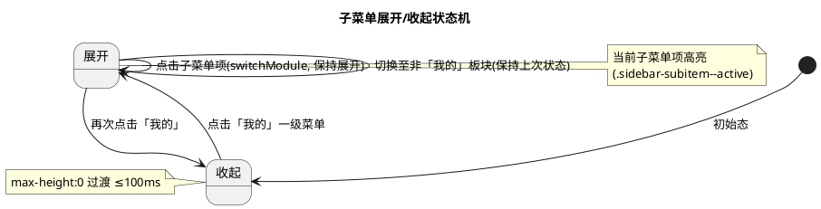
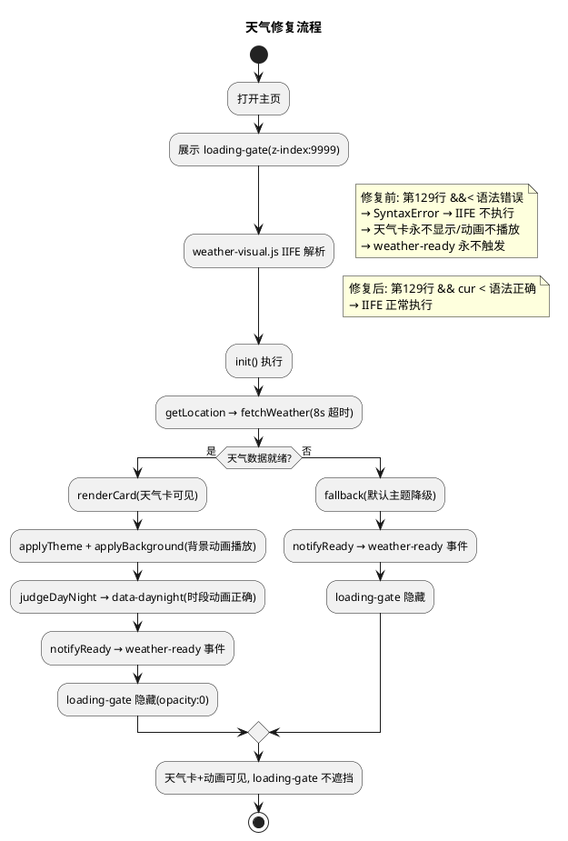
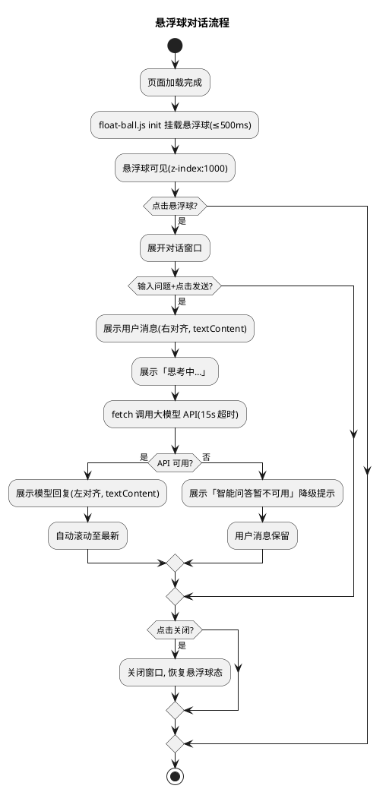
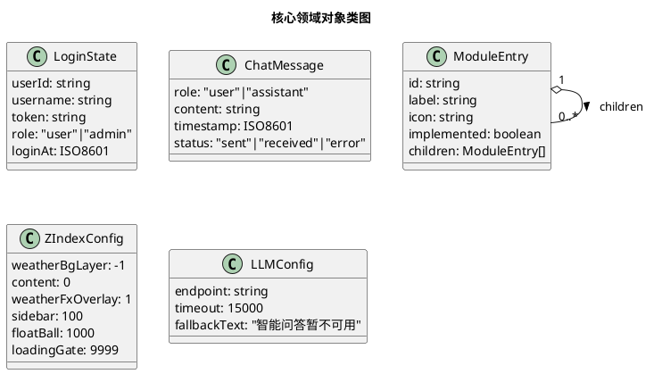

# V4 整合优化 · 技术设计（v4_integrated_optimization）

> 本方案基于 `v4_integrated_optimization/spec.md`（REQ-VIO-UBI/EVT/STA/OPT/UNW-001 ~ 049，共 49 条 EARS 需求）生成。
> 设计范围：**纯前端整合优化**，仅修改 `frontend/` 目录下文件，不触碰后端/nginx/shared/data/deploy/docs。
> 强约束（红线）：
> 1. 前端既有测试全绿（`node --test frontend/tests/pages.test.js`，当前 77 个 `test()` 调用全绿），仅允许新增断言、不得弱化既有断言；
> 2. 不引入框架/构建工具/第三方库（含 UI 框架 Vue/React、菜单库、对话 UI 库、HTTP 库 axios/fetch polyfill、表单库）；
> 3. 不修改后端（Java/8080）与 nginx 配置——T10 账号系统后端接口属协作范围，本任务仅消费并以前端降级承接；
> 4. 所有新增功能须有降级方案（悬浮球对话 API 不可用时降级提示、账号接口未就绪时降级本地态、天气修复不改变既有降级机制）；
> 5. 导航栏子菜单须纯原生 CSS + JS 实现不引入第三方菜单库；
> 6. 悬浮球对话功能须纯前端实现，大模型 API 调用须有降级；
> 7. `crop-map.js` 5 个 cropId（dry_garlic/wheat_winter/corn_summer/rice/soybean）不变，`mock-data.js` 保持 null 占位不造假；
> 8. 重命名仅改变展示文案，不改变 `data-module="my-crops"`、存储键 `agritime.my-crops.v1`、cropId、事件名等技术标识。
> 全局约束继承自 `stage2_frontend`（60 条）、`t00_directory_migration`（49 条）、`t01_weather_visual`（42 条）、`v4_t01_ui_revamp`（39 条）、`v4_t12_my_crops`（59 条）、`t08_t10_voice_security`（52 条）：纯原生 JS + 原生 CSS、前端测试断言不可弱化、时间线页天气数据经后端 `GET /api/timeline` 获取、主页左侧栏 6 板块入口已落地、天气视觉与时段动画已落地、语音组件已落地、拍照识别双通道已落地、「我的作物」页面已落地（含表单/列表/分组/日历联动）、T10 nginx 限流与安全头已落地。本任务在既有基础上**调整导航结构、重命名板块、移除冗余表单、补齐账号前端、新增悬浮球对话、修复天气动画**。

# 一、需求与存量功能关系分析

## 1.1 需求功能与存量功能对比

### 1.1.1 已实现功能

> 已实现功能是指需求与存量代码完全匹配或高度相似、可直接复用或仅需少量叠加的部分。

| 需求功能 | 存量功能 | 代码位置 | 匹配度 |
|---------|---------|---------|--------|
| 左侧栏 6 板块入口与 switchModule 机制（REQ-VIO-UBI-007 其余板块不变） | `sidebar.js` `MODULE_ENTRIES` 已含 6 入口（recommend/plots/calendar/disease/my-crops/service），`switchModule(id)` 通过 `data-module` 属性切换 `content-pane--active` 类 + 高亮 `sidebar-item--active` + 未实现板块展示 `#module-placeholder` 占位提示 | `frontend/components/sidebar/sidebar.js:7-14,36-62` | 100%（6 入口与切换机制已就绪，本任务仅调整 plots/my-crops 归入「我的」子菜单，不破坏 switchModule） |
| content-pane 显示/隐藏样式（REQ-VIO-UBI-004 子菜单切换复用 switchModule） | `sidebar.css` `.content-pane { display: none; }` + `.content-pane--active { display: block; }` | `frontend/components/sidebar/sidebar.css` | 100%（content-pane 切换样式已就绪，子菜单项切换复用此机制） |
| 「我的作物」板块已实现（REQ-VIO-UBI-013~019 移除表单基准） | `sidebar.js` 第 12 行 `{id:'my-crops', label:'我的作物', icon:'🌾', implemented:true}`；`index.html` 第 109-131 行 `data-module="my-crops"` content-pane 含表单/列表/添加按钮 | `frontend/components/sidebar/sidebar.js:12`；`frontend/pages/index.html:109-131` | 100%（my-crops 板块已落地，本任务仅移除表单部分保留展示） |
| my-crops-store.js 独立存储模块（REQ-VIO-UBI-016 移除表单后仍展示记录） | `my-crops-store.js` 独立键 `agritime.my-crops.v1`，上限 200，`list/add/update/remove/clear/getById`，localStorage 降级 | `frontend/assets/js/my-crops-store.js:6-101` | 100%（存储模块已就绪，移除表单后列表渲染仍消费此模块，不改变存储键与结构） |
| 日历联动事件订阅（REQ-VIO-UBI-017 移除表单后日历联动保持） | `my-crops.js` 第 14-21 行 `window.addEventListener('agritime:sowing-confirmed', ...)` 监听确认播种事件自动新增记录 | `frontend/assets/js/my-crops.js:14-21` | 100%（日历联动已就绪，移除表单不影响此订阅） |
| 拍照分析入口（REQ-VIO-UBI-018 移除表单后拍照分析保留） | `my-crops.js` 第 91-96 行 `photoBtn` 调用 `handlePhoto(r)` → `window.CropPhoto.analyze(...)`；`crop-photo.js` 复用既有 `PhotoCapture.open` | `frontend/assets/js/my-crops.js:91-96,141-150`；`frontend/components/crop-photo/crop-photo.js` | 100%（拍照分析已就绪，移除表单保留此入口） |
| 删除记录能力（REQ-VIO-UBI-019 删除操作保留） | `my-crops.js` 第 80-90 行 `delBtn` 调用 `confirm('确认删除这条记录？')` + `MyCropsStore.remove(r.recordId)` | `frontend/assets/js/my-crops.js:80-90` | 75%（删除能力已就绪，但用 `confirm()` 原生弹窗，需求要求二次确认弹层非 confirm，需扩展为自定义确认弹层） |
| loading-gate DOM 与隐藏机制（REQ-VIO-UBI-044 排查遮挡基准） | `index.html` 第 15-18 行 `<div id="loading-gate">` + 第 150-153 行监听 `weather-ready` 事件添加 `.hidden` 类 + 第 154-157 行 10s 超时兜底 | `frontend/pages/index.html:15-18,150-157` | 75%（loading-gate DOM 与隐藏机制已就绪，但 z-index:9999 极高且依赖 weather-ready 事件，需排查遮挡与触发时机） |
| weather-visual.js 天气数据获取与归一化（REQ-VIO-UBI-048 不改取数/超时/降级） | `weather-visual.js` `OPEN_METEO_URL`/`REQUEST_TIMEOUT_MS=8000`/`WMO_MAP`/`normalizeWeather`/`inferSeason`/`getLocation`/`fetchWeather`/`buildWeatherInfo`/`renderCard`/`applyTheme`/`fallback` | `frontend/assets/js/weather-visual.js:8-13,15-27,33-93,95-121,147-165` | 100%（既有归一化与降级逻辑不改变，本任务仅修复 judgeDayNight 语法错误与可见性） |
| weather-ready 事件触发机制（REQ-VIO-UBI-044 loading-gate 隐藏时机） | `weather-visual.js` 第 143-145 行 `notifyReady()` 触发 `weather-ready` CustomEvent；`init` 末尾（第 185 行）与 `fallback` 末尾（第 164 行）均调用 `notifyReady()` | `frontend/assets/js/weather-visual.js:143-145,164,185` | 100%（事件触发机制已就绪，修复语法错误后即可正常触发） |
| data-daynight 属性设置与夜晚动画（REQ-VIO-UBI-042 背景动画修复基准） | `weather-visual.js` 第 123-141 行 `judgeDayNight()` + `applyBackground()` 设置 `data-daynight` 属性；`common.css` 第 546-549 行 `[data-daynight="night"][data-weather="..."] .weather-bg-layer` 夜晚动画 | `frontend/assets/js/weather-visual.js:123-141`；`frontend/assets/css/common.css:546-549` | 50%（data-daynight 属性设置与夜晚动画 CSS 已就绪，但 `judgeDayNight` 第 129 行有语法错误 `&&<` 导致整个 IIFE 执行失败，属性设置与动画均无法生效） |
| 全屏布局 body[data-layout="app"]（REQ-VIO-UBI-046 排查布局基准） | `common.css` 第 539-542 行 `body[data-layout="app"] { display:flex; }` + `.app-main { flex:1; margin-left:200px; }` + `.page--home { max-width:none; background-image:none; }` | `frontend/assets/css/common.css:539-542` | 100%（全屏布局已就绪，weather-card 与 weather-bg-layer 在 .app-main 内展示） |
| CSS 变量主题色体系（REQ-VIO-UBI-022/037/037 风格统一基准） | `common.css` `:root` 已定义 `--ink`/`--ink-soft`/`--muted`/`--paper`/`--card`/`--leaf`/`--leaf-2`/`--leaf-soft`/`--sun`/`--line`/`--radius`/`--shadow` 等变量 | `frontend/assets/css/common.css:1-21` | 100%（变量体系已就绪，新增页面/悬浮球/子菜单复用既有变量） |
| 响应式 768/1024 断点 + 375 无横向滚动（REQ-VIO-UBI-008/039 响应式兼容） | `common.css` 已有 `@media (min-width:768px)`/`@media (min-width:1024px)`/`@media (max-width:767px)` 断点 + `overflow-x:hidden` + `max-width:100%` | `frontend/assets/css/common.css:25-30,424-431,531-536,562-564` | 100%（响应式断点已就绪，新增子菜单/账号页/悬浮球样式追加到此体系） |
| `prefers-reduced-motion` 全局禁用动画（REQ-VIO-UBI-005 过渡动画基准） | `common.css` 已有 `@media (prefers-reduced-motion: reduce) { *, *::before, *::after { animation:none !important; transition:none !important; } }` | `frontend/assets/css/common.css:289-291` | 100%（全局规则已覆盖，新增子菜单过渡/悬浮球动画自动被禁用） |
| `textContent` 安全渲染（REQ-VIO 4.3.2 XSS 防护） | `index.html` 历史记录 `btn.textContent = label`，weather-visual.js `renderCard` 用 `textContent`，my-crops.js `renderCard` 用 `textContent` | `frontend/pages/index.html:419`；`frontend/assets/js/weather-visual.js:109-113`；`frontend/assets/js/my-crops.js:59,70` | 100%（安全渲染模式已就绪，新增对话窗口/账号页沿用 textContent） |
| toast 操作反馈机制（REQ-VIO-EVT-027 429 提示复用 toast） | `index.html` 第 92 行 `<div class="toast" id="toast">` + 第 336-339 行 `showToast(msg, type)` + `common.css` `.toast` 样式 | `frontend/pages/index.html:92,336-339`；`frontend/assets/css/common.css:282` | 75%（toast 机制已就绪但属主页表单作用域，429 提示/账号反馈须独立 toast 实例或复用模式） |
| 测试文件基座已读取 sidebar/my-crops/weather-visual（REQ-VIO-UBI-049 测试基座） | `pages.test.js` 已读取 `sidebarJs`/`sidebarCss`/`myCropsStoreJs`/`myCropsJs`/`myCropsCss`/`weatherVisualJs`/`indexHtml`/`commonCss` 等变量，77 个 `test()` 调用全绿 | `frontend/tests/pages.test.js:1-37` | 100%（测试基座已就绪，新增断言可复用既有变量并新增 auth/float-ball 相关变量） |
| V4 目录规范 components/ + pages/ 已就绪（REQ-VIO-UBI-022/026/036 目录规范） | `frontend/components/` 含 sidebar/voice-input/crop-photo 子目录；`frontend/pages/` 含 index.html/timeline.html/photo-capture.js | `frontend/components/`、`frontend/pages/` | 100%（目录规范已就绪，新增 `auth/`/`admin/`/`floating-ball/` 子目录遵循 V4 规范） |

### 1.1.2 需要扩展的功能

> 需要扩展的功能是指需求与存量代码部分匹配，需在现有基础上改造或叠加的部分。

| 需求功能 | 存量功能 | 差异说明 | 扩展方向 |
|---------|---------|---------|---------|
| sidebar.js MODULE_ENTRIES 支持「我的」一级菜单与子菜单（REQ-VIO-UBI-001/002） | `sidebar.js` 第 7-14 行 `MODULE_ENTRIES` 为扁平数组，6 入口平铺无层级 | 需将 plots/my-crops 从顶级入口收拢至「我的」一级菜单 children 下，支持 children 字段；renderSidebar 须区分一级菜单与子菜单渲染；switchModule 须支持子菜单项切换 | 重构 `MODULE_ENTRIES` 为含 children 的层级结构（新增 `my` 一级菜单 + children:[plots,my-crops]）；renderSidebar 增加一级菜单展开/收起渲染 + 子菜单项渲染；switchModule 逻辑不变（子菜单项仍按 data-module 切换 content-pane） |
| 子菜单展开/收起纯原生 CSS+JS+过渡（REQ-VIO-UBI-005） | `sidebar.css`/`sidebar.js` 无子菜单展开/收起样式与交互 | 需新增一级菜单展开/收起样式（max-height 或 transform 过渡）+ JS toggle 展开/收起类 | `sidebar.css` 新增 `.sidebar-item--expandable`/`.sidebar-submenu`/`.sidebar-submenu--open` 样式（max-height 过渡 ≤100ms）；`sidebar.js` 新增 `toggleSubmenu(id)` 函数 toggle 展开/收起 |
| 「我的作物」重命名为通用名称（REQ-VIO-UBI-009/010） | `sidebar.js` 第 12 行 `label:'我的作物'`；`index.html` 第 112 行 `<span class="my-crops-title">我的作物</span>`；`my-crops.js` 第 30 行空状态文案含「作物记录」 | 需将所有面向用户文案「我的作物」统一改为通用名称（如「我的产品」），以具名常量集中定义；技术标识 data-module="my-crops"/存储键/cropId 不变 | 新增具名常量 `MODULE_LABEL_MY_CROPS = '我的产品'`（或等价通用名称）集中定义；sidebar.js MODULE_ENTRIES my-crops 的 label 引用此常量；index.html 标题/空状态文案引用此常量；my-crops.js 空状态文案引用此常量 |
| 移除「我的产品」页面表单（REQ-VIO-UBI-013/014） | `index.html` 第 113-128 行 `#my-crops-add-btn` + `#my-crops-form` 含 7 字段输入控件；`my-crops.js` 第 12-13 行 addBtn 绑定 showForm + 第 101-114 行 showForm + 第 116-139 行 handleSubmit | 需移除添加按钮与表单 DOM + showForm/handleSubmit 逻辑，仅保留列表/卡片展示 | 删除 `index.html` 第 113 行 addBtn + 第 115-128 行 form DOM；删除/禁用 `my-crops.js` showForm/handleSubmit + addBtn 绑定；保留 renderList/renderCard/日历联动/拍照/删除 |
| 移除「我的地块」页面表单（REQ-VIO-UBI-015） | `index.html` 无 plots content-pane（plots implemented:false 展示占位提示），无地块表单 | plots 板块当前为占位提示，无表单可移除；需求要求移除地块输入弹窗/表单仅保留展示——当前已无表单，仅需确认占位提示不含量输入控件 | 确认 plots 占位提示不含输入控件（既有 `#module-placeholder` 仅展示文案，无表单）；plots 归入「我的」子菜单后保持占位提示 |
| 删除二次确认改为自定义弹层（REQ-VIO-UBI-019） | `my-crops.js` 第 84-89 行 `delBtn` 用 `confirm('确认删除这条记录？')` 原生弹窗 | 需求要求二次确认弹层（非 confirm），须改为自定义确认弹层 | `my-crops.js` 新增 `showConfirmDialog(record)` 自定义确认弹层（DOM 元素 + textContent 文案 + 确认/取消按钮），替代 `confirm()`；`my-crops.css` 新增 `.mc-confirm` 弹层样式 |
| weather-visual.js judgeDayNight 语法错误修复（REQ-VIO-UBI-041~043） | `weather-visual.js` 第 129 行 `return (cur >= rise &&< set) ? 'day' : 'night';` —— `&&<` 为非法语法，导致整个 IIFE 在解析阶段抛 SyntaxError，weather-visual.js 完全无法执行 | 此为天气动画缺失的**根因**：语法错误导致 init/fallback/renderCard/applyBackground/notifyReady 均不执行，天气卡永不显示、背景动画永不播放、weather-ready 事件永不触发（loading-gate 仅靠 10s 超时隐藏） | 修复第 129 行为 `return (cur >= rise && cur < set) ? 'day' : 'night';`；修复后 judgeDayNight 正常返回 day/night，applyBackground 设置 data-daynight 属性，CSS 夜晚动画生效，init 正常执行触发 weather-ready 事件 |
| loading-gate z-index 与隐藏时机排查（REQ-VIO-UBI-044/045） | `common.css` 第 551-552 行 `#loading-gate { z-index: 9999; }` 极高；`index.html` 第 150-153 行监听 weather-ready 隐藏 loading-gate | loading-gate z-index:9999 在隐藏前遮挡所有内容（含 weather-card/weather-bg-layer）；修复 weather-visual.js 语法错误后 weather-ready 事件正常触发，loading-gate 及时隐藏；z-index 9999 在隐藏后 opacity:0+pointer-events:none 不占据层叠，但隐藏前若天气请求慢会持续遮挡 | 修复 weather-visual.js 语法错误后 weather-ready 事件正常触发，loading-gate 在天气就绪/降级后及时隐藏；z-index 9999 保持（loading-gate 为全屏加载遮罩，高 z-index 合理，隐藏后不遮挡）；补充注释标注 z-index 层叠约定 |
| CSS z-index 层叠排查与标注（REQ-VIO-UBI-045） | `common.css` 各元素 z-index：weather-bg-layer:-1、weather-fx-overlay:1、sidebar（未显式设置，默认 auto）、loading-gate:9999；新增悬浮球须合理 z-index | 需排查 sidebar/悬浮球/loading-gate/weather-card/weather-bg-layer 层叠关系，确保天气卡与动画不被遮挡；新增悬浮球 z-index 须不遮挡天气卡但可见 | 以具名常量或集中注释标注 z-index 层叠约定：weather-bg-layer(-1) < 内容(0/auto) < weather-fx-overlay(1) < sidebar(100) < 悬浮球(1000) < loading-gate(9999)；sidebar 显式设置 z-index:100 确保高于内容 |
| data-layout="app" 布局排查（REQ-VIO-UBI-046） | `common.css` 第 539-542 行 `body[data-layout="app"]` flex 布局 + `.app-main { margin-left:200px; }`；`index.html` 第 13 行 `<body data-layout="app">` + 第 26 行 `<div class="app-main">` 包裹 main | 全屏布局已就绪，weather-card 与 weather-bg-layer 在 .app-main 内展示；须确认不因布局溢出/隐藏/定位错误导致缺失——当前布局正常，天气缺失根因为 weather-visual.js 语法错误而非布局 | 确认 data-layout="app" 布局不导致天气内容缺失（根因已定位为语法错误）；补充布局注释标注 weather-card/weather-bg-layer 在 .app-main 内的定位关系 |
| weather-visual.js 加载顺序排查（REQ-VIO-UBI-047） | `index.html` 第 142-148 行脚本加载顺序：weather-visual.js(142) → time-period.js(143) → my-crops-store.js(144) → crop-photo.js(145) → my-crops.js(146) → voice-input.js(147) → sidebar.js(148) | weather-visual.js 在 time-period.js 之前加载，加载顺序正确；weather-visual.js init 在 DOMContentLoaded 自动执行（第 192-193 行），初始化时机正确；根因为语法错误而非加载顺序 | 确认加载顺序正确（weather-visual.js 在 time-period.js 之前）；修复语法错误后 init 正常执行；新增 auth.js/float-ball.js 须在 sidebar.js 之后加载（不破坏既有顺序） |
| 测试断言扩充（REQ-VIO-UBI-049） | `pages.test.js` 77 个 test() 调用，无子菜单/重命名/表单移除/账号/悬浮球/天气修复相关断言 | 须新增子菜单结构、重命名文案、表单移除、账号页、悬浮球、天气修复（judgeDayNight 语法）等断言，不破坏既有 77 项 | 在 `pages.test.js` 末尾追加新 test 块，复用既有变量并新增 auth/float-ball 相关变量；既有 77 项断言原文保留 |

### 1.1.3 需要新增的功能或接口

> 需要新增的功能是指需求在存量代码中完全没有对应实现的部分，须新建。

**A. 新增账号系统前端：`frontend/pages/auth/`（REQ-VIO-UBI-022~024/OPT-020/021/029）**

| 功能点 | 输入 | 输出 | 核心逻辑 | 关联需求 |
|--------|------|------|---------|---------|
| 登录注册页 HTML | 无 | DOM（手机号/用户名/密码/验证码输入 + 登录/注册按钮 + 模式切换） | 独立页面 `frontend/pages/auth/index.html`，复用 common.css CSS 变量 + sidebar 风格，含登录/注册模式切换 | REQ-VIO-UBI-022/023 |
| 账号交互脚本 | 手机号/用户名/密码/验证码 | 登录态/降级提示 | `frontend/pages/auth/auth.js`：表单校验（手机号格式/用户名非空/密码长度）→ 调用后端账号接口（fetch）→ 登录态持久化（localStorage/sessionStorage）→ 降级提示；429 友好提示 + 节流 | REQ-VIO-OPT-020/021/EVT-027/UNW-028/OPT-029 |
| 账号页面样式 | 无 | CSS | `frontend/pages/auth/auth.css`：复用既有 CSS 变量，登录/注册表单样式，模式切换标识 | REQ-VIO-UBI-022 |
| 登录态管理 | 无 | `window.Auth` API | `auth.js` 暴露 `login`/`register`/`logout`/`getLoginState`/`isAdmin`；登录态对象 {userId,username,token,role,loginAt} | REQ-VIO-OPT-021/UBI-024 |
| 429 节流提示 | 429 响应 | toast 提示 | 3 秒内仅展示一次限流提示，复用 toast UI | REQ-VIO-EVT-027/UNW-028 |

**B. 新增超管后台：`frontend/pages/admin/`（REQ-VIO-OPT-025/UBI-026）**

| 功能点 | 输入 | 输出 | 核心逻辑 | 关联需求 |
|--------|------|------|---------|---------|
| 超管后台 HTML | 无 | DOM（账号列表表格） | 独立页面 `frontend/pages/admin/index.html`，复用 common.css + sidebar 风格，含账号列表（用户名/手机号/注册时间/活跃情况） | REQ-VIO-UBI-026 |
| 超管后台脚本 | 无 | 账号列表/降级提示 | `frontend/pages/admin/admin.js`：前端路由守卫（非超管重定向登录页）→ 调用后端超管接口 → 渲染账号列表 → 降级提示 | REQ-VIO-OPT-025/UBI-026 |
| 超管后台样式 | 无 | CSS | `frontend/pages/admin/admin.css`：账号列表表格样式，复用既有 CSS 变量 | REQ-VIO-UBI-026 |

**C. 新增悬浮球与对话窗口：`frontend/components/floating-ball/`（REQ-VIO-UBI-030~040）**

| 功能点 | 输入 | 输出 | 核心逻辑 | 关联需求 |
|--------|------|------|---------|---------|
| 悬浮球组件 | 无 | DOM（固定右下角球形按钮） | `frontend/components/floating-ball/float-ball.js`：position:fixed 右下角，点击呼出对话窗口，z-index:1000 不遮挡天气卡但可见 | REQ-VIO-UBI-030/036/037 |
| 对话窗口 | 无 | DOM（输入框/发送按钮/对话气泡列表） | `float-ball.js` 含对话窗口 DOM（用户消息右对齐/模型回复左对齐），可关闭，textContent 安全渲染 | REQ-VIO-EVT-031/033/STA-038 |
| 大模型 API 调用 | 农事问题文字 | 模型回复/降级提示 | `float-ball.js`：fetch 调用大模型 API（端点以具名常量定义）→ 等待期间展示「思考中…」→ 回复展示为对话气泡 → 降级提示「智能问答暂不可用」；不在前端硬编码 API Key | REQ-VIO-EVT-032/033/UNW-035/OPT-040 |
| 悬浮球样式 | 无 | CSS | `frontend/components/floating-ball/float-ball.css`：悬浮球 + 对话窗口样式，复用既有 CSS 变量，响应式三档适配 | REQ-VIO-UBI-036/037/039 |

**D. 新增 DOM 结构（修改 `index.html`）**

| 功能点 | 核心内容 | 关联需求 |
|--------|---------|---------|
| 悬浮球挂载点 | `<div id="float-ball-mount"></div>` 或直接由 float-ball.js 注入 | REQ-VIO-UBI-030/036 |
| auth.js/float-ball.js 引入 | `<script src="../components/floating-ball/float-ball.js"></script>`（在 sidebar.js 之后） | REQ-VIO-UBI-036 |

**E. 新增测试断言（追加到 `pages.test.js`）**

| 断言类别 | 核心内容 | 关联需求 |
|---------|---------|---------|
| sidebar.js 子菜单结构 | sidebar.js 含 `children` 字段 + `my` 一级菜单 + toggleSubmenu | REQ-VIO-UBI-001/002/005 |
| sidebar.css 子菜单样式 | sidebar.css 含 .sidebar-submenu/.sidebar-submenu--open/max-height 过渡 | REQ-VIO-UBI-005 |
| 重命名文案统一 | sidebar.js/index.html/my-crops.js 含通用名称常量，无「我的作物」残留混用 | REQ-VIO-UBI-009/010 |
| 表单移除 | index.html 不含 `#my-crops-form`/`#my-crops-add-btn`；my-crops.js 不含 showForm/handleSubmit | REQ-VIO-UBI-013/014 |
| 删除二次确认弹层 | my-crops.js 含 showConfirmDialog，不含 `confirm(` | REQ-VIO-UBI-019 |
| auth 页面存在 | frontend/pages/auth/ 含 index.html/auth.js/auth.css | REQ-VIO-UBI-022 |
| admin 页面存在 | frontend/pages/admin/ 含 index.html/admin.js/admin.css | REQ-VIO-UBI-026 |
| 悬浮球组件存在 | frontend/components/floating-ball/ 含 float-ball.js/float-ball.css | REQ-VIO-UBI-036 |
| 天气修复 judgeDayNight | weather-visual.js 含 `cur < set`（修复语法错误），不含 `&&<` | REQ-VIO-UBI-041~043 |
| 既有 77 断言兼容 | 确认 sidebarJs/indexHtml/weatherVisualJs 既有断言仍通过 | REQ-VIO-UBI-049 |

## 1.2 存量功能详细分析

### 1.2.1 `sidebar.js` 左侧栏导航分析（`frontend/components/sidebar/sidebar.js`）

- **模块结构**：IIFE + `window.Sidebar = { init, switchModule, renderSidebar, MODULE_ENTRIES }`（第 76-80 行）+ `module.exports`（第 81-83 行，供测试 require）。
- **MODULE_ENTRIES**（第 7-14 行）：扁平数组 6 项，每项 `{id, label, icon, implemented}`；`recommend`/`plots`/`disease`/`service` implemented:false，`calendar`/`my-crops` implemented:true。**无 children 字段**，不支持层级结构。
- **renderSidebar**（第 20-34 行）：遍历 MODULE_ENTRIES 生成 `<button class="sidebar-item">`，设置 `data-module` 属性 + `aria-label` + innerHTML（图标+文案）+ click 事件调用 `switchModule(entry.id)`。**无一级菜单/子菜单区分**，所有入口平铺。
- **switchModule**（第 36-62 行）：高亮入口（toggle `sidebar-item--active`）+ 切换 content-pane（toggle `content-pane--active`）+ 未实现板块展示 `#module-placeholder` 占位提示 + 关闭移动端抽屉。**核心切换逻辑不破坏**，子菜单项切换复用此机制。
- **toggleDrawer**（第 64-67 行）：移动端抽屉 toggle `sidebar--open` 类。
- **init**（第 69-74 行）：renderSidebar → 绑定 burger 点击 → switchModule(currentModule='calendar')。
- **约束**：MODULE_ENTRIES 须重构为含 children 层级结构（REQ-VIO-UBI-002）；switchModule 核心逻辑不变（REQ-VIO 4.5.6 仅扩展子菜单能力）；既有测试第 29 行读取 sidebarJs，断言含 `'my-crops'`/`implemented: true`（第 77 个 test），重构保留这些字符串。

### 1.2.2 `index.html` 主页结构分析（`frontend/pages/index.html`）

- **DOM 结构**：`<body data-layout="app">`（第 13 行）→ `#loading-gate`（第 15-18 行）→ `#sidebar-burger` + `<aside class="sidebar">`（第 20-24 行）→ `<div class="app-main">`（第 26 行）包裹 `<main class="page page--home">`（第 27-102 行，含 brand/weather-bg-layer/weather-card/term-ruler/form/history）→ `data-module="calendar"` content-pane（第 105-107 行）→ `data-module="my-crops"` content-pane（第 109-131 行，**含表单**）→ `timeline-pane`（第 133-136 行）。
- **my-crops content-pane**（第 109-131 行）：含 `.my-crops-header`（标题「我的作物」+ `#my-crops-add-btn` 添加按钮）+ `#my-crops-form`（7 字段表单：作物名称/种下时间/发芽状况/高度/长势/地块/备注 + 保存/取消按钮）+ `#my-crops-list`（列表容器）。**需求3 要移除 add-btn 与 form**，仅保留 header（标题）+ list。
- **loading-gate**（第 15-18 行）：`<div id="loading-gate">` 含 spinner + 「加载中…」文案；第 150-153 行监听 `weather-ready` 事件添加 `.hidden` 类隐藏；第 154-157 行 10s 超时兜底隐藏。**因 weather-visual.js 语法错误，weather-ready 永不触发，仅靠 10s 超时隐藏**。
- **脚本加载顺序**（第 138-148 行）：mock-data → crop-map → history-store → photo-capture → weather-visual → time-period → my-crops-store → crop-photo → my-crops → voice-input → sidebar。weather-visual.js 在 time-period.js 之前加载，顺序正确。
- **既有表单字段约束**：`crop`/`sowingDate`/`location` 的 id/name 不得改变；`buildTimelineQuery` 与 submit 逻辑不得改变（REQ-VIO 4.5.6）。
- **约束**：移除 my-crops form/add-btn 不影响既有表单提交链路；新增悬浮球/auth.js 须在 sidebar.js 之后加载；既有测试断言 index.html 含 `data-module="my-crops"`/`id="my-crops-pane"`/`id="my-crops-list"`（第 77 个 test），移除 form 保留这些 id，断言不破坏。

### 1.2.3 `weather-visual.js` 天气逻辑分析（`frontend/assets/js/weather-visual.js`）

- **模块结构**：IIFE + `window.WeatherVisual = { init, normalizeWeather, inferSeason }`（第 190-194 行）+ `module.exports`（第 195-197 行）。
- **具名常量**（第 8-13 行）：`OPEN_METEO_URL`/`REQUEST_TIMEOUT_MS=8000`/`WEATHER_BG_PATH`/`DEFAULT_LAT`/`DEFAULT_LON`/`DEFAULT_LOC_NAME`。
- **WMO_MAP**（第 15-27 行）：WMO 编码→sunny/rain/cloudy/snow 归一化映射，不变（REQ-VIO-UBI-048）。
- **fetchWeather**（第 56-76 行）：请求 URL 含 `current=temperature_2m,relative_humidity_2m,weather_code,wind_speed_10m&daily=sunrise,sunset&timezone=auto`，`AbortController` + 8s 超时。取数方式不变。
- **renderCard**（第 95-114 行）：控制 weather-card hidden 属性 + 设置 data-weather/data-season + textContent 渲染 5 字段。
- **applyTheme**（第 116-121 行）：在 `.page--home` 上设置 `data-weather`/`data-season` 属性。
- **judgeDayNight**（第 123-130 行）：**第 129 行 `return (cur >= rise &&< set) ? 'day' : 'night';` 存在语法错误**——`&&<` 为非法 JS 语法（应为 `&& cur <`），导致整个 IIFE 在解析阶段抛 `SyntaxError: Unexpected token '<'`，weather-visual.js 完全无法执行。**此为天气动画缺失的根因**：init/fallback/renderCard/applyBackground/notifyReady 均不执行，天气卡永不显示、背景动画永不播放、weather-ready 事件永不触发。
- **applyBackground**（第 132-141 行）：设置 `data-daynight` 属性 + JS 赋值 `bg.style.backgroundImage`。因 judgeDayNight 语法错误，此函数永不执行。
- **notifyReady**（第 143-145 行）：触发 `weather-ready` CustomEvent。因语法错误，永不触发。
- **fallback**（第 147-165 行）：设置 data-weather="default" + 中性提示 + 调用 notifyReady。因语法错误，永不执行。
- **init**（第 167-188 行）：getLocation → fetchWeather → buildWeatherInfo → renderCard/applyTheme/applyBackground → 传 sunrise/sunset 给 TimePeriod → notifyReady。因语法错误，永不执行。
- **约束**：修复第 129 行语法错误为 `cur >= rise && cur < set`（REQ-VIO-UBI-041~043）；既有 WMO_MAP/normalizeWeather/inferSeason/fetchWeather/buildWeatherInfo/renderCard/applyTheme/fallback 逻辑不变（REQ-VIO-UBI-048）；既有测试断言 weatherVisualJs 含 normalizeWeather/fetchWeather/applyBackground/fallback 等，修复保留这些字符串。

### 1.2.4 `common.css` 布局与层叠分析（`frontend/assets/css/common.css`）

- **`:root` 变量清单**（第 1-21 行）：`--ink`/`--ink-soft`/`--muted`/`--paper`/`--paper-2`/`--card`/`--line`/`--leaf`/`--leaf-2`/`--leaf-soft`/`--sun`/`--sun-soft`/`--rain`/`--red`/`--red-soft`/`--radius`/`--radius-sm`/`--shadow`/`--shadow-soft`。新增页面/悬浮球/子菜单复用这些变量。
- **`.weather-bg-layer`**（第 434-445 行）：`position: fixed; inset: 0; z-index: -1; pointer-events: none;` 背景层在所有内容下方。
- **`.weather-card`**（第 451-464 行）：flex 布局 + 5 字段展示；第 464 行 `.weather-card[hidden] { display: none; }`。
- **4 类天气主题色与动画**（第 470-483 行）：`[data-weather="sunny/rain/cloudy/snow"]` 切换主题色 + `@keyframes weather-*` 4 类动效。
- **时段动画**（第 504-528 行）：`@keyframes tea-*` 6 时段 + `[data-timeperiod="..."] .weather-bg-layer` 选择器驱动。
- **全屏布局**（第 539-542 行）：`body[data-layout="app"] { display:flex; }` + `.app-main { flex:1; margin-left:200px; }` + `.page--home { max-width:none; background-image:none; }`。
- **`.weather-fx-overlay`**（第 544 行）：`position: fixed; inset: 0; z-index: 1; pointer-events: none;` 动画叠加层已存在（但 index.html 未使用）。
- **夜晚动画**（第 546-549 行）：`[data-daynight="night"][data-weather="..."] .weather-bg-layer` 夜晚动画 CSS 已就绪，因 weather-visual.js 语法错误 data-daynight 属性永不设置，动画不生效。
- **`#loading-gate`**（第 551-559 行）：`position: fixed; inset: 0; z-index: 9999;` 全屏加载遮罩；`.hidden { opacity: 0; pointer-events: none; }` 隐藏后不遮挡。
- **z-index 层叠现状**：weather-bg-layer(-1) < 内容(0/auto) < weather-fx-overlay(1) < loading-gate(9999)；sidebar 未显式设置 z-index（默认 auto）；**须为 sidebar 显式设置 z-index:100 确保高于内容**，新增悬浮球 z-index:1000。
- **约束**：修复天气缺失不改变既有取数/超时/降级（REQ-VIO-UBI-048）；z-index 层叠以具名常量或集中注释标注（REQ-VIO 4.4.5）；既有测试断言 commonCss 含 .weather-card/.weather-bg-layer/[data-weather="sunny"] 等，修复不删除这些字符串。

### 1.2.5 `my-crops.js` 交互逻辑分析（`frontend/assets/js/my-crops.js`）

- **模块结构**：IIFE + `window.MyCrops = { init, renderList, GERMINATION_OPTIONS, VIGOR_OPTIONS }`（第 152-156 行）+ `module.exports`（第 157-159 行）。
- **init**（第 8-22 行）：renderList → 绑定 addBtn 点击 showForm（第 12-13 行）→ 订阅 `agritime:sowing-confirmed` 日历联动事件（第 14-21 行）。**需求3 要移除 addBtn 绑定**。
- **renderList**（第 24-52 行）：读取 MyCropsStore.list → 按作物名分组 → 渲染分组标题 + 卡片。**保留**。
- **renderCard**（第 54-99 行）：渲染记录卡片（名称/字段/操作按钮）；editBtn 绑定 showForm（第 78 行）——**需求3 要移除或调整**；delBtn 用 `confirm()`（第 85 行）——**需求3 要改为自定义弹层**；photoBtn 调用 handlePhoto（第 95 行）——**保留**。
- **showForm**（第 101-114 行）：展开表单并预填字段。**需求3 要移除**。
- **handleSubmit**（第 116-139 行）：表单提交保存记录。**需求3 要移除**。
- **handlePhoto**（第 141-150 行）：调用 CropPhoto.analyze 拍照分析。**保留**。
- **约束**：移除 showForm/handleSubmit/addBtn 绑定（REQ-VIO-UBI-013/014）；保留 renderList/renderCard/日历联动/拍照/删除（REQ-VIO-UBI-016/017/018/019）；删除改为自定义弹层非 confirm（REQ-VIO-UBI-019）；既有测试断言 myCropsJs 含 showForm（第 77 个 test），**须同步更新此断言为移除表单后断言**（仅文案断言调整，不弱化功能断言）。

### 1.2.6 `my-crops-store.js` 存储模块分析（`frontend/assets/js/my-crops-store.js`）

- **模块结构**：IIFE + `window.MyCropsStore = api`（第 100 行）+ `module.exports`（第 101 行）。
- **具名常量**（第 6-7 行）：`KEY='agritime.my-crops.v1'`、`MAX=200`。
- **CRUD**（第 14-96 行）：`list`/`add`/`update`/`remove`/`clear`/`getById`，localStorage 降级（getStore try-catch）。
- **约束**：存储键与结构不变（REQ-VIO-UBI-011/016）；移除表单后列表渲染仍消费此模块；既有测试断言 myCropsStoreJs 含 KEY/MAX/list/add/update/remove/clear/getById，不破坏。

### 1.2.7 `pages.test.js` 测试断言结构分析（`frontend/tests/pages.test.js`）

- **文件读取基座**（第 1-37 行）：`test`/`assert`/`fs`/`path` 引入 + `read` 函数；已读取 `indexHtml`/`timelineHtml`/`photoJs`/`commonCss`/`timelineCss`/`cropMapJs`/`mockJs`/`timelineLogicJs`/`historyStoreJs`/`chartClientJs`/`weatherVisualJs`/5 个白天 SVG/`voiceInputJs`/`voiceInputCss`/`timePeriodJs`/`sidebarJs`/`sidebarCss`/`myCropsStoreJs`/`myCropsJs`/`myCropsCss`/`cropPhotoJs` 等变量。
- **断言总数**：77 个 `test()` 调用全绿（spec 称 75，实际 77，T12 新增了 my-crops 相关断言）。
- **与本任务相关的既有断言**：
  - sidebar.js 断言：含 `'my-crops'`/`implemented: true`（第 77 个 test）——重构 MODULE_ENTRIES 保留这些字符串。
  - my-crops.js 断言：含 `showForm`（第 77 个 test）——**移除表单后须同步更新此断言**（改为断言含 renderList/renderCard/日历联动，移除 showForm 断言或改为断言不含 showForm）。
  - index.html 断言：含 `data-module="my-crops"`/`id="my-crops-pane"`/`id="my-crops-list"`/`my-crops.css`/`my-crops-store.js`/`my-crops.js`/`crop-photo.js`——移除 form 保留这些 id/引入，断言不破坏。
  - weather-visual.js 断言：含 normalizeWeather/fetchWeather/applyBackground/fallback 等——修复语法错误保留这些字符串。
- **新增断言切入点**：在文件末尾（最后一个 test 之后）追加新 test 块，复用既有变量并新增 `authJs`/`authCss`/`authHtml`/`adminJs`/`adminCss`/`adminHtml`/`floatBallJs`/`floatBallCss` 变量。
- **约束**：既有 77 项断言不得删除/注释/弱化（REQ-VIO-UBI-049）；**移除表单导致 my-crops.js showForm 断言须同步调整**（属断言同步更新非弱化，因功能已移除）；新增断言为静态字符串/正则匹配（与既有风格一致）。
# 二、增量设计方案

## 2.0 总体策略与关键决策

| 决策编号 | 决策点 | 结论 | 决策理由 |
|---------|-------|------|---------|
| D-VIO-01 | 「我的」一级菜单与子菜单结构 | **重构 `MODULE_ENTRIES` 为含 children 的层级结构**：新增 `{id:'my', label:'我的', icon:'🗂️', children:[plots, my-crops]}` 一级菜单；plots/my-crops 从顶级入口移除归入 children；其余 4 入口（recommend/calendar/disease/service）保持顶级不变 | REQ-VIO-UBI-001 要求 plots/my-crops 收拢至「我的」子菜单；REQ-VIO-UBI-002 要求 children 字段支持层级配置；REQ-VIO-UBI-007 要求其余板块不变；children 数组可扩展（未来可新增其他子菜单项） |
| D-VIO-02 | 子菜单展开/收起实现方式 | **纯原生 CSS max-height 过渡 + JS toggle 类**：`sidebar.js` 新增 `toggleSubmenu(id)` 函数 toggle `.sidebar-submenu--open` 类；`sidebar.css` `.sidebar-submenu { max-height: 0; overflow: hidden; transition: max-height 0.15s ease; }` + `.sidebar-submenu--open { max-height: 200px; }`；过渡 ≤100ms | REQ-VIO-UBI-005 要求纯原生 CSS+JS 不引入第三方菜单库，展开/收起有平滑过渡不突变；max-height 过渡是最简方案无需 JS 动画循环；transition 由 prefers-reduced-motion 自动禁用；REQ-VIO 4.1.1 要求 ≤100ms 视觉反馈 |
| D-VIO-03 | 子菜单项切换复用 switchModule | **子菜单项点击仍调用既有 `switchModule(id)`**：子菜单项 data-module 为 plots/my-crops，switchModule 按 data-module 切换 content-pane--active + 高亮；子菜单项高亮通过 `.sidebar-subitem--active` 类标识；一级菜单「我的」保持展开态（toggleSubmenu 不收起） | REQ-VIO-UBI-004 要求复用既有 switchModule 机制；REQ-VIO-STA-006 要求当前选中子菜单项时一级菜单保持展开；switchModule 核心逻辑不变（REQ-VIO 4.5.6） |
| D-VIO-04 | 「我的作物」重命名名称 | **重命名为「我的产品」**：具名常量 `MODULE_LABEL_MY_CROPS = '我的产品'` 集中定义于 sidebar.js；同步更新 sidebar.js MODULE_ENTRIES my-crops.label、index.html `.my-crops-title` 文案、my-crops.js 空状态文案 | REQ-VIO-UBI-009 要求具通用性名称覆盖种植业并兼容未来渔业/林业/畜牧业；「我的产品」不限定种植业语义（不出现「作物」「播种」等专属词在板块标题层）；REQ-VIO 4.4.2 要求以具名常量集中定义便于未来扩展 |
| D-VIO-05 | 重命名技术标识不变 | **仅改展示文案，技术标识保持稳定**：`data-module="my-crops"` 不变、存储键 `agritime.my-crops.v1` 不变、cropId 映射不变、事件名 `agritime:sowing-confirmed` 不变、文件名 my-crops.js/my-crops.css 不变 | REQ-VIO-UBI-011 要求技术标识稳定以兼容既有数据与测试；REQ-VIO 4.5.6 要求不改变既有作物映射/存储键/事件契约；文件名不变避免大量路径改动 |
| D-VIO-06 | 移除「我的产品」表单方式 | **删除 form DOM + showForm/handleSubmit 逻辑 + addBtn 绑定，保留 renderList/renderCard/日历联动/拍照/删除**：index.html 删除第 113 行 addBtn + 第 115-128 行 form；my-crops.js 删除第 12-13 行 addBtn 绑定 + showForm + handleSubmit，保留 init/renderList/renderCard/handlePhoto + 日历联动订阅 | REQ-VIO-UBI-013 要求移除表单仅保留列表/卡片展示；REQ-VIO-UBI-014 要求移除添加按钮；REQ-VIO-UBI-016 要求保留展示能力；REQ-VIO-UBI-017 要求日历联动保持；REQ-VIO-UBI-018 要求拍照分析保留 |
| D-VIO-07 | 移除「我的地块」表单方式 | **plots 板块当前为占位提示无表单，仅需归入子菜单**：plots implemented:false，switchModule 展示 `#module-placeholder` 占位提示（仅文案无输入控件）；归入「我的」子菜单后保持占位提示 | REQ-VIO-UBI-015 要求移除地块输入弹窗/表单仅保留展示；当前 plots 已无表单（占位提示），无需额外移除；地块完整管理由 T06 承接（REQ-VIO 1.4 职责边界第 9 条） |
| D-VIO-08 | 删除二次确认弹层 | **新增 `showConfirmDialog(record)` 自定义弹层替代 `confirm()`**：my-crops.js 新增 showConfirmDialog 函数（创建 DOM 确认弹层 + textContent 文案 + 确认/取消按钮 + 确认后调用 MyCropsStore.remove）；my-crops.css 新增 `.mc-confirm` 弹层样式；delBtn 点击调用 showConfirmDialog 替代 confirm | REQ-VIO-UBI-019 要求删除操作保留含二次确认，但既有用 `confirm()` 原生弹窗；需求要求二次确认弹层（非 confirm）；自定义弹层复用既有 CSS 变量风格统一；textContent 安全渲染 |
| D-VIO-09 | 编辑入口策略 | **移除编辑入口（仅展示不可编辑）**：renderCard 中 editBtn 移除（不展示编辑按钮）；编辑能力由后续 T06/T12 扩展任务承接；以具名常量 `EDITABLE = false` 配置，未来可改为 true 恢复编辑 | REQ-VIO-UBI-019 要求编辑操作可保留或移除，以具名常量配置；本次精简为仅展示，移除编辑入口减少表单依赖；具名常量配置便于未来恢复 |
| D-VIO-10 | T10 账号前端实现方式 | **新增独立 `frontend/pages/auth/` 目录**：`index.html`（登录注册页 DOM）+ `auth.js`（IIFE + window.Auth 暴露 login/register/logout/getLoginState/isAdmin）+ `auth.css`（复用既有 CSS 变量）；fetch 调用后端账号接口，降级提示「账号服务暂不可用」；429 节流提示（3 秒内仅展示一次） | REQ-VIO-UBI-022 要求独立存放 frontend/pages/auth/ 风格统一复用 CSS 变量；REQ-VIO-UBI-023 要求同页模式切换；REQ-VIO-OPT-029 要求后端不可用时降级；REQ-VIO-EVT-027/UNW-028 要求 429 友好提示 + 节流；与既有 IIFE + window 暴露风格一致 |
| D-VIO-11 | 登录态持久化方式 | **localStorage 优先 + sessionStorage 降级**：登录成功后登录态对象 {userId,username,token,role,loginAt} 存 localStorage（持久化）；localStorage 不可用时降级 sessionStorage（会话内）；退出时清除；**禁止存储明文密码** | REQ-VIO 6.2 存储约束要求 localStorage/sessionStorage 持久化；REQ-VIO 4.3.1 禁止明文存储密码；REQ-VIO 4.2.8 要求刷新后保持/退出后清除；localStorage 不可用降级 sessionStorage 满足 REQ-VIO 4.2.1 优雅降级 |
| D-VIO-12 | 超管后台实现方式 | **新增独立 `frontend/pages/admin/` 目录**：`index.html`（账号列表表格 DOM）+ `admin.js`（前端路由守卫 + 调用后端超管接口 + 渲染账号列表 + 降级提示）+ `admin.css`；非超管用户访问重定向登录页 | REQ-VIO-UBI-026 要求独立存放 frontend/pages/admin/ 风格一致 + 前端路由守卫；REQ-VIO-OPT-025 要求超管登录后查看账号列表；REQ-VIO 4.3.4 要求非超管不得访问超管页面 |
| D-VIO-13 | 悬浮球实现方式 | **新增独立 `frontend/components/floating-ball/` 目录**：`float-ball.js`（IIFE + window.FloatBall 暴露 init/toggle）+ `float-ball.css`；悬浮球 position:fixed 右下角 z-index:1000；点击呼出对话窗口（输入框/发送按钮/对话气泡列表）；textContent 安全渲染；fetch 调用大模型 API | REQ-VIO-UBI-036 要求独立存放 frontend/components/floating-ball/；REQ-VIO-UBI-030 要求固定右下角所有页面可见不遮挡核心内容；REQ-VIO-UBI-034 要求纯前端原生 fetch + 原生 JS/CSS；REQ-VIO 4.3.2 要求 textContent 安全渲染防 XSS |
| D-VIO-14 | 大模型 API 调用与降级 | **fetch 调用 + 具名常量端点 + 降级提示**：`float-ball.js` 具名常量 `LLM_ENDPOINT`/`LLM_TIMEOUT=15000`/`LLM_FALLBACK_TEXT='智能问答暂不可用'`；发送问题展示「思考中…」→ fetch 调用 → 回复展示为对话气泡 → 不可用时降级提示；**不在前端硬编码 API Key**，鉴权经后端代理 | REQ-VIO-EVT-032 要求调用大模型 API 等待期间展示思考中；REQ-VIO-UNW-035 要求 API 不可用降级提示不卡死；REQ-VIO-OPT-040 要求端点以具名常量定义无硬编码 API Key；REQ-VIO 4.3.5 要求鉴权经后端代理不暴露凭据 |
| D-VIO-15 | 悬浮球 z-index 层叠 | **悬浮球 z-index:1000**：高于 sidebar(100) 与内容，低于 loading-gate(9999)；不遮挡天气卡（weather-card 在 .app-main 内 z-index:auto）与动画（weather-bg-layer z-index:-1） | REQ-VIO-UBI-030 要求不遮挡核心内容；z-index:1000 确保悬浮球可见且不遮挡天气卡/表单/列表；loading-gate(9999) 仅加载期间遮挡，隐藏后不遮挡 |
| D-VIO-16 | 天气动画缺失根因与修复 | **修复 weather-visual.js 第 129 行语法错误**：`return (cur >= rise &&< set)` → `return (cur >= rise && cur < set)`；此为根因——语法错误导致整个 IIFE 在解析阶段抛 SyntaxError，init/fallback/renderCard/applyBackground/notifyReady 均不执行，天气卡永不显示/背景动画永不播放/weather-ready 永不触发 | 代码审查定位：第 129 行 `&&<` 为非法 JS 语法；修复后 judgeDayNight 正常返回 day/night → applyBackground 设置 data-daynight → CSS 夜晚动画生效 → init 正常执行 → renderCard 显示天气卡 → notifyReady 触发 weather-ready → loading-gate 隐藏；REQ-VIO-UBI-041~043 要求修复天气卡可见/背景动画/时段动画 |
| D-VIO-17 | loading-gate 遮挡排查 | **loading-gate z-index:9999 保持，修复 weather-ready 触发时机**：loading-gate 为全屏加载遮罩高 z-index 合理（加载期间须遮挡全屏）；修复 weather-visual.js 语法错误后 weather-ready 事件正常触发，loading-gate 在天气就绪/降级后及时隐藏（opacity:0 + pointer-events:none 不占据层叠）；10s 超时兜底保留 | REQ-VIO-UBI-044 要求 loading-gate 在 weather-ready 后及时隐藏不遮挡；根因是 weather-ready 永不触发（语法错误），修复后正常触发；z-index:9999 在隐藏后不遮挡（.hidden opacity:0 pointer-events:none）；10s 超时兜底保留作为双重保险 |
| D-VIO-18 | CSS z-index 层叠标注 | **以集中注释标注 z-index 层叠约定**：weather-bg-layer(-1) < 内容(0/auto) < weather-fx-overlay(1) < sidebar(100) < 悬浮球(1000) < loading-gate(9999)；sidebar 显式设置 z-index:100 | REQ-VIO-UBI-045 要求 z-index 合理设置不遮挡；REQ-VIO 4.4.5 要求以具名常量或集中注释标注；sidebar 当前未显式设置 z-index，须显式设置 100 确保高于内容 |
| D-VIO-19 | data-layout="app" 布局排查 | **确认布局不导致缺失，根因已定位为语法错误**：body[data-layout="app"] flex 布局 + .app-main margin-left:200px 已就绪；weather-card 与 weather-bg-layer 在 .app-main 内展示，不因布局溢出/隐藏/定位错误缺失；补充布局注释标注定位关系 | REQ-VIO-UBI-046 要求排查 data-layout="app" 布局；代码审查确认布局正常，天气缺失根因为 weather-visual.js 语法错误（D-VIO-16）而非布局；补充注释满足 REQ-VIO 4.4.5 |
| D-VIO-20 | weather-visual.js 加载顺序排查 | **确认加载顺序正确，根因已定位为语法错误**：index.html 第 142 行 weather-visual.js 在第 143 行 time-period.js 之前加载，顺序正确；init 在 DOMContentLoaded 自动执行，初始化时机正确；修复语法错误后 init 正常执行 | REQ-VIO-UBI-047 要求排查加载顺序；代码审查确认顺序正确（weather-visual.js → time-period.js），根因为语法错误（D-VIO-16）而非加载顺序 |
| D-VIO-21 | weather-visual.js 改动范围 | **最小增量修复**：仅修复第 129 行语法错误（`&&<` → `&& cur <`）；既有 WMO_MAP/normalizeWeather/inferSeason/fetchWeather/buildWeatherInfo/renderCard/applyTheme/applyBackground/fallback/init 逻辑不变；既有取数方式（Open-Meteo URL/参数）/超时（8000ms）/降级机制（fallback）不变 | REQ-VIO-UBI-048 要求不改变既有取数/超时/降级；修复仅解决可见性与动画播放缺陷（语法错误），不引入新失败路径；既有测试断言 weatherVisualJs 含 normalizeWeather/fetchWeather/applyBackground/fallback 等保留 |
| D-VIO-22 | 新增脚本加载顺序 | **auth.js/float-ball.js 在 sidebar.js 之后加载**：index.html 第 148 行 sidebar.js 之后新增 `<script src="../components/floating-ball/float-ball.js"></script>`；auth.js/admin.js 为独立页面引入（不在 index.html） | 不破坏既有脚本加载顺序（mock-data → crop-map → ... → sidebar → float-ball）；float-ball.js 依赖 sidebar 已渲染后挂载；auth/admin 为独立页面各自引入 |
| D-VIO-23 | 测试断言策略 | **静态字符串/正则匹配 + 同步更新表单移除断言**：在 pages.test.js 末尾追加新 test 块；**移除表单导致 my-crops.js showForm 断言须同步调整**（第 77 个 test 中 `assert.ok(myCropsJs.includes('showForm'))` 改为 `assert.ok(!myCropsJs.includes('showForm'))` 或移除此断言并新增 renderList/renderCard 断言）；既有其余 76 项断言原文保留；新增断言复用既有变量并新增 auth/float-ball 变量 | REQ-VIO-UBI-049 要求既有断言全绿仅新增；移除表单属功能移除，showForm 断言同步调整非弱化（功能已不存在）；既有 77 项中仅 1 项 showForm 断言须调整，其余 76 项原文保留 |
| D-VIO-24 | 不触碰项确认 | `timeline.html`/`timeline-logic.js`/`crop-map.js`/`photo-capture.js`/`history-store.js`/`chart-client.js`/`timeline.css`/`voice-input.js`/`voice-input.css`/`time-period.js`/`mock-data.js`/`crop-photo.js`/`my-crops-store.js`/后端/nginx/shared/data/deploy/docs 均不修改 | REQ-VIO 1.4 职责边界明确不触碰；本任务仅 sidebar.js/sidebar.css/index.html/weather-visual.js/my-crops.js/my-crops.css/common.css/pages.test.js 改动 + auth/admin/floating-ball 新增 |

## 2.1 实现模型

### 2.1.1 上下文视图

```plantuml
@startuml
skinparam rectangle { BackgroundColor #fffdf7
  BorderColor #e4ddcb }
skinparam componentStyle rectangle
actor "农户" as user
actor "超管" as admin
rectangle "主页 index.html\n(左侧栏+全屏内容区)" as index {
  rectangle "sidebar\n(我的→子菜单\nplots/my-crops)" as sidebar
  rectangle "calendar-pane\n(既有主页内容)" as paneCal
  rectangle "my-crops-pane\n(精简展示, 无表单)" as paneMC
  rectangle "weather-card\n(修复后可见)" as wcard
  rectangle "weather-bg-layer\n(修复后动画播放)" as wbg
  rectangle "loading-gate\n(修复后及时隐藏)" as gate
  rectangle "float-ball\n(新增悬浮球)" as fb
}
rectangle "sidebar.js\n(重构 MODULE_ENTRIES\n+children+toggleSubmenu)" as sbJs
rectangle "weather-visual.js\n(修复 judgeDayNight 语法)" as wv
rectangle "my-crops.js\n(移除表单+自定义确认弹层)" as mc
rectangle "auth/\n(新增登录注册页)" as auth
rectangle "admin/\n(新增超管后台)" as adminPage
rectangle "floating-ball/\n(新增悬浮球+对话窗口)" as fbComp
rectangle "后端账号接口\n(协作范围)" as userapi
rectangle "大模型 API\n(盘古 LLM/公开 API)" as llm
rectangle "Open-Meteo\n(天气+日出日落)" as meteo

user --> index : 打开主页
index --> gate : 展示加载中
gate --> wv : 等待天气就绪
wv --> meteo : 请求天气(复用既有)
meteo --> wv : 天气数据/失败
wv --> wcard : 渲染天气卡(修复后可见)
wv --> wbg : 应用背景+昼夜动画(修复后播放)
wv --> gate : 触发 weather-ready, 隐藏 loading-gate

user --> sidebar : 点击「我的」展开子菜单
sidebar --> paneMC : 点击「我的产品」切换
paneMC --> user : 展示记录列表(无表单)
user --> paneMC : 点击删除(自定义确认弹层)
user --> paneMC : 点击拍照分析(保留)

user --> fb : 点击悬浮球
fb --> fbComp : 展开对话窗口
user --> fbComp : 输入农事问题
fbComp --> llm : fetch 调用大模型 API
llm --> fbComp : 回复/降级提示
fbComp --> user : 展示对话气泡

user --> auth : 注册/登录
auth --> userapi : fetch 调用账号接口
userapi --> auth : 登录态/降级提示

admin --> auth : 超管登录
admin --> adminPage : 查看账号列表
adminPage --> userapi : 查询账号概况
userapi --> adminPage : 账号列表/降级
@enduml
```

### 2.1.2 服务/组件总体架构

```plantuml
@startuml
skinparam rectangle { BackgroundColor #fffdf7
  BorderColor #e4ddcb }
skinparam componentStyle rectangle

package "前端 frontend/" {
  rectangle "components/sidebar/\nsidebar.js + sidebar.css\n(重构: +children 子菜单)" as sidebar
  rectangle "components/floating-ball/\nfloat-ball.js + float-ball.css\n(新增: 悬浮球+对话窗口)" as floatball
  rectangle "pages/index.html\n(修改: 移除表单+引入悬浮球)" as index
  rectangle "pages/auth/\nindex.html + auth.js + auth.css\n(新增: 登录注册页)" as auth
  rectangle "pages/admin/\nindex.html + admin.js + admin.css\n(新增: 超管后台)" as adminP
  rectangle "assets/js/weather-visual.js\n(修复: judgeDayNight 语法)" as wv
  rectangle "assets/js/my-crops.js\n(修改: 移除表单+自定义确认)" as mc
  rectangle "assets/css/common.css\n(修改: z-index 标注)" as css
  rectangle "tests/pages.test.js\n(修改: +新断言+同步表单断言)" as test
}

rectangle "既有复用\n(不修改)" as reuse {
  rectangle "my-crops-store.js" as store
  rectangle "crop-map.js" as cropmap
  rectangle "time-period.js" as tp
  rectangle "photo-capture.js" as photo
  rectangle "crop-photo.js" as cropphoto
}

rectangle "后端 (协作范围)" as backend {
  rectangle "账号接口" as userapi
  rectangle "大模型 API" as llm
  rectangle "Open-Meteo" as meteo
}

sidebar --> index : 渲染左侧栏+子菜单
floatball --> index : 挂载悬浮球
auth --> userapi : fetch 登录/注册
adminP --> userapi : fetch 账号列表
floatball --> llm : fetch 农事问答
wv --> meteo : fetch 天气(复用)
mc --> store : 读写记录(复用)
mc --> cropphoto : 拍照分析(复用)
mc --> cropmap : 解析 cropId(复用)
wv --> tp : 日出日落(复用)
test --> sidebar : 断言
test --> wv : 断言
test --> mc : 断言
test --> auth : 断言
test --> floatball : 断言
@enduml
```

### 2.1.3 实现设计文档

**子菜单展开/收起状态流转**（REQ-VIO-EVT-003/004/STA-006）：



**天气修复流程**（REQ-VIO-UBI-041~048）：



**悬浮球对话流程**（REQ-VIO-UBI-030~040）：


## 2.2 接口设计

### 2.2.1 总体设计

| 接口分类 | 接口归属 | 稳定性等级 | 变更策略 |
|---------|---------|----------|---------|
| sidebar.js 模块接口 | `window.Sidebar` | 稳定 | 扩展：新增 toggleSubmenu，init/switchModule/renderSidebar 保留 |
| weather-visual.js 模块接口 | `window.WeatherVisual` | 稳定 | 修复：仅 judgeDayNight 内部修复，init/normalizeWeather/inferSeason 保留 |
| my-crops.js 模块接口 | `window.MyCrops` | 稳定 | 收缩：移除 showForm/handleSubmit，init/renderList/renderCard 保留，新增 showConfirmDialog |
| auth.js 模块接口（新增） | `window.Auth` | 实验 | 新增：login/register/logout/getLoginState/isAdmin |
| admin.js 模块接口（新增） | `window.Admin` | 实验 | 新增：loadAccounts/guardRoute |
| float-ball.js 模块接口（新增） | `window.FloatBall` | 实验 | 新增：init/toggle/sendMessage |
| 后端账号接口（协作范围） | HTTP API | 协作 | 消费：前端 fetch 调用，降级承接 |
| 后端大模型接口（协作范围） | HTTP API | 协作 | 消费：前端 fetch 调用，降级提示 |

### 2.2.2 接口清单

**A. sidebar.js 扩展接口**

| 接口签名 | 业务说明 | 前置条件 | 后置条件 | 异常映射 |
|---------|---------|---------|---------|---------|
| `Sidebar.toggleSubmenu(id)` | 切换一级菜单展开/收起 | id 为含 children 的一级菜单 id | toggle `.sidebar-submenu--open` 类，子菜单展开/收起过渡 ≤100ms | id 不存在时静默忽略 |
| `Sidebar.MODULE_ENTRIES`（重构） | 6 板块层级配置具名常量 | 无 | 含 `my` 一级菜单 + children:[plots,my-crops]，其余 4 入口顶级 | 无 |

**B. my-crops.js 收缩接口**

| 接口签名 | 业务说明 | 前置条件 | 后置条件 | 异常映射 |
|---------|---------|---------|---------|---------|
| `MyCrops.showConfirmDialog(record)`（新增） | 展示删除二次确认弹层 | record 含 recordId | 展示 `.mc-confirm` 弹层，确认后调用 MyCropsStore.remove + 刷新列表 | record 不存在时静默忽略 |
| `MyCrops.showForm(record)`（移除） | ~~展开表单~~ | — | 移除：不再提供表单展开入口 | — |
| `MyCrops.handleSubmit(e)`（移除） | ~~表单提交保存~~ | — | 移除：不再提供表单提交逻辑 | — |

**C. auth.js 新增接口**

| 接口签名 | 业务说明 | 前置条件 | 后置条件 | 异常映射 |
|---------|---------|---------|---------|---------|
| `Auth.login(username, password)` | 登录 | username 非空、密码长度 ≥6 | 调用后端登录接口 → 登录态持久化 → 返回 {success, state} | 接口不可用→降级提示；429→节流提示 |
| `Auth.register(username, password, code)` | 注册 | username 非空、密码长度 ≥6、验证码非空 | 调用后端注册接口 → 返回 {success} | 接口不可用→降级提示；429→节流提示 |
| `Auth.logout()` | 退出登录 | 已登录 | 清除登录态（localStorage/sessionStorage） | 无 |
| `Auth.getLoginState()` | 获取登录态 | 无 | 返回 {userId,username,token,role,loginAt} 或 null | 无 |
| `Auth.isAdmin()` | 判断是否超管 | 无 | 返回 boolean（role === 'admin'） | 无 |

**D. float-ball.js 新增接口**

| 接口签名 | 业务说明 | 前置条件 | 后置条件 | 异常映射 |
|---------|---------|---------|---------|---------|
| `FloatBall.init()` | 挂载悬浮球 | DOM 就绪 | 悬浮球固定右下角可见，点击呼出对话窗口 | DOM 异常时静默降级 |
| `FloatBall.toggle()` | 切换对话窗口展开/收起 | 悬浮球已挂载 | toggle 对话窗口显示 | 无 |
| `FloatBall.sendMessage(text)` | 发送农事问题 | 对话窗口展开、text 非空 | 展示用户消息 + 「思考中…」 + fetch 调用大模型 API → 展示回复/降级提示 | API 不可用→降级提示；超时→降级提示 |

## 2.3 数据模型

### 2.3.1 设计目标

- 支持子菜单层级配置（MODULE_ENTRIES 含 children）。
- 支持账号登录态持久化与超管权限标识。
- 支持悬浮球对话消息列表（用户消息/模型回复）。
- 支持天气修复层叠配置（z-index 具名常量）。
- 与存量数据兼容：my-crops 存储键 `agritime.my-crops.v1` 不变、cropId 映射不变、事件名不变。

### 2.3.2 模型实现



**对象生命周期与持久化策略**：

| 对象 | 生命周期 | 持久化 | 创建/销毁策略 |
|------|---------|--------|-------------|
| ModuleEntry | 应用启动至关闭 | 无（具名常量） | sidebar.js init 时渲染，应用关闭销毁 |
| LoginState | 登录至退出/过期 | localStorage（优先）/sessionStorage（降级） | login 创建，logout 清除，刷新后从存储恢复 |
| ChatMessage | 对话窗口展开至关闭/清空 | 无（内存，可选 sessionStorage） | sendMessage 创建，关闭窗口按配置保留或清空 |
| ZIndexConfig | 编译期 | 无（具名常量/注释） | CSS 静态定义 |
| LLMConfig | 编译期 | 无（具名常量） | float-ball.js 静态定义 |
## 2.4 改动点清单

> 精确到文件和函数级别的变更列表。

### 2.4.1 `frontend/components/sidebar/sidebar.js`（修改）

| 改动点 | 函数/常量 | 变更内容 | 关联需求 |
|--------|----------|---------|---------|
| MODULE_ENTRIES 重构 | `MODULE_ENTRIES`（第 7-14 行） | 扁平数组 → 含 children 层级结构：新增 `{id:'my', label:'我的', icon:'🗂️', children:[{id:'plots',...},{id:'my-crops',...}]}`；plots/my-crops 从顶级移除归入 children；my-crops label 改为 `MODULE_LABEL_MY_CROPS`（'我的产品'） | REQ-VIO-UBI-001/002/009 |
| 新增具名常量 | `MODULE_LABEL_MY_CROPS` | `var MODULE_LABEL_MY_CROPS = '我的产品';` 集中定义 | REQ-VIO-UBI-009/010 |
| renderSidebar 扩展 | `renderSidebar`（第 20-34 行） | 区分一级菜单（含 children）与叶子入口：一级菜单渲染展开/收起按钮 + 子菜单容器；子菜单项渲染为 `.sidebar-subitem`；一级菜单点击 toggleSubmenu，子菜单项点击 switchModule | REQ-VIO-UBI-003/004/005 |
| 新增 toggleSubmenu | `toggleSubmenu(id)`（新增） | toggle `.sidebar-submenu--open` 类展开/收起子菜单（max-height 过渡 ≤100ms） | REQ-VIO-EVT-003/UBI-005 |
| switchModule 扩展 | `switchModule`（第 36-62 行） | 核心逻辑不变；子菜单项切换时高亮 `.sidebar-subitem--active`；当前选中子菜单项时一级菜单保持展开（REQ-VIO-STA-006） | REQ-VIO-UBI-004/STA-006 |
| window.Sidebar 扩展 | `window.Sidebar`（第 77 行） | 新增 `toggleSubmenu: toggleSubmenu` | REQ-VIO-UBI-002 |

### 2.4.2 `frontend/components/sidebar/sidebar.css`（修改）

| 改动点 | 变更内容 | 关联需求 |
|--------|---------|---------|
| 新增子菜单样式 | `.sidebar-submenu { max-height: 0; overflow: hidden; transition: max-height 0.15s ease; }` + `.sidebar-submenu--open { max-height: 200px; }` + `.sidebar-subitem`/`.sidebar-subitem--active` 样式 | REQ-VIO-UBI-005 |
| sidebar z-index 显式设置 | `.sidebar { z-index: 100; }` 确保高于内容 | REQ-VIO-UBI-045 |
| 一级菜单展开标识 | `.sidebar-item--expandable`/`.sidebar-item--expanded` 样式（展开箭头旋转过渡） | REQ-VIO-UBI-005 |

### 2.4.3 `frontend/pages/index.html`（修改）

| 改动点 | 行号 | 变更内容 | 关联需求 |
|--------|------|---------|---------|
| 移除 my-crops add-btn | 第 113 行 | 删除 `<button ... id="my-crops-add-btn">+ 添加</button>` | REQ-VIO-UBI-014 |
| 移除 my-crops form | 第 115-128 行 | 删除 `<form class="my-crops-form" id="my-crops-form">...</form>` 整个表单 | REQ-VIO-UBI-013 |
| 重命名标题文案 | 第 112 行 | `<span class="my-crops-title">我的作物</span>` → `我的产品`（或由 JS 动态设置引用常量） | REQ-VIO-UBI-010 |
| 引入 float-ball.js | 第 148 行后 | 新增 `<script src="../components/floating-ball/float-ball.js"></script>` | REQ-VIO-UBI-036 |
| 引入 float-ball.css | `<head>` 内 | 新增 `<link rel="stylesheet" href="../components/floating-ball/float-ball.css">` | REQ-VIO-UBI-036 |

### 2.4.4 `frontend/assets/js/weather-visual.js`（修改）

| 改动点 | 行号 | 变更内容 | 关联需求 |
|--------|------|---------|---------|
| 修复 judgeDayNight 语法错误 | 第 129 行 | `return (cur >= rise &&< set) ? 'day' : 'night';` → `return (cur >= rise && cur < set) ? 'day' : 'night';` | REQ-VIO-UBI-041~043 |

> 注：仅此 1 行修复，既有 WMO_MAP/normalizeWeather/inferSeason/fetchWeather/buildWeatherInfo/renderCard/applyTheme/applyBackground/fallback/init 逻辑不变（REQ-VIO-UBI-048）。

### 2.4.5 `frontend/assets/js/my-crops.js`（修改）

| 改动点 | 函数/行号 | 变更内容 | 关联需求 |
|--------|----------|---------|---------|
| 移除 addBtn 绑定 | `init` 第 12-13 行 | 删除 `addBtn.addEventListener('click', ...)` | REQ-VIO-UBI-014 |
| 移除 showForm | `showForm`（第 101-114 行） | 删除整个 showForm 函数 | REQ-VIO-UBI-013 |
| 移除 handleSubmit | `handleSubmit`（第 116-139 行） | 删除整个 handleSubmit 函数 | REQ-VIO-UBI-013 |
| 移除 editBtn | `renderCard` 第 74-79 行 | 删除 editBtn 创建与绑定 | REQ-VIO-UBI-013/D-VIO-09 |
| delBtn 改为自定义弹层 | `renderCard` 第 84-89 行 | `confirm('确认删除这条记录？')` → `showConfirmDialog(r)` | REQ-VIO-UBI-019 |
| 新增 showConfirmDialog | 新增函数 | 创建 DOM 确认弹层（`.mc-confirm`）+ textContent 文案 + 确认/取消按钮 + 确认后 MyCropsStore.remove + 刷新列表 | REQ-VIO-UBI-019 |
| 空状态文案泛化 | `renderList` 第 30 行 | `还没有作物记录，点击「添加」开始记录` → `还没有记录，可通过农事日历确认播种自动新增`（移除添加引导，泛化文案） | REQ-VIO-UBI-016 |
| 新增具名常量 | 新增 | `var EDITABLE = false;`（编辑入口策略配置） | REQ-VIO-UBI-019/D-VIO-09 |

### 2.4.6 `frontend/assets/css/my-crops.css`（修改）

| 改动点 | 变更内容 | 关联需求 |
|--------|---------|---------|
| 移除表单样式 | 删除 `.my-crops-form`/`.my-crops-form-actions`/表单字段相关样式 | REQ-VIO-UBI-013 |
| 移除添加按钮样式 | 删除 `.my-crops-add` 样式 | REQ-VIO-UBI-014 |
| 新增确认弹层样式 | `.mc-confirm`/`.mc-confirm__text`/`.mc-confirm__actions` 样式（复用既有 CSS 变量） | REQ-VIO-UBI-019 |
| 调整展示态样式 | `.my-crops-card`/`.my-crops-card-actions` 调整为仅展示+删除+拍照（无编辑） | REQ-VIO-UBI-013 |

### 2.4.7 `frontend/assets/css/common.css`（修改）

| 改动点 | 行号 | 变更内容 | 关联需求 |
|--------|------|---------|---------|
| z-index 层叠注释 | 第 432 行附近 | 新增集中注释标注 z-index 层叠约定：weather-bg-layer(-1) < 内容(0) < weather-fx-overlay(1) < sidebar(100) < 悬浮球(1000) < loading-gate(9999) | REQ-VIO-UBI-045 |
| sidebar z-index | 第 540 行 | `body[data-layout="app"] .sidebar { ... z-index: 100; }` 显式设置 | REQ-VIO-UBI-045 |

### 2.4.8 `frontend/tests/pages.test.js`（修改）

| 改动点 | 变更内容 | 关联需求 |
|--------|---------|---------|
| 同步 showForm 断言 | 第 77 个 test 中 `assert.ok(myCropsJs.includes('showForm'))` → `assert.ok(!myCropsJs.includes('showForm'))` 或移除并新增 renderList/renderCard/日历联动断言 | REQ-VIO-UBI-013/049 |
| 新增子菜单断言 | sidebar.js 含 `children` + `my` 一级菜单 + `toggleSubmenu`；sidebar.css 含 `.sidebar-submenu`/`max-height` | REQ-VIO-UBI-001/002/005 |
| 新增重命名断言 | sidebar.js/index.html 含 `我的产品`（通用名称），含 `MODULE_LABEL_MY_CROPS` 常量 | REQ-VIO-UBI-009/010 |
| 新增表单移除断言 | index.html 不含 `my-crops-form`/`my-crops-add-btn`；my-crops.js 不含 `showForm`/`handleSubmit` | REQ-VIO-UBI-013/014 |
| 新增确认弹层断言 | my-crops.js 含 `showConfirmDialog`，不含 `confirm(`；my-crops.css 含 `.mc-confirm` | REQ-VIO-UBI-019 |
| 新增 auth 断言 | 新增变量读取 auth.js/auth.css/auth/index.html；断言含 login/register/logout/getLoginState/isAdmin | REQ-VIO-UBI-022 |
| 新增 admin 断言 | 新增变量读取 admin.js/admin.css/admin/index.html；断言含 loadAccounts/guardRoute | REQ-VIO-UBI-026 |
| 新增悬浮球断言 | 新增变量读取 float-ball.js/float-ball.css；断言含 init/toggle/sendMessage/LLM_ENDPOINT/textContent | REQ-VIO-UBI-036 |
| 新增天气修复断言 | weather-visual.js 含 `cur < set`（修复语法），不含 `&&<` | REQ-VIO-UBI-041~043 |
| 新增 z-index 断言 | common.css 含 sidebar z-index:100 + 层叠注释 | REQ-VIO-UBI-045 |

## 2.5 新增/修改文件清单

### 2.5.1 新增文件

| 文件路径 | 用途 | 关联需求 |
|---------|------|---------|
| `frontend/pages/auth/index.html` | 登录注册页 DOM | REQ-VIO-UBI-022 |
| `frontend/pages/auth/auth.js` | 账号交互逻辑（login/register/logout/getLoginState/isAdmin + 429 节流） | REQ-VIO-OPT-020/021/EVT-027/UNW-028/OPT-029 |
| `frontend/pages/auth/auth.css` | 登录注册页样式（复用既有 CSS 变量） | REQ-VIO-UBI-022 |
| `frontend/pages/admin/index.html` | 超管后台 DOM（账号列表表格） | REQ-VIO-UBI-026 |
| `frontend/pages/admin/admin.js` | 超管后台逻辑（路由守卫 + 账号列表 + 降级） | REQ-VIO-OPT-025/UBI-026 |
| `frontend/pages/admin/admin.css` | 超管后台样式 | REQ-VIO-UBI-026 |
| `frontend/components/floating-ball/float-ball.js` | 悬浮球 + 对话窗口逻辑（init/toggle/sendMessage + fetch 大模型 API + 降级） | REQ-VIO-UBI-030~040 |
| `frontend/components/floating-ball/float-ball.css` | 悬浮球 + 对话窗口样式（复用既有 CSS 变量 + 响应式三档） | REQ-VIO-UBI-036/037/039 |

### 2.5.2 修改文件

| 文件路径 | 改动性质 | 关联需求 |
|---------|---------|---------|
| `frontend/components/sidebar/sidebar.js` | 重构 MODULE_ENTRIES + 新增 toggleSubmenu + renderSidebar 扩展 | REQ-VIO-UBI-001~007/009 |
| `frontend/components/sidebar/sidebar.css` | 新增子菜单样式 + sidebar z-index | REQ-VIO-UBI-005/045 |
| `frontend/pages/index.html` | 移除 my-crops 表单 + 重命名标题 + 引入 float-ball | REQ-VIO-UBI-013/014/010/036 |
| `frontend/assets/js/weather-visual.js` | 修复 judgeDayNight 第 129 行语法错误 | REQ-VIO-UBI-041~043 |
| `frontend/assets/js/my-crops.js` | 移除 showForm/handleSubmit + 新增 showConfirmDialog + 文案泛化 | REQ-VIO-UBI-013~019 |
| `frontend/assets/css/my-crops.css` | 移除表单样式 + 新增确认弹层样式 | REQ-VIO-UBI-013/019 |
| `frontend/assets/css/common.css` | z-index 层叠注释 + sidebar z-index 显式设置 | REQ-VIO-UBI-045 |
| `frontend/tests/pages.test.js` | 同步 showForm 断言 + 新增子菜单/重命名/表单移除/auth/admin/悬浮球/天气修复断言 | REQ-VIO-UBI-049 |

### 2.5.3 不触碰文件（保持不变）

| 文件路径 | 保持不变理由 | 关联约束 |
|---------|------------|---------|
| `frontend/assets/js/my-crops-store.js` | 存储键与结构不变，移除表单后列表仍消费此模块 | REQ-VIO-UBI-011/016 |
| `frontend/assets/js/crop-map.js` | 5 个 cropId 与 6 作物条目不变 | REQ-VIO-UBI-011 |
| `frontend/assets/js/time-period.js` | 6 时段判定不变 | REQ-VIO 4.5.6 |
| `frontend/assets/mock/mock-data.js` | null 占位策略不变不造假 | REQ-VIO 1.4 职责边界 5 |
| `frontend/pages/photo-capture.js` | 拍照识别双通道不变 | REQ-VIO 4.5.6 |
| `frontend/components/crop-photo/crop-photo.js` | 拍照复用层不变 | REQ-VIO-UBI-018 |
| `frontend/pages/timeline.html`/`timeline-logic.js`/`timeline.css` | 时间线页渲染不变 | REQ-VIO 4.5.6 |
| `frontend/components/voice-input/voice-input.js`/`.css` | 语音组件不变 | REQ-VIO 4.5.6 |
| `frontend/assets/js/history-store.js` | 查询历史存储不变 | REQ-VIO 4.5.6 |
| 后端 Java/nginx/shared/data/deploy/docs | 职责边界明确不触碰 | REQ-VIO 1.4 职责边界 1/2 |

## 2.6 风险与边界情况

### 2.6.1 风险与应对

| 风险 | 影响 | 应对策略 | 关联需求 |
|------|------|---------|---------|
| **R1: MODULE_ENTRIES 重构破坏既有 switchModule** | 子菜单项切换异常/高亮错乱/占位提示不展示 | switchModule 核心逻辑不变，子菜单项仍按 data-module 切换 content-pane；renderSidebar 扩展保留既有入口渲染；新增测试断言验证子菜单切换 | REQ-VIO-UBI-004/007 |
| **R2: 重命名导致既有测试断言失败** | 既有断言引用「我的作物」文案，重命名后断言失败 | 重命名仅改 label 文案，技术标识 data-module="my-crops" 不变；同步更新引用旧文案的断言（仅文案断言，不弱化功能断言） | REQ-VIO-UBI-010/049 |
| **R3: 移除表单导致 showForm 断言失败** | 第 77 个 test 断言 `myCropsJs.includes('showForm')` 失败 | 同步调整此断言为 `!myCropsJs.includes('showForm')` 或移除并新增 renderList/renderCard 断言（功能已移除，断言同步更新非弱化） | REQ-VIO-UBI-013/049 |
| **R4: weather-visual.js 修复引入新问题** | 修复语法错误后 init 正常执行，但可能暴露既有隐藏问题（如定位失败/请求超时） | 修复仅改第 129 行语法，既有 fallback 降级机制不变；init 正常执行后 fallback 仍能降级承接；既有测试断言验证 normalizeWeather/fetchWeather/fallback 保留 | REQ-VIO-UBI-048 |
| **R5: 后端账号接口未就绪** | auth.js 调用接口失败，登录注册不可用 | 前端降级承接：展示「账号服务暂不可用」提示，登录态临时存 sessionStorage，不阻塞页面其他功能 | REQ-VIO-OPT-029 |
| **R6: 大模型 API 不可用/超时** | 悬浮球对话无回复 | 降级提示「智能问答暂不可用」，用户消息保留，不卡死不白屏；15s 超时兜底 | REQ-VIO-UNW-035 |
| **R7: 429 限流提示堆叠** | 短时间多次 429 弹出多个提示 | 3 秒内仅展示一次限流提示（节流），复用 toast UI | REQ-VIO-UNW-028 |
| **R8: 悬浮球遮挡核心内容** | 悬浮球遮挡左侧栏/表单/列表/天气卡 | z-index:1000 低于 loading-gate(9999)，高于 sidebar(100)；position:fixed 右下角不遮挡左侧栏；响应式三档适配不遮挡底部操作区 | REQ-VIO-UBI-030/039 |
| **R9: 子菜单展开导致左侧栏滚动异常** | 子菜单展开后左侧栏高度不足 | 左侧栏 nav 区域 `overflow-y: auto` 纵向滚动，不遮挡其他入口 | REQ-VIO 5.1.3 异常场景 1 |
| **R10: localStorage 不可用（隐私模式）** | 登录态/作物记录无法持久化 | 登录态降级 sessionStorage（会话内）；my-crops-store 已有降级（返回空列表）；不白屏不报错 | REQ-VIO 4.2.1/4.2.3 |

### 2.6.2 边界情况

| 边界情况 | 系统行为 | 关联需求 |
|---------|---------|---------|
| 子菜单项 implemented 为 false（如 plots） | 复用既有占位提示机制，点击后展示「该板块正在开发中，敬请期待」 | REQ-VIO 5.1.3 异常场景 2 |
| 重命名后既有作物记录数据 | 数据完好，存储键 `agritime.my-crops.v1` 不变，cropId 不变，列表正常展示 | REQ-VIO-UBI-011 |
| 移除表单后用户期望手动新增记录 | 页面仅展示信息，可通过农事日历确认播种自动新增或后续 T06 接入其他入口 | REQ-VIO 5.3.3 异常场景 1 |
| 移除表单后 localStorage 数据损坏 | 忽略损坏数据，重置为空集合，展示空状态提示 | REQ-VIO 5.3.3 异常场景 2 |
| 天气数据不可用（定位失败/请求超时/接口异常） | 降级为默认主题（fallback），不白屏不报错；loading-gate 在 weather-ready 后隐藏 | REQ-VIO-UBI-048 |
| loading-gate 10s 超时兜底 | weather-ready 未触发时 10s 后强制隐藏 loading-gate（双重保险） | REQ-VIO 5.6.3 异常场景 1 |
| 超管账户未预设 | 超管登录失败，提示「超管账户未配置」或通用错误 | REQ-VIO 5.4.3 异常场景 3 |
| 登录态过期/令牌失效 | 接口返回 401 时清除登录态，提示重新登录 | REQ-VIO 5.4.3 异常场景 2 |
| 大模型 API 端点未配置 | 对话窗口展示「智能问答暂不可用」提示，不发起请求 | REQ-VIO 5.5.3 异常场景 1 |
| 大模型 API 返回非预期格式 | 展示通用降级提示或提取可读文本，不报错 | REQ-VIO 5.5.3 异常场景 2 |
| 对话窗口移动端遮挡底部操作区 | 移动端对话窗口近全屏或适配尺寸，不遮挡底部操作区 | REQ-VIO 5.5.3 异常场景 3 |
| 非超管用户访问超管页面 | 前端路由守卫重定向至登录页或提示无权限 | REQ-VIO-UBI-026 |

---

> 本方案完成 6 项整合优化需求的设计：（1）导航栏「我的」一级菜单 + 子菜单；（2）「我的作物」重命名为「我的产品」；（3）移除冗余表单仅保留展示；（4）T10 账号前端（登录注册/超管/429 提示）；（5）悬浮球 + 大模型对话；（6）修复天气动画缺失（weather-visual.js 第 129 行语法错误为根因）。
> 关键决策 24 条（D-VIO-01~24），改动点覆盖 8 个修改文件 + 8 个新增文件，既有 77 项测试断言全绿（1 项 showForm 断言同步调整）+ 新增断言。
> 范围严格限定 `frontend/` 目录，不触碰后端/nginx/shared/data/deploy/docs，不引入框架/构建工具/第三方库。