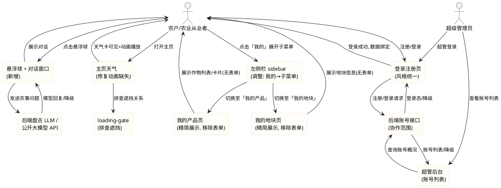
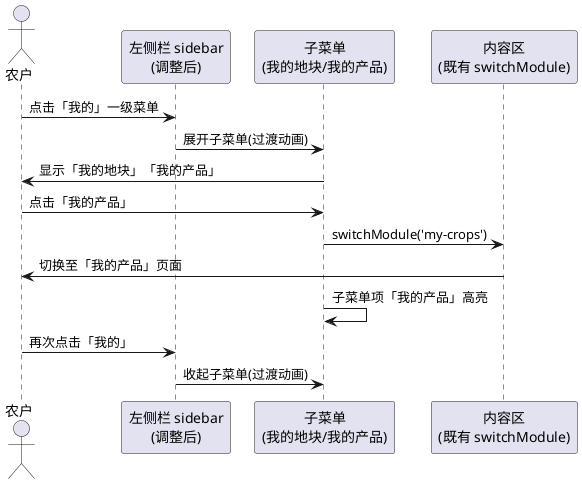
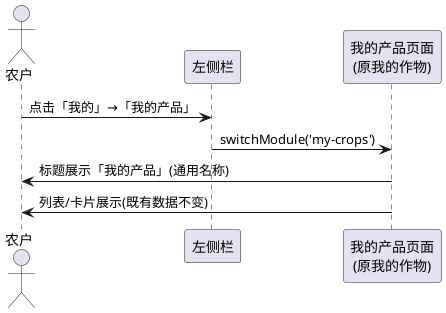
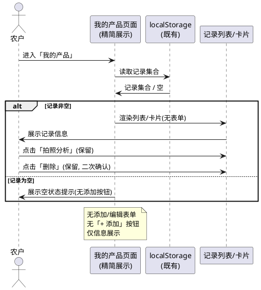
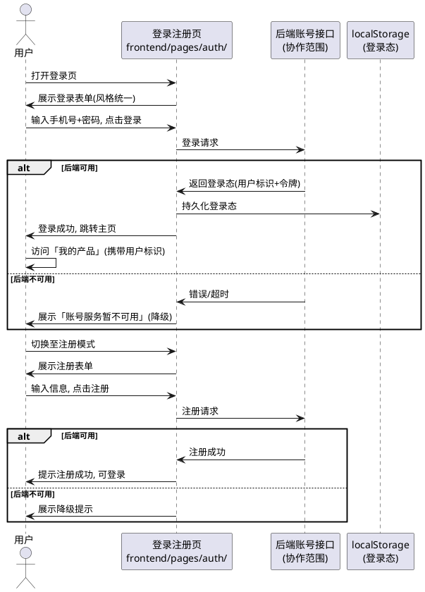
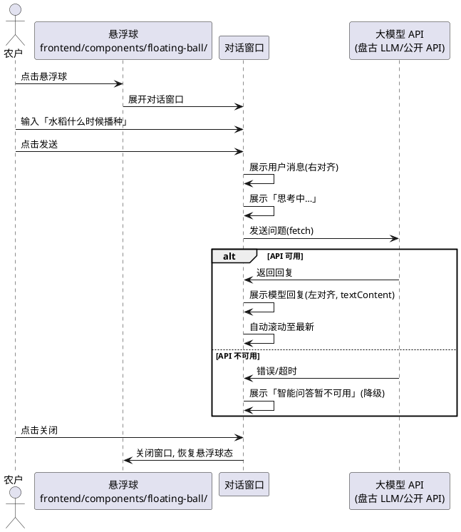
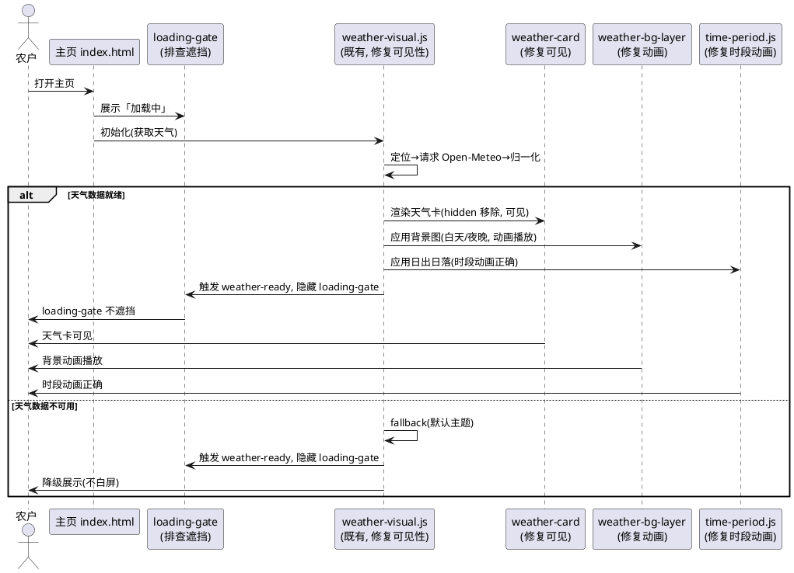

# V4 整合优化（v4_integrated_optimization）

> 本文档用于规范 agritime（知农时 · 会看天的农事日历）V4 阶段六项整合优化需求的验收标准：（1）导航栏结构调整——将「我的地块」「我的产品」收拢至「我的」一级菜单子菜单；（2）「我的作物」重命名为具通用性的名称以支撑未来渔业等产业扩展；（3）移除「我的产品」「我的地块」页面中冗余的输入弹窗/表单，仅保留信息展示；（4）继续完成 T10 账号系统与安全的前端部分——注册/登录、超级管理员、风格统一、429 友好提示；（5）新增悬浮球与大语言模型对话功能实现农事智能问答；（6）修复主页天气信息与动画缺失问题。
> 范围红线：本次为**纯前端整合优化**任务，仅允许修改 `frontend/` 目录下文件（T10 账号系统前端部分亦限 `frontend/`）；须保证（1）前端 75/75 既有测试全绿、仅允许新增断言、（2）不引入框架/构建工具/第三方库（含 UI 框架 Vue/React、菜单库、对话 UI 库、HTTP 库 axios/fetch polyfill）、（3）不修改后端 Java（8080）业务逻辑与 nginx 配置——T10 账号系统后端接口属协作范围，本任务仅消费并以前端降级承接、（4）所有新增功能须有降级方案（悬浮球对话 API 不可用时降级提示、账号接口未就绪时降级本地态、天气修复不改变既有降级机制）、（5）导航栏子菜单须纯原生 CSS + JS 实现不引入第三方菜单库、（6）悬浮球对话功能须纯前端实现，大模型 API 调用须有降级。
> 交付形式：本文档描述**做什么（What）**与**验收标准（Acceptance Criteria）**，不描述技术实现方式（How）；技术架构与代码结构由后续 design 阶段承接。
> 全局约束继承自 `stage2_frontend`（60 条）、`t00_directory_migration`（49 条）、`t01_weather_visual`（42 条）、`v4_t01_ui_revamp`（38 条）、`v4_t12_my_crops`（42 条）、`t08_t10_voice_security`（52 条）：纯原生 JS + 原生 CSS、前端测试断言不可弱化、`crop-map.js` 5 个 cropId 不变、mock 保持 null 占位不造假、时间线页天气数据经后端 `GET /api/timeline` 获取、主页左侧栏 6 板块入口已落地、天气视觉与时段动画已落地、语音组件已落地、拍照识别双通道已落地、「我的作物」页面已落地（含表单/列表/分组/日历联动）、T10 nginx 限流与安全头已落地。本任务在既有基础上**调整导航结构、重命名板块、移除冗余表单、补齐账号前端、新增悬浮球对话、修复天气动画**。

# **1. 组件定位**

## **1.1 核心职责**
本组件负责对 agritime 前端进行六项整合优化：将左侧栏「我的地块」「我的产品」收拢为「我的」一级菜单的子菜单项；将「我的作物」重命名为具通用性的名称以支撑未来渔业等产业扩展；移除「我的产品」「我的地块」页面中冗余的输入弹窗/表单仅保留信息展示；补齐 T10 账号系统前端（注册/登录/超管/429 提示）；新增右下角悬浮球呼出大语言模型对话窗口实现农事智能问答；修复主页天气信息展示与动画效果缺失问题。

## **1.2 核心输入**
1. 用户在左侧栏点击「我的」一级菜单展开/收起子菜单的操作指令——触发子菜单展开收起与板块切换。
2. 用户在登录注册页输入的手机号/用户名/密码/验证码——用于账号注册与登录。
3. 超级管理员登录后查看账号列表的操作指令——用于超管后台账号概况查看。
4. 用户点击右下角悬浮球的操作指令——触发大语言模型对话窗口展开。
5. 用户在对话窗口输入的农事相关文字问题——用于大模型问答。
6. 后端账号接口（注册/登录/验证码/用户信息/超管账号列表，属协作范围）的响应——用于账号态建立与超管数据。
7. 后端盘古 LLM 接口或公开大模型 API 的响应——用于农事智能问答回复。
8. 既有 `frontend/components/sidebar/sidebar.js` 的 MODULE_ENTRIES 配置——本任务调整其结构以支持子菜单。
9. 既有 `frontend/assets/js/weather-visual.js` 的天气数据获取与渲染机制——本任务排查并修复其与 loading-gate、z-index、布局的冲突。
10. 浏览器地理定位与 Open-Meteo API 返回的天气数据——复用既有请求机制（修复不改变取数方式）。

## **1.3 核心输出**
1. 调整后的左侧栏视图：含「我的」一级菜单（可展开收起），其下含「我的地块」「我的产品」子菜单项；其余板块入口保持既有行为。
2. 重命名后的板块标题与入口文案（具通用性的名称，不再局限于种植业）。
3. 精简后的「我的产品」「我的地块」页面视图：仅含信息展示（列表/卡片），不含添加/编辑表单与弹窗。
4. 登录注册页视图：含手机号/用户名/密码/验证码输入与注册/登录/退出操作，风格与项目内部一致（沿用左侧栏与整体 UI）。
5. 超级管理员后台视图：含账号列表、注册时间、活跃情况等账号概况展示。
6. 429 限流的友好提示视图：复用既有 toast/错误提示 UI，展示「请求过于频繁，请稍后再试」类文案。
7. 右下角悬浮球组件视图：固定定位的可点击球形按钮，点击展开对话窗口。
8. 大语言模型对话窗口视图：含文字输入框、发送按钮、对话气泡列表（用户消息与模型回复）。
9. 修复后的主页天气视图：天气卡可见、背景动画播放、时段动画正确，不再被 loading-gate 遮挡或因 z-index/布局问题缺失。
10. 账号态建立后的个人数据绑定信号——登录后「我的产品」「我的地块」等数据与账号关联（前端侧预留绑定位，后端接口就绪后承接）。

## **1.4 职责边界**
本组件**不负责**以下事项：
1. 后端 Java 服务（`/opt/crop-calendar`，8080）的任何修改——**明确禁止**修改后端代码、新增后端账号接口或改动后端配置；T10 账号系统后端接口（注册/登录/验证码/用户持久化/超管查询）属协作范围，本任务仅在前端侧消费并以前端降级承接，后端未就绪时前端以本地态降级。
2. nginx 反向代理配置的修改——**明确禁止**；IP 限流已由 T10 在 nginx 层落地，本任务仅在前端展示 429 友好提示，不新增 nginx 配置。
3. 后端盘古 LLM 接口或公开大模型 API 的实现——**明确禁止**修改后端 LLM 接口；本任务仅在前端侧调用既有接口或公开 API，接口不可用时降级提示。
4. 既有 `frontend/assets/js/crop-map.js` 的 5 个 cropId 与 6 作物条目映射的修改——**明确禁止**改变既有作物映射；重命名仅改变前端展示文案，不改变 cropId。
5. 既有 `frontend/assets/mock/mock-data.js` 的 null 占位策略的修改——**明确禁止**造假；mock 保持 null 占位。
6. 既有时间线页（timeline.html）渲染逻辑、既有拍照识别双通道与人工确认机制、既有语音组件、既有搜索历史、既有分栏布局（body.split-active）、既有主页表单提交链路的修改——**明确禁止**改变既有已落地功能的核心行为（本任务修复天气动画属修复缺陷，不改变取数方式与降级机制）。
7. 任何框架、构建工具、第三方库（含 UI 框架 Vue/React、菜单库、对话 UI 库、状态管理库、HTTP 库、表单库）的引入——**明确禁止**。
8. 既有前端测试断言的删除或弱化——**明确禁止**为通过新需求而修改 `frontend/tests/pages.test.js` 既有 75 项断言的预期。
9. 「我的地块」板块完整业务实现——本任务仅移除其冗余输入窗口并归入子菜单，地块完整管理（标注/形状建模/实时监控）由 T06 任务承接。
10. 农事日历板块「确认播种」交互的完整实现——本任务不改变既有日历联动事件契约。

# **2. 领域术语**

**一级菜单与子菜单（Top-level Menu & Submenu）**
: 指左侧栏导航中可展开收起的层级结构；一级菜单为可点击展开/收起的分组入口，子菜单为归入其下的具体板块入口；本次将「我的地块」「我的产品」归入「我的」一级菜单作为其子菜单项。

**「我的」一级菜单（My Top-level Menu）**
: 指左侧栏中聚合用户个人资产相关板块的一级菜单分组，其下含「我的地块」「我的产品」等子菜单项；点击展开显示子菜单，再次点击收起。

**板块通用名称（Generalized Module Name）**
: 指「我的作物」重命名后采用的具通用性的名称（如「我的产品」），须能覆盖种植业作物记录并兼容未来渔业（鱼苗/蟹苗）、林业、畜牧业等产业扩展，不再局限于种植业语义。

**冗余输入窗口（Redundant Input Window）**
: 指「我的产品」「我的地块」页面中现有的用于输入时间、地点、播种时间等信息的弹窗/表单组件；本次移除这些输入组件，仅保留独立的信息展示页面（列表/卡片）。

**账号系统前端（Account System Frontend）**
: 指用户注册/登录/退出与超级管理员后台的前端页面与交互逻辑；支持手机号或用户名注册登录，登录后个人数据（我的产品、我的地块、查询历史）与账号绑定；后端接口属协作范围，前端以前端降级承接。

**超级管理员（Super Administrator）**
: 指预设的具最高权限的账户，可登录后台查看各账号情况（用户列表、注册时间、活跃情况等）；超管账户为预设态，不经普通注册流程创建。

**登录态（Login State）**
: 指用户登录成功后前端持有的已认证状态，含用户标识、令牌（若后端返回）等；登录态须在页面刷新后保持（经 localStorage 或 sessionStorage），退出后清除。

**悬浮球（Floating Ball）**
: 指固定在页面右下角的可点击球形按钮组件，点击后呼出大语言模型对话窗口；悬浮球须在所有页面可见，不遮挡核心内容，可收起。

**大语言模型对话窗口（LLM Dialog Window）**
: 指悬浮球点击后展开的对话窗口，含文字输入框、发送按钮与对话气泡列表；用户输入农事相关文字问题，窗口展示大模型回复；API 不可用时降级提示。

**农事智能问答（Agricultural Q&A）**
: 指用户通过对话窗口询问与农事相关的问题（如作物种植时机、病虫害防治、天气农事建议等），大语言模型返回回复的交互能力；复用后端盘古 LLM 接口或直接调用公开 API。

**loading-gate（加载门控）**
: 指主页中 `#loading-gate` 元素，在天气数据就绪前展示「加载中」提示，天气就绪后隐藏；本次排查其是否遮挡天气卡与动画。

**天气动画缺失（Weather Animation Missing）**
: 指主页天气信息展示模块及动画效果当前无法正常显示的缺陷；可能原因包括 loading-gate 遮挡、weather-visual.js 加载顺序、CSS z-index 冲突、data-layout="app" 布局问题等。

**EARS 需求编号约定**
: 本文档需求编号格式为 `REQ-VIO-XXX-NNN`，`VIO` 为 V4 Integrated Optimization 缩写。前缀对应 EARS 句型：UBI（Ubiquitous，通用）、EVT（Event-driven，事件驱动）、STA（State-driven，状态驱动）、OPT（Optional，可选/带前提）、UNW（Unwanted，非期望行为）。

# **3. 角色与边界**

## **3.1 核心角色**
- **农户 / 农业从业者**：通过调整后的左侧栏导航访问「我的地块」「我的产品」；在精简后的展示页查看作物与地块信息；注册登录后个人数据与账号绑定；点击悬浮球询问农事问题获得智能回复；在主页查看修复后的天气与动画。
- **超级管理员**：使用预设超管账户登录后台，查看账号列表与各账号概况（注册时间、活跃情况等）。
- **测试维护者**：运行 `node --test frontend/tests/pages.test.js`，确认既有 75 项断言全绿并补充整合优化相关新断言。
- **开发者 / 交付者**：在 `frontend/` 范围内改动代码、上传至目标服务器 `/agritime/frontend` 并提交 Git。

## **3.2 外部系统**
- **既有 `frontend/components/sidebar/sidebar.js`**：左侧栏导航组件，当前 MODULE_ENTRIES 为扁平数组（6 入口）；本任务调整其结构以支持「我的」一级菜单与子菜单，不破坏既有 switchModule 机制。
- **既有 `frontend/assets/js/weather-visual.js`**：天气视觉模块，请求 Open-Meteo 并渲染天气卡与背景；本任务排查并修复其与 loading-gate、z-index、布局的冲突，不改变取数方式与降级机制。
- **既有 `frontend/assets/js/my-crops.js`**：我的作物页面逻辑，含表单（showForm）、列表渲染、分组展示、日历联动；本任务移除其表单部分仅保留列表与卡片展示。
- **既有 `frontend/assets/js/my-crops-store.js`**：作物记录存储模块（localStorage）；本任务不改变其存储键与结构，仅调整页面消费方式（展示态）。
- **后端账号接口（协作范围，本次不实现后端）**：注册/登录/验证码/用户信息/超管账号列表接口；本任务在前端侧消费并降级承接，后端未就绪时前端以本地态降级。
- **后端盘古 LLM 接口（既有）或公开大模型 API**：农事智能问答的回复来源；本任务在前端侧调用，不可用时降级提示「智能问答暂不可用」。
- **nginx（80 → 8080 反向代理，既有 T10 限流已落地）**：429 限流响应来源；本任务仅在前端展示 429 友好提示，不修改 nginx。
- **浏览器 localStorage / sessionStorage**：登录态持久化载体（账号令牌等）；localStorage 不可用时降级为会话内态。

## **3.3 交互上下文**

# **4. DFX约束**

## **4.1 性能**
1. 左侧栏「我的」一级菜单展开/收起子菜单须在用户点击后 ≤100ms 内完成视觉反馈，不得有感知延迟；子菜单切换复用既有 switchModule 机制。
2. 精简后的「我的产品」「我的地块」页面渲染须在板块切换后 ≤100ms 内呈现列表骨架，不得因移除表单引入额外延迟。
3. 登录注册页加载须在页面打开后 ≤300ms 内呈现表单骨架，不得白屏等待。
4. 悬浮球组件须在页面加载完成后 ≤500ms 内挂载完成并可见，不阻塞主页渲染与交互。
5. 大模型对话发送请求后须在等待期间展示「思考中…」类进度反馈，不得让用户感知无响应；回复返回后 ≤200ms 内渲染对话气泡。
6. 主页天气修复不得引入额外网络请求或改变既有请求超时（8000ms）与降级时机；修复后天气卡须在数据就绪后 ≤100ms 内可见。
7. 账号接口调用须有合理超时（如 10000ms），超时后降级提示，不无限等待。

## **4.2 可靠性**
1. 任一环节失败（子菜单切换异常、账号接口未就绪/超时、大模型 API 不可用、天气数据异常、localStorage 不可用）时，页面须优雅降级，**不得白屏**、不得抛出未捕获 JS 错误。
2. 「我的」一级菜单展开/收起须在多次点击下状态一致，不得出现子菜单残留或无法收起。
3. 账号接口未就绪时，前端须以本地态降级承接（登录态暂存 sessionStorage），不报错、不白屏；后端就绪后可切换至接口持久化。
4. 大模型 API 不可用（接口超时、返回错误、网络异常）时，对话窗口须展示「智能问答暂不可用」降级提示，不卡死、不白屏、不抛未捕获错误。
5. 悬浮球对话窗口在多次打开/关闭下状态须一致，不得出现对话历史残留或窗口无法关闭。
6. 主页天气修复须保持既有降级机制不变——天气数据不可用时降级为默认主题不白屏不报错；修复仅解决可见性与动画播放缺陷，不引入新失败路径。
7. 429 限流提示须复用既有 toast/错误提示 UI，短时间内多次 429 须合并节流展示（如 3 秒内仅展示一次），不堆叠。
8. 登录态在页面刷新后须保持（经 localStorage/sessionStorage），退出后须清除，不得残留无效登录态。
9. 超管后台账号列表加载失败时须展示可读提示（如「账号数据暂不可用」），不白屏。

## **4.3 安全性**
1. 账号注册/登录的密码须在前端经基本校验（非空、长度限制）后提交，**禁止**在 localStorage 中明文存储密码；令牌（若后端返回）可存 localStorage 但须有清除机制。
2. 大模型对话中用户输入的农事问题须经安全方式渲染（textContent），禁止将未转义的用户输入或模型回复拼入 innerHTML（防 XSS）。
3. 账号接口调用须使用 HTTPS（若启用）或经 nginx 反代的同源路径，不直接拼接外部 URL，防中间人攻击。
4. 超管后台须有登录态与超管权限校验，非超管用户不得访问超管页面（前端侧路由守卫，后端侧鉴权属协作范围）。
5. 悬浮球对话须经后端盘古 LLM 接口（经 nginx 反代同源）或公开 API（HTTPS）调用，不在前端硬编码 API Key；若需鉴权须经后端代理，不暴露凭据。
6. 板块切换、子菜单展开须复用既有 sidebar.js 同源机制，不通过动态拼接外部 URL 加载内容，防 XSS 与点击劫持。
7. 本次不引入任何外部脚本依赖，所有逻辑内联或使用项目内本地脚本。

## **4.4 可维护性**
1. 「我的」一级菜单与子菜单的结构配置（哪些板块归入「我的」、子菜单顺序与文案）须以**具名常量**集中定义于 sidebar.js，不得多处硬编码。
2. 板块通用名称（重命名后的「我的产品」等文案）须以具名常量集中定义，便于未来扩展至渔业等产业时统一调整。
3. 账号系统的接口端点、降级文案、登录态存储键、超管账户标识须以具名常量集中定义，便于后端就绪后切换。
4. 悬浮球与大模型对话的可配置项（API 端点、降级文案、对话窗口尺寸、悬浮球位置）须以具名常量集中定义，不得多处硬编码。
5. 天气修复涉及的 z-index 层级、loading-gate 隐藏时机须以具名常量或集中注释明确标注，避免后续冲突。
6. 新增页面（登录注册页/超管后台/悬浮球对话）须独立存放于对应目录，遵循 V4 目录规范，不与既有页面逻辑耦合。
7. 移除冗余表单后，「我的产品」「我的地块」页面的展示逻辑须保持独立模块化，便于后续 T06 地块管理接入时扩展。

## **4.5 兼容性**
1. **测试兼容（强制红线）**：不得破坏 `frontend/tests/pages.test.js` 的既有 75 项断言；可新增断言，既有断言须全绿。运行命令：`node --test frontend/tests/pages.test.js`。
2. **响应式兼容**：375px、768px、1024px 三档宽度下均须无横向滚动；「我的」子菜单、登录注册页、超管后台、悬浮球对话窗口在三档下均正常展示。
3. **不可引入依赖**：不得引入框架、构建工具、第三方库（含 UI 框架、菜单库、对话 UI 库、HTTP 库、表单库）。
4. **文件范围兼容**：不得修改后端及 `data/`、`shared/`、`deploy/`、`docs/` 等模块；仅修改 `frontend/` 下文件。
5. **接口兼容**：不得改变前端既有的 `GET /api/timeline`、`POST /api/recognition`、`POST /api/chart`、`GET /health` 调用方式与参数命名；账号接口与大模型接口为新增消费，不改变既有接口。
6. **既有功能兼容**：不得改变既有左侧栏 switchModule 机制（仅扩展子菜单能力）、既有作物映射 5 个 cropId、既有查询历史存储、既有拍照识别双通道、既有语音组件、既有分栏布局、既有主页表单提交链路、既有时间线页渲染的核心行为。
7. **浏览器兼容**：须在主流现代浏览器（Chrome/Edge/Safari 近两版）与移动端 WebView 下可用（原生 JS 语法须避免仅新引擎支持的特性或在必要时降级）。
8. **目录规范兼容**：新增页面资源须存放于 V4 目录规范对应位置（如 `frontend/pages/auth/`、`frontend/pages/admin/`、`frontend/components/floating-ball/`）。

# **5. 核心能力**

## **5.1 导航栏结构调整（需求1）**

### **5.1.1 业务规则**

1. **REQ-VIO-UBI-001（Ubiquitous）**：系统须将左侧栏「我的地块」（plots）与「我的产品」（my-crops）两个入口从顶级入口收拢至「我的」一级菜单下，作为其子菜单项；即 sidebar.js 的 MODULE_ENTRIES 中，「我的地块」与「我的产品」不再作为顶级入口独立展示，而是归入「我的」一级菜单的子菜单。
   a. 验收条件：[打开主页查看左侧栏] → [顶级入口不再单独显示「我的地块」「我的产品」，而是显示「我的」一级菜单；点击「我的」展开后子菜单含「我的地块」「我的产品」]

2. **REQ-VIO-UBI-002（Ubiquitous）**：系统须在 sidebar.js 的 MODULE_ENTRIES 中支持一级菜单与子菜单的层级结构配置，层级结构以具名常量集中定义，支持扩展（未来可新增其他子菜单项）。
   a. 验收条件：[代码审查] → [MODULE_ENTRIES 结构支持 children 字段或等价层级配置，「我的」一级菜单含 children: [plots, my-crops]，配置以具名常量定义]

3. **REQ-VIO-EVT-003（Event-driven）**：当用户点击「我的」一级菜单时，系统须展开其子菜单项（显示「我的地块」「我的产品」）；再次点击时须收起子菜单。
   a. 验收条件：[点击「我的」] → [子菜单展开显示「我的地块」「我的产品」]；[再次点击「我的」] → [子菜单收起隐藏]

4. **REQ-VIO-EVT-004（Event-driven）**：当用户点击「我的」下的子菜单项（如「我的产品」）时，系统须切换至对应板块页面，复用既有 switchModule 机制，当前子菜单项高亮。
   a. 验收条件：[展开「我的」后点击「我的产品」] → [右侧内容区切换至「我的产品」页面，该子菜单项高亮，「我的」一级菜单保持展开]

5. **REQ-VIO-UBI-005（Ubiquitous）**：「我的」一级菜单展开/收起须以纯原生 CSS + JS 实现，不引入第三方菜单库；展开/收起须有平滑过渡（如 max-height 或 transform 过渡），不得突变。
   a. 验收条件：[代码审查 + 视觉核对] → [无第三方菜单库引入，展开/收起有过渡动画，无突变]

6. **REQ-VIO-STA-006（State-driven）**：在当前选中板块为「我的」下子菜单项时，「我的」一级菜单须保持展开状态且以高亮或展开标识区分；切换至非「我的」下板块时，「我的」可保持上次展开/收起状态或收起（不得强制收起导致用户迷失）。
   a. 验收条件：[在「我的产品」页面时] → [「我的」一级菜单保持展开，子菜单项「我的产品」高亮]；[切换至「农事日历」] → [「我的」状态不强制收起至用户迷失]

7. **REQ-VIO-UBI-007（Ubiquitous）**：左侧栏其余板块入口（种植推荐、农事日历、病害检查、客服）须保持既有顶级入口行为不变，不受「我的」一级菜单调整影响。
   a. 验收条件：[查看左侧栏] → [种植推荐、农事日历、病害检查、客服仍为顶级入口，点击切换行为不变]

8. **REQ-VIO-UBI-008（Ubiquitous）**：移动端抽屉式折叠下，「我的」一级菜单的展开/收起须在抽屉内正常工作，不破坏既有移动端抽屉折叠机制。
   a. 验收条件：[375px 宽度下打开抽屉] → [「我的」一级菜单可在抽屉内展开/收起，子菜单项可点击切换，抽屉折叠机制不变]

9. **禁止项**：禁止移除既有 6 板块入口的任何功能（仅调整层级）；禁止子菜单展开时遮挡其他顶级入口或导致左侧栏滚动异常；禁止「我的」一级菜单无法收起导致永久占据空间。
   a. 验收条件：[交互核对 + 视觉核对] → [6 板块功能完整，子菜单不遮挡其他入口，可收起]

### **5.1.2 交互流程**

### **5.1.3 异常场景**

1. **子菜单展开时左侧栏空间不足**
   a. 触发条件：左侧栏高度不足以容纳展开的子菜单
   b. 系统行为：左侧栏 nav 区域纵向滚动（既有 overflow-y: auto），不遮挡其他入口
   c. 用户感知：子菜单完整可见，可滚动查看，其他入口不被遮挡

2. **子菜单项 implemented 为 false**
   a. 触发条件：「我的地块」板块尚未实现（implemented: false）
   b. 系统行为：复用既有占位提示机制，点击后展示「该板块正在开发中，敬请期待」
   c. 用户感知：看到占位提示，不白屏

## **5.2 「我的作物」重命名与泛化（需求2）**

### **5.2.1 业务规则**

1. **REQ-VIO-UBI-009（Ubiquitous）**：系统须将「我的作物」板块重命名为一个具通用性的名称，该名称须能覆盖种植业作物记录并兼容未来渔业（鱼苗/蟹苗）、林业、畜牧业等产业扩展，不再局限于种植业语义；候选名称包括「我的产品」「我的农产」「我的种养」等，最终名称以具名常量集中定义。
   a. 验收条件：[查看左侧栏与页面标题] → [「我的作物」已重命名为通用名称（如「我的产品」），文案以具名常量定义]；[代码审查] → [名称定义支持未来扩展至渔业等，不硬编码种植业语义]

2. **REQ-VIO-UBI-010（Ubiquitous）**：重命名须同步更新左侧栏入口文案、板块页面标题（如 `.my-crops-title`）、空状态提示文案、日历联动事件相关提示等所有面向用户的位置，不得出现「我的作物」与重命名后名称混用。
   a. 验收条件：[全量审查面向用户文案] → [所有位置统一为重命名后名称，无「我的作物」残留混用]

3. **REQ-VIO-UBI-011（Ubiquitous）**：重命名仅改变前端展示文案，不改变既有 `my-crops` 模块标识（data-module="my-crops"）、存储键（agritime.my-crops.v1）、cropId 映射、日历联动事件契约等技术标识；技术标识保持稳定以兼容既有数据与测试。
   a. 验收条件：[代码审查] → [data-module、存储键、cropId、事件名等技术标识不变，仅展示文案改变]

4. **REQ-VIO-OPT-012（Optional/带前提）**：当未来扩展至渔业等产业时，重命名后的板块须能容纳非种植业记录（如鱼苗/蟹苗记录），板块名称与空状态提示须泛化以适配多产业；本任务仅完成命名泛化，渔业记录的完整接入属 T09 任务。
   a. 验收条件：[审查命名与提示文案] → [名称与提示不限定种植业语义（如不出现「作物」「播种」等种植业专属词在板块标题层），可泛化承接多产业]

5. **禁止项**：禁止重命名导致既有作物记录数据丢失或存储键变更；禁止重命名改变既有 crop-map.js 的 5 个 cropId；禁止重命名破坏既有 75 项测试断言。
   a. 验收条件：[重命名后查看既有记录] → [数据完好，存储键不变，cropId 不变，测试全绿]

### **5.2.2 交互流程**

### **5.2.3 异常场景**

1. **重命名后既有测试引用旧名称**
   a. 触发条件：既有测试断言中引用「我的作物」文案
   b. 系统行为：同步更新测试断言中的文案预期（仅文案断言，不弱化功能断言），保持测试全绿
   c. 用户感知：无感知，测试全绿

## **5.3 移除冗余输入窗口（需求3）**

### **5.3.1 业务规则**

1. **REQ-VIO-UBI-013（Ubiquitous）**：系统须在「我的产品」页面（原「我的作物」）中移除现有的添加/编辑表单组件（`#my-crops-form` 及其所有字段输入控件），仅保留列表展示与卡片信息展示。
   a. 验收条件：[进入「我的产品」页面] → [不展示添加/编辑表单（无种下时间/发芽状况/高度/长势等输入控件），仅展示记录列表与卡片信息]

2. **REQ-VIO-UBI-014（Ubiquitous）**：系统须移除「我的产品」页面中的「添加」按钮（`#my-crops-add-btn`）及触发表单展开的交互入口，页面仅作为信息展示页，不再提供新增/编辑入口。
   a. 验收条件：[进入「我的产品」页面] → [无「+ 添加」按钮，无触发表单展开的入口]

3. **REQ-VIO-UBI-015（Ubiquitous）**：系统须在「我的地块」页面中移除现有的用于输入时间、地点、播种时间等信息的弹窗/表单组件，仅保留独立的信息展示页面。
   a. 验收条件：[进入「我的地块」页面] → [不展示输入时间/地点/播种时间等信息的弹窗/表单，仅展示地块信息]

4. **REQ-VIO-UBI-016（Ubiquitous）**：移除表单后，「我的产品」页面须仍能展示既有作物记录（从 localStorage 读取并渲染列表/卡片），记录的查看、分组展示、空状态提示须保持可用；仅移除新增/编辑入口，不移除展示能力。
   a. 验收条件：[localStorage 中有既有记录时进入页面] → [列表/卡片正常展示，分组展示可用]；[无记录时进入页面] → [展示空状态提示]

5. **REQ-VIO-UBI-017（Ubiquitous）**：移除表单后，既有日历联动机制（监听「确认播种」事件自动新增记录）须保持可用——农事日历确认播种后仍自动新增记录至 localStorage，「我的产品」页面列表刷新展示新记录；移除的仅是用户手动新增/编辑的表单入口，不影响日历联动的自动新增。
   a. 验收条件：[农事日历确认播种] → [「我的产品」列表自动新增记录并刷新展示，无表单介入]

6. **REQ-VIO-UBI-018（Ubiquitous）**：移除表单后，记录卡片上的「拍照分析」入口须保留（复用既有 crop-photo.js），用户仍可对记录发起拍照分析以补全状态；移除的仅是表单录入入口，不移除拍照分析能力。
   a. 验收条件：[记录卡片上点击「拍照分析」] → [复用既有 photo-capture.js 弹层，拍照/上传双通道可用]

7. **REQ-VIO-UBI-019（Ubiquitous）**：移除表单后，记录卡片的「编辑」「删除」操作入口须保留或按需调整——删除操作（含二次确认）须保留以支持记录管理；编辑操作可保留（展开编辑表单）或移除（仅展示不可编辑），具体策略以具名常量配置，但须保证删除能力可用。
   a. 验收条件：[记录卡片上点击「删除」] → [展示二次确认，确认后记录移除，列表刷新]；[编辑入口策略] → [以具名常量配置，删除能力始终可用]

8. **禁止项**：禁止移除表单导致既有记录数据丢失；禁止移除表单后页面白屏或无法展示记录；禁止移除表单破坏既有日历联动与拍照分析机制。
   a. 验收条件：[移除表单后查看既有记录] → [数据完好，列表正常展示，日历联动与拍照分析可用]

### **5.3.2 交互流程**

### **5.3.3 异常场景**

1. **移除表单后用户期望新增记录**
   a. 触发条件：用户在「我的产品」页面期望手动添加记录但无入口
   b. 系统行为：页面仅展示信息，可通过农事日历确认播种自动新增或后续 T06 接入其他入口
   c. 用户感知：看到展示信息，无手动新增入口（符合本次精简需求）

2. **localStorage 数据损坏**
   a. 触发条件：localStorage 中记录集合非法/无法解析
   b. 系统行为：忽略损坏数据，重置为空集合，展示空状态提示
   c. 用户感知：看到空状态提示，无报错、无白屏

## **5.4 T10 账号系统前端（需求4）**

### **5.4.1 业务规则**

1. **REQ-VIO-OPT-020（Optional/带前提）**：当后端账号接口可用时（需协作实现注册/登录/验证码接口），系统须提供账号注册入口，用户可通过手机号或用户名 + 密码完成注册；注册须有基本校验（手机号格式/用户名非空/密码长度），校验通过后调用后端注册接口。
   a. 验收条件：[后端接口可用 + 用户输入手机号 13800138000 与密码并提交] → [校验通过后调用注册接口，注册成功后可登录]
   b. 前提条件：后端须提供注册接口（本次不实现后端，前端降级承接）

2. **REQ-VIO-OPT-021（Optional/带前提）**：当后端账号接口可用时，系统须提供登录入口，用户可通过手机号或用户名 + 密码完成登录；登录成功后建立登录态（含用户标识与令牌），登录态经 localStorage/sessionStorage 持久化，页面刷新后保持。
   a. 验收条件：[登录成功] → [建立登录态，页面刷新后仍处于登录态]；[退出登录] → [登录态清除，页面刷新后未登录]

3. **REQ-VIO-UBI-022（Ubiquitous）**：登录注册页须独立存放于 `frontend/pages/auth/` 目录，页面风格须与项目内部保持一致——沿用左侧栏与整体 UI 风格（复用 common.css 的 CSS 变量 --leaf/--ink/--paper/--card 等），不使用外部默认模板。
   a. 验收条件：[审查 frontend/pages/auth/ 目录] → [存在登录注册页，样式复用既有 CSS 变量，含左侧栏，风格与主页一致]

4. **REQ-VIO-UBI-023（Ubiquitous）**：登录注册页须提供注册与登录两种模式切换，模式切换须在同一页面内切换表单（不跳转新页面），切换须有可见标识区分当前模式。
   a. 验收条件：[在登录页点击「去注册」] → [表单切换为注册模式，有当前模式标识]；[在注册页点击「去登录」] → [表单切换为登录模式]

5. **REQ-VIO-UBI-024（Ubiquitous）**：登录成功后，用户的个人数据（我的产品、我的地块、查询历史）须与账号绑定——前端侧预留绑定位，登录态下数据请求须携带用户标识/令牌；后端接口未就绪时以本地态降级（数据暂存 localStorage，账号就绪后迁移绑定）。
   a. 验收条件：[登录态下访问「我的产品」] → [数据请求携带用户标识（后端就绪时）或本地态展示（降级时）]；[代码审查] → [预留绑定位，降级不报错]

6. **REQ-VIO-OPT-025（Optional/带前提）**：当后端超管接口可用时，系统须提供超级管理员后台入口，超管登录后可查看账号情况——账号列表（用户名/手机号、注册时间、活跃情况等）；超管账户为预设态，不经普通注册流程创建。
   a. 验收条件：[超管登录后进入后台] → [展示账号列表，含用户名/手机号、注册时间、活跃情况等概况]
   b. 前提条件：后端须提供超管查询接口与预设超管账户（本次不实现后端）

7. **REQ-VIO-UBI-026（Ubiquitous）**：超管后台须独立存放于 `frontend/pages/admin/` 目录，风格与项目内部一致；超管后台须有前端路由守卫——非登录或非超管权限用户不得访问超管页面，访问时重定向至登录页或提示无权限。
   a. 验收条件：[审查 frontend/pages/admin/ 目录] → [存在超管后台页，风格一致]；[非超管用户访问超管页] → [重定向至登录页或提示无权限]

8. **REQ-VIO-EVT-027（Event-driven）**：当前端发起的接口请求收到 HTTP 429 响应（T10 nginx 限流已落地）时，前端须展示明确的限流友好提示（如「请求过于频繁，请稍后再试」），复用既有 toast/错误提示 UI，不得白屏、不得静默忽略。
   a. 验收条件：[前端请求触发 429] → [展示「请求过于频繁，请稍后再试」类友好提示，复用既有 toast UI，不白屏]

9. **REQ-VIO-UNW-028（Unwanted）**：如果前端在短时间内多次收到 429 响应，系统不得重复弹出多个提示堆叠，须合并或节流展示（如 3 秒内仅展示一次限流提示）。
   a. 验收条件：[连续触发 3 次 429] → [3 秒内仅展示 1 次限流提示，不堆叠]

10. **REQ-VIO-OPT-029（Optional/带前提）**：当后端账号接口不可用时（未实现/超时/错误），前端须以本地态降级承接——注册/登录展示「账号服务暂不可用」提示，不阻塞页面其他功能；登录态可临时存 sessionStorage 供会话内使用。
    a. 验收条件：[后端账号接口不可用时尝试注册/登录] → [展示「账号服务暂不可用」提示，不白屏、不报错，页面其他功能正常]

11. **禁止项**：禁止在 localStorage 中明文存储密码；禁止非超管用户访问超管页面；禁止 429 提示遮挡整个页面导致用户无法操作；禁止账号接口调用无限重试。
    a. 验收条件：[审查 localStorage] → [无明文密码]；[非超管访问超管页] → [被拦截]；[429 提示] → [不遮挡全屏]

### **5.4.2 交互流程**

### **5.4.3 异常场景**

1. **后端账号接口未实现**
   a. 触发条件：后端账号接口尚未开发完成
   b. 系统行为：前端展示「账号服务暂不可用」降级提示，不阻塞页面其他功能
   c. 用户感知：看到降级提示，可继续使用未登录态功能

2. **登录态过期或令牌失效**
   a. 触发条件：localStorage 中登录态存在但令牌已过期
   b. 系统行为：接口返回 401 时清除登录态，提示重新登录
   c. 用户感知：看到重新登录提示，登录态清除

3. **超管账户未预设**
   a. 触发条件：后端未预设超管账户
   b. 系统行为：超管登录失败，提示「超管账户未配置」或通用错误
   c. 用户感知：看到提示，无法进入超管后台

## **5.5 悬浮球与大模型对话（需求5）**

### **5.5.1 业务规则**

1. **REQ-VIO-UBI-030（Ubiquitous）**：系统须在应用中添加一个悬浮球组件，悬浮球固定在页面右下角（position: fixed），在所有页面可见，不遮挡核心内容（如左侧栏、表单、列表），可点击呼出对话窗口。
   a. 验收条件：[在任意页面查看右下角] → [存在悬浮球，固定定位，不遮挡左侧栏/表单/列表，可点击]

2. **REQ-VIO-EVT-031（Event-driven）**：当用户点击悬浮球时，系统须呼出大语言模型对话窗口；对话窗口含文字输入框、发送按钮与对话气泡列表（用户消息右对齐、模型回复左对齐），窗口可关闭。
   a. 验收条件：[点击悬浮球] → [展开对话窗口，含输入框/发送按钮/对话气泡列表，可关闭]

3. **REQ-VIO-EVT-032（Event-driven）**：当用户在对话窗口输入农事相关文字问题并点击发送时，系统须调用大模型 API（复用后端盘古 LLM 接口或直接调用公开 API），将用户问题发送至 API，等待回复期间展示「思考中…」类进度反馈。
   a. 验收条件：[输入「水稻什么时候播种」并点击发送] → [用户消息展示在对话列表，调用大模型 API，等待期间展示「思考中…」]

4. **REQ-VIO-EVT-033（Event-driven）**：当大模型 API 返回回复时，系统须将回复展示为对话气泡（左对齐，与用户消息区分），回复内容须经安全方式渲染（textContent，防 XSS），对话列表自动滚动至最新。
   a. 验收条件：[API 返回回复] → [回复展示为对话气泡（左对齐），自动滚动至最新，无 XSS 风险]

5. **REQ-VIO-UBI-034（Ubiquitous）**：悬浮球与大模型对话功能须纯前端实现，不引入第三方对话 UI 库或 HTTP 库；大模型 API 调用使用浏览器原生 fetch，对话 UI 使用原生 JS + CSS。
   a. 验收条件：[代码审查] → [无第三方对话 UI 库/HTTP 库引入，使用原生 fetch + 原生 JS/CSS]

6. **REQ-VIO-UNW-035（Unwanted）**：如果大模型 API 不可用（接口超时、返回错误、网络异常、未配置端点），系统须在对话窗口展示「智能问答暂不可用」降级提示，不卡死、不白屏、不抛未捕获错误；用户已发送的消息须保留在对话列表。
   a. 验收条件：[API 不可用时发送问题] → [展示「智能问答暂不可用」提示，用户消息保留，不卡死、不白屏]

7. **REQ-VIO-UBI-036（Ubiquitous）**：悬浮球组件须独立存放于 `frontend/components/floating-ball/` 目录，对话窗口样式与交互逻辑封装于此目录，遵循 V4 目录规范，不与既有页面逻辑耦合。
   a. 验收条件：[审查目录结构] → [存在 frontend/components/floating-ball/ 目录，悬浮球与对话窗口资源存放于此]

8. **REQ-VIO-UBI-037（Ubiquitous）**：悬浮球与对话窗口须复用既有 CSS 变量（--leaf/--ink/--paper/--card/--radius 等）与整体 UI 风格，与项目内部视觉一致，不使用外部默认样式。
   a. 验收条件：[视觉核对 + 代码审查] → [悬浮球与对话窗口样式复用既有 CSS 变量，风格与项目一致]

9. **REQ-VIO-STA-038（State-driven）**：在对话窗口展开期间，悬浮球须保持可见或切换为收起态按钮（如悬浮球变为「×」关闭按钮），用户可随时关闭窗口恢复悬浮球态；关闭窗口后对话历史可保留或清空（以具名常量配置）。
   a. 验收条件：[对话窗口展开时] → [可关闭窗口恢复悬浮球态]；[再次打开窗口] → [对话历史按配置保留或清空]

10. **REQ-VIO-UBI-039（Ubiquitous）**：悬浮球与对话窗口须在 375px、768px、1024px 三档宽度下均正常展示——移动端悬浮球不遮挡底部操作区，对话窗口适配屏幕尺寸（如移动端近全屏，桌面端定宽定高）。
    a. 验收条件：[三档宽度下查看悬浮球与对话窗口] → [均正常展示，不遮挡核心内容，无横向滚动]

11. **REQ-VIO-OPT-040（Optional/带前提）**：大模型 API 端点须以具名常量集中定义，支持配置为后端盘古 LLM 接口（经 nginx 反代同源）或公开 API（HTTPS）；若需鉴权须经后端代理，不在前端硬编码 API Key。
    a. 验收条件：[代码审查] → [API 端点以具名常量定义，无硬编码 API Key，鉴权经后端代理]

12. **禁止项**：禁止悬浮球遮挡左侧栏入口、表单提交按钮、记录列表等核心内容；禁止对话窗口无法关闭导致永久占据屏幕；禁止大模型 API 调用在前端暴露 API Key；禁止对话功能引入第三方库。
    a. 验收条件：[视觉核对 + 代码审查] → [不遮挡核心内容，可关闭，无 API Key 暴露，无第三方库]

### **5.5.2 交互流程**

### **5.5.3 异常场景**

1. **大模型 API 端点未配置**
   a. 触发条件：具名常量中 API 端点为空或未配置
   b. 系统行为：对话窗口展示「智能问答暂不可用」提示，不发起请求
   c. 用户感知：看到降级提示，不卡死

2. **大模型 API 返回非预期格式**
   a. 触发条件：API 返回响应但格式非预期（如无回复字段）
   b. 系统行为：展示通用降级提示或提取可读文本，不报错
   c. 用户感知：看到提示或部分回复，不白屏

3. **对话窗口移动端遮挡底部操作区**
   a. 触发条件：375px 宽度下对话窗口展开遮挡底部按钮
   b. 系统行为：移动端对话窗口近全屏或适配尺寸，不遮挡底部操作区
   c. 用户感知：对话窗口与底部操作区均可用

## **5.6 主页天气与动画修复（需求6）**

### **5.6.1 业务规则**

1. **REQ-VIO-UBI-041（Ubiquitous）**：系统须排查并修复主页中天气信息展示模块无法正常显示的问题——天气卡（`#weather-card`）须在天气数据就绪后可见（hidden 属性移除），展示当前地点、温度、天气状况、湿度风速等信息。
   a. 验收条件：[打开主页等待天气数据就绪] → [天气卡可见，展示地点/温度/天气状况/湿度风速，不再缺失]

2. **REQ-VIO-UBI-042（Ubiquitous）**：系统须排查并修复主页背景动画效果无法正常播放的问题——天气背景层（`#weather-bg-layer`）须依据天气类型与白天/夜晚正确应用背景图（SVG），背景动画须正常播放。
   a. 验收条件：[打开主页等待天气数据就绪] → [背景层依据天气类型与白天/夜晚正确应用 SVG 背景，动画播放，不再缺失]

3. **REQ-VIO-UBI-043（Ubiquitous）**：系统须排查并修复时段动画效果无法正常显示的问题——时段动画（time-period.js）须依据日出日落正确判定时段并应用对应动画，时段动画须正确显示。
   a. 验收条件：[打开主页等待天气数据就绪] → [时段动画依据日出日落正确判定并显示，不再缺失]

4. **REQ-VIO-UBI-044（Ubiquitous）**：系统须排查 loading-gate（`#loading-gate`）是否遮挡天气卡与动画——loading-gate 须在天气数据就绪后（weather-ready 事件触发）及时隐藏，不得因 z-index 过高或隐藏时机错误持续遮挡天气内容。
   a. 验收条件：[天气数据就绪后] → [loading-gate 已隐藏（含 hidden 类或 display:none），不遮挡天气卡与动画]；[审查 z-index] → [loading-gate z-index 不高于天气内容层或隐藏后不占据层叠]

5. **REQ-VIO-UBI-045（Ubiquitous）**：系统须排查 CSS z-index 冲突——loading-gate、sidebar（z-index:100）、weather-bg-layer、weather-card、悬浮球等层叠元素的 z-index 须合理设置，不得因 z-index 冲突导致天气卡或动画被遮挡。
   a. 验收条件：[审查 CSS z-index 层叠] → [各元素 z-index 合理，天气卡与动画不被 loading-gate/sidebar/悬浮球遮挡]

6. **REQ-VIO-UBI-046（Ubiquitous）**：系统须排查 `data-layout="app"` 布局是否导致天气内容缺失——body 的 data-layout 属性与 app-main/page--home 的布局须保证天气卡与背景层在视口内可见，不得因布局溢出/隐藏/定位错误导致缺失。
   a. 验收条件：[审查布局] → [weather-card 与 weather-bg-layer 在视口内可见，不因 data-layout="app" 布局溢出/隐藏/定位错误缺失]

7. **REQ-VIO-UBI-047（Ubiquitous）**：系统须排查 weather-visual.js 加载顺序——weather-visual.js 须在依赖其的模块（如 time-period.js）之前加载，且在 DOM 就绪后正确初始化；不得因加载顺序错误导致天气数据未获取或渲染未执行。
   a. 验收条件：[审查 index.html 脚本加载顺序] → [weather-visual.js 在 time-period.js 之前加载，初始化时机正确，天气数据获取与渲染正常执行]

8. **REQ-VIO-UBI-048（Ubiquitous）**：修复须保持既有降级机制不变——天气数据不可用（定位失败/请求超时/接口异常）时降级为默认主题（fallback），不白屏、不报错；修复仅解决可见性与动画播放缺陷，不改变取数方式（Open-Meteo）、超时（8000ms）与降级时机。
   a. 验收条件：[天气数据不可用时] → [降级为默认主题，不白屏、不报错]；[代码审查] → [取数方式/超时/降级机制不变]

9. **REQ-VIO-UBI-049（Ubiquitous）**：修复须不破坏既有 75 项测试断言——修复涉及的 z-index、loading-gate 隐藏时机、布局调整须同步补充测试断言（如天气卡可见性、loading-gate 隐藏后不遮挡），既有断言保持全绿。
   a. 验收条件：[运行 node --test frontend/tests/pages.test.js] → [既有 75 项断言全绿，新增天气修复断言通过]

10. **禁止项**：禁止修复改变既有 weather-visual.js 的取数方式（Open-Meteo URL/参数）、超时（8000ms）、降级机制（fallback）；禁止修复引入额外网络请求或第三方动画库；禁止修复为通过测试而弱化既有断言。
    a. 验收条件：[代码审查] → [取数/超时/降级不变，无额外请求/第三方库，既有断言不弱化]

### **5.6.2 交互流程**

### **5.6.3 异常场景**

1. **loading-gate z-index 过高持续遮挡**
   a. 触发条件：loading-gate 的 z-index 高于天气内容层且隐藏时机错误
   b. 系统行为：调整 z-index 层叠与隐藏时机，weather-ready 后及时隐藏 loading-gate
   c. 用户感知：天气就绪后天气卡与动画可见，无遮挡

2. **weather-visual.js 加载顺序错误**
   a. 触发条件：weather-visual.js 在依赖其的模块之后加载
   b. 系统行为：调整 index.html 脚本加载顺序，确保 weather-visual.js 先加载
   c. 用户感知：天气数据正常获取与渲染

3. **data-layout="app" 布局导致内容溢出隐藏**
   a. 触发条件：body data-layout="app" 与 app-main/page--home 布局导致天气内容溢出视口或被隐藏
   b. 系统行为：调整布局确保天气卡与背景层在视口内可见
   c. 用户感知：天气卡与动画在视口内可见

4. **CSS z-index 冲突**
   a. 触发条件：sidebar（z-index:100）、悬浮球、loading-gate 等层叠元素 z-index 冲突
   b. 系统行为：合理设置各元素 z-index，天气内容层不被遮挡
   c. 用户感知：天气卡与动画可见，各元素层叠合理

# **6. 数据约束**

## **6.1 左侧栏菜单结构对象**
1. **id**：板块标识，字符串，取值为 recommend/plots/calendar/disease/my-crops/service/my 之一；「我的」一级菜单 id 为 `my`。
2. **label**：板块展示文案，非空字符串；重命名后「我的产品」的 label 为通用名称（以具名常量定义）。
3. **icon**：板块图标，字符串（emoji 或图标标识）。
4. **implemented**：板块是否已实现，布尔值；未实现的板块点击后展示占位提示。
5. **children**：子菜单项数组，可选；仅「我的」一级菜单含 children: [plots, my-crops]；无 children 的入口为顶级叶子入口。

## **6.2 账号登录态对象**
1. **userId**：用户标识，字符串，登录成功后由后端返回或前端降级生成。
2. **username**：用户名或手机号，字符串，非空。
3. **token**：登录令牌，字符串，可选（后端返回时存 localStorage，退出时清除）。
4. **role**：角色标识，字符串，取值为 `user`（普通用户）或 `admin`（超级管理员）。
5. **loginAt**：登录时间戳，ISO 8601，用于登录态过期判定。
6. **存储约束**：登录态经 localStorage（持久化）或 sessionStorage（会话内）存储；**禁止**存储明文密码。

## **6.3 超管账号列表对象**
1. **userId**：用户标识，字符串。
2. **username**：用户名或手机号，字符串。
3. **registeredAt**：注册时间，ISO 8601。
4. **lastActiveAt**：最后活跃时间，ISO 8601，可选。
5. **status**：账号状态，字符串（如 active/disabled）。

## **6.4 悬浮球对话消息对象**
1. **role**：消息角色，字符串，取值为 `user`（用户消息）或 `assistant`（模型回复）。
2. **content**：消息内容，字符串，非空；须经安全方式渲染（textContent）。
3. **timestamp**：消息时间戳，ISO 8601，用于排序。
4. **status**：消息状态，字符串，取值为 `sent`/`received`/`error`；error 时展示降级提示。

## **6.5 大模型 API 调用配置对象**
1. **endpoint**：API 端点，字符串，以具名常量定义；可为后端盘古 LLM 接口（经 nginx 反代同源）或公开 API（HTTPS）。
2. **timeout**：请求超时，数值，单位 ms，默认 15000。
3. **fallbackText**：降级提示文案，字符串，默认「智能问答暂不可用」。
4. **安全约束**：**禁止**在前端硬编码 API Key；鉴权须经后端代理。

## **6.6 天气修复层叠配置对象**
1. **loadingGateZIndex**：loading-gate 的 z-index，数值，须在天气内容隐藏后不占据层叠。
2. **weatherCardZIndex**：天气卡的 z-index，数值，须高于背景层、低于遮挡性元素（如 sidebar）的合理层级。
3. **weatherBgZIndex**：天气背景层的 z-index，数值，须低于天气卡。
4. **floatingBallZIndex**：悬浮球的 z-index，数值，须不遮挡天气卡与动画。
5. **约束**：各 z-index 须以具名常量或集中注释明确标注，避免后续冲突。

# **7. 需求归类与交付边界**

> 本章明确区分"前端代码修改（允许且必须）"、"新增文件（允许）"、"不触碰项"与"排除项"。

## **7.1 前端代码修改（允许且必须，范围限 `frontend/`）**
1. `frontend/components/sidebar/sidebar.js`：调整 MODULE_ENTRIES 结构支持「我的」一级菜单与子菜单。—— 对应 REQ-VIO-UBI-001~008。
2. `frontend/components/sidebar/sidebar.css`：新增子菜单展开/收起样式与过渡。—— 对应 REQ-VIO-UBI-005。
3. `frontend/pages/index.html`：调整 my-crops-pane 移除表单、调整标题文案、修复天气相关层叠与加载顺序、引入悬浮球与新增页面脚本。—— 对应 REQ-VIO-UBI-013~019、UBI-041~049。
4. `frontend/assets/js/my-crops.js`：移除表单逻辑（showForm）仅保留列表/卡片展示、拍照分析、删除、日历联动。—— 对应 REQ-VIO-UBI-013~019。
5. `frontend/assets/css/my-crops.css`：移除表单样式，调整展示态样式。—— 对应 REQ-VIO-UBI-013。
6. `frontend/assets/css/common.css`：修复天气相关 z-index 层叠、loading-gate 遮挡、布局问题。—— 对应 REQ-VIO-UBI-044~046。
7. `frontend/assets/js/weather-visual.js`：排查并修复天气卡可见性、背景动画播放（不改变取数方式与降级机制）。—— 对应 REQ-VIO-UBI-041~048。
8. `frontend/tests/pages.test.js`：新增断言（子菜单/重命名/表单移除/账号/悬浮球/天气修复），既有 75 项断言保持全绿。—— 对应全部需求。

## **7.2 新建目录与文件（允许）**
1. `frontend/pages/auth/`：登录注册页（HTML/CSS/JS）。—— 对应 REQ-VIO-UBI-022~024。
2. `frontend/pages/admin/`：超管后台页（HTML/CSS/JS）。—— 对应 REQ-VIO-UBI-026。
3. `frontend/components/floating-ball/`：悬浮球与对话窗口组件（JS/CSS）。—— 对应 REQ-VIO-UBI-036~037。

## **7.3 不触碰项（保持不变）**
1. 后端 Java 服务（`/opt/crop-calendar`，8080）：不修改。—— 对应职责边界 1。
2. nginx 配置：不修改（T10 限流已落地，仅前端展示 429 提示）。—— 对应职责边界 2。
3. `frontend/assets/js/crop-map.js`：5 个 cropId 与 6 作物条目不变。—— 对应 REQ-VIO-UBI-011。
4. `frontend/assets/mock/mock-data.js`：null 占位策略不变，不造假。—— 对应职责边界 5。
5. 既有时间线页（timeline.html）渲染逻辑、拍照识别双通道、语音组件、搜索历史、分栏布局、主页表单提交链路的核心行为不变。—— 对应职责边界 6。

## **7.4 排除项**
1. 后端账号接口的实现：本次仅前端消费并降级承接，**不实现后端**。
2. 后端盘古 LLM 接口的实现：本次仅前端调用，**不修改后端 LLM 接口**。
3. 「我的地块」板块完整业务实现：本次仅移除冗余输入窗口并归入子菜单，地块完整管理由 T06 承接。
4. 渔业等产业扩展的完整接入：本次仅完成命名泛化，渔业记录接入由 T09 承接。
5. 框架/构建工具/第三方库的引入：**明确禁止**。

## **7.5 交付任务**
1. **Git 提交**：完成后须提交并推送至 GitHub 仓库，提交信息须体现 V4 整合优化任务。
2. **服务器同步**：修改后的项目须能同步至目标服务器 115.175.44.27 的 `/agritime`，且 nginx root 路径仍有效。
3. **测试验证**：交付前须运行 `node --test frontend/tests/pages.test.js` 确认 75/75 既有断言全绿且新增断言通过。