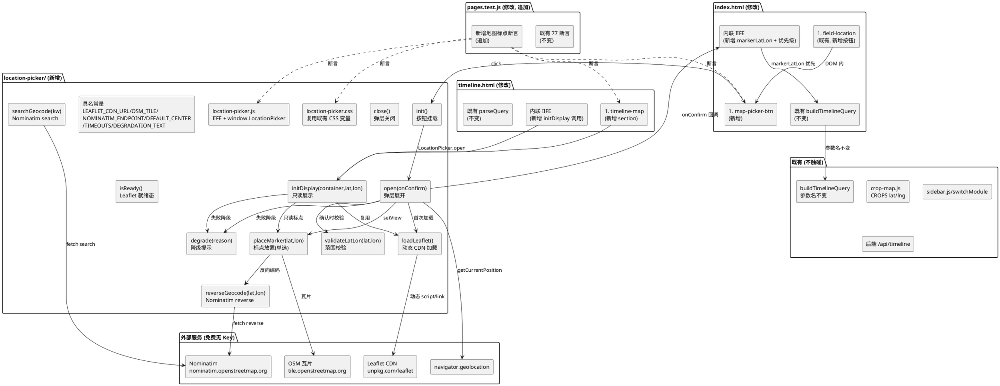
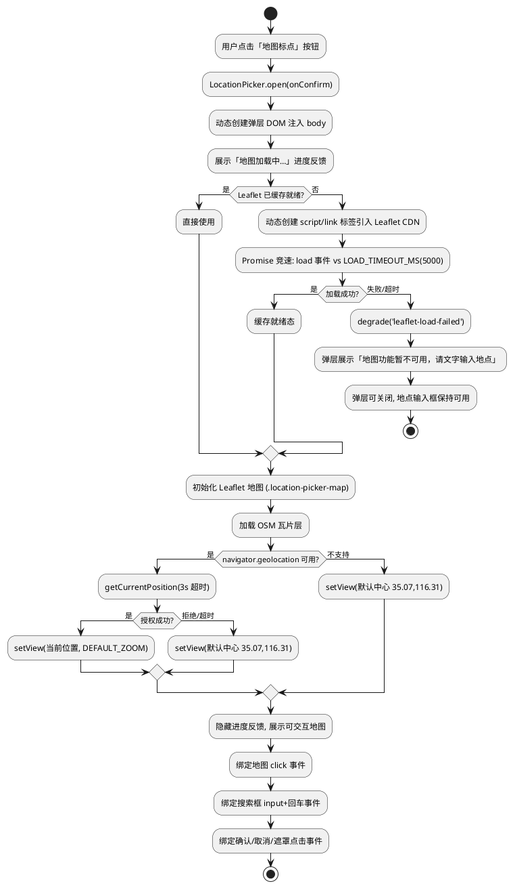
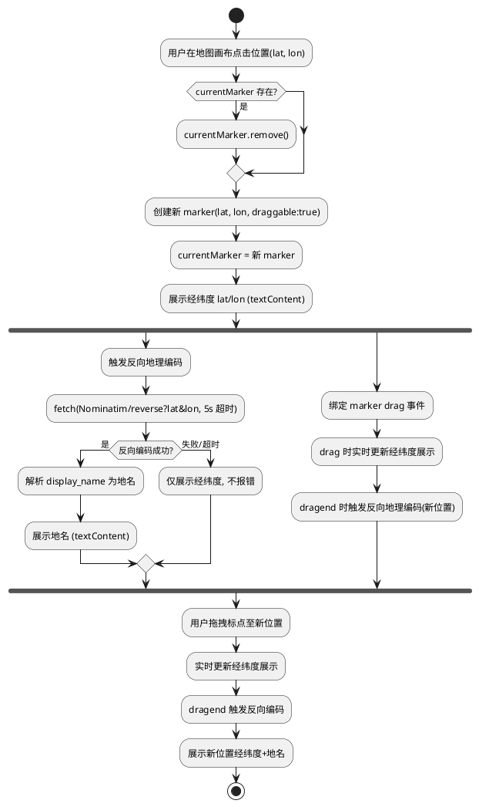
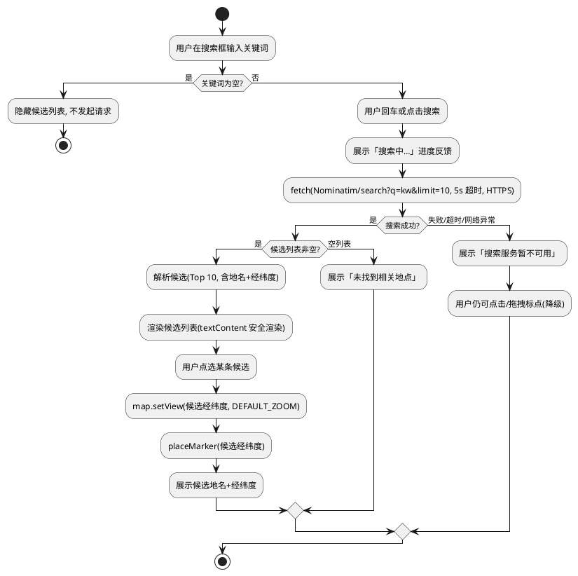
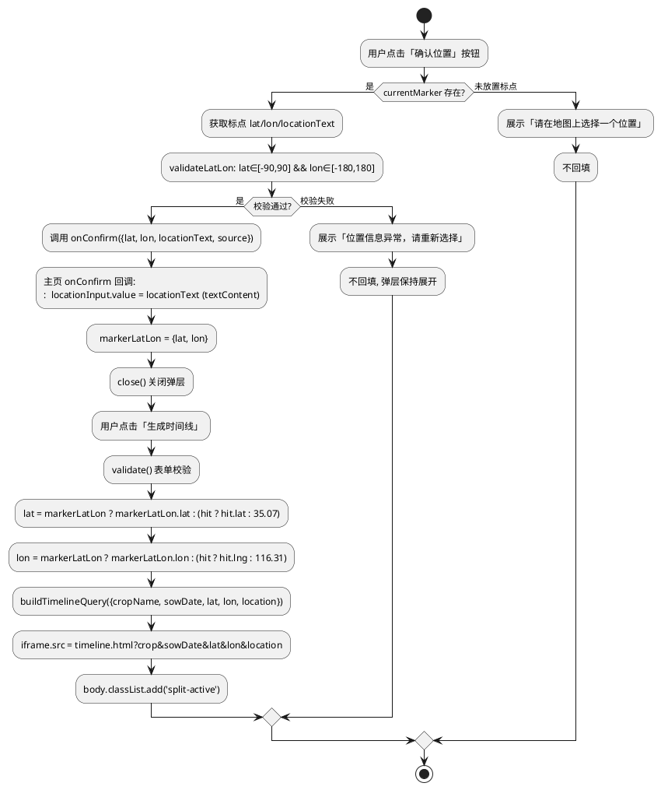
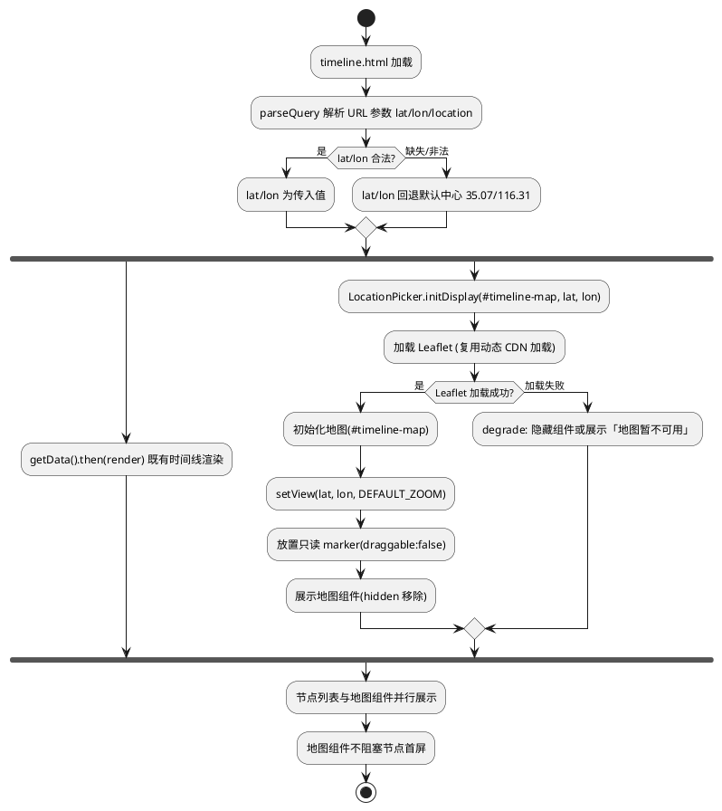
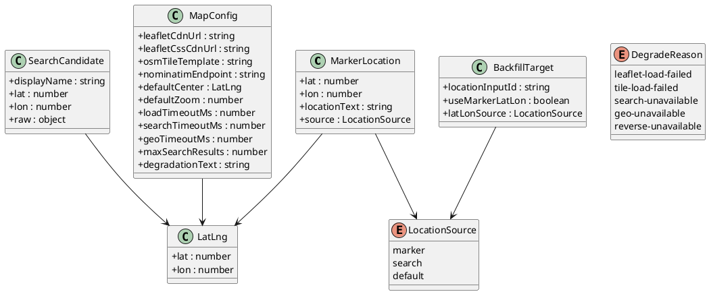

# V4 T06 农事日历地图标点功能 · 技术设计（v4_map_marker）

> 本方案基于 `v4_map_marker/spec.md`（REQ-VMM-UBI/EVT/STA/OPT/UNW-001 ~ 045，共 45 条 EARS 需求）生成。
> 设计范围：**纯前端地图标点地点选择能力**，仅修改 `frontend/` 目录下文件，不触碰后端/nginx/shared/data/deploy/docs。
> 强约束（红线）：
> 1. 前端既有测试全绿（`node --test frontend/tests/pages.test.js`，当前 77 个 `test()` 调用全绿），仅允许新增断言、不得弱化既有断言；
> 2. 不引入框架/构建工具/状态管理库；**唯一例外**：允许通过 CDN `<script>` 标签引入开源免费的 Leaflet 地图库（MIT 协议、无 API Key、无需构建），作为地图渲染引擎；不得引入需 API Key 的商业地图 SDK（高德/百度/腾讯地图 JS API 等）；
> 3. 不修改后端（Java/8080）业务逻辑与 nginx 配置——地图与搜索服务直接调用公开免费服务（OpenStreetMap 瓦片 + Nominatim），不经后端代理；
> 4=4. 地图 API/瓦片/搜索服务加载失败时降级为既有文字输入，不白屏、不报错、不阻塞表单提交；
> 5. 地图组件资源放 `frontend/components/location-picker/` 遵循 V4 目录规范；
> 6. `crop-map.js` 5 个 cropId（dry_garlic/wheat_winter/corn_summer/rice/soybean）与 6 作物条目映射不变，`mock-data.js` 保持 null 占位不造假；
> 7. 既有 `buildTimelineQuery` 参数命名（crop/sowDate/2/lat/lon/location）不变；地图标点回填的 lat/lon 经既有 `buildTimelineQuery` 拼装，参数名保持 lat/lon/location 不变；
> 8. 既有左侧栏 sidebar.js 配置与 switchModule 机制、既有时间线页节点渲染、既有拍照识别/语音组件/搜索历史/分栏布局/天气视觉/悬浮球对话不变。
> 全局约束继承自 `stage2_frontend`（60 条）、`t00_directory_migration`（49 条）、`t01_weather_visual`（42 条）、`v4_t01_ui_revamp`（38 条）、`v4_t12_my_crops`（42 条）、`v4_integrated_optimization`（52 条）：纯原生 JS + 原生 CSS、前端测试断言不可弱化、时间线页天气数据经后端 `GET /api/timeline` 获取、主页左侧栏 6 板块入口已落地、天气视觉与时段动画已落地、语音组件已落地、拍照识别双通道C落地、「我的产品D落地、悬浮球对话已落地、导航栏「我的」一级菜单与子菜单已落地。本任务在既有基础上**新增地图标点地点选择能力**，并**建立地图组件展示、标点交互、搜索定位、位置回填、加载降级五项核心能力**。

# 一、需求与存量功能关系分析

## 1.1 需求功能与存量功能对比

### 1.1.1 已实现功能

> 已实现功能是指需求与存量代码完全匹配或高度相似、可直接复用或仅需少量叠加的部分。

| 需求功能 | 存量功能 | 代码位置 | 匹配度 |
|---------|---------|---------|--------|
| 主页地点输入框<code>#location</code>与<code>#field-location</code>字段（REQ-VMM-UBI-002 按钮挂载基准） | <code>index.html</code> 第 72-76 行 <code>&lt;div class="field" id="field-location"&gt;</code> 含 <code>&lt;label for="location"&gt;所在地&lt;/label&gt;</code> + <code>&lt;input id="location" name="location" type="text"&gt;</code> + <code>&lt;div class="error" id="error-location"&gt;</code> | <code>frontend/pages/index.html:72-76</code> | 100%（地点输入框已就绪，本任务在其内新增「地图标点」按钮，不改变既有 id/name） |
| 既有<code>buildTimelineQuery</code>参数拼装（REQ-VMM-UBI-029 复用提交链路） | <code>index.html</code> 第 444-452 行 <code>buildTimelineQuery(opts)</code> 用 <code>URLSearchParams</code> 拼装 crop/sowDate/lat/lon/location 五参数 | <code>frontend/pages/index.html:444-452</code> | 100%（参数拼装逻辑已就绪，本任务仅丰富C纬度来源，参数名不变） |
| 既有表单提交与 iframe 加载机制（REQ-VMM-UBI-029 复用提交链路） | <code>index.html</code> 第 454-484 行 submit 监听 → validate → buildTimelineQuery → <code>iframe.src = 'timeline.html?' + query</code> + <code>body.classList.add('split-active')</code> | <code>frontend/pages/index.html:454-484</code> | 100%（提交与 iframe 加载机制已就绪，本任务不改变既有提交行为） |
| 既有作物映射经纬度来源（REQ-V/lon 来源基准） | <code>crop-map.js</code> 第 9-16 行 <code>CROPS</code> 6 作物条目含 <code>lat/lng/city</code>；<code>index.html</code> 第 460/467-468 行 <code>findCrop(cropName)</code> 取 <code>hit.lat/hit.lng</code>，无匹配回退 35.07/116.31 | <code>frontend/assets/js/crop-map.js:9-16</code>；<code>frontend/pages/index.html:460,467-468</code> | 100%（既有经纬度来源已就绪，本任务使地图标点回填经纬度优先于此，不修改 crop-map.js） |
| timeline.html URL 参数解析与 lat/lon 范围校验（REQ-VMM-UBI-030/035 展示组件基准） | <code>timeline.html</code> 第 88-104 行 <code>parseQuery(search)</code> 从 URL 解析 crop/sowDate/lat/lon/location，lat ∈ [-90,90]、lon ∈ [-180,180] 范围校验回退默认 35.07/116.31 | <code>frontend/pages/timeline.html:88-104</code> | 100%（URL 参数解析与范围校验已就绪，本任务在头部新增地图展示组件消费此 lat/lon） |
| timeline.html 头部结构与结论卡（REQ-VMM-UBI-031 展示组件位置基准） | <code>timeline.html</code> 第 25-29 行 <code>&lt;section class="timeline-header" id="conclusion-card" hidden&gt;</code> 含 <code>#conclusion</code> + <code>#data-meta</code>；第 13-23 行品牌头 | <code>frontend/pages/timeline.html:13-29</code> | 100%（头部结构已就绪，本任务在结论卡附近或独立区块新增地图展示组件，不遮挡既有节点列表） |
| CSS 变量9题色体系（REQ-VMM-UBI-004 风格统一基准） | <code>common.css</code> <code>:root</code> 第 1-21 行已定义 <code>--ink</code>/<code>--ink-soft</code>/<code>--muted</code>/<code>--paper</code>/<code>--paper-2</code>/<code>--card</code>/<code>--line</code>/<code>--leaf</code>/<code>--leaf-2</code>/<code>--leaf-soft</code>/<code>--sun</code>/<code>--sun-soft</code>/<code>--rain</code>/<code>--red</code>/<code>--red-soft</code>/<code>--radius</code>/<code>--radius-sm</code>/<code>--shadow</code>/<code>--shadow-soft</code> | <code>frontend/assets/css/common.css:1-21</code> | 100%（变量体系已就绪，地图弹层与展示组件复用既有变量，不使用外部默认样式） |
| 全屏布局 <code>body[data-layout="app"]</code> + <code>.app-main</code>（REQ-VMM-UBI-011 响应式基准） | <code>common.css</code> 第 539-542 行 <code>body[data-layout="app"] { display:flex; }</code> + <code>.0%; margin-left:200px; }</code> + <code>.page--home { max-width:none; }</code> | <code>frontend/assets/css/common.css:539-542</code> | 100%（全屏布局已就绪，地图弹层在 .app-main 内展示） |
| 响应式 768/1024/375/767 断点 + 无横向滚动（REQ-VMM-UBI-011 响应式兼容） | <code>common.css</code> 已有 <code>@media (min-width:768px)</code>/<code>@media (min-width:1024px)</code>/<code>@media (max-width:375px)</code>/<code>@media (max-width:767px)</code> 断点 + <code>overflow-x:hidden</code> + <code>max-width:100%</code> | <code>frontend/assets/css/common.css:25-30,424-431,489-493,531-536,562-564</code> | 100%（响应式断点已就绪，地图弹层与展示组件样式追加到此体系） |
| <code>prefers-reduced-motion</code> 全局禁用动画（REQ-VMM 4.1 性能基准） | <code>common.css</code> 第 285-291 行已有 <code>@media (prefers-reduced-motion: reduce) { *, *::before, *::after { animation:none !important; transition5 !important; } }</code> | <code>frontend/assets/css/common.css:285-291</code> | 100%（全局规则已覆盖，新增地图弹层过渡/标点动画自动被禁用） |
| <code>textContent</code> 安全渲染（REQ-VMM-UBI-015/027/4.3.1 XSS 防护） | <code>index.html</code> 历史记录 <code>btn.textContent = label</code>，weather-visual.js <code>renderCard</code> 用 <code>textContent</code>，my-crops.js <code>renderCard</code> 用 <code>textContent</code> | <code>frontend/pages/index.html:406</code>；<code>frontend/assets/js/weather-visual.js</code>；<code>frontend/assets/js/my-crops.js</code> | 100%（安全渲染模式已就绪，地图标点位置信息/搜索候选/回填地名沿用 textContent） |
| toast 操作反馈机制（REQ-VMM 降级提示基准） | <code>index.html</code> 第 93 行 <code>&lt;div class="toast" id="toast"&gt;</code> + 第 323-326 行 <code>showToast(msg, type)</code> + <code>common.css</code> <code>.toast</code> 样式 | <code>frontend/pages/index.html:93,323-326</code>；<code>frontend/assets/css/common.css</code> | 75%（toast 机制已就绪但属主页表单作用域，地图弹层降级提示须独立 toast 实例或复用模式） |
| 测试文件基座已读取 index.html/timeline.html/common.css/crop-map.js（REQ-VMM-UBI-041/042 测试基座） | <code>pages.test.js</code> 已读取 <code>indexHtml</code>/<code>timelineHtml</code>/<code>commonCss</code>/<code>cropMapJs</code>/<code>sidebarJs</code>/<code>weatherVisualJs</code>/<code>myCropsJs</code> 等变量，77 个 <code>test()</code> 调用全绿 | <code>frontend/tests/pages.test.js:1-38</code> | 100%（测试基座已就绪，新增断言可复用既有变量并新增 location-picker 相关变量） |
| V4 目录规范 <code>frontend/components/</code> 已就绪（REQ-VMM-UBI-001 目录规范） | <code>frontend/components/</code> 含 sidebar/voice-input/crop-photo/floating-ball 子目录 | <code>frontend/components/</code> | 100%（目录规范已就绪，新增 <code>location-picker/</code> 子目录遵循 V4 规范） |
| 既有脚本加载顺序（REQ-VMM-UBI-002 按钮挂载时机基准） | <code>index.html</code> 第 124-135 行：mock-data → crop-map → history-store → photo-capture → weather-visual → time-period → my-crops-store → crop-photo → my-crops → floating-ball → voice-input → sidebar | <code>frontend/pages/index.html:124-135</code> | 100%（脚本加载顺序已就绪，新增 location-picker.js 须在 sidebar.js 之后或之前插入，不破坏既有顺序） |
| loading-gate DOM 与隐藏机制（REQ-VMM 降级不白屏基准） | <code>index.html</code> 第 16-19 行 <code>&lt;div id="loading-gate"&gt;</code> + 第 137-144 行监听 <code>weather-ready</code> 事件添加 <code>.hidden</code> 类 + 10s 超时兜底 | <code>frontend/pages/index.html:16-19,137-144</code> | 100%（loading-gate 机制已就绪，地图弹层降级不依赖此机制，独立降级提示） |

### 1.1.2 需要扩展的功能

> 需要扩展的功能是指需求与存量代码部分匹配，需在现有基础上改造或叠加的部分。

| 需求功能 | 存量功能 | 差异说明 | 扩展方向 |
|---------|---------|---------|---------|
| 主页 <code>#field-location</code> 内新增「地图标点」按钮（REQ-VMM-UBI-002/EVT-003） | <code>index.html</code> 第 72-76 行 <code>#field-location</code> 仅含 label + input + error，无地图标点按钮 | 需在 input 旁新增可点击按钮，点击触发地图选点弹层，不遮挡 input 与其他字段 | 在 <code>#field-location</code> 内 input 之后新增 <code>&lt;button type="button" id="map-picker-btn"&gt;地图标点&lt;/button&gt;</code>；按钮挂载位置以具名常量定义；<code>location-picker.css</code> 新增按钮样式复用既有 CSS 变量 |
| 表单提交经纬度来源优先级（REQ-VMM-EVT-025） | <code>index.html</code> 第 460/467-468 行 <code>findCrop(cropName)</code> 取 <code>hit.lat/hit.lng</code>，无匹配回退 35.07/116.31 | 需使地图标点回填的精确经纬度优先于作物映射默认经纬度参与 <code>buildTimelineQuery</code> | 在内联 IIFE 中新增模块级变量 <code>markerLatLon = null</code>（地图标点回填时设置）；submit 处理中 <code>lat/lon</code> 优先取 <code>markerLatLon</code>，回退至 <code>hit.lat/hit.lng</code>，再回退默认；<code>buildTimelineQuery</code> 逻辑不变（参数名不变） |
| timeline.html 头部新增地图展示组件（REQ-VMM-UBI-030/031/032） | <code>timeline.html</code> 第 25-29 行结论卡 + 第 13-23 行品牌头，无地图展示组件 | 需在头部（结论卡附近或独立区块）新增地图展示组件，依据 URL 参数 lat/lon 展示标点，不遮挡既有节点列表/模式切换/图表 | 在 <code>timeline.html</code> 结论卡之后（第 29 行后）新增 <code>&lt;section class="timeline-map" id="timeline-map" hidden&gt;&lt;/section&gt;</code>；引入 location-picker.js/css（复用地图初始化与标点放置能力）；组件加载与既有节点渲染并行，不阻塞 <code>getData().then(render)</code> |
| 测试断言扩充（REQ-VMM-UBI-042） | <code>pages.test.js</code> 77 个 test() 调用，无 location-picker/地图标点/地图弹层/回填/降级相关断言 | 须新增 location-picker 组件目录存在、「地图标点」按钮挂载、地图弹层结构、标点回填逻辑、降级提示、经纬度范围校验等断言，不破坏既有 77 项 | 在 <code>pages.test.js</code> 末尾（第 683 行后）追加新 test 块，复用既有变量并新增 <code>locationPickerJs</code>/<code>locationPickerCss</code> 变量；既有 77 项断言原文保留 |

### 1.1.3 需要新增的功能或接口

> 需要新增的功能是指需求在存量代码中完全没有对应实现的部分，须新建。

**A. 新增 location-picker 组件：`frontend/components/location-picker/`（REQ-VMM-UBI-001/005）**

| 功能点 | 输入 | 输出 | 核心逻辑 | 关联需求 |
|--------|------|------|---------|---------|
| 组件目录 | 无 | 目录 <code>frontend/components/location-picker/</code> | 存放地图弹层 HTML 结构、交互逻辑 JS、样式 CSS，遵循 V4 目录规范 | REQ-VMM-UBI-001 |
| location-picker.js 模块 | 无 | <code>window.LocationPicker</code> API | IIFE + <code>window.LocationPicker = { init, open, close, initDisplay, isReady }</code> + <code>module.exports</code>（供测试 require）；封装地图初始化、标点放置、搜索定位、位置回填、降级能力 | REQ-VMM-UBI-001/005 |
| Leaflet CDN 动态加载 | 无 | <code>Promise&lt;boolean&gt;</code> | 动态创建 <code>&lt;script&gt;</code> + <code>&lt;link&gt;</code> 标签引入 Leaflet JS+CSS（HTTPS）；超时（如 5000ms）降级；加载失败降级提示 | REQ-VMM-UBI-007/UNW-036 |
| 地图选点弹层展开 | 无 | DOM（弹层 + 地图画布 + 搜索框 + 候选列表 + 位置信息 + 确认/取消） | <code>open(onConfirm)</code> 创建弹层 DOM → 加载 Leaflet → 初始化地图 → 绑定标点/搜索/确认/取消交互；<code>onConfirm({lat, lon, locationText, source})</code> 回调 | REQ-VMM-EVT-003/UBI-006/010 |
| 地图初始视图中心 | 无 | <code>{lat, lon}</code> | 优先 <code>navigator.geolocation.getCurrentPosition</code>；不可用/拒绝授权/超时回退默认中心 <code>{lat:35.07, lon:116.31}</code>；不反复弹出授权请求 | REQ-VMM-EVT-009/UNW-039 |
| 标点放置（click） | lat/lon | 标点 DOM | 地图画布 click 事件 → 清除旧标点 → 新标点 → 展示经纬度 → 触发反向地理编码获取地名 | REQ-VMM-EVT-012/UBI-014/015 |
| 标点拖拽（drag） | drag 事件 | 实时更新经纬度 | Leaflet marker draggable → drag 事件实时更新经纬度展示 → dragend 触发反向地理编码 | REQ-VMM-EVT-013 |
| 单选模式 | 无 | 仅保留一个标点 | 放置新标点前清除旧标点，无多个标点残留 | REQ-VMM-UBI-014 |
| 反向地理编码 | lat/lon | 地名字符串或 null | <code>fetch</code> 调用 Nominatim reverse 端点（HTTPS，带超时 5000ms）→ 解析返回地名 → 失败/超时返回 null（仅展示经纬度） | REQ-VMM-OPT-016/UBI-015 |
| 文字搜索定位 | 关键词 | 候选地点列表 | <code>fetch</code> 调用 Nominatim search 端点（HTTPS，带超时 5000ms）→ 解析候选列表（限 Top 10）→ 展示候选（textContent 安全渲染） | REQ-VMM-EVT-018/019/UBI-023 |
| 搜索候选点选 | 候选地点 | 地图定位 + 标点 | 点选候选 → 地图 setView 至候选经纬度 → 放置标点 → 展示候选地名与经纬度 | REQ-VMM-EVT-020 |
| 标点位置回填 | 无 | <code>{lat, lon, locationText, source}</code> | 点击「确认位置」→ 校验经纬度范围 → 调用 <code>onConfirm</code> 回调 → 关闭弹层；未放置标点提示「请在地图上选择一个位置」 | REQ-VMM-EVT-024/UBI-026/028 |
| 弹层关闭/取消 | 无 | 关闭弹层 | 点击「取消」或弹层外部遮罩 → 关闭弹层 → 不回填 → 不修改表单 | REQ-VMM-UBI-010/028 |
| 农事日历页地图展示组件 | lat/lon | DOM（只读地图 + 标点） | <code>initDisplay(container, lat, lon)</code> 复用地图初始化与标点放置能力 → 加载 Leaflet → 设置视图中心 → 放置只读标点；加载失败降级隐藏或提示 | REQ-VMM-UBI-030/032/033/UNW-034 |
| 降级机制 | 失败原因 | 降级提示 | Leaflet 加载失败 → 按钮禁用/隐藏 + 提示「地图功能暂不可用，请文字输入地点」；瓦片加载失败 → 画布提示「地图底图加载失败」标点仍可尝试；Nominatim 不可用 → 搜索框提示「搜索服务暂不可用」；geolocation 不可用 → 回退默认中心 | REQ-VMM-UNW-036+039/UBI-040 |
| location-picker.css 样式 | 无 | CSS | 地图标点按钮 + 地图选点弹层（地图画布/搜索框/候选列表/位置信息/确认取消按钮）+ 农事日历页展示组件样式；复用既有 CSS 变量；响应式三档适配 | REQ-VMM-UBI-004/011 |

**B. 新增 DOM 结构（修改 `frontend/pages/index.html`）**

| 功能点 | 核心内容 | 关联需求 |
|--------|---------|---------|
| 「地图标点」按钮 | 在 <code>#field-location</code> 内 input 之后新增 <code>&lt;button type="button" class="map-picker-btn" id="map-picker-btn"&gt;📍 地图标点&lt;/button&gt;</code> | REQ-VMM-UBI-002/EVT-003 |
| location-picker.js/css 引入 | <code>&lt;link rel="stylesheet" href="../components/location-picker/location-picker.css"&gt;</code>（head 内）+ <code>&lt;script src="../components/location-picker/location-picker.js"&gt;</code>（sidebar.js 之后） | REQ-VMM-UBI-001 |
| location-picker init 调用 | 内联 IIFE 末尾新增 <code>if (window.LocationPicker) window.LocationPicker.init();</code> | REQ-VMM-UBI-002 |
| 经纬度回填承接变量 | 内联 IIFE 内新增模块级变量 <code>var markerLatLon = null;</code>；submit 处理中优先取 <code>markerLatLon</code> | REQ-VMM-EVT-025 |

**C. 新增 DOM 结构（修改 `frontend/pages/timeline.html`）**

| 功能点 | 核心内容 | 关联需求 |
|--------|---------|---------|
| 农事日历页地图展示组件容器 | 在结论卡之后（第 29 行后）新增 <code>&lt;section class="timeline-map" id="timeline-map" hidden&gt;&lt;/section&gt;</code> | REQ-VMM-UBI-030/031 |
| location-picker.js/css 引入 | <code>&lt;link rel="stylesheet" href="../components/location-picker/location-picker.css"&gt;</code> + <code>&lt;script src="../components/location-picker/location-picker.js"&gt;</code>（chart-client.js 之后） | REQ-VMM-UBI-032 |
| 地图展示组件初始化 | 内联 IIFE 中 <code>parseQuery</code> 后新增 <code>if (window.LocationPicker) window.LocationPicker.initDisplay(document.getElementById('timeline-map'), query.lat, query.lon);</code> | REQ-VMM-UBI-030/035 |

**D. 新增测试断言（追加到 `frontend/tests/pages.test.js`）**

| 断言类别 | 核心内容 | 关联需求 |
|---------|---------|---------|
| location-picker 组件目录存在 | <code>frontend/components/location-picker/</code> 含 location-picker.js + location-picker.css | REQ-VMM-UBI-001 |
| location-picker.js 模块接口 | <code>locationPickerJs</code> 含 <code>window.LocationPicker</code>/<code>open</code>/<code>close</code>/<code>initDisplay</code>/<code>isReady</code> | REQ-VMM-UBI-001/005 |
| location-picker.js 具名常量 | <code>locationPickerJs</code> 含 <code>LEAFLET_CDN_URL</code>/<code>OSM_TILE_TEMPLATE</code>/<code>NOMINATIM_ENDPOINT</code>/<code>DEFAULT_CENTER</code>/<code>DEFAULT_ZOOM</code>/<code>LOAD_TIMEOUT_MS</code>/<code>SEARCH_TIMEOUT_MS</code>/<code>DEGRADATION_TEXT</code> | REQ-VMM-UBI-005 |
| location-picker.js Leaflet CDN 引入 | <code>locationPickerJs</code> 含 <code>https://</code> + <code>unpkg.com</code>或等价 CDN + 动态 script 加载逻辑 | REQ-VMM-UBI-007 |
| location-picker.js Nominatim 搜索 | <code>locationPickerJs</code> 含 <code>nominatim</code> + <code>fetch</code> + <code>AbortController</code> + <code>textContent</code> | REQ-VMM-UBI-023/EVT-018/019 |
| location-picker.js 降级机制 | <code>locationPickerJs</code> 含降级文案「地图功能暂不可用」+ 「搜索服务暂不可用」+ 「地图底图加载失败」 | REQ-VMM-UNW-036/037/038 |
| location-picker.js 经纬度范围校验 | <code>locationPickerJs</code> 含 <code>lat &gt;= -90</code> 或等价范围校验逻辑 | REQ-VMM-UBI-026 |
| location-picker.css 样式 | <code>locationPickerCss</code> 含 <code>.map-picker-btn</code>/<code>.location-picker-modal</code>/<code>.location-picker-map</code>/<code>.location-picker-search</code>/<code>.location-picker-results</code>/<code>.location-picker-info</code>/<code>.timeline-map</code> | REQ-VMM-UBI-004/011 |
| index.html 「地图标点」按钮 | <code>indexHtml</code> 含 <code>id="map-picker-btn"</code> + <code>地图标点</code> + <code>location-picker.js</code> + <code>location-picker.css</code> | REQ-VMM-UBI-002 |
| index.html 经纬度回填承接 | <code>indexHtml</code> 含 <code>markerLatLon</code> 变量 + submit 中优先取 markerLatLon 逻辑 | REQ-VMM-EVT-025 |
| timeline.html 地图展示组件 | <code>timelineHtml</code> 含 <code>id="timeline-map"</code> + <code>location-picker.js</code> + <code>initDisplay</code> | REQ-VMM-UBI-030/032 |
| 既有 77 断言兼容 | 确认 <code>indexHtml</code>/<code>timelineHtml</code>/<code>commonCss</code> 既有断言仍通过 | REQ-VMM-UBI-041 |

## 1.2 存量功能详细分析

### 1.2.1 `index.html` 地点输入框与表单提交链路分析（`frontend/pages/index.html`）

- **DOM 结构**：`<body data-layout="app">`（第 14 行）→ `#loading-gate`（第 16-19 行）→ `.sidebar-burger` + `.sidebar`（第 21-25 行）→ `.app-main`（第 27 行）包裹 `<main class="page page--home">`（第 28-103 行，含 brand/weather-bg-layer/weather-card/term-ruler/form/history）→ `data-module="calendar"` content-pane（第 106-108 行）→ `data-module="my-crops"` content-pane（第 110-117 行）→ `.timeline-pane`（第 119-122 行）。
- **地点输入框**（第 72-76 行）：`<div class="field" id="field-location">` 含 `<label for="location">所在地</label>` + `<input id="location" name="location" type="text" autocomplete="off" placeholder="" />` + `<div class="error" id="error-location">请输入所在地</div>`。**本任务在此字段内 input 之后新增「地图标点」按钮**，不改变既有 id/name/class。
- **表单提交链路**（第 454-484 行）：`form.addEventListener('submit', ...)` → `validate()` → `findCrop(cropName)` 取 `hit` → `buildTimelineQuery({cropName, sowDate, lat: hit ? hit.lat : 35.07, lon: hit ? hit.lng : 116.31, location})` → `iframe.src = 'timeline.html?' + query` + `body.classList.add('split-active')`。**本任务使地图标点回填的精确经纬度优先于 `hit.lat/hit.lng`**，通过新增模块级变量 `markerLatLon` 实现，`buildTimelineQuery` 逻辑不变（参数名 lat/lon/location 不变）。
- **buildTimelineQuery**（第 444-452 行）：`URLSearchParams` 拼装 crop/sowDate/lat/lon/location 五参数。**不改变参数命名**（REQ-VMM-UBI-029/045）。
- **脚本加载顺序**（第 124-135 行）：mock-data → crop-map → history-store → photo-capture → weather-visual → time-period → my-crops-store → crop-photo → my-crops → floating-ball → voice-input → sidebar。新增 location-picker.js 须在此链中插入（建议在 sidebar.js 之后，确保 Sidebar 已渲染后挂载按钮）。
- **内联 IIFE**（第 146-491 行）：含表单逻辑、日期选择器、搜索联想、拍照、历史记录、buildTimelineQuery、submit。本任务在此 IIFE 内新增 `markerLatLon` 变量与 location-picker init 调用，并在 submit 处理中调整 lat/lon 来源优先级。
- **既有测试断言**（pages.test.js 第 40-46/670-683 行）：检查 indexHtml 含 `id="crop"`/`id="sowingDate"`/`id="location"`/`id="photo-btn"` + my-crops 相关引入。新增「地图标点」按钮保留 `id="location"` 等，断言不破坏。
- **约束**：表单字段 id/name 不变；`buildTimelineQuery` 参数命名不变；`validate()` 逻辑不变；既有 77 断言中引用 `id="location"` 等保留。

### 1.2.2 `timeline.html` 结构与 URL 参数解析分析（`frontend/pages/timeline.html`）

- **DOM 结构**（第 11-56 行）：`<main class="page">` → `<header class="brand">`（第 13-23 行，含 brand-sub）→ `<section class="timeline-header" id="conclusion-card" hidden>`（第 25-29 行，含 `#conclusion` + `#data-meta`）→ `<div class="loading" id="loading">`（第 31-37 行）→ `<div class="mode-switch" id="mode-switch" hidden>`（第 39-42 行）→ `<section class="timeline" id="timeline" hidden>`（第 44 行）→ `<section class="chart-wrap" id="chart" hidden>`（第 46 行）→ `<section class="empty-state" id="empty-state" hidden>`（第 48-51 行）→ `<div class="timeline-footer" id="footer" hidden>`（第 53-55 行）。
- **本任务插入点**：在结论卡 `</section>`（第 29 行）之后、`<div class="loading">`（第 31 行）之前新增 `<section class="timeline-map" id="timeline-map" hidden></section>`，位于头部，不遮挡既有节点列表/模式切换/图表。
- **URL 参数解析**（第 88-104 行 `parseQuery`）：从 `window.location.search` 解析 crop/sowDate/lat/lon/location；lat ∈ [-90,90]、lon ∈ [-180,180] 范围校验，非法回退默认 35.07/116.31；`county = p.get('location')`。**本任务地图展示组件消费此 lat/lon**，参数缺失或非法时回退默认中心或不展示标点（REQ-VMM-UBI-035）。
- **脚本加载顺序**（第 58-61 行）：mock-data → crop-map → timeline-logic → chart-client。新增 location-picker.js 须在 chart-client.js 之后插入。
- **内联 IIFE**（第 62-565 行）：含 parseQuery、getData、renderConclusion、renderWeather、renderNode、renderReminder、renderChart、switchMode、render。`getData().then(render)`（第 564 行）驱动时间线渲染。**本任务在 parseQuery 后新增地图展示组件初始化**，与 `getData().then(render)` 并行，不阻塞节点列表渲染。
- **既有测试断言**（pages.test.js 第 55-58 行等）：检查 timelineHtml 含 `name="viewport"`。新增地图展示组件保留这些字符串，断言不破坏。
- **约束**：既有时间线页节点渲染、模式切换、图表渲染、节日倒计时逻辑不变（REQ-VMM 7.3 不触碰项）；地图展示组件加载与既有渲染并行，不阻塞节点首屏。

### 1.2.3 `common.css` 布局与变量体系分析（`frontend/assets/css/common.css`）

- **`:root` 变量清单**（第 1-21 行）：`--ink`/`--ink-soft`/`--muted`（文字色）、`--paper`/`--paper-2`/`--card`（背景色）、`--line`（边框）、`--leaf`/`--leaf-2`/`--leaf-soft`（绿色系）、`--sun`/`--sun-soft`（金色系）、`--rain`（蓝色系）、`--red`/`--red-soft`（红色系）、`--radius`/`--radius-sm`/`--shadow`/`--shadow-soft`（圆角阴影）。地图弹层与展示组件复用这些变量，不引入新色彩体系。
- **全屏布局**（第 539-542 行）：`body[data-layout="app"] { display:flex; min-height:100vh; }` + `.app-main { flex:1; margin-left:200px; min-height:100vh; position:relative; z-index:1; }` + `.page--home { max-width:none; background-image:none; }`。地图弹层在 .app-main 内展示，弹层 position:fixed 全屏遮罩。
- **loading-gate**（第 551-560 行）：`position: fixed; inset: 0; z-index: 9999;` 全屏加载遮罩；`.hidden { opacity: 0; pointer-events: none; }`。地图弹层 z-index 须低于 loading-gate（弹层展开时 loading-gate 已隐藏）。
- **既有 z-index 层叠**：weather-bg-layer(0) < .app-main(z-index:1) < weather-fx-overlay(z-index:1) < sidebar(z-index:100，sidebar.css) < loading-gate(9999)；新增地图弹层 z-index 须合理（建议 2000，高于 sidebar 与悬浮球 1000，低于 loading-gate 9999）。
- **既有 `prefers-reduced-motion`**（第 285-291 行）：全局 `animation:none !important; transition:none !important;`。新增地图弹层过渡/标点动画自动被禁用。
- **既有响应式断点**（第 424-431/489-493/531-536/562-564 行）：768/1024/375/767 四档。地图弹层与展示组件样式须在此三档（375/768/1024）内适配。
- **既有测试断言**（pages.test.js 第 53-58 行等）：检查 commonCss 含 `overflow-x:hidden`/`max-width:100%`。本任务不修改 common.css 既有规则（地图样式独立存放 location-picker.css），断言不破坏。
- **约束**：本任务不修改 common.css（地图弹层与展示组件样式独立存放 location-picker.css，复用既有 CSS 变量）；z-index 层叠以具名常量或集中注释标注。

### 1.2.4 `crop-map.js` 经纬度来源分析（`frontend/assets/js/crop-map.js`）

- **模块结构**：IIFE + `window.CropMap = { CROP_IDS, CROPS, CROP_KEYWORDS, getCropByName, resolveCropId, buildCropParam }`（第 93-100 行）。无 module.exports。
- **CROPS**（第 9-16 行）：6 作物条目，每项含 `name`/`cropId`/`lat`/`lng`/`city`。lat/lng 为城市级粗略坐标（如金乡 35.07/116.31）。
- **index.html 消费方式**（第 460/467-468 行）：`findCrop(cropName)` 精确匹配 CROPS 取 `hit`，`buildTimelineQuery` 用 `hit ? hit.lat : 35.07` 与 `hit ? hit.lng : 116.31`。**本任务使地图标点回填的精确经纬度优先于此**，但不修改 crop-map.js 源文件（REQ-VMM 1.4 职责边界第 3 条）。
- **既有测试断言**（pages.test.js 第 143-160 行）：检查 cropMapJs 含 5 个 cropId + 6 作物条目 + resolveCropId/buildCropParam。本任务不修改 crop-map.js，断言不破坏。
- **约束**：5 个 cropId 与 6 作物条目映射不变（REQ-VMM 1.4 职责边界第 3 条/UBI-045）；地图选点回填的经纬度优先于作物映射默认经纬度，但不改变 crop-map.js 源文件。

### 1.2.5 `pages.test.js` 测试断言结构分析（`frontend/tests/pages.test.js`）

- **文件读取基座**（第 1-38 行）：`test`/`assert`/`fs`/`path` 引入 + `read` 函数；已读取 `indexHtml`/`timelineHtml`/`photoJs`/`commonCss`/`timelineCss`/`cropMapJs`/`mockJs`/`timelineLogicJs`/`historyStoreJs`/`chartClientJs`/`weatherVisualJs`/5 个白天 SVG/`voiceInputJs`/`voiceInputCss`/`timePeriodJs`/`sidebarJs`/`sidebarCss`/4 个夜晚 SVG/`myCropsStoreJs`/`myCropsJs`/`myCropsCss`/`cropPhotoJs` 共 28 个文件内容变量。
- **断言总数**：77 个 `test()` 调用全绿（spec 称 75，实际 77，T12 新增了 my-crops 相关断言）。
- **与本任务相关的既有断言**：
  - 第 40-46 行输入表单页：断言 indexHtml 含 `id="crop"`/`id="sowingDate"`/`id="location"`/`id="crop-suggestions"`/`id="photo-btn"`。新增「地图标点」按钮保留 `id="location"`，断言不破坏。
  - 第 670-678 行 V4 T12 index.html my-crops 引入：断言 indexHtml 含 `my-crops.css`/`my-crops-store.js`/`my-crops.js`/`crop-photo.js`/`data-module="my-crops"`/`id="my-crops-pane"`/`id="my-crops-list"`。新增 location-picker 引入与按钮不删除这些字符串，断言不破坏。
  - 第 680-683 行 V4 T12 sidebar.js my-crops：断言 sidebarJs 含 `'my-crops'`/`implemented: true`。本任务不修改 sidebar.js，断言不破坏。
- **新增断言切入点**：在第 683 行（文件末尾）之后追加新 test 块。须新增 `locationPickerJs`（read location-picker.js）与 `locationPickerCss`（read location-picker.css）变量。
- **约束**：既有 77 项断言不得删除/注释/弱化（REQ-VMM-UBI-041）；新增断言为静态字符串/正则匹配（与既有风格一致），不执行 location-picker.js 运行时逻辑（因含 DOM/Leaflet/navigator.geolocation 依赖）。

### 1.2.6 既有组件目录规范分析（`frontend/components/`）

- **现状**：`frontend/components/` 已存在，含 `sidebar/`/`voice-input/`/`crop-photo/`/`floating-ball/` 子目录（V4 目录规范已落地）。
- **新增子目录**：须新建 `frontend/components/location-picker/`，存放 `location-picker.js` + `location-picker.css`，遵循 V4 目录规范（REQ-VMM-UBI-001）。
- **约束**：location-picker 组件独立存放，不与既有页面逻辑耦合（REQ-VMM 4.4.1）；与既有 sidebar/voice-input/crop-photo/floating-ball 组件并列，风格一致（IIFE + window 暴露 + module.exports 供测试 require）。
# 二、增量设计方案

## 2.0 总体策略与关键决策

| 决策编号 | 决策点 | 结论 | 决策理由 |
|---------|-------|------|---------|
| D-VMM-01 | Leaflet CDN 引入方式 | **动态 `<script>` + `<link>` 标签加载 + 超时降级**：location-picker.js 内部具名常量 `LEAFLET_CDN_URL`（如 `https://unpkg.com/leaflet@1.9.4/dist/leaflet.js`）+ `LEAFLET_CSS_CDN_URL`（如 `https://unpkg.com/leaflet@1.9.4/dist/leaflet.css`）；首次 open 时动态创建 script/link 标签注入 `<head>`，Promise resolve on `load` / reject on `error` 或 `LOAD_TIMEOUT_MS=5000` 超时；加载成功后缓存就绪态避免重复加载 | REQ-VMM-UBI-007 要求经 CDN `<script>` 引入 Leaflet（MIT 协议、无 API Key）；REQ-VMM-UBI-044 唯一例外允许 Leaflet；动态加载而非 HTML 静态引入，使首页不强制依赖 CDN（CDN 不可达时首页其他功能不受影响）；超时降级满足 REQ-VMM-UNW-036；缓存就绪态避免重复加载满足 REQ-VMM 4.1.1 性能 |
| D-VMM-02 | location-picker 组件目录与模块结构 | **新增独立目录 `frontend/components/location-picker/`**：`location-picker.js`（IIFE + `window.LocationPicker` 暴露 + `module.exports` 供测试 require）+ `location-picker.css`（复用既有 CSS 变量）；遵循 V4 目录规范，与既有 sidebar/voice-input/crop-photo/floating-ball 组件并列 | REQ-VMM-UBI-001 要求独立存放 `frontend/components/location-picker/` 遵循 V4 目录规范；REQ-VMM 4.4.1 要求独立模块化不与既有页面逻辑耦合；与既有组件 IIFE + window 暴露风格一致 |
| D-VMM-03 | location-picker.js 模块接口设计 | **IIFE + `window.LocationPicker = { init, open, close, initDisplay, isReady }` + `module.exports`**：`init()` 挂载「地图标点」按钮点击事件；`open(onConfirm)` 展开地图选点弹层，`onConfirm({lat, lon, locationText, source})` 回调；`close()` 关闭弹层；`initDisplay(container, lat, lon)` 初始化农事日历页只读展示组件；`isReady()` 返回 Leaflet 加载就绪态 | REQ-VMM-UBI-001 要求封装地图初始化/标点/搜索/回填/降级能力；`open(onConfirm)` 回调模式解耦弹层与主页表单（主页 onConfirm 中回填 `#location` + 设置 `markerLatLon`）；`initDisplay` 复用地图能力满足 REQ-VMM-UBI-032；与既有 PhotoCapture.open(onConfirm) 回调契约风格一致 |
| D-VMM-04 | 地图选点弹层 DOM 结构 | **动态创建弹层 DOM 注入 `document.body`**：`<div class="location-picker-modal" id="location-picker-modal">` 含遮罩 `.location-picker-overlay` + 弹层主体 `.location-picker-dialog`（搜索框 `.location-picker-search` + 候选列表 `.location-picker-results` + 地图画布 `.location-picker-map` + 位置信息 `.location-picker-info` + 操作按钮 `.location-picker-confirm`/`.location-picker-cancel`）；弹层 `position:fixed; inset:0; z-index:2000`；地图画布由 Leaflet 接管 | REQ-VMM-EVT-003 要求弹层含地图画布/搜索框/候选列表区/位置信息区/确认与取消按钮；动态创建避免污染既有 HTML；z-index:2000 高于 sidebar(100) 与悬浮球(1000)，低于 loading-gate(9999)；REQ-VMM-UBI-010 要求取消操作（关闭按钮 + 点击外部遮罩） |
| D-VMM-05 | 地图初始视图中心策略 | **优先 `navigator.geolocation.getCurrentPosition` → 回退默认中心 `{lat:35.07, lon:116.31}`**：open 时尝试 `getCurrentPosition`（超时 3000ms），成功则视图中心为当前位置，失败/拒绝/超时/不支持则回退默认中心；不反复弹出授权请求（仅 open 时尝试一次） | REQ-VMM-EVT-009 要求初始中心优先使用浏览器地理定位，不可用/拒绝回退默认中心；REQ-VMM-UNW-039 要求不报错、不阻塞地图展开、不反复弹出授权请求；默认中心 35.07/116.31 与既有 crop-map.js 金乡坐标一致 |
| D-VMM-06 | 标点交互实现（click + drag + 单选） | **Leaflet marker + click/dragend 事件 + 单选模式**：地图画布 `click` 事件 → 清除旧 marker → 新 marker（draggable:true）→ 展示经纬度 → 触发反向地理编码；marker `drag` 事件实时更新经纬度展示；marker `dragend` 事件触发反向地理编码；模块级变量 `currentMarker` 保持单引用，放置新标点前 `currentMarker.remove()` | REQ-VMM-EVT-012 要求 click 放置标点展示经纬度与地名；REQ-VMM-EVT-013 要求拖拽实时更新经纬度，拖拽结束展示新地名；REQ-VMM-UBI-014 要求单选模式无多个标点残留；Leaflet marker draggable 是原生能力无需自定义拖拽逻辑 |
| D-VMM-07 | 反向地理编码实现 | **Nominatim reverse API + fetch + 超时降级**：`fetch(NOMINATIM_ENDPOINT + '/reverse?format=json&lat=' + lat + '&lon=' + lon + '&zoom=18&accept-language=zh', {signal})` + `AbortController` + `SEARCH_TIMEOUT_MS=5000` 超时；成功解析 `data.display_name` 作为地名；失败/超时/网络异常返回 null（仅展示经纬度，不报错）；地名经 `textContent` 安全渲染 | REQ-VMM-OPT-016 要求反向地理编码获取可读地名，失败仅展示经纬度不报错不阻塞确认；REQ-VMM-UBI-015 要求地名经 textContent 渲染防 XSS；REQ-VMM 4.3.2 要求 HTTPS 调用；Nominatim 为 OSM 官方免费服务无 API Key（REQ-VMM-UBI-023） |
| D-VMM-08 | Nominatim 搜索实现 | **Nominatim search API + fetch + 候选列表 + 超时降级**：搜索框 input + 回车/搜索按钮触发 → `fetch(NOMINATIM_ENDPOINT + '/search?format=json&q=' + encodeURIComponent(kw) + '&limit=' + MAX_SEARCH_RESULTS + '&accept-language=zh', {signal})` + `AbortController` + `SEARCH_TIMEOUT_MS=5000` 超时；成功解析候选列表（限 Top 10）→ 渲染候选（textContent 安全渲染，含地名+经纬度概要）；无结果展示「未找到相关地点」；服务不可用展示「搜索服务暂不可用」；空关键词不发起请求 | REQ-VMM-EVT-018 要求输入关键词触发搜索展示「搜索中…」；REQ-VMM-EVT-019 要求展示候选列表经 textContent 渲染；REQ-VMM-EVT-020 要求点选候选定位+放置标点；REQ-VMM-UNW-021 要求无结果展示提示；REQ-VMM-UNW-022 要求服务不可用降级提示；REQ-VMM-UBI-023 要求 HTTPS + 无 API Key + 超时；REQ-VMM 5.4.3 异常场景要求空关键词不搜索、候选过长限制 Top 10 |
| D-VMM-09 | 标点位置回填逻辑 | **确认按钮 → 经纬度范围校验 → onConfirm 回调 → 关闭弹层**：点击「确认位置」→ 校验 `lat ∈ [-90,90]` && `lon ∈ [-180,180]` → 校验通过调用 `onConfirm({lat, lon, locationText, source:'marker'|'search'})` → close()；未放置标点提示「请在地图上选择一个位置」不回填；校验失败提示「位置信息异常，请重新选择」不回填；取消/遮罩关闭不回填 | REQ-VMM-EVT-024 要求确认后回填地名至 `#location` 并关闭弹层；REQ-VMM-UBI-026 要求经纬度范围校验；REQ-VMM-UBI-028 要求未确认标点提示不回填空值、取消不回填；REQ-VMM 4.3.6 要求确认/取消操作防误操作 |
| D-VMM-10 | 经纬度优先级策略 | **地图标点回填优先于作物映射默认经纬度**：index.html 内联 IIFE 新增模块级变量 `var markerLatLon = null;`；location-picker open 的 onConfirm 回调中设置 `markerLatLon = {lat, lon}` + `locationInput.value = locationText`；submit 处理中 `lat = markerLatLon ? markerLatLon.lat : (hit ? hit.lat : 35.07)`，`lon = markerLatLon ? markerLatLon.lon : (hit ? hit.lng : 116.31)`；`buildTimelineQuery` 逻辑不变（参数名 lat/lon/location 不变） | REQ-VMM-EVT-025 要求回填经纬度优先于作物映射默认经纬度参与 buildTimelineQuery；REQ-VMM-UBI-029 要求复用既有提交链路参数名不变；模块级变量最小化改动面，不改变 buildTimelineQuery 签名；用户手动修改地点文本时经纬度保持回填值（REQ-VMM 5.5.3 异常场景 1） |
| D-VMM-11 | timeline.html 地图展示组件实现 | **复用 location-picker.initDisplay + 只读展示**：timeline.html 结论卡之后新增 `<section class="timeline-map" id="timeline-map" hidden>`；内联 IIFE 中 parseQuery 后调用 `LocationPicker.initDisplay(document.getElementById('timeline-map'), query.lat, query.lon)`；initDisplay 内部加载 Leaflet → 创建地图 → setView(lat, lon, DEFAULT_ZOOM) → 放置只读 marker（draggable:false）；加载失败降级为隐藏组件或展示「地图暂不可用」提示；与 `getData().then(render)` 并行不阻塞节点渲染；默认只读展示（不触发时间线重新加载） | REQ-VMM-UBI-030 要求依据 URL 参数 lat/lon 展示标点；REQ-VMM-UBI-031 要求位于头部不遮挡既有内容；REQ-VMM-UBI-032 要求复用 location-picker 地图能力；REQ-VMM-OPT-033 要求默认只读展示；REQ-VMM-UNW-034 要求加载失败降级不阻塞节点渲染；REQ-VMM-UBI-035 要求 URL 参数缺失/非法回退默认中心或不展示标点 |
| D-VMM-12 | 降级机制 | **分级降级，不白屏不报错不阻塞表单**：(1) Leaflet CDN 加载失败/超时 → `isReady()` 返回 false → 「地图标点」按钮禁用或隐藏 + 提示「地图功能暂不可用，请文字输入地点」+ 地点输入框保持可用 + 表单提交回退作物映射默认经纬度；(2) OSM 瓦片加载失败 → 地图画布展示「地图底图加载失败」提示，标点交互与搜索仍可尝试（标点基于经纬度放置不依赖瓦片可见）；(3) Nominatim 搜索/反向编码不可用 → 搜索框展示「搜索服务暂不可用」/标点位置信息仅展示经纬度，用户仍可点击/拖拽标点；(4) geolocation 不可用/拒绝 → 回退默认中心不报错不反复请求；所有降级路径 try-catch 捕获异常不抛未捕获 JS 错误 | REQ-VMM-UNW-036 要求 Leaflet 加载失败降级；REQ-VMM-UNW-037 要求弹层展开后瓦片失败降级；REQ-VMM-UNW-038 要求 Nominatim 不可用降级；REQ-VMM-UNW-039 要求 geolocation 不可用回退默认中心；REQ-VMM-UBI-040 要求降级时文字输入地点方式完全可用；REQ-VMM 4.2.1 要求任一环节失败不白屏不抛未捕获错误 |
| D-VMM-13 | 「地图标点」按钮挂载位置与样式 | **在 `#field-location` 内 input 之后新增按钮**：`<button type="button" class="map-picker-btn" id="map-picker-btn" type="button">📍 地图标点</button>`；location-picker.css 新增 `.map-picker-btn` 样式（复用 `--leaf`/`--card`/`--radius-sm` 变量，inline-block 不遮挡 input）；按钮挂载位置以具名常量 `MAP_PICKER_BTN_ID='map-picker-btn'`、`LOCATION_INPUT_ID='location'` 集中定义；`init()` 时 `document.getElementById(MAP_PICKER_BTN_ID).addEventListener('click', ...)`；按钮不挂载或禁用时地点输入框保持可用 | REQ-VMM-UBI-002 要求按钮位于地点输入框旁不遮挡输入框与其他字段；REQ-VMM 4.4.3 要求挂载位置以具名常量定义便于未来调整；REQ-VMM 5.1.3 异常场景要求组件资源加载失败时按钮不挂载或禁用 |
| D-VMM-14 | z-index 层叠策略 | **地图弹层 z-index:2000**：高于 sidebar(100) 与悬浮球(1000)，低于 loading-gate(9999)；弹层遮罩覆盖全屏（`position:fixed; inset:0`），弹层主体居中（移动端近全屏，桌面端定宽定高）；农事日历页展示组件 z-index:auto（在文档流内，不遮挡节点列表）；以集中注释标注 z-index 层叠约定 | REQ-VMM-UBI-006 要求弹层展开不阻塞主页背景与左侧栏（弹层遮罩覆盖但左侧栏仍可见，弹层主体居中）；z-index:2000 确保弹层可见且高于 sidebar/悬浮球；loading-gate(9999) 仅加载期间遮挡，弹层展开时 loading-gate 已隐藏；REQ-VMM 4.4.5 要求 z-index 以具名常量或集中注释标注 |
| D-VMM-15 | 响应式适配策略 | **三档断点（375/768/1024）+ 弹层适配**：location-picker.css 新增 `@media (max-width:767px)`（移动端弹层近全屏，宽度占满、高度占视口 80% 以上）+ `@media (min-width:768px)`（桌面端弹层定宽定高居中，如宽 600px 高 480px）+ `@media (min-width:1024px)`（大屏弹层适当增大）；地图画布尺寸适配弹层尺寸（Leaflet `invalidateSize` 在弹层展开后调用）；农事日历页展示组件在三档下均不引入横向滚动；复用既有 `overflow-x:hidden`/`max-width:100%` 全局规则 | REQ-VMM-UBI-011 要求 375/768/1024 三档下弹层正常展示，移动端近全屏，桌面端定宽定高，无横向滚动；Leaflet invalidateSize 确保弹层尺寸变化后地图画布正确渲染；REQ-VMM 4.5.2 响应式兼容 |
| D-VMM-16 | 安全性策略 | **textContent 安全渲染 + HTTPS + 无 API Key + 不存敏感信息**：所有用户可控文本（搜索候选地名/标点位置地名/回填地点文本）均用 `textContent` 渲染，禁止拼入 `innerHTML`；Leaflet CDN/OSM 瓦片/Nominatim 请求均使用 HTTPS；不在前端硬编码任何 API Key/令牌/凭据（Leaflet 与 OSM/Nominatim 均为免费无 Key 服务）；回填的经纬度仅用于 buildTimelineQuery 参数拼装（经 URLSearchParams 编码），不写入 localStorage 敏感信息；地点文本可经既有 HistoryStore 纳入查询历史（复用既有非敏感信息存储策略） | REQ-VMM 4.3.1 要求 textContent 安全渲染防 XSS；REQ-VMM 4.3.2 要求 Nominatim HTTPS 调用防中间人攻击；REQ-VMM 4.3.3 要求 OSM 瓦片与 Leaflet CDN HTTPS 加载不混合内容；REQ-VMM 4.3.4 要求经纬度仅用于参数拼装不写 localStorage 敏感信息；REQ-VMM 4.3.5 要求不硬编码 API Key；REQ-VMM 4.3.6 要求确认/取消操作防误操作 |
| D-VMM-17 | 具名常量集中定义 | **location-picker.js 顶部集中定义所有可配置项**：`LEAFLET_CDN_URL`/`LEAFLET_CSS_CDN_URL`/`OSM_TILE_TEMPLATE`（如 `https://{s}.tile.openstreetmap.org/{z}/{x}/{y}.png`）/`NOMINATIM_ENDPOINT`（如 `https://nominatim.openstreetmap.org`）/`DEFAULT_CENTER={lat:35.07, lon:116.31}`/`DEFAULT_ZOOM=12`/`LOAD_TIMEOUT_MS=5000`/`SEARCH_TIMEOUT_MS=5000`/`GEO_TIMEOUT_MS=3000`/`DEGRADATION_TEXT='地图功能暂不可用，请文字输入地点'`/`SEARCH_DEGRADATION_TEXT='搜索服务暂不可用'`/`TILE_DEGRADATION_TEXT='地图底图加载失败'`/`NO_RESULT_TEXT='未找到相关地点'`/`NO_MARKER_TEXT='请在地图上选择一个位置'`/`INVALID_LATLON_TEXT='位置信息异常，请重新选择'`/`MAX_SEARCH_RESULTS=10`/`MAP_PICKER_BTN_ID='map-picker-btn'`/`LOCATION_INPUT_ID='location'`；不得多处硬编码 | REQ-VMM-UBI-005 要求可配置项以具名常量集中定义不得多处硬编码；REQ-VMM 4.4.2 要求具名常量集中定义便于未来切换 CDN 源/端点；REQ-VMM 4.4.3 要求挂载位置/回填目标以具名常量定义便于调整集成位置 |
| D-VMM-18 | 测试断言策略 | **静态字符串/正则匹配 + 不执行运行时逻辑**：在 pages.test.js 末尾（第 683 行后）追加新 test 块；新增 `locationPickerJs`（read location-picker.js）与 `locationPickerCss`（read location-picker.css）变量；断言以 includes/match 为主验证结构/常量/文案存在；不执行 location-picker.js 运行时逻辑（因含 DOM/Leaflet/navigator.geolocation/fetch 依赖无法在 Node 测试环境直接执行）；既有 77 项断言原文保留 | 既有 77 项断言均为静态字符串/正则匹配；location-picker.js 含浏览器 API 与 Leaflet 依赖无法在 Node 测试环境直接执行；字符串匹配断言足以验证结构/常量/文案/降级路径存在；REQ-VMM-UBI-041/042 要求既有断言不破坏仅新增；REQ-VMM 5.8.3 异常场景要求测试覆盖降级路径不依赖真实 CDN 可达 |
| D-VMM-19 | 不触碰项确认 | `sidebar.js`/`sidebar.css`/`weather-visual.js`/`time-period.js`/`my-crops.js`/`my-crops.css`/`my-crops-store.js`/`crop-map.js`/`crop-photo.js`/`photo-capture.js`/`history-store.js`/`voice-input.js`/`voice-input.css`/`floating-ball.js`/`floating-ball.css`/`timeline-logic.js`/`chart-client.js`/`timeline.css`/`mock-data.js`/后端/nginx/shared/data/deploy/docs 均不修改 | REQ-VMM 1.4 职责边界 + 7.3 不触碰项；本任务仅 index.html（新增按钮+引入+经纬度优先级）/timeline.html（新增展示组件+引入）/pages.test.js（新增断言）改动 + 新增 location-picker.js/location-picker.css |

## 2.1 实现模型

### 2.1.1 上下文视图

```plantuml
@startuml
skinparam rectangle { BackgroundColor #fffdf7
  BorderColor #e4ddcb }
skinparam componentStyle rectangle
actor "农户" as user
rectangle "主页 index.html\n#field-location 地点输入框" as index {
  rectangle "#location 输入框\n(既有)" as locInput
  rectangle "「地图标点」按钮\n#map-picker-btn (新增)" as mapBtn
}
rectangle "location-picker 组件\nfrontend/components/location-picker/" as picker
rectangle "地图选点弹层\n(动态注入 body)" as modal {
  rectangle "搜索框 + 候选列表" as search
  rectangle "地图画布\n(Leaflet + OSM 瓦片)" as map
  rectangle "标点 + 位置信息" as marker
  rectangle "确认/取消按钮" as btns
}
rectangle "Leaflet CDN\n(unpkg, MIT, 无 Key)" as leaflet
rectangle "OSM 瓦片服务\n(公开免费)" as osm
rectangle "Nominatim 地理编码\n(OSM 官方免费)" as nominatim
rectangle "浏览器地理定位\nnavigator.geolocation" as geo
rectangle "表单回填\n#location + markerLatLon" as form
rectangle "buildTimelineQuery\n(既有, 复用)" as query
rectangle "农事日历页 timeline.html\n#timeline-map (新增)" as timeline
rectangle "后端 GET /api/timeline\n(既有, 复用)" as api

user --> index : 进入主页地点输入
index --> mapBtn : 展示「地图标点」按钮
user --> mapBtn : 点击「地图标点」
mapBtn --> picker : LocationPicker.open(onConfirm)
picker --> modal : 动态创建弹层 DOM
modal --> leaflet : 动态加载 Leaflet JS+CSS (CDN)
alt Leaflet 加载成功
  leaflet --> modal : Leaflet 就绪
  modal --> osm : 加载首屏瓦片
  modal --> geo : getCurrentPosition (3s 超时)
  alt 地理定位可用
    geo --> modal : 当前经纬度
    modal --> map : setView(当前位置)
  else 地理定位不可用/拒绝
    geo --> modal : 错误/超时/拒绝
    modal --> map : setView(默认中心 35.07,116.31)
  end
  map --> user : 展示可交互地图画布
  user --> map : 点击/拖拽标点
  map --> marker : 放置标点(单选)
  marker --> nominatim : 反向地理编码(lat,lon)
  alt 反向编码可用
    nominatim --> marker : 返回可读地名
    marker --> user : 展示经纬度 + 地名
  else 反向编码失败
    nominatim --> marker : 错误/超时
    marker --> user : 仅展示经纬度
  end
  user --> search : 输入「金乡」并回车
  search --> nominatim : 地理编码请求(HTTPS, 5s 超时)
  alt 搜索可用
    nominatim --> search : 候选列表
    search --> user : 展示候选(Top 10, textContent)
    user --> search : 点选「金乡县」
    search --> map : setView(金乡县)
    search --> marker : 放置标点
  else 搜索无结果
    nominatim --> search : 空列表
    search --> user : 展示「未找到相关地点」
  else 搜索服务不可用
    nominatim --> search : 错误/超时
    search --> user : 展示「搜索服务暂不可用」
  end
  user --> btns : 点击「确认位置」
  btns --> btns : 校验经纬度范围
  alt 校验通过
    btns --> form : onConfirm({lat,lon,locationText,source})
    form --> locInput : #location = 地名 (textContent)
    form --> form : markerLatLon = {lat, lon}
    btns --> modal : 关闭弹层
    user --> form : 点击「生成时间线」
    form --> query : buildTimelineQuery(lat=markerLatLon.lat)
    query --> timeline : iframe 加载 timeline.html?lat&lon&location
    timeline --> user : 展示时间线 + 当前地点地图
  else 校验失败
    btns --> user : 提示「位置信息异常，请重新选择」
  end
else Leaflet 加载失败/超时
  leaflet --> modal : 加载失败
  modal --> index : 关闭弹层, 降级提示
  mapBtn --> mapBtn : 禁用/隐藏按钮
  index --> user : 提示「地图功能暂不可用，请文字输入地点」
  user --> locInput : 文字输入地点(既有方式)
  user --> form : 提交表单(lat/lon 来自作物映射)
  form --> query : buildTimelineQuery(lat=hit.lat)
  query --> timeline : iframe 加载
end
timeline --> picker : LocationPicker.initDisplay(#timeline-map, lat, lon)
picker --> leaflet : 加载 Leaflet (复用)
picker --> timeline : 放置只读标点 + setView
timeline --> user : 展示当前地点地图(只读)
@enduml
```

### 2.1.2 服务/组件总体架构



**模块职责与依赖规则**

| 模块 | 职责 | 变更类型 | 关联需求 |
|------|------|---------|---------|
| `location-picker/location-picker.js` | Leaflet 动态加载/地图初始化/标点放置/搜索定位/反向编码/位置回填/降级/只读展示 | 新增 | REQ-VMM-UBI-001/005/007/EVT-003/009/012/013/018/020/024/OPT-016/UBI-030/UNW-036~039 |
| `location-picker/location-picker.css` | 地图标点按钮 + 地图选点弹层 + 农事日历页展示组件样式（复用既有 CSS 变量，响应式三档） | 新增 | REQ-VMM-UBI-004/011 |
| `index.html` | 新增「地图标点」按钮 + 引入 location-picker.js/css + 经纬度回填承接变量 + submit 优先级 | 修改（新增 DOM + script/link + IIFE 内变量与优先级） | REQ-VMM-UBI-002/EVT-003/024/025/029 |
| `timeline.html` | 新增地图展示组件容器 + 引入 location-picker.js/css + initDisplay 调用 | 修改（新增 DOM + script/link + IIFE 内调用） | REQ-VMM-UBI-030/031/032 |
| `pages.test.js` | 新增地图标点相关断言 | 修改（末尾追加 test 块） | REQ-VMM-UBI-041/042 |
| `crop-map.js`/`sidebar.js`/`weather-visual.js` 等 | 不变 | 不触碰 | REQ-VMM 1.4/7.3 |

### 2.1.3 实现设计文档

#### 流程一：地图选点弹层展开与标点交互（REQ-VMM-EVT-003/009/012/013/018/020/024）



#### 流程二：标点放置与反向地理编码（REQ-VMM-EVT-012/013/OPT-016/UBI-014/015）



#### 流程三：文字搜索定位（REQ-VMM-EVT-018/019/020/UNW-021/022/UBI-023）



#### 流程四：标点位置回填与表单提交（REQ-VMM-EVT-024/025/UBI-026/028/029）



#### 流程五：农事日历页地图展示组件（REQ-VMM-UBI-030/031/032/033/035/UNW-034）



## 2.2 接口设计

### 2.2.1 总体设计

| 接口分类 | 接口名 | 暴露方式 | 稳定性 | 调用方 |
|---------|-------|---------|--------|--------|
| 按钮挂载 | `init()` | `window.LocationPicker.init()` | 稳定 | index.html 内联 IIFE |
| 弹层展开 | `open(onConfirm)` | `window.LocationPicker.open(onConfirm)` | 稳定 | init 内按钮 click |
| 弹层关闭 | `close()` | `window.LocationPicker.close()` | 稳定 | open 内取消/遮罩/确认后 |
| 只读展示 | `initDisplay(container, lat, lon)` | `window.LocationPicker.initDisplay(...)` | 稳定 | timeline.html 内联 IIFE |
| 就绪态查询 | `isReady()` | `window.LocationPicker.isReady()` | 稳定 | init / 测试 |
| Leaflet 加载 | `loadLeaflet()` | 内部 | 稳定 | open / initDisplay |
| 标点放置 | `placeMarker(lat, lon)` | 内部 | 稳定 | open 内 click/dragend/搜索点选 |
| 反向地理编码 | `reverseGeocode(lat, lon)` | 内部 | 稳定 | placeMarker |
| 搜索地理编码 | `searchGeocode(kw)` | 内部 | 稳定 | open 内搜索触发 |
| 经纬度校验 | `validateLatLon(lat, lon)` | 内部 | 稳定 | open 内确认 |
| 降级 | `degrade(reason)` | 内部 | 稳定 | 各环节 catch |

接口继承体系：无（平铺 API 对象，与 `sidebar.js`/`weather-visual.js`/`PhotoCapture` 风格一致）。
接口变更策略：本任务为首次新增，无既有接口变更；后续迭代保持 `init`/`open`/`close`/`initDisplay`/`isReady` 签名稳定。

### 2.2.2 接口清单

#### 接口组一：按钮挂载与弹层生命周期

**`init()`**
- 接口签名：`init() => void`
- 业务说明：挂载「地图标点」按钮点击事件，点击调用 `open(onConfirm)`；onConfirm 回调中回填 `#location` 地点文本与设置 `markerLatLon` 经纬度承接变量。按钮不挂载或禁用时地点输入框保持可用。
- 前置条件：DOM 已就绪（DOMContentLoaded 后调用）；`#map-picker-btn` 与 `#location` 节点存在。
- 后置条件：按钮点击可触发弹层；onConfirm 回调可回填地点与经纬度。
- 异常映射：按钮节点缺失时静默降级（不抛错）；location-picker.js 加载失败时按钮不挂载。
- 调用示例：`if (window.LocationPicker) window.LocationPicker.init();`

**`open(onConfirm)`**
- 接口签名：`open(onConfirm: (result: {lat: number, lon: number, locationText: string, source: 'marker'|'search'}) => void) => void`
- 业务说明：展开地图选点弹层，动态创建弹层 DOM 注入 body，加载 Leaflet（首次），初始化地图与标点/搜索/确认/取消交互；用户确认标点后调用 `onConfirm(result)` 回调并关闭弹层；取消/遮罩关闭不回调。
- 前置条件：`init()` 已调用；Leaflet CDN 可达或降级提示。
- 后置条件：弹层展开；用户确认后 onConfirm 被调用；取消后 onConfirm 不被调用。
- 异常映射：Leaflet 加载失败 → 弹层展示降级提示可关闭；瓦片失败 → 画布提示标点仍可尝试；Nominatim 失败 → 搜索/反向编码降级提示。
- 调用示例：`LocationPicker.open(function(r){ locationInput.value = r.locationText; markerLatLon = {lat:r.lat, lon:r.lon}; });`

**`close()`**
- 接口签名：`close() => void`
- 业务说明：关闭地图选点弹层，移除弹层 DOM（或隐藏复用），不回填任何位置。
- 前置条件：弹层已展开。
- 后置条件：弹层关闭；弹层 DOM 移除；未确认的标点不回填。
- 异常映射：无异常（内部 try-catch）。

#### 接口组二：农事日历页只读展示

**`initDisplay(container, lat, lon)`**
- 接口签名：`initDisplay(container: HTMLElement, lat: number, lon: number) => void`
- 业务说明：在指定容器内初始化只读地图展示组件，加载 Leaflet（复用），设置视图中心为 (lat, lon)，放置只读标点（draggable:false）；加载失败降级为隐藏组件或展示「地图暂不可用」提示；与既有时间线节点渲染并行，不阻塞。
- 前置条件：container 为有效 DOM 节点；lat ∈ [-90,90]、lon ∈ [-180,180]（非法回退默认中心）。
- 后置条件：container 内展示只读地图与标点；或降级隐藏/提示。
- 异常映射：Leaflet 加载失败 → 隐藏组件或提示；lat/lon 非法 → 回退默认中心或不展示标点。
- 调用示例：`LocationPicker.initDisplay(document.getElementById('timeline-map'), query.lat, query.lon);`

#### 接口组三：就绪态与内部能力

**`isReady()`**
- 接口签名：`isReady() => boolean`
- 业务说明：返回 Leaflet 库加载就绪态；未加载/加载中/加载失败返回 false，加载成功返回 true。
- 前置条件：无。
- 后置条件：返回布尔就绪态。
- 调用示例：`if (LocationPicker.isReady()) { /* 启用按钮 */ } else { /* 禁用按钮 + 降级提示 */ }`

**`loadLeaflet()`（内部）**
- 接口签名：`loadLeaflet() => Promise<boolean>`
- 业务说明：动态创建 `<script>` + `<link>` 标签引入 Leaflet JS+CSS（HTTPS CDN）；Promise resolve on load / reject on error 或 `LOAD_TIMEOUT_MS` 超时；加载成功后缓存就绪态避免重复加载。
- 前置条件：浏览器环境；CDN 可达。
- 后置条件：Leaflet 全局 `L` 可用；或 reject（reason 含 `'timeout'`/`'error'`/`'network'`）。

**`placeMarker(lat, lon)`（内部）**
- 接口签名：`placeMarker(lat: number, lon: number) => void`
- 业务说明：清除旧标点（单选模式），在新位置创建 Leaflet marker（draggable:true），展示经纬度，触发反向地理编码。
- 前置条件：地图已初始化；lat/lon 合法。
- 后置条件：画布上仅保留一个标点；位置信息区展示经纬度与地名（或仅经纬度）。

**`reverseGeocode(lat, lon)`（内部）**
- 接口签名：`reverseGeocode(lat: number, lon: number) => Promise<string|null>`
- 业务说明：fetch 调用 Nominatim reverse 端点（HTTPS，5s 超时），解析 `display_name` 返回地名；失败/超时返回 null。
- 前置条件：lat/lon 合法；网络可用。
- 后置条件：返回地名字符串或 null。

**`searchGeocode(kw)`（内部）**
- 接口签名：`searchGeocode(kw: string) => Promise<Array<{displayName, lat, lon}>|null>`
- 业务说明：fetch 调用 Nominatim search 端点（HTTPS，5s 超时，限 Top 10），返回候选列表；失败/超时返回 null。
- 前置条件：kw 非空字符串；网络可用。
- 后置条件：返回候选数组或 null。

**`validateLatLon(lat, lon)`（内部）**
- 接口签名：`validateLatLon(lat: number, lon: number) => boolean`
- 业务说明：校验 lat ∈ [-90,90] && lon ∈ [-180,180]。
- 前置条件：lat/lon 为数值。
- 后置条件：返回布尔校验结果。

**`degrade(reason)`（内部）**
- 接口签名：`degrade(reason: string) => void`
- 业务说明：按 reason 展示对应降级提示（`'leaflet-load-failed'` → 「地图功能暂不可用，请文字输入地点」；`'tile-load-failed'` → 「地图底图加载失败」；`'search-unavailable'` → 「搜索服务暂不可用」；`'geo-unavailable'` → 回退默认中心）；不抛未捕获错误。
- 前置条件：弹层或按钮节点存在。
- 后置条件：降级提示展示；表单保持可交互。

## 2.3 数据模型

### 2.3.1 设计目标

- 需支持的业务场景：主页地图选点弹层（标点/搜索/反向编码/回填）、农事日历页只读地图展示、分级降级（Leaflet/瓦片/Nominatim/geolocation）。
- 性能/容量/扩展性目标：Leaflet 加载 ≤1500ms（首屏瓦片）；搜索响应 ≤3000ms；回填 ≤100ms；展示组件加载 ≤1000ms；CDN/瓦片/搜索超时 5000ms；geolocation 超时 3000ms。
- 与存量数据兼容策略：不改变既有 `buildTimelineQuery` 参数命名（lat/lon/location）；不改变既有 crop-map.js CROPS 经纬度；地图标点回填经纬度优先于作物映射默认经纬度，通过 index.html 内联 IIFE 模块级变量 `markerLatLon` 实现。

### 2.3.2 模型实现



**对象创建与销毁策略**
- `MarkerLocation` 为纯数据对象（POJO），由 `open` 内确认按钮创建，经 `onConfirm` 回调传递给主页，无生命周期管理需求。
- `SearchCandidate` 为纯数据对象数组，由 `searchGeocode` 创建，渲染候选列表后可被 GC。
- `MapConfig` 为具名常量对象，模块加载时定义一次。
- `LatLng` 为纯数据对象，用于默认中心与标点位置。
- 弹层 DOM 在 `close()` 时移除（或隐藏复用），避免 DOM 泄漏。

**持久化策略**
- 无持久化：标点位置为会话内临时态，经 `markerLatLon` 模块级变量传递给 `buildTimelineQuery`，不存 localStorage。
- 地点文本可经既有 `HistoryStore` 纳入查询历史（复用既有非敏感信息存储策略，REQ-VMM 4.3.4）。
- Leaflet 加载就绪态缓存在模块级变量，避免重复加载。

## 2.4 改动点清单

> 精确到文件与函数/区块级别的变更列表。标注【新增】/【修改】/【不触碰】。

### 2.4.1 `frontend/components/location-picker/location-picker.js`【新增】

| 序号 | 改动位置 | 改动类型 | 改动内容 | 关联需求 |
|------|---------|---------|---------|---------|
| C-01 | 全文件 | 新增 | IIFE + `window.LocationPicker` 暴露 API + `module.exports` | REQ-VMM-UBI-001/005 |
| C-02 | 模块顶部 | 新增常量 | `LEAFLET_CDN_URL`/`LEAFLET_CSS_CDN_URL`/`OSM_TILE_TEMPLATE`/`NOMINATIM_ENDPOINT`/`DEFAULT_CENTER`/`DEFAULT_ZOOM`/`LOAD_TIMEOUT_MS`/`SEARCH_TIMEOUT_MS`/`GEO_TIMEOUT_MS`/`DEGRADATION_TEXT`/`SEARCH_DEGRADATION_TEXT`/`TILE_DEGRADATION_TEXT`/`NO_RESULT_TEXT`/`NO_MARKER_TEXT`/`INVALID_LATLON_TEXT`/`MAX_SEARCH_RESULTS`/`MAP_PICKER_BTN_ID`/`LOCATION_INPUT_ID` | REQ-VMM-UBI-005/017 |
| C-03 | 模块内 | 新增函数 | `init()` 挂载按钮 click → `open(onConfirm)` | REQ-VMM-UBI-002/EVT-003 |
| C-04 | 模块内 | 新增函数 | `open(onConfirm)` 动态创建弹层 DOM + 加载 Leaflet + 初始化地图 + 绑定交互 | REQ-VMM-EVT-003/UBI-006/010 |
| C-05 | 模块内 | 新增函数 | `close()` 关闭弹层移除 DOM | REQ-VMM-UBI-010/028 |
| C-06 | 模块内 | 新增函数 | `initDisplay(container, lat, lon)` 只读展示组件 | REQ-VMM-UBI-030/032/033 |
| C-07 | 模块内 | 新增函数 | `isReady()` 返回 Leaflet 就绪态 | REQ-VMM-UBI-007 |
| C-08 | 模块内 | 新增函数 | `loadLeaflet()` 动态 CDN 加载 + 超时降级 + 缓存 | REQ-VMM-UBI-007/UNW-036 |
| C-09 | 模块内 | 新增函数 | `placeMarker(lat, lon)` 标点放置（单选，draggable） | REQ-VMM-EVT-012/013/UBI-014 |
| C-10 | 模块内 | 新增函数 | `reverseGeocode(lat, lon)` Nominatim reverse + 超时降级 | REQ-VMM-OPT-016/UBI-015 |
| C-11 | 模块内 | 新增函数 | `searchGeocode(kw)` Nominatim search + 超时降级 + Top 10 | REQ-VMM-EVT-018/019/UBI-023/UNW-021/022 |
| C-12 | 模块内 | 新增函数 | `validateLatLon(lat, lon)` 范围校验 | REQ-VMM-UBI-026 |
| C-13 | 模块内 | 新增函数 | `degrade(reason)` 分级降级提示 | REQ-VMM-UNW-036~039/UBI-040 |

### 2.4.2 `frontend/components/location-picker/location-picker.css`【新增】

| 序号 | 改动位置 | 改动类型 | 改动内容 | 关联需求 |
|------|---------|---------|---------|---------|
| C-14 | 全文件 | 新增 | `.map-picker-btn` 按钮样式（复用 `--leaf`/`--card`/`--radius-sm`） | REQ-VMM-UBI-002/004 |
| C-15 | 全文件 | 新增 | `.location-picker-modal`/`.location-picker-overlay`/`.location-picker-dialog` 弹层样式（z-index:2000，遮罩全屏，主体居中） | REQ-VMM-EVT-003/UBI-006/011 |
| C-16 | 全文件 | 新增 | `.location-picker-search`/`.location-picker-results` 搜索框与候选列表样式 | REQ-VMM-UBI-017/019 |
| C-17 | 全文件 | 新增 | `.location-picker-map` 地图画布容器样式 | REQ-VMM-UBI-006 |
| C-18 | 全文件 | 新增 | `.location-picker-info` 标点位置信息样式 | REQ-VMM-UBI-015 |
| C-19 | 全文件 | 新增 | `.location-picker-confirm`/`.location-picker-cancel` 确认/取消按钮样式 | REQ-VMM-UBI-010/EVT-024 |
| C-20 | 全文件 | 新增 | `.timeline-map` 农事日历页展示组件样式 | REQ-VMM-UBI-030/031 |
| C-21 | 全文件 | 新增 | `@media (max-width:767px)`/`@media (min-width:768px)`/`@media (min-width:1024px)` 三档响应式适配 | REQ-VMM-UBI-011 |

### 2.4.3 `frontend/pages/index.html`【修改】

| 序号 | 改动位置 | 改动类型 | 改动内容 | 关联需求 |
|------|---------|---------|---------|---------|
| C-22 | `<head>` 内（第 12 行后） | 新增 link | `<link rel="stylesheet" href="../components/location-picker/location-picker.css">` | REQ-VMM-UBI-001/004 |
| C-23 | 第 72-76 行 `#field-location` 内 input 之后 | 新增 DOM | `<button type="button" class="map-picker-btn" id="map-picker-btn">📍 地图标点</button>` | REQ-VMM-UBI-002/EVT-003 |
| C-24 | 第 135 行 sidebar.js 之后 | 新增 script | `<script src="../components/location-picker/location-picker.js"></script>` | REQ-VMM-UBI-001 |
| C-25 | 内联 IIFE 内（第 148 行 CROPS 声明附近） | 新增变量 | `var markerLatLon = null;` 经纬度回填承接变量 | REQ-VMM-EVT-025 |
| C-26 | 内联 IIFE 内 submit 处理（第 467-468 行） | 修改 | `lat: markerLatLon ? markerLatLon.lat : (hit ? hit.lat : 35.07)` + `lon: markerLatLon ? markerLatLon.lon : (hit ? hit.lng : 116.31)`（经纬度优先级） | REQ-VMM-EVT-025 |
| C-27 | 内联 IIFE 末尾（第 489 行后） | 新增调用 | `if (window.LocationPicker) window.LocationPicker.init();` | REQ-VMM-UBI-002 |
| C-28 | 既有表单字段 id/name、`buildTimelineQuery`、`validate` | 不触碰 | 保持不变 | REQ-VMM-UBI-029/045 |

### 2.4.4 `frontend/pages/timeline.html`【修改】

| 序号 | 改动位置 | 改动类型 | 改动内容 | 关联需求 |
|------|---------|---------|---------|---------|
| C-29 | `<head>` 内（第 9 行后） | 新增 link | `<link rel="stylesheet" href="../components/location-picker/location-picker.css">` | REQ-VMM-UBI-032 |
| C-30 | 第 29 行结论卡 `</section>` 之后 | 新增 DOM | `<section class="timeline-map" id="timeline-map" hidden></section>` | REQ-VMM-UBI-030/031 |
| C-31 | 第 61 行 chart-client.js 之后 | 新增 script | `<script src="../components/location-picker/location-picker.js"></script>` | REQ-VMM-UBI-032 |
| C-32 | 内联 IIFE 内 `parseQuery` 之后（第 115 行后） | 新增调用 | `if (window.LocationPicker) window.LocationPicker.initDisplay(document.getElementById('timeline-map'), query.lat, query.lon);` | REQ-VMM-UBI-030/035 |
| C-33 | 既有 `parseQuery`/`getData`/`render`/节点渲染/模式切换/图表 | 不触碰 | 保持不变 | REQ-VMM 7.3 不触碰项 |

### 2.4.5 `frontend/tests/pages.test.js`【修改，末尾追加】

| 序号 | 改动位置 | 改动类型 | 改动内容 | 关联需求 |
|------|---------|---------|---------|---------|
| C-34 | 第 38 行后（文件读取基座区） | 新增变量 | `const locationPickerJs = read(path.resolve(__dirname, '..', 'components', 'location-picker', 'location-picker.js'));` + `const locationPickerCss = read(path.resolve(__dirname, '..', 'components', 'location-picker', 'location-picker.css'));` | REQ-VMM-UBI-042 |
| C-35 | 第 683 行后（文件末尾） | 新增 test 块 | location-picker 组件目录/接口/常量/CDN/Nominatim/降级/校验断言 + index.html 按钮/回填断言 + timeline.html 展示组件断言 + 既有 77 断言兼容 | REQ-VMM-UBI-041/042 |

### 2.4.6 不触碰项【保持不变】

| 文件 | 说明 | 关联需求 |
|------|------|---------|
| `frontend/assets/js/crop-map.js` | 5 个 cropId 与 6 作物条目映射不变 | REQ-VMM 1.4/UBI-045 |
| `frontend/components/sidebar/sidebar.js`/`sidebar.css` | 左侧栏配置与 switchModule 机制不变 | REQ-VMM 7.3 |
| `frontend/assets/js/weather-visual.js`/`time-period.js` | 天气视觉与时段动画不变 | REQ-VMM 7.3 |
| `frontend/assets/js/my-crops.js`/`my-crops.css`/`my-crops-store.js` | 我的产品页面不变 | REQ-VMM 7.3 |
| `frontend/components/crop-photo/crop-photo.js`/`frontend/pages/photo-capture.js` | 拍照识别不变 | REQ-VMM 7.3 |
| `frontend/assets/js/history-store.js` | 查询历史存储不变 | REQ-VMM 7.3 |
| `frontend/components/voice-input/*`/`floating-ball/*` | 语音组件与悬浮球对话不变 | REQ-VMM 7.3 |
| `frontend/assets/js/timeline-logic.js`/`chart-client.js` | 时间线逻辑与图表客户端不变 | REQ-VMM 7.3 |
| `frontend/assets/css/timeline.css`/`common.css` | 时间线样式与公共样式不变（地图样式独立存放 location-picker.css） | REQ-VMM 7.3 |
| `frontend/assets/mock/mock-data.js` | null 占位策略不变 | REQ-VMM 7.3 |
| 后端 Java/nginx/shared/data/deploy/docs | 不修改 | REQ-VMM-UBI-043 |

## 2.5 新增/修改文件清单

### 新增文件（2 个）
1. `frontend/components/location-picker/location-picker.js` — 地点选择组件交互逻辑（Leaflet 动态加载/地图初始化/标点/搜索/反向编码/回填/降级/只读展示）
2. `frontend/components/location-picker/location-picker.css` — 地点选择组件样式（按钮/弹层/搜索/画布/信息/展示组件，复用既有 CSS 变量，响应式三档）

### 修改文件（3 个）
1. `frontend/pages/index.html` — 新增「地图标点」按钮 + 引入 location-picker.js/css + 经纬度回填承接变量 `markerLatLon` + submit 经纬度优先级 + init 调用
2. `frontend/pages/timeline.html` — 新增 `#timeline-map` 展示组件容器 + 引入 location-picker.js/css + initDisplay 调用
3. `frontend/tests/pages.test.js` — 新增 location-picker 读取变量 + 地图标点相关断言（既有 77 项保留）

### 不触碰文件
`crop-map.js`/`sidebar.js`/`sidebar.css`/`weather-visual.js`/`time-period.js`/`my-crops.js`/`my-crops.css`/`my-crops-store.js`/`crop-photo.js`/`photo-capture.js`/`history-store.js`/`voice-input.*`/`floating-ball.*`/`timeline-logic.js`/`chart-client.js`/`timeline.css`/`common.css`/`mock-data.js`/后端/nginx/shared/data/deploy/docs

## 2.6 风险与边界情况

| 风险点 | 影响范围 | 应对策略 | 关联需求 |
|--------|---------|---------|---------|
| R1: Leaflet CDN 不可达（网络/防火墙/CDN 故障） | 地图标点按钮/弹层 | 动态加载超时 5000ms 降级：按钮禁用/隐藏 + 提示「地图功能暂不可用，请文字输入地点」+ 地点输入框保持可用 + 表单提交回退作物映射默认经纬度；测试断言覆盖降级路径不依赖真实 CDN 可达 | REQ-VMM-UNW-036/UBI-040 |
| R2: OSM 瓦片服务不可达 | 地图画布 | 瓦片加载失败时画布展示「地图底图加载失败」提示，标点交互与搜索仍可尝试（标点基于经纬度放置不依赖瓦片可见），不白屏 | REQ-VMM-UNW-037/4.2.3 |
| R3: Nominatim 搜索/反向编码不可用或超时 | 搜索/标点地名 | 搜索超时 5000ms 降级提示「搜索服务暂不可用」，用户仍可点击/拖拽标点；反向编码失败仅展示经纬度不报错不阻塞确认 | REQ-VMM-UNW-022/OPT-016/UBI-015 |
| R4: 浏览器地理定位不可用/拒绝授权 | 地图初始视图 | getCurrentPosition 超时 3000ms 回退默认中心 35.07/116.31，不报错、不反复弹出授权请求 | REQ-VMM-UNW-039/EVT-009 |
| R5: 地图标点回填后用户手动修改地点文本 | 经纬度与地点文本一致性 | 地点文本以用户手动修改为准，经纬度保持回填值（markerLatLon 不清除），用户可重新点击地图标点覆盖 | REQ-VMM 5.5.3 异常场景 1 |
| R6: 弹层多次打开/关闭状态不一致 | 弹层/标点残留 | close() 移除弹层 DOM（或隐藏复用）+ 重置 currentMarker；未确认的标点不回填 | REQ-VMM 4.2.6/UBI-028 |
| R7: 标点经纬度超出合法范围 | 回填校验 | validateLatLon 校验 lat ∈ [-90,90] && lon ∈ [-180,180]，非法不回填并提示「位置信息异常，请重新选择」 | REQ-VMM-UBI-026/4.2.7 |
| R8: 搜索候选列表过长 | 候选列表渲染 | Nominatim 请求 limit=10，候选列表限制 Top 10，列表可纵向滚动 | REQ-VMM 5.4.3 异常场景 2/UBI-023 |
| R9: 搜索关键词为空 | 搜索请求 | 空关键词不发起请求，隐藏候选列表 | REQ-VMM 5.4.3 异常场景 1 |
| R10: 移动端弹层遮挡底部操作区 | 响应式 | 移动端（375px）弹层近全屏（宽度占满、高度占视口 80% 以上），不遮挡底部操作区；地图画布 invalidateSize 确保正确渲染 | REQ-VMM-UBI-011 |
| R11: timeline.html 地图展示组件阻塞节点首屏 | 时间线页渲染 | initDisplay 与 getData().then(render) 并行，地图加载不阻塞节点列表渲染；加载失败降级隐藏不阻塞 | REQ-VMM-UBI-032/UNW-034 |
| R12: timeline.html URL 参数 lat/lon 缺失或非法 | 展示组件 | parseQuery 已有范围校验回退默认 35.07/116.31；initDisplay 内部再次校验，非法回退默认中心或不展示标点 | REQ-VMM-UBI-035 |
| R13: XSS（搜索结果/地名未转义拼入 innerHTML） | 安全性 | 所有用户可控文本（搜索候选地名/标点位置地名/回填地点文本）均用 textContent 渲染，禁止拼入 innerHTML | REQ-VMM 4.3.1/UBI-015/027 |
| R14: 混合 HTTP/HTTPS 内容 | 安全性 | Leaflet CDN/OSM 瓦片/Nominatim 请求均使用 HTTPS，不混合 HTTP/HTTPS | REQ-VMM 4.3.3 |
| R15: 前端硬编码 API Key | 安全性 | Leaflet 与 OSM/Nominatim 均为免费无 Key 服务，不在前端硬编码任何 API Key/令牌/凭据 | REQ-VMM 4.3.5 |
| R16: 既有 77 项测试断言破坏 | 测试兼容 | 新增「地图标点」按钮保留 `id="location"` 等既有 id；新增 location-picker 引入不删除既有引入；既有 77 项断言原文保留，仅末尾追加新断言 | REQ-VMM-UBI-041 |
| R17: buildTimelineQuery 参数命名改变 | 接口兼容 | buildTimelineQuery 逻辑不变，参数名 lat/lon/location 不变；markerLatLon 仅影响 lat/lon 值来源，不影响参数名 | REQ-VMM-UBI-029/045 |
| R18: Leaflet 重复加载 | 性能 | loadLeaflet() 缓存就绪态，首次加载后后续 open/initDisplay 复用，不重复注入 script/link | REQ-VMM 4.1.1 |
| R19: 弹层 z-index 与既有层叠冲突 | 视觉层叠 | 弹层 z-index:2000，高于 sidebar(100) 与悬浮球(1000)，低于 loading-gate(9999)；展示组件 z-index:auto 在文档流内 | REQ-VMM 4.4.5/D-VMM-14 |
| 边界: 地图标点功能在 timeline.html 直接访问（非 iframe） | 展示组件 | timeline.html 独立访问时 parseQuery 从 URL 解析 lat/lon，initDisplay 正常工作 | REQ-VMM-UBI-030/035 |
| 边界: 用户未放置标点即点击确认 | 回填 | 提示「请在地图上选择一个位置」，不回填空值 | REQ-VMM-UBI-028 |
| 边界: 反向地理编码返回地名与用户预期不符 | 回填地名 | 回填地名与经纬度均为标点位置的真实值，用户可手动调整地点文本或重新标点 | REQ-VMM 5.5.3 异常场景 2 |
| 边界: 网络间歇性故障导致瓦片/搜索时好时坏 | 地图可用性 | 已加载瓦片正常展示，未加载瓦片留白；搜索失败展示降级提示可重试 | REQ-VMM 5.7.3 异常场景 2 |

## 2.7 需求覆盖追溯

> 确认所有 45 条 EARS 需求已映射到设计方案

| 需求编号范围 | 设计章节 | 覆盖状态 |
|-------------|---------|---------|
| REQ-VMM-UBI-001/005（组件创建与配置） | D-VMM-02/17 + 2.4.1 | ✅ 全覆盖 |
| REQ-VMM-UBI-002/EVT-003/UBI-004（按钮挂载与弹层展开） | D-VMM-04/13 + 2.4.3 C-23/C-27 | ✅ 全覆盖 |
| REQ-VMM-UBI-006~011（地图组件展示与渲染） | D-VMM-01/04/05/14/15 + 2.4.1 C-04 | ✅ 全覆盖 |
| REQ-VMM-UBI-007（Leaflet + OSM 瓦片） | D-VMM-01/17 | ✅ 全覆盖 |
| REQ-VMM-EVT-009/UNW-039（初始视图中心 + geolocation 降级） | D-VMM-05 | ✅ 全覆盖 |
| REQ-VMM-EVT-012/013/UBI-014/015/OPT-016（标点交互 + 反向编码） | D-VMM-06/07 + 2.4.1 C-09/C-10 | ✅ 全覆盖 |
| REQ-VMM-UBI-017~023/UNW-021/022（搜索定位） | D-VMM-08 + 2.4.1 C-11 | ✅ 全覆盖 |
| REQ-VMM-EVT-024/025/UBI-026/027/028/029（标点回填） | D-VMM-09/10 + 2.4.3 C-25/C-26 | ✅ 全覆盖 |
| REQ-VMM-UBI-030~035/OPT-033/UNW-034（农事日历页展示） | D-VMM-11 + 2.4.4 | ✅ 全覆盖 |
| REQ-VMM-UNW-036~039/UBI-040（降级机制） | D-VMM-12 + 2.4.1 C-13 | ✅ 全覆盖 |
| REQ-VMM-UBI-041/042/043/044/045（测试与兼容性） | D-VMM-18/19 + 2.4.5 | ✅ 全覆盖 |

---

> 本方案共 19 条关键决策（D-VMM-01 ~ D-VMM-19），覆盖 45 条 EARS 需求。
> 改动文件：3 个修改（index.html/timeline.html/pages.test.js）+ 2 个新增（location-picker.js/location-picker.css）。
> 不触碰：后端/nginx/shared/data/deploy/docs + crop-map.js/sidebar.js/sidebar.css/weather-visual.js/time-period.js/my-crops.js/my-crops.css/my-crops-store.js/crop-photo.js/photo-capture.js/history-store.js/voice-input.*/floating-ball.*/timeline-logic.js/chart-client.js/timeline.css/common.css/mock-data.js。
> 唯一例外依赖：Leaflet 地图库（MIT 协议、无 API Key、经 CDN 动态引入），加载失败降级为既有文字输入。