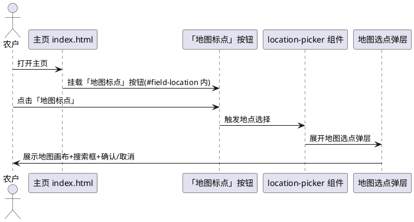
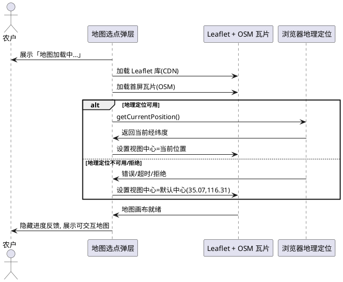
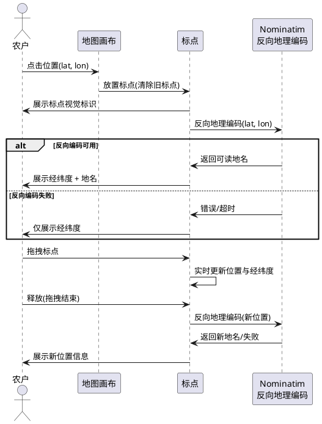
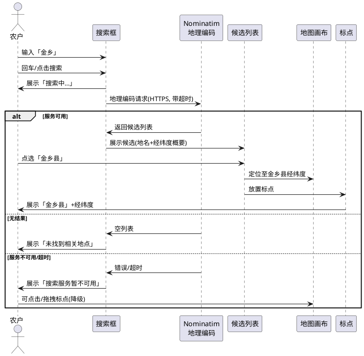
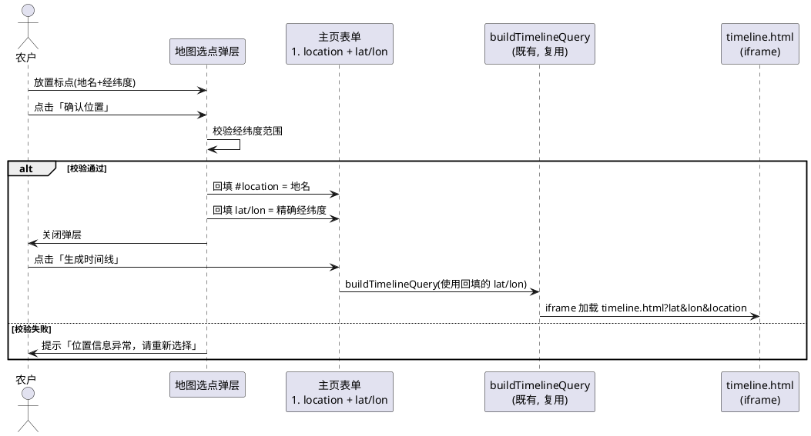
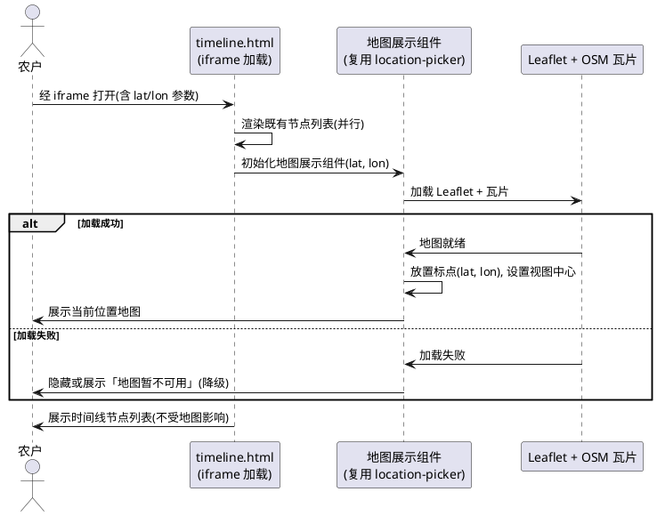
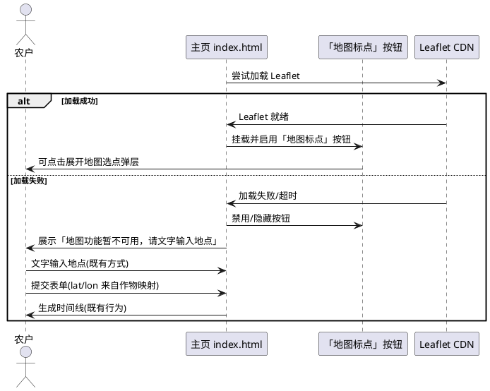
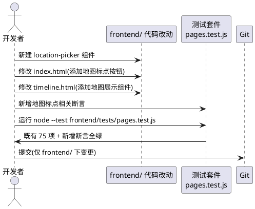

# V4 T06 农事日历地图标点功能 · 前端部分（v4_map_marker）

> 本文档用于规范 agritime（知农时 · 会看天的农事日历）功能扩展任务书 V4.0 中任务编号 T06「我的地块与环境感知」前端部分的验收标准：在农事日历功能中添加地图标点能力，用户可在地图上进行位置标点操作，选择农事活动的具体地点。具体包含：（1）新建 `frontend/components/location-picker/` 地点选择组件；（2）在主页（index.html）地点输入框旁添加「地图标点」按钮，点击弹出地图选点弹层；（3）在农事日历页（timeline.html）展示当前地点的地图位置组件；（4）地图支持点击标点、拖拽标点、文字搜索定位；（5）标点位置回填到地点字段并携带精确经纬度参与时间线请求；（6）地图 API 加载失败时降级为既有文字输入，不白屏不报错。
> 范围红线：本次为**纯前端地图标点功能**任务，仅允许修改 `frontend/` 目录下文件；须保证（1）前端 75/75 既有测试全绿、仅允许新增断言、（2）不引入框架/构建工具（地图功能仅允许通过 CDN 引入开源免费的 Leaflet 库作为地图渲染引擎，不引入需 API Key 的商业地图 SDK）、（3）不修改后端 Java（8080）业务逻辑与 nginx 配置、（4）地图 API/瓦片/搜索服务加载失败时降级为既有文字输入不白屏不报错、（5）地图组件资源放 `frontend/components/location-picker/` 遵循 V4 目录规范、（6）地图标点功能须纯前端实现，经纬度回填后复用既有表单提交链路与 `buildTimelineQuery` 参数拼装。
> 交付形式：本文档描述**做什么（What）**与**验收标准（Acceptance Criteria）**，不描述技术实现方式（How）；技术架构与代码结构由后续 design 阶段承接。
> 全局约束继承自 `stage2_frontend`（60 条）、`t00_directory_migration`（49 条）、`t01_weather_visual`（42 条）、`v4_t01_ui_revamp`（38 条）、`v4_t12_my_crops`（42 条）、`v4_integrated_optimization`（52 条）：纯原生 JS + 原生 CSS、前端测试断言不可弱化、`crop-map.js` 5 个 cropId 不变、mock 保持 null 占位不造假、时间线页天气数据经后端 `GET /api/timeline` 获取、主页左侧栏 6 板块入口已落地、天气视觉与时段动画已落地、语音组件已落地、拍照识别双通道已落地、「我的产品」页面已落地、悬浮球对话已落地、导航栏「我的」一级菜单与子菜单已落地。本任务在既有基础上**新增地图标点地点选择能力**，并**建立地图组件展示、标点交互、搜索定位、位置回填、加载降级五项核心能力**。

# **1. 组件定位**

## **1.1 核心职责**
本组件负责在 agritime 前端新增地图标点地点选择能力：新建 `frontend/components/location-picker/` 地点选择组件，在主页地点输入框旁添加「地图标点」按钮以弹出地图选点弹层，在农事日历页展示当前地点的地图位置，支持点击标点、拖拽标点与文字搜索定位，标点确认后回填地点文本与精确经纬度至既有表单并复用既有提交链路，地图 API 加载失败时降级为既有文字输入。

## **1.2 核心输入**
1. 用户在主页（index.html）地点输入框旁点击「地图标点」按钮的操作指令——触发地图选点弹层展开。
2. 浏览器地理定位 API（`navigator.geolocation`）提供的当前经纬度——用于地图初始视图中心（地理定位不可用时回退至默认中心）。
3. 用户在地图弹层上点击/拖拽的操作指令——在对应位置放置或移动标点。
4. 用户在地图弹层搜索框输入的地点关键词——用于文字搜索定位（经 Nominatim 地理编码服务返回候选）。
5. 用户在搜索候选列表中点选某条结果的操作指令——地图定位至该位置并放置标点。
6. 用户在地图弹层点击「确认位置」的操作指令——触发标点位置回填至地点输入框与表单经纬度。
7. 既有 `frontend/pages/index.html` 的 `#location` 地点输入框与 `buildTimelineQuery` 参数拼装逻辑——本任务在其旁添加地图标点按钮，选点后回填 location 文本与精确 lat/lon，复用既有提交链路。
8. 既有 `frontend/pages/timeline.html` 的 URL 参数（lat/lon/location）——本任务在时间线页头部新增地图展示组件，依据传入的 lat/lon 展示当前地点标点。
9. 既有 `frontend/assets/js/crop-map.js` 的作物映射（含各作物的默认 lat/lng）——本任务不改变其既有映射；地图选点回填的经纬度优先于作物映射的默认经纬度参与时间线请求。
10. Leaflet 地图库（经 CDN 引入）与 OpenStreetMap 瓦片服务、Nominatim 地理编码服务——地图渲染、底图瓦片与搜索定位的数据来源。

## **1.3 核心输出**
1. `frontend/components/location-picker/` 地点选择组件目录：含地图弹层 HTML 结构、交互逻辑（JS）与样式（CSS），封装地图初始化、标点、搜索、回填能力。
2. 主页地点输入框旁的「地图标点」按钮视图：在 `#field-location` 字段内新增可点击按钮，点击展开地图选点弹层。
3. 地图选点弹层视图：含地图画布、搜索框、搜索候选列表、标点位置信息展示、「确认位置」与「取消」按钮。
4. 农事日历页地图展示组件视图：在 timeline.html 头部展示当前地点的地图位置（标点标注当前 lat/lon），可只读展示或可选标点调整。
5. 标点确认后回填至 `#location` 地点输入框的地点文本（中文地名/地址）。
6. 标点确认后回填至表单的精确经纬度（lat/lon），参与 `buildTimelineQuery` 参数拼装，替代既有从作物映射取默认经纬度的方式。
7. 地图 API/瓦片/搜索服务加载失败时的降级视图：地图标点按钮禁用或隐藏并提示「地图功能暂不可用，请文字输入地点」，地点输入框保持可用。
8. 地图标点相关的新增测试断言（不破坏既有 75 项断言）。

## **1.4 职责边界**
本组件**不负责**以下事项：
1. 后端 Java 服务（`/opt/crop-calendar`，8080）的任何修改——**明确禁止**修改后端代码、新增后端地理编码/地图接口或改动后端配置；地图与搜索服务直接调用公开免费服务（OpenStreetMap 瓦片 + Nominatim），不经后端代理。
2. nginx 反向代理配置的修改——**明确禁止**；本任务不依赖 nginx 新增代理路径或 location，地图资源经 CDN/公开服务直接加载。
3. 既有 `frontend/assets/js/crop-map.js` 的 5 个 cropId 与 6 作物条目映射的修改——**明确禁止**改变既有作物映射；地图选点回填的经纬度优先于作物映射默认经纬度，但不改变 crop-map.js 源文件。
4. 既有 `frontend/assets/mock/mock-data.js` 的 null 占位策略的修改——**明确禁止**造假；mock 保持 null 占位。
5. 既有时间线页（timeline.html）渲染逻辑、既有拍照识别双通道与人工确认机制、既有语音组件、既有搜索历史、既有分栏布局（body.split-active）、既有主页表单提交链路（`buildTimelineQuery`）、既有左侧栏 switchModule 机制、既有天气视觉与时段动画、既有悬浮球对话、既有「我的产品」页面的修改——**明确禁止**改变既有已落地功能的核心行为；本任务在 timeline.html **新增**地图展示组件（不改变既有节点渲染），在 index.html **新增**地图标点按钮（不改变既有表单提交链路，仅丰富地点输入方式）。
6. 任何框架、构建工具的引入——**明确禁止**引入 Vue/React 等 UI 框架、Webpack/Vite 等构建工具、状态管理库；**唯一例外**：允许通过 CDN `<script>` 标签引入开源免费的 Leaflet 地图库（MIT 协议、无 API Key、无需构建），作为地图渲染引擎；Leaflet 加载失败时降级为文字输入。
7. 既有前端测试断言的删除或弱化——**明确禁止**为通过新需求而修改 `frontend/tests/pages.test.js` 既有 75 项断言的预期。
8. 地块完整管理（标注/形状建模/实时监控/种类选择）——本任务仅实现地点选择中的「地图标点」方式，地块完整管理由 T06 后续任务承接；本任务输出的经纬度可供地块管理复用。
9. 离线地图瓦片缓存或自建瓦片服务器——**明确禁止**；本任务依赖在线 OpenStreetMap 瓦片，离线/加载失败时降级为文字输入。

# **2. 领域术语**

**地图标点（Map Marker）**
: 指用户在地图画布上通过点击或拖拽操作放置的位置标记，标记对应一个具体地理坐标（经纬度），用于选择农事活动的具体地点；标点可附带可读的位置信息（地名/地址）。

**地点选择组件（Location Picker）**
: 指本任务新建的 `frontend/components/location-picker/` 组件，封装地图弹层、标点交互、搜索定位与位置回填能力，可在主页地点输入框旁与农事日历页复用。

**地图选点弹层（Map Picker Modal）**
: 指用户点击「地图标点」按钮后展开的弹层，含地图画布、搜索框、搜索候选列表、标点位置信息展示与确认/取消按钮；用户在弹层内完成标点与搜索后确认回填或取消关闭。

**文字搜索定位（Text Search Geocoding）**
: 指用户在地图弹层搜索框输入地点关键词（如「金乡」「济南」），经 Nominatim 地理编码服务返回候选地点列表，用户点选候选后地图定位至该位置并放置标点的交互能力。

**标点位置回填（Marker Location Backfill）**
: 指用户在地图弹层确认标点后，系统将标点的地点文本（地名/地址）回填至 `#location` 地点输入框，并将精确经纬度（lat/lon）回填至表单，参与 `buildTimelineQuery` 参数拼装的机制；回填的经纬度优先于既有从作物映射取默认经纬度的方式。

**Leaflet 地图库（Leaflet Library）**
: 指开源（MIT 协议）、免费、无需 API Key 的轻量 JavaScript 地图渲染库，经 CDN `<script>` 标签引入，用于地图画布渲染、标点放置与拖拽；本任务将其作为地图功能的唯一例外依赖，加载失败时降级为文字输入。

**OpenStreetMap 瓦片服务（OSM Tile Service）**
: 指公开免费的 OpenStreetMap 底图瓦片服务，经 Leaflet 加载为地图底图；瓦片加载失败时地图画布展示提示，不白屏。

**Nominatim 地理编码服务（Nominatim Geocoding）**
: 指 OpenStreetMap 官方提供的免费地理编码/搜索服务，将用户输入的地点关键词转换为候选地点列表（含地名、经纬度）；服务不可用时降级提示，不报错。

**地图 API 加载降级（Map API Degradation）**
: 指 Leaflet 库、OpenStreetMap 瓦片或 Nominatim 搜索服务加载失败/不可用时，系统降级为既有文字输入地点方式（地点输入框保持可用，地图标点按钮禁用或隐藏并提示），不白屏、不报错、不阻塞表单提交的机制。

**精确经纬度（Precise Lat/Lon）**
: 指经地图标点获得的地理坐标，纬度 lat 范围 [-90, 90]、经度 lon 范围 [-180, 180]，精度到街区级；区别于既有从作物映射取的默认经纬度（城市级粗略坐标）。

**农事日历页地图展示（Timeline Map Display）**
: 指在 timeline.html 头部新增的地图展示组件，依据 URL 参数传入的 lat/lon 展示当前地点的标点位置，供用户查看时间线对应的地理区位。

**EARS 需求编号约定**
: 本文档需求编号格式为 `REQ-VMM-XXX-NNN`，`VMM` 为 V4 Map Marker 缩写。前缀对应 EARS 句型：UBI（Ubiquitous，通用）、EVT（Event-driven，事件驱动）、STA（State-driven，状态驱动）、OPT（Optional，带前提）、UNW（Unwanted，非期望行为）。

# **3. 角色与边界**

## **3.1 核心角色**
- **农户 / 农业从业者**：在主页地点输入框旁点击「地图标点」按钮，在地图弹层内通过点击/拖拽/搜索选择农事活动具体地点，确认后回填至表单并生成时间线；在农事日历页查看当前地点的地图位置；是本任务的直接受益对象。
- **测试维护者**：运行 `node --test frontend/tests/pages.test.js`，确认既有 75 项断言全绿并补充地图标点相关新断言。
- **开发者 / 交付者**：在 `frontend/` 范围内改动代码、上传至目标服务器 `/agritime/frontend` 并提交 Git。

## **3.2 外部系统**
- **既有 `frontend/pages/index.html`**：主页表单，含 `#location` 地点输入框与 `buildTimelineQuery` 参数拼装逻辑；本任务在其 `#field-location` 字段内新增「地图标点」按钮，选点后回填 location 与精确 lat/lon，复用既有提交链路，不改变既有表单核心行为。
- **既有 `frontend/pages/timeline.html`**：农事时间线页，经 iframe 加载，地点从 URL 参数（lat/lon/location）传入；本任务在其头部新增地图展示组件，依据传入 lat/lon 展示当前地点标点，不改变既有节点渲染逻辑。
- **既有 `frontend/assets/js/crop-map.js`**：作物映射模块，含各作物默认 lat/lng；本任务不修改其源文件，地图选点回填的经纬度优先于作物映射默认经纬度参与时间线请求。
- **Leaflet 地图库（经 CDN 引入）**：地图渲染引擎，提供地图画布、标点、拖拽能力；MIT 协议开源免费无 API Key，加载失败时降级为文字输入。
- **OpenStreetMap 瓦片服务（公开免费）**：地图底图瓦片来源，经 Leaflet 加载；瓦片加载失败时地图画布展示提示。
- **Nominatim 地理编码服务（OSM 官方免费）**：文字搜索定位的候选来源，将关键词转为候选地点列表；服务不可用时降级提示。
- **浏览器地理定位 API（`navigator.geolocation`）**：地图初始视图中心来源；不可用或拒绝授权时回退至默认中心（如中国华北地区）。
- **既有 `frontend/components/sidebar/sidebar.js`**：左侧栏导航组件；本任务不修改其配置与机制，地图功能不新增板块入口。
- **后端 `GET /api/timeline`**：时间线数据接口；本任务不改变其调用方式与参数命名，仅丰富 lat/lon 参数来源（地图标点回填的精确经纬度优先于作物映射默认经纬度）。

## **3.3 交互上下文**
```plantuml
@startuml
skinparam rectangle {
  BackgroundColor #fffdf7
  BorderColor #e4ddcb
}
actor "农户/农业从业者" as user
rectangle "主页 index.html\n#field-location 地点输入框" as index
rectangle "「地图标点」按钮\n(新增)" as mapBtn
rectangle "location-picker 组件\nfrontend/components/location-picker/" as picker
rectangle "地图选点弹层\n(地图画布+搜索+标点)" as modal
rectangle "Leaflet + OSM 瓦片\n(CDN, 开源免费)" as leaflet
rectangle "Nominatim 搜索\n(OSM 官方免费)" as nominatim
rectangle "表单回填\n#location + lat/lon" as form
rectangle "农事日历页 timeline.html\n(地图展示组件, 新增)" as timeline
rectangle "后端 GET /api/timeline\n(既有, 复用)" as api

user --> index : 进入主页地点输入
index --> mapBtn : 展示「地图标点」按钮
user --> mapBtn : 点击「地图标点」
mapBtn --> picker : 触发地点选择
picker --> modal : 展开地图选点弹层
modal --> leaflet : 加载地图画布+瓦片
alt 地图可用
  leaflet --> modal : 地图渲染完成
  user --> modal : 点击/拖拽标点
  user --> modal : 输入搜索关键词
  modal --> nominatim : 地理编码请求
  nominatim --> modal : 候选地点列表
  user --> modal : 点选候选/确认标点
  modal --> form : 回填 location 文本 + 精确 lat/lon
  form --> index : 地点输入框更新
  user --> index : 提交表单(复用既有链路)
  index --> timeline : iframe 加载 timeline.html?lat&lon&location
  timeline --> user : 展示时间线 + 当前地点地图
else 地图不可用(降级)
  leaflet --> modal : 加载失败
  modal --> index : 降级提示, 地点输入框保持可用
  user --> index : 文字输入地点(既有方式)
end
@enduml
```

# **4. DFX约束**

## **4.1 性能**
1. 「地图标点」按钮须在主页加载完成后 ≤500ms 内挂载完成并可见，不阻塞主页渲染与表单其他字段交互。
2. 地图选点弹层展开后须在 ≤1500ms 内完成 Leaflet 库与首屏瓦片加载并呈现可交互地图画布；加载超过该时长时展示「地图加载中…」进度反馈，不让用户无反馈等待。
3. 文字搜索定位须在用户输入关键词并触发搜索后 ≤3000ms 内展示候选列表（Nominatim 服务响应时间依赖网络），等待期间展示「搜索中…」进度反馈。
4. 标点位置回填须在用户点击「确认位置」后 ≤100ms 内完成（地点文本回填 + 经纬度回填 + 弹层关闭），不得有感知延迟。
5. 农事日历页地图展示组件须在时间线页数据渲染后 ≤1000ms 内完成地图加载与标点展示，不阻塞既有节点列表渲染。
6. 地图瓦片加载不得阻塞主页表单提交与时间线页节点渲染；地图组件加载与既有页面渲染为并行，不串行阻塞。
7. Nominatim 搜索请求须有合理超时（如 5000ms），超时后降级提示「搜索服务暂不可用」，不无限等待。

## **4.2 可靠性**
1. 任一环节失败（Leaflet 加载失败、瓦片加载失败、Nominatim 服务不可用、地理定位拒绝授权、网络异常）时，页面须优雅降级，**不得白屏**、不得抛出未捕获 JS 错误。
2. Leaflet 库加载失败（CDN 不可达、脚本错误）时，地图标点按钮须禁用或隐藏并提示「地图功能暂不可用，请文字输入地点」，地点输入框保持可用，表单提交不受影响（回退至既有从作物映射取默认经纬度的方式）。
3. OpenStreetMap 瓦片加载失败时，地图画布须展示「地图底图加载失败」提示，标点交互与搜索功能仍可尝试（标点基于经纬度放置，不依赖瓦片可见），不白屏。
4. Nominatim 搜索服务不可用（超时、错误、网络异常）时，搜索框须展示「搜索服务暂不可用」降级提示，用户仍可通过点击/拖拽地图标点选择位置，不卡死。
5. 浏览器地理定位不可用或用户拒绝授权时，地图初始视图须回退至默认中心（如中国华北地区 lat 35.07/lon 116.31），不报错、不阻塞地图展开。
6. 地图选点弹层在多次打开/关闭下状态须一致，不得出现标点残留或弹层无法关闭；关闭弹层后未确认的标点不回填。
7. 标点位置回填的经纬度须经过范围校验（lat ∈ [-90, 90]、lon ∈ [-180, 180]），非法经纬度不回填并提示。
8. 农事日历页地图展示组件加载失败时须降级为隐藏或展示「地图暂不可用」提示，不阻塞既有时间线节点列表渲染。

## **4.3 安全性**
1. 地图标点回填的地点文本须经安全方式渲染（textContent），禁止将未转义的搜索结果或地名拼入 innerHTML（防 XSS）。
2. Nominatim 搜索请求须使用 HTTPS（OpenStreetMap 官方服务支持 HTTPS），不拼接外部不可信 URL，防中间人攻击。
3. OpenStreetMap 瓦片与 Leaflet CDN 须使用 HTTPS 加载，不混合 HTTP/HTTPS 内容。
4. 回填至表单的经纬度仅用于 `buildTimelineQuery` 参数拼装（经 URLSearchParams 编码），不写入 localStorage 敏感信息；地点文本可经既有 HistoryStore 纳入查询历史（复用既有非敏感信息存储策略）。
5. 不在前端硬编码任何 API Key、令牌或凭据；Leaflet 与 OpenStreetMap/Nominatim 均为免费无 Key 服务。
6. 地图选点弹层须有清晰的确认/取消操作，不得在用户未确认时自动回填并提交表单（防误操作）。

## **4.4 可维护性**
1. location-picker 组件须独立存放于 `frontend/components/location-picker/` 目录，封装地图初始化、标点、搜索、回填能力，不与既有页面逻辑耦合，遵循 V4 目录规范。
2. 地图功能的可配置项（Leaflet CDN 地址、OSM 瓦片模板、Nominatim 端点、默认地图中心、默认缩放级别、加载超时、降级文案）须以**具名常量**集中定义于 location-picker 组件内，不得多处硬编码。
3. 地图标点按钮的挂载位置（`#field-location` 字段内）、回填的目标输入框（`#location`）、经纬度回填的承接方式须以具名常量或集中配置定义，便于未来调整集成位置。
4. Leaflet 库的引入须以 CDN `<script>` 标签动态加载（或 HTML 静态引入），不经过构建工具打包；引入方式以具名常量定义，便于切换 CDN 源。
5. 地图选点弹层与农事日历页地图展示组件须复用同一 location-picker 组件核心能力（地图初始化、标点放置），避免重复实现。
6. 新增的地图标点相关测试断言须独立组织，不与既有 75 项断言混合，便于维护。

## **4.5 兼容性**
1. **测试兼容（强制红线）**：不得破坏 `frontend/tests/pages.test.js` 的既有 75 项断言；可新增断言，既有断言须全绿。运行命令：`node --test frontend/tests/pages.test.js`。
2. **响应式兼容**：375px、768px、1024px 三档宽度下均须无横向滚动；地图选点弹层与农事日历页地图展示组件在三档下均正常展示（移动端弹层近全屏，桌面端定宽定高）。
3. **依赖兼容**：不得引入框架、构建工具、状态管理库；**唯一例外**：允许通过 CDN 引入开源免费的 Leaflet 地图库（MIT 协议、无 API Key），作为地图渲染引擎；不得引入需 API Key 的商业地图 SDK（高德/百度/腾讯地图 JS API 等）。
4. **文件范围兼容**：不得修改后端及 `data/`、`shared/`、`deploy/`、`docs/` 等模块；仅修改 `frontend/` 下文件。
5. **接口兼容**：不得改变前端既有的 `GET /api/timeline` 调用方式与参数命名（crop/sowDate/lat/lon/location）；地图标点回填的 lat/lon 经既有 `buildTimelineQuery` 拼装，不改变参数名。
6. **既有功能兼容**：不得改变既有左侧栏 6 板块入口与 switchModule 机制、既有作物映射 5 个 cropId、既有查询历史存储、既有拍照识别双通道、既有语音组件、既有分栏布局、既有主页表单提交链路、既有时间线页节点渲染、既有天气视觉、既有悬浮球对话的核心行为。
7. **浏览器兼容**：须在主流现代浏览器（Chrome/Edge/Safari 近两版）与移动端 WebView 下可用；Leaflet 兼容主流浏览器，地理定位 API 在不支持的浏览器下降级为默认中心。
8. **目录规范兼容**：location-picker 组件资源须存放于 `frontend/components/location-picker/`，遵循 V4 目录规范。

# **5. 核心能力**

## **5.1 location-picker 组件创建与集成**

### **5.1.1 业务规则**

1. **REQ-VMM-UBI-001（Ubiquitous）**：系统须新建 `frontend/components/location-picker/` 目录，存放地点选择组件的 HTML 结构、交互逻辑（JS）与样式（CSS），封装地图初始化、标点放置、搜索定位与位置回填能力，遵循 V4 目录规范。
   a. 验收条件：[审查目录结构] → [存在 `frontend/components/location-picker/` 目录，含组件相关资源（JS/CSS），不散落于既有页面]

2. **REQ-VMM-UBI-002（Ubiquitous）**：系统须在主页（index.html）的 `#field-location` 地点输入框字段内新增「地图标点」按钮，按钮位于地点输入框旁，可点击触发地图选点弹层，不遮挡地点输入框与其他表单字段。
   a. 验收条件：[打开主页查看地点输入字段] → [地点输入框旁存在「地图标点」按钮，可点击，不遮挡输入框与作物/日期字段]

3. **REQ-VMM-EVT-003（Event-driven）**：当用户点击「地图标点」按钮时，系统须展开地图选点弹层，弹层含地图画布、搜索框、搜索候选列表区、标点位置信息展示区与「确认位置」「取消」按钮；弹层展开不阻塞主页背景与左侧栏。
   a. 验收条件：[点击「地图标点」按钮] → [展开地图选点弹层，含地图画布/搜索框/候选列表区/位置信息区/确认与取消按钮，主页背景与左侧栏不被阻塞]

4. **REQ-VMM-UBI-004（Ubiquitous）**：地图选点弹层与农事日历页地图展示组件须复用既有 CSS 变量（--leaf/--ink/--paper/--card/--radius 等）与整体 UI 风格，与项目内部视觉一致，不使用外部默认样式。
   a. 验收条件：[视觉核对 + 代码审查] → [地图弹层与展示组件样式复用既有 CSS 变量，风格与项目一致]

5. **REQ-VMM-UBI-005（Ubiquitous）**：location-picker 组件的可配置项（Leaflet CDN 地址、OSM 瓦片模板、Nominatim 端点、默认地图中心、默认缩放级别、加载超时、降级文案）须以具名常量集中定义，不得多处硬编码。
   a. 验收条件：[代码审查] → [可配置项以具名常量集中定义于 location-picker 组件内，无多处硬编码]

6. **禁止项**：禁止「地图标点」按钮遮挡地点输入框导致无法文字输入；禁止地图选点弹层遮挡左侧栏入口；禁止 location-picker 组件与既有页面逻辑耦合（须独立模块化）。
   a. 验收条件：[视觉核对 + 代码审查] → [按钮不遮挡输入框，弹层不遮挡左侧栏，组件独立模块化]

### **5.1.2 交互流程**


### **5.1.3 异常场景**

1. **location-picker 组件资源加载失败**
   a. 触发条件：组件 JS/CSS 加载失败
   b. 系统行为：「地图标点」按钮不挂载或禁用，地点输入框保持可用
   c. 用户感知：看不到地图标点按钮或按钮禁用，可文字输入地点

## **5.2 地图组件展示与渲染**

### **5.2.1 业务规则**

1. **REQ-VMM-UBI-006（Ubiquitous）**：地图选点弹层须展示可交互的地图画布，地图画布须渲染地理底图、支持缩放与平移操作，画布尺寸适配弹层尺寸（移动端近全屏，桌面端定宽定高）。
   a. 验收条件：[展开地图选点弹层] → [展示可交互地图画布，含地理底图，可缩放/平移，尺寸适配弹层]

2. **REQ-VMM-UBI-007（Ubiquitous）**：地图须使用开源免费的 Leaflet 库（MIT 协议、无 API Key）作为渲染引擎，经 CDN `<script>` 引入；底图瓦片须使用公开免费的 OpenStreetMap 瓦片服务；不得引入需 API Key 的商业地图 SDK。
   a. 验收条件：[代码审查] → [使用 Leaflet + OpenStreetMap 瓦片，经 CDN 引入，无 API Key，无商业地图 SDK]

3. **REQ-VMM-STA-008（State-driven）**：在地图画布加载完成前，系统须展示「地图加载中…」类进度反馈，不得展示空白画布让用户无反馈等待。
   a. 验收条件：[地图加载过程中] → [展示「地图加载中…」进度反馈，非空白]

4. **REQ-VMM-EVT-009（Event-driven）**：当地图画布加载完成（Leaflet 与首屏瓦片就绪）后，系统须隐藏进度反馈，展示可交互地图，并依据初始视图中心定位——初始中心优先使用浏览器地理定位（`navigator.geolocation`），地理定位不可用或拒绝授权时回退至默认中心（如 lat 35.07/lon 116.31）。
   a. 验收条件：[地图加载完成 + 地理定位可用] → [地图定位至当前位置]；[地理定位不可用/拒绝] → [地图定位至默认中心，不报错]

5. **REQ-VMM-UBI-010（Ubiquitous）**：地图选点弹层须提供「取消」操作（关闭按钮与点击弹层外部遮罩关闭），用户点击取消时须关闭弹层、不回填任何位置、不修改表单。
   a. 验收条件：[点击「取消」或弹层外部遮罩] → [弹层关闭，表单不变，未确认的标点不回填]

6. **REQ-VMM-UBI-011（Ubiquitous）**：地图选点弹层与农事日历页地图展示组件须在 375px、768px、1024px 三档宽度下均正常展示——移动端（375px）弹层近全屏（宽度占满、高度占视口 80% 以上），桌面端（768px/1024px）弹层定宽定高居中展示，均无横向滚动。
   a. 验收条件：[三档宽度下展开地图弹层] → [均正常展示，移动端近全屏，桌面端定宽定高，无横向滚动]

7. **禁止项**：禁止地图画布遮挡弹层内的搜索框与确认/取消按钮；禁止地图画布在加载失败时白屏；禁止地图画布缩放/平移导致弹层外内容被遮挡。
   a. 验收条件：[视觉核对] → [搜索框与按钮可见，加载失败不白屏，弹层外不被遮挡]

### **5.2.2 交互流程**


### **5.2.3 异常场景**

1. **Leaflet 库 CDN 加载失败**
   a. 触发条件：CDN 不可达或脚本加载错误
   b. 系统行为：地图选点弹层展示「地图功能暂不可用，请文字输入地点」降级提示，弹层可关闭，地点输入框保持可用
   c. 用户感知：看到降级提示，可关闭弹层文字输入地点，表单提交不受影响

2. **OpenStreetMap 瓦片加载失败**
   a. 触发条件：瓦片服务不可达或网络异常
   b. 系统行为：地图画布展示「地图底图加载失败」提示，标点交互与搜索仍可尝试（标点基于经纬度放置）
   c. 用户感知：看到底图加载失败提示，仍可点击放置标点（无底图参考）或关闭弹层

## **5.3 地图标点交互**

### **5.3.1 业务规则**

1. **REQ-VMM-EVT-012（Event-driven）**：当用户在地图画布上点击某位置时，系统须在该位置放置一个标点，标点须有可见的视觉标识（如图钉/圆点），并展示该位置的经纬度信息与可读地名（经 Nominatim 反向地理编码获取，失败时仅展示经纬度）。
   a. 验收条件：[点击地图某位置] → [该位置出现标点，展示经纬度与可读地名（或仅经纬度）]

2. **REQ-VMM-EVT-013（Event-driven）**：当用户拖拽标点时，系统须实时更新标点位置与对应经纬度信息展示，拖拽结束后展示新位置的可读地名（经反向地理编码，失败时仅展示经纬度）。
   a. 验收条件：[拖拽标点至新位置] → [标点跟随移动，经纬度实时更新，拖拽结束后展示新位置地名]

3. **REQ-VMM-UBI-014（Ubiquitous）**：地图画布上同时须只保留一个标点（单选模式）；用户再次点击或拖拽时，原标点移动至新位置，不出现多个标点残留。
   a. 验收条件：[多次点击地图不同位置] → [仅保留最后一次点击的标点，无多个标点残留]

4. **REQ-VMM-UBI-015（Ubiquitous）**：标点位置信息展示区须展示当前标点的经纬度（lat/lon，保留合理小数位）与可读地名（如「山东省济宁市金乡县」），地名须经安全方式渲染（textContent，防 XSS）。
   a. 验收条件：[放置标点后查看位置信息区] → [展示经纬度与可读地名，地名经 textContent 渲染]

5. **REQ-VMM-OPT-016（Optional/带前提）**：当标点放置后，系统可经 Nominatim 反向地理编码获取该经纬度对应的可读地名并展示；反向地理编码失败或不可用时仅展示经纬度，不报错、不阻塞标点确认。
   a. 验收条件：[放置标点 + 反向地理编码可用] → [展示可读地名]；[反向地理编码失败] → [仅展示经纬度，不报错，可确认]

6. **禁止项**：禁止标点遮挡弹层内的搜索框与确认/取消按钮；禁止标点位置信息区展示未经转义的 HTML 内容；禁止标点经纬度超出 [-90,90]/[-180,180] 范围。
   a. 验收条件：[视觉核对 + 代码审查] → [标点不遮挡按钮，位置信息经 textContent 渲染，经纬度在合法范围]

### **5.3.2 交互流程**


### **5.3.3 异常场景**

1. **反向地理编码失败**
   a. 触发条件：Nominatim 反向地理编码服务不可用或返回错误
   b. 系统行为：标点位置信息区仅展示经纬度，不展示地名，不报错
   c. 用户感知：看到经纬度，无地名，可确认标点

2. **标点经纬度超出合法范围**
   a. 触发条件：地图边界或异常导致经纬度超出范围
   b. 系统行为：校验经纬度范围，非法值不放置标点或钳制至合法范围
   c. 用户感知：标点仅在合法位置放置，无异常

## **5.4 位置搜索定位**

### **5.4.1 业务规则**

1. **REQ-VMM-UBI-017（Ubiquitous）**：地图选点弹层须提供文字搜索框，搜索框位于地图画布上方或上方叠加，支持用户输入地点关键词（如「金乡」「济南」「山东金乡」）。
   a. 验收条件：[展开地图选点弹层] → [存在文字搜索框，可输入地点关键词]

2. **REQ-VMM-EVT-018（Event-driven）**：当用户在搜索框输入关键词并触发搜索（回车或搜索按钮）时，系统须调用 Nominatim 地理编码服务将关键词转为候选地点列表，等待期间展示「搜索中…」进度反馈。
   a. 验收条件：[输入「金乡」并回车] → [展示「搜索中…」，调用 Nominatim 地理编码]

3. **REQ-VMM-EVT-019（Event-driven）**：当 Nominatim 返回候选地点列表时，系统须在搜索框下方展示候选列表（含地名与经纬度概要），用户可点选某条候选；候选列表须经安全方式渲染（textContent，防 XSS）。
   a. 验收条件：[Nominatim 返回候选] → [展示候选列表（地名+经纬度概要），经 textContent 渲染，可点选]

4. **REQ-VMM-EVT-020（Event-driven）**：当用户点选某条搜索候选时，系统须将地图定位至该候选的经纬度（设置视图中心与缩放），并在该位置放置标点，展示该候选的地名与经纬度。
   a. 验收条件：[点选候选「金乡县」] → [地图定位至金乡县，放置标点，展示「金乡县」与经纬度]

5. **REQ-VMM-UNW-021（Unwanted）**：如果搜索无结果（Nominatim 返回空列表），系统须展示「未找到相关地点」提示，不报错、不白屏。
   a. 验收条件：[输入不存在的关键词并搜索] → [展示「未找到相关地点」提示，不报错]

6. **REQ-VMM-UNW-022（Unwanted）**：如果 Nominatim 搜索服务不可用（超时、错误、网络异常），系统须展示「搜索服务暂不可用」降级提示，用户仍可通过点击/拖拽地图标点选择位置，不卡死。
   a. 验收条件：[Nominatim 不可用时搜索] → [展示「搜索服务暂不可用」提示，可点击/拖拽标点，不卡死]

7. **REQ-VMM-UBI-023（Ubiquitous）**：搜索服务须使用公开免费的 Nominatim 地理编码服务（OSM 官方），经 HTTPS 调用，不在前端硬编码 API Key；搜索请求须有合理超时（如 5000ms），超时后降级提示。
   a. 验收条件：[代码审查] → [使用 Nominatim 经 HTTPS 调用，无 API Key，有超时设置]

8. **禁止项**：禁止搜索候选列表遮挡地图画布导致无法点击标点；禁止搜索结果未经转义拼入 innerHTML；禁止搜索请求无限重试。
   a. 验收条件：[视觉核对 + 代码审查] → [候选列表不遮挡画布，结果经 textContent 渲染，无无限重试]

### **5.4.2 交互流程**


### **5.4.3 异常场景**

1. **搜索关键词为空**
   a. 触发条件：用户未输入关键词即触发搜索
   b. 系统行为：不发起搜索请求，隐藏候选列表
   c. 用户感知：无搜索动作，可继续输入

2. **搜索候选列表过长**
   a. 触发条件：Nominatim 返回大量候选
   b. 系统行为：限制展示数量（如 Top 10），列表可纵向滚动
   c. 用户感知：看到有限候选，可滚动查看

## **5.5 标点位置关联回填**

### **5.5.1 业务规则**

1. **REQ-VMM-EVT-024（Event-driven）**：当用户在地图选点弹层放置标点后点击「确认位置」按钮时，系统须将标点的可读地名（或经纬度文本）回填至主页 `#location` 地点输入框，并关闭弹层。
   a. 验收条件：[放置标点并点击「确认位置」] → [`#location` 输入框回填标点地名，弹层关闭]

2. **REQ-VMM-EVT-025（Event-driven）**：当用户确认标点位置后，系统须将标点的精确经纬度（lat/lon）回填至表单承接变量，使后续表单提交时 `buildTimelineQuery` 使用该精确经纬度拼装 lat/lon 参数，**优先于**既有从作物映射（`findCrop` 返回的 hit.lat/hit.lng）取默认经纬度的方式。
   a. 验收条件：[确认标点后提交表单] → [timeline.html 的 URL 参数 lat/lon 为标点的精确经纬度，而非作物映射的默认经纬度]

3. **REQ-VMM-UBI-026（Ubiquitous）**：回填的经纬度须经过范围校验（lat ∈ [-90, 90]、lon ∈ [-180, 180]），校验通过后方可回填；非法经纬度不回填并提示「位置信息异常，请重新选择」。
   a. 验收条件：[标点经纬度合法] → [回填成功]；[标点经纬度非法] → [不回填，展示异常提示]

4. **REQ-VMM-UBI-027（Ubiquitous）**：回填须使用安全方式渲染（textContent），禁止将未转义的地名或搜索结果拼入 innerHTML（防 XSS）；回填的地点文本可经既有 HistoryStore 纳入查询历史（复用既有非敏感信息存储策略）。
   a. 验收条件：[代码审查] → [回填经 textContent，无 XSS 风险，地点文本可入查询历史]

5. **REQ-VMM-UBI-028（Ubiquitous）**：未确认标点时点击「确认位置」须提示「请在地图上选择一个位置」，不回填空值；弹层关闭（取消）时不回填任何位置，表单保持原值。
   a. 验收条件：[未放置标点点击确认] → [提示「请在地图上选择一个位置」，不回填]；[点击取消关闭] → [表单保持原值，不回填]

6. **REQ-VMM-UBI-029（Ubiquitous）**：标点位置回填后，主页表单提交链路须复用既有 `buildTimelineQuery` 与 iframe 加载机制（`timeline-pane`/`timeline-iframe`），不改变既有提交行为；回填的 lat/lon 经 URLSearchParams 编码拼装，参数名保持 lat/lon 不变。
   a. 验收条件：[回填后提交表单] → [复用既有提交链路，timeline.html 经 iframe 加载，URL 参数含 lat/lon/location，参数名不变]

7. **禁止项**：禁止未确认即自动回填并提交表单；禁止回填改变既有 `buildTimelineQuery` 参数命名（lat/lon/location）；禁止回填的经纬度不参与时间线请求（须优先于作物映射默认经纬度）。
   a. 验收条件：[交互核对 + 代码审查] → [确认后才回填，参数命名不变，经纬度参与请求]

### **5.5.2 交互流程**


### **5.5.3 异常场景**

1. **回填后用户再次文字修改地点**
   a. 触发条件：用户确认标点回填后，又在地点输入框手动修改文字
   b. 系统行为：地点文本以用户手动修改为准，经纬度保持回填值（或回退至作物映射默认经纬度，以具名常量配置策略）
   c. 用户感知：手动修改生效，可重新点击地图标点覆盖

2. **回填的经纬度与地点文本不匹配**
   a. 触发条件：反向地理编码返回的地名与用户预期不符
   b. 系统行为：回填地名与经纬度均为标点位置的真实值，用户可手动调整
   c. 用户感知：看到回填的地名，可接受或重新标点

## **5.6 农事日历页地图展示**

### **5.6.1 业务规则**

1. **REQ-VMM-UBI-030（Ubiquitous）**：系统须在农事日历页（timeline.html）新增地图展示组件，展示当前时间线对应的地点位置；组件依据 URL 参数传入的 lat/lon 在地图上放置标点并定位视图中心。
   a. 验收条件：[打开 timeline.html（含 lat/lon 参数）] → [页面展示地图组件，地图上标点标注 lat/lon 位置，视图中心为该位置]

2. **REQ-VMM-UBI-031（Ubiquitous）**：农事日历页地图展示组件须位于时间线页头部（结论卡附近或独立区块），不遮挡既有节点列表、模式切换、图表等核心内容；组件尺寸适配页面布局（移动端与桌面端均不引入横向滚动）。
   a. 验收条件：[查看 timeline.html 布局] → [地图组件位于头部，不遮挡节点列表/模式切换/图表，无横向滚动]

3. **REQ-VMM-UBI-032（Ubiquitous）**：农事日历页地图展示组件须复用 location-picker 组件的地图初始化与标点放置能力（复用 Leaflet + OSM 瓦片），不重复实现地图渲染逻辑；组件加载与既有时间线节点渲染为并行，不阻塞节点列表展示。
   a. 验收条件：[代码审查 + 交互核对] → [复用 location-picker 地图能力，地图加载不阻塞节点渲染]

4. **REQ-VMM-OPT-033（Optional/带前提）**：农事日历页地图展示组件可为只读展示（仅标注当前位置）或可选标点调整（用户可点击调整位置并重新加载时间线）；具体策略以具名常量配置，默认为只读展示（不改变既有时间线数据）。
   a. 验收条件：[默认配置下查看地图组件] → [只读展示当前位置，不触发时间线重新加载]；[配置为可调整时] → [可点击调整，调整后重新加载时间线]

5. **REQ-VMM-UNW-034（Unwanted）**：如果农事日历页地图展示组件加载失败（Leaflet/瓦片不可用），系统须降级为隐藏组件或展示「地图暂不可用」提示，不阻塞既有时间线节点列表渲染，不白屏、不报错。
   a. 验收条件：[地图组件加载失败] → [组件隐藏或展示降级提示，节点列表正常渲染，不白屏]

6. **REQ-VMM-UBI-035（Ubiquitous）**：当 timeline.html 的 URL 参数缺失 lat/lon 或值为非法时，地图展示组件须回退至默认中心（如 lat 35.07/lon 116.31）或不展示标点，不报错。
   a. 验收条件：[URL 参数无 lat/lon 或非法] → [地图回退默认中心或不展示标点，不报错]

7. **禁止项**：禁止农事日历页地图展示组件改变既有时间线节点渲染逻辑、模式切换、图表渲染、节日倒计时等核心行为；禁止地图组件阻塞节点列表首屏渲染；禁止地图组件引入横向滚动。
   a. 验收条件：[交互核对 + 视觉核对] → [既有渲染不变，节点首屏不阻塞，无横向滚动]

### **5.6.2 交互流程**


### **5.6.3 异常场景**

1. **timeline.html 经 iframe 加载时地图组件初始化时机问题**
   a. 触发条件：iframe 加载时 Leaflet 全局变量未就绪
   b. 系统行为：地图组件延迟初始化或降级隐藏，不阻塞节点渲染
   c. 用户感知：节点列表正常展示，地图可能延迟出现或降级提示

2. **URL 参数 lat/lon 为默认值（作物映射默认经纬度）**
   a. 触发条件：用户未使用地图标点，表单提交时 lat/lon 来自作物映射
   b. 系统行为：地图展示组件正常展示该默认经纬度位置
   c. 用户感知：看到地图标注的作物默认位置

## **5.7 地图 API 加载降级机制**

### **5.7.1 业务规则**

1. **REQ-VMM-UNW-036（Unwanted）**：如果 Leaflet 库加载失败（CDN 不可达、脚本错误、超时），系统须将主页「地图标点」按钮禁用或隐藏并展示「地图功能暂不可用，请文字输入地点」提示，地点输入框 `#location` 保持可用，表单提交回退至既有从作物映射取默认经纬度的方式，不白屏、不报错。
   a. 验收条件：[Leaflet 加载失败] → [「地图标点」按钮禁用/隐藏+提示，地点输入框可用，表单可提交（lat/lon 来自作物映射），不白屏]

2. **REQ-VMM-UNW-037（Unwanted）**：如果地图选点弹层已展开但 Leaflet 或瓦片加载失败，系统须在弹层内展示「地图加载失败，请关闭弹层文字输入地点」降级提示，弹层可关闭，关闭后地点输入框保持可用。
   a. 验收条件：[弹层展开后 Leaflet/瓦片加载失败] → [弹层内展示降级提示，可关闭弹层，关闭后地点输入框可用]

3. **REQ-VMM-UNW-038（Unwanted）**：如果 Nominatim 搜索服务不可用，系统须在搜索框展示「搜索服务暂不可用」降级提示，用户仍可通过点击/拖拽地图标点选择位置，弹层其他功能不受影响。
   a. 验收条件：[Nominatim 不可用] → [搜索框展示降级提示，可点击/拖拽标点，弹层其他功能正常]

4. **REQ-VMM-UNW-039（Unwanted）**：如果浏览器地理定位不可用或用户拒绝授权，系统须将地图初始视图回退至默认中心（如 lat 35.07/lon 116.31），不报错、不阻塞地图展开、不反复弹出授权请求。
   a. 验收条件：[地理定位不可用/拒绝] → [地图回退默认中心，不报错，不反复请求授权]

5. **REQ-VMM-UBI-040（Ubiquitous）**：地图 API 加载降级须保持既有文字输入地点方式完全可用——降级时用户可文字输入地点并提交表单生成时间线，表单提交链路与时间线渲染不受地图功能降级影响。
   a. 验收条件：[地图功能降级时文字输入地点并提交] → [表单正常提交，时间线正常生成，与既有行为一致]

6. **禁止项**：禁止地图 API 加载失败导致白屏或未捕获 JS 错误；禁止降级时阻塞表单提交或时间线渲染；禁止降级时反复重试加载地图 API 导致死循环。
   a. 验收条件：[地图 API 失败] → [不白屏、不报错、不阻塞表单、不死循环重试]

### **5.7.2 交互流程**


### **5.7.3 异常场景**

1. **Leaflet 部分加载（脚本就绪但瓦片不可达）**
   a. 触发条件：Leaflet 脚本加载成功但 OSM 瓦片服务不可达
   b. 系统行为：地图画布展示「底图加载失败」，标点交互仍可尝试
   c. 用户感知：看到空底图与提示，可放置标点（无底图参考）或关闭弹层

2. **网络间歇性故障导致搜索与瓦片时好时坏**
   a. 触发条件：网络不稳定，瓦片部分加载、搜索时通时断
   b. 系统行为：已加载瓦片正常展示，未加载瓦片留白；搜索失败展示降级提示，可重试
   c. 用户感知：地图部分可见，搜索可重试，可点击/拖拽标点

## **5.8 测试与兼容性保障**

### **5.8.1 业务规则**

1. **REQ-VMM-UBI-041（Ubiquitous）**：系统须保证 `frontend/tests/pages.test.js` 的既有 75 项断言全部通过，不得为通过新需求而删除、注释或弱化既有断言；运行命令 `node --test frontend/tests/pages.test.js`。
   a. 验收条件：[运行 `node --test frontend/tests/pages.test.js`] → [既有 75 项断言全绿，无失败]

2. **REQ-VMM-UBI-042（Ubiquitous）**：系统须针对本次新增地图标点能力补充必要测试断言（如 location-picker 组件目录存在、「地图标点」按钮挂载、地图弹层结构、标点回填逻辑、降级提示、经纬度范围校验等），且不得破坏既有断言。
   a. 验收条件：[测试套件运行] → [新增断言通过，既有 75 项断言仍全绿]

3. **REQ-VMM-UBI-043（Ubiquitous）**：本次改动须仅修改 `frontend/` 目录下文件，不得修改后端（`/opt/crop-calendar`、Java/8080）、`data/`、`shared/`、`deploy/`、`docs/` 等模块；不得修改 nginx 配置。
   a. 验收条件：[git diff 审查] → [仅 `frontend/` 下文件变更，后端/数据/共享/部署/文档/nginx 不变]

4. **REQ-VMM-UBI-044（Ubiquitous）**：本次改动须不引入框架、构建工具、状态管理库；**唯一例外**：允许通过 CDN 引入开源免费的 Leaflet 地图库（MIT 协议、无 API Key）作为地图渲染引擎；不得引入需 API Key 的商业地图 SDK。
   a. 验收条件：[代码审查] → [无框架/构建工具/状态管理库引入，仅 Leaflet 经 CDN 引入，无商业地图 SDK]

5. **REQ-VMM-UBI-045（Ubiquitous）**：本次改动须不改变既有接口（`GET /api/timeline`、`POST /api/recognition`、`POST /api/chart`、`GET /health`）的调用方式与参数命名；地图标点回填的 lat/lon 经既有 `buildTimelineQuery` 拼装，参数名保持 lat/lon/location 不变。
   a. 验收条件：[代码审查] → [既有接口调用方式与参数命名不变，lat/lon/location 参数名不变]

6. **禁止项**：禁止为通过测试而删除/注释/弱化既有断言；禁止引入框架/构建工具/商业地图 SDK；禁止修改后端与 nginx；禁止改变既有接口调用方式与参数命名。
   a. 验收条件：[代码审查 + 测试运行] → [既有断言全绿，无框架/商业 SDK，后端/nginx 不变，接口不变]

### **5.8.2 交互流程**


### **5.8.3 异常场景**

1. **新增地图标点功能导致既有测试失败**
   a. 触发条件：新增改动破坏既有 75 项断言
   b. 系统行为：排查破坏点，调整改动使既有断言恢复全绿（不弱化既有断言）
   c. 用户感知：最终既有 75 项 + 新增断言全绿

2. **Leaflet CDN 在测试环境不可达**
   a. 触发条件：测试环境无网络或 CDN 被墙
   b. 系统行为：测试断言须覆盖降级路径（地图标点按钮禁用/隐藏+提示），不依赖真实 CDN 可达
   c. 用户感知：测试全绿，降级路径被验证

# **6. 数据约束**

## **6.1 标点位置对象**
1. **lat**：纬度，数值类型，取值范围 [-90, 90]，保留合理小数位（如 6 位），用于地图标点定位与 `buildTimelineQuery` 的 lat 参数。
2. **lon**：经度，数值类型，取值范围 [-180, 180]，保留合理小数位（如 6 位），用于地图标点定位与 `buildTimelineQuery` 的 lon 参数。
3. **locationText**：地点文本（可读地名/地址），字符串类型，经 Nominatim 反向地理编码或搜索候选获取，用于回填 `#location` 地点输入框与 `buildTimelineQuery` 的 location 参数；可为空（反向编码失败时仅回填经纬度，地点文本以经纬度字符串代替或保持原值）。
4. **source**：位置来源标识，枚举值：`marker`（地图标点）、`search`（搜索候选点选）、`default`（默认/作物映射），用于区分经纬度来源以决定回填优先级。

## **6.2 搜索候选对象**
1. **displayName**：候选地点显示名称，字符串类型，由 Nominatim 返回，经安全方式渲染（textContent）。
2. **lat**：候选纬度，数值类型，取值范围 [-90, 90]。
3. **lon**：候选经度，数值类型，取值范围 [-180, 180]。
4. **raw**：Nominatim 原始返回对象（可选），仅供内部解析，不直接渲染。

## **6.3 地图配置对象**
1. **leafletCdnUrl**：Leaflet 库 CDN 地址，字符串类型，HTTPS 协议，以具名常量定义。
2. **leafletCssCdnUrl**：Leaflet 样式 CDN 地址，字符串类型，HTTPS 协议。
3. **osmTileTemplate**：OpenStreetMap 瓦片模板 URL，字符串类型，HTTPS 协议，含 {z}/{x}/{y} 占位符。
4. **nominatimEndpoint**：Nominatim 地理编码端点，字符串类型，HTTPS 协议。
5. **defaultCenter**：默认地图中心，对象 `{lat: 35.07, lon: 116.31}`，地理定位不可用时回退。
6. **defaultZoom**：默认缩放级别，整数，如 12。
7. **loadTimeoutMs**：Leaflet/瓦片加载超时，整数，如 5000。
8. **searchTimeoutMs**：Nominatim 搜索超时，整数，如 5000。
9. **degradationText**：降级提示文案，字符串类型，如「地图功能暂不可用，请文字输入地点」。
10. **maxSearchResults**：搜索候选最大展示数量，整数，如 10。

## **6.4 回填承接对象**
1. **locationInputId**：回填目标地点输入框元素 ID，字符串类型，固定为 `location`（既有 `#location`）。
2. **useMarkerLatLon**：是否使用地图标点回填的经纬度优先于作物映射默认经纬度，布尔类型，默认 true。
3. **latLonSource**：当前经纬度来源标识，枚举值 `marker`/`search`/`default`，用于 `buildTimelineQuery` 决策。

# **7. 需求归类与交付边界**

> 本章明确区分"前端代码修改（允许且必须）"、"新增文件（允许）"、"不触碰项"与"排除项"。

## **7.1 前端代码修改（允许且必须，范围限 `frontend/`）**
1. `frontend/components/location-picker/`（新建目录）：地点选择组件（地图弹层 HTML 结构、交互逻辑 JS、样式 CSS）。—— 对应 REQ-VMM-UBI-001、UBI-005。
2. `frontend/pages/index.html`：在 `#field-location` 字段内新增「地图标点」按钮，引入 location-picker 组件，选点后回填 location 与精确 lat/lon。—— 对应 REQ-VMM-UBI-002、EVT-003、EVT-024、EVT-025、UBI-029。
3. `frontend/pages/timeline.html`：在头部新增地图展示组件，依据 URL 参数 lat/lon 展示当前地点标点。—— 对应 REQ-VMM-UBI-030、UBI-031、UBI-032。
4. `frontend/tests/pages.test.js`：新增地图标点相关断言（组件目录存在、按钮挂载、弹层结构、回填逻辑、降级提示、经纬度校验等），既有 75 项断言保持全绿。—— 对应 REQ-VMM-UBI-041、UBI-042。

## **7.2 新建目录与文件（允许）**
1. `frontend/components/location-picker/location-picker.js`：地点选择组件交互逻辑（地图初始化、标点、搜索、回填、降级）。—— 对应 REQ-VMM-UBI-001。
2. `frontend/components/location-picker/location-picker.css`：地点选择组件样式（复用既有 CSS 变量）。—— 对应 REQ-VMM-UBI-004。
3. `frontend/components/location-picker/` 下其他必要资源（如地图图标）。—— 对应 REQ-VMM-UBI-001。

## **7.3 不触碰项（保持不变）**
1. 后端 Java 服务（`/opt/crop-calendar`，8080）：不修改。—— 对应 REQ-VMM-UBI-043。
2. nginx 配置：不修改。—— 对应 REQ-VMM-UBI-043。
3. `frontend/assets/js/crop-map.js`：5 个 cropId 与 6 作物条目映射不变。—— 对应 REQ-VMM-UBI-045。
4. `frontend/assets/mock/mock-data.js`：null 占位策略不变。—— 对应 REQ-VMM-UBI-043。
5. 既有 `buildTimelineQuery` 参数命名（crop/sowDate/lat/lon/location）：不变。—— 对应 REQ-VMM-UBI-045。
6. 既有左侧栏 sidebar.js 配置与 switchModule 机制：不变。—— 对应 REQ-VMM-UBI-043。
7. 既有时间线页节点渲染、模式切换、图表渲染、节日倒计时逻辑：不变（仅新增地图展示组件，不改变既有渲染）。—— 对应 REQ-VMM-UBI-035。
8. 既有拍照识别、语音组件、搜索历史、分栏布局、天气视觉、悬浮球对话：不变。—— 对应 REQ-VMM-UBI-043。

## **7.4 排除项**
1. 后端 Java 代码的修改：**明确禁止**。
2. nginx 配置的修改：**明确禁止**。
3. 框架/构建工具/状态管理库的引入：**明确禁止**（Leaflet 作为开源免费地图库为唯一例外）。
4. 需 API Key 的商业地图 SDK（高德/百度/腾讯地图 JS API 等）的引入：**明确禁止**。
5. 离线地图瓦片缓存或自建瓦片服务器：**明确禁止**。
6. 地块完整管理（标注/形状建模/实时监控/种类选择）：**排除**（由 T06 后续任务承接）。
7. 既有前端测试断言的删除/注释/弱化：**明确禁止**。

## **7.5 交付任务**
1. **Git 提交**：完成后须提交并推送，提交信息须体现 V4 T06 地图标点任务编号。
2. **服务器同步**：修改后的项目须能同步至目标服务器 115.175.44.27 的 `/agritime`，且 nginx root 路径仍有效。
3. **测试验证**：交付前须运行 `node --test frontend/tests/pages.test.js` 确认既有 75 项 + 新增断言全绿。
4. **降级验证**：交付前须验证地图 API 加载失败时降级为文字输入的路径（如断网/CDN 不可达场景）。