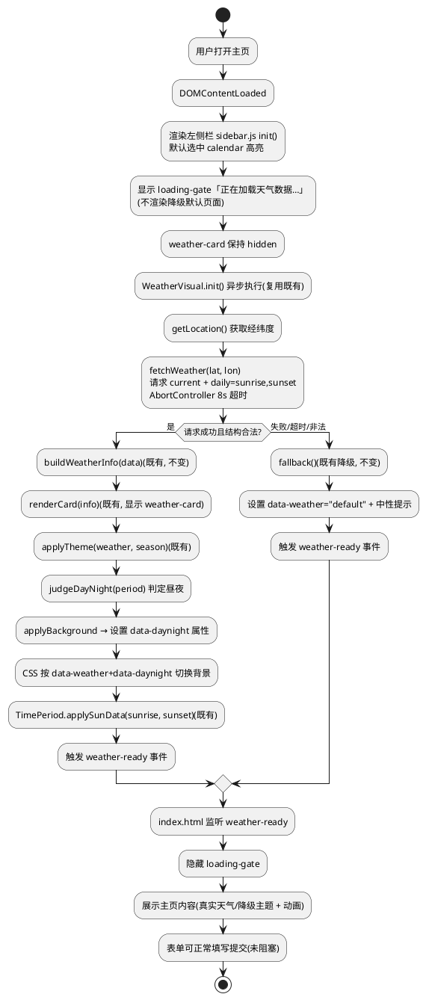
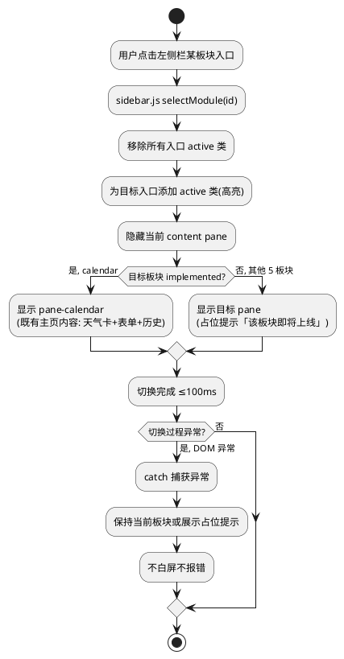
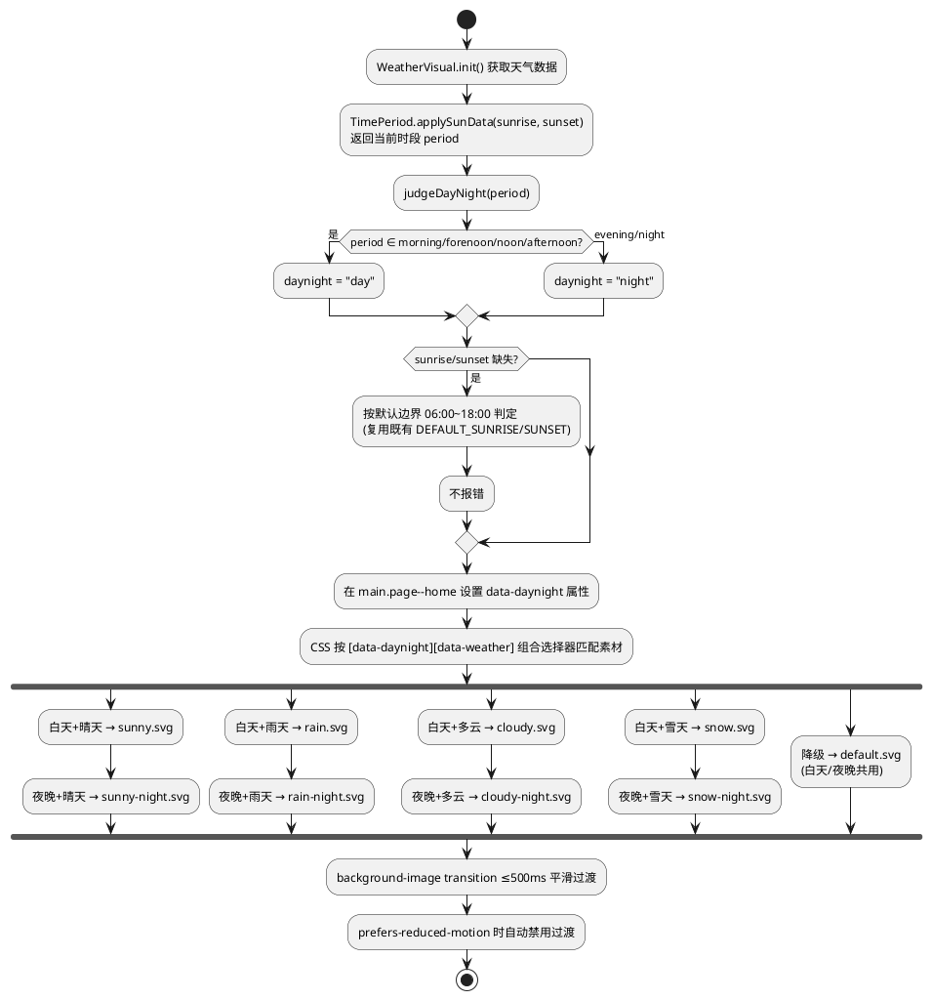
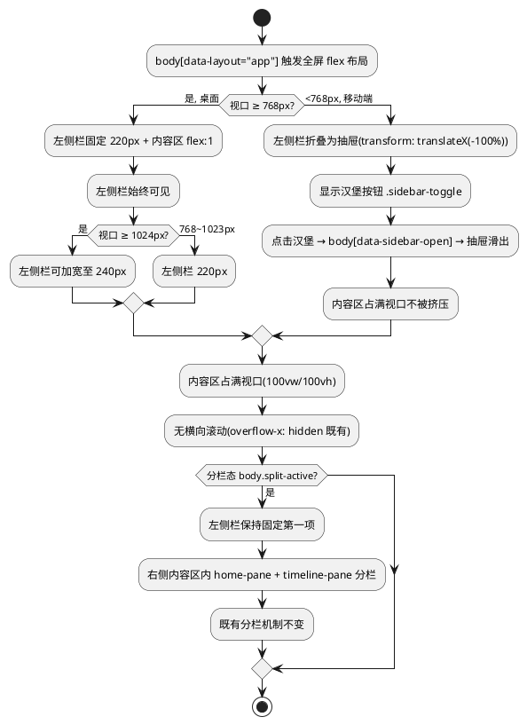
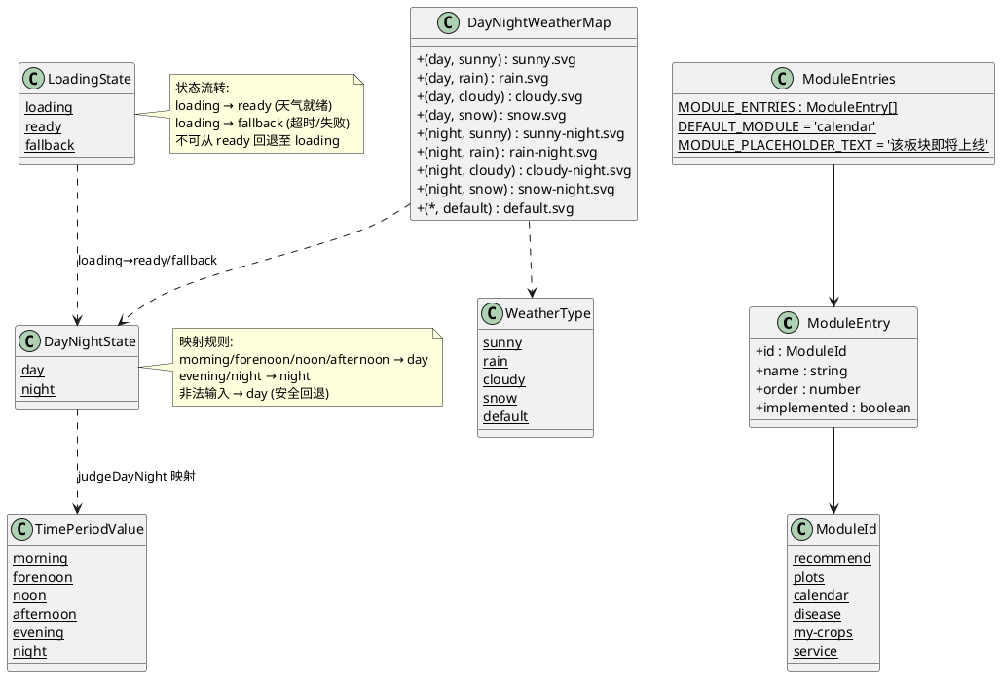

# V4 T01 主页 UI 改版与天气视觉动态适配 · 技术设计（v4_t01_ui_revamp）

> 本方案基于 `v4_t01_ui_revamp/spec.md`（REQ-VUI-UBI/EVT/STA/OPT/UNW-001 ~ 039，共 39 条 EARS 需求）生成。
> 设计范围：**纯前端 UI 改版与视觉适配**，仅修改 `frontend/` 目录下文件，不触碰后端/nginx/shared/data/deploy/docs/contract。
> 强约束（红线）：
> 1. 前端 63/63 既有测试全绿（`node --test frontend/tests/pages.test.js`），仅允许新增断言；
> 2. 不引入框架/构建工具/第三方库（含动画库 GSAP/Lottie、UI 框架 Vue/React、路由库）；
> 3. 不修改后端（Java/8080）与 nginx 配置；
> 4. 天气数据不可用时降级为默认主题，不白屏、不抛未捕获 JS 错误；
> 5. 左侧栏导航资源放 `frontend/components/sidebar/` 遵循 V4 目录规范；
> 6. 白天/夜晚动画素材放 `frontend/assets/weather-bg/` 遵循既有目录规范；
> 7. 不改变既有表单字段（crop/sowingDate/location）id/name 与 `validate()` 校验逻辑与 `buildTimelineQuery()` 参数拼装；
> 8. 不改变既有 weather-visual.js 的 `WMO_MAP`/`normalizeWeather`/`inferSeason`/`fallback` 归一化与降级语义；
> 9. 不改变既有 time-period.js 的 `judgeTimePeriod`/`parseSunTime`/`applyTimePeriod` 6 时段判定输出；
> 10. 不改变既有语音组件（voice-input.js/css）、搜索历史（history-store.js）、拍照识别（photo-capture.js）；
> 11. 不改变时间线页（timeline.html）渲染逻辑与 `GET /api/timeline` 取数方式；
> 12. `crop-map.js` 5 个 cropId 不变，`mock-data.js` 保持 null 占位不造假。
> 全局约束继承自 `stage2_frontend`（60 条）、`t00_directory_migration`（49 条）、`t01_weather_visual`（42 条）、`t01_enhance_animation`（40 条）：纯原生 JS + 原生 CSS、前端测试断言不可弱化、时间线页天气数据经后端 `GET /api/timeline` 获取、主页天气视觉（T01）已落地、时段动画（T01 增强）已落地、分栏布局已落地、语音组件已落地。本任务在既有基础上**改版主页布局为左侧栏 + 全屏内容区**，并**修复夜间动画与加载闪现两个缺陷**。

# 一、需求与存量功能关系分析

## 1.1 需求功能与存量功能对比

### 1.1.1 已实现功能

> 已实现功能是指需求与存量代码完全匹配或高度相似、可直接复用或仅需少量叠加的部分。

| 需求功能 | 存量功能 | 代码位置 | 匹配度 |
|---------|---------|---------|--------|
| 主页品牌头结构（REQ-VUI-UBI-014 既有内容保留基准） | `index.html` 已有 `<header class="brand">` 品牌头 | `frontend/pages/index.html:13-23` | 100%（品牌头已存在，全屏化后保留） |
| 主页表单卡片结构（REQ-VUI-UBI-014 既有内容保留基准） | `index.html` 已有 `<form class="card" id="timeline-form">` 含 crop/sowingDate/location 三字段 | `frontend/pages/index.html:36-78` | 100%（表单已存在，全屏化后保留，id/name 不变） |
| 主页历史记录结构（REQ-VUI-UBI-014 既有内容保留基准） | `index.html` 已有 `<div class="history" id="history">` | `frontend/pages/index.html:80-86` | 100%（历史记录已存在，全屏化后保留） |
| 天气卡 DOM 与 5 字段展示（REQ-VUI-UBI-033 天气信息保留） | `index.html` 已有 `<div class="weather-card" id="weather-card" data-weather="default" data-season="auto" hidden>` 含地点/温度/状况/湿度/风速 5 字段 | `frontend/pages/index.html:26-31` | 100%（T01 已落地，5 字段完整，本任务保留不改） |
| 天气背景图层（REQ-VUI-UBI-013 动画叠加层基准） | `index.html` 已有 `<div class="weather-bg-layer" id="weather-bg-layer" aria-hidden="true">`，CSS `position: fixed; inset: 0; z-index: -1; pointer-events: none;` | `frontend/pages/index.html:25`；`frontend/assets/css/common.css:434-445` | 75%（背景图层已存在且 pointer-events:none 不阻挡交互，但 z-index:-1 在内容下方，需求要求叠加在内容图片"之上"，需新增独立叠加层或调整 z-index 策略） |
| weather-visual.js 天气数据获取与归一化（REQ-VUI-UBI-037 不改归一化） | `weather-visual.js` 已有 `WMO_MAP`/`normalizeWeather`/`inferSeason`/`getLocation`/`fetchWeather`/`buildWeatherInfo`/`renderCard`/`applyTheme`/`applyBackground`/`fallback`/`init` | `frontend/assets/js/weather-visual.js:7-179` | 100%（既有逻辑不改变，本任务仅在其基础上叠加昼夜属性设置与加载门控回调） |
| Open-Meteo 请求含日出日落参数（REQ-VUI-UBI-019 昼夜判定依据） | `weather-visual.js` `fetchWeather` 已含 `&daily=sunrise,sunset`，`init` 已调用 `TimePeriod.applySunData` | `frontend/assets/js/weather-visual.js:59,162-166` | 100%（日出日落已获取并传给 time-period.js，昼夜判定可复用） |
| time-period.js 6 时段判定（REQ-VUI-UBI-025 不改时段判定） | `time-period.js` 已有 `judgeTimePeriod`/`parseSunTime`/`applyTimePeriod`/`applySunData`/`fallbackPeriod`/`init`，6 时段 morning/forenoon/noon/afternoon/evening/night | `frontend/assets/js/time-period.js:6-79` | 100%（既有 6 时段判定不改变，昼夜判定可复用其结果：morning/forenoon/noon/afternoon=day，evening/night=night） |
| data-timeperiod 属性驱动时段动画（REQ-VUI-UBI-023 纯 CSS 属性选择器基准） | `common.css` 已有 `[data-timeperiod="morning"] .weather-bg-layer { animation: tea-morning ...; }` 等 6 类选择器 + `@keyframes tea-*` | `frontend/assets/css/common.css:504-528` | 100%（属性选择器驱动机制已就绪，昼夜动画可复用此模式新增 data-daynight 属性选择器） |
| 4 类天气背景与主题色切换（REQ-VUI-UBI-034 4 类动画保留） | `common.css` 已有 `[data-weather="sunny/rain/cloudy/snow"]` 选择器切换主题色变量 + `@keyframes weather-*` 4 类动效 | `frontend/assets/css/common.css:470-483` | 100%（4 类天气背景与动效已就绪，本任务保留不改，仅叠加昼夜维度） |
| 5 类天气 SVG 背景资源（REQ-VUI-UBI-021 素材目录基准） | `weather-bg/` 已有 sunny.svg/rain.svg/cloudy.svg/snow.svg/default.svg 5 文件 | `frontend/assets/weather-bg/` | 75%（5 类白天素材已存在，但无夜晚版本，需新增 4 类夜晚素材 + default 兼用） |
| 既有分栏布局（REQ-VUI-STA-016 分栏兼容） | `common.css` 已有 `body.split-active` flex 布局 + `timeline-pane`/`timeline-iframe`/`home-back` + 响应式 <768px 上下排列 | `frontend/assets/css/common.css:496-536`；`frontend/pages/index.html:89-92` | 100%（分栏布局已落地，全屏化须与之兼容：左侧栏固定 + 右侧内容区内分栏） |
| `prefers-reduced-motion` 全局禁用动画（REQ-VUI-UBI-023） | `common.css` 已有 `@media (prefers-reduced-motion: reduce) { *, *::before, *::after { animation: none !important; transition: none !important; } }` | `frontend/assets/css/common.css:289-291` | 100%（全局规则已覆盖，新增昼夜动画/加载提示/板块切换 transition 自动被禁用） |
| 响应式 768/1024 断点（REQ-VUI-OPT-009/UNW-017 响应式兼容） | `common.css` 已有 `@media (min-width: 768px)` 与 `@media (min-width: 1024px)` 断点，`html,body` 已 `overflow-x: hidden; max-width: 100%` | `frontend/assets/css/common.css:25-30,424-431` | 75%（断点已存在，左侧栏移动端折叠/抽屉规则需新增到此断点内） |
| CSS 变量主题色体系（REQ-VUI-UBI-015 纯 CSS 布局基准） | `common.css` `:root` 已定义 `--leaf`/`--leaf-2`/`--sun`/`--rain`/`--paper`/`--card` 等变量 | `frontend/assets/css/common.css:1-21` | 100%（变量体系已就绪，左侧栏/加载提示/占位提示复用既有变量） |
| `textContent` 安全渲染（REQ-VUI 4.3.2 安全性） | `index.html` 历史记录渲染已用 `btn.textContent = label`，weather-visual.js `renderCard` 已用 `textContent` | `frontend/pages/index.html:361`；`frontend/assets/js/weather-visual.js:109-113` | 100%（板块占位提示/加载提示文案渲染沿用 textContent 方式） |
| 测试文件已读取 index.html/common.css/weather-visual.js/time-period.js/SVG（REQ-VUI-UBI-038 测试基座） | `pages.test.js` 已读取 `indexHtml`/`commonCss`/`weatherVisualJs`/`timePeriodJs`/5 个 SVG/`voiceInputJs` 等共 63 项断言 | `frontend/tests/pages.test.js:10-28` | 100%（测试基座已就绪，新增断言可直接复用既有 read 变量并新增 sidebar.js/夜晚 SVG 变量） |
| V4 目录规范 components/ 已预留（REQ-VUI-UBI-008 sidebar 目录） | `frontend/components/` 已存在，含 `.gitkeep` 与 `voice-input/` 子目录 | `frontend/components/` | 100%（components/ 目录已就绪，新增 `sidebar/` 子目录遵循 V4 规范） |

### 1.1.2 需要扩展的功能

> 需要扩展的功能是指需求与存量代码部分匹配，需在现有基础上改造或叠加的部分。

| 需求功能 | 存量功能 | 差异说明 | 扩展方向 |
|---------|---------|---------|---------|
| 主页全屏化布局（REQ-VUI-UBI-011/015） | `common.css` `.page { max-width: 460px; margin: 0 auto; }` 单栏居中，`.page--home` 有整页背景图 | 需将单栏居中改为左侧栏 + 右侧全屏内容区 flex 布局，内容区占满视口（100vw/100vh），移除整页背景图 | 改造 `.page--home` 为全屏 flex 布局（覆盖既有 max-width），新增 `[data-layout="app"]` 左侧栏 + 内容区 flex 规则；移除 `.page--home` 的 `background-image: url('../img/index-bg.png')`（REQ-VUI-UBI-012）；保留 `.page` 既有规则供 timeline.html 用 |
| 移除整页背景图片（REQ-VUI-UBI-012） | `common.css` `.page--home { background-image: url('../img/index-bg.png'); background-size: cover; }` 整页底图 | 需移除此整页背景，改由内容区图片 + 天气动画叠加层构成视觉 | 删除/覆盖 `.page--home` 的 `background-image`/`background-size`/`background-position`/`background-repeat` 规则（保留 `background-color: var(--paper)` 作为底色）；既有 weather-bg-layer 仍提供天气背景 |
| 天气动画叠加层置于内容图片之上（REQ-VUI-UBI-013） | `common.css` `.weather-bg-layer { z-index: -1; }` 在所有内容下方 | 需求要求动画叠加在主页内容图片"之上"且不阻挡交互；既有 weather-bg-layer 为背景层（z-index:-1），需新增独立动画叠加层或在内容区图片之上叠加 | 新增 `.weather-fx-overlay` 独立动画叠加层（绝对定位，z-index 介于内容图片与表单之间，pointer-events: none），或将 weather-bg-layer 拆为背景层 + 动效层；表单/天气卡/历史记录 z-index 高于叠加层确保可交互 |
| 夜间动画素材匹配（REQ-VUI-UBI-018/020） | `weather-visual.js` `applyBackground` 仅按 weather 类型设置背景（`bg.style.backgroundImage = url('sunny.svg')`），不区分昼夜；`weather-bg/` 仅 5 类白天素材 | 需按天气类型 × 昼夜组合匹配素材（4 天气 × 2 昼夜 = 8 组合 + 默认），夜间显示夜晚素材；既有 applyBackground 为 JS 赋值 style，需求 REQ-VUI-UBI-023 要求纯 CSS 属性选择器驱动 | 新增 4 类夜晚 SVG 素材（sunny-night.svg/rain-night.svg/cloudy-night.svg/snow-night.svg）；weather-visual.js `applyBackground` 改为设置 `data-daynight` 属性（保留函数名与调用点，既有测试不破坏）；CSS 新增 `[data-daynight="night"][data-weather="sunny"] .weather-bg-layer { background-image: url('sunny-night.svg'); }` 等选择器驱动 |
| 加载门控消除闪现（REQ-VUI-EVT-026/027/028/029） | `weather-visual.js` `init` 在 DOMContentLoaded 自动执行，页面加载时立即渲染默认/降级态，天气就绪后切换为真实视图，造成闪现 | 需在天气就绪前展示「加载中」提示，不渲染降级默认页面，天气就绪/超时后切换为主页内容 | 新增加载门控逻辑：index.html 增加 loading overlay DOM（全屏加载提示）；weather-visual.js `init` 改为先展示 loading，天气就绪/降级后隐藏 loading（通过回调或事件通知）；既有 init 编排逻辑不变，仅在外层包裹 loading 显示/隐藏 |
| 左侧栏导航 6 板块入口（REQ-VUI-UBI-001/006） | `index.html` 无左侧栏结构，仅有顶部品牌头 + 单栏内容 | 需新增固定左侧栏含 6 板块入口（种植推荐/我的地块/农事日历/病害检查/我的作物/客服），当前选中高亮，默认选中"农事日历" | 新增 `frontend/components/sidebar/sidebar.js` + `sidebar.css`；index.html 引入 sidebar 组件 + 新增左侧栏 DOM；6 板块以具名常量集中定义；默认选中"农事日历"（对应既有主页内容） |
| 板块切换与占位提示（REQ-VUI-EVT-003/OPT-007） | `index.html` 仅有单栏主页内容，无板块切换机制 | 需点击板块入口切换右侧内容区，未实现板块展示占位提示（不白屏不报错） | sidebar.js 实现板块切换：显示/隐藏对应 content pane div；"农事日历"板块 = 既有主页内容（home-pane），其他 5 板块为占位提示 div；切换 ≤100ms 视觉反馈 |
| 左侧栏移动端适配（REQ-VUI-OPT-009） | `common.css` 响应式断点仅覆盖 `.page`/天气卡/分栏，无左侧栏规则 | 需在 <768px 移动端将左侧栏适配为折叠/抽屉或顶部栏，不挤压内容区 | 新增 `@media (max-width: 767px)` 左侧栏折叠/抽屉规则（汉堡按钮切换或顶部横向栏），复用既有 768 断点 |
| 测试断言扩充（REQ-VUI-UBI-039） | `pages.test.js` 63 项断言无左侧栏/全屏化/昼夜动画/加载门控相关断言 | 需新增左侧栏 6 入口、板块切换、全屏布局、昼夜素材、加载门控、占位提示等断言，不破坏既有 63 项 | 在 `pages.test.js` 末尾新增 test 块，复用既有变量并新增 `sidebarJs`/`sidebarCss`/4 个夜晚 SVG 变量 |

### 1.1.3 需要新增的功能或接口

> 需要新增的功能是指需求在存量代码中完全没有对应实现的部分，须新建。

**A. 新增 JS 模块：`frontend/components/sidebar/sidebar.js`**

| 功能点 | 输入 | 输出 | 核心逻辑 | 关联需求 |
|--------|------|------|---------|---------|
| 6 板块具名常量 | 无 | `MODULE_ENTRIES` 数组（6 项，每项含 id/name/order/implemented） | 集中定义 6 板块：种植推荐(recommend)/我的地块(plots)/农事日历(calendar)/病害检查(disease)/我的作物(my-crops)/客服(service)；implemented 仅 calendar 为 true，其余 false | REQ-VUI-UBI-006 |
| 左侧栏渲染 | 无 | 无（渲染 DOM） | 根据 MODULE_ENTRIES 生成 6 个入口按钮，默认选中 calendar 高亮 | REQ-VUI-UBI-001/005 |
| 板块切换 | 板块 id | 无（切换 content pane 显示 + 高亮入口） | 点击入口：高亮该入口（移除其余高亮），显示对应 content pane div（隐藏其余）；未实现板块展示占位提示 | REQ-VUI-EVT-003/STA-004/OPT-007 |
| 占位提示展示 | 板块 name | 无（渲染占位提示 div） | 未实现板块点击时右侧展示「该板块即将上线」占位提示，不白屏不报错 | REQ-VUI-OPT-007 |
| 移动端抽屉切换 | 无 | 无（切换左侧栏显示/隐藏） | <768px 时左侧栏折叠为抽屉，汉堡按钮切换显示/隐藏 | REQ-VUI-OPT-009 |
| 模块入口 init | 无（页面加载时调用） | 无 | 编排：渲染左侧栏 → 默认选中 calendar → 绑定点击事件 | REQ-VUI-UBI-001/005 |

**B. 新增 CSS 样式：`frontend/components/sidebar/sidebar.css`**

| 功能点 | 核心内容 | 关联需求 |
|--------|---------|---------|
| 左侧栏容器样式 | `.app-sidebar` 固定左侧（position: fixed 或 flex item），宽度 200~240px，全高 | REQ-VUI-UBI-001/002 |
| 6 入口按钮样式 | `.sidebar-entry` 纵向排列，含图标 + 文字，hover/active 态 | REQ-VUI-UBI-001 |
| 当前选中高亮 | `.sidebar-entry.active` 高亮样式（背景色/左边框/文字色） | REQ-VUI-STA-004 |
| 板块占位提示样式 | `.module-placeholder` 居中提示文案样式 | REQ-VUI-OPT-007 |
| 移动端抽屉适配 | `@media (max-width: 767px)` 左侧栏折叠为抽屉 + 汉堡按钮 | REQ-VUI-OPT-009 |
| 左侧栏不遮挡内容 | 左侧栏 z-index 低于表单/天气卡，内容区 margin-left 留出左侧栏宽度 | REQ-VUI 5.1.1 禁止项 |

**C. 新增白天/夜晚动画素材：`frontend/assets/weather-bg/`（追加 4 文件）**

| 资源文件 | 用途 | 体积约束 | 关联需求 |
|---------|------|---------|---------|
| `sunny-night.svg` | 夜晚晴天背景 | ≤300KB | REQ-VUI-UBI-018/020/021 |
| `rain-night.svg` | 夜晚雨天背景 | ≤300KB | REQ-VUI-UBI-018/020/021 |
| `cloudy-night.svg` | 夜晚多云背景 | ≤300KB | REQ-VUI-UBI-018/020/021 |
| `snow-night.svg` | 夜晚雪天背景 | ≤300KB | REQ-VUI-UBI-018/020/021 |

> 注：`default.svg` 白天/夜晚共用（降级态不区分昼夜），既有 5 类白天素材保留不变。

**D. 新增 DOM 结构（修改 `index.html`）**

| 功能点 | 核心内容 | 关联需求 |
|--------|---------|---------|
| 左侧栏容器 | `<aside class="app-sidebar" id="app-sidebar">` 含 6 入口（由 sidebar.js 渲染或静态写入） | REQ-VUI-UBI-001/008 |
| 主页内容包裹为 content pane | `<div class="content-pane" id="pane-calendar" data-pane="calendar">` 包裹既有 header/weather-card/term-ruler/form/history | REQ-VUI-UBI-005/014 |
| 其他 5 板块占位 content pane | `<div class="content-pane module-placeholder" id="pane-recommend" data-pane="recommend" hidden>该板块即将上线</div>` 等 5 个 | REQ-VUI-OPT-007 |
| 加载提示 overlay | `<div class="loading-gate" id="loading-gate"><div class="loading-gate__inner"><span class="loading-gate__spinner"></span><span class="loading-gate__text">正在加载天气数据…</span></div></div>` 全屏覆盖 | REQ-VUI-EVT-026/UBI-031 |
| data-layout 属性挂钩 | `<body data-layout="app">` 或 `<main data-layout="app">` 标识全屏布局 | REQ-VUI-UBI-011 |
| data-daynight 属性挂钩 | `main.page--home` 上新增 `data-daynight="day"`（默认）属性 | REQ-VUI-UBI-018 |
| sidebar.js/sidebar.css 引入 | `<link rel="stylesheet" href="../components/sidebar/sidebar.css">` + `<script src="../components/sidebar/sidebar.js"></script>` | REQ-VUI-UBI-008 |

**E. 新增测试断言（追加到 `pages.test.js`）**

| 断言类别 | 核心内容 | 关联需求 |
|---------|---------|---------|
| 左侧栏 DOM 结构 | index.html 含 app-sidebar/6 个板块入口 data-pane | REQ-VUI-UBI-001 |
| sidebar.js 6 板块常量 | sidebar.js 含 MODULE_ENTRIES + recommend/plots/calendar/disease/my-crops/service 6 id | REQ-VUI-UBI-006 |
| sidebar.js 板块切换 | sidebar.js 含 active 高亮切换逻辑 + 占位提示 | REQ-VUI-EVT-003/OPT-007 |
| sidebar.css 样式 | sidebar.css 含 .app-sidebar/.sidebar-entry/.sidebar-entry.active/.module-placeholder | REQ-VUI-UBI-001/STA-004 |
| 全屏布局 | common.css 含 [data-layout="app"] 全屏 flex 布局 + 移除 index-bg.png 整页背景 | REQ-VUI-UBI-011/012 |
| 内容区 content pane | index.html 含 pane-calendar/content-pane 包裹 | REQ-VUI-UBI-005/014 |
| 加载门控 DOM | index.html 含 loading-gate/正在加载天气数据 | REQ-VUI-EVT-026/UBI-031 |
| 昼夜动画素材 | weather-bg/ 下存在 sunny-night.svg/rain-night.svg/cloudy-night.svg/snow-night.svg 4 文件 | REQ-VUI-UBI-020/021 |
| 昼夜属性驱动 | common.css 含 [data-daynight="night"][data-weather="sunny"] 等选择器 | REQ-VUI-UBI-018/023 |
| weather-visual.js 昼夜属性设置 | weather-visual.js 含 data-daynight 属性设置逻辑 | REQ-VUI-UBI-018 |
| 加载门控逻辑 | weather-visual.js 含 loading-gate 隐藏逻辑 或 index.html 含加载门控编排 | REQ-VUI-EVT-028/OPT-030 |
| 移动端左侧栏适配 | sidebar.css 含 @media (max-width: 767px) 抽屉/折叠规则 | REQ-VUI-OPT-009 |
| 既有 63 断言兼容 | 确认 indexHtml/commonCss/weatherVisualJs 既有断言仍通过 | REQ-VUI-UBI-038 |

## 1.2 存量功能详细分析

### 1.2.1 `index.html` 主页结构分析（`frontend/pages/index.html`）

- **DOM 结构**：`<main class="page page--home">`（第 12 行）→ `<header class="brand">`（第 13-23 行）→ `<div class="weather-bg-layer">`（第 25 行）→ `<div class="weather-card" hidden>`（第 26-31 行）→ `<div class="term-ruler">`（第 34 行）→ `<form class="card" id="timeline-form">`（第 36-78 行）→ `<div class="history">`（第 80-86 行）。既有内容为 main 的平铺子元素，无统一包裹容器。
- **分栏结构**：`<div class="timeline-pane" id="timeline-pane">`（第 89-92 行）在 `</main>` 之后、`<body>` 内，含 `home-back` 按钮 + `timeline-iframe`。通过 `body.split-active` 切换分栏显示。
- **既有表单字段约束**：`crop`（第 39 行）、`sowingDate`（第 50 行）、`location`（第 58 行）的 id/name 不得改变；`buildTimelineQuery`（第 399-407 行）与 submit 跳转逻辑（第 409-439 行）不得改变（REQ-VUI 4.5.8）。
- **既有脚本加载顺序**（第 94-100 行）：mock-data.js → crop-map.js → history-store.js → photo-capture.js → weather-visual.js → time-period.js → voice-input.js → 内联 IIFE（第 101-446 行）。新增 sidebar.js 须在此加载链中插入（建议在 voice-input.js 之后或之前），sidebar.css 须在 `<head>` 内引入。
- **既有 submit 分栏逻辑**（第 409-439 行）：`validate()` 通过后 `iframe.src = 'timeline.html?' + query` + `body.classList.add('split-active')` + `pane.style.display='block'`。全屏化后此分栏逻辑须与左侧栏兼容：左侧栏保持固定，分栏在右侧内容区内进行。
- **既有 weather-card hidden 属性**（第 26 行）：weather-card 初始 `hidden`，weather-visual.js `renderCard` 控制显示。加载门控须与此协调：加载期间 weather-card 保持 hidden，加载就绪后由 weather-visual.js 显示。
- **约束**：表单字段 id/name 不变；validate()/buildTimelineQuery() 逻辑不变；既有 63 断言中第 379-388 行检查 weather-card/weather-bg-layer 等 DOM id，包裹 content pane 不删除这些 id，断言不破坏。

### 1.2.2 `common.css` 布局与背景机制分析（`frontend/assets/css/common.css`）

- **`:root` 变量清单**（第 1-21 行）：`--ink`/`--ink-soft`/`--muted`（文字色）、`--paper`/`--paper-2`/`--card`（背景色）、`--line`（边框）、`--leaf`/`--leaf-2`/`--leaf-soft`（绿色系）、`--sun`/`--sun-soft`（金色系）、`--rain`（蓝色系）、`--red`/`--red-soft`（红色系）、`--radius`/`--radius-sm`/`--shadow`/`--shadow-soft`（圆角阴影）。左侧栏/加载提示/占位提示复用这些变量，不引入新色彩体系。
- **`.page` 布局**（第 45-50 行）：`max-width: 460px; margin: 0 auto; padding: 22px 16px ...; min-height: 100vh;` 单栏居中。全屏化须覆盖此规则（仅 `.page--home`，不影响 timeline.html 的 `.page`）。
- **`.page--home` 整页背景**（第 293-299 行）：`background-image: url('../img/index-bg.png'); background-size: cover; background-position: top center; background-repeat: no-repeat; background-color: var(--paper);`。此为**整页背景图片**，REQ-VUI-UBI-012 要求移除。移除后保留 `background-color: var(--paper)` 作为底色，由 weather-bg-layer 提供天气背景。
- **`.weather-bg-layer`**（第 434-445 行）：`position: fixed; inset: 0; z-index: -1; background-size: cover; background-image: url('../assets/weather-bg/default.svg'); opacity: 0.35; transition: opacity 0.6s ease; pointer-events: none;`。此为固定全屏背景层，z-index:-1 在所有内容下方。REQ-VUI-UBI-013 要求动画叠加在内容图片"之上"，需新增独立动画叠加层或调整 z-index 策略（见 D-VUI-04）。
- **既有天气主题色切换**（第 470-473 行）：`.page--home[data-weather="sunny"] { --leaf: #d99b2b; ... }` 等 4 类。本任务保留不改，仅叠加昼夜维度。
- **既有天气动效**（第 475-483 行）：`@keyframes weather-sunny/rain/cloudy/snow` + `[data-weather="..."] .weather-bg-layer { animation: ... }`。本任务保留不改。
- **既有时段动画**（第 504-528 行）：`@keyframes tea-morning/.../tea-night` + `[data-timeperiod="..."] .weather-bg-layer { animation: ... }`。本任务保留不改，昼夜动画以独立 data-daynight 属性驱动，与 data-timeperiod 共存不冲突。
- **既有分栏布局**（第 496-502 行）：`body.split-active { display: flex; } .page--home { flex: 0 0 42%; } .timeline-pane { flex: 1 1 58%; }`。全屏化后须兼容：左侧栏固定 + 右侧内容区内分栏（home-pane + timeline-pane 在内容区内 flex）。
- **既有 `prefers-reduced-motion`**（第 289-291 行）：全局 `animation: none !important; transition: none !important;`。新增昼夜动画/加载提示/板块切换 transition 自动被禁用。
- **既有响应式断点**（第 424-431 行）：`@media (min-width: 768px) { .page { max-width: 680px; } }` 与 `@media (min-width: 1024px) { .page { max-width: 860px; } }`。全屏化须覆盖 .page--home 的 max-width，左侧栏移动端规则追加到 <768px 断点。
- **既有测试断言**（pages.test.js 第 443-470 行）：检查 commonCss 含 .weather-card/.weather-bg-layer/[data-weather="sunny"/rain/cloudy/snow]/@keyframes weather-*/max-width: 375px/prefers-reduced-motion。全屏化与昼夜动画追加不删除这些字符串，断言不破坏。

### 1.2.3 `weather-visual.js` 天气逻辑分析（`frontend/assets/js/weather-visual.js`）

- **模块结构**：IIFE + `window.WeatherVisual = { init, normalizeWeather, inferSeason }`（第 171-175 行）+ `module.exports`（第 176-178 行，供测试 require）。
- **具名常量**（第 8-13 行）：`OPEN_METEO_URL`/`REQUEST_TIMEOUT_MS=8000`/`WEATHER_BG_PATH`/`DEFAULT_LAT`/`DEFAULT_LON`/`DEFAULT_LOC_NAME`。
- **WMO_MAP**（第 15-27 行）：WMO 编码→sunny/rain/cloudy/snow 归一化映射，不变（REQ-VUI-UBI-037）。
- **fetchWeather**（第 56-76 行）：请求 URL 含 `current=temperature_2m,relative_humidity_2m,weather_code,wind_speed_10m&daily=sunrise,sunset&timezone=auto`，`AbortController` + 8s 超时。日出日落参数已就绪。
- **buildWeatherInfo**（第 78-93 行）：从 `data.current` 提取 temp/humidity/windSpeed/weather/season/weathercode。未提取 sunrise/sunset（在 init 中直接传给 TimePeriod）。
- **renderCard**（第 95-114 行）：控制 weather-card hidden 属性 + 设置 data-weather/data-season + textContent 渲染 5 字段。
- **applyTheme**（第 116-121 行）：在 `.page--home` 上设置 `data-weather`/`data-season` 属性。
- **applyBackground**（第 123-128 行）：**JS 赋值** `bg.style.backgroundImage = "url('" + WEATHER_BG_PATH + w + ".svg')"`。此为 JS 逐个赋值方式，REQ-VUI-UBI-023 要求纯 CSS 属性选择器驱动。改造方向：保留 applyBackground 函数名与调用点（既有测试第 398 行检查 `applyBackground` 字符串），改为设置 `data-daynight` 属性，CSS 据此切换背景。
- **fallback**（第 130-147 行）：设置 data-weather="default" + 中性提示文案。既有降级语义不变（REQ-VUI-UBI-037）。
- **init**（第 149-169 行）：`getLocation` → `fetchWeather` → `buildWeatherInfo` → `renderCard`/`applyTheme`/`applyBackground` → 传 sunrise/sunset 给 TimePeriod。**init 在 DOMContentLoaded 自动执行**（第 173-174 行），这是加载闪现的根源：页面加载时立即渲染，天气未就绪前先显示默认/降级态。
- **既有测试断言**（pages.test.js 第 390-432 行）：检查 weatherVisualJs 含 normalizeWeather/inferSeason/getLocation/fetchWeather/buildWeatherInfo/renderCard/applyTheme/applyBackground/fallback/OPEN_METEO_URL/REQUEST_TIMEOUT_MS/WMO_MAP/0:'sunny'/3:'cloudy'/61:'rain'/71:'snow'/spring/summer/autumn/winter/api.open-meteo.com/temperature_2m/relative_humidity_2m/weather_code/wind_speed_10m/AbortController/8000/function fallback/hidden = true/'default'。改造保留这些字符串，断言不破坏。
- **约束**：WMO_MAP/normalizeWeather/inferSeason/fallback 既有逻辑不变（REQ-VUI-UBI-037）；昼夜属性设置与加载门控为增量叠加，不修改既有归一化与降级分支。

### 1.2.4 `time-period.js` 时段判定分析（`frontend/assets/js/time-period.js`）

- **模块结构**：IIFE + `window.TimePeriod = { init, judgeTimePeriod, parseSunTime, applyTimePeriod, applySunData, fallbackPeriod }`（第 71-75 行）+ `module.exports`（第 76-78 行）。
- **judgeTimePeriod**（第 21-34 行）：依据本地时间与日出日落判定 6 时段（morning/forenoon/noon/afternoon/evening/night）。日出日落为 null 时用默认边界（06:00~18:00）。
- **applyTimePeriod**（第 36-41 行）：在 `.page--home` 上设置 `data-timeperiod` 属性。
- **applySunData**（第 43-51 行）：接收 sunrise/sunset，判定时段，设置 data-timeperiod。
- **昼夜判定复用**：既有时段判定已包含 night（深夜 22:00~次日日出）和 evening（日落~22:00）。白天/夜晚二元判定可复用既有时段结果：morning/forenoon/noon/afternoon = day，evening/night = night。或独立判定：日出~日落 = day，日落~次日日出 = night（更精确）。两种方式均不改变既有 judgeTimePeriod 输出（REQ-VUI-UBI-025）。
- **既有测试断言**（pages.test.js 第 505-541 行）：检查 timePeriodJs 含 judgeTimePeriod/parseSunTime/applyTimePeriod/applySunData/fallbackPeriod/morning/forenoon/noon/afternoon/evening/night + parseSunTime 纯函数断言 + judgeTimePeriod 6 时段断言。本任务不修改 time-period.js，断言不破坏。

### 1.2.5 `pages.test.js` 测试断言结构分析（`frontend/tests/pages.test.js`）

- **文件读取基座**（第 6-28 行）：`PAGES`/`CSS` 路径常量 + `read` 函数；已读取 `indexHtml`/`timelineHtml`/`photoJs`/`commonCss`/`timelineCss`/`cropMapJs`/`mockJs`/`timelineLogicJs`/`historyStoreJs`/`chartClientJs`/`weatherVisualJs`/5 个白天 SVG/`voiceInputJs`/`voiceInputCss`/`timePeriodJs` 共 18 个文件内容变量。
- **断言总数**：63 项（第 30-569 行），覆盖输入表单、日期选择器、函数图像、流程对齐、加载反馈、天气图标、识别双通道、搜索联想、历史记录、倒计时、响应式、mock 字段、纯函数、T01 天气视觉（第 379-470 行）、T08 语音组件（第 471-504 行）、T01 增强（第 505-569 行）。
- **与本任务相关的既有断言**：
  - 第 379-388 行 T01 天气卡 DOM：断言 indexHtml 含 weather-card/weather-bg-layer/weather-loc 等 id + data-weather="default"。包裹 content pane 保留这些 id，断言不破坏。
  - 第 390-432 行 weather-visual.js 函数与常量：断言 weatherVisualJs 含 normalizeWeather/fetchWeather/applyBackground/fallback 等。改造保留这些字符串，断言不破坏。
  - 第 435-441 行 5 类 SVG：断言 sunnySvg/rainSvg/cloudySvg/snowSvg/defaultSvg 含 `<svg`。新增夜晚 SVG 不删除白天 SVG，断言不破坏。
  - 第 443-470 行 CSS 天气样式：断言 commonCss 含 .weather-card/[data-weather="sunny"]/@keyframes weather-sunny/max-width: 375px。追加全屏化与昼夜样式不删除这些字符串，断言不破坏。
  - 第 543-564 行 T01 增强分栏/时段：断言 commonCss 含 split-active/.timeline-pane/@keyframes tea-morning/[data-timeperiod="morning"] + indexHtml 含 timeline-pane/time-period.js。全屏化与左侧栏追加不删除这些字符串，断言不破坏。
- **新增断言切入点**：在第 569 行（文件末尾）之后追加新 test 块。须新增 `sidebarJs`（read sidebar.js）与 `sidebarCss`（read sidebar.css）变量 + 4 个夜晚 SVG 变量（sunnyNightSvg 等）。
- **约束**：既有 63 项断言不得删除/注释/弱化（REQ-VUI-UBI-038）；新增断言为静态字符串/正则匹配（与既有风格一致），不执行 sidebar.js 运行时逻辑（因含 DOM 依赖）。

### 1.2.6 `frontend/components/` 目录现状分析

- **现状**：`frontend/components/` 已存在（T00 目录规范已落地），含 `.gitkeep` 与 `voice-input/` 子目录（T08 语音组件）。
- **新增子目录**：须新建 `frontend/components/sidebar/`，存放 `sidebar.js` + `sidebar.css`，遵循 V4 目录规范（REQ-VUI-UBI-008）。
- **约束**：sidebar 组件独立存放，不与业务页面逻辑耦合（REQ-VUI 4.4.4）；与既有 voice-input/ 组件并列，风格一致（IIFE + window 暴露）。

### 1.2.7 `frontend/assets/weather-bg/` 目录现状分析

- **现状**：`frontend/assets/weather-bg/` 已存在（T01 已落地），含 sunny.svg/rain.svg/cloudy.svg/snow.svg/default.svg 5 类白天素材。
- **新增素材**：须新增 4 类夜晚素材（sunny-night.svg/rain-night.svg/cloudy-night.svg/snow-night.svg），共 9 文件（5 白天 + 4 夜晚）。default.svg 白天/夜晚共用（降级态不区分昼夜）。
- **资源格式**：SVG 矢量图形（与既有 5 类一致），单张 ≤300KB（REQ-VUI-UBI-021）。
- **约束**：既有 5 类白天素材保留不变（既有测试第 435-441 行断言不破坏）；夜晚素材为新增。

### 1.2.8 既有分栏布局与全屏化兼容性分析

- **既有分栏机制**：`body.split-active` 时 `body { display: flex; }` + `.page--home { flex: 0 0 42%; }` + `.timeline-pane { flex: 1 1 58%; }`。主页与时间线在 body 下并列。
- **全屏化后兼容**：全屏化引入左侧栏后，布局层次为：`body > [app-sidebar + main.page--home]`。分栏态下须保持左侧栏固定，右侧内容区内主页与时间线分栏。方案：左侧栏作为 body flex 第一项（固定宽度），`main.page--home` + `timeline-pane` 作为第二项内 flex 分栏（见 D-VUI-08）。
- **既有测试断言**（第 543-564 行）：检查 commonCss 含 split-active/.timeline-pane + indexHtml 含 timeline-pane/split-active。全屏化保留这些字符串，断言不破坏。
# 二、增量设计方案

## 2.0 总体策略与关键决策

| 决策编号 | 决策点 | 结论 | 决策理由 |
|---------|-------|------|---------|
| D-VUI-01 | 左侧栏导航实现方式 | **新增独立组件 `frontend/components/sidebar/sidebar.js` + `sidebar.css`**：IIFE + `window.Sidebar` 暴露 API；6 板块以具名常量 `MODULE_ENTRIES` 集中定义；CSS `position: fixed` 左侧固定（桌面）/ 抽屉折叠（移动端）；JS 负责渲染入口、切换高亮、切换 content pane | REQ-VUI-UBI-008 要求 sidebar 独立存放 `frontend/components/sidebar/` 遵循 V4 目录规范不与业务页面耦合；与既有 voice-input.js（IIFE + window 暴露）风格一致；REQ-VUI-UBI-006 要求 6 板块具名常量集中定义；REQ-VUI-UBI-002 要求左侧栏固定不随内容滚动，CSS fixed 实现最简；REQ-VUI-OPT-009 要求移动端折叠/抽屉 |
| D-VUI-02 | 6 板块标识与顺序 | **具名常量 `MODULE_ENTRIES` 数组**：`[{id:'recommend',name:'种植推荐',order:1,implemented:false}, {id:'plots',name:'我的地块',order:2,implemented:false}, {id:'calendar',name:'农事日历',order:3,implemented:true}, {id:'disease',name:'病害检查',order:4,implemented:false}, {id:'my-crops',name:'我的作物',order:5,implemented:false}, {id:'service',name:'客服',order:6,implemented:false}]`；仅 calendar（农事日历）implemented 为 true | REQ-VUI-UBI-006 明确顺序为种植推荐/我的地块/农事日历/病害检查/我的作物/客服；spec 6.1 板块标识取值 recommend/plots/calendar/disease/my-crops/service；REQ-VUI-UBI-005 要求默认选中农事日历，故 calendar implemented 为 true 对应既有主页内容；其余 5 板块由后续任务承接，本任务仅占位提示（REQ-VUI 1.4 职责边界第 3 条） |
| D-VUI-03 | 默认选中板块 | **默认选中 `calendar`（农事日历）**：sidebar.js init 时高亮 calendar 入口 + 显示 pane-calendar（既有主页内容）；pane-calendar 包裹既有 header/weather-card/term-ruler/form/history | REQ-VUI-UBI-005 明确以农事日历为默认选中，右侧展示既有主页内容（天气卡+表单+历史记录）；包裹既有内容进 pane-calendar 不改变子元素 id/class，既有 63 断言不破坏 |
| D-VUI-04 | 主页全屏化实现方式 | **CSS flexbox + `[data-layout="app"]` 属性选择器**：`body[data-layout="app"] { display: flex; min-height: 100vh; }` + `.app-sidebar { flex: 0 0 220px; }` + `main.page--home { flex: 1 1 auto; max-width: none; margin: 0; }`；覆盖既有 `.page { max-width: 460px; margin: 0 auto; }`（仅 .page--home，不影响 timeline.html）；移除 `.page--home` 整页背景图 | REQ-VUI-UBI-011 要求内容区占满视口；REQ-VUI-UBI-015 要求纯 CSS flexbox/grid + 媒体查询不依赖 JS 计算布局；flexbox + flex 比例分配是最简全屏方案；覆盖 max-width 而非删除 .page 规则，保留 timeline.html 的 .page 单栏居中；REQ-VUI-UBI-012 要求移除整页背景图 |
| D-VUI-05 | 移除整页背景图片方式 | **覆盖 `.page--home` 的 `background-image` 为 `none`**：新增 `body[data-layout="app"] .page--home { background-image: none; }` 覆盖既有第 294 行 `background-image: url('../img/index-bg.png')`；保留 `background-color: var(--paper)` 作为底色；既有 weather-bg-layer 继续提供天气背景 | REQ-VUI-UBI-012 要求移除整页背景图片；采用覆盖而非删除既有规则，减少改动面（既有第 293-299 行规则保留，被新选择器覆盖）；weather-bg-layer（z-index:-1）继续作为天气背景层；既有测试第 443-450 行检查 .weather-bg-layer/.weather-card 字符串仍存在，断言不破坏 |
| D-VUI-06 | 天气动画叠加层实现方式 | **保留既有 `.weather-bg-layer`（z-index:-1 背景层）+ 新增独立 `.weather-fx-overlay` 动效叠加层**：weather-bg-layer 继续作为天气背景（z-index:-1，在内容下方）；新增 `.weather-fx-overlay` 绝对定位叠加在内容区图片之上（z-index:1，pointer-events:none），由 `[data-weather][data-daynight]` 属性选择器驱动播放昼夜动效；表单/天气卡/历史记录 z-index:2 确保可交互 | REQ-VUI-UBI-013 要求动画叠加在内容图片之上且不阻挡交互；既有 weather-bg-layer 为 z-index:-1 背景层，若改 z-index 会破坏既有视觉层次且既有测试断言 .weather-bg-layer 存在；新增独立叠加层避免改动既有背景层，pointer-events:none 确保不阻挡表单交互；既有 weather-* @keyframes 可迁移至 overlay 层或保留在 bg-layer（见 D-VUI-07） |
| D-VUI-07 | 昼夜动画素材匹配方式 | **CSS `[data-daynight]` + `[data-weather]` 属性选择器组合驱动**：`[data-daynight="day"][data-weather="sunny"] .weather-bg-layer { background-image: url('sunny.svg'); }` + `[data-daynight="night"][data-weather="sunny"] .weather-bg-layer { background-image: url('sunny-night.svg'); }` 等 8 组合 + default 降级；weather-visual.js `applyBackground` 改为设置 `data-daynight` 属性（保留函数名与调用点），CSS 据此切换背景 | REQ-VUI-UBI-023 要求纯 CSS 属性选择器驱动不通过 JS 逐个赋值；REQ-VUI-UBI-020 要求 4 天气 × 2 昼夜 8 组合；REQ-VUI-UBI-018 要求白天/夜晚分别匹配素材；保留 applyBackground 函数名（既有测试第 398 行检查 applyBackground 字符串）但改为设置属性而非赋值 style，既有归一化/降级不变（REQ-VUI-UBI-037） |
| D-VUI-08 | 白天/夜晚判定方式 | **复用既有 time-period.js 时段结果 + 独立判定函数**：新增 `judgeDayNight(period)` 函数，将 6 时段映射为昼夜——morning/forenoon/noon/afternoon → day，evening/night → night；在 weather-visual.js init 中 buildWeatherInfo 后调用，设置 `data-daynight` 属性；日出日落缺失时默认按 06:00~18:00 判定（复用既有 DEFAULT_SUNRISE/DEFAULT_SUNSET）；**不修改 time-period.js** | REQ-VUI-UBI-025 要求可复用既有时段结果或独立判定但不改变既有时段判定输出；复用时段结果避免重复计算；evening（日落~22:00）与 night（22:00~日出）归为夜晚符合直觉；REQ-VUI-UBI-019 要求日出日落缺失时使用默认边界 06:00~18:00 不报错，复用既有默认值；不修改 time-period.js 满足 REQ-VUI-UBI-025 红线 |
| D-VUI-09 | 夜间动画素材格式与目录 | **SVG 矢量图形，4 类夜晚素材放 `frontend/assets/weather-bg/`**：sunny-night.svg/rain-night.svg/cloudy-night.svg/snow-night.svg，单张 ≤300KB；default.svg 白天/夜晚共用 | REQ-VUI-UBI-021 要求素材存放 `frontend/assets/weather-bg/` 遵循既有目录规范，格式 SVG 矢量或既有格式，单张 ≤300KB；与既有 5 类白天 SVG 格式一致；default.svg 共用避免冗余（降级态不区分昼夜） |
| D-VUI-10 | 加载门控实现方式 | **新增 loading overlay DOM + weather-visual.js init 回调门控**：index.html 新增 `<div class="loading-gate" id="loading-gate">` 全屏覆盖（z-index:9999），默认显示；weather-visual.js init 改为接受 `onReady` 回调或在 init 末尾触发 `window.dispatchEvent(new Event('weather-ready'))`；index.html 内联 IIFE 监听 weather-ready 事件隐藏 loading-gate；超时/失败时 fallback 也触发隐藏（不永久停留）；既有 init 编排逻辑不变，仅在外层包裹 loading 显示/隐藏 | REQ-VUI-EVT-026 要求天气未就绪时展示加载中不展示降级默认页面；REQ-VUI-EVT-028 要求天气就绪后隐藏加载切换为主页内容；REQ-VUI-OPT-030 要求超时/失败也隐藏加载进入降级态不永久停留；REQ-VUI-UBI-031 要求加载提示为纯 CSS 占位或简单 DOM 文案不依赖外部库；事件机制解耦 weather-visual.js 与 index.html，既有 init 逻辑不变（REQ-VUI-UBI-037） |
| D-VUI-11 | 加载门控与既有 weather-card hidden 协调 | **加载期间 weather-card 保持 hidden，loading-gate 显示；天气就绪后 loading-gate 隐藏 + weather-card 由 renderCard 显示**：既有 weather-card 初始 hidden（第 26 行），renderCard 控制显示；加载门控仅控制 loading-gate 显示/隐藏，不干预 weather-card hidden 逻辑；加载期间不调用 fallback（避免先显示降级态再切换） | REQ-VUI-UNW-029 要求消除先显示默认页面再切换为真实天气的闪现；加载期间 loading-gate 覆盖全屏，即使 weather-card hidden 用户也只看到加载提示；天气就绪后 renderCard 显示 weather-card + 隐藏 loading-gate，无闪现；既有 renderCard/fallback 逻辑不变 |
| D-VUI-12 | 板块切换实现方式 | **显示/隐藏 content pane div + 高亮入口**：6 板块各对应一个 content pane div（pane-calendar/pane-recommend/pane-plots/pane-disease/pane-my-crops/pane-service）；点击入口时隐藏当前 pane + 显示目标 pane + 高亮目标入口；pane-calendar 为既有主页内容（包裹既有 header/weather-card/term-ruler/form/history），其余 5 pane 为占位提示 div；切换 ≤100ms（仅 display 切换 + class 切换，无动画延迟） | REQ-VUI-EVT-003 要求点击入口切换右侧内容区；REQ-VUI-STA-004 要求恰有 1 个高亮；REQ-VUI-OPT-007 要求未实现板块展示占位提示；REQ-VUI 4.1.2 要求切换 ≤100ms；div 显示/隐藏是最简方案无需 iframe/路由；pane-calendar 包裹既有内容不改变 id/class，既有断言不破坏 |
| D-VUI-13 | 板块占位提示文案 | **具名常量 `MODULE_PLACEHOLDER_TEXT = '该板块即将上线'`**：未实现板块点击时右侧展示此文案，居中显示；以具名常量集中定义便于维护 | REQ-VUI 4.4.3 要求占位提示文案以具名常量集中定义；REQ-VUI-OPT-007 要求不白屏不报错不跳转 404；textContent 渲染安全（REQ-VUI 4.3.2） |
| D-VUI-14 | 左侧栏移动端适配方式 | **<768px 抽屉式折叠 + 汉堡按钮**：`@media (max-width: 767px) { .app-sidebar { transform: translateX(-100%); transition: transform 0.3s; } body[data-sidebar-open] .app-sidebar { transform: translateX(0); } }`；新增汉堡按钮 `.sidebar-toggle`（<768px 显示，≥768px 隐藏），点击切换 `body[data-sidebar-open]` 属性；抽屉打开时内容区不挤压（overlay 或推动） | REQ-VUI-OPT-009 要求 <768px 左侧栏适配为折叠/抽屉或顶部栏不挤压内容区；抽屉式是常见移动端导航模式；复用既有 768 断点不新增断点（REQ-VUI 4.5.2）；transform translateX 动画由 prefers-reduced-motion 自动禁用 |
| D-VUI-15 | 全屏化与既有分栏兼容 | **左侧栏固定 + 右侧内容区内分栏**：`body[data-layout="app"] { display: flex; }` + `.app-sidebar { flex: 0 0 220px; }` + `main.page--home { flex: 1 1 auto; }`；分栏态 `body.split-active` 时 `main.page--home` 内部再 flex 分栏 home-pane + timeline-pane（既有 timeline-pane 移至 main 内或保持 body 下由 flex 第二项）；左侧栏始终固定第一项 | REQ-VUI-STA-016 要求分栏态左侧栏保持固定，主页与时间线在右侧内容区内分栏；既有 body.split-active 机制保留，仅调整 flex 层次；既有测试第 543-564 行检查 split-active/.timeline-pane 字符串仍存在 |
| D-VUI-16 | sidebar.js 模块接口设计 | **IIFE + `window.Sidebar` 暴露 API**：`init()`/`renderEntries()`/`selectModule(id)`/`toggleSidebar()`/`getActiveModule()`；内部具名常量 `MODULE_ENTRIES`/`MODULE_PLACEHOLDER_TEXT`/`DEFAULT_MODULE='calendar'` | 与既有 timeline-logic.js/weather-visual.js/time-period.js 的 IIFE + window 暴露风格一致；具名常量集中定义满足 REQ-VUI 4.4.1/4.4.3；DEFAULT_MODULE='calendar' 满足 REQ-VUI-UBI-005 |
| D-VUI-17 | weather-visual.js 改动范围 | **最小增量叠加**：(1) `applyBackground` 改为设置 `data-daynight` 属性而非赋值 style（保留函数名）；(2) `init` 末尾新增昼夜判定 + 设置 data-daynight + 触发 weather-ready 事件；(3) `fallback` 末尾新增触发 weather-ready 事件（确保超时/失败也隐藏 loading）；既有 WMO_MAP/normalizeWeather/inferSeason/fetchWeather/buildWeatherInfo/renderCard/applyTheme 逻辑不变 | REQ-VUI-UBI-037 要求不改变既有归一化/降级，仅叠加昼夜匹配与加载门控；保留函数名满足既有测试断言；事件机制解耦加载门控 |
| D-VUI-18 | CSS 样式归属 | **sidebar 样式放 `frontend/components/sidebar/sidebar.css`（组件独立），全屏化/昼夜动画/加载门控/占位提示样式追加到 `common.css` 末尾** | REQ-VUI-UBI-008 要求 sidebar 组件独立存放；全屏化/昼夜动画涉及既有 .page--home/.weather-bg-layer 规则覆盖，放 common.css 逻辑内聚；既有 pages.test.js 第 13 行读取 commonCss，追加到 common.css 复用既有测试基座 |
| D-VUI-19 | 测试断言策略 | **静态字符串/正则匹配，不执行运行时**：在 pages.test.js 末尾新增 test 块，复用既有 indexHtml/commonCss/weatherVisualJs 变量，新增 sidebarJs/sidebarCss/4 个夜晚 SVG 变量；断言以 includes/match 为主（与既有 63 项风格一致），不执行 sidebar.js/weather-visual.js 运行时逻辑（因含 DOM/navigator 依赖） | 既有 63 项断言均为静态字符串匹配不执行运行时；sidebar.js 含 DOM 依赖无法在 Node 测试环境直接执行；字符串匹配断言足以验证结构/常量/文案存在；REQ-VUI-UBI-038 要求既有 63 项不破坏仅新增 |
| D-VUI-20 | 不触碰项确认 | `timeline.html`/`timeline-logic.js`/`crop-map.js`/`photo-capture.js`/`history-store.js`/`chart-client.js`/`timeline.css`/`voice-input.js`/`voice-input.css`/`time-period.js`/`mock-data.js`/后端/nginx/shared/data/deploy/docs/contract 均不修改 | REQ-VUI 1.4 职责边界明确不触碰；本任务仅 index.html/common.css/weather-visual.js（扩展）/sidebar.js（新增）/sidebar.css（新增）/weather-bg/4 夜晚 SVG（新增）/pages.test.js 改动 |
| D-VUI-21 | data-daynight 属性设置位置 | **在 `main.page--home` 上设置 `data-daynight` 属性**（与既有 data-weather/data-season/data-timeperiod 同元素）：weather-visual.js init 中 `main.setAttribute('data-daynight', daynight)`；CSS `[data-daynight="night"][data-weather="sunny"] .weather-bg-layer { ... }` 选择器 | 与既有 data-weather/data-season/data-timeperiod 属性同元素（main.page--home），属性共存不冲突；CSS 选择器组合驱动满足 REQ-VUI-UBI-023；既有 applyTheme 在 main 上设置 data-weather/data-season，data-daynight 同位置一致 |
| D-VUI-22 | 加载门控超时兜底 | **复用既有 weather-visual.js 8s 超时**：fetchWeather 已有 AbortController + 8000ms 超时，超时返回 null → fallback → 触发 weather-ready 事件 → 隐藏 loading-gate；不新增超时逻辑 | REQ-VUI-OPT-030 要求超时后进入降级态不永久停留；既有 8s 超时已就绪（REQ-VUI 6.3 超时阈值复用既有 8000ms）；fallback 末尾触发 weather-ready 确保超时也隐藏 loading |
| D-VUI-23 | 昼夜切换过渡 | **CSS transition ≤500ms**：`.weather-bg-layer { transition: opacity 0.5s ease, background-image 0.5s ease; }`（既有第 525 行已有 transition: filter/opacity 0.5s）；data-daynight 属性变化时 CSS 自动过渡；既有 prefers-reduced-motion 全局规则自动禁用过渡 | REQ-VUI-STA-022 要求昼夜切换平滑过渡无跳变/闪烁/白屏，过渡 ≤500ms；既有 transition 规则已就绪（第 525 行），background-image transition 兼容性有限但 opacity transition 可保证无闪烁；prefers-reduced-motion 自动覆盖 |

## 2.1 实现模型

### 2.1.1 上下文视图

```plantuml
@startuml
skinparam rectangle { BackgroundColor #fffdf7
  BorderColor #e4ddcb }
skinparam componentStyle rectangle
actor "农户" as user
rectangle "主页 index.html\n(左侧栏 + 全屏内容区)" as index {
  rectangle "app-sidebar\n(6 板块入口)" as sidebar
  rectangle "content-pane calendar\n(既有主页内容\n天气卡+表单+历史)" as paneCal
  rectangle "content-pane 其他\n(占位提示)" as paneOther
  rectangle "weather-fx-overlay\n(动画叠加层)" as overlay
  rectangle "loading-gate\n(加载中提示)" as loading
}
rectangle "sidebar.js\n(新增组件)" as sbJs
rectangle "weather-visual.js\n(扩展: +data-daynight\n+weather-ready 事件)" as wv
rectangle "time-period.js\n(既有, 复用时段结果)" as tp
rectangle "Open-Meteo API\n(天气+日出日落)" as meteo
rectangle "本地系统时间\n(昼夜判定)" as clock
rectangle "weather-bg/\n(5 白天+4 夜晚 SVG)" as bg
rectangle "common.css\n(全屏布局+昼夜选择器\n+加载门控样式)" as css
rectangle "sidebar.css\n(左侧栏样式)" as sbCss
rectangle "默认主题\n(降级)" as fallback

user --> index : 打开主页
index --> loading : 先展示「加载中」(不渲染降级默认页面)
loading --> wv : 等待天气数据就绪
wv --> meteo : 请求天气(复用既有, 8s 超时)
meteo --> wv : 天气数据 / 失败
wv --> tp : 日出日落(复用既有)
tp --> clock : 读取本地时间
clock --> tp : 当前时间
tp --> wv : 时段(含昼夜)
wv --> paneCal : 设置 data-daynight 属性
paneCal --> css : data-daynight 触发
css --> bg : 按天气+昼夜组合匹配素材
bg --> paneCal : 返回对应动画素材
wv --> index : 天气就绪 → 触发 weather-ready 事件
index --> loading : 隐藏「加载中」
index --> paneCal : 切换为主页内容(真实天气+动画)
user --> sidebar : 点击板块入口
sidebar --> sbJs : selectModule(id)
sbJs --> sidebar : 高亮入口
sbJs --> paneCal : 切换 content pane
sbJs --> paneOther : 占位提示(未实现板块)
meteo --> wv : 失败/超时
wv --> fallback : fallback()(既有, 不变)
fallback --> index : 触发 weather-ready 事件
index --> loading : 隐藏「加载中」
index --> paneCal : 展示降级主页(默认主题+中性提示)
@enduml
```

### 2.1.2 服务/组件总体架构

```plantuml
@startuml
skinparam componentStyle rectangle
package "index.html (修改)" {
  [body data-layout="app"] as BODY
  [app-sidebar (新)\n6 入口(由 sidebar.js 渲染)] as SIDEBAR
  [main.page--home\n(data-weather/data-season\n/data-timeperiod/data-daynight)] as MAIN
  [pane-calendar (新包裹)\nheader + weather-card + form + history\n(既有内容, id/class 不变)] as PANE_CAL
  [pane-recommend...pane-service (新)\n占位提示 5 个] as PANE_OTHER
  [weather-bg-layer\n(不变, z-index:-1 背景层)] as BG_LAYER
  [weather-fx-overlay (新)\n动画叠加层 z-index:1\npointer-events:none] as FX_OVERLAY
  [loading-gate (新)\n全屏加载提示 z-index:9999] as LOADING
  [timeline-pane\n(不变, 分栏用)] as TPANE
  [内联 IIFE\n(修改: 监听 weather-ready\n隐藏 loading-gate)] as IIFE
}
package "sidebar.js (新增)" {
  [init()\n入口编排] as SB_INIT
  [renderEntries()\n渲染 6 入口] as SB_RENDER
  [selectModule(id)\n板块切换] as SB_SELECT
  [toggleSidebar()\n移动端抽屉] as SB_TOGGLE
  [getActiveModule()\n获取当前板块] as SB_GET
  [MODULE_ENTRIES (常量)\n6 板块定义] as SB_CONST
  [MODULE_PLACEHOLDER_TEXT (常量)] as SB_PH
}
package "weather-visual.js (扩展)" {
  [init()\n(扩展: +昼夜判定\n+weather-ready 事件)] as WV_INIT
  [applyBackground(weather)\n(改为设置 data-daynight 属性)] as WV_BG
  [fallback()\n(扩展: +触发 weather-ready)] as WV_FB
  [WMO_MAP/normalizeWeather\n/inferSeason/fetchWeather\n/buildWeatherInfo\n/renderCard/applyTheme\n(不变)] as WV_NORM
  [judgeDayNight(period)\n(新增: 时段→昼夜)] as WV_DN
}
package "common.css (修改, 追加)" {
  [:root 变量\n(不变)] as ROOT
  [data-layout="app" 选择器\n(新增全屏 flex 布局)] as LAYOUT_CSS
  [.page--home 背景覆盖\n(新增 background-image:none)] as BG_COVER
  [data-daynight 选择器\n(新增 8 组合昼夜背景)] as DN_CSS
  [.weather-fx-overlay 样式\n(新增动画叠加层)] as FX_CSS
  [.loading-gate 样式\n(新增加载提示)] as LD_CSS
  [.content-pane 样式\n(新增板块切换)] as PANE_CSS
  [既有 weather-*/tea-* 样式\n(不变)] as WEATHER_CSS
  [响应式左侧栏\n(新增 <768px 抽屉)] as RESP
}
package "sidebar.css (新增)" {
  [.app-sidebar 样式] as SB_CSS1
  [.sidebar-entry 样式] as SB_CSS2
  [.sidebar-entry.active 样式] as SB_CSS3
  [.module-placeholder 样式] as SB_CSS4
  [移动端抽屉 @media] as SB_CSS5
}
package "weather-bg/ (新增 4 文件)" {
  [sunny-night.svg] as BG_SN
  [rain-night.svg] as BG_RN
  [cloudy-night.svg] as BG_CN
  [snow-night.svg] as BG_SNN
}
package "pages.test.js (修改, 追加)" {
  [既有 63 断言\n(不变)] as T63
  [新增 UI 改版断言\n(追加)] as TNEW
}
package "不触碰" {
  [timeline.html] as TL
  [time-period.js\n(既有, 不改)] as TP_JS
  [timeline-logic.js] as TLL
  [crop-map.js] as CM
  [voice-input.js/css] as VOICE
  [后端/nginx] as BE
}

BODY --> SIDEBAR : flex 第一项
BODY --> MAIN : flex 第二项
MAIN --> PANE_CAL : 默认显示
MAIN --> PANE_OTHER : 默认 hidden
MAIN --> BG_LAYER : 既有
MAIN --> FX_OVERLAY : 新增
BODY --> LOADING : 全屏覆盖
BODY --> TPANE : 既有分栏
IIFE --> LOADING : 监听 weather-ready 隐藏

SB_INIT --> SB_RENDER
SB_RENDER --> SB_CONST
SB_SELECT --> SB_CONST
SB_SELECT --> PANE_CAL : 显示/隐藏
SB_SELECT --> PANE_OTHER : 显示占位
SB_TOGGLE --> SIDEBAR : 移动端

WV_INIT --> WV_DN
WV_INIT --> WV_BG
WV_BG --> MAIN : 设置 data-daynight
WV_INIT --> LOADING : 触发 weather-ready
WV_FB --> LOADING : 触发 weather-ready
WV_DN --> TP_JS : 复用时段结果

LAYOUT_CSS --> MAIN
BG_COVER --> MAIN
DN_CSS --> BG_LAYER
FX_CSS --> FX_OVERLAY
LD_CSS --> LOADING
PANE_CSS --> PANE_CAL
RESP --> SIDEBAR

TNEW ..> SIDEBAR : 断言
TNEW ..> PANE_CAL : 断言
TNEW ..> LOADING : 断言
TNEW ..> BG_SN : 断言
@enduml
```



**模块职责与依赖规则**

| 模块 | 职责 | 变更类型 | 关联需求 |
|------|------|---------|---------|
| `index.html` | 新增左侧栏 DOM + content pane 包裹 + loading-gate + 引入 sidebar.js/css + 监听 weather-ready | 修改（包裹 DOM + 新增 DOM + 新增 script/link + 内联 IIFE 扩展） | REQ-VUI-UBI-001/005/008/011/014/EVT-026/028 |
| `sidebar.js` | 6 板块具名常量/左侧栏渲染/板块切换/占位提示/移动端抽屉 | 新增 | REQ-VUI-UBI-001/002/005/006/EVT-003/STA-004/OPT-007/009 |
| `sidebar.css` | 左侧栏容器/入口按钮/高亮/占位提示/移动端抽屉样式 | 新增 | REQ-VUI-UBI-001/002/STA-004/OPT-007/009 |
| `weather-visual.js` | applyBackground 改设 data-daynight + init 增昼夜判定与 weather-ready 事件 + fallback 增 weather-ready | 修改（增量扩展，既有归一化/降级不变） | REQ-VUI-UBI-018/019/023/025/037/EVT-028/OPT-030 |
| `common.css` | 全屏 flex 布局 + 移除整页背景 + 昼夜背景选择器 + 动画叠加层 + 加载门控 + content pane + 响应式左侧栏 | 修改（末尾追加 + 覆盖 .page--home 背景） | REQ-VUI-UBI-011/012/013/015/018/020/023/031/EVT-026/OPT-009/STA-016/022 |
| `weather-bg/` | 4 类夜晚 SVG 素材 | 新增 4 文件 | REQ-VUI-UBI-018/020/021 |
| `pages.test.js` | 新增 UI 改版断言 | 修改（末尾追加 test 块） | REQ-VUI-UBI-038/039 |
| `time-period.js`/`timeline.html`/`timeline-logic.js`/`crop-map.js`/`voice-input.*` 等 | 不变 | 不触碰 | REQ-VUI-UBI-025/037/4.5.6 |

### 2.1.3 实现设计文档

#### 流程一：页面加载与加载门控（REQ-VUI-EVT-026/027/028/029/OPT-030）



#### 流程二：左侧栏板块切换（REQ-VUI-EVT-003/STA-004/OPT-007/UNW-010）



#### 流程三：昼夜动画匹配（REQ-VUI-UBI-018/019/020/023/STA-022）



#### 流程四：全屏布局与响应式适配（REQ-VUI-UBI-011/015/OPT-009/UNW-017）


## 2.2 接口设计

### 2.2.1 总体设计

| 接口分类 | 接口名 | 暴露方式 | 稳定性 | 调用方 |
|---------|-------|---------|--------|--------|
| 入口编排 | `Sidebar.init()` | `window.Sidebar.init()` | 稳定 | index.html 内联 IIFE |
| 渲染入口 | `Sidebar.renderEntries()` | 内部 + 暴露 | 稳定 | init |
| 板块切换 | `Sidebar.selectModule(id)` | 内部 + 暴露 | 稳定 | 入口点击事件 / 测试 |
| 抽屉切换 | `Sidebar.toggleSidebar()` | 内部 + 暴露 | 稳定 | 汉堡按钮点击 |
| 获取当前 | `Sidebar.getActiveModule()` | 内部 + 暴露 | 稳定 | 测试 |
| 昼夜判定 | `WeatherVisual.judgeDayNight(period)` | 内部 + 暴露 | 稳定 | init / 测试 |
| 加载就绪事件 | `weather-ready`（CustomEvent） | `window.dispatchEvent` | 稳定 | weather-visual.js init/fallback → index.html 监听 |

接口继承体系：无（平铺 API 对象，与既有 `weather-visual.js`/`time-period.js` 风格一致）。
接口变更策略：`weather-visual.js` 既有 `init`/`normalizeWeather`/`inferSeason` 签名不变，新增 `judgeDayNight`；`sidebar.js` 为首次新增；后续迭代保持签名稳定。

### 2.2.2 接口清单

#### 接口组一：sidebar.js 入口与编排

**`Sidebar.init()`**
- 接口签名：`init() => void`
- 业务说明：页面加载入口，编排：渲染 6 入口 → 默认选中 calendar → 绑定入口点击事件 → 绑定汉堡按钮点击事件（移动端）。
- 前置条件：DOM 已就绪（DOMContentLoaded 后调用）；`#app-sidebar` 节点存在；`#pane-calendar` 等 content pane 节点存在。
- 后置条件：左侧栏含 6 入口；calendar 入口高亮；pane-calendar 显示，其余 pane hidden。
- 异常映射：内部 catch 所有异常，静默降级（左侧栏可能不渲染但主页内容仍可用），不向外抛出。
- 调用示例：`Sidebar.init();`（index.html 内联 IIFE 末尾）

#### 接口组二：sidebar.js 板块切换

**`Sidebar.selectModule(id)`**
- 接口签名：`selectModule(id: string) => void`
- 业务说明：切换右侧内容区为指定板块。移除所有入口 active 类，为目标入口添加 active；隐藏当前 pane，显示目标 pane（`pane-${id}`）；未实现板块展示占位提示。
- 前置条件：id 为 MODULE_ENTRIES 中某项的 id（recommend/plots/calendar/disease/my-crops/service）。
- 后置条件：恰有 1 个入口 active；对应 content pane 显示，其余 hidden。
- 异常映射：id 非法时静默忽略（不切换、不报错）。
- 调用示例：`Sidebar.selectModule('calendar');`

**`Sidebar.toggleSidebar()`**
- 接口签名：`toggleSidebar() => void`
- 业务说明：移动端抽屉切换。切换 `body[data-sidebar-open]` 属性，CSS transform 驱动抽屉滑出/收起。
- 前置条件：视口 <768px（桌面端调用无效果或无害）。
- 后置条件：`body[data-sidebar-open]` 属性切换。
- 异常映射：无异常。

**`Sidebar.getActiveModule()`**
- 接口签名：`getActiveModule() => string`
- 业务说明：返回当前选中板块 id。
- 前置条件：无。
- 后置条件：返回 MODULE_ENTRIES 中某项的 id，默认 `'calendar'`。
- 异常映射：无异常。

#### 接口组三：weather-visual.js 昼夜判定（新增）

**`WeatherVisual.judgeDayNight(period)`**
- 接口签名：`judgeDayNight(period: string) => 'day' | 'night'`
- 业务说明：将 6 时段映射为昼夜。morning/forenoon/noon/afternoon → `'day'`；evening/night → `'night'`；非法输入 → `'day'`（默认白天，安全回退）。
- 前置条件：period 为 time-period.js 的 6 时段之一或 null/undefined。
- 后置条件：返回 `'day'` 或 `'night'`。
- 异常映射：无异常（非法输入返回 `'day'`）。
- 调用示例：`judgeDayNight('night')` → `'night'`；`judgeDayNight('noon')` → `'day'`

#### 接口组四：加载就绪事件

**`weather-ready` 事件**
- 事件签名：`new Event('weather-ready')`，dispatch 于 `window`
- 业务说明：weather-visual.js 在天气就绪（renderCard 完成）或降级（fallback 完成）后触发；index.html 内联 IIFE 监听此事件，隐藏 loading-gate。
- 前置条件：weather-visual.js init 已执行。
- 后置条件：loading-gate 隐藏（`display: none` 或 `hidden` 属性）。
- 异常映射：事件监听器内部 catch，不抛错。
- 调用示例：
  - 触发：`window.dispatchEvent(new Event('weather-ready'));`（weather-visual.js init/fallback 末尾）
  - 监听：`window.addEventListener('weather-ready', function () { document.getElementById('loading-gate').hidden = true; });`（index.html 内联 IIFE）

## 2.3 数据模型

### 2.3.1 设计目标

- 需支持的业务场景：左侧栏 6 板块导航与切换、主页全屏化布局、白天/夜晚动画素材匹配（4 天气 × 2 昼夜 = 8 组合 + 默认）、加载门控（loading → ready/fallback）、板块占位提示、移动端抽屉适配、分栏态兼容。
- 性能/容量/扩展性目标：左侧栏渲染即时（纯静态 DOM 无异步）；板块切换 ≤100ms；昼夜素材单张 ≤300KB；昼夜切换 transition ≤500ms；加载门控复用既有 8s 超时。
- 与存量数据兼容策略：不改变既有 `WeatherInfo`/`WMO_MAP`/`WEATHER_LABEL`/`MODULE_ENTRIES` 等既有对象；本任务 `ModuleEntry`/`DayNightState`/`LoadingState` 为新增独立对象。

### 2.3.2 模型实现



**对象创建与销毁策略**
- `ModuleEntry` 为纯数据对象（POJO），由 `MODULE_ENTRIES` 具名常量静态定义，无生命周期管理需求。
- `ModuleId`/`DayNightState`/`LoadingState`/`TimePeriodValue`/`WeatherType` 为字符串常量集合，无实例化。
- `DayNightWeatherMap` 为 CSS 属性选择器组合映射（非 JS 对象），由 `[data-daynight][data-weather]` 选择器在 CSS 中定义。

**持久化策略**
- 无持久化：当前选中板块不存 localStorage（刷新回到默认 calendar）；昼夜状态/加载状态为运行时计算不持久化。
- 与既有 `history-store.js` 的历史记录存储独立，不引入新 localStorage 键。
## 2.4 改动点清单

> 精确到文件与函数/区块级别的变更列表。标注【新增】/【修改】/【不触碰】。

### 2.4.1 `frontend/pages/index.html`【修改】

| 序号 | 改动位置 | 改动类型 | 改动内容 | 关联需求 |
|------|---------|---------|---------|---------|
| C-01 | `<head>` 内第 9 行之后 | 新增 link | `<link rel="stylesheet" href="../components/sidebar/sidebar.css">` | REQ-VUI-UBI-008 |
| C-02 | `<body>` 标签 | 修改属性 | `<body data-layout="app">` 标识全屏布局 | REQ-VUI-UBI-011 |
| C-03 | `<body>` 开标签之后、`<main>` 之前 | 新增 DOM | `<aside class="app-sidebar" id="app-sidebar" aria-label="主导航"></aside>`（入口由 sidebar.js 渲染，或静态写入 6 入口） | REQ-VUI-UBI-001/008 |
| C-04 | `<body>` 内、`<main>` 之前或左侧栏之后 | 新增 DOM | `<button class="sidebar-toggle" id="sidebar-toggle" aria-label="切换导航">☰</button>`（移动端汉堡按钮，≥768px 隐藏） | REQ-VUI-OPT-009 |
| C-05 | `<main class="page page--home">` 开标签 | 修改属性 | 新增 `data-daynight="day"` 默认属性：`<main class="page page--home" data-daynight="day">` | REQ-VUI-UBI-018 |
| C-06 | `<main>` 内既有内容（header/weather-bg-layer/weather-card/term-ruler/form/history） | 包裹 DOM | 将既有第 13-86 行内容包裹进 `<div class="content-pane" id="pane-calendar" data-pane="calendar">`；子元素 id/class 不变 | REQ-VUI-UBI-005/014 |
| C-07 | `<main>` 内 pane-calendar 之后 | 新增 DOM | 5 个占位 content pane：`<div class="content-pane module-placeholder" id="pane-recommend" data-pane="recommend" hidden>该板块即将上线</div>` 等（recommend/plots/disease/my-crops/service） | REQ-VUI-OPT-007 |
| C-08 | `<main>` 内 | 新增 DOM | `<div class="weather-fx-overlay" id="weather-fx-overlay" aria-hidden="true"></div>` 动画叠加层（z-index:1, pointer-events:none） | REQ-VUI-UBI-013 |
| C-09 | `<body>` 内（`<main>` 之后或之前） | 新增 DOM | `<div class="loading-gate" id="loading-gate"><div class="loading-gate__inner"><span class="loading-gate__spinner" aria-hidden="true"></span><span class="loading-gate__text">正在加载天气数据…</span></div></div>` 全屏加载提示 | REQ-VUI-EVT-026/UBI-031 |
| C-10 | `<script>` 加载区（第 100 行 voice-input.js 之后） | 新增 script | `<script src="../components/sidebar/sidebar.js"></script>` | REQ-VUI-UBI-008 |
| C-11 | 内联 IIFE 内（第 444 行 `renderHistory();` 之后或末尾） | 新增调用 | `if (window.Sidebar) { window.Sidebar.init(); }` + `window.addEventListener('weather-ready', function () { var lg = document.getElementById('loading-gate'); if (lg) lg.hidden = true; });` | REQ-VUI-EVT-028/UBI-005 |
| C-12 | 既有表单字段（crop/sowingDate/location）id/name | 不触碰 | 保持不变 | REQ-VUI 4.5.8 |
| C-13 | `buildTimelineQuery`/submit 跳转逻辑 | 不触碰 | 保持不变（分栏逻辑保留，全屏化兼容） | REQ-VUI 4.5.8/STA-016 |
| C-14 | 既有 weather-card/weather-bg-layer/term-ruler/form/history id | 不触碰 | 包裹进 pane-calendar 但 id/class 不变 | REQ-VUI-UBI-014/038 |

### 2.4.2 `frontend/components/sidebar/sidebar.js`【新增】

| 序号 | 改动位置 | 改动类型 | 改动内容 | 关联需求 |
|------|---------|---------|---------|---------|
| C-15 | 全文件 | 新增 | IIFE + `window.Sidebar` 暴露 API | REQ-VUI-UBI-008 |
| C-16 | 模块顶部 | 新增常量 | `MODULE_ENTRIES`（6 板块定义，含 id/name/order/implemented）、`DEFAULT_MODULE = 'calendar'`、`MODULE_PLACEHOLDER_TEXT = '该板块即将上线'` | REQ-VUI-UBI-006/005/4.4.3 |
| C-17 | 模块内 | 新增函数 | `init()` 入口编排（渲染入口 + 默认选中 + 绑定事件） | REQ-VUI-UBI-001/005 |
| C-18 | 模块内 | 新增函数 | `renderEntries()` 根据 MODULE_ENTRIES 生成 6 入口按钮 | REQ-VUI-UBI-001/006 |
| C-19 | 模块内 | 新增函数 | `selectModule(id)` 板块切换（高亮 + 显示/隐藏 pane + 占位提示） | REQ-VUI-EVT-003/STA-004/OPT-007 |
| C-20 | 模块内 | 新增函数 | `toggleSidebar()` 移动端抽屉切换 | REQ-VUI-OPT-009 |
| C-21 | 模块内 | 新增函数 | `getActiveModule()` 返回当前选中板块 id | 测试用 |
| C-22 | 模块内 | 新增函数 | `judgeModuleImplemented(id)` 判断板块是否已实现 | REQ-VUI-OPT-007 |
| C-23 | module.exports | 新增 | 供测试 require：`{ MODULE_ENTRIES, DEFAULT_MODULE, selectModule, getActiveModule }` | REQ-VUI-UBI-039 |

### 2.4.3 `frontend/components/sidebar/sidebar.css`【新增】

| 序号 | 改动位置 | 改动类型 | 改动内容 | 关联需求 |
|------|---------|---------|---------|---------|
| C-24 | 全文件 | 新增 | `.app-sidebar` 容器样式（固定左侧 220px，全高，背景 var(--card)，边框 var(--line)） | REQ-VUI-UBI-001/002 |
| C-25 | 全文件 | 新增 | `.sidebar-entry` 入口按钮样式（纵向排列，含图标+文字，padding，hover 态） | REQ-VUI-UBI-001 |
| C-26 | 全文件 | 新增 | `.sidebar-entry.active` 高亮样式（背景 var(--leaf-soft)，左边框 var(--leaf)，文字色 var(--leaf)） | REQ-VUI-STA-004 |
| C-27 | 全文件 | 新增 | `.sidebar-toggle` 汉堡按钮样式（默认隐藏，<768px 显示） | REQ-VUI-OPT-009 |
| C-28 | 全文件 | 新增 | `.module-placeholder` 占位提示样式（居中，文字色 var(--muted)，font-size 18px） | REQ-VUI-OPT-007 |
| C-29 | 全文件 | 新增 | `@media (max-width: 767px)` 移动端抽屉规则（`.app-sidebar { transform: translateX(-100%); transition: transform 0.3s; }` + `body[data-sidebar-open] .app-sidebar { transform: translateX(0); }` + `.sidebar-toggle { display: block; }`） | REQ-VUI-OPT-009 |
| C-30 | 全文件 | 新增 | `@media (min-width: 768px)` 桌面端规则（`.sidebar-toggle { display: none; }`） | REQ-VUI-OPT-009 |
| C-31 | 全文件 | 新增 | `@media (prefers-reduced-motion: reduce)` 抽屉 transition 禁用 | REQ-VUI-UBI-023 |

### 2.4.4 `frontend/assets/js/weather-visual.js`【修改，增量扩展】

| 序号 | 改动位置 | 改动类型 | 改动内容 | 关联需求 |
|------|---------|---------|---------|---------|
| C-32 | 模块内（新增函数） | 新增函数 | `judgeDayNight(period)` 将 6 时段映射为 day/night；morning/forenoon/noon/afternoon→day，evening/night→night，非法→day | REQ-VUI-UBI-018/019/025 |
| C-33 | `applyBackground` 函数（第 123-128 行） | 修改实现 | 改为设置 `data-daynight` 属性而非赋值 `style.backgroundImage`：`var main = document.querySelector('.page--home'); if (main) main.setAttribute('data-daynight', arguments[1] || 'day');`；保留函数名与调用点（既有测试第 398 行不破坏）；CSS 据属性切换背景 | REQ-VUI-UBI-023/037 |
| C-34 | `init` 函数（第 149-169 行） | 修改实现 | 在 `renderCard`/`applyTheme`/`applyBackground` 之后新增：判定昼夜（复用 TimePeriod 时段结果或独立判定）+ 设置 data-daynight + `window.dispatchEvent(new Event('weather-ready'))`；既有 getLocation/fetchWeather/buildWeatherInfo 调用不变 | REQ-VUI-UBI-018/EVT-028 |
| C-35 | `fallback` 函数（第 130-147 行） | 修改实现 | 在函数末尾新增 `window.dispatchEvent(new Event('weather-ready'))`；既有降级逻辑（data-weather="default" + 中性提示）不变 | REQ-VUI-OPT-030 |
| C-36 | `window.WeatherVisual` 暴露（第 172 行） | 修改 | 新增暴露 `judgeDayNight`：`window.WeatherVisual = { init, normalizeWeather, inferSeason, judgeDayNight }` | REQ-VUI-UBI-039 |
| C-37 | `module.exports`（第 177 行） | 修改 | 新增导出 `judgeDayNight` 供测试 require | REQ-VUI-UBI-039 |
| C-38 | WMO_MAP/normalizeWeather/inferSeason/fetchWeather/buildWeatherInfo/renderCard/applyTheme | 不触碰 | 既有逻辑不变 | REQ-VUI-UBI-037 |

### 2.4.5 `frontend/assets/css/common.css`【修改，末尾追加 + 覆盖】

| 序号 | 改动位置 | 改动类型 | 改动内容 | 关联需求 |
|------|---------|---------|---------|---------|
| C-39 | 文件末尾追加 | 新增选择器 | `body[data-layout="app"] { display: flex; min-height: 100vh; gap: 0; }` 全屏 flex 布局 | REQ-VUI-UBI-011/015 |
| C-40 | 文件末尾追加 | 新增选择器 | `body[data-layout="app"] .app-sidebar { flex: 0 0 220px; overflow-y: auto; }` 左侧栏固定宽度 | REQ-VUI-UBI-002 |
| C-41 | 文件末尾追加 | 新增选择器 | `body[data-layout="app"] .page--home { flex: 1 1 auto; max-width: none; margin: 0; padding: 22px 24px; }` 内容区占满（覆盖既有 .page max-width:460px） | REQ-VUI-UBI-011 |
| C-42 | 文件末尾追加 | 新增选择器 | `body[data-layout="app"] .page--home { background-image: none; }` 移除整页背景图（覆盖既有第 294 行） | REQ-VUI-UBI-012 |
| C-43 | 文件末尾追加 | 新增样式 | `.content-pane { min-height: 100vh; }` + `.content-pane[hidden] { display: none; }` 板块切换 | REQ-VUI-EVT-003/UBI-011 |
| C-44 | 文件末尾追加 | 新增样式 | `.weather-fx-overlay { position: absolute; inset: 0; z-index: 1; pointer-events: none; }` 动画叠加层 | REQ-VUI-UBI-013 |
| C-45 | 文件末尾追加 | 新增选择器 | `[data-daynight="day"][data-weather="sunny"] .weather-bg-layer { background-image: url('../assets/weather-bg/sunny.svg'); }` 等 4 类白天组合 | REQ-VUI-UBI-018/020/023 |
| C-46 | 文件末尾追加 | 新增选择器 | `[data-daynight="night"][data-weather="sunny"] .weather-bg-layer { background-image: url('../assets/weather-bg/sunny-night.svg'); }` 等 4 类夜晚组合 | REQ-VUI-UBI-018/020/023 |
| C-47 | 文件末尾追加 | 新增选择器 | `[data-weather="default"] .weather-bg-layer { background-image: url('../assets/weather-bg/default.svg'); }` 降级背景（白天/夜晚共用） | REQ-VUI-UNW-024 |
| C-48 | 文件末尾追加 | 新增样式 | `.loading-gate { position: fixed; inset: 0; z-index: 9999; display: flex; align-items: center; justify-content: center; background: var(--paper); }` + `.loading-gate[hidden] { display: none; }` + `.loading-gate__spinner { width: 32px; height: 32px; border: 3px solid var(--line); border-top-color: var(--leaf); border-radius: 50%; animation: loading-spin 0.8s linear infinite; }` + `@keyframes loading-spin { to { transform: rotate(360deg); } }` + `.loading-gate__text { margin-left: 12px; color: var(--ink-soft); }` | REQ-VUI-EVT-026/UBI-031 |
| C-49 | 文件末尾追加 | 新增选择器 | `body[data-layout="app"] .page--home { transition: background-image 0.5s ease; }` 昼夜切换过渡（复用既有 .weather-bg-layer transition） | REQ-VUI-STA-022 |
| C-50 | 既有 768/1024 媒体查询块内追加 | 修改 | `@media (min-width: 768px) { body[data-layout="app"] .app-sidebar { flex: 0 0 220px; } }` + `@media (min-width: 1024px) { body[data-layout="app"] .app-sidebar { flex: 0 0 240px; } }` 左侧栏响应式宽度 | REQ-VUI-OPT-009 |
| C-51 | 文件末尾追加 | 新增选择器 | `@media (max-width: 767px) { body[data-layout="app"] { flex-direction: column; } body[data-layout="app"] .app-sidebar { position: fixed; top: 0; left: 0; height: 100vh; z-index: 100; transform: translateX(-100%); transition: transform 0.3s ease; } body[data-layout="app"][data-sidebar-open] .app-sidebar { transform: translateX(0); } }` 移动端抽屉 | REQ-VUI-OPT-009 |
| C-52 | 文件末尾追加 | 新增样式 | `@media (prefers-reduced-motion: reduce) { .loading-gate__spinner { animation: none !important; } body[data-layout="app"] .app-sidebar { transition: none !important; } }` | REQ-VUI-UBI-023 |
| C-53 | 既有 `:root` 变量 | 不触碰 | 保持不变 | REQ-VUI-UBI-015 |
| C-54 | 既有 `.page--home` 背景规则（第 293-299 行） | 不删除（被覆盖） | 保留原文，由 C-42 覆盖；既有测试断言不破坏 | REQ-VUI-UBI-012/038 |
| C-55 | 既有 weather-*/tea-* @keyframes 与选择器 | 不触碰 | 保持不变 | REQ-VUI-UBI-034/038 |
| C-56 | 既有 `prefers-reduced-motion` 全局规则（第 289-291 行） | 不触碰 | 全局禁用动画已覆盖新增 | REQ-VUI-UBI-023 |

### 2.4.6 `frontend/assets/weather-bg/`【新增 4 文件】

| 序号 | 改动位置 | 改动类型 | 改动内容 | 关联需求 |
|------|---------|---------|---------|---------|
| C-57 | `weather-bg/sunny-night.svg` | 新增文件 | 夜晚晴天背景（SVG，≤300KB） | REQ-VUI-UBI-018/020/021 |
| C-58 | `weather-bg/rain-night.svg` | 新增文件 | 夜晚雨天背景（SVG，≤300KB） | REQ-VUI-UBI-018/020/021 |
| C-59 | `weather-bg/cloudy-night.svg` | 新增文件 | 夜晚多云背景（SVG，≤300KB） | REQ-VUI-UBI-018/020/021 |
| C-60 | `weather-bg/snow-night.svg` | 新增文件 | 夜晚雪天背景（SVG，≤300KB） | REQ-VUI-UBI-018/020/021 |
| C-61 | 既有 5 类白天 SVG | 不触碰 | 保持不变 | REQ-VUI-UBI-038 |

### 2.4.7 `frontend/tests/pages.test.js`【修改，末尾追加】

| 序号 | 改动位置 | 改动类型 | 改动内容 | 关联需求 |
|------|---------|---------|---------|---------|
| C-62 | 第 28 行之后（文件读取基座区） | 新增变量 | `const sidebarJs = read(path.resolve(__dirname, '..', 'components', 'sidebar', 'sidebar.js'));` + `const sidebarCss = read(path.resolve(__dirname, '..', 'components', 'sidebar', 'sidebar.css'));` + `const sunnyNightSvg = read(path.resolve(__dirname, '..', 'assets', 'weather-bg', 'sunny-night.svg'));` + `const rainNightSvg = ...` + `const cloudyNightSvg = ...` + `const snowNightSvg = ...` | REQ-VUI-UBI-039 |
| C-63 | 第 569 行之后（文件末尾） | 新增 test 块 | 见 2.4.8 新增断言清单 | REQ-VUI-UBI-039 |
| C-64 | 既有 63 项断言 | 不触碰 | 保持不变 | REQ-VUI-UBI-038 |

### 2.4.8 新增测试断言清单（追加到 `pages.test.js` 末尾）

| 断言 test 块名 | 核心断言内容 | 关联需求 |
|---------------|---------|---------|
| `V4 左侧栏：DOM 结构与脚本引入` | indexHtml 含 `id="app-sidebar"`/`data-layout="app"`/`sidebar.js`/`sidebar.css` | REQ-VUI-UBI-001/008/011 |
| `V4 sidebar.js：6 板块具名常量` | sidebarJs 含 `MODULE_ENTRIES`/`recommend`/`plots`/`calendar`/`disease`/`my-crops`/`service`/`种植推荐`/`我的地块`/`农事日历`/`病害检查`/`我的作物`/`客服` | REQ-VUI-UBI-006 |
| `V4 sidebar.js：默认选中与板块切换` | sidebarJs 含 `DEFAULT_MODULE`/`'calendar'`/`selectModule`/`active`/`MODULE_PLACEHOLDER_TEXT`/`该板块即将上线` | REQ-VUI-UBI-005/EVT-003/OPT-007 |
| `V4 sidebar.js：移动端抽屉` | sidebarJs 含 `toggleSidebar`/`data-sidebar-open` | REQ-VUI-OPT-009 |
| `V4 sidebar.css：左侧栏样式` | sidebarCss 含 `.app-sidebar`/`.sidebar-entry`/`.sidebar-entry.active`/`.module-placeholder`/`@media (max-width: 767px)`/`transform: translateX` | REQ-VUI-UBI-001/STA-004/OPT-009 |
| `V4 全屏布局：data-layout 与移除整页背景` | commonCss 含 `[data-layout="app"]`/`background-image: none` 或 `background-image:none`；indexHtml 含 `data-layout="app"` | REQ-VUI-UBI-011/012 |
| `V4 content pane：板块切换容器` | indexHtml 含 `class="content-pane"`/`id="pane-calendar"`/`data-pane="calendar"`/`pane-recommend`/`pane-plots`/`pane-disease`/`pane-my-crops`/`pane-service` | REQ-VUI-UBI-005/014/OPT-007 |
| `V4 加载门控：loading-gate DOM` | indexHtml 含 `id="loading-gate"`/`正在加载天气数据`/`weather-ready` | REQ-VUI-EVT-026/UBI-031 |
| `V4 加载门控：CSS 样式` | commonCss 含 `.loading-gate`/`@keyframes loading-spin`/`.loading-gate__spinner` | REQ-VUI-UBI-031 |
| `V4 昼夜动画：4 类夜晚 SVG 素材` | sunnyNightSvg/rainNightSvg/cloudyNightSvg/snowNightSvg 含 `<svg` | REQ-VUI-UBI-020/021 |
| `V4 昼夜动画：CSS 属性选择器驱动` | commonCss 含 `[data-daynight="day"`/`[data-daynight="night"`/`sunny-night.svg`/`rain-night.svg`/`cloudy-night.svg`/`snow-night.svg` | REQ-VUI-UBI-018/023 |
| `V4 weather-visual.js：昼夜判定与加载门控` | weatherVisualJs 含 `judgeDayNight`/`data-daynight`/`weather-ready` | REQ-VUI-UBI-018/EVT-028 |
| `V4 weather-visual.js：judgeDayNight 纯函数` | `const WV = require('../assets/js/weather-visual.js'); assert.strictEqual(WV.judgeDayNight('morning'), 'day'); assert.strictEqual(WV.judgeDayNight('night'), 'night');` | REQ-VUI-UBI-018/039 |
| `V4 动画叠加层：weather-fx-overlay` | indexHtml 含 `weather-fx-overlay`；commonCss 含 `.weather-fx-overlay`/`pointer-events: none` | REQ-VUI-UBI-013 |
| `V4 既有 63 断言兼容性复核` | 确认 indexHtml 含 `id="weather-card"`/`id="weather-bg-layer"`/`id="timeline-form"`/`id="crop"`/`id="sowingDate"`/`id="location"`（包裹后仍存在） | REQ-VUI-UBI-038 |

## 2.5 与既有约束的兼容性分析

| 既有约束 | 本方案兼容性 | 验证方式 |
|---------|------------|---------|
| 前端 63/63 既有测试全绿（REQ-VUI-UBI-038） | **兼容**：包裹 content pane 保留既有 id/class（weather-card/weather-bg-layer/timeline-form/crop/sowingDate/location 等）；weather-visual.js 保留既有函数名（normalizeWeather/fetchWeather/applyBackground/fallback 等）；common.css 保留既有 .weather-card/.weather-bg-layer/[data-weather="sunny"]/@keyframes weather-* 等字符串；新增断言为追加不修改既有 | 运行 `node --test frontend/tests/pages.test.js` 确认 63 项全绿 + 新增项全绿 |
| 纯原生 JS + 原生 CSS，无框架/构建工具/第三方库（REQ-VUI 4.5.3） | **兼容**：sidebar.js 为原生 JS IIFE；sidebar.css/common.css 追加为原生 CSS；无 import/require 第三方库；无构建工具 | 代码审查无 import/require 第三方库语句 |
| 不修改后端/nginx（REQ-VUI 1.4 第 1/2 条） | **兼容**：仅修改 `frontend/` 下文件 | 改动点清单 C-01~C-64 均在 frontend/ 内 |
| 不改变既有表单字段 id/name 与 validate/buildTimelineQuery（REQ-VUI 4.5.8） | **兼容**：C-12/C-13 明确不触碰；包裹 content pane 不改变子元素 id/class | 既有测试第 30-36/79-88/156-161 行断言仍通过 |
| 不改变 weather-visual.js 归一化/降级（REQ-VUI-UBI-037） | **兼容**：C-38 明确 WMO_MAP/normalizeWeather/inferSeason/fetchWeather/buildWeatherInfo/renderCard/applyTheme 不变；仅 applyBackground 改实现（设属性而非赋值 style，函数名保留）+ init/fallback 增量叠加 | 既有测试第 390-432 行断言仍通过 |
| 不改变 time-period.js 6 时段判定（REQ-VUI-UBI-025） | **兼容**：本任务不修改 time-period.js；昼夜判定复用其时段结果（judgeDayNight 映射） | 既有测试第 505-541 行断言仍通过 |
| 不改变 timeline.html 渲染与 GET /api/timeline 取数（REQ-VUI 1.4 第 6 条） | **兼容**：本任务不修改 timeline.html；分栏 iframe 机制保留 | 既有测试第 50-66/113-135 行断言仍通过 |
| 不改变既有语音/搜索历史/拍照识别（REQ-VUI 1.4 第 7 条） | **兼容**：本任务不修改 voice-input.js/css/history-store.js/photo-capture.js | 既有测试第 210-236/471-504 行断言仍通过 |
| mock 保持 null 占位不造假（REQ-VUI 4.5.6 第 6 条） | **兼容**：本任务不修改 mock-data.js | 既有测试第 172-175/253-257 行断言仍通过 |
| crop-map.js 5 个 cropId 不变（REQ-VUI 4.5.6 第 5 条） | **兼容**：本任务不修改 crop-map.js | 既有测试第 137-154 行断言仍通过 |
| 既有分栏布局 body.split-active 兼容（REQ-VUI-STA-016） | **兼容**：D-VUI-15 左侧栏固定 + 右侧内容区内分栏；既有 split-active/.timeline-pane 字符串保留 | 既有测试第 543-564 行断言仍通过 |
| 响应式 768/1024 断点兼容（REQ-VUI 4.5.2） | **兼容**：复用既有 768/1024 断点，左侧栏移动端 <768px 抽屉规则追加到此断点；不新增断点 | 既有测试第 246-251 行断言仍通过 |
| prefers-reduced-motion 全局禁用动画（REQ-VUI-UBI-023） | **兼容**：既有全局规则第 289-291 行覆盖新增昼夜动画/加载 spinner/抽屉 transition；C-52 补充 loading-gate__spinner 与 sidebar transition 禁用 | 既有测试第 466-470 行断言仍通过 |
| V4 目录规范 components/（REQ-VUI-UBI-008） | **兼容**：sidebar.js/css 放 `frontend/components/sidebar/`，与既有 voice-input/ 并列 | 目录结构审查 |

## 2.6 风险与边界情况

| 风险/边界 | 触发条件 | 影响评估 | 缓解措施 | 关联需求 |
|---------|---------|---------|---------|---------|
| 包裹 content pane 破坏既有 DOM 查询 | 既有 JS 用 `document.querySelector('.page--home > .weather-card')` 等直接子选择器 | 中：若存在直接子选择器会失效 | 审查既有代码：weather-visual.js 用 `document.getElementById('weather-card')`（id 查询，不受包裹影响）；index.html 内联 IIFE 用 `document.getElementById` 查询表单字段（不受影响）；无直接子选择器 | REQ-VUI-UBI-038 |
| applyBackground 改实现破坏既有背景显示 | applyBackground 从赋值 style 改为设属性，若 CSS 选择器未正确配置则背景不切换 | 中：背景可能停留在 default | CSS C-45/C-46/C-47 选择器覆盖 8 组合 + default；既有 weather-bg-layer 默认 background-image:default.svg（第 441 行）作为兜底；测试断言验证选择器存在 | REQ-VUI-UBI-018/023 |
| 加载门控永久停留 | weather-ready 事件未触发（init 异常未 catch） | 高：用户永久看到加载提示 | weather-visual.js init 内部 try-catch 确保任何路径都触发 weather-ready；fallback 末尾也触发；既有 8s 超时保证最终触发 | REQ-VUI-OPT-030 |
| 左侧栏遮挡表单/天气卡 | 左侧栏 z-index 过高或内容区 margin-left 未留出 | 中：核心内容被遮挡 | sidebar z-index 低于表单/天气卡；内容区 flex:1 自动占剩余宽度；移动端抽屉 transform 不挤压内容；测试断言验证布局 | REQ-VUI 5.1.1 禁止项 |
| 夜晚 SVG 素材缺失或体积超限 | 夜晚 SVG 文件未创建或 >300KB | 中：夜晚无动画或加载慢 | 测试断言验证 4 类夜晚 SVG 存在；素材创建时控制 ≤300KB；缺失时 CSS 选择器无匹配，weather-bg-layer 保持 default.svg 兜底 | REQ-VUI-UBI-021/UNW-024 |
| 昼夜判定错误（高纬度极昼/极夜） | 日出日落异常或缺失 | 低：动画按默认边界切换 | 复用既有 time-period.js DEFAULT_SUNRISE/DEFAULT_SUNSET（06:00~18:00）兜底；judgeDayNight 非法输入返回 day（安全回退） | REQ-VUI-UBI-019/5.3.3 |
| 板块切换白屏 | content pane DOM 异常或 selectModule 抛错 | 中：右侧内容区空白 | sidebar.js selectModule 内部 try-catch，异常时保持当前板块或展示占位提示；未实现板块展示占位提示不白屏 | REQ-VUI-UNW-010/OPT-007 |
| 全屏化导致横向滚动 | 内容区宽度超出视口 | 中：出现横向滚动条 | 既有 `html,body { overflow-x: hidden; max-width: 100%; }`（第 25-30 行）防溢出；flex 布局自动适应；测试断言验证 | REQ-VUI-UNW-017 |
| 移动端抽屉与既有分栏冲突 | <768px 同时触发抽屉与分栏 | 低：布局层次混乱 | 移动端分栏为上下排列（既有第 531-536 行），抽屉为 overlay 不挤压内容；两者独立 | REQ-VUI-OPT-009/STA-016 |
| weather-ready 事件重复触发 | init 多次调用或 fallback 后再次 init | 低：loading-gate 多次隐藏（幂等） | loading-gate.hidden = true 幂等；weather-visual.js init 幂等（既有设计） | REQ-VUI-EVT-028 |
| 既有 weather-card hidden 与加载门控时序 | weather-card 初始 hidden，加载门控期间是否显示 | 低：加载期间 weather-card 保持 hidden 由 loading-gate 覆盖 | D-VUI-11 加载门控不干预 weather-card hidden 逻辑；天气就绪后 renderCard 显示 + loading-gate 隐藏 | REQ-VUI-UNW-029 |
| sidebar.js 在 index.html 之外页面误加载 | sidebar.js 仅 index.html 引入，其他页面不引入 | 无影响 | sidebar.js 仅在 index.html `<script>` 引入（C-10）；timeline.html 不引入 | REQ-VUI-UBI-008 |
| CSS 选择器优先级冲突 | 新增 `[data-layout="app"] .page--home` 与既有 `.page--home` 优先级 | 低：可能背景未覆盖 | 新选择器含 body 属性选择器 + .page--home，特异性高于既有 `.page--home`，覆盖生效；必要时 `!important`（谨慎） | REQ-VUI-UBI-012 |