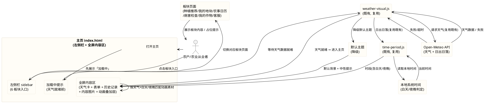
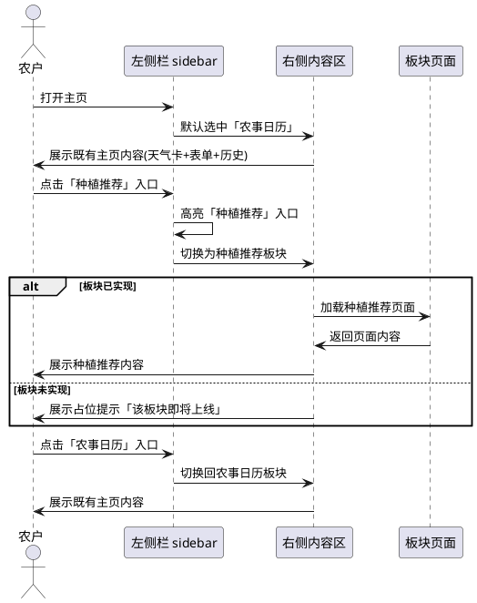
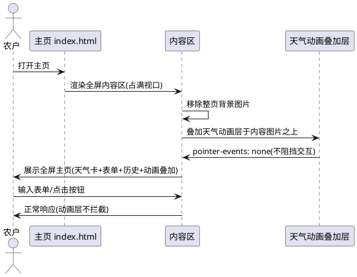
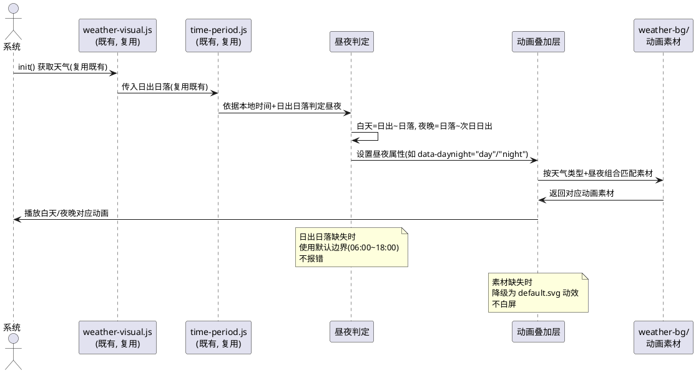
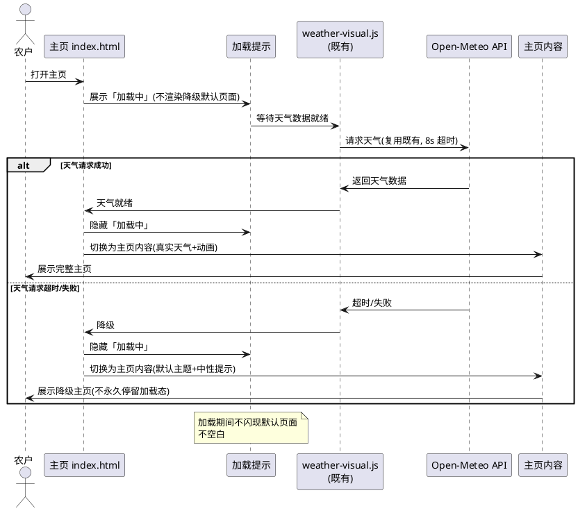
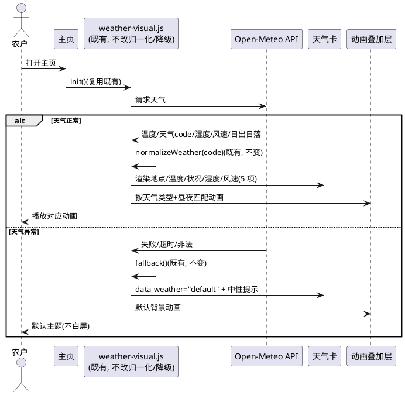
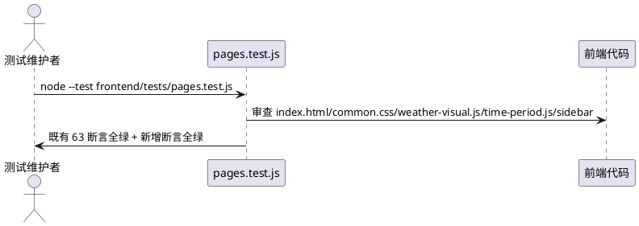

# V4 T01 主页 UI 改版与天气视觉动态适配（v4_t01_ui_revamp）

> 本文档用于规范 agritime（知农时 · 会看天的农事日历）功能扩展任务书 V4.0 中任务编号 T01 的验收标准：主页新增左侧栏导航（种植推荐/我的地块/农事日历/病害检查/我的作物/客服 6 个板块入口）；主页全屏化（占满视口、不再使用整页背景图片、天气动画叠加显示在主页内容图片上）；修复夜间动画不显示问题（按白天/夜晚分别匹配动画素材，保证 24 小时均有正确视觉）；修复打开页面时天气未加载完成先闪现默认页面的 bug（进入前展示「加载中」提示，待天气数据就绪后再进入主页）；保留既有天气信息展示与降级机制。
> 范围红线：本次为**纯前端 UI 改版与视觉适配**任务，仅允许修改 `frontend/` 目录下文件；须保证（1）前端 63/63 既有测试全绿、仅允许新增断言、（2）不引入框架/构建工具/第三方库（含动画库 GSAP/Lottie、UI 框架 Vue/React）、（3）不修改后端（Java/8080）与 nginx 配置、（4）天气数据不可用时降级为默认主题不白屏不报错、（5）左侧栏导航资源放 `frontend/components/sidebar/` 遵循 V4 目录规范、（6）白天/夜晚动画素材放 `frontend/assets/weather-bg/` 遵循既有目录规范。
> 交付形式：本文档描述**做什么（What）**与**验收标准（Acceptance Criteria）**，不描述技术实现方式（How）；技术架构与代码结构由后续 design 阶段承接。
> 全局约束继承自 `stage2_frontend`（spec.md 60 条）、`t00_directory_migration`（49 条）、`t01_weather_visual`（42 条）、`t01_enhance_animation`（40 条）：纯原生 JS + 原生 CSS、前端测试断言不可弱化、`crop-map.js` 5 个 cropId 不变、mock 保持 null 占位不造假、时间线页天气数据经后端 `GET /api/timeline` 获取、主页天气视觉（T01）已落地不改变其 weathercode 归一化与降级机制、时段动画（T01 增强）已落地不改变其 6 时段判定与日出日落动态计算、语音组件已落地不改变。本任务在既有基础上**改版主页布局为左侧栏 + 全屏内容区**，并**修复夜间动画与加载闪现两个缺陷**。

# **1. 组件定位**

## **1.1 核心职责**
本组件负责将主页（index.html）改版为「左侧固定导航栏 + 右侧全屏内容区」布局，提供 6 个业务板块入口并支持点击切换；将主页占满整个视口、移除整页背景图片、使天气动画叠加显示在主页内容图片之上；按白天/夜晚分别匹配动画素材以修复夜间动画不显示缺陷；在天气数据就绪前展示「加载中」提示以修复打开页面闪现默认页面的缺陷。

## **1.2 核心输入**
1. 用户在左侧栏点击板块入口的操作指令——触发对应板块页面切换。
2. 浏览器地理定位 API（`navigator.geolocation`）或所在地输入提供的当前经纬度——用于获取天气数据（复用既有 weather-visual.js）。
3. Open-Meteo API 返回的当前天气数据与日出日落时间——用于天气展示与白天/夜晚判定（复用既有请求机制）。
4. 本地系统时间（`new Date()`）——用于判定当前处于白天或夜晚，匹配对应动画素材。
5. 既有天气数据获取与归一化结果（weather-visual.js 已落地的 weathercode 归一化、季节推断、降级）——本任务不重复请求，在其基础上叠加白天/夜晚素材匹配。
6. 离线兜底数据 `frontend/assets/mock/mock-data.js`——天气数据不可用时的降级参照。

## **1.3 核心输出**
1. 左侧固定导航栏视图：含「种植推荐、我的地块、农事日历、病害检查、我的作物、客服」6 个板块入口，当前选中板块高亮。
2. 右侧全屏内容区视图：主页内容（品牌头、天气卡、表单、历史记录）占满视口，无整页背景图片。
3. 叠加在主页内容图片上的天气动画视图：晴/雨/多云/雪对应不同动画，白天/夜晚分别匹配不同动画素材。
4. 天气数据就绪前的「加载中」提示视图：进入主页前展示加载状态，天气就绪后切换为主页内容。
5. 天气数据不可用时的默认主题降级视图（默认背景 + 默认主题色 + 中性提示）。
6. 板块页面未实现时的占位提示视图（不白屏）。

## **1.4 职责边界**
本组件**不负责**以下事项：
1. 后端 Java 服务（`/opt/crop-calendar`，8080）的任何修改——**明确禁止**修改后端代码、新增后端接口或改动后端配置。
2. nginx 反向代理配置的修改——**明确禁止**；本任务不依赖 nginx 新增代理路径或 location。
3. 各板块对应业务页面的完整功能实现——本任务仅提供左侧栏入口与页面切换框架；「种植推荐/我的地块/农事日历/病害检查/我的作物/客服」各板块的完整业务功能由后续 T06/T12/T13/T14/T15 等任务承接，本任务仅保证入口可点击、切换不白屏（未实现板块展示占位提示）。
4. 既有 weather-visual.js 的 weathercode 归一化（WMO_MAP）、季节推断（inferSeason）、降级机制（fallback）的修改——**明确禁止**改变既有归一化与降级逻辑；本任务仅在其基础上叠加白天/夜晚素材匹配与加载门控。
5. 既有 time-period.js 的 6 时段判定（judgeTimePeriod）、日出日落解析（parseSunTime）的修改——**明确禁止**改变既有时段判定逻辑；白天/夜晚判定可复用既有时段结果或独立判定，但不改变既有时段判定输出。
6. 时间线页（timeline.html）既有渲染逻辑与 `GET /api/timeline` 取数方式的修改——时间线页作为「农事日历」板块内容，其渲染/取数/超时/降级全部不变。
7. 既有语音组件（voice-input.js/voice-input.css）、搜索历史（history-store.js）、拍照识别（photo-capture.js）的修改——**明确禁止**改变既有交互组件。
8. 既有表单字段（crop/sowingDate/location）id/name 与 `validate()` 校验逻辑与 `buildTimelineQuery()` 参数拼装的修改——**明确禁止**改变既有表单提交链路。
9. 任何框架、构建工具、第三方库（含 UI 框架 Vue/React、动画库 GSAP/Lottie、路由库）的引入——**明确禁止**。

# **2. 领域术语**

**左侧栏导航（Sidebar Navigation）**
: 指固定在页面左侧的纵向导航栏，包含多个业务板块入口图标与文字，点击切换右侧内容区显示对应板块页面，导航栏本身不随页面内容滚动。

**板块入口（Module Entry）**
: 指左侧栏导航中可点击的业务模块入口项，本任务须提供 6 个：种植推荐、我的地块、农事日历、病害检查、我的作物、客服；每个入口对应一个业务页面。

**主页全屏化（Fullscreen Home）**
: 指主页内容区占满整个浏览器视口（宽度 100vw、高度 100vh），不再使用整页背景图片作为页面底图，天气动画以叠加层形式显示在主页内容图片之上。

**整页背景图片（Full-page Background Image）**
: 指既有主页通过 `.page--home { background-image: url('../img/index-bg.png'); }` 设置的覆盖整个页面的静态背景图；本任务须移除此整页背景，改由内容区图片 + 天气动画叠加层构成视觉。

**天气动画叠加层（Weather Animation Overlay）**
: 指独立于主页内容图片的动画图层，以绝对定位叠加在内容图片之上，依据天气类型（晴/雨/多云/雪）与时段（白天/夜晚）播放对应动画，不阻挡下方内容交互。

**白天/夜晚（Day/Night）**
: 指依据当前本地时间与日出日落时间判定的昼夜状态；白天为日出至日落之间，夜晚为日落至次日日出之间；用于分别匹配不同动画素材，保证 24 小时均有正确视觉。

**夜间动画缺陷（Night Animation Bug）**
: 指既有实现中夜间（夜晚时段）动画不显示的问题——夜间时段虽有判定为 `night` 但动画素材未按白天/夜晚区分匹配，导致夜间无正确视觉；本任务须修复此缺陷。

**加载闪现缺陷（Loading Flash Bug）**
: 指既有实现中打开页面时天气数据尚未加载完成，会先显示默认页面（降级态），天气数据就绪后又切换为真实天气视图，造成页面闪现/跳变的问题；本任务须修复此缺陷。

**加载门控（Loading Gate）**
: 指在天气数据就绪前展示「加载中」提示、待天气数据就绪后再进入主页内容的机制；加载期间不展示降级默认页面，避免闪现。

**板块占位提示（Module Placeholder）**
: 指板块对应业务页面尚未实现时，右侧内容区展示的占位提示（如「该板块即将上线」），不白屏、不报错。

**EARS 需求编号约定**
: 本文档需求编号格式为 `REQ-VUI-XXX-NNN`，`VUI` 为 V4 UI Revamp 缩写。前缀对应 EARS 句型：UBI（Ubiquitous，通用）、EVT（Event-driven，事件驱动）、STA（State-driven，状态驱动）、OPT（Optional，可选/带前提）、UNW（Unwanted，非期望行为）。

# **3. 角色与边界**

## **3.1 核心角色**
- **农户 / 农业从业者**：打开主页后通过左侧栏切换不同业务板块，在全屏内容区查看天气与表单，是 UI 改版与视觉修复的受益对象。
- **测试维护者**：运行 `node --test frontend/tests/pages.test.js`，确认既有 63 项断言全绿并补充新需求断言。
- **开发者 / 交付者**：在 `frontend/` 范围内改动代码、上传至目标服务器 `/agritime/frontend` 并提交 Git。

## **3.2 外部系统**
- **Open-Meteo API（`https://api.open-meteo.com/v1/forecast`）**：天气数据与日出日落时间来源，前端直连（复用既有 weather-visual.js 请求机制），本任务不改变请求参数与超时。
- **后端 `GET /api/timeline`**：时间线页数据来源（农事日历板块内容），取数方式不变。
- **浏览器地理定位 API（`navigator.geolocation`）**：经纬度来源（复用既有 getLocation），本任务不改变。
- **本地系统时间（`new Date()`）**：白天/夜晚判定依据，纯本地计算不发起网络请求。
- **mock-data.js**：离线兜底数据来源，字段 null 占位不造假。
- **既有 weather-visual.js / time-period.js**：天气数据获取与时段判定上游模块，本任务复用其输出不改变其逻辑。

## **3.3 交互上下文**

# **4. DFX约束**

## **4.1 性能**
1. 左侧栏渲染须在首屏 DOMContentLoaded 后即时呈现，不得因板块入口加载延迟首屏渲染（左侧栏为纯静态 DOM，无异步数据依赖）。
2. 板块切换须在用户点击后 ≤100ms 内给出视觉反馈（高亮切换 + 内容区切换），不得有感知延迟。
3. 天气动画叠加层须为纯 CSS animation/transition 实现，不引入 JS 动画循环（requestAnimationFrame/setInterval 驱动动画），不引入动画库。
4. 加载门控不得阻塞表单交互：天气数据请求异步执行，加载期间表单字段可预先渲染但展示加载态，天气就绪后切换为完整主页；若天气请求超时（既有 8s），须进入降级态并展示主页内容，不让用户无限等待。
5. 白天/夜晚动画素材切换须为纯 CSS 属性选择器驱动（data-timeperiod 或自定义昼夜属性），不通过 JS 逐个赋值样式，切换过渡 ≤500ms 无闪烁。
6. 主页全屏化不得引入额外网络请求或第三方资源，复用既有 CSS 变量与静态资源。

## **4.2 可靠性**
1. 任一环节失败（左侧栏 DOM 异常、板块页面加载失败、天气请求超时、动画素材缺失）时，页面须优雅降级，**不得白屏**、不得抛出未捕获 JS 错误。
2. 板块对应业务页面未实现时，须展示占位提示（如「该板块即将上线」），不白屏、不报错、不跳转至 404。
3. 天气数据不可用时须降级为默认主题（默认背景 + 默认主题色 + 中性提示），与既有 weather-visual.js 降级机制一致，不白屏。
4. 白天/夜晚判定异常（日出日落缺失、本地时间异常）时，须回退为默认动画素材，不白屏不报错。
5. 加载门控须有超时兜底：天气请求超时后须进入降级态并展示主页内容，不得永久停留在「加载中」。
6. mock 的 null 占位字段须能正常渲染，不因字段为 null 抛异常。

## **4.3 安全性**
1. 板块页面切换须使用同源页面切换（iframe 加载或同源页面显示/隐藏），不通过动态拼接外部 URL 加载板块内容，防 XSS 与点击劫持。
2. 渲染用户可控文本（如板块占位提示、加载提示文案）时须使用 `textContent` 等安全方式，禁止将未转义的用户输入拼入 `innerHTML`。
3. 本次不引入任何外部脚本依赖，所有逻辑内联或使用项目内本地脚本。
4. 左侧栏导航项的板块标识须为预定义枚举（6 个固定板块），不接受外部 URL 参数动态注入板块入口，防注入。

## **4.4 可维护性**
1. 6 个板块入口的标识、名称、顺序须以**具名常量**集中定义，不得多处硬编码；新增或调整板块须只改常量定义一处。
2. 白天/夜晚判定规则与动画素材映射须以具名常量集中定义，未知时段或素材缺失须有统一回退分支。
3. 加载提示文案、板块占位提示文案、降级提示文案须以具名常量集中定义，便于统一维护与国际化预留。
4. 左侧栏导航组件须独立存放于 `frontend/components/sidebar/`，遵循 V4 目录规范，不与业务页面逻辑耦合。
5. 参数名（crop / sowDate / lat / lon）须全链路统一，不得因 UI 改版改变既有表单提交参数。

## **4.5 兼容性**
1. **测试兼容（强制红线）**：不得破坏 `frontend/tests/pages.test.js` 的既有 63 项断言；可新增断言，既有断言须全绿。运行命令：`node --test frontend/tests/pages.test.js`。
2. **响应式兼容**：375px、768px、1024px 三档宽度下均须无横向滚动；左侧栏在移动端（<768px）须适配为折叠/抽屉或顶部栏，不挤压内容区。
3. **不可引入依赖**：不得引入框架、构建工具、第三方库（含 UI 框架、动画库、路由库）。
4. **文件范围兼容**：不得修改后端及 `data/`、`shared/`、`deploy/`、`docs/` 等模块；仅修改 `frontend/` 下文件。
5. **接口兼容**：不得改变前端既有的 GET /api/timeline 取数方式与参数命名；不得改变既有 weather-visual.js 对 Open-Meteo 的请求参数与超时。
6. **既有功能兼容**：不得改变既有天气卡展示（地点/温度/状况/湿度/风速）、既有表单提交链路、既有语音组件、既有搜索历史、既有拍照识别、既有分栏布局（body.split-active）的核心行为。
7. **浏览器兼容**：须在主流现代浏览器（Chrome/Edge/Safari 近两版）与移动端 WebView 下可用（原生 JS 语法须避免仅新引擎支持的特性或在必要时降级）。

# **5. 核心能力**

## **5.1 左侧栏导航**

### **5.1.1 业务规则**

1. **REQ-VUI-UBI-001（Ubiquitous）**：系统须在主页左侧提供固定导航栏，导航栏须包含 6 个业务板块入口：种植推荐、我的地块、农事日历、病害检查、我的作物、客服。
   a. 验收条件：[打开主页] → [页面左侧存在固定导航栏，栏内依次含「种植推荐、我的地块、农事日历、病害检查、我的作物、客服」6 个可点击入口]

2. **REQ-VUI-UBI-002（Ubiquitous）**：左侧栏须固定在页面左侧，不随右侧内容区滚动而滚动；左侧栏自身内容超出时可在栏内独立滚动。
   a. 验收条件：[右侧内容区纵向滚动] → [左侧栏位置固定不动，栏内入口始终可见]

3. **REQ-VUI-EVT-003（Event-driven）**：当用户点击左侧栏某个板块入口时，系统须将右侧内容区切换为该板块对应页面内容，并将该入口标记为当前选中（高亮）。
   a. 验收条件：[点击「农事日历」入口] → [右侧内容区切换为农事日历页面内容，「农事日历」入口高亮，其余入口非高亮]

4. **REQ-VUI-STA-004（State-driven）**：在任一时刻，左侧栏须有且仅有一个板块入口处于当前选中高亮态，不得出现多个高亮或无高亮。
   a. 验收条件：[切换板块后查看左侧栏] → [恰有 1 个入口高亮，为当前展示板块]

5. **REQ-VUI-UBI-005（Ubiquitous）**：系统须以「农事日历」板块为默认选中板块，用户首次打开主页时右侧内容区默认展示农事日历相关内容（含既有主页表单与天气卡）。
   a. 验收条件：[首次打开主页] → [「农事日历」入口高亮，右侧内容区展示既有主页内容（天气卡 + 表单 + 历史记录）]

6. **REQ-VUI-UBI-006（Ubiquitous）**：6 个板块入口的标识、名称与顺序须以具名常量集中定义，顺序为：种植推荐、我的地块、农事日历、病害检查、我的作物、客服。
   a. 验收条件：[代码审查] → [存在具名常量集中定义 6 板块，顺序与名称与需求一致，无散落硬编码]

7. **REQ-VUI-OPT-007（Optional/带前提）**：当某板块对应业务页面尚未实现时，系统须在右侧内容区展示占位提示（如「该板块即将上线」），不白屏、不报错、不跳转至 404。
   a. 验收条件：[点击未实现的板块入口（如「我的地块」）] → [右侧内容区展示占位提示文案，无白屏、无控制台错误、无 404 跳转]

8. **REQ-VUI-UBI-008（Ubiquitous）**：左侧栏导航组件须独立存放于 `frontend/components/sidebar/` 目录，遵循 V4 目录规范，不与业务页面逻辑耦合。
   a. 验收条件：[审查目录结构] → [存在 `frontend/components/sidebar/` 目录，左侧栏相关资源（JS/CSS）存放于此，不散落于 pages/]

9. **REQ-VUI-OPT-009（Optional/带前提）**：当视口宽度 < 768px（移动端）时，左侧栏须适配为折叠/抽屉或顶部横向栏形式，不挤压右侧内容区可用宽度。
   a. 验收条件：[在 375px 宽度打开主页] → [左侧栏以折叠/抽屉或顶部栏形式呈现，右侧内容区可用宽度不被严重挤压，无横向滚动]

10. **REQ-VUI-UNW-010（Unwanted）**：如果板块切换过程中发生异常（页面加载失败、DOM 异常），系统不得白屏或抛出未捕获错误，须回退为占位提示或保持当前板块。
    a. 验收条件：[板块页面加载失败] → [右侧内容区展示占位提示或保持原板块内容，无白屏、无未捕获错误]

11. **禁止项**：禁止左侧栏入口数量少于 6 个；禁止用同一入口代表多个板块；禁止左侧栏遮挡右侧内容区核心内容（表单/天气卡）；禁止板块入口顺序与需求规定不一致。
    a. 验收条件：[审查左侧栏] → [入口恰为 6 个且顺序为种植推荐/我的地块/农事日历/病害检查/我的作物/客服，不遮挡内容区核心内容]

### **5.1.2 交互流程**

### **5.1.3 异常场景**

1. **板块页面加载失败**
   a. 触发条件：板块对应页面资源加载失败或 DOM 异常
   b. 系统行为：捕获异常，右侧内容区展示占位提示或保持当前板块，不抛未捕获错误
   c. 用户感知：看到占位提示或原内容，无白屏、无报错

2. **左侧栏 DOM 结构异常**
   a. 触发条件：左侧栏容器节点缺失或结构损坏
   b. 系统行为：静默降级，右侧内容区仍可独立展示主页内容
   c. 用户感知：可能无左侧栏，但主页内容正常可用

## **5.2 主页全屏化**

### **5.2.1 业务规则**

1. **REQ-VUI-UBI-011（Ubiquitous）**：主页内容区须占满整个浏览器视口（宽度 100vw、高度 100vh），不得出现大面积留白或内容区未铺满视口的情况。
   a. 验收条件：[在任意视口尺寸打开主页] → [内容区铺满整个视口，无大面积留白、无内容区仅占部分宽度]

2. **REQ-VUI-UBI-012（Ubiquitous）**：系统须移除既有主页的整页背景图片（`.page--home` 的 `background-image: url('../img/index-bg.png')` 整页底图），不再使用整页背景图片作为页面底图。
   a. 验收条件：[打开主页审查背景] → [无整页背景图片作为页面底图，页面背景由内容区图片 + 天气动画叠加层构成]

3. **REQ-VUI-UBI-013（Ubiquitous）**：天气动画须以叠加层形式直接显示在主页内容图片之上，叠加层不得阻挡下方内容（表单/天气卡/历史记录）的交互（pointer-events 不拦截）。
   a. 验收条件：[主页展示天气动画] → [动画叠加层显示在内容图片之上，点击/输入表单字段正常响应，动画层不阻挡交互]

4. **REQ-VUI-UBI-014（Ubiquitous）**：主页既有内容（品牌头、天气卡、节气刻度、表单、历史记录）须在全屏内容区内可见且可交互，不得因全屏化而隐藏或挤压核心内容。
   a. 验收条件：[全屏化后查看主页] → [品牌头、天气卡、表单（作物/播种日期/所在地）、历史记录均完整可见可交互]

5. **REQ-VUI-UBI-015（Ubiquitous）**：主页全屏化须使用纯 CSS 布局（flexbox/grid + 媒体查询）实现，不依赖 JS 计算布局尺寸，不引入栅格框架。
   a. 验收条件：[代码审查] → [全屏布局由项目内 CSS 实现，无第三方栅格库、无 JS 动态计算布局尺寸]

6. **REQ-VUI-STA-016（State-driven）**：在分栏态（既有 body.split-active，搜索后主页与时间线同屏）下，主页全屏化须与分栏布局兼容，左侧栏保持固定，主页与时间线在右侧内容区内分栏展示。
   a. 验收条件：[搜索后进入分栏态] → [左侧栏保持固定，右侧内容区内主页与时间线分栏展示，全屏化布局不破坏既有分栏]

7. **REQ-VUI-UNW-017（Unwanted）**：如果主页全屏化导致既有内容溢出或横向滚动，系统不得出现横向滚动条；内容区超出部分须纵向滚动。
   a. 验收条件：[在 375/768/1024px 宽度查看全屏主页] → [三档均无横向滚动条，内容超出时纵向滚动]

8. **禁止项**：禁止保留整页背景图片作为页面底图；禁止天气动画叠加层遮挡表单输入与按钮点击；禁止全屏化导致既有表单字段 id/name 改变；禁止通过隐藏核心内容来"实现"全屏。
   a. 验收条件：[审查全屏主页] → [无整页背景底图，表单可正常输入提交，核心内容完整可见]

### **5.2.2 交互流程**

### **5.2.3 异常场景**

1. **全屏布局在某些浏览器下不支持**
   a. 触发条件：目标浏览器对 flexbox/grid 全屏布局支持不完整
   b. 系统行为：降级为既有单栏居中布局，内容仍可用
   c. 用户感知：可能非严格全屏，但内容完整可交互

2. **内容区内容超出视口高度**
   a. 触发条件：主页内容（表单+历史记录）总高度超过视口高度
   b. 系统行为：内容区纵向滚动，左侧栏固定不动
   c. 用户感知：可纵向滚动查看全部内容，左侧栏始终可见

## **5.3 夜间动画修复**

### **5.3.1 业务规则**

1. **REQ-VUI-UBI-018（Ubiquitous）**：系统须按白天/夜晚分别匹配动画素材，保证 24 小时均有正确视觉——白天时段显示白天动画素材，夜晚时段显示夜晚动画素材，不得出现夜间无动画或动画不显示的情况。
   a. 验收条件：[白天时段打开主页] → [显示白天对应动画素材，动画正常播放可见]；[夜晚时段打开主页] → [显示夜晚对应动画素材，动画正常播放可见]

2. **REQ-VUI-UBI-019（Ubiquitous）**：白天/夜晚判定须依据当前本地时间与日出日落时间动态计算——白天为日出至日落之间，夜晚为日落至次日日出之间；日出日落缺失时须使用默认昼夜边界（如 06:00~18:00 为白天）不报错。
   a. 验收条件：[当前时间在日出与日落之间] → [判定为白天]；[当前时间在日落之后或日出之前] → [判定为夜晚]；[日出日落缺失] → [按默认边界判定昼夜，不报错]

3. **REQ-VUI-UBI-020（Ubiquitous）**：白天/夜晚动画素材须与既有天气类型（晴/雨/多云/雪）组合匹配——即每种天气类型在白天与夜晚各有对应动画素材，共至少 8 种组合（4 天气 × 2 昼夜）+ 默认降级素材。
   a. 验收条件：[白天+晴天] → [白天晴天动画]；[夜晚+晴天] → [夜晚晴天动画]；[白天+雨天] → [白天雨天动画]；[夜晚+雨天] → [夜晚雨天动画]（多云/雪同理）

4. **REQ-VUI-UBI-021（Ubiquitous）**：白天/夜晚动画素材须存放于 `frontend/assets/weather-bg/` 目录，遵循既有天气背景资源目录规范；素材格式须为 SVG 矢量图形或项目既有格式，单张 ≤300KB。
   a. 验收条件：[审查 weather-bg 目录] → [存在白天/夜晚分别对应的动画素材文件，格式为 SVG 或既有格式，单张 ≤300KB]

5. **REQ-VUI-STA-022（State-driven）**：当昼夜状态切换（如从白天进入夜晚）时，动画素材须平滑切换，无突兀跳变/闪烁/白屏，切换过渡 ≤500ms。
   a. 验收条件：[昼夜切换瞬间] → [动画素材平滑过渡，无跳变/闪烁/白屏，过渡 ≤500ms]

6. **REQ-VUI-UBI-023（Ubiquitous）**：白天/夜晚动画须为纯 CSS animation/transition 实现（@keyframes + 属性选择器驱动），不引入 JS 动画循环，不引入动画库；须复用既有 `prefers-reduced-motion` 全局规则，在用户设置减少动画时自动禁用。
   a. 验收条件：[代码审查] → [动画由纯 CSS @keyframes + 属性选择器驱动，无 JS 动画循环、无动画库；prefers-reduced-motion 时动画禁用]

7. **REQ-VUI-UNW-024（Unwanted）**：如果白天/夜晚动画素材缺失或加载失败，系统不得白屏或报错，须降级为既有默认动画素材（default.svg 对应动效）。
   a. 验收条件：[夜晚动画素材缺失] → [降级为默认动画素材，无白屏、无报错]

8. **REQ-VUI-UBI-025（Ubiquitous）**：白天/夜晚判定须为纯本地计算（依据本地时间与日出日落），不发起额外网络请求；可复用既有 time-period.js 的时段判定结果或独立判定，但不改变既有时段判定输出。
   a. 验收条件：[代码审查] → [昼夜判定为本地时间比较，无额外网络请求；既有 time-period.js 时段判定输出不变]

9. **禁止项**：禁止夜间无动画或动画不显示（即禁止不修复夜间动画缺陷）；禁止用同一动画素材表示白天与夜晚（须可视觉区分）；禁止白天/夜晚判定发起额外网络请求；禁止改变既有 time-period.js 的 6 时段判定逻辑。
   a. 验收条件：[夜晚时段查看主页] → [夜晚动画正常显示且与白天可视觉区分；无额外网络请求；既有时段判定不变]

### **5.3.2 交互流程**

### **5.3.3 异常场景**

1. **日出日落时间缺失**
   a. 触发条件：Open-Meteo 响应未含 daily.sunrise/sunset 或解析失败
   b. 系统行为：使用默认昼夜边界（06:00~18:00 白天，其余夜晚）判定，不报错
   c. 用户感知：动画按默认昼夜切换，无报错

2. **夜晚动画素材缺失**
   a. 触发条件：weather-bg 目录下夜晚对应素材文件缺失或加载失败
   b. 系统行为：降级为既有默认动画素材（default.svg 动效），不白屏
   c. 用户感知：看到默认动画，无白屏、无报错

3. **高纬度极昼/极夜**
   a. 触发条件：高纬度地区日出日落异常（极昼无日落、极夜无日出）
   b. 系统行为：日出日落缺失时使用默认昼夜边界，不报错
   c. 用户感知：动画按默认昼夜切换，无报错

## **5.4 加载优化（加载门控）**

### **5.4.1 业务规则**

1. **REQ-VUI-EVT-026（Event-driven）**：当用户打开主页且天气数据尚未就绪时，系统须先展示「加载中」提示，不得先展示默认页面（降级态）再切换为真实天气视图。
   a. 验收条件：[打开主页且天气未就绪] → [页面展示「加载中」提示，不展示降级默认页面]

2. **REQ-VUI-STA-027（State-driven）**：在天气数据就绪前，系统须持续保持「加载中」提示可见，不得闪现默认页面或空白。
   a. 验收条件：[天气请求进行中] → [「加载中」提示持续可见，不闪现默认页面、不空白]

3. **REQ-VUI-EVT-028（Event-driven）**：当天气数据就绪（请求成功并完成归一化）后，系统须隐藏「加载中」提示，切换为主页内容视图（含真实天气展示与动画）。
   a. 验收条件：[天气数据就绪] → [「加载中」提示隐藏，主页内容（天气卡+表单+动画）可见]

4. **REQ-VUI-UNW-029（Unwanted）**：如果天气数据就绪前先显示默认页面（降级态）再切换为真实天气视图，造成页面闪现/跳变，系统须消除此闪现——加载门控须保证加载期间不渲染降级默认页面。
   a. 验收条件：[打开主页至天气就绪全过程] → [不出现先显示默认页面再切换为真实天气的闪现，全程仅显示「加载中」直至就绪]

5. **REQ-VUI-OPT-030（Optional/带前提）**：当天气请求超时（既有 8s 超时）或失败时，系统须隐藏「加载中」提示，进入降级态展示主页内容（默认主题 + 中性提示），不得永久停留在「加载中」。
   a. 验收条件：[天气请求超时（>8s）或失败] → [「加载中」提示隐藏，展示主页内容（默认主题 + 中性提示），不永久停留加载态]

6. **REQ-VUI-UBI-031（Ubiquitous）**：「加载中」提示须为纯 CSS 占位或简单 DOM 文案，不依赖外部图片或第三方加载动画库；提示须有可读文案（如「正在加载天气数据…」）或视觉指示（如旋转图标）。
   a. 验收条件：[加载期间查看提示] → [存在可读的「加载中」文案或视觉指示，由项目内 CSS/DOM 实现，无外部资源请求]

7. **REQ-VUI-UBI-032（Ubiquitous）**：加载门控不得阻塞表单交互——加载期间表单字段可预先渲染（用户可提前填写），或加载完成后统一展示；无论何种方式，天气就绪后表单须可正常填写提交。
   a. 验收条件：[加载完成后查看表单] → [表单字段（作物/播种日期/所在地）可正常填写并提交]

8. **禁止项**：禁止加载期间闪现默认页面（降级态）；禁止天气超时后永久停留在「加载中」；禁止加载提示依赖第三方库；禁止加载门控阻塞表单最终可用性。
   a. 验收条件：[打开主页至就绪/超时全过程] → [无闪现默认页面，超时后进入降级主页，表单最终可填写提交]

### **5.4.2 交互流程**

### **5.4.3 异常场景**

1. **天气请求超时**
   a. 触发条件：Open-Meteo 请求超过既有 8s 超时
   b. 系统行为：隐藏「加载中」，进入降级态展示主页内容（默认主题 + 中性提示）
   c. 用户感知：先看到加载提示，约 8s 后看到降级主页，无永久等待

2. **天气请求失败（网络错误）**
   a. 触发条件：网络不可用或 Open-Meteo 返回非 2xx
   b. 系统行为：隐藏「加载中」，进入降级态展示主页内容
   c. 用户感知：先看到加载提示，随后看到降级主页，表单可正常填写

3. **加载提示 DOM 异常**
   a. 触发条件：加载提示节点缺失或渲染异常
   b. 系统行为：静默降级，直接展示主页内容（可能短暂无加载提示，但不白屏）
   c. 用户感知：可能无加载提示，但主页内容最终正常展示

## **5.5 天气信息保留与降级**

### **5.5.1 业务规则**

1. **REQ-VUI-UBI-033（Ubiquitous）**：系统须保留既有天气信息展示——当前地点、实时温度、天气状况、湿度、风速 5 项信息须在天气就绪后正常展示，不得因 UI 改版而缺失或弱化。
   a. 验收条件：[天气就绪后查看主页] → [天气卡展示地点、温度、天气状况、湿度、风速 5 项信息，与既有展示一致]

2. **REQ-VUI-UBI-034（Ubiquitous）**：系统须保留既有天气类型与动画映射——晴/雨/多云/雪 4 类天气各对应不同动画，不得因 UI 改版而合并为同一动画或缺失某类动画。
   a. 验收条件：[天气为晴] → [播放晴天动画]；[天气为雨] → [播放雨天动画]；[天气为多云] → [播放多云动画]；[天气为雪] → [播放雪天动画]（4 类动画可视觉区分）

3. **REQ-VUI-UNW-035（Unwanted）**：如果天气数据异常（请求失败、超时、响应结构非法、weathercode 未识别），系统不得白屏或抛出未捕获错误，须降级为默认主题（默认背景 + 默认主题色 + 中性提示文案）。
   a. 验收条件：[天气数据异常] → [展示默认主题（默认背景 + 默认主题色 + 中性提示如「天气数据暂不可用」），无白屏、无未捕获错误]

4. **REQ-VUI-UBI-036（Ubiquitous）**：降级机制须与既有 weather-visual.js 的 fallback() 一致——设置 data-weather="default"、加载默认背景、展示中性提示文案，不改变既有降级分支语义。
   a. 验收条件：[天气异常降级] → [data-weather="default"，默认背景加载，中性提示展示，与既有 fallback() 行为一致]

5. **REQ-VUI-UBI-037（Ubiquitous）**：既有 weather-visual.js 的 weathercode 归一化（WMO_MAP）、季节推断（inferSeason）、降级函数（fallback）须保持不变，本任务不改变其既有逻辑，仅在其基础上叠加白天/夜晚素材匹配与加载门控。
   a. 验收条件：[代码审查 weather-visual.js] → [WMO_MAP/inferSeason/fallback 既有逻辑不变，新增白天/夜晚匹配与加载门控为增量叠加]

6. **禁止项**：禁止因 UI 改版缺失天气信息 5 项中的任一项；禁止用同一动画表示所有天气类型；禁止天气异常时白屏或抛未捕获错误；禁止改变既有 weather-visual.js 归一化与降级逻辑。
   a. 验收条件：[天气就绪/异常各场景核对] → [5 项信息完整、4 类动画可区分、异常降级不白屏、既有归一化降级不变]

### **5.5.2 交互流程**

### **5.5.3 异常场景**

1. **weathercode 未识别**
   a. 触发条件：Open-Meteo 返回的 weathercode 不在 WMO_MAP 中
   b. 系统行为：既有 normalizeWeather 回退 'default'，降级默认主题
   c. 用户感知：看到默认主题与中性提示，无报错

2. **天气响应结构非法**
   a. 触发条件：Open-Meteo 响应缺 current 字段或结构异常
   b. 系统行为：既有 buildWeatherInfo 返回 null，触发 fallback 降级
   c. 用户感知：看到默认主题，无白屏

## **5.6 测试与兼容性**

### **5.6.1 业务规则**

1. **REQ-VUI-UBI-038（Ubiquitous）**：改造后前端须逻辑正确、无报错，且 `frontend/tests/pages.test.js` 既有 63 项断言全部通过，不得因 UI 改版而破坏既有断言。
   a. 验收条件：[运行 `node --test frontend/tests/pages.test.js`] → [既有 63 项断言全绿，无失败]

2. **REQ-VUI-UBI-039（Ubiquitous）**：系统须针对本次新增能力补充必要测试断言（如左侧栏 6 入口存在、板块切换机制、全屏布局、白天/夜晚动画素材、加载门控、占位提示等），且不得破坏既有 63 项断言。
   a. 验收条件：[测试套件运行] → [新增断言通过，既有 63 项断言仍全绿]

3. **禁止项**：禁止为通过测试而删除、注释或弱化既有 63 项断言。
   a. 验收条件：[代码审查 pages.test.js] → [既有 63 项断言原文保留且通过，新增断言为追加]

### **5.6.2 交互流程**

### **5.6.3 异常场景**

1. **新增断言破坏既有断言**
   a. 触发条件：新增断言修改了既有断言依赖的字符串/结构
   b. 系统行为：调整新增断言为独立 test 块，不修改既有断言
   c. 用户感知：既有 63 项 + 新增项均全绿

# **6. 数据约束**

## **6.1 左侧栏板块入口对象**
1. **板块标识（id）**：字符串枚举，取值为 `recommend`（种植推荐）、`plots`（我的地块）、`calendar`（农事日历）、`disease`（病害检查）、`my-crops`（我的作物）、`service`（客服），共 6 个，全局唯一。
2. **板块名称（name）**：中文名称，非空字符串，依次为「种植推荐、我的地块、农事日历、病害检查、我的作物、客服」。
3. **板块顺序（order）**：整数，1~6，按需求规定顺序递增。
4. **是否已实现（implemented）**：布尔值，标识该板块对应业务页面是否已实现；未实现时点击展示占位提示。
5. **数量约束**：板块入口总数恰为 6，不得增删。

## **6.2 白天/夜晚状态对象**
1. **昼夜状态（daynight）**：字符串枚举，取值 `day`（白天）或 `night`（夜晚）。
2. **判定依据**：当前本地时间与日出日落时间；白天为日出至日落之间，夜晚为日落至次日日出之间。
3. **默认边界**：日出日落缺失时，白天默认 06:00~18:00，夜晚默认 18:00~次日 06:00。
4. **动画素材映射**：天气类型（sunny/rain/cloudy/snow）× 昼夜（day/night）→ 对应动画素材文件，共至少 8 种组合 + 默认降级素材。

## **6.3 加载状态对象**
1. **加载状态（loadingState）**：字符串枚举，取值 `loading`（加载中）、`ready`（天气就绪）、`fallback`（降级）。
2. **加载提示文案**：非空字符串，如「正在加载天气数据…」，以具名常量集中定义。
3. **超时阈值**：复用既有 weather-visual.js 的 8000ms，不得改变。
4. **状态流转**：`loading` → `ready`（天气就绪）或 `loading` → `fallback`（超时/失败），不得从 `ready` 回退至 `loading`。

## **6.4 板块占位提示对象**
1. **占位提示文案**：非空字符串，如「该板块即将上线」，以具名常量集中定义。
2. **适用条件**：板块入口 `implemented` 为 false 时展示。
3. **展示约束**：占位提示须可读、不白屏、不报错、不跳转 404。

## **6.5 既有天气信息对象（保留，不改变）**
1. **地点（location）**：字符串，当前地点名称或经纬度文本。
2. **温度（temperature）**：数值，单位 °C，展示为整数 + °。
3. **天气状况（weatherLabel）**：字符串，取值晴/雨/多云/雪/未知。
4. **湿度（humidity）**：数值或 null，单位 %。
5. **风速（windSpeed）**：数值或 null，单位 km/h。
6. **天气类型（weatherType）**：字符串枚举，sunny/rain/cloudy/snow/default。
7. **季节（season）**：字符串枚举，spring/summer/autumn/winter。
8. **保留约束**：上述字段语义与展示须与既有 weather-visual.js 一致，本任务不改变其取值范围与展示规则。