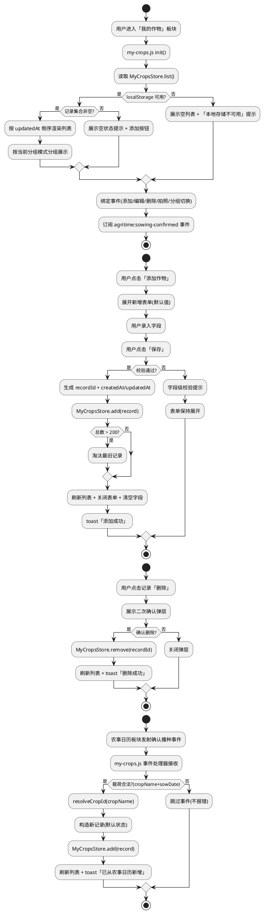
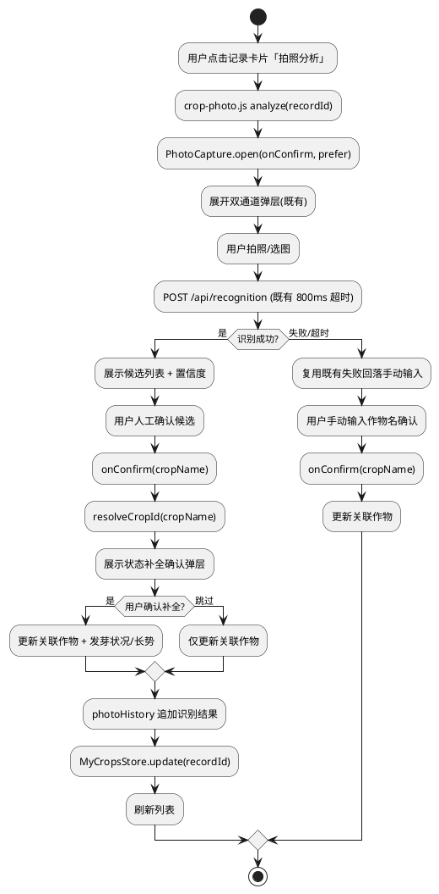

# V4 T12 我的作物 · 技术设计（v4_t12_my_crops）

> 本方案基于 `v4_t12_my_crops/spec.md`（REQ-VMC-UBI/EVT/STA/OPT/UNW-001 ~ 059，共 59 条 EARS 需求）生成。
> 设计范围：**纯前端「我的作物」功能模块实现**，仅修改 `frontend/` 目录下文件，不触碰后端/nginx/shared/data/deploy/docs。
> 强约束（红线）：
> 1. 前端既有测试全绿（`node --test frontend/tests/pages.test.js`，当前 71 项 `test()` 调用全绿），仅允许新增断言、不得弱化既有断言；
> 2. 不引入框架/构建工具/第三方库（含 UI 框架 Vue/React、状态管理库、存储库 localforage、表单库、图片处理库）；
> 3. 不修改后端（Java/8080）与 nginx 配置——后端 `backend/service/my-crop` 属成员2协作范围，本任务仅消费既有 `POST /api/recognition` 与待定 my-crop 接口契约前端侧适配位；
> 4. 数据存储采用前端 localStorage 临时存储（独立键 `agritime.my-crops.v1`，不污染既有 `agritime.history.v1`），账号系统就绪后绑定后端（本任务不实现绑定）；
> 5. 拍照分析复用既有 `frontend/pages/photo-capture.js`（`PhotoCapture.open(onConfirm, prefer)`）与后端 `/api/recognition` 接口，不修改既有源文件；
> 6. 日历联动监听农事日历板块「确认播种」自定义事件自动新增记录，不实现农事日历板块的确认播种 UI；
> 7. 左侧栏集成复用既有 `frontend/components/sidebar/sidebar.js` 的 `my-crops` 入口与 `switchModule` 机制，仅将 `implemented` 标记为 true；
> 8. 「我的作物」页面资源放 `frontend/pages/my-crops/`、拍照组件复用层放 `frontend/components/crop-photo/`，遵循 V4 目录规范；
> 9. `crop-map.js` 5 个 cropId（dry_garlic/wheat_winter/corn_summer/rice/soybean）与 6 作物条目不变，mock 保持 null 占位不造假。
> 全局约束继承自 `stage2_frontend`（60 条）、`t00_directory_migration`（49 条）、`t01_weather_visual`（42 条）、`v4_t01_ui_revamp`（39 条）：纯原生 JS + 原生 CSS、前端测试断言不可弱化、时间线页天气数据经后端 `GET /api/timeline` 获取、主页左侧栏 6 板块入口已落地（含 `my-crops` 入口，当前 `implemented:false` 展示占位提示）、天气视觉与时段动画已落地不改变、语音组件已落地不改变、拍照识别（photo-capture.js 双通道 + `POST /api/recognition`）已落地不改变其双通道与人工确认机制。本任务在既有基础上**将「我的作物」板块从占位提示升级为完整业务页面**，并**建立作物记录管理、拍照分析、日历联动三项核心能力**。

# 一、需求与存量功能关系分析

## 1.1 需求功能与存量功能对比

### 1.1.1 已实现功能

> 已实现功能是指需求与存量代码完全匹配或高度相似、可直接复用或仅需少量叠加的部分。

| 需求功能 | 存量功能 | 代码位置 | 匹配度 |
|---------|---------|---------|--------|
| 左侧栏 `my-crops` 板块入口已配置（REQ-VMC-UBI-001/002） | `sidebar.js` `MODULE_ENTRIES` 已含 `{id:'my-crops', label:'我的作物', icon:'🌾', implemented:false}` 入口 | `frontend/components/sidebar/sidebar.js:12` | 100%（入口已存在，仅需将 `implemented` 改为 true） |
| 板块切换 `switchModule` 机制（REQ-VMC-UBI-002） | `sidebar.js` `switchModule(id)` 通过 `.content-pane` 的 `data-module` 属性切换 `content-pane--active` 类 + 高亮入口 + 未实现板块展示 `#module-placeholder` 占位提示 | `frontend/components/sidebar/sidebar.js:36-62` | 100%（切换机制已就绪，仅需新增 `data-module="my-crops"` 的 content-pane） |
| content-pane 显示/隐藏样式（REQ-VMC-UBI-002） | `sidebar.css` `.content-pane { display: none; }` + `.content-pane--active { display: block; }` | `frontend/components/sidebar/sidebar.css:68-69` | 100%（content-pane 切换样式已就绪） |
| 占位提示样式（REQ-VMC-UBI-004 降级基准） | `sidebar.css` `#module-placeholder { display:none; padding:40px 20px; text-align:center; color:var(--muted); }` | `frontend/components/sidebar/sidebar.css:71-77` | 100%（占位提示样式已就绪，my-crops 实现后该板块不再展示占位） |
| 拍照识别双通道 + 人工确认 + 800ms 超时 + 失败回落（REQ-VMC-EVT-036/UBI-041/UNW-039） | `photo-capture.js` `open(onConfirm, prefer)` 含拍照/上传双通道、`POST /api/recognition`、`AbortController` + 800ms 超时、候选列表 + 置信度、人工确认、失败回落手动输入 | `frontend/pages/photo-capture.js:7-221` | 100%（既有拍照识别机制完整，本任务仅复用 `open(onConfirm, prefer)` 入口，不修改源文件） |
| `onConfirm` 回调承接确认作物名（REQ-VMC-UBI-037） | `photo-capture.js` `open(onConfirm)` 中 `onConfirm(crop)` 传入用户确认的作物中文名字符串 | `frontend/pages/photo-capture.js:141,162,213-218` | 100%（回调契约已就绪，crop-photo 复用层在 onConfirm 中承接作物回填与状态补全） |
| 作物中文名 → cropId 解析（REQ-VMC-UBI-006） | `crop-map.js` `resolveCropId(name)` 按精确匹配 → 包含匹配 → 关键词命中 → null 解析，5 个 cropId + 6 作物条目 | `frontend/assets/js/crop-map.js:57-78` | 100%（解析逻辑已就绪，本任务仅消费，不修改映射） |
| localStorage 存储降级模式参照（REQ-VMC-UBI-049~054） | `history-store.js` `getStore()` try-catch 检测 localStorage 可用性 + `safeParse()` JSON 解析校验 + 读写异常捕获降级 + store 注入支持测试 | `frontend/assets/js/history-store.js:10-26,36-94` | 75%（降级模式可参照，但须独立实现独立存储键 `agritime.my-crops.v1` 与上限 200，不修改既有源文件） |
| CSS 变量主题色体系（REQ-VMC 4.3/4.5 响应式基准） | `common.css` `:root` 已定义 `--ink`/`--ink-soft`/`--muted`/`--paper`/`--card`/`--leaf`/`--leaf-2`/`--leaf-soft`/`--sun`/`--line`/`--radius`/`--shadow` 等变量 | `frontend/assets/css/common.css:1-21` | 100%（变量体系已就绪，my-crops 页面样式复用既有变量，不引入新色彩体系） |
| 全屏布局 `body[data-layout="app"]` + `.app-main`（REQ-VMC-UBI-002/003） | `common.css` `body[data-layout="app"] { display:flex; }` + `.app-main { flex:1; margin-left:200px; }` + 移动端 `@media (max-width:767px) { .app-main { margin-left:0; } }` | `frontend/assets/css/common.css:539-542,562-564` | 100%（全屏布局已就绪，my-crops content-pane 在 .app-main 内展示） |
| 响应式 768/1024 断点 + 375 无横向滚动（REQ-VMC 4.5.2） | `common.css` 已有 `@media (min-width:768px)`/`@media (min-width:1024px)` 断点 + `overflow-x:hidden` + `max-width:100%` | `frontend/assets/css/common.css:25-30,424-431` | 100%（响应式断点已就绪，my-crops 样式追加到此体系） |
| `prefers-reduced-motion` 全局禁用动画（REQ-VMC 4.5.2） | `common.css` 已有 `@media (prefers-reduced-motion: reduce) { *, *::before, *::after { animation:none !important; transition:none !important; } }` | `frontend/assets/css/common.css:289-291` | 100%（全局规则已覆盖，my-crops transition/animation 自动被禁用） |
| `textContent` 安全渲染（REQ-VMC 4.3.1 XSS 防护） | `index.html` 历史记录渲染 `btn.textContent = label`、weather-visual.js `renderCard` 用 `textContent` | `frontend/pages/index.html:391`；`frontend/assets/js/weather-visual.js:109-113` | 100%（安全渲染模式已就绪，my-crops 记录卡片/表单/提示沿用 textContent） |
| toast 操作反馈机制（REQ-VMC 1.3.7/4.2.7） | `index.html` `showToast(msg, type)` + `<div class="toast" id="toast">` + `common.css` `.toast` 样式 | `frontend/pages/index.html:91,308-311`；`frontend/assets/css/common.css:282` | 75%（toast 机制已就绪但属主页表单作用域，my-crops 须独立 toast 实例或复用模式，不依赖主页 toast） |
| 测试文件基座已读取 sidebar/crop-map/history-store/photo-capture（REQ-VMC-UBI-056/057） | `pages.test.js` 已读取 `sidebarJs`/`sidebarCss`/`cropMapJs`/`historyStoreJs`/`photoJs`/`indexHtml`/`commonCss` 等变量，71 项 `test()` 调用全绿 | `frontend/tests/pages.test.js:10-34` | 100%（测试基座已就绪，新增断言可复用既有变量并新增 my-crops 相关变量） |
| V4 目录规范 `frontend/pages/` + `frontend/components/` 已就绪（REQ-VMC-UBI-003/041） | `frontend/pages/` 含 index.html/timeline.html/photo-capture.js；`frontend/components/` 含 sidebar/voice-input 子目录 | `frontend/pages/`、`frontend/components/` | 100%（目录规范已就绪，新增 `my-crops/` 与 `crop-photo/` 子目录遵循 V4 规范） |
| 既有 `content-pane` calendar 板块集成范式（REQ-VMC-UBI-001~004） | `index.html` 第 104-106 行 `<div class="content-pane" data-module="calendar" id="calendar-pane">` 含 `<div id="module-placeholder">`，由 sidebar.js switchModule 切换 | `frontend/pages/index.html:104-106` | 100%（calendar 板块集成范式可参照，my-crops 新增同结构 content-pane） |

### 1.1.2 需要扩展的功能

> 需要扩展的功能是指需求与存量代码部分匹配，需在现有基础上改造或叠加的部分。

| 需求功能 | 存量功能 | 差异说明 | 扩展方向 |
|---------|---------|---------|---------|
| sidebar.js `my-crops` 入口 implemented 标记为 true（REQ-VMC-UBI-001） | `sidebar.js` 第 12 行 `{id:'my-crops', ..., implemented:false}` | 仅需将 `implemented` 由 false 改为 true（单行常量改动），接入真实 content-pane | 修改 `sidebar.js:12` 的 `implemented: false` 为 `implemented: true`；既有 `switchModule` 逻辑不变（implemented 为 true 时不展示 `#module-placeholder`，由 content-pane 承载内容） |
| index.html 新增 my-crops content-pane（REQ-VMC-UBI-002/003） | `index.html` 仅有 `data-module="calendar"` 一个 content-pane，无 my-crops content-pane | 须新增 `<div class="content-pane" data-module="my-crops" id="my-crops-pane">` 含 my-crops 页面骨架 DOM（列表容器、添加按钮、表单容器、分组切换、空状态、toast），并引入 my-crops.js/css | 在 `index.html` 第 106 行（calendar content-pane 闭合后）新增 my-crops content-pane + `<link>`/`<script>` 引入；骨架 DOM 写在 index.html 供静态测试断言，详细列表项/卡片由 my-crops.js 动态渲染 |
| 测试断言扩充（REQ-VMC-UBI-056/057） | `pages.test.js` 71 项断言无 my-crops 相关断言 | 须新增 my-crops 页面存在、记录字段约束、增删改查流程、分组展示、拍照复用、日历联动、独立存储键、降级等断言，不破坏既有 71 项 | 在 `pages.test.js` 末尾（632 行后）追加新 test 块，新增 `myCropsJs`/`myCropsCss`/`myCropsHtml`/`myCropsStoreJs`/`cropPhotoJs`/`calendarLinkJs` 变量；既有 71 项断言原文保留 |
| mock-data.js 占位字段扩充（REQ-VMC-UBI-058） | `mock-data.js` 29 行，含既有 null 占位字段 | 可同步扩充 my-crops 相关占位字段（值为 null），不造假 | 在 `mock-data.js` 末尾追加 `myCrops: null` 等占位字段（可选，非强制） |

### 1.1.3 需要新增的功能或接口

> 需要新增的功能是指需求在存量代码中完全没有对应实现的部分，须新建。

**A. 新增独立存储模块：`frontend/assets/js/my-crops-store.js`**

| 功能点 | 输入 | 输出 | 核心逻辑 | 关联需求 |
|--------|------|------|---------|---------|
| 存储键与上限具名常量 | 无 | `KEY='agritime.my-crops.v1'`、`MAX=200` | 集中定义独立存储键（不与 `agritime.history.v1` 冲突）与记录总数上限 | REQ-VMC-UBI-049/050 |
| localStorage 可用性检测 | 无 | `Storage\|null` | try-catch 检测 localStorage 访问（隐私模式/禁用返回 null） | REQ-VMC-OPT-051/UBI-052 |
| 读取记录集合 | `Storage?` | `CropRecord[]` | getItem + JSON.parse + 数组校验 + 字段校验，损坏数据重置为空集合 | REQ-VMC-UBI-053 |
| 新增记录 | `CropRecord`、`Storage?` | `CropRecord[]` | 生成 recordId + 写入 + 超 200 淘汰最旧 + 返回新集合 | REQ-VMC-EVT-018/UBI-050 |
| 更新记录 | `recordId`、`Partial<CropRecord>`、`Storage?` | `CropRecord\|null` | 按 recordId 定位 + 更新字段 + updatedAt 刷新 + 写入 | REQ-VMC-EVT-022 |
| 删除记录 | `recordId`、`Storage?` | `boolean` | 按 recordId 定位 + 移除 + 写入 | REQ-VMC-EVT-026 |
| 按 recordId 查询 | `recordId`、`Storage?` | `CropRecord\|null` | 遍历匹配 recordId | REQ-VMC-EVT-021 |
| 淘汰最旧记录 | `CropRecord[]` | `CropRecord[]` | 按 createdAt/updatedAt 排序，超 MAX 截断保留最新 200 条 | REQ-VMC-UBI-050 |
| recordId 生成 | 无 | `string` | 时间戳 + 随机串，保证全局唯一（冲突重生成） | REQ-VMC-UBI-005 |
| 模块导出 | 无 | `window.MyCropsStore` + `module.exports` | IIFE + window 暴露 + Node 导出（供测试 require） | REQ-VMC-UBI-054 |

**B. 新增「我的作物」页面脚本：`frontend/pages/my-crops/my-crops.js`**

| 功能点 | 输入 | 输出 | 核心逻辑 | 关联需求 |
|--------|------|------|---------|---------|
| 字段与枚举具名常量 | 无 | `GERMINATION_STATUS`/`GROWTH_VIGOR`/`HEIGHT_MIN`/`HEIGHT_MAX`/`REMARK_MAX` | 集中定义发芽状况/长势枚举、高度范围、备注长度上限 | REQ-VMC-UBI-008/010/012、4.4.1 |
| 列表渲染 | `CropRecord[]`、`groupBy` | DOM | 按 updatedAt 倒序 + 分组（按作物/按地块）+ 渲染记录卡片（textContent 安全渲染） | REQ-VMC-UBI-029~034 |
| 空状态展示 | 无 | DOM | 无记录时展示空状态提示 + 添加按钮 | REQ-VMC-UBI-032 |
| 新增表单展开 | 无 | DOM | 展开表单含种下时间/发芽状况/高度/长势/关联作物/关联地块/备注字段，默认值未发芽/正常 | REQ-VMC-EVT-015/UBI-016/017 |
| 关联作物联想 | 关键词 | 候选下拉 | 复用既有 `CropMap.CROPS` 本地匹配候选（与主页搜索联想同模式） | REQ-VMC-UBI-016 |
| 表单校验 | 表单值 | `{valid, errors}` | 校验必填 sownDate、高度 [0,1000]、备注 ≤200，失败展示字段级提示 | REQ-VMC-UBI-007/009/012、UNW-019 |
| 保存记录 | 表单值 | 无 | 校验通过 → 生成 recordId + 写入 store + 刷新列表 + 关闭表单 + 清空字段 + toast 提示 | REQ-VMC-EVT-018 |
| 编辑表单展开 | `recordId` | DOM | 预填该记录当前字段值，保存时更新（updatedAt 刷新，createdAt/recordId 不变） | REQ-VMC-EVT-021/022 |
| 删除二次确认 | `recordId` | DOM | 展示二次确认弹层（非 confirm），确认后移除 + 刷新列表 + toast 提示 | REQ-VMC-EVT-025/026/UBI-027 |
| 分组切换 | `groupBy` | DOM | 切换按作物/按地块分组，纯前端本地分组计算，≤100ms | REQ-VMC-UBI-030/031/034 |
| 操作反馈 | 消息、类型 | DOM | toast 提示（非 alert），添加/编辑/删除/拍照/日历联动成功或失败 | REQ-VMC 1.3.7/4.2.7 |
| 日历联动事件订阅 | 无 | 无 | 监听 `agritime:sowing-confirmed` CustomEvent，校验载荷合法性，自动新增记录 + toast 提示 | REQ-VMC-UBI-043/EVT-044/UNW-045 |
| 模块 init | 无 | 无 | 编排：读取记录 → 渲染列表 → 绑定事件 → 订阅日历联动事件 | REQ-VMC-UBI-004 |

**C. 新增「我的作物」页面样式：`frontend/pages/my-crops/my-crops.css`**

| 功能点 | 核心内容 | 关联需求 |
|--------|---------|---------|
| content-pane 容器样式 | `#my-crops-pane` 内列表/表单/卡片布局，复用既有 CSS 变量 | REQ-VMC-UBI-029 |
| 记录卡片样式 | `.mc-card` 含字段展示 + 操作入口（编辑/删除/拍照分析） | REQ-VMC-UBI-029 |
| 表单样式 | `.mc-form` 含字段输入控件 + 校验提示 + 保存/取消按钮 | REQ-VMC-EVT-015 |
| 分组标题样式 | `.mc-group-title` 按作物/地块分组标题 | REQ-VMC-UBI-030/031 |
| 空状态样式 | `.mc-empty` 居中提示 + 添加按钮 | REQ-VMC-UBI-032 |
| toast 样式 | `.mc-toast` 操作反馈提示（非 alert） | REQ-VMC 4.2.7 |
| 二次确认弹层样式 | `.mc-confirm` 删除二次确认 | REQ-VMC-EVT-025 |
| 响应式适配 | `@media (max-width:767px)`/`@media (min-width:768px)`/`@media (min-width:1024px)` 三档，列表纵向滚动，左侧栏固定 | REQ-VMC 4.5.2 |
| 列表纵向滚动 | `.mc-list { overflow-y:auto; }` 超一屏滚动，左侧栏固定不动，无横向滚动 | REQ-VMC-OPT-035 |

**D. 新增「我的作物」独立页面文件：`frontend/pages/my-crops/index.html`**

| 功能点 | 核心内容 | 关联需求 |
|--------|---------|---------|
| 独立可访问页面 | 完整 HTML 骨架 + 引入 my-crops.js/css + sidebar.js/css（供直接 URL 访问或测试读取） | REQ-VMC-UBI-003、7.2 |
| 页面骨架 DOM | 列表容器、添加按钮、表单容器、分组切换、空状态、toast（与 index.html content-pane 内骨架一致） | REQ-VMC-UBI-029 |

> 注：主页集成通过 `index.html` 的 `data-module="my-crops"` content-pane（非 iframe），与 calendar 板块一致；`my-crops/index.html` 作为独立页面文件存在满足目录规范与直接访问/测试读取需求。

**E. 新增拍照分析复用层：`frontend/components/crop-photo/crop-photo.js`**

| 功能点 | 输入 | 输出 | 核心逻辑 | 关联需求 |
|--------|------|------|---------|---------|
| 触发拍照分析 | `recordId`、`onCropConfirmed` | 无 | 调用既有 `PhotoCapture.open(onConfirm, prefer)`，在 onConfirm 回调中承接作物回填与状态补全 | REQ-VMC-EVT-036/UBI-037 |
| 作物回填与状态补全 | 确认作物名 | 无 | 经 `CropMap.resolveCropId` 解析 cropId → 回填关联作物 → 可选补全发芽状况/长势（经用户确认）→ photoHistory 追加识别结果 → updatedAt 更新 → 刷新列表 | REQ-VMC-UBI-037/EVT-038 |
| 失败/超时回落 | 无 | 无 | 复用既有 photo-capture.js 失败回落手动输入机制，不卡死、不白屏 | REQ-VMC-UNW-039/OPT-040 |
| 模块导出 | 无 | `window.CropPhoto` | IIFE + window 暴露 | REQ-VMC-UBI-041 |

**F. 新增日历联动订阅模块：`frontend/pages/my-crops/calendar-link.js`（或集成于 my-crops.js）**

| 功能点 | 输入 | 输出 | 核心逻辑 | 关联需求 |
|--------|------|------|---------|---------|
| 事件契约具名常量 | 无 | `SOWING_CONFIRMED_EVENT='agritime:sowing-confirmed'` | 集中定义事件名与载荷字段契约 | REQ-VMC-UBI-043、4.4.2 |
| 事件订阅 | 无 | 无 | `window.addEventListener(SOWING_CONFIRMED_EVENT, handler)` | REQ-VMC-UBI-043 |
| 载荷合法性校验 | 事件载荷 | `boolean` | 校验含 cropName（非空字符串）与 sowDate（YYYY-MM-DD 格式），缺字段/类型错误返回 false | REQ-VMC-UNW-045 |
| 自动新增记录 | 合法载荷 | 无 | 解析 cropId → 构造新记录（关联作物/种下时间/关联地块/默认状态）→ 写入 store → 刷新列表 → toast 提示 | REQ-VMC-EVT-044/UBI-048 |
| 模块导出 | 无 | `window.CalendarLink` | IIFE + window 暴露 | REQ-VMC-UBI-043 |

**G. 新增 DOM 结构（修改 `index.html`）**

| 功能点 | 核心内容 | 关联需求 |
|--------|---------|---------|
| my-crops content-pane | `<div class="content-pane" data-module="my-crops" id="my-crops-pane">` 含骨架 DOM（列表容器 `#mc-list`、添加按钮 `#mc-add-btn`、表单容器 `#mc-form-wrap`、分组切换 `#mc-group-toggle`、空状态 `#mc-empty`、toast `#mc-toast`） | REQ-VMC-UBI-001/002/029 |
| my-crops.js/css 引入 | `<link rel="stylesheet" href="my-crops/my-crops.css">` + `<script src="my-crops/my-crops.js"></script>` + `<script src="../components/crop-photo/crop-photo.js"></script>` | REQ-VMC-UBI-003/041 |

**H. 新增测试断言（追加到 `pages.test.js`）**

| 断言类别 | 核心内容 | 关联需求 |
|---------|---------|---------|
| my-crops content-pane 存在 | index.html 含 `data-module="my-crops"` + `id="my-crops-pane"` + 骨架 DOM id | REQ-VMC-UBI-001/002 |
| sidebar.js my-crops implemented | sidebar.js 含 `my-crops` 入口 `implemented: true` | REQ-VMC-UBI-001 |
| my-crops-store.js 独立存储键与上限 | myCropsStoreJs 含 `agritime.my-crops.v1` + `MAX = 200` + try/catch 降级 | REQ-VMC-UBI-049/050/052 |
| my-crops-store.js CRUD | myCropsStoreJs 含 list/add/update/remove/getById 函数 | REQ-VMC-EVT-018/022/026 |
| my-crops.js 字段与枚举常量 | myCropsJs 含 GERMINATION_STATUS/GROWTH_VIGOR/HEIGHT_MIN/HEIGHT_MAX/REMARK_MAX | REQ-VMC-UBI-008/010/012 |
| my-crops.js 表单校验 | myCropsJs 含校验逻辑（必填 sownDate、高度范围、备注长度） | REQ-VMC-UBI-007/009/012 |
| my-crops.js 分组展示 | myCropsJs 含按作物/按地块分组逻辑 | REQ-VMC-UBI-030/031 |
| my-crops.js 删除二次确认 | myCropsJs 含二次确认（非 confirm） | REQ-VMC-EVT-025 |
| my-crops.js toast 操作反馈 | myCropsJs 含 toast 提示（非 alert） | REQ-VMC 4.2.7 |
| crop-photo.js 复用 PhotoCapture.open | cropPhotoJs 含 `PhotoCapture.open` 调用 + onConfirm 回调 | REQ-VMC-EVT-036/UBI-041 |
| calendar-link.js 事件契约与订阅 | calendarLinkJs 含 `agritime:sowing-confirmed` + addEventListener + 载荷校验 | REQ-VMC-UBI-043/UNW-045 |
| my-crops.css 样式 | myCropsCss 含 .mc-card/.mc-form/.mc-empty/.mc-toast/.mc-confirm | REQ-VMC-UBI-029 |
| my-crops.css 响应式 | myCropsCss 含三档断点 + 列表纵向滚动 | REQ-VMC 4.5.2/OPT-035 |
| my-crops-store.js 纯函数测试 | require my-crops-store.js + 注入 mock store + 测试 CRUD/上限/降级/损坏数据 | REQ-VMC-UBI-050/053 |
| 既有 71 断言兼容 | 确认 indexHtml/sidebarJs/commonCss 既有断言仍通过 | REQ-VMC-UBI-056 |

## 1.2 存量功能详细分析

### 1.2.1 `sidebar.js` 左侧栏集成机制分析（`frontend/components/sidebar/sidebar.js`）

- **模块结构**：IIFE + `window.Sidebar = { init, switchModule, renderSidebar, MODULE_ENTRIES }`（第 76-80 行）+ `module.exports`（第 81-83 行，供测试 require）。
- **MODULE_ENTRIES 具名常量**（第 7-14 行）：6 板块数组，每项 `{id, label, icon, implemented}`。`my-crops`（第 12 行）当前 `implemented: false`。本任务仅将此行 `implemented` 改为 true，其余 5 板块与顺序不变。
- **renderSidebar()**（第 20-34 行）：根据 MODULE_ENTRIES 渲染 6 个入口按钮到 `#sidebar-nav`，绑定 click → `switchModule(entry.id)`。本任务不修改此函数。
- **switchModule(id)**（第 36-62 行）：(1) 高亮入口（toggle `sidebar-item--active`）；(2) 切换 content-pane（`document.querySelectorAll('.content-pane')` toggle `content-pane--active`，匹配 `data-module` 属性）；(3) 未实现板块（`entry.implemented === false`）展示 `#module-placeholder` 占位提示，实现板块隐藏占位；(4) 移动端关闭抽屉。**关键**：my-crops `implemented` 改为 true 后，切换至 my-crops 时隐藏 `#module-placeholder`，由 `data-module="my-crops"` 的 content-pane 承载内容。
- **toggleDrawer()**（第 64-67 行）：移动端抽屉切换，本任务不修改。
- **init()**（第 69-74 行）：renderSidebar → 绑定 burger → switchModule(currentModule='calendar')。本任务不修改。
- **约束**：6 板块入口顺序与标识不变（REQ-VMC 5.1.1 禁止项）；switchModule 机制不变（REQ-VMC-UBI-002）；仅改第 12 行 implemented 常量。
- **既有测试断言**（pages.test.js 第 577-588 行）：检查 sidebarJs 含 MODULE_ENTRIES/renderSidebar/switchModule/toggleDrawer/recommend/plots/calendar/disease/my-crops/service。本任务保留这些字符串，断言不破坏。

### 1.2.2 `index.html` 主页结构与 content-pane 集成分析（`frontend/pages/index.html`）

- **整体结构**：`<body data-layout="app">`（第 12 行）→ `#loading-gate`（第 14-17 行）→ `.sidebar-burger` + `.sidebar`（第 19-23 行）→ `.app-main` 包裹 `<main class="page page--home">`（第 25-102 行，含品牌头/天气卡/表单/历史）→ `data-module="calendar"` content-pane（第 104-106 行）→ `.timeline-pane`（第 108-111 行）。
- **content-pane 现状**：仅第 104-106 行一个 `<div class="content-pane" data-module="calendar" id="calendar-pane">` 含 `<div id="module-placeholder">`。**注意**：calendar 板块的主页内容实际在 `.app-main` 内的 `<main class="page page--home">`（第 26-101 行），而非 calendar-pane 内——calendar-pane 仅含 module-placeholder 占位 div。这意味着 sidebar.js switchModule 切换 content-pane--active 时，calendar-pane 的 display 切换控制的是占位 div 的显隐，主页内容始终在 .app-main 内可见。my-crops 须采用不同策略：新增的 `data-module="my-crops"` content-pane 须承载完整 my-crops 页面骨架（列表/表单/卡片），切换至 my-crops 时该 pane display:block 展示内容，切回 calendar 时 display:none 隐藏。
- **脚本加载顺序**（第 113-120 行）：mock-data.js → crop-map.js → history-store.js → photo-capture.js → weather-visual.js → time-period.js → voice-input.js → sidebar.js。新增 my-crops-store.js/crop-photo.js/my-crops.js 须在此链中插入（建议：my-crops-store.js 在 history-store.js 之后或 crop-map.js 之后；crop-photo.js 在 photo-capture.js 之后；my-crops.js 在 sidebar.js 之后，确保 Sidebar/CropMap/MyCropsStore/CropPhoto 就绪）。
- **既有表单字段约束**（第 50-92 行）：`crop`/`sowingDate`/`location` 的 id/name 不变；`validate()`/`buildTimelineQuery()` 逻辑不变（REQ-VMC 7.3 不触碰项）。新增 my-crops content-pane 不影响既有表单。
- **既有 toast**（第 91 行 `<div class="toast" id="toast">`）：属主页表单作用域，由第 308-311 行 `showToast` 函数控制。my-crops 须独立 toast 实例（`#mc-toast`），不依赖主页 toast，避免作用域耦合。
- **既有测试断言**（pages.test.js 第 625-632 行）：检查 indexHtml 含 sidebar.css/sidebar.js/id="sidebar"/id="sidebar-nav"/data-module="calendar"/id="module-placeholder"。新增 my-crops content-pane 保留这些字符串，断言不破坏。

### 1.2.3 `photo-capture.js` 拍照识别接口分析（`frontend/pages/photo-capture.js`）

- **模块结构**：IIFE + `window.PhotoCapture = { open: open }`（第 220 行）。无 module.exports（仅浏览器运行）。
- **open(onConfirm, prefer)**（第 213-218 行）：`onConfirm` 为回调函数（确认作物后调用，传入作物中文名字符串）；`prefer` 为 'capture'（直接调起摄像头）或 'upload'（直接调起选图）或 undefined（展示双通道按钮）。
- **双通道**（第 70-83 行）：拍照通道（`capture='environment'`）+ 上传/选图通道（无 capture），复用同一 `runRecognition` 识别流程。
- **runRecognition**（第 177-211 行）：`fetch('/api/recognition', {method:'POST', body:JSON.stringify({image:base64})})` + `AbortController` + 800ms 超时（`FALLBACK_TIMEOUT_MS=800`，第 8 行）。成功 → 候选列表 + 置信度（`renderCandidates`，第 124-145 行）；失败/超时 → 失败回落手动输入（`showFallback`，第 147-165 行）。
- **onConfirm 回调契约**：用户确认候选（第 138-142 行）或手动输入确认（第 158-163 行）后，`close()` 关闭弹层 + `onConfirm(crop)` 传入确认的作物中文名字符串。
- **约束**：不修改此文件（REQ-VMC 5.7.1 禁止项/UBI-041）；crop-photo.js 复用层仅调用 `PhotoCapture.open`，在 onConfirm 中承接作物回填与状态补全。
- **既有测试断言**（pages.test.js 第 79-84/216-225 行）：检查 photoJs 含 needConfirm/确认/fallback/手动搜索/AbortController//api/recognition。本任务不修改 photo-capture.js，断言不破坏。

### 1.2.4 `history-store.js` 存储降级模式分析（`frontend/assets/js/history-store.js`）

- **模块结构**：IIFE + `window.HistoryStore = api`（第 98 行）+ `module.exports = api`（第 99 行，供测试 require）。`api = { KEY, MAX, list, add, clear, remove }`（第 96 行）。
- **具名常量**（第 7-8 行）：`KEY='agritime.history.v1'`、`MAX=20`。
- **getStore()**（第 10-15 行）：try-catch 检测 `typeof localStorage !== 'undefined' && localStorage`，隐私模式/禁用返回 null。**my-crops-store.js 须参照此模式**。
- **safeParse()**（第 17-26 行）：JSON.parse + Array.isArray 校验 + filter 对象，损坏数据返回空数组。**my-crops-store.js 须参照并增强字段级校验**。
- **list(store)**（第 36-44 行）：注入 store 参数（便于测试），读取 + slice(0, MAX)。
- **add(record, store)**（第 51-71 行）：去重（cropName+sowDate+location）+ unshift 头插 + slice(0, MAX) 截断 + try-catch 写入异常降级。
- **clear/remove**（第 77-94 行）：try-catch 移除。
- **约束**：不修改此文件（REQ-VMC-UBI-054）；my-crops-store.js 独立实现独立存储键 `agritime.my-crops.v1` 与上限 200，参照降级策略但不共享存储键。
- **既有测试断言**（pages.test.js 第 234-242/289-309 行）：检查 historyStoreJs 含 agritime.history.v1/MAX = 20/unshift/try + 纯函数测试（注入 mock store 测试上限/去重/容错）。本任务不修改 history-store.js，断言不破坏；my-crops-store.js 新增类似纯函数测试。

### 1.2.5 `crop-map.js` 作物映射分析（`frontend/assets/js/crop-map.js`）

- **模块结构**：IIFE + `window.CropMap = { CROP_IDS, CROPS, CROP_KEYWORDS, getCropByName, resolveCropId, buildCropParam }`（第 93-100 行）。无 module.exports。
- **CROP_IDS**（第 7 行）：`['dry_garlic', 'wheat_winter', 'corn_summer', 'rice', 'soybean']`，5 个 cropId，不变。
- **CROPS**（第 9-16 行）：6 作物条目（含第 15 行 `{name:'山东寿光番茄', cropId:null, ...}` 1 个 cropId=null 条目），不变。
- **resolveCropId(name)**（第 57-78 行）：合法 cropId 透传 → 精确匹配 → 包含匹配（取最长名）→ 关键词命中 → null。**my-crops 关联作物解析复用此函数**。
- **buildCropParam(name)**（第 85-91 行）：有匹配用 cropId，无匹配回退中文名，兜底首个 cropId。
- **约束**：不修改此文件（REQ-VMC 5.2.1 禁止项/UBI-006）；my-crops 仅消费 `resolveCropId` 解析关联作物 cropId。
- **既有测试断言**（pages.test.js 第 143-160 行）：检查 cropMapJs 含 5 个 cropId + resolveCropId/buildCropParam + cropId: null。本任务不修改 crop-map.js，断言不破坏。

### 1.2.6 `pages.test.js` 测试断言结构分析（`frontend/tests/pages.test.js`）

- **文件读取基座**（第 6-34 行）：`PAGES`/`CSS` 路径常量 + `read` 函数；已读取 indexHtml/timelineHtml/photoJs/commonCss/timelineCss/cropMapJs/mockJs/timelineLogicJs/historyStoreJs/chartClientJs/weatherVisualJs/5 个白天 SVG/voiceInputJs/voiceInputCss/timePeriodJs/sidebarJs/sidebarCss/4 个夜晚 SVG 共 25 个文件内容变量。
- **断言总数**：71 项 `test()` 调用（第 36-632 行），覆盖输入表单、日期选择器、函数图像、流程对齐、加载反馈、天气图标、识别双通道、搜索联想、历史记录、倒计时、响应式、mock 字段、纯函数、T01 天气视觉、T08 语音组件、T01 增强、V4 T01 左侧栏/全屏化/夜间动画/加载门控。
- **与本任务相关的既有断言**：
  - 第 577-588 行 V4 T01 左侧栏：断言 sidebarJs 含 MODULE_ENTRIES/renderSidebar/switchModule/toggleDrawer/6 板块 id。本任务仅改 my-crops implemented 常量，保留这些字符串，断言不破坏。
  - 第 625-632 行 V4 T01 index.html sidebar 引入：断言 indexHtml 含 sidebar.css/sidebar.js/id="sidebar"/id="sidebar-nav"/data-module="calendar"/id="module-placeholder"。新增 my-crops content-pane 保留这些字符串，断言不破坏。
  - 第 234-242/289-309 行历史记录存储：断言 historyStoreJs 含 agritime.history.v1/MAX = 20 + 纯函数测试。本任务不修改 history-store.js，断言不破坏。
  - 第 79-84/216-225 行拍照识别：断言 photoJs 含双通道/确认/回落/AbortController//api/recognition。本任务不修改 photo-capture.js，断言不破坏。
  - 第 143-160 行作物映射：断言 cropMapJs 含 5 个 cropId + resolveCropId/buildCropParam + cropId: null。本任务不修改 crop-map.js，断言不破坏。
- **新增断言切入点**：在第 632 行（文件末尾）之后追加新 test 块。须新增 `myCropsJs`（read my-crops.js）、`myCropsCss`（read my-crops.css）、`myCropsHtml`（read my-crops/index.html）、`myCropsStoreJs`（read my-crops-store.js）、`cropPhotoJs`（read crop-photo.js）、`calendarLinkJs`（read calendar-link.js，若独立模块）变量。
- **约束**：既有 71 项断言不得删除/注释/弱化（REQ-VMC-UBI-056）；新增断言为静态字符串/正则匹配 + 纯函数测试（与既有风格一致），不执行 my-crops.js 运行时逻辑（因含 DOM 依赖），但可 require my-crops-store.js 执行纯函数测试（与 history-store.js 测试同模式）。

### 1.2.7 `common.css` 布局与变量体系分析（`frontend/assets/css/common.css`）

- **`:root` 变量清单**（第 1-21 行）：`--ink`/`--ink-soft`/`--muted`（文字色）、`--paper`/`--paper-2`/`--card`（背景色）、`--line`（边框）、`--leaf`/`--leaf-2`/`--leaf-soft`（绿色系）、`--sun`/`--sun-soft`（金色系）、`--rain`（蓝色系）、`--red`/`--red-soft`（红色系）、`--radius`/`--radius-sm`/`--shadow`/`--shadow-soft`（圆角阴影）。my-crops 样式复用这些变量，不引入新色彩体系。
- **全屏布局**（第 539-542 行）：`body[data-layout="app"] { display:flex; min-height:100vh; }` + `.app-main { flex:1; margin-left:200px; min-height:100vh; }` + `.page--home { max-width:none; background-image:none; }`。my-crops content-pane 在 .app-main 内展示。
- **响应式**（第 562-564 行）：`@media (max-width:767px) { .app-main { margin-left:0; } }` 移动端左侧栏折叠。my-crops 样式须在此三档断点（375/768/1024）内适配。
- **既有 `prefers-reduced-motion`**（第 289-291 行）：全局 `animation:none !important; transition:none !important;`。my-crops transition/animation 自动被禁用。
- **既有 `body.split-active` 分栏**（第 496-502 行）：主页与时间线分栏。my-crops 板块不参与分栏（分栏仅 calendar 板块的主页表单提交后触发），my-crops content-pane 在非分栏态展示。
- **既有测试断言**（pages.test.js 第 252-257/449-476/549-562/598-603 行）：检查 commonCss 含响应式断点/.weather-card/[data-weather]/@keyframes/split-active/.page--home/[data-layout="app"]/background-image:none。本任务不修改 common.css 既有规则（my-crops 样式独立存放 my-crops.css），断言不破坏。

### 1.2.8 既有 sidebar.css content-pane 切换机制分析（`frontend/components/sidebar/sidebar.css`）

- **content-pane 切换**（第 68-69 行）：`.content-pane { display: none; }` + `.content-pane--active { display: block; }`。sidebar.js switchModule 通过 toggle `content-pane--active` 类切换 display。my-crops content-pane 遵循此机制，无需新增切换样式。
- **占位提示**（第 71-77 行）：`#module-placeholder { display:none; padding:40px 20px; text-align:center; color:var(--muted); }`。my-crops implemented 为 true 后，切换至 my-crops 时 `#module-placeholder` display:none，由 content-pane 承载内容。
- **移动端抽屉**（第 79-84 行）：`@media (max-width:767px)` 左侧栏 transform translateX(-100%) + `.sidebar--open` 展开。my-crops 板块复用此移动端适配，不新增。
- **约束**：不修改 sidebar.css（REQ-VMC 5.1.1 禁止项）；my-crops content-pane 切换复用既有 `.content-pane`/`.content-pane--active` 样式。
# 二、增量设计方案

## 2.0 总体策略与关键决策

| 决策编号 | 决策点 | 结论 | 决策理由 |
|---------|-------|------|---------|
| D-VMC-01 | my-crops-store.js 存储模块设计 | **新增独立模块 `frontend/assets/js/my-crops-store.js`**：IIFE + `window.MyCropsStore` + `module.exports`；独立存储键 `KEY='agritime.my-crops.v1'`、上限 `MAX=200`；CRUD（list/add/update/remove/getById）；参照 history-store.js 降级模式（getStore try-catch + safeParse + store 注入）；超 200 按 createdAt/updatedAt 淘汰最旧；损坏数据重置空集合 | REQ-VMC-UBI-049/050/053/054 要求独立存储键、上限 200、降级、独立实现不修改既有 history-store.js；与既有 history-store.js（IIFE + window + module.exports + store 注入）风格一致便于测试 require；放 `assets/js/` 与既有 history-store.js/crop-map.js 同级共享模块目录 |
| D-VMC-02 | my-crops 页面 DOM 结构与集成方式 | **在 index.html 新增 `<div class="content-pane" data-module="my-crops" id="my-crops-pane">` content-pane，内含骨架 DOM（`#mc-list`/`#mc-add-btn`/`#mc-form-wrap`/`#mc-group-toggle`/`#mc-empty`/`#mc-toast`/`#mc-confirm`）**；骨架 DOM 写在 index.html 供静态测试断言，详细列表项/卡片/表单字段由 my-crops.js 动态渲染；切换复用既有 sidebar.js switchModule 的 `.content-pane--active` 机制（非 iframe/路由） | REQ-VMC-UBI-002 要求复用 switchModule 机制；与 calendar 板块集成范式一致（content-pane div 切换）；骨架 DOM 在 index.html 供既有测试基座（indexHtml.includes）断言；非 iframe 避免路由库/跨文档通信复杂度；切换 ≤100ms（仅 display 切换 + class 切换） |
| D-VMC-03 | 作物记录表单字段与校验设计 | **具名常量集中定义字段约束**：`GERMINATION_STATUS=['未发芽','已发芽','出苗','真叶','成熟']`、`GROWTH_VIGOR=['旺盛','正常','缓慢','不良']`、`HEIGHT_MIN=0`/`HEIGHT_MAX=1000`、`REMARK_MAX=200`；必填 sownDate（YYYY-MM-DD）；默认 germinationStatus='未发芽'、growthVigor='正常'；校验失败展示字段级 `.mc-error` 提示，表单保持展开 | REQ-VMC-UBI-007~012 要求字段约束与默认值；REQ-VMC 4.4.1 要求具名常量集中定义；字段级校验提示满足 REQ-VMC-UNW-019（不写入 localStorage，表单保持展开）；默认值满足 REQ-VMC-UBI-008/010 |
| D-VMC-04 | 拍照分析复用方式 | **新增复用层 `frontend/components/crop-photo/crop-photo.js`**：`window.CropPhoto.analyze(recordId, onCropConfirmed)` 内部调用 `window.PhotoCapture.open(onConfirm, prefer)`；onConfirm 回调中经 `CropMap.resolveCropId` 解析 cropId → 回填关联作物 → 可选补全发芽状况/长势（经用户确认弹层）→ photoHistory 追加 `{timestamp, recognizedCrop, confidence}` → updatedAt 更新 → `MyCropsStore.update` → 刷新列表；不修改既有 photo-capture.js | REQ-VMC-UBI-041 要求复用层独立存放 `frontend/components/crop-photo/`；REQ-VMC-EVT-036 要求复用 PhotoCapture.open；REQ-VMC-UBI-037/EVT-038 要求回填作物 + photoHistory 追加；REQ-VMC 5.7.1 禁止项要求不修改既有 photo-capture.js |
| D-VMC-05 | 日历联动事件机制 | **CustomEvent + window.addEventListener 订阅**：事件名具名常量 `SOWING_CONFIRMED_EVENT='agritime:sowing-confirmed'`；农事日历板块发射 `window.dispatchEvent(new CustomEvent(SOWING_CONFIRMED_EVENT, {detail:{cropName, sowDate, location, plotId, plotName}}))`；my-crops.js init 时 `window.addEventListener(SOWING_CONFIRMED_EVENT, handler)` 订阅；handler 校验载荷合法性（cropName 非空字符串 + sowDate YYYY-MM-DD 格式）→ 合法则自动新增记录 + toast 提示，非法则跳过不报错 | REQ-VMC-UBI-043 要求具名常量定义事件契约；REQ-VMC-EVT-044 要求自动新增记录；REQ-VMC-UNW-045 要求非法载荷跳过不报错；CustomEvent + window 事件总线是最简原生机制无需引入 EventBus 库；REQ-VMC 4.4.2 要求事件名与载荷契约具名常量集中定义 |
| D-VMC-06 | 左侧栏集成方式 | **修改 sidebar.js 第 12 行 `my-crops` 入口的 `implemented: false` 为 `implemented: true`（单行常量改动）**；index.html 新增 `data-module="my-crops"` content-pane；既有 switchModule 机制不变（implemented 为 true 时隐藏 `#module-placeholder`，由 content-pane 承载内容）；6 板块入口顺序与标识不变 | REQ-VMC-UBI-001 要求 implemented 标记为 true；REQ-VMC 5.1.1 禁止项要求 6 板块入口顺序与标识不变、switchModule 机制不变；单行常量改动最小化改动面；既有测试第 586 行检查 sidebarJs 含 'my-crops' 字符串，保留不破坏 |
| D-VMC-07 | 分组展示方式 | **纯前端本地分组计算，具名常量 `GROUP_BY={CROP:'crop', PLOT:'plot'}`**；按作物分组：以 cropName 为分组键，同作物记录归入同一分组，分组标题为作物中文名；按地块分组：以 plotName 为分组键，plotName 为 null 归入「未指定地块」分组；分组切换 toggle `#mc-group-toggle` 的 `data-group-by` 属性，≤100ms 重新渲染列表；不发起网络请求 | REQ-VMC-UBI-030/031/034 要求按作物/按地块分组、纯前端本地计算、≤100ms；本地分组计算无网络请求满足 REQ-VMC 4.1.5；「未指定地块」分组满足 REQ-VMC-UBI-031 |
| D-VMC-08 | recordId 生成策略 | **时间戳 + 随机串：`'mc-' + Date.now() + '-' + Math.random().toString(36).slice(2,8)`**；生成后校验与既有记录不冲突，冲突则重新生成（极小概率） | REQ-VMC-UBI-005 要求全局唯一字符串 recordId；时间戳 + 随机串保证唯一性；冲突重生成满足 REQ-VMC 5.3.3 异常场景；前缀 'mc-' 标识 my-crops 记录，与既有 history 记录区分 |
| D-VMC-09 | 淘汰策略 | **超 200 条按 updatedAt 倒序截断保留最新 200 条**：add 时若总数 > MAX，按 updatedAt 倒序排序后 `slice(0, MAX)` 截断，淘汰最旧记录 | REQ-VMC-UBI-050 要求上限 200、超出按 createdAt/updatedAt 淘汰最旧；按 updatedAt 倒序截断保留近期操作记录，符合用户直觉；与既有 history-store.js `slice(0, MAX)` 同模式 |
| D-VMC-10 | 操作反馈机制 | **独立 toast 实例 `#mc-toast` + `showMcToast(msg, type)` 函数**：toast 提示添加/编辑/删除/拍照/日历联动成功或失败；非 alert（REQ-VMC 4.2.7）；toast 显示后 ≤3s 自动隐藏（setTimeout）；复用既有 `.toast` CSS 模式但独立 id 避免与主页 toast 作用域耦合 | REQ-VMC 1.3.7/4.2.7 要求操作反馈有可见标识、非 alert、不白屏；独立 toast 避免与主页表单 toast（`#toast`）作用域耦合；REQ-VMC-UBI-048 要求日历联动也展示可见提示 |
| D-VMC-11 | 删除二次确认机制 | **自定义确认弹层 `#mc-confirm`（非 `confirm()`）**：点击删除 → 展示 `.mc-confirm` 弹层含「确认删除」与「取消」按钮；确认 → 移除记录 + 刷新列表 + toast；取消 → 关闭弹层不修改；弹层不遮挡左侧栏 | REQ-VMC-EVT-025 要求二次确认提示；REQ-VMC-UBI-027 要求取消操作；非 `confirm()` 满足原生 JS + 良好 UX；REQ-VMC 5.5.1 禁止项要求不遮挡左侧栏 |
| D-VMC-12 | 后端 my-crop 接口适配位 | **独立适配函数 `persistAdapter` 封装（集成于 my-crops-store.js 或独立模块）**：当前实现为 localStorage 读写（降级承接）；预留 `persistAdapter.save(record)`/`persistAdapter.load()`/`persistAdapter.remove(recordId)` 接口契约，后端就绪后切换为 fetch `/api/my-crop/*` 调用，不改动业务逻辑层；本任务不实现后端调用与账号绑定 | REQ-VMC-OPT-055 要求预留后端接口适配位（独立模块/函数封装）；REQ-VMC 1.4 职责边界第 1 条要求后端属成员2协作范围本任务仅前端侧预留；适配位封装满足 REQ-VMC 4.4.5 可维护性 |
| D-VMC-13 | 测试断言策略 | **静态字符串/正则匹配 + 纯函数测试（与既有 71 项风格一致）**：在 pages.test.js 末尾追加新 test 块；新增 `myCropsJs`/`myCropsCss`/`myCropsHtml`/`myCropsStoreJs`/`cropPhotoJs`/`calendarLinkJs` 变量；断言以 includes/match 为主验证结构/常量/文案存在；require my-crops-store.js 执行纯函数测试（注入 mock store 测试 CRUD/上限/降级/损坏数据，与 history-store.js 测试同模式）；不执行 my-crops.js 运行时逻辑（因含 DOM 依赖） | 既有 71 项断言均为静态字符串匹配 + 纯函数测试；my-crops.js 含 DOM 依赖无法在 Node 测试环境直接执行；require my-crops-store.js 纯函数测试与既有 history-store.js 测试同模式；REQ-VMC-UBI-056/057 要求既有断言不破坏仅新增 |
| D-VMC-14 | 模块文件组织 | **`frontend/pages/my-crops/` 目录：`index.html`（独立页面）+ `my-crops.js`（交互逻辑）+ `my-crops.css`（样式）；`frontend/components/crop-photo/` 目录：`crop-photo.js`（拍照复用层）；`frontend/assets/js/my-crops-store.js`（独立存储模块，与既有 history-store.js 同级）**；calendar-link 事件订阅集成于 my-crops.js（不独立文件，减少文件数） | REQ-VMC-UBI-003 要求页面资源放 `frontend/pages/my-crops/`；REQ-VMC-UBI-041 要求复用层放 `frontend/components/crop-photo/`；my-crops-store.js 放 `assets/js/` 与既有 history-store.js/crop-map.js 同级共享模块目录便于测试 require；calendar-link 集成于 my-crops.js 减少文件数且事件订阅与列表刷新强耦合 |
| D-VMC-15 | XSS 安全渲染 | **所有用户可控文本（cropName/plotName/remark/发芽状况/长势等）均用 `textContent` 渲染，禁止拼入 `innerHTML`**；列表项/卡片/表单预填/分组标题均 textContent；仅骨架 DOM 结构用 createElement + appendChild | REQ-VMC 4.3.1 要求 textContent 安全渲染防 XSS；与既有 index.html 历史记录渲染（`btn.textContent = label`）同模式 |
| D-VMC-16 | 响应式适配 | **三档断点（375/768/1024）+ 列表纵向滚动 + 左侧栏固定**：`#my-crops-pane` 占满 .app-main 内容区；`.mc-list { overflow-y:auto; max-height:calc(100vh - <header-height>); }` 超一屏纵向滚动；左侧栏复用既有固定定位不滚动；无横向滚动（`overflow-x:hidden` 既有全局规则覆盖）；移动端 <768px 表单/卡片单栏堆叠 | REQ-VMC 4.5.2 要求 375/768/1024 三档无横向滚动；REQ-VMC-OPT-035 要求超一屏纵向滚动、左侧栏固定；复用既有 `overflow-x:hidden`/`max-width:100%` 全局规则 |
| D-VMC-17 | 关联作物联想方式 | **复用既有 `CropMap.CROPS` 本地匹配候选**：关联作物输入框 input 事件 → `CROPS.filter(c => c.name.indexOf(kw) !== -1)` → 候选下拉（与主页搜索联想 `renderSuggestions` 同模式）；选择候选回填 cropName，cropId 由 `resolveCropId` 解析 | REQ-VMC-UBI-016 要求复用既有搜索联想机制基于本地作物库实时匹配下拉；与主页 `renderSuggestions`（index.html 第 279-295 行）同模式保持一致体验；不修改 crop-map.js |
| D-VMC-18 | 表单日期输入方式 | **原生 `<input type="date">` 种下时间输入控件**：min/max 限定两年前至今天后 10 天（复用主页日期范围常量语义）；表单校验 sownDate 非空 + 格式 YYYY-MM-DD | REQ-VMC-UBI-007/017 要求种下时间必填、格式 YYYY-MM-DD、支持日期选择器交互；原生 `<input type="date">` 最简无需自定义日期选择器（主页用三联动下拉是因既有测试断言禁止 type="date"，my-crops 表单无此约束）；日期范围限定与主页一致符合用户直觉 |
| D-VMC-19 | 状态补全确认机制 | **拍照确认作物后展示「状态补全确认」弹层**：显示识别作物 + 可选发芽状况/长势下拉（预填识别结果或保持当前值）+ 确认/跳过按钮；确认 → 更新关联作物 + 状态字段；跳过 → 仅更新关联作物不补全状态；均追加 photoHistory + 更新 updatedAt | REQ-VMC 5.7.1 禁止项要求拍照确认后自动保存而不给用户确认状态补全的机会；状态补全经用户确认满足 REQ-VMC-UBI-037「可选补全」语义 |
| D-VMC-20 | 不触碰项确认 | `photo-capture.js`/`crop-map.js`/`history-store.js`/`sidebar.css`/`weather-visual.js`/`time-period.js`/`voice-input.js`/`timeline.html`/`timeline-logic.js`/`chart-client.js`/`timeline.css`/后端/nginx/shared/data/deploy/docs 均不修改；仅 sidebar.js（改 1 行常量）/index.html（新增 content-pane + 引入）/common.css（可选追加 my-crops 相关全局规则，尽量不用改）/pages.test.js（新增断言）/mock-data.js（可选追加 null 占位）改动 + 新增 my-crops-store.js/my-crops.js/my-crops.css/my-crops/index.html/crop-photo.js | REQ-VMC 7.3 不触碰项 + 1.4 职责边界；最小化改动面降低破坏既有断言风险 |

## 2.1 实现模型

### 2.1.1 上下文视图

```plantuml
@startuml
skinparam rectangle { BackgroundColor #fffdf7
  BorderColor #e4ddcb }
skinparam componentStyle rectangle
actor "农户" as user
rectangle "主页 index.html\n(左侧栏 + content-pane)" as index {
  rectangle "sidebar.js\n(既有, my-crops implemented:true)" as sidebar
  rectangle "content-pane my-crops\n#my-crops-pane\n(骨架 DOM)" as pane
}
rectangle "my-crops.js\n(新增, 交互逻辑)" as mcJs
rectangle "my-crops-store.js\n(新增, 独立存储)" as store
rectangle "crop-photo.js\n(新增, 拍照复用层)" as cropPhoto
rectangle "photo-capture.js\n(既有, 复用 open)" as pc
rectangle "crop-map.js\n(既有, 复用 resolveCropId)" as cropmap
rectangle "localStorage\nagritime.my-crops.v1" as ls
rectangle "后端 POST /api/recognition\n(既有, 复用)" as recog
rectangle "农事日历板块\n(发射确认播种事件)" as calendar
rectangle "后端 my-crop 接口\n(待定, 适配位预留)" as beapi
rectangle "my-crops.css\n(新增, 样式)" as mcCss

user --> sidebar : 点击「我的作物」入口
sidebar --> pane : switchModule('my-crops')\n(既有机制, content-pane--active)
pane --> mcJs : 渲染列表/卡片/表单
mcJs --> store : list()
store --> ls : getItem(KEY)
ls --> store : JSON 数组
store --> mcJs : CropRecord[]
mcJs --> pane : textContent 渲染卡片

user --> pane : 点击「添加作物」
pane --> mcJs : 展开新增表单
user --> mcJs : 录入字段 + 保存
mcJs --> cropmap : resolveCropId(cropName)
mcJs --> store : add(record)
store --> ls : setItem(KEY, JSON)
mcJs --> pane : 刷新列表 + toast

user --> pane : 点击记录「拍照分析」
pane --> cropPhoto : analyze(recordId)
cropPhoto --> pc : PhotoCapture.open(onConfirm)
pc --> recog : POST {image:base64}
recog --> pc : 候选作物+置信度
user --> pc : 人工确认候选
pc --> cropPhoto : onConfirm(cropName)
cropPhoto --> cropmap : resolveCropId
cropPhoto --> store : update(recordId, {cropName, cropId, photoHistory})
cropPhoto --> pane : 刷新列表

user --> calendar : 确认播种
calendar --> mcJs : dispatch CustomEvent\n'agritime:sowing-confirmed'
mcJs --> mcJs : 校验载荷合法性
mcJs --> store : add(新记录)
mcJs --> pane : 刷新列表 + toast

note over beapi : 后端 my-crop 接口待定\nstore 内预留 persistAdapter 适配位\n当前 localStorage 降级承接
@enduml
```

### 2.1.2 服务/组件总体架构

```plantuml
@startuml
skinparam component { BackgroundColor #fffdf7
  BorderColor #e4ddcb }
package "frontend/pages/my-crops/" {
  component [my-crops.js\n(页面交互逻辑)] as mcJs
  component [my-crops.css\n(页面样式)] as mcCss
  component [index.html\n(独立页面骨架)] as mcHtml
}
package "frontend/components/crop-photo/" {
  component [crop-photo.js\n(拍照复用层)] as cropPhoto
}
package "frontend/assets/js/" {
  component [my-crops-store.js\n(独立存储模块)] as store
  component [crop-map.js\n(既有, 复用)] as cropmap
  component [history-store.js\n(既有, 不修改)] as hs
}
package "frontend/components/sidebar/" {
  component [sidebar.js\n(既有, implemented:true)] as sidebar
}
package "frontend/pages/" {
  component [index.html\n(新增 content-pane)] as index
  component [photo-capture.js\n(既有, 复用 open)] as pc
}
package "frontend/tests/" {
  component [pages.test.js\n(新增断言)] as test
}

index --> sidebar : 引入(既有)
index --> mcJs : 引入(新增)
index --> mcCss : 引入(新增)
index --> cropPhoto : 引入(新增)
index --> store : 引入(新增)

mcJs --> store : CRUD
mcJs --> cropmap : resolveCropId
mcJs --> cropPhoto : analyze(recordId)
mcJs --> sidebar : switchModule(既有)
mcJs ..> calendar : 订阅事件(运行时)

cropPhoto --> pc : PhotoCapture.open
cropPhoto --> cropmap : resolveCropId
cropPhoto --> store : update

store --> ls : localStorage\n(独立键)

test --> mcJs : 静态断言
test --> store : 纯函数测试
test --> cropPhoto : 静态断言
@enduml
```

### 2.1.3 实现设计文档

**A. 作物记录状态流转（活动图）**



**B. 拍照分析流程（活动图）**


## 2.2 接口设计

### 2.2.1 总体设计

| 接口分类 | 接口归属 | 稳定性等级 | 说明 |
|---------|---------|-----------|------|
| 存储接口（CRUD） | `window.MyCropsStore` | 稳定 | 作物记录的 localStorage 读写，独立于既有 HistoryStore |
| 页面交互接口 | `window.MyCrops`（my-crops.js） | 稳定 | 列表渲染/表单/分组/操作反馈/事件订阅的编排入口 |
| 拍照复用接口 | `window.CropPhoto` | 稳定 | 封装对既有 PhotoCapture.open 的调用与 onConfirm 承接 |
| 日历联动事件契约 | `SOWING_CONFIRMED_EVENT` 常量 + CustomEvent | 稳定 | 农事日历板块发射、my-crops 订阅的事件契约 |
| 后端适配位 | `persistAdapter`（内部） | 实验 | 后端 my-crop 接口就绪后切换的适配位，当前 localStorage 降级 |
| 既有复用接口 | `window.Sidebar.switchModule`/`window.PhotoCapture.open`/`window.CropMap.resolveCropId` | 稳定（既有） | 复用既有接口，不修改 |

### 2.2.2 接口清单

**A. 存储接口 `window.MyCropsStore`（`frontend/assets/js/my-crops-store.js`）**

```
// 具名常量
MyCropsStore.KEY             // 'agritime.my-crops.v1'
MyCropsStore.MAX             // 200

// 读取记录集合（按 updatedAt 倒序）
MyCropsStore.list([store]) -> CropRecord[]
  // 前置：无
  // 后置：返回符合字段约束的记录数组；localStorage 不可用/损坏返回 []
  // 异常：不抛出，内部 try-catch 降级

// 新增记录
MyCropsStore.add(record, [store]) -> CropRecord[]
  // 入参 record: {cropName, sownDate, germinationStatus?, growthVigor?, height?, plotId?, plotName?, location?, remark?, photoHistory?}
  // 前置：record.cropName 与 record.sownDate 非空
  // 后置：生成 recordId + createdAt/updatedAt，写入 localStorage，超 200 淘汰最旧，返回新集合
  // 异常：localStorage 不可用返回当前 list，不抛出

// 更新记录
MyCropsStore.update(recordId, patch, [store]) -> CropRecord|null
  // 入参 recordId: string，patch: Partial<CropRecord>
  // 前置：recordId 在集合中存在
  // 后置：合并 patch（recordId/createdAt 不变），updatedAt 更新为当前时间戳，写入 localStorage
  // 异常：recordId 不存在返回 null，localStorage 异常返回 null

// 删除记录
MyCropsStore.remove(recordId, [store]) -> boolean
  // 前置：recordId 在集合中存在
  // 后置：移除该记录，写入 localStorage
  // 异常：recordId 不存在返回 false，localStorage 异常返回 false

// 按 recordId 查询
MyCropsStore.getById(recordId, [store]) -> CropRecord|null
  // 后置：返回匹配记录或 null
```

**B. 页面交互接口 `window.MyCrops`（`frontend/pages/my-crops/my-crops.js`）**

```
// 具名常量
MyCrops.GERMINATION_STATUS   // ['未发芽','已发芽','出苗','真叶','成熟']
MyCrops.GROWTH_VIGOR         // ['旺盛','正常','缓慢','不良']
MyCrops.HEIGHT_MIN           // 0
MyCrops.HEIGHT_MAX           // 1000
MyCrops.REMARK_MAX           // 200
MyCrops.GROUP_BY             // {CROP:'crop', PLOT:'plot'}

// 初始化（页面加载时自动调用）
MyCrops.init()
  // 编排：读取记录 → 渲染列表 → 绑定事件 → 订阅日历联动事件

// 渲染记录列表
MyCrops.renderList(records, groupBy)
  // 入参 records: CropRecord[]，groupBy: 'crop'|'plot'
  // 后置：按 updatedAt 倒序 + 分组渲染到 #mc-list

// 展开新增/编辑表单
MyCrops.openForm([recordId])
  // 入参 recordId 省略为新增，提供为编辑
  // 后置：展开表单，编辑时预填该记录字段值

// 表单校验
MyCrops.validateForm(values) -> {valid: boolean, errors: object}
  // 入参 values: 表单字段值
  // 后置：返回校验结果与字段级错误信息

// 切换分组模式
MyCrops.switchGroup(groupBy)
  // 入参 groupBy: 'crop'|'plot'
  // 后置：重新渲染列表，≤100ms

// 订阅日历联动事件
MyCrops.subscribeSowingConfirmed()
  // 后置：window.addEventListener('agritime:sowing-confirmed', handler)
```

**C. 拍照复用接口 `window.CropPhoto`（`frontend/components/crop-photo/crop-photo.js`）**

```
// 触发拍照分析
CropPhoto.analyze(recordId, [onCropConfirmed])
  // 入参 recordId: string，onCropConfirmed: 可选回调
  // 后置：调用 PhotoCapture.open(onConfirm, prefer)；onConfirm 中解析 cropId → 回填关联作物 → 状态补全确认弹层 → photoHistory 追加 → MyCropsStore.update → 刷新列表
  // 异常：复用既有 photo-capture.js 失败回落，不卡死、不白屏
```

**D. 日历联动事件契约（具名常量）**

```
// 事件名（集中定义于 my-crops.js 或 calendar-link.js）
SOWING_CONFIRMED_EVENT = 'agritime:sowing-confirmed'

// 事件载荷契约
{
  cropName: string,      // 必填，作物中文名
  sowDate: string,       // 必填，YYYY-MM-DD 格式
  location?: string,     // 可选，所在地文本
  plotId?: string,       // 可选，关联地块标识
  plotName?: string      // 可选，关联地块名称
}

// 发射方（农事日历板块，本任务不实现）
window.dispatchEvent(new CustomEvent(SOWING_CONFIRMED_EVENT, { detail: payload }))

// 订阅方（my-crops.js）
window.addEventListener(SOWING_CONFIRMED_EVENT, function (e) {
  var payload = e.detail;
  // 校验载荷合法性 → 合法则自动新增记录，非法则跳过
});
```

**E. 既有复用接口（不修改）**

```
// sidebar.js（既有，仅改 my-crops implemented 常量）
window.Sidebar.switchModule(id)           // 切换板块，复用
window.Sidebar.MODULE_ENTRIES             // 6 板块配置，my-crops implemented 改为 true

// photo-capture.js（既有，不修改）
window.PhotoCapture.open(onConfirm, prefer)  // onConfirm(cropName: string), prefer: 'capture'|'upload'|undefined

// crop-map.js（既有，不修改）
window.CropMap.resolveCropId(name)        // 中文名 -> cropId|null
window.CropMap.CROPS                      // 6 作物条目
```

## 2.3 数据模型

### 2.3.1 设计目标

- **支持的业务场景**：作物记录的添加/编辑/删除/查看、按作物/按地块分组关联展示、拍照分析状态补全、日历联动自动新增、localStorage 临时持久化与降级。
- **性能/容量/扩展性目标**：记录总数上限 200 条；localStorage 读写同步本地操作不阻塞渲染；分组计算纯前端本地 ≤100ms；后端 my-crop 接口就绪后可切换持久化方式（适配位预留）。
- **与存量数据兼容策略**：独立存储键 `agritime.my-crops.v1`，不污染既有 `agritime.history.v1`；不修改既有 crop-map.js 5 个 cropId 与 6 作物条目；不修改既有 history-store.js。

### 2.3.2 模型实现

**A. 核心领域对象类图**

```plantuml
@startuml
skinparam class { BackgroundColor #fffdf7
  BorderColor #e4ddcb }

class CropRecord {
  +recordId: string
  +cropName: string
  +cropId: string|null
  +sownDate: string
  +germinationStatus: string
  +height: number|null
  +growthVigor: string
  +plotId: string|null
  +plotName: string|null
  +location: string|null
  +remark: string
  +photoHistory: PhotoHistoryItem[]
  +createdAt: string
  +updatedAt: string
}

class PhotoHistoryItem {
  +timestamp: string
  +recognizedCrop: string
  +confidence: number
}

class SowingConfirmedPayload {
  +cropName: string
  +sowDate: string
  +location: string
  +plotId: string
  +plotName: string
}

class MyCropsStore {
  +KEY: string
  +MAX: number
  +list(): CropRecord[]
  +add(record): CropRecord[]
  +update(recordId, patch): CropRecord|null
  +remove(recordId): boolean
  +getById(recordId): CropRecord|null
}

class CropMap {
  +CROP_IDS: string[]
  +CROPS: Crop[]
  +resolveCropId(name): string|null
}

CropRecord "1" o-- "0..*" PhotoHistoryItem : photoHistory
MyCropsStore --> CropRecord : 管理
CropRecord ..> CropMap : cropId 解析
@enduml
```

**B. 对象关系与生命周期**

- **CropRecord**：作物记录核心对象，由 my-crops.js 构造（新增/编辑/日历联动），由 MyCropsStore 持久化。生命周期：创建（add）→ 更新（update，updatedAt 刷新）→ 删除（remove）。recordId 与 createdAt 创建后不变。
- **PhotoHistoryItem**：拍照历史项，CropRecord.photoHistory 数组元素。每次拍照分析确认后追加，不单独持久化（随 CropRecord 写入 localStorage）。
- **SowingConfirmedPayload**：确认播种事件载荷，由农事日历板块发射，my-crops.js 接收后构造 CropRecord。为瞬态对象，不持久化。
- **MyCropsStore**：存储模块，管理 CropRecord 集合的 localStorage 读写。无状态（每次操作读写 localStorage）。
- **CropMap**：既有作物映射模块，CropRecord.cropId 经其 resolveCropId 解析。不修改。

**C. 持久化策略**

- **存储载体**：浏览器 localStorage，独立键 `agritime.my-crops.v1`。
- **存储格式**：JSON 数组字符串，数组每项为符合 CropRecord 字段约束的对象。
- **读写时机**：list/add/update/remove 时同步读写 localStorage（同步本地操作不阻塞渲染）。
- **淘汰策略**：超 200 条按 updatedAt 倒序截断保留最新 200 条。
- **降级策略**：localStorage 不可用（隐私模式/禁用/配额满）时 getStore 返回 null，list 返回 []，add/update/remove 静默失败返回空/null/false，不抛未捕获错误。
- **数据校验**：safeParse 时校验 JSON 解析 + Array.isArray + 字段类型，损坏数据重置为空集合。
- **后端适配位**：persistAdapter 封装当前 localStorage 实现，预留后端 my-crop 接口切换位（本任务不实现后端调用）。
## 2.4 改动点清单（精确到文件与函数级别）

### 2.4.1 既有文件修改（最小化改动）

| 文件 | 改动位置 | 改动内容 | 关联需求 |
|------|---------|---------|---------|
| `frontend/components/sidebar/sidebar.js` | 第 12 行 `MODULE_ENTRIES` 中 `my-crops` 条目 | 将 `implemented: false` 改为 `implemented: true`（单行常量改动）；其余 5 板块与顺序不变；`renderSidebar`/`switchModule`/`toggleDrawer`/`init` 函数不变 | REQ-VMC-UBI-001 |
| `frontend/pages/index.html` | 第 106 行后（calendar content-pane 闭合后） | 新增 `<div class="content-pane" data-module="my-crops" id="my-crops-pane">` content-pane，含骨架 DOM（`#mc-list`/`#mc-add-btn`/`#mc-form-wrap`/`#mc-group-toggle`/`#mc-empty`/`#mc-toast`/`#mc-confirm`）；既有 `<main>`/表单/历史/天气卡/timeline-pane 不变 | REQ-VMC-UBI-002/003/029 |
| `frontend/pages/index.html` | `<head>` 内（第 10 行 sidebar.css 后） | 新增 `<link rel="stylesheet" href="my-crops/my-crops.css">` | REQ-VMC-UBI-003 |
| `frontend/pages/index.html` | 脚本加载区（第 115-120 行区间） | 新增 `<script src="../assets/js/my-crops-store.js"></script>`（在 crop-map.js/history-store.js 之后）、`<script src="../components/crop-photo/crop-photo.js"></script>`（在 photo-capture.js 之后）、`<script src="my-crops/my-crops.js"></script>`（在 sidebar.js 之后）；既有脚本顺序不变 | REQ-VMC-UBI-003/041 |
| `frontend/tests/pages.test.js` | 第 34 行后（文件读取基座区） | 新增 `myCropsJs`/`myCropsCss`/`myCropsHtml`/`myCropsStoreJs`/`cropPhotoJs` 变量声明（read 对应文件）；既有变量不变 | REQ-VMC-UBI-057 |
| `frontend/tests/pages.test.js` | 第 632 行后（文件末尾） | 新增 my-crops 相关 test 块（content-pane 存在/sidebar implemented/存储键与上限/CRUD/字段枚举/表单校验/分组/二次确认/toast/拍照复用/事件契约/样式/响应式/纯函数测试）；既有 71 项断言原文保留不修改 | REQ-VMC-UBI-056/057 |
| `frontend/assets/mock/mock-data.js` | 末尾（可选） | 追加 `myCrops: null` 占位字段（不造假，可选改动） | REQ-VMC-UBI-058 |

### 2.4.2 新增文件（全部为新增，不修改既有逻辑）

| 文件 | 核心内容 | 关联需求 |
|------|---------|---------|
| `frontend/assets/js/my-crops-store.js` | 独立存储模块：IIFE + `window.MyCropsStore` + `module.exports`；KEY/MAX 具名常量；getStore/safeParse 降级；list/add/update/remove/getById CRUD；recordId 生成；超 200 淘汰；store 注入支持测试 | REQ-VMC-UBI-049~055 |
| `frontend/pages/my-crops/my-crops.js` | 页面交互逻辑：IIFE + `window.MyCrops`；字段枚举/范围具名常量；renderList/openForm/validateForm/switchGroup/subscribeSowingConfirmed；列表/卡片/表单/分组/空状态/toast/二次确认渲染；日历联动事件订阅 | REQ-VMC-UBI-005~048 |
| `frontend/pages/my-crops/my-crops.css` | 页面样式：`#my-crops-pane`/`.mc-card`/`.mc-form`/`.mc-group-title`/`.mc-empty`/`.mc-toast`/`.mc-confirm`/`.mc-error`；三档响应式断点；列表纵向滚动；复用既有 CSS 变量 | REQ-VMC-UBI-029/4.5.2 |
| `frontend/pages/my-crops/index.html` | 独立可访问页面：完整 HTML 骨架 + 引入 my-crops.js/css + sidebar.js/css；页面骨架 DOM 与 index.html content-pane 内一致 | REQ-VMC-UBI-003、7.2 |
| `frontend/components/crop-photo/crop-photo.js` | 拍照复用层：IIFE + `window.CropPhoto`；`analyze(recordId, onCropConfirmed)` 调用 `PhotoCapture.open`；onConfirm 中 resolveCropId + 回填 + 状态补全确认弹层 + photoHistory 追加 + MyCropsStore.update + 刷新列表 | REQ-VMC-EVT-036/UBI-037/041 |

## 2.5 新增/修改文件清单（汇总）

### 2.5.1 修改文件（5 个，均限 `frontend/`）

1. `frontend/components/sidebar/sidebar.js` — 改 1 行常量（my-crops implemented: true）
2. `frontend/pages/index.html` — 新增 my-crops content-pane + 引入 3 个脚本/1 个样式
3. `frontend/tests/pages.test.js` — 新增文件读取变量 + 新增 test 块（既有 71 项保留）
4. `frontend/assets/mock/mock-data.js` — 可选追加 null 占位字段
5. （`frontend/assets/css/common.css` — 尽量不修改，my-crops 样式独立存放 my-crops.css；仅在需追加全局规则时最小化改动）

### 2.5.2 新增文件（5 个，均限 `frontend/`）

1. `frontend/assets/js/my-crops-store.js` — 独立存储模块
2. `frontend/pages/my-crops/my-crops.js` — 页面交互逻辑
3. `frontend/pages/my-crops/my-crops.css` — 页面样式
4. `frontend/pages/my-crops/index.html` — 独立页面骨架
5. `frontend/components/crop-photo/crop-photo.js` — 拍照复用层

### 2.5.3 不触碰文件（保持不变）

- `frontend/pages/photo-capture.js`（既有拍照识别，不修改）
- `frontend/assets/js/crop-map.js`（既有作物映射，不修改）
- `frontend/assets/js/history-store.js`（既有历史存储，不修改）
- `frontend/components/sidebar/sidebar.css`（既有左侧栏样式，不修改）
- `frontend/assets/js/weather-visual.js`/`time-period.js`/`timeline-logic.js`/`chart-client.js`（既有业务逻辑，不修改）
- `frontend/components/voice-input/voice-input.js`/`voice-input.css`（既有语音组件，不修改）
- `frontend/pages/timeline.html`（既有时间线页，不修改）
- `frontend/assets/css/timeline.css`（既有时间线样式，不修改）
- 后端（Java/8080）、nginx、`data/`、`shared/`、`deploy/`、`docs/`（不修改）

## 2.6 与既有约束的兼容性分析

| 既有约束 | 兼容性分析 | 兼容结论 |
|---------|-----------|---------|
| 前端 71 项测试全绿（REQ-VMC-UBI-056） | sidebar.js 仅改 my-crops implemented 常量，保留 MODULE_ENTRIES/renderSidebar/switchModule/toggleDrawer/6 板块 id 字符串，第 577-588 行断言不破坏；index.html 新增 content-pane 保留 sidebar.css/sidebar.js/id="sidebar"/id="sidebar-nav"/data-module="calendar"/id="module-placeholder" 字符串，第 625-632 行断言不破坏；既有表单/天气卡/历史/timeline-pane DOM 不变，相关断言不破坏；新增断言为独立 test 块，不修改既有 71 项 | ✅ 兼容 |
| 不引入框架/构建工具/第三方库（REQ-VMC-UBI-059） | my-crops-store.js/my-crops.js/crop-photo.js 均为纯原生 JS（IIFE + window 暴露），与既有 history-store.js/sidebar.js/photo-capture.js 同模式；my-crops.css 为纯原生 CSS；无 import/require 第三方库语句（module.exports 仅供 Node 测试 require 本地模块） | ✅ 兼容 |
| 不修改后端/nginx（REQ-VMC 1.4 职责边界第 1/2 条） | 改动文件均在 frontend/ 下；后端 my-crop 接口仅预留前端侧 persistAdapter 适配位，不实现后端调用；nginx 配置不修改 | ✅ 兼容 |
| 数据独立存储不污染既有历史（REQ-VMC-UBI-049/054） | my-crops-store.js 独立键 `agritime.my-crops.v1`，不与 `agritime.history.v1` 冲突；不修改既有 history-store.js 源文件 | ✅ 兼容 |
| 拍照识别复用不修改既有（REQ-VMC-UBI-041/042） | crop-photo.js 复用层仅调用 `PhotoCapture.open`，不修改 photo-capture.js 源文件；既有主页表单拍照识别行为（index.html 第 365-374 行 openPhoto）不变 | ✅ 兼容 |
| 作物映射不变（REQ-VMC-UBI-006/058） | my-crops 仅消费 `CropMap.resolveCropId`/`CropMap.CROPS`，不修改 crop-map.js；5 个 cropId 与 6 作物条目不变 | ✅ 兼容 |
| 左侧栏 6 板块入口与 switchModule 机制不变（REQ-VMC 5.1.1 禁止项） | sidebar.js 仅改 my-crops implemented 常量，6 板块顺序与标识不变；switchModule/renderSidebar/toggleDrawer/init 函数不变；不引入路由库 | ✅ 兼容 |
| 既有天气视觉/时段动画/语音组件/分栏布局不变（REQ-VMC 7.3） | 不修改 weather-visual.js/time-period.js/voice-input.js/common.css 既有规则；my-crops content-pane 在 .app-main 内展示，不参与 body.split-active 分栏（分栏仅 calendar 板块主页表单提交触发） | ✅ 兼容 |
| 既有表单字段与提交链路不变（REQ-VMC 7.3） | index.html 既有 `<form id="timeline-form">` 的 crop/sowingDate/location 字段 id/name 不变；validate()/buildTimelineQuery() 逻辑不变；新增 my-crops content-pane 在既有表单之外，不影响提交链路 | ✅ 兼容 |
| 响应式 375/768/1024 三档无横向滚动（REQ-VMC 4.5.2） | my-crops.css 在三档断点内适配，复用既有 `overflow-x:hidden`/`max-width:100%` 全局规则；列表纵向滚动，左侧栏固定 | ✅ 兼容 |
| XSS 安全渲染（REQ-VMC 4.3.1） | my-crops.js 所有用户可控文本（cropName/plotName/remark/发芽状况/长势）均用 textContent 渲染，不拼 innerHTML | ✅ 兼容 |
| localStorage 不存敏感信息（REQ-VMC 4.3.2） | my-crops-store.js 仅存作物记录非敏感字段（作物名/种下时间/发芽状况/高度/长势/地块名/备注/拍照识别结果文本）；不存 API Key/令牌/凭据/精确经纬度/原始全尺寸图片 | ✅ 兼容 |
| mock 保持 null 占位不造假（REQ-VMC 7.4 排除项） | mock-data.js 仅可选追加 `myCrops: null` 占位，不造假 | ✅ 兼容 |
| 目录规范（REQ-VMC-UBI-003/041/4.5.8） | 新增 `frontend/pages/my-crops/`（index.html/my-crops.js/my-crops.css）+ `frontend/components/crop-photo/`（crop-photo.js）+ `frontend/assets/js/my-crops-store.js`，遵循 V4 目录规范 | ✅ 兼容 |

## 2.7 风险与边界情况

### 2.7.1 风险与缓解措施

| 风险 | 影响 | 缓解措施 | 关联需求 |
|------|------|---------|---------|
| localStorage 不可用（隐私模式/禁用） | 记录无法保存，用户操作失败 | my-crops-store.js getStore try-catch 降级返回 null；list 返回 []；add/update/remove 静默失败；页面展示空列表 + 「本地存储不可用，无法保存记录」中性提示；不抛未捕获错误、不白屏 | REQ-VMC-OPT-051/UBI-052 |
| localStorage 配额满 | 新增记录写入失败 | 捕获 QuotaExceededError，展示「本地存储空间不足」提示；可尝试淘汰最旧记录后重试一次；已保存记录仍可查看 | REQ-VMC 5.9.3 |
| localStorage 数据损坏（非法 JSON/字段缺失） | 读取异常 | safeParse 校验 JSON 解析 + Array.isArray + 字段类型，损坏数据重置为空集合，不报错、不白屏 | REQ-VMC-UBI-053 |
| recordId 生成冲突（极小概率） | 新增记录覆盖既有 | 生成后校验唯一性，冲突则重新生成直至唯一 | REQ-VMC 5.3.3 |
| 拍照识别失败/超时（后端不可用） | 拍照分析无法自动识别 | 复用既有 photo-capture.js 失败回落手动输入机制，用户可手动输入作物名确认回填，不卡死、不白屏 | REQ-VMC-UNW-039/OPT-040 |
| 确认播种事件载荷非法 | 自动新增异常记录 | 事件处理器校验载荷（cropName 非空字符串 + sowDate YYYY-MM-DD 格式），非法跳过不新增、不报错、不污染既有记录 | REQ-VMC-UNW-045 |
| 多标签页并发编辑/删除 | 编辑时记录已被另一标签页删除 | 保存时检测 recordId 是否存在，不存在则提示「该记录已被删除，无法保存」并关闭表单 | REQ-VMC 5.4.3/5.5.3 |
| 农事日历板块尚未实现事件发射 | 日历联动不触发 | my-crops.js 订阅但不触发，用户仍可手动添加记录，无报错 | REQ-VMC 5.8.3 |
| 后端 my-crop 接口未就绪 | 无法后端持久化 | persistAdapter 适配位当前 localStorage 降级承接全部 CRUD，不报错、不白屏；后端就绪后切换适配位实现 | REQ-VMC-OPT-055 |
| 新增断言破坏既有断言 | 测试失败 | 新增断言为独立 test 块，不修改既有 71 项断言原文；新增变量独立 read，不修改既有变量 | REQ-VMC 5.10.3 |
| my-crops content-pane 与 calendar 板块主页内容显示冲突 | 切换时视觉错乱 | 复用既有 switchModule 的 `.content-pane--active` toggle 机制，同一时刻仅一个 content-pane display:block；calendar 板块主页内容在 .app-main 内始终可见，my-crops content-pane 切换 display 控制 | REQ-VMC-UBI-002 |
| 表单遮挡左侧栏 | 移动端 UX 受损 | 表单在 content-pane 内渲染，不脱离 .app-main 容器；左侧栏 z-index 高于 content-pane（既有 sidebar z-index:100）；移动端左侧栏抽屉式折叠不与表单冲突 | REQ-VMC 5.3.1 禁止项 |
| 拍照 base64 数据留存 localStorage | 存储空间膨胀/隐私风险 | photoHistory 仅存识别结果文本（timestamp/recognizedCrop/confidence），不存原始 base64 图片 | REQ-VMC 4.3.3/UBI-013 |

### 2.7.2 边界情况处理

| 边界情况 | 处理策略 |
|---------|---------|
| 记录总数达 200 上限后新增 | 按 updatedAt 倒序截断保留最新 200 条，淘汰最旧记录 |
| 关联作物中文名不在 crop-map.js 映射中（如「番茄」） | cropId 置为 null，记录仍可保存，列表以中文名展示 |
| 高度字段录入超范围（<0 或 >1000） | 表单校验拦截，展示「高度超出范围」提示，不保存 |
| 备注字段超 200 字符 | 表单校验拦截，展示「备注不超过 200 字」提示，不保存 |
| 种下时间未填 | 表单校验拦截，展示「请选择种下时间」提示，不保存 |
| 按地块分组时某记录 plotName 为 null | 归入「未指定地块」分组 |
| 分组切换时列表为空 | 展示空状态提示，分组切换不改变空状态 |
| 拍照分析确认时该 recordId 已被删除 | 提示「该记录已被删除，无法更新」，关闭弹层 |
| 日历联动事件缺 plotId/plotName | 正常新增记录，关联地块为 null |
| 编辑表单展开后另一标签页删除该记录 | 保存时检测 recordId 不存在，提示并关闭表单 |
| localStorage 数据结构升级（后续版本字段变更） | 按版本号 v1 识别，不兼容数据重置为空集合并提示 |
| 同时多次拍照分析（用户快速点击） | PhotoCapture.open 单例弹层（既有 state 单例），新点击覆盖前一次 onConfirm |
| 日历联动自动新增时 localStorage 写入失败 | 捕获异常，展示「本地存储不可用」提示，不阻塞农事日历板块交互 |

## 2.8 交付验证清单

> 对应 spec.md 7.5 交付任务第 4 条功能验证。

| 验证项 | 验证方式 | 预期结果 |
|--------|---------|---------|
| 既有 71 项断言全绿 | `node --test frontend/tests/pages.test.js` | 既有 71 项 pass + 新增断言 pass，无 fail |
| 左侧栏点击「我的作物」切换至业务页面 | 浏览器交互：点击左侧栏「我的作物」入口 | 右侧内容区展示 my-crops content-pane（记录列表 + 添加按钮），不展示占位提示 |
| 添加作物记录全流程 | 点击「添加作物」→ 录入字段 → 保存 | 记录写入 localStorage（键 `agritime.my-crops.v1`），列表刷新出现新记录，toast「添加成功」 |
| 编辑作物记录全流程 | 点击记录「编辑」→ 修改字段 → 保存 | 记录更新，updatedAt 刷新，createdAt/recordId 不变，toast「编辑成功」 |
| 删除作物记录全流程 | 点击记录「删除」→ 二次确认 → 确认删除 | 记录从 localStorage 移除，列表刷新，toast「删除成功」 |
| 拍照分析复用既有弹层并回填 | 点击记录「拍照分析」→ 拍照/选图 → 确认候选 | 展开既有 photo-capture.js 弹层（双通道），确认后作物回填至该记录，photoHistory 追加 |
| 确认播种事件触发自动新增 | 模拟 `window.dispatchEvent(new CustomEvent('agritime:sowing-confirmed', {detail:{cropName:'水稻', sowDate:'2026-04-15'}}))` | my-crops 列表自动新增记录，toast「已从农事日历新增」 |
| 按作物/地块分组展示切换 | 点击分组切换「按作物」/「按地块」 | 列表重新分组展示，≤100ms，无网络请求 |
| localStorage 不可用时降级不白屏 | 隐私模式/禁用 localStorage 后进入「我的作物」 | 展示空列表 + 「本地存储不可用」提示，板块切换正常，无白屏、无未捕获错误 |
| 响应式三档无横向滚动 | 375px/768px/1024px 宽度下查看 | 无横向滚动条，列表/表单/卡片正常展示，列表纵向滚动，左侧栏固定 |
| 记录上限 200 淘汰 | 添加第 201 条记录 | 最旧记录被淘汰，总数保持 200 条 |
| XSS 防护 | 录入备注含 `<script>alert(1)</script>` 后查看列表 | 以纯文本展示，不执行脚本 |