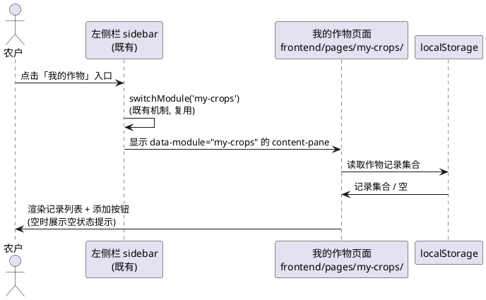
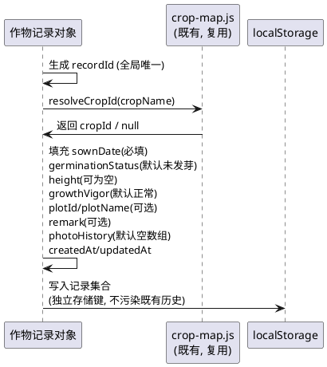
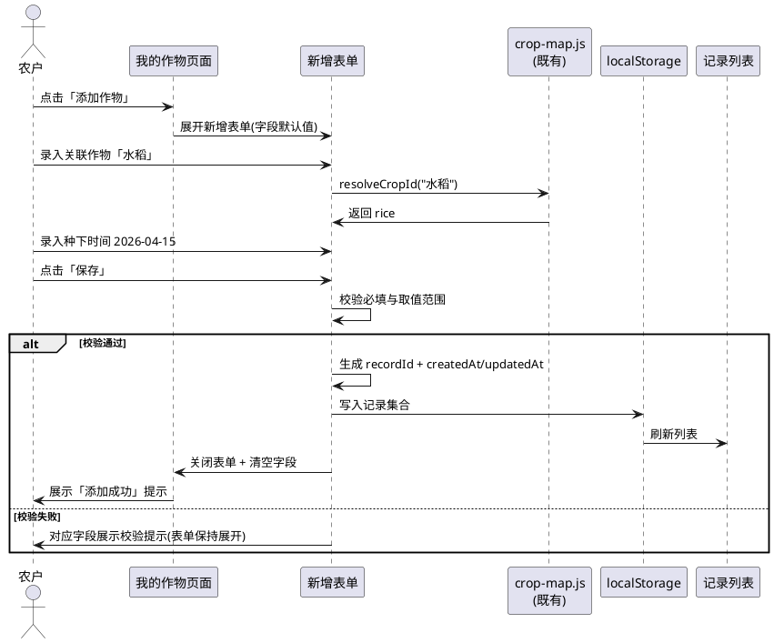
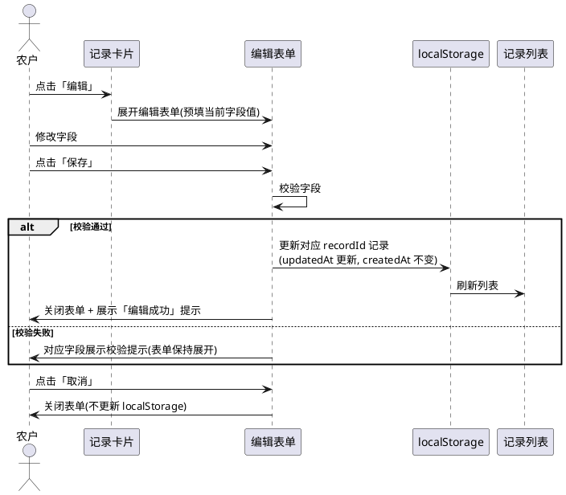
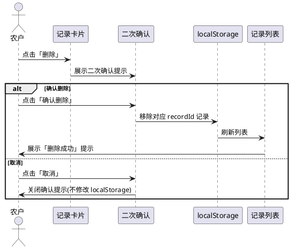
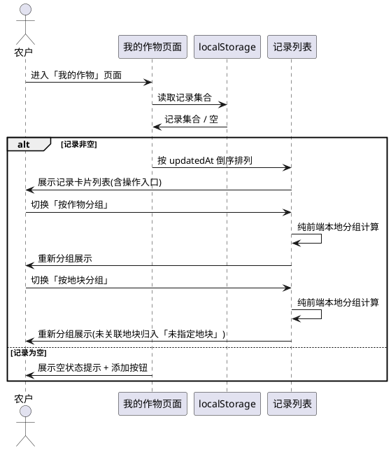
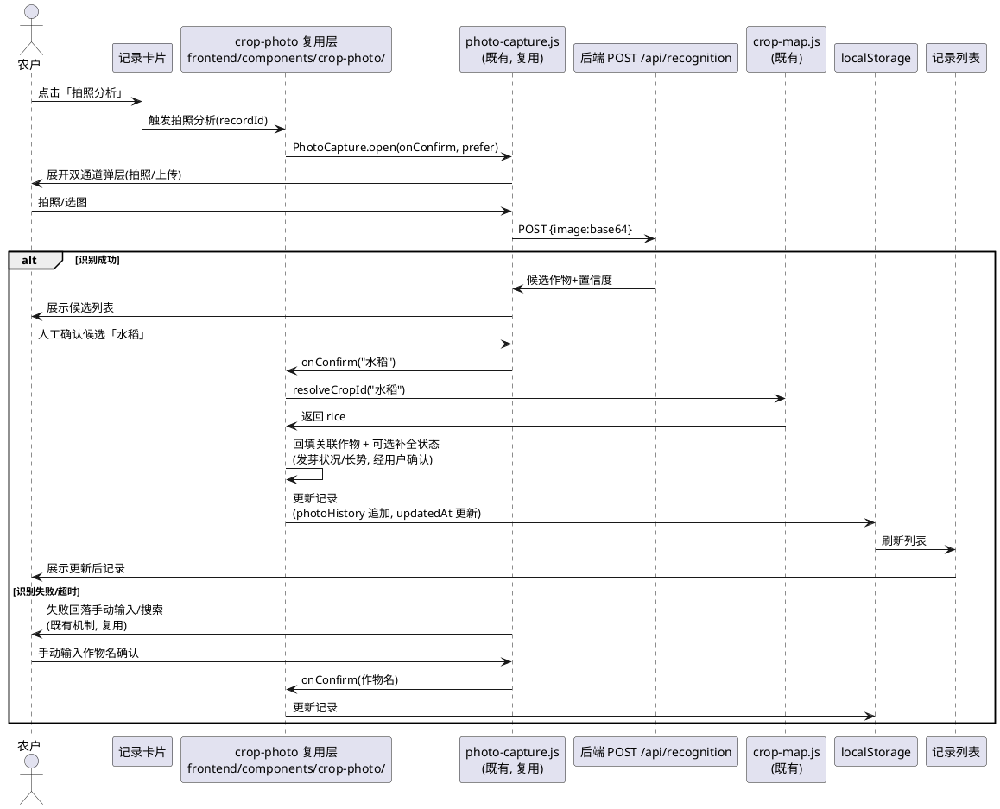
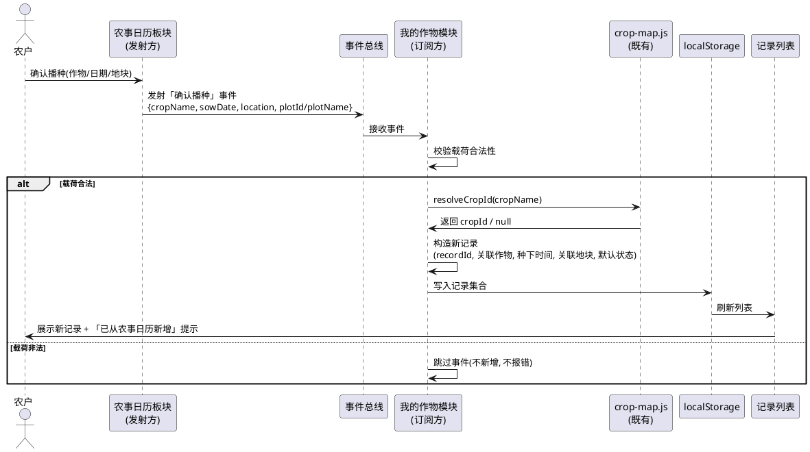
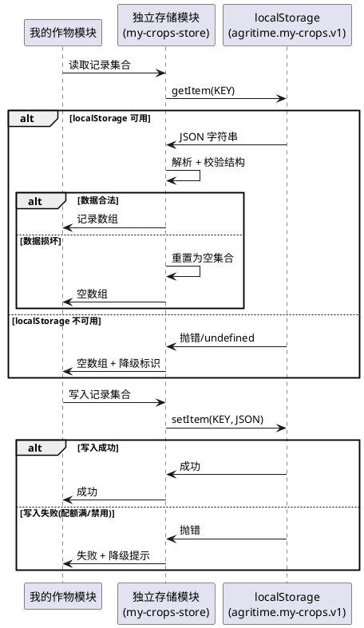
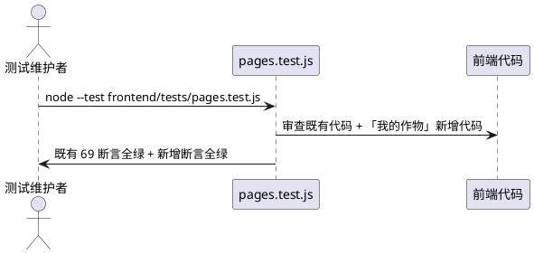

# V4 T12 我的作物（v4_t12_my_crops）

> 本文档用于规范 agritime（知农时 · 会看天的农事日历）功能扩展任务书 V4.0 中任务编号 T12 的验收标准：「我的作物」独立功能模块——管理用户已经种下的作物；用户按提示录入作物状态（种下时间、发芽状况、高度、长势等字段）；支持拍照分析（拍摄作物照片，后台识别后自动补全/更新状态）；日历联动（用户在农事日历板块确认播种后，自动在「我的作物」中新增对应作物记录）；记录按作物/地块关联展示。
> 范围红线：本次为**纯前端「我的作物」功能实现**任务，仅允许修改 `frontend/` 目录下文件；须保证（1）前端 69/69 既有测试全绿、仅允许新增断言、（2）不引入框架/构建工具/第三方库（含 UI 框架 Vue/React、状态管理库、存储库）、（3）不修改后端（Java/8080）与 nginx 配置——后端 `backend/service/my-crop` 服务属成员2协作范围，本任务仅消费既有 `POST /api/recognition` 接口与待定的 my-crop 接口契约前端侧适配、（4）数据存储采用前端 localStorage 临时存储（账号系统就绪后绑定后端，本任务不实现账号绑定）、（5）拍照分析复用既有 `frontend/pages/photo-capture.js` 与后端 `/api/recognition` 接口、（6）日历联动监听农事日历板块确认播种事件自动新增记录、（7）左侧栏集成复用既有 `frontend/components/sidebar/sidebar.js` 的 `my-crops` 入口与 `switchModule` 机制、（8）「我的作物」页面资源放 `frontend/pages/my-crops/`、拍照组件复用层放 `frontend/components/crop-photo/` 遵循 V4 目录规范。
> 交付形式：本文档描述**做什么（What）**与**验收标准（Acceptance Criteria）**，不描述技术实现方式（How）；技术架构与代码结构由后续 design 阶段承接。
> 全局约束继承自 `stage2_frontend`（spec.md 60 条）、`t00_directory_migration`（49 条）、`t01_weather_visual`（42 条）、`v4_t01_ui_revamp`（38 条）：纯原生 JS + 原生 CSS、前端测试断言不可弱化、`crop-map.js` 5 个 cropId 不变、mock 保持 null 占位不造假、时间线页天气数据经后端 `GET /api/timeline` 获取、主页左侧栏 6 板块入口已落地（含 `my-crops` 入口，当前 `implemented:false` 展示占位提示）、天气视觉与时段动画已落地不改变、语音组件已落地不改变、拍照识别（photo-capture.js 双通道 + `POST /api/recognition`）已落地不改变其双通道与人工确认机制。本任务在既有基础上**将「我的作物」板块从占位提示升级为完整业务页面**，并**建立作物记录管理、拍照分析、日历联动三项核心能力**。

# **1. 组件定位**

## **1.1 核心职责**
本组件负责将左侧栏「我的作物」板块从占位提示升级为完整业务页面，提供作物记录的添加/编辑/删除/查看能力，支持用户录入作物状态字段（种下时间、发芽状况、高度、长势等），复用既有拍照识别通道实现拍照分析以自动补全/更新状态，并监听农事日历板块的确认播种事件自动新增对应作物记录，记录按作物/地块关联展示，数据暂存于浏览器 localStorage。

## **1.2 核心输入**
1. 用户在「我的作物」页面点击「添加作物」的操作指令——触发新增记录表单。
2. 用户在新增/编辑表单中录入的作物状态字段——种下时间、发芽状况、高度、长势、关联作物、关联地块、备注等。
3. 用户在记录卡片上点击「拍照分析」的操作指令——触发拍照识别通道（复用既有 photo-capture.js）。
4. 用户通过拍照/上传提交的作物照片（base64）——经既有 `POST /api/recognition` 接口返回候选作物与置信度，人工确认后回填并可作为状态补全依据。
5. 农事日历板块发出的「确认播种」事件——含作物名、播种日期、所在地/地块等上下文，触发自动新增记录。
6. 用户在记录列表上的查看/编辑/删除操作指令——触发对应记录的读取/更新/移除。
7. 既有 `frontend/assets/js/crop-map.js` 的作物映射（5 个 cropId + 6 作物条目）——用于关联作物的中文名 ↔ cropId 解析，不改变其既有映射。
8. 既有 `frontend/assets/js/history-store.js` 的 localStorage 存储模式参照——本任务采用独立的存储键与结构，不污染既有历史记录。
9. 既有 `frontend/components/sidebar/sidebar.js` 的 `my-crops` 板块入口与 `switchModule` 机制——本任务将其 `implemented` 标记为 true 并接入真实页面。

## **1.3 核心输出**
1. 「我的作物」板块页面视图：含记录列表（按作物/地块分组关联展示）、添加按钮、空状态提示。
2. 作物记录新增/编辑表单视图：含种下时间、发芽状况、高度、长势、关联作物、关联地块、备注等字段输入控件。
3. 作物记录卡片视图：单条记录的状态字段展示、拍照分析入口、编辑/删除操作。
4. 拍照分析结果视图：复用既有 photo-capture.js 候选确认弹层，确认后回填作物并可选补全状态字段。
5. 农事日历确认播种后自动新增的作物记录（写入 localStorage 并刷新列表）。
6. 写入浏览器 localStorage 的作物记录集合（独立存储键，账号系统就绪后可迁移至后端）。
7. 操作反馈视图：添加/编辑/删除成功或失败的可见提示（非 alert，不白屏）。

## **1.4 职责边界**
本组件**不负责**以下事项：
1. 后端 Java 服务（`/opt/crop-calendar`，8080）的任何修改——**明确禁止**修改后端代码、新增后端 my-crop 接口或改动后端配置；后端 `backend/service/my-crop` 服务属成员2协作范围，本任务仅在前端侧预留接口契约适配位（消费既有 `POST /api/recognition`，待定 my-crop 接口以前端降级方式承接）。
2. nginx 反向代理配置的修改——**明确禁止**；本任务不依赖 nginx 新增代理路径或 location。
3. 账号系统的实现与个人数据后端绑定——**明确禁止**；账号系统由 T10 任务承接，本任务数据暂存 localStorage，账号就绪后由 T10 统一迁移绑定，本任务不实现绑定逻辑。
4. 既有 `frontend/pages/photo-capture.js` 双通道机制、人工确认机制、800ms 超时、失败回落搜索的修改——**明确禁止**改变既有拍照识别交互；本任务仅复用其 `open(onConfirm, prefer)` 入口，在 `onConfirm` 回调中承接作物回填与状态补全。
5. 既有 `frontend/components/sidebar/sidebar.js` 的 6 板块入口配置、`switchModule` 机制、移动端抽屉折叠的修改——**明确禁止**改变既有左侧栏核心行为；本任务仅将 `my-crops` 入口的 `implemented` 标记为 true 并提供对应 `.content-pane` 内容区。
6. 既有 `frontend/assets/js/crop-map.js` 的 5 个 cropId 与 6 作物条目映射的修改——**明确禁止**改变既有作物映射；本任务仅消费其 `resolveCropId`/`buildCropParam` 解析关联作物。
7. 既有 `frontend/assets/js/history-store.js` 的存储键 `agritime.history.v1` 与查询历史记录的修改——**明确禁止**污染既有历史记录；本任务采用独立存储键（如 `agritime.my-crops.v1`）。
8. 既有天气视觉（weather-visual.js）、时段动画（time-period.js）、语音组件（voice-input.js）、搜索历史、分栏布局（body.split-active）、主页表单提交链路、时间线页渲染逻辑的修改——**明确禁止**改变既有已落地功能。
9. 任何框架、构建工具、第三方库（含 UI 框架 Vue/React、状态管理库 Redux/Pinia、存储库 localforage、表单库、图片处理库）的引入——**明确禁止**。
10. 农事日历板块「确认播种」交互的完整实现——本任务仅**监听**该板块发出的确认播种事件并自动新增记录；确认播种按钮的 UI 与事件发射由农事日历板块（T04/T13 相关任务）承接，本任务定义事件契约并消费。

# **2. 领域术语**

**我的作物（My Crops）**
: 指用户已经种下并纳入管理的作物集合，每条记录对应一块田间正在生长的作物实例，含种下时间、发芽状况、高度、长势等状态字段，区别于「种植推荐」（未种下的候选作物）与「农事日历」（时间节点视图）。

**作物记录（Crop Record）**
: 指「我的作物」模块中一条具体的作物实例记录，含关联作物（中文名 + cropId）、关联地块、种下时间、发芽状况、高度、长势、备注、拍照历史等字段，存储于浏览器 localStorage，全局唯一标识为 recordId。

**作物状态字段（Crop Status Fields）**
: 指描述作物当前生长状态的结构化字段集合，至少包含：种下时间（日期）、发芽状况（枚举：未发芽/已发芽/出苗/真叶/成熟等）、高度（数值，单位 cm）、长势（枚举：旺盛/正常/缓慢/不良等）；可扩展备注文本与拍照历史。

**种下时间（Sown Date）**
: 指作物记录中该作物实际种下（播种/移栽）的日期，格式 `YYYY-MM-DD`，为作物记录的必填字段；可由用户手动录入或由农事日历确认播种事件自动带入。

**发芽状况（Germination Status）**
: 指作物记录中该作物当前的发芽与苗情阶段，枚举值至少覆盖：未发芽、已发芽、出苗、真叶、成熟；可由用户手动选择或由拍照分析结果补全。

**高度（Height）**
: 指作物记录中该作物当前的高度测量值，数值类型，单位 cm（厘米），取值范围 [0, 1000]；可由用户手动录入或由拍照分析结果补全。

**长势（Growth Vigor）**
: 指作物记录中该作物当前的长势评价，枚举值至少覆盖：旺盛、正常、缓慢、不良；可由用户手动选择或由拍照分析结果补全。

**关联作物（Linked Crop）**
: 指作物记录所关联的作物种类，含中文名与 cropId（经 `crop-map.js` 的 `resolveCropId` 解析）；cropId 须落在既有 5 个 cropId 之内（dry_garlic/wheat_winter/corn_summer/rice/soybean），未识别中文名时 cropId 为 null 但仍允许保存记录。

**关联地块（Linked Plot）**
: 指作物记录所关联的地块标识，可为空（用户未标注地块时）；地块完整管理由 T06「我的地块」任务承接，本任务仅以地块名/标识字段关联展示，不实现地块建模。

**拍照分析（Photo Analysis）**
: 指用户对某条作物记录发起拍照/上传图片，经既有 `POST /api/recognition` 接口识别返回候选作物与置信度，人工确认后回填关联作物并可选补全状态字段（如发芽状况、长势）的过程；复用既有 photo-capture.js 双通道与人工确认机制。

**日历联动（Calendar Linkage）**
: 指用户在农事日历板块确认播种后，农事日历板块发出「确认播种」事件，「我的作物」模块监听该事件并自动新增一条作物记录（含事件携带的作物名、播种日期、所在地/地块）的机制。

**确认播种事件（Sowing Confirmed Event）**
: 指农事日历板块在用户确认播种操作时发出的自定义事件，事件载荷至少含作物名（cropName）、播种日期（sowDate）、所在地（location）、地块标识（plotId，可选）；「我的作物」模块订阅该事件并据此自动新增记录，事件契约由本任务定义、由农事日历板块发射。

**记录分组关联展示（Grouped Display by Crop/Plot）**
: 指作物记录列表按关联作物或关联地块分组展示的视图模式，用户可切换分组维度（按作物/按地块），未关联地块的记录归入「未指定地块」分组。

**localStorage 临时存储（Temporary Local Storage）**
: 指作物记录集合暂存于浏览器 localStorage（独立存储键，不污染既有查询历史），账号系统就绪后可迁移至后端绑定；localStorage 不可用时（隐私模式/被禁用）须静默降级，不阻塞页面渲染与查看（只读空列表）。

**EARS 需求编号约定**
: 本文档需求编号格式为 `REQ-VMC-XXX-NNN`，`VMC` 为 V4 My Crops 缩写。前缀对应 EARS 句型：UBI（Ubiquitous，通用）、EVT（Event-driven，事件驱动）、STA（State-driven，状态驱动）、OPT（Optional，可选/带前提）、UNW（Unwanted，非期望行为）。

# **3. 角色与边界**

## **3.1 核心角色**
- **农户 / 农业从业者**：在「我的作物」板块添加/编辑/删除/查看已种作物记录，对记录发起拍照分析以补全状态，是本任务的直接受益对象。
- **测试维护者**：运行 `node --test frontend/tests/pages.test.js`，确认既有 69 项断言全绿并补充「我的作物」相关新断言。
- **开发者 / 交付者**：在 `frontend/` 范围内改动代码、上传至目标服务器 `/agritime/frontend` 并提交 Git。

## **3.2 外部系统**
- **既有 `frontend/components/sidebar/sidebar.js`**：左侧栏导航组件，已配置 `my-crops` 入口（当前 `implemented:false`），本任务将其标记为 true 并接入真实页面；复用 `switchModule` 机制，不改变其核心行为。
- **既有 `frontend/pages/photo-capture.js`**：拍照识别组件，暴露 `window.PhotoCapture.open(onConfirm, prefer)`，本任务复用其双通道与人工确认机制，在 `onConfirm` 回调中承接作物回填与状态补全；不改变其既有交互。
- **后端 `POST /api/recognition`**：拍照识别接口，请求 `{image: base64}`，返回候选作物（中文名 + 置信度）；本任务经既有 photo-capture.js 间接调用，不直接修改该接口。
- **后端 my-crop 接口（待定，属成员2协作范围）**：作物记录的持久化接口（增删改查），本任务不实现后端，仅在前端侧预留接口契约适配位；后端未就绪时前端以 localStorage 降级承接，后端就绪后可切换至接口持久化。
- **既有 `frontend/assets/js/crop-map.js`**：作物映射模块，暴露 `resolveCropId`/`buildCropParam`；本任务消费其解析关联作物的 cropId，不改变既有 5 个 cropId 与 6 作物条目。
- **农事日历板块（`calendar` 板块）**：确认播种事件的发射方；本任务定义事件契约并订阅，不实现农事日历板块的确认播种 UI。
- **浏览器 localStorage**：作物记录集合的临时持久化载体（独立存储键，如 `agritime.my-crops.v1`），不污染既有查询历史；localStorage 不可用时静默降级。
- **既有 `frontend/assets/js/history-store.js`**：查询历史存储模块（参照其降级模式），本任务不修改既有模块，仅参照其降级策略实现独立存储。

## **3.3 交互上下文**
```plantuml
@startuml
skinparam rectangle {
  BackgroundColor #fffdf7
  BorderColor #e4ddcb
}
actor "农户/农业从业者" as user
rectangle "左侧栏 sidebar\n(既有, 复用 my-crops 入口)" as sidebar
rectangle "我的作物页面\nfrontend/pages/my-crops/" as mycrops
rectangle "作物记录列表\n(按作物/地块分组)" as list
rectangle "新增/编辑表单\n(种下时间/发芽/高度/长势等)" as form
rectangle "拍照分析\n(复用 photo-capture.js)" as photo
rectangle "localStorage\n(agritime.my-crops.v1)" as ls
rectangle "后端 POST /api/recognition\n(既有, 复用)" as recog
rectangle "crop-map.js\n(既有, 复用解析)" as cropmap
rectangle "农事日历板块\n(发射确认播种事件)" as calendar
rectangle "后端 my-crop 接口\n(待定, 成员2协作)" as beapi

user --> sidebar : 点击「我的作物」入口
sidebar --> mycrops : switchModule('my-crops')
mycrops --> list : 渲染记录列表
list --> ls : 读取记录
ls --> list : 记录集合

user --> mycrops : 点击「添加作物」
mycrops --> form : 展开新增表单
user --> form : 录入状态字段
form --> ls : 保存记录
ls --> list : 刷新列表

user --> list : 点击记录「拍照分析」
list --> photo : PhotoCapture.open(onConfirm)
photo --> recog : POST {image:base64}
recog --> photo : 候选作物+置信度
user --> photo : 人工确认候选
photo --> form : 回填作物+补全状态
form --> ls : 更新记录

user --> calendar : 确认播种
calendar --> mycrops : 发射「确认播种」事件
mycrops --> ls : 自动新增记录
ls --> list : 刷新列表

note over beapi : 后端 my-crop 接口待定\n前端以 localStorage 降级承接\n账号就绪后切换后端绑定
@enduml
```

# **4. DFX约束**

## **4.1 性能**
1. 「我的作物」页面渲染须在板块切换后 ≤100ms 内呈现列表骨架，不得因 localStorage 读取延迟首屏渲染（localStorage 读取为同步本地操作）。
2. 作物记录添加/编辑/删除须在用户操作后 ≤100ms 内给出视觉反馈（列表刷新 + 操作提示），不得有感知延迟。
3. 拍照分析复用既有 photo-capture.js 的 800ms 超时与候选确认机制，不引入额外超时或新的识别请求链路。
4. 日历联动的自动新增记录须在确认播种事件发生后 ≤200ms 内完成（事件订阅 + localStorage 写入 + 列表刷新），不得阻塞农事日历板块的确认播种交互。
5. 记录列表分组关联展示（按作物/按地块）须为纯前端本地分组计算，不发起网络请求，分组切换 ≤100ms。
6. 作物记录集合的 localStorage 读写须为同步本地操作，不阻塞页面渲染；单次读写数据量须合理（记录总数上限 200 条，超出按时间淘汰最旧）。

## **4.2 可靠性**
1. 任一环节失败（localStorage 不可用、拍照识别失败/超时、后端 my-crop 接口未就绪、确认播种事件载荷非法）时，页面须优雅降级，**不得白屏**、不得抛出未捕获 JS 错误。
2. localStorage 不可用（隐私模式/被禁用）时，「我的作物」页面须静默降级为只读空列表 + 中性提示（如「本地存储不可用，无法保存记录」），不阻塞板块切换与查看。
3. 拍照识别失败/超时时，须复用既有 photo-capture.js 的失败回落搜索机制，流程不中断，不得卡死在拍照弹层。
4. 后端 my-crop 接口未就绪时，前端须以 localStorage 降级承接全部增删改查，不报错、不白屏；后端就绪后可切换至接口持久化（本任务不实现切换逻辑，仅预留适配位）。
5. 确认播种事件载荷非法（缺字段、类型错误）时，须跳过该事件不新增记录，不报错、不污染既有记录集合。
6. 作物记录数据损坏（localStorage 中数据非法/无法解析）时，须忽略损坏数据并重置为空集合，不报错、不白屏。
7. 操作反馈须有可见标识（添加/编辑/删除成功或失败的提示文案），不得静默成功或静默失败导致用户困惑。

## **4.3 安全性**
1. 作物记录的渲染须使用 `textContent` 等安全方式渲染用户可控文本（备注、关联作物名等），禁止将未转义的用户输入拼入 `innerHTML`（防 XSS）。
2. 写入 localStorage 的内容仅限作物记录的非敏感字段（作物名/种下时间/发芽状况/高度/长势/地块名/备注/拍照 base64 缩略图）；**禁止**在本地存储中写入任何 API Key、令牌、凭据或用户精确经纬度。
3. 拍照 base64 数据须经既有 photo-capture.js 的 `POST /api/recognition` 链路上传，不在前端日志或 localStorage 中留存原始全尺寸图片（仅可存缩略图或仅存识别结果文本）。
4. 板块切换须复用既有 sidebar.js 的同源页面切换机制，不通过动态拼接外部 URL 加载「我的作物」内容，防 XSS 与点击劫持。
5. 本次不引入任何外部脚本依赖，所有逻辑内联或使用项目内本地脚本。

## **4.4 可维护性**
1. 作物记录的字段定义、枚举值（发芽状况/长势）、存储键、记录总数上限、操作提示文案须以**具名常量**集中定义，不得多处硬编码。
2. 确认播种事件的事件名与载荷契约须以具名常量集中定义，便于农事日历板块与「我的作物」模块统一维护。
3. 「我的作物」页面须独立存放于 `frontend/pages/my-crops/` 目录，拍照组件复用层放 `frontend/components/crop-photo/`，遵循 V4 目录规范，不与既有页面逻辑耦合。
4. localStorage 存储模块须独立实现（独立存储键），不与既有 `history-store.js` 共享存储键或修改既有模块；可参照其降级策略但须为独立实现。
5. 后端 my-crop 接口的适配位须以独立模块/函数封装，便于后端就绪后切换持久化方式时不改动业务逻辑层。

## **4.5 兼容性**
1. **测试兼容（强制红线）**：不得破坏 `frontend/tests/pages.test.js` 的既有 69 项断言；可新增断言，既有断言须全绿。运行命令：`node --test frontend/tests/pages.test.js`。
2. **响应式兼容**：375px、768px、1024px 三档宽度下均须无横向滚动；「我的作物」页面（列表/表单/卡片）在三档下均正常展示。
3. **不可引入依赖**：不得引入框架、构建工具、第三方库（含 UI 框架、状态管理库、存储库、表单库、图片处理库）。
4. **文件范围兼容**：不得修改后端及 `data/`、`shared/`、`deploy/`、`docs/` 等模块；仅修改 `frontend/` 下文件。
5. **接口兼容**：不得改变前端既有的 `POST /api/recognition` 调用方式与参数命名（经既有 photo-capture.js 间接调用）；不得改变既有 `GET /api/timeline` 取数方式。
6. **既有功能兼容**：不得改变既有左侧栏 6 板块入口配置与 `switchModule` 机制（仅将 `my-crops` 的 `implemented` 标记为 true）、既有拍照识别双通道与人工确认机制、既有作物映射 5 个 cropId、既有查询历史存储、既有天气视觉、既有语音组件、既有分栏布局、既有主页表单提交链路、既有时间线页渲染的核心行为。
7. **浏览器兼容**：须在主流现代浏览器（Chrome/Edge/Safari 近两版）与移动端 WebView 下可用（原生 JS 语法须避免仅新引擎支持的特性或在必要时降级）。
8. **目录规范兼容**：「我的作物」页面资源须存放于 `frontend/pages/my-crops/`，拍照组件复用层放 `frontend/components/crop-photo/`，遵循 V4 目录规范。

# **5. 核心能力**

## **5.1 左侧栏集成与板块切换**

### **5.1.1 业务规则**

1. **REQ-VMC-UBI-001（Ubiquitous）**：系统须将既有左侧栏 `my-crops` 板块入口的 `implemented` 标记为 true，使用户点击「我的作物」入口时右侧内容区切换为「我的作物」业务页面，不再展示占位提示。
   a. 验收条件：[点击左侧栏「我的作物」入口] → [右侧内容区展示「我的作物」业务页面（记录列表 + 添加按钮），不展示「该板块正在开发中」占位提示]

2. **REQ-VMC-UBI-002（Ubiquitous）**：「我的作物」页面须作为 `data-module="my-crops"` 的 `.content-pane` 接入既有 sidebar.js 的 `switchModule` 机制，板块切换复用既有机制，不改变左侧栏核心行为。
   a. 验收条件：[代码审查 + 交互核对] → [存在 `data-module="my-crops"` 的 content-pane，切换由既有 switchModule 驱动，左侧栏 6 入口配置与切换机制不变]

3. **REQ-VMC-UBI-003（Ubiquitous）**：「我的作物」页面须独立存放于 `frontend/pages/my-crops/` 目录，遵循 V4 目录规范，不与既有页面（index.html/timeline.html）逻辑耦合。
   a. 验收条件：[审查目录结构] → [存在 `frontend/pages/my-crops/` 目录，页面相关资源（HTML/JS/CSS）存放于此，不散落于既有页面]

4. **REQ-VMC-UBI-004（Ubiquitous）**：从其他板块切换至「我的作物」时，页面须即时呈现当前作物记录列表（从 localStorage 读取），不得白屏、不得长时间空白等待。
   a. 验收条件：[从「农事日历」板块切换至「我的作物」] → [≤100ms 内呈现记录列表（含空状态提示），无白屏、无长时间空白]

5. **禁止项**：禁止改变既有 sidebar.js 的 6 板块入口顺序与标识；禁止为「我的作物」板块引入独立的路由库或页面切换机制；禁止「我的作物」板块切换破坏既有分栏布局（body.split-active）。
   a. 验收条件：[代码审查 + 交互核对] → [6 板块入口顺序与标识不变，无路由库引入，分栏布局不被破坏]

### **5.1.2 交互流程**


### **5.1.3 异常场景**

1. **localStorage 不可用时的板块切换**
   a. 触发条件：隐私模式或 localStorage 被禁用
   b. 系统行为：板块切换正常，记录列表展示空 + 中性提示「本地存储不可用，无法保存记录」
   c. 用户感知：可进入「我的作物」板块查看空列表与提示，不白屏

2. **content-pane 节点缺失**
   a. 触发条件：`data-module="my-crops"` 的 content-pane 未正确挂载
   b. 系统行为：复用既有 sidebar.js 的占位提示降级，不白屏
   c. 用户感知：可能看到占位提示，但左侧栏与其他板块正常可用

## **5.2 作物记录数据模型与状态字段**

### **5.2.1 业务规则**

1. **REQ-VMC-UBI-005（Ubiquitous）**：每条作物记录须包含全局唯一的记录标识（recordId），recordId 须为字符串，在同一 localStorage 存储键下唯一，用于编辑/删除/查看的精准定位。
   a. 验收条件：[添加两条记录] → [两条记录的 recordId 不同；编辑/删除指定 recordId 时仅影响该条记录]

2. **REQ-VMC-UBI-006（Ubiquitous）**：每条作物记录须包含关联作物字段，含中文名（cropName）与 cropId（经 `crop-map.js` 的 `resolveCropId` 解析）；cropId 须落在既有 5 个 cropId 之内（dry_garlic/wheat_winter/corn_summer/rice/soybean），未识别中文名时 cropId 为 null 但仍允许保存记录。
   a. 验收条件：[录入关联作物「水稻」] → [cropName 为「水稻」，cropId 为 `rice`]；[录入关联作物「番茄」] → [cropName 为「番茄」，cropId 为 null，记录仍可保存]

3. **REQ-VMC-UBI-007（Ubiquitous）**：每条作物记录须包含种下时间字段（sownDate），格式 `YYYY-MM-DD`，为必填字段；可由用户手动录入或由农事日历确认播种事件自动带入。
   a. 验收条件：[添加记录未填种下时间] → [表单校验提示「请选择种下时间」，不允许保存]；[添加记录填种下时间 2026-04-15] → [sownDate 为「2026-04-15」，保存成功]

4. **REQ-VMC-UBI-008（Ubiquitous）**：每条作物记录须包含发芽状况字段（germinationStatus），枚举值至少覆盖：未发芽、已发芽、出苗、真叶、成熟；默认值为「未发芽」；可由用户手动选择或由拍照分析结果补全。
   a. 验收条件：[新增记录默认发芽状况] → [为「未发芽」]；[选择「已发芽」保存] → [germinationStatus 为「已发芽」]

5. **REQ-VMC-UBI-009（Ubiquitous）**：每条作物记录须包含高度字段（height），数值类型，单位 cm，取值范围 [0, 1000]，可为空（未测量时）；可由用户手动录入或由拍照分析结果补全。
   a. 验收条件：[录入高度 25 保存] → [height 为 25，单位 cm]；[录入高度 1500] → [表单校验提示「高度超出范围」]；[未录入高度保存] → [height 为 null，保存成功]

6. **REQ-VMC-UBI-010（Ubiquitous）**：每条作物记录须包含长势字段（growthVigor），枚举值至少覆盖：旺盛、正常、缓慢、不良；默认值为「正常」；可由用户手动选择或由拍照分析结果补全。
   a. 验收条件：[新增记录默认长势] → [为「正常」]；[选择「旺盛」保存] → [growthVigor 为「旺盛」]

7. **REQ-VMC-OPT-011（Optional/带前提）**：作物记录可包含关联地块字段（plotId/plotName），可为空（用户未标注地块时）；地块完整管理由 T06 任务承接，本任务仅以地块名/标识字段关联展示，不实现地块建模。
   a. 验收条件：[录入关联地块「自家后院」保存] → [plotName 为「自家后院」]；[未录入地块保存] → [plotId/plotName 为 null，记录仍可保存]

8. **REQ-VMC-OPT-012（Optional/带前提）**：作物记录可包含备注字段（remark），文本类型，长度上限 200 字符，可为空；用于用户补充自由文本说明。
   a. 验收条件：[录入备注「长势良好，预计下周追肥」保存] → [remark 为该文本]；[录入备注超 200 字符] → [表单校验提示「备注不超过 200 字」]

9. **REQ-VMC-OPT-013（Optional/带前提）**：作物记录可包含拍照历史字段（photoHistory），数组类型，记录该作物历次拍照分析的识别结果与时间戳；可为空数组；不在 localStorage 中留存原始全尺寸图片（仅存识别结果文本与缩略图或仅存识别结果文本）。
   a. 验收条件：[对某记录发起拍照分析并确认] → [photoHistory 新增一条识别结果记录（含时间戳、识别作物、置信度）]；[审查 localStorage] → [无原始全尺寸图片留存]

10. **REQ-VMC-UBI-014（Ubiquitous）**：每条作物记录须包含创建时间（createdAt）与最后更新时间（updatedAt）字段，格式 ISO 8601 时间戳，用于排序与淘汰最旧记录。
    a. 验收条件：[添加一条记录] → [createdAt 与 updatedAt 均为当前时间戳]；[编辑该记录] → [updatedAt 更新为当前时间戳，createdAt 不变]

11. **禁止项**：禁止在作物记录中存储敏感信息（API Key、令牌、凭据、用户精确经纬度）；禁止改变既有 `crop-map.js` 的 5 个 cropId 与 6 作物条目映射；禁止字段命名与既有全链路参数命名（crop/sowDate/lat/lon）冲突。
    a. 验收条件：[审查作物记录字段] → [无敏感信息，cropId 落在既有 5 个之内，字段命名不与既有参数冲突]

### **5.2.2 交互流程**


### **5.2.3 异常场景**

1. **cropId 解析失败**
   a. 触发条件：用户录入的作物中文名不在 crop-map.js 映射中（如「番茄」）
   b. 系统行为：cropId 置为 null，记录仍可保存，列表以中文名展示
   c. 用户感知：记录保存成功，关联作物展示中文名，无报错

2. **必填字段缺失**
   a. 触发条件：用户未填种下时间即提交
   b. 系统行为：表单校验拦截，提示「请选择种下时间」，不写入 localStorage
   c. 用户感知：看到校验提示，记录未保存，可继续填写

## **5.3 作物记录添加**

### **5.3.1 业务规则**

1. **REQ-VMC-EVT-015（Event-driven）**：当用户在「我的作物」页面点击「添加作物」按钮时，系统须展开新增记录表单，表单含种下时间、发芽状况、高度、长势、关联作物、关联地块、备注等字段输入控件。
   a. 验收条件：[点击「添加作物」] → [展开新增表单，含上述字段输入控件，种下时间为必填，发芽状况默认「未发芽」，长势默认「正常」]

2. **REQ-VMC-UBI-016（Ubiquitous）**：新增表单须提供关联作物输入控件，支持手动输入中文名并经 `crop-map.js` 的 `resolveCropId` 解析 cropId；可复用既有搜索联想机制（基于本地作物库实时匹配候选下拉）。
   a. 验收条件：[在关联作物输入框输入「水」] → [下拉展示含「水稻」的候选]；[选择「水稻」] → [回填关联作物，cropId 为 `rice`]

3. **REQ-VMC-UBI-017（Ubiquitous）**：新增表单须提供种下时间输入控件，支持手动输入日期或日期选择器交互，日期格式 `YYYY-MM-DD`；种下时间为必填，未填时表单校验拦截并提示。
   a. 验收条件：[未填种下时间提交] → [表单校验提示「请选择种下时间」，不保存]；[填种下时间 2026-04-15 提交] → [保存成功，sownDate 为「2026-04-15」]

4. **REQ-VMC-EVT-018（Event-driven）**：当用户填写完新增表单并点击「保存」时，系统须校验必填字段与字段取值范围，校验通过后生成 recordId、写入 localStorage、刷新记录列表、关闭表单、展示添加成功提示。
   a. 验收条件：[填写合法表单并保存] → [生成唯一 recordId，记录写入 localStorage，列表刷新出现新记录，表单关闭，展示「添加成功」类提示]

5. **REQ-VMC-UNW-019（Unwanted）**：如果新增表单校验失败（必填缺失、高度超范围、备注超长等），系统不得写入 localStorage，须在对应字段展示校验提示，表单保持展开供用户修正。
   a. 验收条件：[高度录入 1500 提交] → [不写入 localStorage，高度字段展示「高度超出范围」提示，表单保持展开]

6. **REQ-VMC-OPT-020（Optional/带前提）**：当 localStorage 不可用时，系统须静默降级，新增操作须展示「本地存储不可用，无法保存记录」提示，不阻塞页面渲染与查看。
   a. 验收条件：[localStorage 不可用时点击添加并保存] → [展示「本地存储不可用」提示，不白屏、不报错]

7. **禁止项**：禁止新增表单遮挡左侧栏与其他板块入口；禁止保存按钮在表单未展开时可见可点击；禁止新增成功后表单残留上一次输入（须清空字段）。
   a. 验收条件：[视觉核对 + 交互核对] → [表单不遮挡左侧栏，保存按钮仅在表单展开时可见，新增成功后表单字段清空]

### **5.3.2 交互流程**


### **5.3.3 异常场景**

1. **localStorage 写入失败**
   a. 触发条件：localStorage 配额满或被禁用
   b. 系统行为：捕获异常，展示「本地存储不可用，无法保存记录」提示，表单保持展开供用户复制内容
   c. 用户感知：看到提示，记录未保存，可继续操作

2. **recordId 生成冲突（极小概率）**
   a. 触发条件：生成的 recordId 与既有记录重复
   b. 系统行为：重新生成 recordId 直至唯一
   c. 用户感知：无感知，保存成功

## **5.4 作物记录编辑**

### **5.4.1 业务规则**

1. **REQ-VMC-EVT-021（Event-driven）**：当用户在记录卡片上点击「编辑」操作时，系统须展开编辑表单，表单预填该记录的当前字段值（种下时间、发芽状况、高度、长势、关联作物、关联地块、备注等）。
   a. 验收条件：[点击某记录「编辑」] → [展开编辑表单，各字段预填该记录当前值]

2. **REQ-VMC-EVT-022（Event-driven）**：当用户修改编辑表单字段并点击「保存」时，系统须校验字段，校验通过后更新 localStorage 中对应 recordId 的记录、刷新列表、关闭表单、展示编辑成功提示；updatedAt 须更新为当前时间戳，createdAt 不变。
   a. 验收条件：[修改高度为 30 并保存] → [记录 height 更新为 30，updatedAt 更新，createdAt 不变，列表刷新，展示「编辑成功」提示]

3. **REQ-VMC-UNW-023（Unwanted）**：如果编辑表单校验失败，系统不得覆盖 localStorage 中既有记录，须在对应字段展示校验提示，表单保持展开供用户修正。
   a. 验收条件：[编辑高度为 1500 提交] → [既有记录不变，高度字段展示校验提示，表单保持展开]

4. **REQ-VMC-UBI-024（Ubiquitous）**：编辑表单须提供「取消」操作，用户点击取消时须放弃本次修改、关闭表单、不更新 localStorage。
   a. 验收条件：[修改字段后点击「取消」] → [表单关闭，localStorage 中记录不变，列表不刷新]

5. **禁止项**：禁止编辑操作改变 recordId 与 createdAt；禁止编辑表单遮挡左侧栏；禁止编辑保存后表单残留（须关闭并清空临时状态）。
   a. 验收条件：[编辑保存后审查记录] → [recordId 与 createdAt 不变，表单已关闭]

### **5.4.2 交互流程**


### **5.4.3 异常场景**

1. **编辑时记录已被删除（并发场景）**
   a. 触发条件：用户在多个标签页操作，编辑表单展开后另一标签页删除了该记录
   b. 系统行为：保存时检测到 recordId 不存在，提示「该记录已被删除，无法保存」，关闭表单
   c. 用户感知：看到提示，列表中该记录已不存在

## **5.5 作物记录删除**

### **5.5.1 业务规则**

1. **REQ-VMC-EVT-025（Event-driven）**：当用户在记录卡片上点击「删除」操作时，系统须展示二次确认提示（如「确认删除该作物记录？」），不得直接删除。
   a. 验收条件：[点击「删除」] → [展示二次确认提示，含「确认删除」与「取消」按钮]

2. **REQ-VMC-EVT-026（Event-driven）**：当用户在二次确认中点击「确认删除」时，系统须从 localStorage 移除对应 recordId 的记录、刷新列表、展示删除成功提示。
   a. 验收条件：[点击「确认删除」] → [localStorage 中该 recordId 记录移除，列表刷新不再显示该记录，展示「删除成功」提示]

3. **REQ-VMC-UBI-027（Ubiquitous）**：删除二次确认须提供「取消」操作，用户点击取消时须放弃删除、不修改 localStorage。
   a. 验收条件：[点击「取消」] → [确认提示关闭，localStorage 中记录不变，列表不变]

4. **REQ-VMC-UNW-028（Unwanted）**：如果删除时 localStorage 操作失败，系统不得静默失败，须展示「删除失败」提示，列表保持原状。
   a. 验收条件：[localStorage 操作失败] → [展示「删除失败」提示，列表中该记录仍存在]

5. **禁止项**：禁止无二次确认直接删除；禁止删除操作影响其他记录；禁止删除后列表残留已删记录卡片。
   a. 验收条件：[交互核对] → [删除有二次确认，仅删目标记录，列表无残留]

### **5.5.2 交互流程**


### **5.5.3 异常场景**

1. **删除时记录已被其他操作移除**
   a. 触发条件：多标签页并发，确认删除时该 recordId 已不存在
   b. 系统行为：静默处理，列表刷新，展示「记录已不存在」或直接刷新无该记录
   c. 用户感知：列表中无该记录，无报错

## **5.6 作物记录查看与关联展示**

### **5.6.1 业务规则**

1. **REQ-VMC-UBI-029（Ubiquitous）**：「我的作物」页面须展示当前所有作物记录的列表，列表项为记录卡片，卡片展示关联作物、种下时间、发芽状况、高度、长势、关联地块、备注等关键字段，并提供编辑/删除/拍照分析操作入口。
   a. 验收条件：[进入「我的作物」页面] → [展示记录列表，每张卡片含上述字段与操作入口]

2. **REQ-VMC-UBI-030（Ubiquitous）**：记录列表须支持按关联作物分组关联展示，用户可切换至「按作物分组」模式，同作物的记录归入同一分组，分组以作物中文名为标题。
   a. 验收条件：[切换至「按作物分组」] → [列表按关联作物分组，同作物记录归入同一分组，分组标题为作物中文名]

3. **REQ-VMC-UBI-031（Ubiquitous）**：记录列表须支持按关联地块分组关联展示，用户可切换至「按地块分组」模式，同地块的记录归入同一分组，未关联地块的记录归入「未指定地块」分组。
   a. 验收条件：[切换至「按地块分组」] → [列表按关联地块分组，同地块记录归入同一分组，未关联地块记录归入「未指定地块」分组]

4. **REQ-VMC-UBI-032（Ubiquitous）**：记录列表为空时须展示空状态提示（如「还没有作物记录，点击添加你的第一株作物」），不白屏、不报错。
   a. 验收条件：[无任何记录时进入页面] → [展示空状态提示文案 + 添加按钮，无白屏]

5. **REQ-VMC-UBI-033（Ubiquitous）**：记录列表须按 updatedAt 倒序排列（最近更新的记录在前），便于用户快速访问近期操作过的记录。
   a. 验收条件：[添加/编辑记录后查看列表] → [最近操作的记录排在列表前部]

6. **REQ-VMC-UBI-034（Ubiquitous）**：分组关联展示的切换须为纯前端本地分组计算，不发起网络请求，切换响应 ≤100ms。
   a. 验收条件：[切换分组模式] → [≤100ms 内列表重新分组展示，无网络请求]

7. **REQ-VMC-OPT-035（Optional/带前提）**：当记录总数超过列表一屏可展示数量时，列表须可纵向滚动，左侧栏保持固定不动，不出现横向滚动条。
   a. 验收条件：[记录总数超一屏] → [列表纵向滚动，左侧栏固定，无横向滚动]

8. **禁止项**：禁止列表展示硬编码的虚假记录；禁止分组切换改变记录数据（仅改变展示分组）；禁止列表卡片遮挡左侧栏入口。
   a. 验收条件：[代码审查 + 视觉核对] → [无硬编码虚假记录，分组切换不改数据，卡片不遮挡左侧栏]

### **5.6.2 交互流程**


### **5.6.3 异常场景**

1. **localStorage 数据损坏**
   a. 触发条件：localStorage 中记录集合非法/无法解析
   b. 系统行为：忽略损坏数据，重置为空集合，展示空状态提示
   c. 用户感知：看到空状态提示，无报错、无白屏

2. **分组字段缺失**
   a. 触发条件：按地块分组时某记录 plotId/plotName 为 null
   b. 系统行为：归入「未指定地块」分组
   c. 用户感知：该记录在「未指定地块」分组下可见

## **5.7 拍照分析与状态补全**

### **5.7.1 业务规则**

1. **REQ-VMC-EVT-036（Event-driven）**：当用户在记录卡片上点击「拍照分析」操作时，系统须复用既有 `frontend/pages/photo-capture.js` 的 `PhotoCapture.open(onConfirm, prefer)` 入口，展开拍照/上传双通道弹层，不改变既有双通道与人工确认机制。
   a. 验收条件：[点击「拍照分析」] → [展开既有 photo-capture.js 弹层，含「拍照」与「上传/选图」双通道，人工确认机制不变]

2. **REQ-VMC-UBI-037（Ubiquitous）**：拍照分析须经既有 `POST /api/recognition` 接口识别返回候选作物与置信度，用户人工确认候选后，系统须将确认的作物回填至该记录的关联作物字段（经 `crop-map.js` 解析 cropId），并可选补全状态字段（发芽状况、长势）。
   a. 验收条件：[拍照并确认候选「水稻」] → [该记录关联作物更新为「水稻」，cropId 为 `rice`，可选补全发芽状况/长势]

3. **REQ-VMC-EVT-038（Event-driven）**：当拍照分析确认作物后，系统须将该次识别结果（时间戳、识别作物、置信度）追加至该记录的 photoHistory 字段，并更新 updatedAt，刷新列表展示。
   a. 验收条件：[拍照确认后审查记录] → [photoHistory 新增一条识别结果记录，updatedAt 更新，列表刷新]

4. **REQ-VMC-UNW-039（Unwanted）**：如果拍照识别失败/超时（复用既有 800ms 超时），系统须复用既有 photo-capture.js 的失败回落搜索机制，流程不中断，不得卡死在拍照弹层，不得白屏。
   a. 验收条件：[识别失败/超时] → [展示手动输入/搜索回落，用户可继续操作或取消，不卡死、不白屏]

5. **REQ-VMC-OPT-040（Optional/带前提）**：当后端 `/api/recognition` 接口不可用时，系统须复用既有 photo-capture.js 的失败回落机制，用户可手动输入作物名并确认回填，不报错、不阻塞。
   a. 验收条件：[后端识别接口不可用] → [回落手动输入，用户可输入作物名确认回填，无报错]

6. **REQ-VMC-UBI-041（Ubiquitous）**：拍照分析组件复用层须独立存放于 `frontend/components/crop-photo/` 目录，封装对既有 photo-capture.js 的调用与 onConfirm 回调承接，不修改既有 photo-capture.js 源文件。
   a. 验收条件：[审查目录结构] → [存在 `frontend/components/crop-photo/` 目录，复用层存放于此；既有 photo-capture.js 源文件无修改]

7. **REQ-VMC-UBI-042（Ubiquitous）**：拍照分析须在记录卡片的操作入口触发，不改变既有 photo-capture.js 在主页表单中的既有拍照识别行为（主页表单的拍照识别用于新增查询时的作物识别，与「我的作物」的拍照分析为独立场景）。
   a. 验收条件：[主页表单拍照识别行为] → [既有行为不变]；[「我的作物」记录卡片拍照分析] → [独立触发，回填至该记录]

8. **禁止项**：禁止修改既有 photo-capture.js 源文件的双通道/人工确认/超时/失败回落机制；禁止在 localStorage 中留存原始全尺寸图片；禁止拍照分析遮挡左侧栏；禁止拍照确认后自动保存而不给用户确认状态补全的机会。
   a. 验收条件：[代码审查 + 交互核对] → [既有 photo-capture.js 不变，无全尺寸图片留存，不遮挡左侧栏，状态补全经用户确认]

### **5.7.2 交互流程**


### **5.7.3 异常场景**

1. **用户拒绝摄像头权限**
   a. 触发条件：浏览器拒绝摄像头访问
   b. 系统行为：复用既有 photo-capture.js 的上传/选图通道与失败回落
   c. 用户感知：仍可通过上传/选图或手动输入完成，流程不中断

2. **后端识别接口不可用**
   a. 触发条件：`POST /api/recognition` 返回非 2xx 或网络错误
   b. 系统行为：复用既有 photo-capture.js 失败回落手动输入
   c. 用户感知：看到「该功能需要后端服务支持」提示，可手动输入作物名确认

3. **确认后记录已被删除**
   a. 触发条件：拍照确认时该 recordId 已被其他操作删除
   b. 系统行为：提示「该记录已被删除，无法更新」，关闭弹层
   c. 用户感知：看到提示，列表中该记录已不存在

## **5.8 农事日历联动**

### **5.8.1 业务规则**

1. **REQ-VMC-UBI-043（Ubiquitous）**：系统须定义「确认播种」事件契约，事件名与载荷字段（cropName、sowDate、location、plotId/plotName 可选）须以具名常量集中定义；农事日历板块在用户确认播种时发射该事件，「我的作物」模块订阅该事件并自动新增作物记录。
   a. 验收条件：[代码审查] → [存在具名常量定义事件名与载荷字段]；[农事日历板块确认播种] → [发射「确认播种」事件，「我的作物」模块接收并自动新增记录]

2. **REQ-VMC-EVT-044（Event-driven）**：当「我的作物」模块接收到「确认播种」事件且载荷合法（含 cropName 与 sowDate）时，系统须自动新增一条作物记录，记录的关联作物取自事件 cropName（经 `crop-map.js` 解析 cropId）、种下时间取自事件 sowDate、关联地块取自事件 plotId/plotName（可选）、所在地取自事件 location（可选），并写入 localStorage、刷新列表。
   a. 验收条件：[接收合法确认播种事件 {cropName:「水稻」, sowDate:「2026-04-15」, plotName:「自家后院」}] → [自动新增记录，关联作物「水稻」cropId `rice`，种下时间「2026-04-15」，关联地块「自家后院」，列表刷新出现该记录]

3. **REQ-VMC-UNW-045（Unwanted）**：如果「确认播种」事件载荷非法（缺 cropName 或 sowDate、类型错误），系统须跳过该事件不新增记录，不报错、不污染既有记录集合。
   a. 验收条件：[接收非法事件 {cropName:「水稻」}（缺 sowDate）] → [不新增记录，不报错，既有记录集合不变]

4. **REQ-VMC-OPT-046（Optional/带前提）**：当自动新增记录的关联作物经 `crop-map.js` 解析 cropId 为 null（未识别作物）时，系统须仍保存记录（cropId 为 null），并可在列表中以中文名展示，不阻塞自动新增流程。
   a. 验收条件：[确认播种事件 cropName 为「番茄」] → [自动新增记录，cropName「番茄」，cropId null，列表展示「番茄」]

5. **REQ-VMC-UBI-047（Ubiquitous）**：自动新增记录须在确认播种事件发生后 ≤200ms 内完成（事件订阅 + localStorage 写入 + 列表刷新），不得阻塞农事日历板块的确认播种交互。
   a. 验收条件：[确认播种后查看「我的作物」板块] → [≤200ms 内列表出现对应记录，农事日历板块确认播种交互未被阻塞]

6. **REQ-VMC-UBI-048（Ubiquitous）**：自动新增记录须展示可见提示（如「已从农事日历新增作物记录」），便于用户感知联动发生；提示须非 alert，不阻塞页面交互。
   a. 验收条件：[确认播种后切换至「我的作物」] → [列表出现新记录 + 展示「已从农事日历新增」类提示，非 alert]

7. **禁止项**：禁止「我的作物」模块实现农事日历板块的确认播种 UI（仅订阅事件）；禁止事件载荷携带敏感信息；禁止自动新增记录覆盖既有记录（须新增而非更新）。
   a. 验收条件：[代码审查 + 交互核对] → [确认播种 UI 由农事日历板块实现，事件无敏感信息，自动新增为新增非覆盖]

### **5.8.2 交互流程**


### **5.8.3 异常场景**

1. **农事日历板块未发射事件**
   a. 触发条件：农事日历板块尚未实现确认播种事件发射
   b. 系统行为：「我的作物」模块订阅但不触发，用户仍可手动添加记录
   c. 用户感知：手动添加正常，无报错

2. **事件载荷部分缺失**
   a. 触发条件：事件含 cropName 与 sowDate 但缺 plotId/plotName
   b. 系统行为：正常新增记录，关联地块为 null
   c. 用户感知：记录新增成功，关联地块为空

3. **localStorage 写入失败**
   a. 触发条件：自动新增时 localStorage 不可用
   b. 系统行为：捕获异常，展示「本地存储不可用，无法保存记录」提示，不阻塞农事日历板块
   c. 用户感知：看到提示，农事日历板块交互正常

## **5.9 数据存储与降级**

### **5.9.1 业务规则**

1. **REQ-VMC-UBI-049（Ubiquitous）**：作物记录集合须存储于浏览器 localStorage 的独立存储键（如 `agritime.my-crops.v1`），不与既有查询历史存储键 `agritime.history.v1` 冲突，不污染既有历史记录。
   a. 验收条件：[审查 localStorage] → [作物记录存储于独立键 `agritime.my-crops.v1`，既有 `agritime.history.v1` 不受影响]

2. **REQ-VMC-UBI-050（Ubiquitous）**：作物记录总数上限须为 200 条，超出时按 createdAt/updatedAt 淘汰最旧记录；上限须以具名常量集中定义。
   a. 验收条件：[添加第 201 条记录] → [最旧记录被淘汰，总数保持 200 条]

3. **REQ-VMC-OPT-051（Optional/带前提）**：当 localStorage 不可用（隐私模式/被禁用/配额满）时，系统须静默降级，「我的作物」页面以只读空列表 + 中性提示（如「本地存储不可用，无法保存记录」）呈现，不阻塞板块切换与查看，不抛未捕获错误。
   a. 验收条件：[localStorage 不可用时进入「我的作物」] → [展示空列表 + 中性提示，板块切换正常，无未捕获错误]

4. **REQ-VMC-UBI-052（Ubiquitous）**：localStorage 读写须为同步本地操作，不阻塞页面渲染；读写异常须捕获并降级，不抛未捕获错误。
   a. 验收条件：[代码审查 + 异常场景核对] → [读写为同步本地操作，异常捕获降级，无未捕获错误]

5. **REQ-VMC-UBI-053（Ubiquitous）**：作物记录集合的数据结构须为 JSON 数组，每条记录为符合 5.2 字段约束的对象；读取时须校验数据结构，损坏数据须忽略并重置为空集合，不报错。
   a. 验收条件：[localStorage 中数据非法] → [读取时忽略损坏数据，重置为空集合，不报错、不白屏]

6. **REQ-VMC-UBI-054（Ubiquitous）**：数据存储模块须独立实现（独立存储键与读写逻辑），不修改既有 `frontend/assets/js/history-store.js` 源文件；可参照其降级策略但须为独立实现。
   a. 验收条件：[代码审查] → [独立存储模块，既有 history-store.js 源文件无修改]

7. **REQ-VMC-OPT-055（Optional/带前提）**：账号系统就绪后，作物记录可迁移至后端 my-crop 接口绑定账号持久化；本任务不实现账号绑定与迁移逻辑，仅预留后端接口适配位（独立模块/函数封装），便于后端就绪后切换持久化方式时不改动业务逻辑层。
   a. 验收条件：[代码审查] → [存在后端接口适配位（独立模块/函数），本任务未实现账号绑定与迁移逻辑]

8. **禁止项**：禁止在 localStorage 中写入敏感信息（API Key、令牌、凭据、用户精确经纬度、原始全尺寸图片）；禁止与既有 history-store.js 共享存储键；禁止读写异常导致白屏或未捕获错误。
   a. 验收条件：[审查 localStorage 内容] → [无敏感信息，独立存储键，异常降级不白屏]

### **5.9.2 交互流程**


### **5.9.3 异常场景**

1. **localStorage 配额满**
   a. 触发条件：localStorage 存储空间不足
   b. 系统行为：捕获异常，展示「本地存储空间不足，无法保存」提示，可尝试淘汰最旧记录后重试
   c. 用户感知：看到提示，已保存记录仍可查看

2. **localStorage 数据结构升级**
   a. 触发条件：后续版本字段变更导致旧数据结构不兼容
   b. 系统行为：按版本号（v1）识别，不兼容数据重置为空集合并提示
   c. 用户感知：看到「数据已重置」提示，可重新添加记录

## **5.10 测试与兼容性**

### **5.10.1 业务规则**

1. **REQ-VMC-UBI-056（Ubiquitous）**：改造后前端须逻辑正确、无报错，且 `frontend/tests/pages.test.js` 既有 69 项断言全部通过，不得因「我的作物」功能而破坏既有断言。
   a. 验收条件：[运行 `node --test frontend/tests/pages.test.js`] → [既有 69 项断言全绿，无失败]

2. **REQ-VMC-UBI-057（Ubiquitous）**：系统须针对本次新增能力补充必要测试断言（如「我的作物」页面存在、记录字段约束、添加/编辑/删除流程、分组关联展示、拍照分析复用、日历联动事件订阅、localStorage 独立存储键、降级机制等），且不得破坏既有 69 项断言。
   a. 验收条件：[测试套件运行] → [新增断言通过，既有 69 项断言仍全绿]

3. **REQ-VMC-UBI-058（Ubiquitous）**：本次改动须仅限 `frontend/` 目录，不得修改后端、`data/`、`shared/`、`deploy/`、`docs/` 等模块；新增资源仅限 `frontend/pages/my-crops/`、`frontend/components/crop-photo/`、`frontend/tests/pages.test.js`（新增断言）等前端目录。
   a. 验收条件：[git diff 审查] → [改动文件均在 frontend/ 下，无后端/data/shared/deploy/docs 改动]

4. **REQ-VMC-UBI-059（Ubiquitous）**：本次改动须不引入任何框架、构建工具、第三方库（含 UI 框架、状态管理库、存储库、表单库、图片处理库）；所有逻辑须以纯原生 JS + 原生 CSS 实现。
   a. 验收条件：[代码审查 + package.json 审查] → [无新增依赖，无 import 第三方库语句]

5. **禁止项**：禁止为通过测试而删除、注释或弱化既有 69 项断言；禁止修改后端 Java 代码或新增后端接口；禁止修改 nginx 配置；禁止为「我的作物」功能引入任何第三方依赖。
   a. 验收条件：[代码审查 + git diff] → [既有 69 项断言原文保留且通过，无后端/nginx 改动，无新依赖]

### **5.10.2 交互流程**


### **5.10.3 异常场景**

1. **新增断言破坏既有断言**
   a. 触发条件：新增断言修改了既有断言依赖的字符串/结构
   b. 系统行为：调整新增断言为独立 test 块，不修改既有断言
   c. 用户感知：既有 69 项 + 新增项均全绿

# **6. 数据约束**

## **6.1 作物记录对象**
1. **recordId**：记录唯一标识，字符串，全局唯一（在同一 localStorage 存储键下），用于编辑/删除/查看精准定位。
2. **cropName**：关联作物中文名，字符串，可为用户输入或拍照确认回填；非空（必填）。
3. **cropId**：关联作物 cropId，字符串枚举，取值须落在既有 5 个 cropId 之内（`dry_garlic`/`wheat_winter`/`corn_summer`/`rice`/`soybean`），未识别中文名时为 null；经 `crop-map.js` 的 `resolveCropId` 解析。
4. **sownDate**：种下时间，字符串，格式 `YYYY-MM-DD`，必填；可由用户手动录入或确认播种事件自动带入。
5. **germinationStatus**：发芽状况，字符串枚举，取值 `未发芽`/`已发芽`/`出苗`/`真叶`/`成熟`，默认 `未发芽`；可由用户选择或拍照分析补全。
6. **height**：高度，数值，单位 cm，取值范围 [0, 1000]，可为 null（未测量时）；可由用户录入或拍照分析补全。
7. **growthVigor**：长势，字符串枚举，取值 `旺盛`/`正常`/`缓慢`/`不良`，默认 `正常`；可由用户选择或拍照分析补全。
8. **plotId**：关联地块标识，字符串，可为 null（未关联地块时）；地块完整管理由 T06 任务承接。
9. **plotName**：关联地块名称，字符串，可为 null；用于列表分组展示。
10. **location**：所在地文本，字符串，可为 null；可由确认播种事件带入。
11. **remark**：备注，字符串，长度上限 200 字符，可为空。
12. **photoHistory**：拍照历史，数组，每项含 `{timestamp, recognizedCrop, confidence}`；可为空数组；不存原始全尺寸图片。
13. **createdAt**：创建时间，ISO 8601 时间戳字符串，添加时设置，编辑时不变。
14. **updatedAt**：最后更新时间，ISO 8601 时间戳字符串，添加/编辑/拍照分析/日历联动新增时更新。
15. **数量约束**：记录总数上限 200 条，超出按 createdAt/updatedAt 淘汰最旧。

## **6.2 拍照分析结果对象**
1. **timestamp**：识别时间，ISO 8601 时间戳字符串。
2. **recognizedCrop**：识别作物中文名，字符串，经用户人工确认。
3. **confidence**：置信度，数值，取值范围 [0, 1]，来自后端 `/api/recognition` 返回。
4. **存储约束**：仅存识别结果文本与时间戳，不存原始全尺寸图片 base64。

## **6.3 确认播种事件对象**
1. **eventName**：事件名，字符串，以具名常量集中定义（如 `agritime:sowing-confirmed`）。
2. **cropName**：作物中文名，字符串，非空（必填）。
3. **sowDate**：播种日期，字符串，格式 `YYYY-MM-DD`，非空（必填）。
4. **location**：所在地文本，字符串，可为空。
5. **plotId**：关联地块标识，字符串，可为空。
6. **plotName**：关联地块名称，字符串，可为空。
7. **载荷校验约束**：缺 cropName 或 sowDate 时视为非法载荷，订阅方跳过不新增记录。

## **6.4 localStorage 存储对象**
1. **存储键**：`agritime.my-crops.v1`，字符串，独立于既有 `agritime.history.v1`，以具名常量集中定义。
2. **存储值**：JSON 数组字符串，数组每项为符合 6.1 字段约束的作物记录对象。
3. **版本号**：存储键后缀 `v1` 标识数据结构版本，后续版本变更时按版本号识别与迁移。
4. **降级约束**：localStorage 不可用时静默降级为只读空列表，不抛未捕获错误。

## **6.5 既有作物映射对象（保留，不改变）**
1. **CROP_IDS**：5 个 cropId 数组，`['dry_garlic', 'wheat_winter', 'corn_summer', 'rice', 'soybean']`，不变。
2. **CROPS**：6 作物条目（含 1 个 cropId=null 番茄），不变。
3. **保留约束**：本任务仅消费 `resolveCropId`/`buildCropParam` 解析关联作物，不改变既有映射。

# **7. 需求归类与交付边界**

> 本章明确区分"前端代码修改（允许且必须）"、"新增资源（允许）"、"不触碰项"与"排除项"。

## **7.1 前端代码修改（允许且必须，范围限 `frontend/`）**
1. `frontend/components/sidebar/sidebar.js`：将 `my-crops` 入口的 `implemented` 标记为 true（仅改此一处常量），接入「我的作物」页面 content-pane。—— 对应 REQ-VMC-UBI-001~004。
2. 新增 `frontend/pages/my-crops/`：「我的作物」业务页面（HTML/JS/CSS），含记录列表、新增/编辑表单、记录卡片、分组关联展示、空状态提示、操作反馈。—— 对应 REQ-VMC-UBI-005~035、049~055。
3. 新增 `frontend/components/crop-photo/`：拍照分析组件复用层，封装对既有 photo-capture.js 的调用与 onConfirm 回调承接。—— 对应 REQ-VMC-EVT-036~042。
4. 新增独立存储模块（如 `frontend/pages/my-crops/my-crops-store.js` 或 `frontend/assets/js/my-crops-store.js`）：作物记录的 localStorage 读写（独立存储键 `agritime.my-crops.v1`）、降级、淘汰、数据校验。—— 对应 REQ-VMC-UBI-049~055。
5. 新增日历联动订阅模块（如 `frontend/pages/my-crops/calendar-link.js` 或集成于 my-crops 主模块）：定义确认播种事件契约、订阅事件、自动新增记录。—— 对应 REQ-VMC-UBI-043~048。
6. `frontend/tests/pages.test.js`：新增「我的作物」相关断言（页面存在、字段约束、增删改查流程、分组展示、拍照复用、日历联动、独立存储键、降级等），既有 69 项断言保持全绿。—— 对应 REQ-VMC-UBI-056~057。
7. `frontend/assets/mock/mock-data.js`：可同步扩充「我的作物」相关占位字段（值为 null），不造假。—— 对应 REQ-VMC-UBI-058。

## **7.2 新增资源（允许）**
1. `frontend/pages/my-crops/index.html`（或等价页面文件）：「我的作物」页面 HTML 结构。—— 对应 REQ-VMC-UBI-001~004。
2. `frontend/pages/my-crops/my-crops.js`（或等价脚本）：页面交互逻辑（列表/表单/卡片/分组/操作反馈）。—— 对应 REQ-VMC-UBI-005~035。
3. `frontend/pages/my-crops/my-crops.css`（或等价样式）：页面样式与响应式适配。—— 对应 REQ-VMC-UBI-029~035。
4. `frontend/components/crop-photo/crop-photo.js`（或等价脚本）：拍照分析复用层。—— 对应 REQ-VMC-UBI-041。
5. 独立存储模块与日历联动订阅模块文件（见 7.1）。

## **7.3 不触碰项（保持不变）**
1. 后端 Java 服务（`/opt/crop-calendar`，8080）：不修改代码、不新增接口、不改动配置。—— 对应 REQ-VMC-UBI-058。
2. nginx 配置：不修改。—— 对应 REQ-VMC-UBI-058。
3. 既有 `frontend/pages/photo-capture.js` 源文件：不修改其双通道/人工确认/超时/失败回落机制。—— 对应 REQ-VMC-UBI-041、042。
4. 既有 `frontend/assets/js/crop-map.js`：5 个 cropId 与 6 作物条目映射不变。—— 对应 REQ-VMC-UBI-006、058。
5. 既有 `frontend/assets/js/history-store.js` 源文件：不修改，作物记录采用独立存储键。—— 对应 REQ-VMC-UBI-049、054。
6. 既有 `frontend/pages/index.html` 表单字段与提交链路：不变。—— 对应 REQ-VMC-UBI-058。
7. 既有 `frontend/pages/timeline.html` 渲染逻辑与 `GET /api/timeline` 取数方式：不变。—— 对应 REQ-VMC-UBI-058。
8. 既有天气视觉（weather-visual.js）、时段动画（time-period.js）、语音组件（voice-input.js）、搜索历史、分栏布局（body.split-active）：不变。—— 对应 REQ-VMC-UBI-058。
9. `data/`、`shared/`、`deploy/`、`docs/`：不修改。—— 对应 REQ-VMC-UBI-058。

## **7.4 排除项**
1. 后端 my-crop 接口的实现：**明确禁止**（属成员2协作范围，本任务仅前端侧预留适配位）。
2. 账号系统与个人数据后端绑定的实现：**明确禁止**（由 T10 任务承接，本任务数据暂存 localStorage）。
3. 农事日历板块「确认播种」UI 与事件发射的实现：**明确禁止**（由农事日历板块承接，本任务仅订阅事件）。
4. 我的地块（T06）地块建模与实时监控的实现：**明确禁止**（本任务仅以地块名/标识字段关联展示）。
5. 框架/构建工具/第三方库的引入：**明确禁止**。
6. 既有 photo-capture.js / sidebar.js / crop-map.js / history-store.js 源文件核心行为的修改：**明确禁止**（仅将 sidebar.js 的 my-crops `implemented` 标记为 true）。
7. mock 数据造假：**明确禁止**（保持 null 占位）。

## **7.5 交付任务**
1. **Git 提交**：完成后须提交并推送至 GitHub 仓库 `lj-tang/agritime`，提交信息须体现 T12 任务编号。
2. **服务器同步**：修改后的项目须能同步至目标服务器 115.175.44.27 的 `/agritime`，且 nginx root `/agritime/frontend/pages` 路径仍有效。
3. **测试验证**：交付前须运行 `node --test frontend/tests/pages.test.js` 确认既有 69 项断言全绿 + 新增断言通过。
4. **功能验证**：交付前须验证（a）左侧栏点击「我的作物」切换至业务页面、（b）添加/编辑/删除作物记录全流程、（c）拍照分析复用既有弹层并回填、（d）确认播种事件触发自动新增、（e）按作物/地块分组展示切换、（f）localStorage 不可用时降级不白屏。